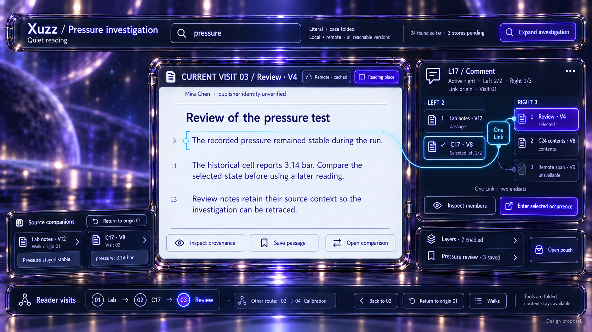
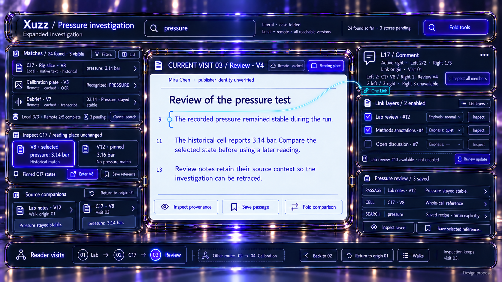

# Integrated investigation workspace: pressure study

Design proposal, 2026-10-13. Two generated concept views combine the
[Omni lens](../omni-search-2026-10-13/concepts.md),
[spatial elements](../spatial-elements-2026-10-13/concepts.md) and
[forge/pouch language](../link-forge-pouches-2026-10-12/concepts.md) in one reader task. No
application code changed. Fictional counts, identities and histories are illustrative.

## 1. Quiet reading

Review V4 is the current reading place, visit 03. The page remains readable while tools fold to a
retained query, selected Link context, two source companions, counted layer/pouch docks and a thin
reader-visit rail. The source's remote origin and cached availability remain distinct from
independent publisher-identity verification.

Permanent controls answer five questions: where am I, what brought me here, which version am I
seeing, what is still selected, and how do I return? Full endset membership is visible in quiet mode
because this relation has only two left and three right members.

## 2. Expanded investigation

The same Review V4 passage remains current. Search and comparison occupy the space to its left;
layer and pouch lists unfold on the right. The source-companion ledge and visit rail stay visible.
The selected C17 comparison owns the strongest tool highlight, while the central reading page owns
the strongest content surface.

The L17 inspector contracts to exact cursors, counts and an explicit all-members action. It retains
the unavailable third right member. Folding member rows does not reduce stored membership. The cyan
relation conduit terminates at the One Link port, never a layer checkbox.

The comparison distinguishes C17 V8, containing `pressure: 3.14 bar`, from pinned V12, containing
`3.16 bar` with no match for the query. A comparison state is inspectable without becoming a query
hit or the current reading place. No shared-primedia claim is made, so no gold connection appears.

## 3. One consistent fixture

This is a new integrated fixture rather than a continuation of every earlier independent example.

| Subject              | Fixed context                                                                     |
| -------------------- | --------------------------------------------------------------------------------- |
| Reader origin        | Visit 01, Lab notes V12, local passage “Pressure stayed stable.”                  |
| Intermediate visit   | Visit 02, Rig slice C17 at V8, local cell content                                 |
| Current visit        | Visit 03, Review V4, remote-origin verified cached publication                    |
| Other retained route | Visit 02 → Visit 04, Calibration plate V5                                         |
| Query                | Literal `pressure`, case folded, selected local/remote stores, reachable versions |
| Search coverage      | 24 matches found so far; local 3/3 complete, remote 2/5 complete                  |
| Selected Link        | L17, Comment, active right, Left 2/2 and Right 1/3                                |
| Link origin          | Visit 01, where L17 was selected before visiting its second left member           |
| Pouch                | Pressure review, three explicitly saved typed references                          |

The two complete L17 endsets are:

| Side  | Ordinal | Preserved member                                 |
| ----- | ------- | ------------------------------------------------ |
| Left  | 1       | Exact selected passage in Lab notes V12          |
| Left  | 2       | Exact selected C17 content spans at V8           |
| Right | 1       | Review V4's selected commentary passage          |
| Right | 2       | C24 content spans at V8                          |
| Right | 3       | Remote span at V9; unavailable and still counted |

C17 V12 is only a comparison context. It is not Right member 2, which belongs to C24. The pouch's
whole-cell reference to C17 is also distinct from L17's selected cell-content spans.

## 4. End-to-end journey

1. Read the source passage in Lab notes V12 at visit 01. Select L17 and retain both endsets.
1. Search `pressure` across the chosen stores, media and reachable versions. Inspect C17 V8.
1. Explicitly enter C17's selected content occurrence as visit 02, retaining L17's origin and
   independently selected member cursors.
1. Compare C17 V8 with pinned V12. This inspection creates no visit and authors no source edit.
1. Cross L17 to preview right member 1, then explicitly enter Review V4 as visit 03.
1. Quiet or disable independent packages as view choices. L17's contributing Lab review #12 remains
   enabled in these frames; #13 is a separate candidate awaiting review.
1. Explicitly save the Lab passage, C17 whole-cell reference and search recipe to Pressure review.
   Different reference types open different inspectors; a saved query reruns only on request.
1. Fold the tool wings and continue reading. Activity Back restores visit 02; Return to origin
   restores visit 01. The sibling route to visit 04 remains available.

The frames show the state after these visits and saves, with only the inspection wings toggled.
Opening or closing a tool does not add a visit. Returning to a saved visit does not create one.
Entering a new destination explicitly records the completed transition in reader activity.

## 5. Interaction and storage boundaries

A shared coordinator should retain the query, selected match, comparison descriptors, active Link,
both endset cursors, source companions, view-emphasis settings, collection selection and current
visit independently. A search result's arrival must not replace the selected target or scroll the
reader away.

Search coverage is scoped to declared stores, branches, media and evidence surfaces. OCR and
transcripts are derived evidence; metadata-only search cannot claim complete remote content
coverage. The three visible results in expanded mode are a bounded window, not all 24 matches.
Pending, unavailable, missing state, locked, unsupported and completed-empty remain distinct.

The saved search recipe is separate from captured results. New matches neither populate the pouch
nor revise an authored Link automatically. A repeated Save reference action should reveal an
existing exact card or offer an explicit duplicate policy rather than silently replacing it.

Package activation and view emphasis have separate controls. Disabling a contributing layer hides
its drawing but preserves the pinned selected-Link context for inspection and explicit dismissal.
Stored Link type, prominence, authority and endsets remain unchanged. Signature verification,
payload integrity, independent author trust and cached availability remain separate.

Inspection and folding write nothing to visited stores. Explicit saving writes to reader-owned
collections; completed navigation writes to reader activity. A future forge or recovery action must
declare its receiving store/branch/base and commit behavior separately.

## 6. Layout findings and implementation priorities

The integration favors persistent location/context over permanently expanded tools. Search,
comparison, layers and pouch share the same scene rather than bringing independent full-screen
headers. Link rows may fold, but identity, both cursor/count summaries and unavailable members
remain reachable. List, keyboard and accessibility commands need the same retained state.

The generated expanded image slightly changes the central page's size/position. It preserves its
content, edition and reading state, but does not prove a pixel-fixed anchor. Implementation should
use stable shared host bounds, avoid scroll jumps, and let reduced motion fold wings without a
camera trip. Rendering contrast, occlusion and picking need actual backend validation.

A practical first implementation slice is compact Walk controls and Layer controls around a retained
source/Link context. Existing [Walks](../../../apps/common/ui/walks.hpp) and
[ReaderLinkPackages](../../../apps/common/xanadu/reader_link_packages.hpp) provide model seams.
Unified historical/media search, exact comparisons, typed query/whole-object cards and the full
integrated coordinator remain proposed work with their own data prerequisites.

Independent UX and aesthetics reviewers checked both final frames using the repository's Xuzz UI
design skill. Refinements corrected the remembered left cursor, attached the authored relation to
its Link port, distinguished pinned V12 from current visit 03, and separated disabled package
enablement from emphasis. Reviews establish conceptual clarity, not implemented behavior.

Exact generation and edit text is in [prompts.md](prompts.md) and
[refinement-prompts.md](refinement-prompts.md). [Output record](outputs.md) maps originals to final
assets. Initial renders remain for comparison. No application builds or tests were run.
