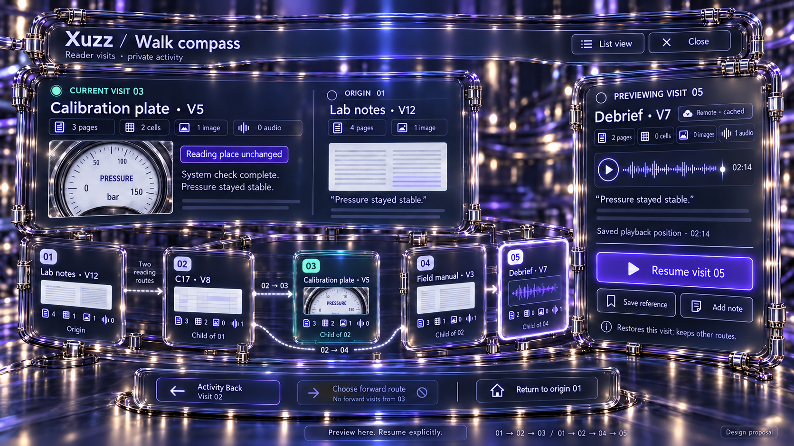
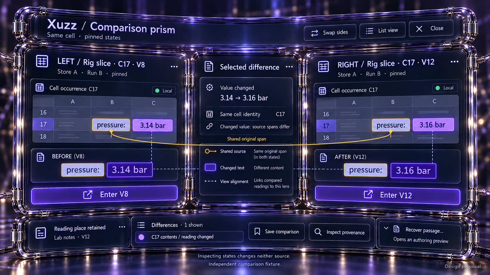
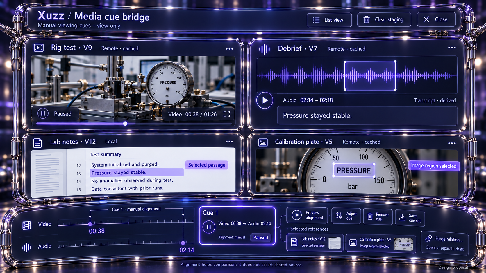
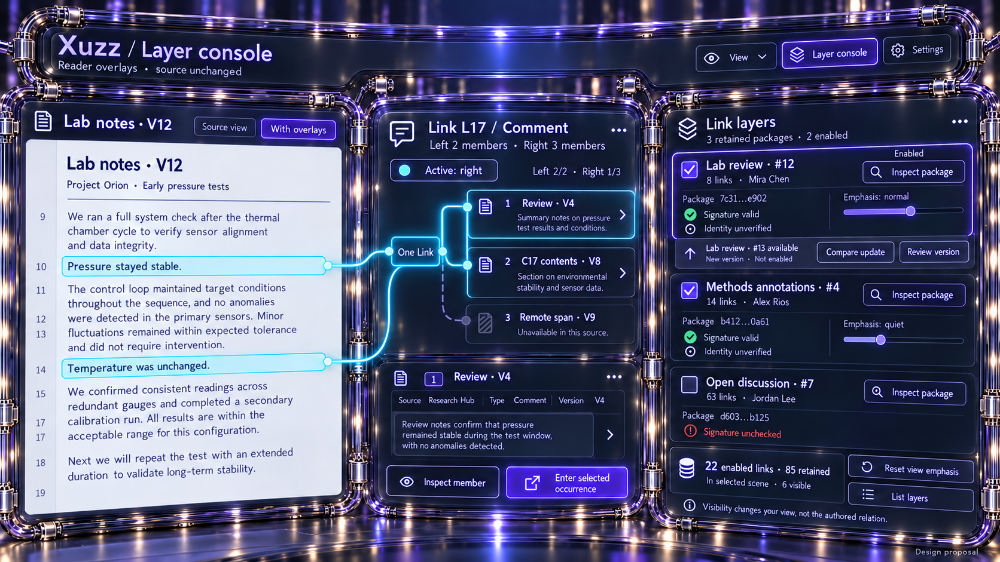

# New spatial elements: design exploration

Design proposals, 2026-10-13. Four generated mockups explore promising additions to Xuzz's
smoky-glass, silver-hinge language. No application code changed. These are fictional fixtures, not
screenshots, performance claims or approved implementation packages.

## 1. Candidate ideas

| Element             | What it helps a reader do                                                         | Spatial form                                                                  | Decision                                                           |
| ------------------- | --------------------------------------------------------------------------------- | ----------------------------------------------------------------------------- | ------------------------------------------------------------------ |
| Walk compass        | Preview and resume a branching reading route without losing the present place     | Bounded visit fan with a labelled fork and fixed source companion             | Mocked; strong next candidate                                      |
| Comparison prism    | Compare exact states while preserving both source identities                      | Two hinged state faces around a narrow difference inspector                   | Mocked; useful extension of version inspection                     |
| Media cue bridge    | Compare a passage, image region and recording segments together                   | Native media faces over one manual cue transport rail                         | Mocked; promising, larger data-model extension                     |
| Layer console       | Quiet or disable independent link packages while inspecting one complete Link     | Hinged package wing beside the unchanged source and selected relation         | Mocked; strong next candidate                                      |
| Selection capsule   | Carry an exact selection across tools without losing range gaps or reference type | Compact seamed capsule unfolding to ordered ranges and a type receipt         | Keep as a shared primitive; overlaps forge/pouch work              |
| Availability seam   | Understand why a reference cannot currently open                                  | Small labelled edge badge unfolding to held, pending, locked or failed status | Keep as a shared primitive; avoid decorative progress rings        |
| Scope ring          | See the active store/media/version envelope from any lens                         | Collapsible segmented glass rim with labels and coverage drawer               | Defer; existing Omni lens chips already expose the scope           |
| Context action rail | Find commands appropriate to the selected subject                                 | Short hinged rail with named actions and keyboard equivalents                 | Keep as a shared primitive; preferable to another full-screen mode |

Walk compass and Layer console are the best candidates for the next design iteration: they give
existing activity and package concepts a useful spatial presentation. Comparison prism needs
explicit comparison/lineage services. Media cue bridge earns its complexity only if readers actually
need repeated mixed-media alignment; it requires exact locators and cue persistence.

## 2. Walk compass

Five completed visits retain two routes: **01 → 02 → 03** and **01 → 02 → 04 → 05**. Current visit
03 stays fixed while visit 05 is previewed. The lower bypass connects 02 to 04 without making 04 a
future of 03. Forward navigation from the leaf 03 is disabled; Back names 02.

The fan is a bounded presentation of private reader activity, not document microversion ancestry.
Resume restores the selected visit; continuing from an earlier visit preserves sibling futures. List
view, Return to origin, Save reference and Add note remain visible named actions.

The existing [walk form](../../../apps/common/ui/walks.hpp) separates Preview from Enter. The
[activity log](../../../apps/common/xanadu/store_activity_log.hpp) retains branching visits,
references and annotations. The mockup proposes their new presentation rather than a new history
model. Exact version, occurrence and saved link context must survive restore; an unavailable target
keeps its identity with retry, without substitution. Media playback restore must be verified.

## 3. Comparison prism

Two faces pin C17 in Store A at V8 and V12. A thin central inspector names one changed reading, 3.14
→ 3.16 bar. Both versions remain inspectable and each has an explicit entry action.

This is an **independent comparison fixture**, not the Omni lens's example history. In this fixture
the prefix `pressure:` preserves its original primedia addresses across both states. Gold touches
only those exact prefixes. The changed numeric readings have distinct spans and violet highlights;
neutral dashed guides express computed view alignment.

Same cell identity, same source span, matching text and explicit Link are different claims.
Comparison alone asserts no authored link or parent relation. The shown version order does not prove
direct ancestry. A complete comparison should expose actual lineage, branch scope, unavailable
regions, contained content and structural effects separately.

Save comparison preserves pinned descriptors. Recover passage opens a separate authoring preview,
which must show receiving store, target branch/base, proposed recovery, cancel and commit effects.
Inspection writes nothing to either visited source.

## 4. Media cue bridge

A video at 00:38 and an audio segment at 02:14–02:18 keep separate clocks. One manual cue aligns
their preview. A document passage and image region stay independent selected references. All remote
media previews are explicitly cached. The transcript is labelled derived.

The cue rail belongs to the reader's view. Adjust cue, Remove cue, Clear staging, Preview alignment
and Save cue set describe their effects. Saving writes a cue descriptor to the reader's collection;
it does not create a content Link. Forge relation opens a separate draft and must explain eligible
endpoint types rather than silently treating every media locator as a text span.

A cue descriptor needs media identity/version, time basis, start/end bounds, image geometry, ordered
passage ranges and extraction provenance. Playback alignment must handle seek limits, rate/offset
policy and unavailable bytes without inventing matching clocks or source sharing. Multiple cues
should stay as counted rows, with only one expanded rail.

The current [media manager](../../../apps/common/xanadu/media_manager.hpp) stages assets and
collects known sources; it does not establish this multi-media cue model. A saved view-cue set and
its locators/playback integration are proposed work. Equal transcript words create no gold strand.

## 5. Layer console

The source page and selected Comment Link L17 stay fixed while the right wing shows three retained
packages. Two enabled packages contribute 8 + 14 = 22 links; all three retain 85 links. Six visible
links is a separate scene count. These totals are illustrative.

Both left source ranges converge on one Link hub before it branches to all three right members. The
relation retains two complete ordered endsets; no strand invents an authored left/right pairing.
Right member 3 stays counted while unavailable. Active side right and the right-1 inspector agree.

Enablement and view emphasis are distinct. Quieting an enabled layer must retain readable labels and
equivalent list access; it does not rewrite stored Link prominence, type or authority. Inspection of
a disabled package remains available without enabling it. Normal/quiet emphasis are view choices,
not curator rankings or trust declarations.

The newer package #13 is an independently inspectable candidate, not an automatic replacement of
enabled #12. Immutable carrier identity, signature status and independent author trust remain
separate fields. A full identifier is copyable from the package inspector.

[ReaderLinkPackages](../../../apps/common/xanadu/reader_link_packages.hpp) already retains immutable
carriers with independent enable preferences and full global link identities/endsets. The console
proposes a new presentation and view-emphasis controls. During implementation, attach the Enabled
heading directly to the checkboxes, and keep Inspect package a separate action. Validation policy
must define whether an unchecked signature can be enabled; the fixture leaves that package disabled.

## 6. Reusable rules and states

Actual content and stored-reference faces keep precise rectangular bounds. View-only fans, rails,
comparison guides and cues use softer seams. Depth supplements labels rather than conveying identity
alone. Gold requires real shared primedia; explicit Comment uses its retained cyan; temporary
routes, alignment and grouping have neutral seamed guides.

Every tool uses select → inspect → explicit enter/play/author. The current reading place and
selected preview remain separate, with a named return action. A transient layout change writes
nothing to visited sources. Saved recipes, references and cue sets write only to the reader-owned
storage when explicitly saved.

Empty, dense, loading, partial coverage, locked, missing version, not-held preview, invalid
reference and cancelled states need distinct labels. List, keyboard and accessibility commands must
match spatial actions. Reduced motion cuts between the same states without requiring a gesture.
Reference identities restore before previews; cancellation never substitutes another target.

Keep one strong focal subject. Quiet inactive outlines and refraction outside text. Visible work is
bounded by the expanded cards and rails; all subjects remain reachable through counted packs and
lists. Rendering, text contrast, picking and backend behavior still require actual app checks.

## 7. Review and generation record

Independent UX and aesthetics reviewers used the repository's Xuzz UI design skill to review the
ideas and actual images. Refinements corrected the walk's sibling-route geometry, scoped gold to the
unchanged comparison prefix, aligned delta colors, matched the layer's active side to its inspector,
and converged both endsets through one relation hub. Media cue bridge needed no edit.

The initial walk, comparison and layer assets remain beside the final images as generation history.
[Exact generation prompts](prompts.md) and [refinement prompts](refinement-prompts.md) preserve the
inputs and outputs. Reviews concern conceptual clarity and appearance, not implementation
verification. No tests or app builds were run for this image-only study.
