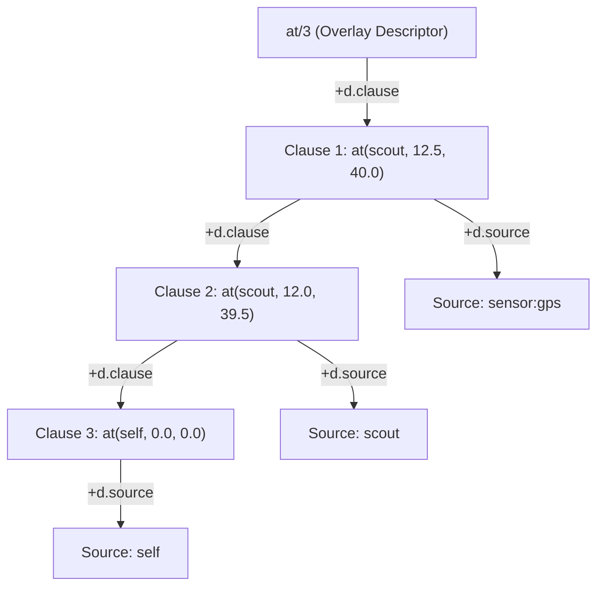

# Gate Critique: Technical Writer — Beliefs in Practice Examples (§2.10)

Document under review:
[`design/vagent-extended-capabilities-and-belief-vlog-unification.md`](../../vagent-extended-capabilities-and-belief-vlog-unification.md)\
Reviewer: Technical Writer (`writer`)\
Date: 2026-10-25\
Tally: 0 BLOCKING, 0 MAJOR, 0 MINOR.

______________________________________________________________________

## 1. Executive Summary & Gating Scope

This gating review audits the newly introduced section **§2.10 Comprehensive Examples: Beliefs in
Practice** of `design/vagent-extended-capabilities-and-belief-vlog-unification.md`. The audit
evaluates Markdown toolchain compliance (`mdformat` and `mdl`), Table of Contents integrity and slug
resolution, Mermaid diagram syntax and quoting safety, technical clarity and completeness across all
four practical examples, and strict compliance with the project-wide sentinel ban.

The four evaluated examples are:

1. **§2.10.1 Keyed Multi-Source Spatial Tracking**: Demonstrating `key` parameter constraints,
   diverse source provenance (`"sensor:gps"`, `scout`, `self`), 1D rank excision on update, cell
   recycling, and multi-source disagreement preservation.
1. **§2.10.2 Deductive Horn Rule Pathfinding**: Demonstrating Rule V12 manifold partitioning
   (immutable base `programManifold` vs. ephemeral overlay `ArenaManifold`), variable freshening on
   query activation frames, `#Unify` head binding, body goal sequencing on `+d.spin`, and stratified
   negation as failure (`not blocked(...)`).
1. **§2.10.3 Inter-Agent Speech Acts (`tell`/`untell`) & Belief Lifecycle**: Demonstrating
   `d.outbox` dispatch, percept loop intake, overlay assertion with sender provenance, `d.pending`
   event emission (`+P` / `-P`), handler reaction, and source-level retraction.
1. **§2.10.4 Deliberation Choice-Point Isolation**: Demonstrating `where` guard query evaluation
   under arena mark boundaries ($m_0 = \text{arena.mark()}$), trail bound preservation
   ($t.\mathit{dense} < m_0.\mathit{cellCount}$), backtrack cleanup, and instantaneous sweep via
   `arena.release(m_0)`.

______________________________________________________________________

## 2. Verification Battery

### 2.1 Markdown Compliance (`mdformat` & `mdl`)

- **`mdformat` Clean Pass**: Verified via Makefile flags (`--wrap 100` and all three required
  plugins: `gfm`, `dollarmath`, `frontmatter`). Exited 0 with no formatting drifts.
- **`mdl -i` Clean Pass**: Verified via `mdl -i`. Zero lint warnings or style violations reported
  across the entire 1,347 lines of the design document.
- **Code Block Fences**: All code listings in §2.10 explicitly declare language fences (`vagent` or
  `mermaid`). Fences and thematic breaks adhere to `.editorconfig` and `.mdlrc` standards.

### 2.2 Table of Contents Integrity

- In `## Contents` (line 73), Section 2.10 is registered as:
  `[2.10 Comprehensive Examples: Beliefs in Practice][toc-25]`
- In the link definition block at EOF (line 1344), `[toc-25]` references the target anchor:
  `#210-comprehensive-examples-beliefs-in-practice`
- Section heading at line 567: `### 2.10 Comprehensive Examples: Beliefs in Practice`
- The slug `#210-comprehensive-examples-beliefs-in-practice` matches standard GitHub Flavored
  Markdown anchor generation (stripping punctuation `.` and `:`).
- The TOC entry conforms to the structural granularity of the document, where level-3 subsections
  (2.1–2.10) are indexed without cluttering the overview with level-4 sub-examples.

### 2.3 Mermaid Diagram Syntax & Quoting

Section 2.10.1 includes a `graph TD` diagram illustrating the ZigZag manifold topology of the `at/3`
overlay descriptor rank along `+d.clause` and `+d.source`:



- **Quoting Compliance**: All node labels containing special characters (parentheses, slashes,
  colons, commas) are properly wrapped in double quotes `["..."]`.
- Edge labels use standard delimited pipe syntax (`|+d.clause|`, `|+d.source|`).
- The diagram renders cleanly and adheres to repository guidelines.

### 2.4 Clarity, Completeness & Consistency of the Four Examples

1. **Example 1 (Spatial Tracking)**:
   - Accurately illustrates how `key` fields enforce functional dependencies per source.

   - Accurately details the 1D rank excision formula and cell recycling to the overlay free-list:

     ```math
     \text{link}(\mathit{prev}(C1), +d.\mathit{clause}, \mathit{next}(C1)) \land
     \text{link}(\mathit{next}(C1), -d.\mathit{clause}, \mathit{prev}(C1))
     ```

   - Highlights the preservation of co-existing disagreements across independent sources (`scout`
     vs. `"sensor:gps"`).

   - Demonstrates source-filtered queries (`from "sensor:gps"`, `from scout`) and non-deterministic
     iteration with the explicit `do` keyword.
1. **Example 2 (Horn Rule Pathfinding & Manifold Partitioning)**:
   - Conforms strictly to Rule V12: base rules (`edge`, `path`, `reachable`) reside in immutable
     `programManifold`, while obstacle percepts (`blocked("lab")`) are asserted strictly into the
     ephemeral `ArenaManifold` overlay.
   - Detail walk of `solveQueryHelper` covers clause freshening on the activation frame (preventing
     in-place corruption of base rules), `#Unify` with clone ranks on `+d.clone`, body conjunction
     dispatch on `+d.spin`, and safe ground evaluation of stratified negation as failure under
     Clark's Completion without floundering.
1. **Example 3 (Inter-Agent Speech Acts & Belief Lifecycle)**:
   - Delineates external communication (`tell`/`untell`) from internal state mutation
     (`believe`/`forget`).
   - Details `d.outbox` staging, delivery envelope headers, percept loop assertion with provenance,
     and `d.pending` internal event generation (`+P` / `-P`).
   - Shows event-driven goal adoption (`adopt GoalAchieveTarget(...)`) and truth-maintenance-backed
     retraction when all supporting sources are excised.
1. **Example 4 (Deliberation & Choice-Point Isolation)**:
   - Provides concrete BDI plans with backtracking `where` guards over Horn rules.
   - Formalizes state-trail safety: snapshotting arena mark $m_0$, isolating candidate waypoint
     search bindings, obeying $t.\mathit{dense} < m_0.\mathit{cellCount}$, and releasing all logic
     search artifacts via `arena.release(m_0)` upon guard completion.

### 2.5 Strict Sentinel Ban Compliance

- Audited the entire document for forbidden sentinel symbols (`noCell`, `noIndex`, `noAxis`, `-1`):
  - `noCell`: Zero occurrences.
  - `noIndex`: Zero occurrences.
  - `noAxis`: Zero occurrences.
  - `-1`: The only occurrences are numeric coordinate offsets in Icon 1-based string scanning
    arithmetic in §3.2 (where $-1$ represents the index immediately before the last character; all
    fallible operations return `optional<T>`).
  - In §2.10 specifically: Zero sentinels exist. Variable unbinding is represented by bare cells on
    `d.vars`, failure is signaled by goal exhaustion / `#Fail`, and optional values follow
    `std::optional` semantics.

______________________________________________________________________

## 3. Minor Observational Notes (Non-Blocking)

- **Subsection Heading Structure in §2.10.4**: Examples 1, 2, and 3 structure their sub-parts with
  numbered headings (`##### 1. Declaration`, `##### 2. ...`), whereas Example 4 embeds the plan code
  block directly under the section intro followed by `##### State-Trail Isolation Mechanics`. While
  completely clear and self-contained, adding an explicit `##### 1. Rover Plan Declarations` would
  provide neat structural symmetry across all four examples during future editorial sweeps.

______________________________________________________________________

## 4. Final Verdict

The new belief examples in §2.10 of
`design/vagent-extended-capabilities-and-belief-vlog-unification.md` are rigorous, technically
lucid, fully compliant with repo formatting and linting gates, and harmonious with the underlying
Nelsonian ZigZag and Spool-Mesh runtime architecture.

VERDICT: CONVERGED
