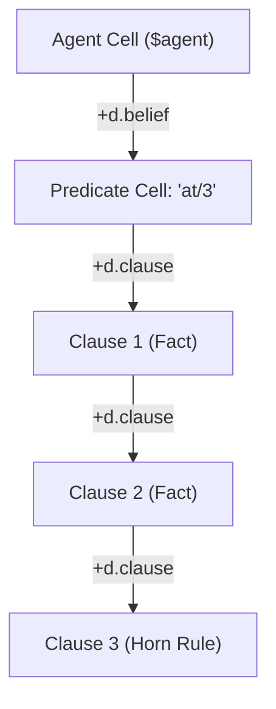

# Round 1 critique: Xanadu / ZigZag Purist (vagent-belief-vlog-unification.md)

Paths below are relative to the repo root. Tally: 3 BLOCKING, 3 MAJOR, 2 MINOR.

## Status of previous BLOCKING/MAJOR findings (Rounds 2+ only)

None (Round 1).

## BLOCKING

### 1. (§2.1, lines 182–226 & §2.4, lines 310–342) Overlay-base rank violates Rule V12

Full title: Interleaving mutable overlay facts and immutable base Horn rules in a single `d.clause`
rank violates Rule V12 and forces base cell shadowing

**Problem:** §2.1 puts ground assertional facts (which are dynamic, mutable cells created in an
agent's ephemeral overlay `ArenaManifold`) and deductive Horn rules (which are static, compiled
clauses residing in the shared, immutable base `programManifold`) into a single contiguous
bidirectional rank along `d.clause`: `Pred --> C1 (Fact) --> C2 (Fact) --> C3 (Horn Rule)`.

Under `ArenaManifold::link` (`apps/common/xanadu/zigzag/arena_manifold.cpp:1348–1356`), linking an
ephemeral overlay cell to a base cell invokes `shadow(*to)`, which copies the base cell into the
overlay. Specifically:

1. In the diagram in §2.1 (lines 204–208), `C2` (an ephemeral fact cell in the overlay) links along
   `+d.clause` to `C3` (a compiled Horn rule in `programManifold`). This forces `shadow(C3)`,
   dragging base rule cells and their entire wing trees into the agent's ephemeral overlay.
1. In §2.4 (line 324), `believe` appends $C_{new}$ to the posward tail of $P$'s `+d.clause` rank. If
   $C_3$ (the base rule) is at the tail, appending $C_{new}$ mutates
   $C_3.\text{pos}(d.clause) = C_{new}$.
1. In §2.4 (lines 318, 332), retracting a fact ($C_2$) links $C_1$ to $C_3$, mutating
   $C_3.\text{neg}(d.clause) = C_1$.

This directly contradicts the explicit invariant in
`design/vagent-shared-program-and-live-upgrade.md:239–245` (Rule V12):

> "Overlay State Cells Never Link Directly to Base Program Cells (Rule V12): In
> `ArenaManifold::link`, linking any cell to a base cell invokes `shadow(*to)`, which would
> unintentionally drag base program cells into the ephemeral overlay and state checkpoints.
> Therefore, mutable overlay cells link only to other ephemeral cells."

Furthermore:

- **Destroys P17 Memory Deduplication**: If 1,000 agents share `programManifold`, every agent that
  asserts a fact shadows the predicate and its base Horn rules into its private overlay, multiplying
  memory consumption and defeating P17.
- **Pollutes Checkpoints**: Checkpoint creation (`MeshActorRuntime::checkpointView`) copies all
  shadowed cells into the state delta store.
- **Breaks Live Upgrades ($V_1 \to V_2$)**: On upgrade, the actor resumes with shadowed V1 rule
  cells from the checkpoint overriding the new V2 base rules in `programManifoldV2`.

**Evidence:**

- `design/vagent-extended-capabilities-and-belief-vlog-unification.md:204–208`:



- `design/vagent-extended-capabilities-and-belief-vlog-unification.md:324`: "Append $C_{new}$ to the
  posward tail of $P$'s `+d.clause` rank."
- `design/vagent-extended-capabilities-and-belief-vlog-unification.md:821–822` & `927`: Claims
  "Conforms to Rule V12: Base program predicates in `programManifold` are read-only; dynamic fact
  cells live exclusively in the agent's ephemeral overlay," which is mathematically false under the
  single `d.clause` topology shown.
- `apps/common/xanadu/zigzag/arena_manifold.cpp:1348–1356`:
  `const auto target = (to.has_value() && *to != noCell) ? shadow(*to) : std::nullopt;`
- `design/vagent-shared-program-and-live-upgrade.md:239–245`: Rule V12 definition.

**Fix:**

Physically segregate extensional overlay facts from intensional base Horn rules:

1. In `programManifold`: Static Horn rules extend posward along `+d.clause` (or `+d.rule`) off the
   base predicate symbol in `programManifold`. These cells remain 100% immutable and unshadowed.
1. In `ArenaManifold`: Dynamic facts form an overlay-only belief rank (e.g. `+d.fact` off an overlay
   predicate cell, or a local fact rank off `$agent`). Overlay facts never link posward or negward
   to base rule cells.
1. In `believes` and `findall`: The two-phase solver in §2.5 already separates Phase 1 (Extensional
   Fact Scan) from Phase 2 (Intensional SLD Resolution). Phase 1 scans overlay fact cells; Phase 2
   resolves base Horn rules by resolving the predicate signature symbolically (`P/N`) against
   `programManifold`, without creating mutable inter-manifold links between fact cells and rule
   cells.

______________________________________________________________________

### 2. (§2.4, lines 318–333) Unlinking retracted cells without rank excision severs ranks

Full title: Unlinking retracted clauses and sources without predecessor-to-successor rank excision
severs 1D ZigZag ranks

**Problem:** §2.4 specifies belief retraction operational semantics as:

- (lines 318–320): "unlink $S$ from $C_{old}$'s `+d.source` rank. If $C_{old}$'s `+d.source` is now
  empty, unlink $C_{old}$ from `+d.clause` and stage event `-P(C_old.head)` to `d.pending`."
- (lines 331–333): "Unlink $S$ from `+d.source`. If $\text{Sources}(C)$ is now empty: unlink $C$
  from `+d.clause` (rearrange to limbo)."

In Nelsonian ZigZag, an unlinking operation on an intermediate cell in a 1D rank without splicing
its predecessor to its successor splits the rank in two. In `ArenaManifold::unlink(from, dim, dir)`
(`apps/common/xanadu/zigzag/arena_manifold.cpp:1378–1392`), the engine clears only the edge between
`from` and its neighbor. It does NOT automatically connect `prev` to `next`.

Consequently:

1. If a source peer $S_1$ in a multi-source rank ($C \to S_1 \to S_2$) is unlinked, $C$'s
   `+d.source` link is cleared, orphaning $S_2$ and causing $C$'s source set to appear empty.
1. If an intermediate clause $C_2$ in $P \to C_1 \to C_2 \to C_3$ is unlinked, $C_1$'s `+d.clause`
   link is cleared, completely severing $C_3$ and all subsequent clauses from $P$.

**Evidence:**

- `design/vagent-extended-capabilities-and-belief-vlog-unification.md:318–333`
- `apps/common/xanadu/zigzag/arena_manifold.cpp:1378–1392`: `unlink` clears only the direct edge.
- `apps/common/xanadu/vagent/compiler.cpp:4214–4225`: The existing compiler explicitly recognized
  this and implemented `Gen::unlinkFromRank`:

```cpp
/// Removal links a cell's predecessor to its successor (§5.1); the owner is
/// the predecessor of a rank's first cell, so no case is special but the end.
void Gen::unlinkFromRank(CellRef xReg, DimRef dim) {
  const CellRef prev = rd(D(xReg), dim, true);
  const CellRef nxt  = rd(D(xReg), dim);
  ...
```

**Fix:**

Explicitly specify in §2.4 that removing a clause from `d.clause` or a source peer from `d.source`
performs **rank excision** (`prev.pos(d) = next <=> next.neg(d) = prev`) before moving the target
cell to limbo, maintaining 2-degree rank continuity across all remaining elements.

______________________________________________________________________

### 3. (§2.5, lines 389–397) Direct head `#Unify` binds static rule variables

Full title: Missing clause variable freshening in SLD resolution mutates static rule variables and
destroys recursive resolution

**Problem:** §2.5 specifies Phase 2 (Intensional SLD Resolution) as:

> "1. Fresh variable activation: variables in the rule are assigned fresh slots on the activation
> frame. 2. Head unification: unify query term with rule head via `#Unify`."

In Vlog, `#Unify` unifies terms by splicing clone ranks (`Vlog::bind`,
`apps/common/xanadu/zigzag/vlog.cpp:86–94`). If the query term is unified directly with the rule
head cell in `programManifold`:

1. `#Unify` links the variable cells of the rule head itself onto the caller's variable clone ranks
   along `+d.clone`.
1. This binds the rule head in-place. If the rule is recursive (e.g.
   `path(X, Y) :- edge(X, Z), path(Z, Y)`), the recursive call unifies against the same rule head
   whose variables are now already bound! Unification against fresh subgoals immediately fails with
   `FunctorMismatch` or `ValueMismatch`.
1. Splicing into clone ranks of cells in `programManifold` triggers `shadow()` under Rule V12,
   corrupting the shared base manifold.

Standard Prolog and Vlog §9.1 require **clause freshening**: every invocation of a clause must
either instantiate an ephemeral copy of the clause with fresh variable cells, or use an activation
frame to dereference variable slots indirectly. The design claims to eliminate front-end matching
shortcuts, yet specifies direct `#Unify` against static rule heads without variable copying or
structure sharing.

**Evidence:**

- `design/vagent-extended-capabilities-and-belief-vlog-unification.md:389–397`
- `apps/common/xanadu/zigzag/vlog.cpp:86–94`: `Vlog::bind` links directly onto variable cells.
- `apps/common/xanadu/vagent/compiler.cpp:4156–4164`: Notes that Vlog §9.1 specified "copy `t`,
  `#Choice`, `#Unify`".
- `design/vlog-logic-extension.md:627`: Notes that activation variables are minted fresh per
  invocation so they unwind cleanly under `release()`.

**Fix:**

Specify in §2.5 and Proposal P18.2 that the SLD resolution engine instantiates (freshens) rule terms
into ephemeral cells in the agent's overlay with freshly minted variable cells for each clause
activation before calling `#Unify`, ensuring recursive calls never collide on shared variable cells
and base program cells remain untouched.

______________________________________________________________________

## MAJOR

### 4. (§2.1, lines 194–195 & Diagram line 224) Chaining body goals on `+d.step` violates Vlog §6.1

Full title: Chaining body goals along `+d.step` conflates argument wings with process control flow
and contradicts Vlog §6.1

**Problem:** §2.1 states:

> "For a Horn rule ($Head \leftarrow Body$), `+d.spin` links to the first goal term of the body
> conjunction, with subsequent body goals chained along `+d.step`"

and the diagram shows:

```mermaid
    C3 -->|"+d.spin"| B1["Body Goal: beacon(?who, ?b)"]
    B1 -->|"+d.step"| B2["Body Goal: beacon_pos(?b, ?x, ?y)"]
```

This violates the canonical hyperstructural calling convention in Vlog §6.1 and Vortex §1:

1. In Vlog §6.1 (`design/vlog-logic-extension.md:554–556`): "`d.spin` is the process instruction
   stream, and a conjunction of goals is a rank along it."
1. In Vlog §3.1 (`apps/common/xanadu/zigzag/vlog.hpp:54–55`,
   `design/vlog-logic-extension.md:140–150`): `d.grab` holds a term's first argument; `d.step` is
   reserved strictly for chaining second and subsequent arguments on the Inputs Wing.

Chaining body goals along `+d.step` creates an ambiguous topological role for `d.step` on goal
terms: `B1`'s arguments are chained on `d.step`, while `B1` itself links to `B2` on `d.step`. This
breaks generic term walkers (`Vlog::argumentsOf`), which treat any cell reached via `step` from an
Inputs Wing as an argument, not a sibling goal.

**Evidence:**

- `design/vlog-logic-extension.md:554–556`: "A clause cell's content is unread; its head hangs off
  `+d.grab` and its body off `+d.spin`, which means a clause body is an instruction stream in
  exactly the sense §1 of the Vortex spec already means — `d.spin` is the process instruction
  stream, and a conjunction of goals is a rank along it."
- `apps/common/xanadu/zigzag/vlog.hpp:54–55`
- `design/vagent-extended-capabilities-and-belief-vlog-unification.md:194–195, 224`

**Fix:**

Revert body goal conjunction chaining to `+d.spin`: `C3 -->|"+d.spin"| B1 -->|"+d.spin"| B2`,
keeping `d.step` strictly for argument lists hanging off `+d.grab`.

______________________________________________________________________

### 5. (§3.2, lines 519–521 & §5.4, lines 877–879) Quoting claim contradicts `VortexCore::value`

Full title: Zero-copy quoting claim contradicts live `VortexCore::value` implementation and lacks
C++ proposal

**Problem:** §3.2 states:

> "Ephemeral Quoting Cells: Substrings produced by scanning functions do not allocate copied string
> buffers. They invoke `value(subjectCell, offset, length)` to return an ephemeral quoting cell
> pointing into the subject's existing permascroll span (Vlog §5.5)."

And Proposal P18.4 claims:

> "Ephemeral quoting invariant: Substring matches produce ephemeral quoting cells via
> `value(subj, off, len)` without string copies. Zero VM opcode changes; built purely using existing
> Vortex opcodes."

This claim is contradicted by the live C++ codebase. In
`apps/common/xanadu/vortex/vortex_core.cpp:216–222`, `VortexCore::value` implements slice reads as
follows:

```cpp
// Read Slice (ephemeral transclusion)
std::string current      = arena_.textOf(master);
const auto [from, count] = resolve_range(current.size(), offset, length);
std::string sliceText    = current.substr(from, count);
CellRef sliceCell        = arena_.makeCell(sliceText);
return sliceCell;
```

`makeCell(sliceText)` (`apps/common/xanadu/zigzag/arena_manifold.cpp:1180–1188`) interns the
substring text into the arena's scratch scroll as a newly allocated string buffer. It does NOT
invoke `arena_.makeCell(const xanadu::PrimediaSpan &content)` (`arena_manifold.hpp:560`). Therefore,
scanning currently copies string buffers on every `tab`, `move`, `match`, and `any`. Proposal P18.4
lists only `vortex_stdlib.{hpp,cpp}` under files affected, failing to propose the necessary C++
changes in `vortex_core.cpp` and `arena_manifold.hpp` to realize zero-copy quoting.

**Evidence:**

- `apps/common/xanadu/vortex/vortex_core.cpp:216–222`
- `apps/common/xanadu/zigzag/arena_manifold.hpp:559–560`
- `design/vagent-extended-capabilities-and-belief-vlog-unification.md:519–521, 877–879`

**Fix:**

Expand Proposal P18.4 to include `apps/common/xanadu/vortex/vortex_core.cpp` and
`apps/common/xanadu/zigzag/arena_manifold.hpp`. Update `VortexCore::value` to inspect the subject
cell's `PrimediaSpan`s and construct an ephemeral quoting cell via `arena_.makeCell(slicedSpan)`
whenever the subject holds permascroll spans, avoiding `substr` heap allocation and scratch scroll
interning.

______________________________________________________________________

### 6. (§3.4, lines 613–615) Scanning cursor anchored to `home` on `+d.scan` causes eviction

Full title: Linking scanning cursor directly to `home` on `+d.scan` causes eviction during nested
scans

**Problem:** §3.4 states:

> "The scanning cursor cell $C_{\text{scan}}$ is created at the beginning of the scan expression
> `s ? e` and linked to `home` on `+d.scan`."

Under 2-degree ZigZag connectivity, `home.pos(d.scan) = C_scan1`. If an inner nested scan
(`s1 ? (s2 ? e)`) executes, linking `C_scan2` to `home` on `+d.scan` will evict $C_{\text{scan1}}$,
clearing its negward link and corrupting the outer scanning context.

In vicon §6.1 (`design/vicon-goal-directed-language.md:337–340`):

> "a nested `s2 ? e2` pushes a second cursor posward on `d.scan` and pops it after, so scanning
> environments nest exactly as cursors on a rank nest."

Furthermore, in `vagent`, multiple intentions run within an agent. Anchoring scanning cursors to a
single actor-wide `home` cell conflates scanning contexts across concurrent intentions and event
handlers.

**Evidence:**

- `design/vicon-goal-directed-language.md:337–340`
- `design/vagent-extended-capabilities-and-belief-vlog-unification.md:613–615`
- `apps/common/xanadu/vortex/vortex_stdlib.cpp:3616–3621`

**Fix:**

Specify that $C_{\text{scan}}$ is pushed to the posward tail of the active intention's `d.scan` rank
(or linked posward from the current cursor on `d.scan`), preserving the outer cursor during nested
scans, and popped upon exit via mark release or rank excision.

______________________________________________________________________

## MINOR

### 7. (§5.1, line 816) Proposal P18.1 cites non-existent opcode `#Unlink`

Full title: Proposal P18.1 cites non-existent opcode `#Unlink` instead of `#Break`

**Problem:** §5.1 states: "Zero new opcodes; uses existing `#Link`, `#Unlink`, `#Unify`." In the
Vortex VM opcode set (`apps/common/xanadu/vortex/vortex_vm.hpp:49–55`), the opcode for breaking a
manifold link is `OpcodeKind::Break` (`#Break`). There is no opcode named `#Unlink`.

**Evidence:**

- `apps/common/xanadu/vortex/vortex_vm.hpp:50`: `Break,`
- `apps/common/xanadu/vortex/vortex_vm.cpp:560–575`: `case OpcodeKind::Break:`

**Fix:**

Replace `#Unlink` with `#Break` in §5.1.

______________________________________________________________________

### 8. (§2.2, line 240) Inaccurate function name `zigzag::vlog::splice` cited for binding

Full title: Inaccurate function name `zigzag::vlog::splice` cited for variable binding

**Problem:** §2.2 states: "Unification of variable $X$ with term $T$ calls
`zigzag::vlog::splice(X, T)`". In `apps/common/xanadu/zigzag/vlog.hpp:86` and `vlog.cpp:86–94`, the
C++ method is `Vlog::bind(CellRef v, CellRef t)`. `splice` was the pseudocode name in
`design/vlog-logic-extension.md:242`, but is not an exported C++ function.

**Evidence:**

- `apps/common/xanadu/zigzag/vlog.hpp:86`
- `apps/common/xanadu/zigzag/vlog.cpp:86–94`

**Fix:**

Update the citation to `zigzag::Vlog::bind(X, T)`.

______________________________________________________________________

VERDICT: NOT CONVERGED
