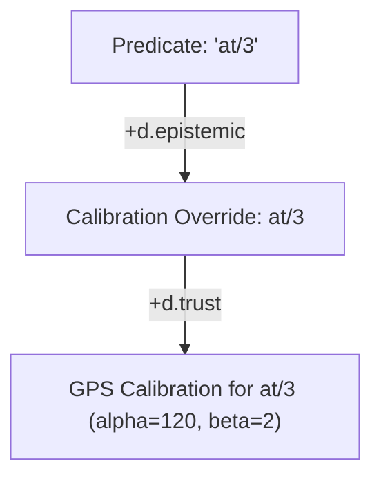

# Round 1 critique: Xanadu / ZigZag Purist (vagent-epistemic-arbitration.md)

Paths below are relative to the repo root. Tally: 3 BLOCKING, 3 MAJOR, 2 MINOR.

## Status of previous BLOCKING/MAJOR findings (Rounds 2+ only)

None (Round 1).

## BLOCKING

### 1. (§6.1, line 660) Uncloned fan-in on `EpistemicProvenanceToken`

Full title: Uncloned fan-in and direct linkage on `EpistemicProvenanceToken` violates 2-degree
ZigZag connectivity and misprices cell footprint

**Problem:** §6.1 specifies the `EpistemicProvenanceToken` attached to an intention's frame along
`+d.vars`:

```markdown
1. An Epistemic Provenance Token is minted on the intention's frame along +d.vars:
   - kTokenClause: The CellRef of the chosen belief clause.
   - kTokenSources: List of sources that asserted or corroborated this fact.
   - kTokenContext: Snapshot of the context vector x at decision time.
2. The token remains attached to the intention throughout its lifecycle.
```

And Proposal P19.5 (§8.5, lines 959–960) claims:

> "- Overhead: 1 token cell + 3 link cells per active intention frame (~128 bytes)."

This violates strict Nelsonian ZigZag 2-degree connectivity
($A.\text{pos}(d) = B \iff B.\text{neg}(d) = A$) and hyperstructural state representation:

1. **Uncloned Fan-In on Shared Clauses**: If `kTokenClause` establishes a structural link to the
   chosen belief clause along any dimension (e.g. `d.values` or `d.clause`):
   - The clause cell is already anchored in a predicate's belief rank on `+d.clause`. Any link on
     `d.clause` would sever the belief rank.
   - If linked on `+d.values`, then $Token_1.\text{pos}(d.\text{values}) = \text{Clause} \implies$
     $\text{Clause}.\text{neg}(d.\text{values}) = Token_1$. When a concurrent intention (or another
     plan guard) queries and selects the same belief clause, establishing
     $Token_2.\text{pos}(d.\text{values}) = \text{Clause}$ will immediately **evict** $Token_1$,
     clearing its reciprocal link (`apps/common/xanadu/zigzag/arena_manifold.cpp:1348–1370`).
1. **Uncloned Fan-In on Source Profiles**: If `kTokenSources` links directly to canonical source
   profile cells on `+d.trust`, multiple intention tokens referencing the same sources (e.g.
   `"sensor:gps"`) will collide and evict each other's reciprocal edges.
1. **Severe Cell Footprint Mispricing**: A "List of sources" and a "Snapshot of the context vector
   $\mathbf{x} \in \mathbb{R}^d$" cannot physically fit in "1 token cell + 3 link cells (~128
   bytes)". Claiming this implies that lists and vectors are either serialized as foreign
   binary/string blobs inside scalar cells (violating "zero foreign serialization inside cells") or
   held in an off-manifold C++ map (violating Rule V12 and "cells over side tables").

**Evidence:**

- `design/vagent-dynamic-source-weighting-and-epistemic-arbitration.md:660–668` & `959–960`
- `apps/common/xanadu/zigzag/arena_manifold.hpp:593–604`: `ArenaManifold::link` maintains both ends
  and evicts whatever either end previously held.
- `apps/common/xanadu/vagent/runtime_abi.hpp:322–335`: Intention frame field conventions.
- `design/vagent-shared-program-and-live-upgrade.md:250–252`: "No Uncloned Fan-In: Every rank
  maintains a maximum degree of 1 in POS and 1 in NEG directions."

**Fix:**

1. Explicitly specify that `kTokenClause` is stored as an unlinked R6 integer scalar cell holding
   the raw `CellRef` integer in its `valueBits` (or an authentic clone view cell on `Clause`'s
   `+d.clone` rank), NEVER as a direct 2-degree structural edge along `d.values` or `d.clause`.
1. Ground `kTokenSources` as a canonical ZigZag list: the `kTokenSources` variable cell links along
   `+d.values` to a list head cell (`"[]"` per `runtime_abi.hpp:144`), which links along `+d.grab`
   to clone instances of the contributing source profiles on `+d.clone`, chained along `+d.step`.
1. Ground `kTokenContext` as a canonical list of R6 float scalar cells along `+d.step` holding the
   snapshot floats in their `valueBits`.
1. Correct the pricing in §8.5: an epistemic token for an intention over $K$ sources and $D$ context
   dimensions occupies $(1 + 3 + 3 + K + D) = 7 + K + D$ cells (~$64 \times (7 + K + D)$ bytes), not
   4 cells.

______________________________________________________________________

### 2. (§2.4, line 306) Base-cell shadowing violates Rule V12 and forces fan-in

Full title: Base-cell shadowing and placing default source profiles in `programManifold` violates
Rule V12 and forces multi-agent fan-in

**Problem:** §2.4 states:

> "- **Base `programManifold`**: Contains static default source priors and predicate arbitration
> specifications declared at compile time. These cells are sealed and read-only.
>
> - **Overlay `ArenaManifold`**: Contains the live mutable Source Profile cells, updated dynamically
>   through observations and learning turns.
> - No mutable links cross the boundary. When an agent learns new weights for a source, the profile
>   cell is minted in the overlay, shadowing any base default cleanly."

And in §2.1 lines 263–267:



This violates Rule V12 and basic ZigZag multi-agent topology:

1. **Direct Contradiction of Rule V12**: `design/vagent-shared-program-and-live-upgrade.md:239–246`
   explicitly defines Rule V12:
   > "Overlay State Cells Never Link Directly to Base Program Cells (Rule V12): In
   > `ArenaManifold::link`, linking any cell to a base cell invokes `shadow(*to)`, which would
   > unintentionally drag base program cells into the ephemeral overlay and state checkpoints.
   > Therefore, mutable overlay cells link only to other ephemeral cells." Claiming that "minted in
   > the overlay, shadowing any base default cleanly" satisfies Rule V12 is false: calling
   > `shadow()` on base cells pulls those base cells into the agent's private overlay, copying
   > program definitions into checkpoint delta stores and destroying P17 memory deduplication.
1. **Multi-Agent Uncloned Fan-In**: The base `programManifold` is shared across hundreds of
   concurrent agent overlays and is `PROT_READ`. If base default source profiles were stored in
   `programManifold` along `+d.trust`, multiple agents ($Agent_1, Agent_2, \dots$) would all need
   their agent cells to link to the same base profile $S_{\text{base}}$. Under 2-degree ZigZag
   connectivity, $S_{\text{base}}.\text{neg}(d.\text{trust})$ can only point to ONE agent cell!
   Multiple agents linking to the same base cell is an illegal fan-in violation.
1. **Cross-Boundary Link on Predicate Calibration**: If `PredAt` is the compiled base predicate in
   `programManifold`, linking `PredAt -->|"+d.epistemic"| Cal_At` from the overlay invokes
   `shadow(PredAt)`, dragging the base predicate into the overlay.

**Evidence:**

- `design/vagent-dynamic-source-weighting-and-epistemic-arbitration.md:263–267, 306–308`
- `design/vagent-shared-program-and-live-upgrade.md:239–253` (Rule V12 definition)
- `apps/common/xanadu/zigzag/arena_manifold.cpp:1348–1356`:
  `const auto target = (to.has_value() && *to != noCell) ? shadow(*to) : std::nullopt;`

**Fix:**

1. Eliminate base source profiles from `programManifold`. Sources (`"sensor:gps"`, `"peer:scout"`)
   represent dynamic percept streams and network peers; their profiles reside exclusively in the
   agent's ephemeral `ArenaManifold` overlay on `+d.trust` off `$agent`.
1. When an agent is initialized or when an unknown source first asserts a percept, the overlay
   allocates the canonical Source Profile Cell in the overlay, populating default priors
   ($\alpha_0, \beta_0, \lambda_0$) from compiler constants or declared predicate options without
   touching or shadowing base cells.
1. Attach dynamic calibration overrides on `+d.epistemic` exclusively to the *overlay* predicate
   descriptor (`PredOverlay` on `+d.belief`, established in P18 §2.1), never to `PredBase`. Static
   arbitration policies declared on base predicates are read symbolically by the compiler/resolver
   without creating cross-manifold mutable links.

______________________________________________________________________

### 3. (§5.4, line 650) `arena.discard(m_0)` claim contradicts `ArenaManifold::discard`

Full title: Claim that `arena.discard(m_0)` truncates scratch calculation artifacts contradicts
`ArenaManifold::discard` implementation and causes unbounded memory leaks

**Problem:** §5.4 states:

> "When `truest` finishes, `arena.discard(m_0)` commits the winning variable bindings to the
> caller's frame while truncating all intermediate calculation artifacts in bulk. If no clause
> satisfies the query, `arena.release(m_0)` unwinds all state without leaving orphaned cells."

This claim directly contradicts the implementation of `ArenaManifold::discard` in
`apps/common/xanadu/zigzag/arena_manifold.cpp:1612–1629`:

```cpp
ArenaManifold *ArenaManifold::discard(const Mark &m) noexcept {
  std::ignore = m;
  if (0 == outstandingMarks_) {
    return this;
  }
  outstandingMarks_--;
  floors_.pop_back();
  if (0 == outstandingMarks_) {
    trail_.clear();
  }
  return this;
}
```

`discard(m)` merely drops the choice-point high-water mark; **it does NOT truncate cells, links,
content, or scratch buffers!** Actual truncation is performed exclusively by
`ArenaManifold::release(m)` (`arena_manifold.cpp:1690–1695`:
`slots_.resize(m.cellCount); links_.resize(m.linkSize);`).

Under the design as written:

1. Every candidate scoring list, temporary weight vector, and scratch sorting cell allocated during
   `believes truest` remains permanently in the arena's `slots_`!
1. In a long-running agent evaluating `believes truest` on sensory percepts turn-by-turn,
   `discard(m_0)` will leak tens of thousands of dead cells into the manifold, triggering massive
   memory bloat.
1. If an implementer substitutes `release(m_0)`, `release` will truncate the winning variable
   bindings along with the scratch cells, breaking query unification!

**Evidence:**

- `design/vagent-dynamic-source-weighting-and-epistemic-arbitration.md:649–653`
- `apps/common/xanadu/zigzag/arena_manifold.cpp:1612–1629` (`ArenaManifold::discard`)
- `apps/common/xanadu/zigzag/arena_manifold.cpp:1690–1695` (`ArenaManifold::release`)
- `apps/common/xanadu/zigzag/arena_manifold.hpp:653–655`: "`discard`: Give up a choice point without
  undoing it -- success, or a cut. The bindings made under it stand; only the ability to retry is
  discarded."

**Fix:**

Structure the arbitration evaluation with a dedicated scoring sub-mark:

1. Prior to variable binding, take an evaluation mark $m_{\text{eval}} = \text{arena.mark()}$.
1. Under $m_{\text{eval}}$, compute candidate scores, freshness decay, and contextual ML gating.
   Identify the `CellRef` of the winning clause $C_{\text{win}}$ (which was asserted prior to the
   query and exists at an index $< m_{\text{eval}}.\text{cellCount}$).
1. Call `arena.release(m_{\text{eval}})`! This immediately and cleanly truncates 100% of the
   intermediate scoring cells, scratch lists, and feature vectors.
1. With all scratch artifacts truncated, unify the query variables with $C_{\text{win}}$'s head
   arguments via `#Unify` under the outer query choice point.

______________________________________________________________________

## MAJOR

### 4. (§2.1, line 259) Stringified list literal in `$weights` violates cell purity

Full title: Representing `$weights` as a stringified list literal in a single value cell violates
zero-foreign-serialization and R6 scalar layout

**Problem:** In §2.1 diagram, `$weights` is depicted as:

```mermaid
F_Weights["$weights (List)"] -->|"+d.values"| V_Weights["[0.82, -0.15, 0.44]"]
```

And in §2.2 table (line 284):

> `| $weights | List<Float> | Learned feature weights w_S for contextual ML gating |`

Placing a stringified list literal `"[0.82, -0.15, 0.44]"` into a single value cell violates:

1. **Zero Foreign Serialization Inside Cells**: Structured lists, vectors, and records must be
   represented as authentic ZigZag cells and links, never formatted as JSON, Python, or ad-hoc
   string literals inside cell content.
1. **Canonical `runtime_abi.hpp` List Layout**: In `apps/common/xanadu/vagent/runtime_abi.hpp:22–25`
   & `144`:
   > "List: a cell whose content is `kListContent` (`"[]"`), first element on `+d.grab`, the rest
   > chained on `+d.step`." Alternatively, in `VortexStdLib::createList`
   > (`apps/common/xanadu/vortex/vortex_stdlib.cpp:2596–2603`), lists are chained along `d.1` off
   > `+d.values`.
1. **R6 Floating-Point In-Place Updates**: §2.3 claims weights are updated in-place via native float
   opcodes (`#Mul`, `#Add`). A text cell containing `"[0.82, -0.15, 0.44]"` cannot be updated via
   `setValueBits` without parsing and re-serializing strings.

**Evidence:**

- `design/vagent-dynamic-source-weighting-and-epistemic-arbitration.md:259–260, 284, 289–297`
- `apps/common/xanadu/vagent/runtime_abi.hpp:22–25, 144`
- `design/store-slice-convergence.md:234–290` (Ruling R6)

**Fix:**

Specify the canonical ZigZag representation for `$weights`: The `$weights` field cell on `+d.vars`
links along `+d.values` to a list head cell carrying `kListContent` (`"[]"`). The list head links
along `+d.grab` to the first weight cell $W_0$, with subsequent weight cells $W_1, \dots, W_{d-1}$
chained posward along `+d.step` (or chained directly along `+d.1` off `+d.values`). Each weight cell
$W_i$ is an R6 scalar cell holding an IEEE 754 float in `CellSlot::valueBits` (`ValueKind::Float`),
enabling true zero-allocation, in-place updates via `ArenaManifold::setValueBits`.

______________________________________________________________________

### 5. (§2.1, line 232) Total omission of `d.clone` ranks for source provenance

Full title: Total omission of `d.clone` ranks for source provenance and predicate calibration
overrides forces $O(S)$ string scanning and breaks identity tracking

**Problem:** The design document contains 0 mentions of `d.clone`. This ignores Ted Nelson's core
primitive for multiple views of a single identity:

1. **Source Provenance Resolution on `+d.source`**: In §3.5, clauses link asserting sources along
   `+d.source` (`C1 --> S1 --> S2`). The document never specifies how $S_1$ reaches its canonical
   profile on `+d.trust`. If it links directly along `d.trust`, it causes uncloned fan-in (evicting
   other clauses). In §8.1, the author resorts to an $O(S)$ string search:
   > "Registry lookup is O(S) over registered sources S (typically S < 50)." Scanning strings on
   > every candidate clause evaluation during real-time navigation is an unacceptable regression.
1. **Predicate Calibration Overrides**: In §2.1, predicate calibration overrides are attached via a
   dummy cell `Cal_At` and an overloaded `+d.trust` rank:
   `PredAt -->|"+d.epistemic"| Cal_At -->|"+d.trust"| S_GPS_At`. `S_GPS_At` has no structural
   connection to the master profile `S_GPS`, and reusing `d.trust` conflates the global source
   registry rank with local override ranks.

In Nelsonian ZigZag, when multiple cells represent views or roles of the same canonical entity, they
form a **clone rank along `d.clone`**:

- The Source Profile Cell on `$agent`'s `+d.trust` rank is the **clone master**.
- Every appearance of that source on a clause's `+d.source` rank, and every predicate-specific
  calibration override on `+d.epistemic`, is a **clone instance** on the master's `+d.clone` rank.
- Resolving any source peer cell or calibration cell to its master profile is a single $O(1)$ call:
  `ArenaManifold::cloneMaster(cell, d.clone)`
  (`apps/common/xanadu/zigzag/arena_manifold.hpp:531–533`), which follows `neg(d.clone)` to the
  master.

**Evidence:**

- `design/vagent-dynamic-source-weighting-and-epistemic-arbitration.md:232–236, 263–267`
- `design/vagent-dynamic-source-weighting-and-epistemic-arbitration.md:431–440, 887`
- `apps/common/xanadu/zigzag/arena_manifold.hpp:531–533`:
  `std::optional<CellRef> cloneMaster(CellRef ref, DimRef cloneDim) const noexcept;`
- `design/store-slice-convergence.md:23–28` (Ruling on `d.clone`)

**Fix:**

1. Designate the canonical Source Profile cell on `$agent`'s `+d.trust` rank as the clone master for
   that source.
1. Specify that each source peer cell linked into a clause's `+d.source` rank, and each predicate
   calibration cell on `+d.epistemic`, is minted as a clone instance linked posward on the source
   master's `+d.clone` rank.
1. Lower source weight lookup in `std:epistemic` to `cloneMaster(sourceCell, d.clone)`, reducing
   profile retrieval from an $O(S)$ string scan to an $O(1)$ pointer walk.
1. Eliminate the intermediate dummy cell `Cal_At`. Predicate overrides link directly along
   `+d.epistemic` off the overlay predicate descriptor
   (`PredOverlay -->|"+d.epistemic"| S_GPS_Override -->|"+d.epistemic"| S_Odom_Override`).

______________________________________________________________________

### 6. (§4.3, line 548) Unspecified 1D rank excision on `confirm` and `refute`

Full title: Unspecified 1D rank excision on belief retraction during `confirm` and `refute` risks
rank severance and manifold corruption

**Problem:** §4.3 introduces explicit epistemic directives:

- `confirm at(...)`: "Automatically rewards all sources that asserted this fact, and penalizes all
  conflicting sources for the same key."
- `refute obstacle(...)`: "marks an asserted fact as false"

And §9 includes an acceptance test:

> "Verifies that 1D rank excision on sources does not corrupt neighbor links."

However, nowhere in the normative text (§4.3, §5, or §6) is the physical retraction and excision
mechanism defined:

1. In Nelsonian ZigZag, unlinking an intermediate cell from a 1D rank without linking its
   predecessor to its successor (`prev.pos = next <=> next.neg = prev`) splits the rank in two.
   `ArenaManifold::unlink` (`apps/common/xanadu/zigzag/arena_manifold.cpp:1378–1392`) clears only
   the single directed edge.
1. When `refute P(args)` executes, does it remove the clause cell from `+d.clause`? If an
   implementer calls `unlink(clause, d.clause, POS)` without excising `prev` to `next`, all
   subsequent clauses on `+d.clause` are permanently severed from the predicate.
1. When `confirm P(key, val)` executes, conflicting clauses for that key must be retracted. If
   conflicting clauses are retracted without 1D rank excision, the clause rank is severed.
1. If an obsolete or Byzantine source is pruned from `$agent`'s `+d.trust` rank, failing to perform
   1D rank excision on `+d.trust` severs all subsequent registered sources from the agent.

**Evidence:**

- `design/vagent-dynamic-source-weighting-and-epistemic-arbitration.md:548–561, 680–692, 1003`
- `apps/common/xanadu/zigzag/arena_manifold.cpp:1378–1392`
- `apps/common/xanadu/vagent/compiler.cpp:4214–4225` (`Gen::unlinkFromRank`)
- `design/vagent-extended-capabilities-and-belief-vlog-unification.md:383–387, 633–635`

**Fix:**

Explicitly specify in §4.3 and §6.2 that:

1. `refute P(args)` locates the matching clause cell $C$ on the predicate's `+d.clause` rank,
   executes 1D rank excision:
   `link(prev(C), +d.clause, next(C)) && link(next(C), -d.clause, prev(C))`, increments
   $\beta \leftarrow \beta + 1.0$ on all sources on $C$'s `+d.source` rank, and recycles $C$ and its
   source peer cells to the overlay free-list.
1. `confirm P(args)` performs 1D rank excision on all conflicting clauses matching the same key
   tuple on `+d.clause`, penalizing their asserting sources ($\beta \leftarrow \beta + 1.0$) and
   reinforcing confirming sources ($\alpha \leftarrow \alpha + 1.0$).
1. Any source retirement or pruning from `+d.trust` executes 1D rank excision on `+d.trust`.

______________________________________________________________________

## MINOR

### 7. (§5.3, lines 638–642) Ephemeral fused ground clause lifecycle unspecified

Full title: Ephemeral fused ground clause anchoring and lifecycle unspecified

**Problem:** §5.3 states:

> "The runtime synthesizes an ephemeral fused ground clause carrying $\hat{x}_{\text{consensus}}$
> and yields it as the query result."

In ZigZag, all cells must be rooted on ranks; unrooted orphan cells cannot be tracked or reaped
cleanly. The document does not specify whether this synthesized clause is anchored to `+d.clause`,
attached to the calling frame, or left unrooted. If it is attached to `+d.clause`, it becomes an
asserted belief that coexists in future queries, violating §1.5 (`U-C5`), which states fusion occurs
only on demand.

**Evidence:**

- `design/vagent-dynamic-source-weighting-and-epistemic-arbitration.md:221–222, 638–642`

**Fix:**

Specify that the ephemeral fused clause is anchored exclusively to the active activation frame's
temporary result register (or query scratch rank on `+d.values`) and is never linked into the
predicate's `+d.clause` rank. When the caller frame pops, the cell is reclaimed.

______________________________________________________________________

### 8. (§4.3, line 559) `reinforce` parameter syntax deviates from Beta model

Full title: `reinforce` and `penalize` parameter syntax deviates from Beta-Bernoulli conjugate
formulation

**Problem:** §4.3 illustrates source directives as:

```vagent
reinforce source "sensor:gps", +0.1
penalize source "peer:scout_1", -0.5
```

In §3.2, source reputation is formulated as a Beta distribution $\text{Beta}(\alpha, \beta)$ updated
via integer evidence counts ($\alpha \leftarrow \alpha + 1.0, \beta \leftarrow \beta + 1.0$).
Passing arbitrary signed float deltas (`+0.1`, `-0.5`) is ungrounded in the conjugate prior math
unless interpreted as fractional pseudo-counts or direct SGD weight shifts.

**Evidence:**

- `design/vagent-dynamic-source-weighting-and-epistemic-arbitration.md:347–360, 558–561`

**Fix:**

Clarify in §4.3 whether float parameters represent fractional observation weights
($\Delta \alpha = 0.1, \Delta \beta = 0.5$) or revise the syntax to take evidence counts:
`reinforce source S [weight: 1.0]` and `penalize source S [weight: 1.0]`.

______________________________________________________________________

VERDICT: NOT CONVERGED
