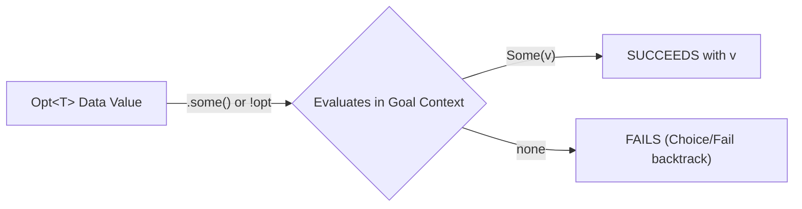

# Critic 4: Icon Programming Language Expert Review

**Reviewer Role**: Critic 4 — Icon Programming Language Expert (`icon`)\
**Document Under Review**: Proposed Language Harmonization for VAgent
\[`brief-common.md`\](file:///home/ccs4ever/.gemini/antigravity/worktrees/gleditor/metacircular_compiler_implementation_plan/design/projects/vagent-harmonization-review/brief-common.md)\
**Focus**: Goal-directed evaluation purity, generator semantics, string scanning environments
(`&subject`, `&pos`), position arithmetic, scanning functions (`tab`, `move`, `match`, `upto`,
`many`, `find`), alternation `|`, conjunction `&`, success/failure control flow, and 1-based
string/position conventions.

______________________________________________________________________

## 1. Executive Summary: The Griswoldian Foundation in VAgent

Ralph Griswold's central discovery in Icon (1977–1983) is that programming languages do not need
boolean flags for control flow. Instead, **every expression is a generator that produces a sequence
of zero, one, or more values**. An expression either **succeeds** (yielding a result) or **fails**
(yielding no results). Control structures (`if`, `while`, `every`) are driven purely by success and
failure, not by truth values.

In the Vortex architecture, as demonstrated in
\[`vicon-goal-directed-language.md`\](file:///home/ccs4ever/.gemini/antigravity/worktrees/gleditor/metacircular_compiler_implementation_plan/design/vicon-goal-directed-language.md),
Icon's goal-directed evaluation and Prolog's SLD-resolution are revealed as the **same underlying
mechanism seen from two angles**. Vortex's VM implements this with `#Choice`, `#Fail`, `#Cut`, and
trailed state restoration via `ArenaManifold::release(mark)`. Furthermore, VAgent's string scanning
relies on a first-class scanning cursor allocated on the `d.scan` rank, holding `&pos` as its scalar
value and `&subject` along `+d.grab` (see
\[`vortex_stdlib.cpp`\](file:///home/ccs4ever/.gemini/antigravity/worktrees/gleditor/metacircular_compiler_implementation_plan/apps/common/xanadu/vortex/vortex_stdlib.cpp#L3956-L4015)
and
\[`vagent_vicon_scan_test.cpp`\](file:///home/ccs4ever/.gemini/antigravity/worktrees/gleditor/metacircular_compiler_implementation_plan/tests/xuzz/vagent_vicon_scan_test.cpp)).

However, a rigorous review of VAgent's parser
(\[`parser.cpp`\](file:///home/ccs4ever/.gemini/antigravity/worktrees/gleditor/metacircular_compiler_implementation_plan/apps/common/xanadu/vagent/parser.cpp))
and compiler
(\[`compiler.cpp`\](file:///home/ccs4ever/.gemini/antigravity/worktrees/gleditor/metacircular_compiler_implementation_plan/apps/common/xanadu/vagent/compiler.cpp))
reveals significant syntactic friction and architectural inconsistencies:

1. **Inverted Operator Precedence for Scanning**: In `parser.cpp`, the scanning operator `?` is
   given precedence 3 while conjunction `&` is given precedence 1. This inversion breaks standard
   Icon scanning syntax, forcing developers to write `"str" ? (tab(...) & move(...))` rather than
   the natural, idiomatic `"str" ? tab(...) & move(...)`.
1. **Confusion Between Positions and Indices**: Position arithmetic ($1..N+1$) in string scanning is
   conflated with discrete element indexing ($1..N$), causing ambiguity around index `0` and slice
   bounds.
1. **Disconnection of `Opt<T>` from Goal-Directed Failure**: Option types are treated as isolated
   functional wrappers rather than first-class participants in goal-directed success and failure.
1. **Lexical Overloading of `?`**: Overloading `?` for pattern variables (`?var`), string scanning
   (`s ? expr`), and proposed optional types (`T?`) creates parser ambiguities that currently force
   fragile parser modal state flags (`allowScan_`).
1. **Conjunction Clashes**: Prolog's `,` and `;` collide with procedural statement sequencing
   (`;`/newline) and Icon's expression conjunction/alternation (`&`/`|`).

Below is the definitive Icon analysis and concrete recommendations across all five harmonization
axes.

______________________________________________________________________

## 2. Axis 1: Indexing Harmonization (The Icon Position Model)

### 2.1 Character Indices versus Inter-Character Positions

A foundational contribution of Icon is the clear mathematical distinction between **character
subscripts** (which identify individual characters) and **character positions** (which identify
points *between* characters).

```text
String:       " H   E   L   L   O "
Indices:        1   2   3   4   5
Positions:    1   2   3   4   5   6
```

For a string or sequence of length $N$:

1. **Element Subscript Range $[1, N]$**:

   - Valid element indices are strictly $1 \le i \le N$.
   - `s[1]` selects the first character (`"H"`), and `s[N]` selects the last character (`"O"`).
   - In Icon, subscripting outside this range is not a fatal crash; **it fails** in the
     goal-directed sense. `x := s[i]` produces a character if $i \in [1, N]$, and produces nothing
     (fails) if $i < 1$ or $i > N$.

1. **Scanning Position Range $[1, N+1]$**:

   - String scanning does not operate on characters; it operates on **positions**.
   - Position 1 is immediately *before* the first character.
   - Position $N+1$ is immediately *after* the last character.
   - When a scanning environment `s ? expr` is pushed onto `d.scan`, `&pos` is initialized to `1`.
   - `tab(p)` moves `&pos` to position $p$ and yields the substring between the old and new
     positions.
   - Therefore, valid positions for `tab(p)` are $1 \le p \le N+1$.

### 2.2 Semantics of Position 0 and Negative Coordinates

In Icon, positions may be specified relative to the right end of the string. The universal formula
for mapping a specified position $P$ into a normalized position $p \in [1, N+1]$ is:

$$
p = \begin{cases} P & \text{if } P > 0 \\ N + 1 + P & \text{if } P \le 0 \end{cases}
$$

- **Position `0`**:

  $$
  p = N + 1 + 0 = N + 1
  $$

  Position `0` represents the position **after the last character** (the end of the string).
  Consequently, `tab(0)` moves `&pos` to the end of the string and returns the entire remaining
  unscanned text.

- **Position `-1`**:

  $$
  p = N + 1 + (-1) = N
  $$

  Position `-1` is the position immediately **before the last character**. `tab(-1)` advances to
  just before the final character.

- **Position `-(N)`**:

  $$
  p = N + 1 - N = 1
  $$

  Position `-(N)` is the beginning of the string (position 1).

This logic is already implemented in
\[`vortex_stdlib.cpp`\](file:///home/ccs4ever/.gemini/antigravity/worktrees/gleditor/metacircular_compiler_implementation_plan/apps/common/xanadu/vortex/vortex_stdlib.cpp#L4024-L4026):

```cpp
const std::int64_t target =
    targetPos <= 0 ? (len + 1 + targetPos) : targetPos;
if (target < 1 || target > len + 1) return std::nullopt;
```

### 2.3 Resolving Index 0 in Element Subscripting (`arr[0]`)

A dangerous mistake when adopting 1-based indexing is allowing `arr[0]` to alias `arr[N]` (or
`arr[-1]`). In Icon:

- **For scanning positions**: `0` means position $N+1$ (end of string).
- **For element subscripting**: `0` is **NOT** a valid index! Elements are indexed $1..N$. Accessing
  `arr[0]` or `str[0]` must **fail** (or raise an out-of-bounds diagnostic in static checking).
- **Negative element subscripting**: For collections and strings, negative indices are indexed from
  the end:
  - `arr[-1]` is the last element ($N$).
  - `arr[-2]` is the penultimate element ($N-1$).
  - `arr[-N]` is the first element ($1$).
  - Formula for element index $k < 0$: $N + 1 + k$.

### 2.4 Slice Ranges: `arr[start..end]` vs Positional Slices

In Icon, substring extraction by position is written `s[i:j]`, which extracts all characters between
position $i$ and position $j$ (length $|j - i|$). For example, `s[1:3]` extracts characters at
indices 1 and 2 (length 2).

In VAgent, general slice notation uses `arr[start..end]`. To avoid developer confusion:

1. **Collection Slices `arr[start..end]`**: Use inclusive element bounds $[start, end]$.
   - `list[1..3]` yields a list of 3 elements: `[list[1], list[2], list[3]]`.
   - `s[1..3]` yields a substring of length 3: characters 1, 2, and 3.
1. **Loop Generator Ranges `start to end by step` or `start..end`**:
   - `1 to n` generates $1, 2, \dots, n$ (inclusive of $n$).
   - `for i in 1..n` executes with $i \in \{1, 2, \dots, n\}$.
1. **Positional String Scanning**:
   - Scanning operations (`tab(p)`, `move(k)`) operate strictly in the inter-character position
     space $[1, N+1]$.

______________________________________________________________________

## 3. Axis 2: Option (`Opt<T>`) Consistency & Goal-Directed Failure

### 3.1 The Icon Philosophy: Failure as the Universal Absent Sentinel

In pure Icon, there is **no null, nil, or None sentinel**. When an operation cannot produce a value
(e.g., an associative table lookup has no matching key, a string search finds no needle, or an index
is out of range), the operation simply **fails**.

In VAgent, because the runtime interoperates with actor mailboxes, structured records, and C++
bindings, explicit representation of missing values via `Opt<T>` is necessary for static typing and
serialization. However, treating `Opt<T>` purely as a monadic container isolates it from VAgent's
goal-directed execution engine.

### 3.2 Unifying `Opt<T>` with Success and Failure

The elegant harmonization is to treat **`Opt<T>` as the data reification of a goal outcome**, while
**success/failure is its expression-level evaluation**:



1. **Canonical Type Syntax**:

   - Use `Opt<T>` exclusively.
   - **Reject `T?`**: Do not use postfix `?` for optional types. In Axis 3, we show that postfix `?`
     causes severe lexical collisions with logic variables (`?var`) and scanning (`s ? expr`).

1. **Canonical Constructors**:

   - Present: `Some(value)`
   - Absent: `none` (lowercase keyword, matching VAgent's zero-sentinel conventions).

1. **Bridging `Opt<T>` to Goal-Directed Control Flow**: Provide a built-in unwrap operation that
   converts an `Opt<T>` directly into goal-directed evaluation:

   - Method spelling: `opt.some()` or prefix element generation `!opt`.
   - **Semantics**:
     - If `opt` is `Some(v)`, `opt.some()` succeeds and produces `v`.
     - If `opt` is `none`, `opt.some()` **fails immediately** (emitting VM `#Fail`).
   - This eliminates nested boilerplate in guards and expressions:

   ```vagent
   // Idiomatic goal-directed expression: fails cleanly if lookup yields none
   let target := find_target(id).some() & target.is_active()
   ```

   If `find_target(id)` produces `none`, `opt.some()` fails, causing the conjunction `&` to fail,
   which propagates to the enclosing control structure or handler recovery without throwing an
   exception or requiring an explicit `match`.

1. **Defaulting and Safe Navigation**:

   - Provide null-coalescing `opt ?? default_value`.
   - Safe navigation `opt?.field` should be sugar for:
     `match opt with { Some(?x) => Some(x.field), none => none }`.

______________________________________________________________________

## 4. Axis 3: Disambiguation of `?` & Operator Precedence Inversion

### 4.1 The Sacred Scanning Infix: `subject ? scan_expr`

String scanning is Icon's signature feature. In VAgent, `s ? expr` establishes a scoped scanning
environment:

1. Evaluates `s` to a string.
1. Allocates a scanning cursor cell on the `d.scan` rank, setting `&pos = 1` and linking `&subject`
   along `+d.grab`.
1. Evaluates `expr` in this dynamic context.
1. If an alternative fails within `expr`, backtracking restores `&pos` because the write to the
   cursor is trailed under the VM's `#Choice` mark!
1. On completion (or terminal failure), `d.scan` is popped, restoring the outer scanning
   environment.

This is already proven and working in
\[`vagent_vicon_scan_test.cpp`\](file:///home/ccs4ever/.gemini/antigravity/worktrees/gleditor/metacircular_compiler_implementation_plan/tests/xuzz/vagent_vicon_scan_test.cpp).
Replacing infix `?` with a keyword block like `scan s with { ... }` would destroy the concise,
mathematical elegance of Icon scanning. **Infix `?` must be retained.**

### 4.2 Resolving the Lexical Overloading of `?`

Currently, `?` is overloaded in five conflicting positions:

- Prefix logic variable: `?var` (in terms, patterns, and destructuring)
- Binary infix scanning: `s ? expr`
- Postfix optional type: `T?`
- Postfix unwrapping / safe nav: `opt?`, `expr?.field`
- Performative punctuation: `ask Agent question?`

This overload currently forces the parser
(\[`parser.cpp`\](file:///home/ccs4ever/.gemini/antigravity/worktrees/gleditor/metacircular_compiler_implementation_plan/apps/common/xanadu/vagent/parser.cpp#L795))
to use a modal flag `allowScan_`, disabling scanning inside predicate term arguments unless
surrounded by parentheses!

#### The Icon Expert's Lexical Disambiguation Rule

To achieve a clean LALR(1) grammar without modal parser state:

1. **`?ident` as a Distinct Lexer Token**:
   - When `?` is immediately followed by an identifier character (`[a-zA-Z_]`) with **no intervening
     whitespace**, the lexer emits `TokenKind::LogicVariable` (e.g. `?x`, `?target`).
   - It is never tokenized as a standalone `?`.
1. **Infix Binary `?` Requires Whitespace or Expression Context**:
   - When `?` appears as an operator with whitespace or between two expressions, it is tokenized as
     `TokenKind::Scan`.
1. **Strictly Ban Postfix `?` from the Grammar**:
   - Optional types: Use `Opt<T>` (never `T?`).
   - Unwrapping: Use `opt.some()` or `opt.unwrap()` (never `opt?`).
   - Performatives: Use `ask(Agent, Question)` (never trailing `?`).

With these three rules, `?ident` and `?` never conflict, and the modal `allowScan_` parser flag can
be deleted entirely!

### 4.3 Diagnostic Discovery: Fixing the Precedence Inversion of `?` vs `&`

In analyzing
\[`parser.cpp`\](file:///home/ccs4ever/.gemini/antigravity/worktrees/gleditor/metacircular_compiler_implementation_plan/apps/common/xanadu/vagent/parser.cpp#L41-L60),
we uncovered a severe grammar defect:

```cpp
// Current precedence table in apps/common/xanadu/vagent/parser.cpp:
switch (token.kind) {
case TokenKind::Ampersand:
  return Operator{1};                 // Conjunction: Precedence 1
case TokenKind::Assign:
  return Operator{2, true};           // Assignment:  Precedence 2
case TokenKind::Scan:
  return Operator{3, false, true};    // Scanning ?:  Precedence 3
case TokenKind::Alternation:
  return Operator{5};                 // Alternation: Precedence 5
...
```

Notice that `Scan` (`?`) has precedence 3, while `Ampersand` (`&`) has precedence 1! Because `?` has
higher precedence than `&`:

$$
\text{"hello world" ? tab(7) \& move(5)}
$$

parses as:

$$
(\text{"hello world" ? tab(7)}) \;\&\; \text{move}(5)
$$

The first `tab(7)` executes inside the scan, but the scan is **immediately popped**, and `move(5)`
executes **outside** the scanning environment, failing with no active `d.scan` cursor!

This is why every test in `vagent_vicon_scan_test.cpp` and every example in the design docs had to
wrap parentheses around the scanning body: `"hello world" ? (tab(7) & move(5))`.

#### The Correct Icon Precedence Table

In Icon, `?` establishes a scanning context for the **entire scanning expression on its right**. `?`
binds looser than conjunction `&` and alternation `|`. Only assignment `:=` binds looser than `?`.

```text
Operator Precedence (Lowest to Highest):
1. Assignment:          :=   <-            (Precedence 1, right-associative)
2. String Scanning:     ?                  (Precedence 2, right-associative)
3. Alternation:         |                  (Precedence 3, left-associative)
4. Conjunction:         &                  (Precedence 4, left-associative)
5. Comparisons:         ==  !=  <  <=  >   (Precedence 5, non-associative)
6. Concat:              ++                 (Precedence 6, left-associative)
7. Add/Subtract:        +   -              (Precedence 7, left-associative)
8. Multiply/Divide:     *   /   %          (Precedence 8, left-associative)
```

With this corrected precedence:

```vagent
let tag := text ? tab(match("ID:")) & tab(upto(";"))
```

parses naturally as:

```math
\text{tag} := (\text{text} \;?\; (\text{tab}(\text{match}(\text{"ID:"})) \;\&\; \text{tab}(\text{upto}(\text{";"}))))
```

No artificial parentheses are needed. This restores pure Icon scanning syntax to VAgent.

______________________________________________________________________

## 5. Axis 4: Plan Operators & Conjunction/Disjunction Harmonization

### 5.1 Goal-Directed `&` and `|` versus Procedural Sequencing

A critical source of confusion in VAgent is the conflict between:

- Prolog's `,` (AND) and `;` (OR)
- Icon's `&` (conjunction) and `|` (alternation)
- Procedural statement sequencing (`;` and newline)

#### The Icon Principle of Bounded Expressions at Statement Boundaries

In an agent plan or reactive handler, an author writes sequential statements:

```vagent
plan DeliverItem for Deliver(?item, ?target) where has_item(item) {
  locate_destination(target);
  navigate_to(target);
  deposit(item);
}
```

How does goal-directed evaluation interact with procedural plan steps? Griswold formulated the
**Principle of Bounded Expressions** (Icon Book, Chapter 8):

> At a statement boundary (newline or semicolon `;`), an expression is **bounded**. It is evaluated
> for its first result, after which all pending generator choice points are **cut** (`#Cut`).
> Failure in a subsequent statement does **NOT** backtrack across the statement boundary into
> preceding statements.

This principle is vital for BDI agent execution:

1. **Inside an expression**: `&` and `|` perform goal-directed evaluation with full backtracking and
   generator suspension.
1. **Across statements**: Statements are separated by newlines or `;`. Each statement is bounded. If
   `navigate_to(target)` fails, the agent does not magically time-travel backtrack into
   `locate_destination(target)`. Instead, plan failure is triggered, invoking BDI plan replanning or
   handler recovery.

### 5.2 Unifying Query Conjunction: Eliminate Prolog's `;`

In Horn clause logic, `;` is traditionally used for disjunction: `p(X) :- a(X) ; b(X).` However, in
procedural code and plan bodies, `;` is the statement terminator. Allowing `;` to mean logical OR
inside belief queries or plan guards creates cognitive dissonance and grammar ambiguity:

```vagent
// Ambiguous if ';' means OR:
believes At(?x, ?y); check_sensors()
```

#### Recommendation

Adopt Icon's operators universally across expressions, guards, and relational queries:

- **Conjunction**: Always `&` (e.g. `believes Position(?x, ?y) & Battery(?b)`).
- **Alternation / Disjunction**: Always `|` (e.g. `believes Clear(North) | Clear(South)`).
- **Statement Separator**: Always `;` or newline.
- **Pure Booleans**: Use `and`, `or`, `not` when working with explicit boolean values, or let
  boolean comparisons yield results/failure under `&` and `|`.

______________________________________________________________________

## 6. Axis 5: Pattern Matching & Destructuring Syntax

### 6.1 String Scanning as Continuous Pattern Matching

Structural pattern matching (`match ... with`) excels at matching discrete algebraic data structures
(records, tuples, lists). String scanning (`s ? ...`) excels at parsing continuous linear character
streams.

These two mechanisms are deeply complementary:

- Structural destructuring matches the **shape** of an event or message.
- String scanning matches the **contents** of textual payloads within that event.

### 6.2 Disambiguating Brackets `[...]`

Square brackets are currently overloaded for list literals `[1, 2]`, list types `[Int]`, subscript
indexing `arr[1]`, destructuring `let [?a, ?b] := x`, and handler guards `on Event [guard]`.

To establish a clean, orthogonal syntax:

1. **Brackets `[...]` for Lists and Subscripts Only**:
   - List literals: `[1, 2, 3]`
   - List types: `[T]` or `List<T>`
   - Subscript access: `arr[1]`
   - List destructuring: `let [?head, ...?tail] := list`
1. **Parentheses `(...)` for Tuples**:
   - Tuple literals: `(1, "bolt")`
   - Tuple types: `(Int, Str)`
   - Tuple destructuring: `let (?x, ?y) := point`
1. **Braces `{...}` for Records**:
   - Record patterns: `Point { x: ?x, y: ?y }`
1. **Keyword Guards for Handlers**:
   - Replace `on Event [guard]` with `on Event if guard` or `on Event where guard`.
   - Notice that `plan` declarations in VAgent already use `where guard` (\[`parser.cpp` line
     572\](file:///home/ccs4ever/.gemini/antigravity/worktrees/gleditor/metacircular_compiler_implementation_plan/apps/common/xanadu/vagent/parser.cpp#L572)).
     Using `where guard` across both `on Event` and `plan` eliminates `[...]` guard overloading
     completely!

### 6.3 Seamless Integration of Scanning in Pattern Matching

Because a string scan `s ? expr` is an expression that either succeeds (producing a string or value)
or fails, it can be directly embedded into pattern guards:

```vagent
on Message as msg where msg.payload ? (tab(match("CMD:")) & tab(0)) as cmd {
  dispatch_command(cmd);
}
```

If the payload does not start with `"CMD:"`, the scanning expression fails, the guard fails, and the
agent bypasses the handler cleanly.

______________________________________________________________________

## 7. Comprehensive Summary of Harmonization Recommendations

| Axis                                  | Problem in VAgent                                                                            | Icon Expert Recommendation                                                                                                                                                         | Rationale                                                                                                                  |
| :------------------------------------ | :------------------------------------------------------------------------------------------- | :--------------------------------------------------------------------------------------------------------------------------------------------------------------------------------- | :------------------------------------------------------------------------------------------------------------------------- |
| **Axis 1: Indexing**                  | Divergence between 0-based Java heritage and 1-based Vicon/Vortex; ambiguity of index 0.     | **1-based everywhere.** Elements: $[1, N]$. Positions: $[1, N+1]$. `tab(0)` is position $N+1$ (end). `arr[0]` strictly fails. Element $-1$ is last ($N$). Ranges `1..n` inclusive. | Preserves Icon's position model while maintaining strict 1-based consistency across sibling languages (VQL, VPL, VProlog). |
| **Axis 2: Option (`Opt<T>`)**         | Fragmented option spellings (`Opt<T>` vs `T?`), disconnected from goal failure.              | Canonical type `Opt<T>`. Constructors `Some(v)` and `none`. Unwrapping bridge `opt.some()`: succeeds with `v` or fails on `none`. Reject `T?`.                                     | Unifies typed Option with Icon's fundamental success/failure control flow without sentinel values.                         |
| **Axis 3: Disambiguation of `?`**     | `?` overloaded for scanning, logic vars, types, unwrapping; precedence inverted against `&`. | **Preserve infix `s ? expr`.** Lexer treats `?ident` as `TokenKind::LogicVariable`. Ban postfix `?`. Set `?` precedence lower than `&` and `\|`, right above assignment `:=`.      | Restores natural Icon scanning without parentheses: `s ? tab(...) & move(...)`. Eliminates `allowScan_`.                   |
| **Axis 4: Conjunction / Disjunction** | Clash between Prolog `,`/`;`, Icon `&`/`\|`, and procedural `;`.                             | Standardize on `&` (conjunction) and `\|` (alternation) for all expressions and queries. Statement sequencing is `;`/newline with **bounded expressions** (implicit cut).          | Eliminates `;` as OR, preventing catastrophic collisions with procedural plan step terminators.                            |
| **Axis 5: Pattern Destructuring**     | `[...]` overloaded for guards, lists, indexing, tuples.                                      | Reserve `[...]` for lists/indexing. Use `(...)` for tuples. Replace `on Event [guard]` with `on Event where guard` (matching `plan ... where`).                                    | Unifies guard syntax across handlers and plans while removing bracket clutter.                                             |

______________________________________________________________________

## 8. Compiler and Runtime Action Items

To implement these recommendations in `apps/common/xanadu/vagent/`:

1. **`lexer.cpp` & `token.hpp`**:
   - Add `TokenKind::LogicVariable`.
   - Update lexer: when encountering `?` immediately followed by an identifier start character
     (`identifierStart`), consume both and emit `TokenKind::LogicVariable`.
1. **`parser.cpp` Operator Precedences**:
   - Reorder `binaryOperator`:
     - Assign `:=`, `<-` $\to$ Precedence 1 (right-associative)
     - Scan `?` $\to$ Precedence 2 (right-associative)
     - Alternation `|` $\to$ Precedence 3 (left-associative)
     - Conjunction `&` $\to$ Precedence 4 (left-associative)
   - Remove `allowScan_` modal parser flag.
1. **`parser.cpp` Handler Guards**:
   - In `Parser::handler`, replace `accept(TokenKind::OpenBracket)` with `acceptWord("where")` or
     `acceptWord("if")`.
1. **`compiler.cpp` Goal-Directed Option Lowering**:
   - Lower `.some()` on `Opt<T>` to check cell presence: if none, jump to `cells_->fail`; if some,
     bind the inner value to the output temporary.
