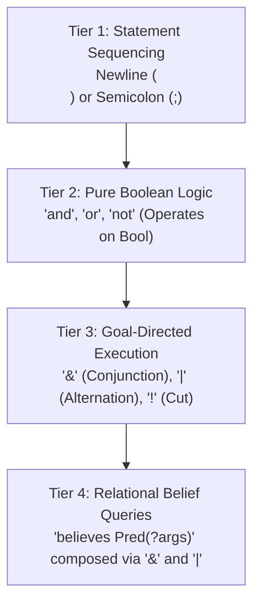

# VAgent Language Harmonization Review — Round 1

**Reviewer**: Critic 5: Programming Language Design & Ergonomics Expert (`pl_ergo`)\
**Document Under Review**: Proposed Language Harmonization for VAgent (`brief-common.md`)\
**Target Codebase**: `apps/common/xanadu/vagent/` (`parser.cpp`, `checker.cpp`, `token.hpp`,
`ast.hpp`, `compiler.cpp`, `stdlib/*.vagent`)\
**Date**: November 2026

______________________________________________________________________

## 1. Executive Summary & Ergonomic Mandate

VAgent represents a bold synthesis of five distinct paradigms:

1. **SARL**: Reactive agent architecture (events, capacities, skills, contexts, spaces).
1. **BDI (Belief-Desire-Intention)**: Declarative goals, mental attitudes, plan selection, logic
   variables.
1. **Icon / Vicon**: Goal-directed execution, generators, success/failure control flow, string
   scanning.
1. **Prolog / VProlog**: Horn clause logic, unification, relational queries against belief bases.
1. **Vortex & ZigZag**: 2-degree orthogonal cell manifolds, Merkle-tree ops spool, zero-sentinel
   safety (`Opt<T>`, `Result<T, E>`), actor turn atomicity.

When a language imports notation from multiple parents without strict orthogonality, cognitive
friction multiplies exponentially. Syntax that looks familiar to an Icon programmer (such as infix
`?` for scanning) collides with modern optional types (`T?`) and safe navigation (`?.`). Semicolons
that signify disjunction in Prolog collide with procedural statement sequencing in agent plan
bodies. Bracket overloading (`[...]`) simultaneously attempts to denote list literals, list types,
index subscripts, tuple patterns, and handler guards.

### The Ergonomic Design Principles

To resolve these conflicts, this review applies four foundational programming language design
tenets:

1. **Principle of Least Astonishment (POLA)**: Syntax must behave according to the mental models of
   modern systems programmers. Silent divergence (such as `arr[0]` returning the end of a string) is
   unacceptable.
1. **Orthogonality**: One conceptual mechanism must have exactly one syntactic manifestation, and
   distinct mechanisms must not share ambiguous lexical tokens.
1. **Deterministic Grammars (LALR(1) / Linear Predictive Descent)**: The language grammar must be
   parseable without backtracking, semantic predicates, or dynamic lexer/parser mode switches (such
   as `allowScan_`).
1. **Actionable Diagnostics & Compiler-as-Teacher**: Syntax transitions (notably from 0-based to
   1-based indexing) must be guided by compile-time error detectors with clear remediation advice.

______________________________________________________________________

## 2. Axis 1: Indexing Harmonization (1-Based Everywhere)

### 2.1 The Problem & Sibling Alignment

VAgent's sister subsystems in the Xanadu/Vortex ecosystem—VQL (query), VPL (array processing), and
VProlog (logic programming)—all operate under **1-based indexing** ($1\text{-origin}$,
$\Box\text{IO} = 1$). Furthermore, Icon string scanning and ZigZag manifold ranks are natively
1-based (ranks traverse step 1 to $N$).

Allowing SARL/Java's historical 0-based indexing to persist in VAgent creates cross-language
cognitive dissonance across the unified hypermedia workspace. Therefore, unifying on **1-based
indexing everywhere** is correct. However, 1-based indexing must be engineered with absolute
mathematical rigor to prevent off-by-one errors and developer frustration.

### 2.2 Formal Index Domain and Slicing Semantics

#### Discrete Element Subscripting

For a list or string of length $N$:

- The valid index domain is the discrete set $\mathcal{I}^+ = \{1, 2, \dots, N\}$.
- In bounds: `1 <= i <= N`.
- Subscripting out of bounds (e.g. `arr[N + 1]`) fails statically if known at compile time, or fails
  dynamically (raising an `IndexOutOfBounds` error or goal failure).

#### Slice Ranges: Fully Closed Interval $[start, end]$

In 0-based languages (Python, Go, Rust), half-open intervals $[0, N)$ are standard because the
length equals $end - start$. However, in a 1-based language, half-open intervals are profoundly
unnatural: obtaining all $N$ elements would require writing `s[1..N+1]`. Every major 1-based
language (Julia, MATLAB, Lua, Fortran, R) uses **inclusive (closed) ranges** $[start, end]$:

- In VAgent, `s[start..end]` is inclusive of both `start` and `end`.
- Slice length is $\text{Length}(start, end) = end - start + 1$.
- For example, `s[1..N]` produces all $N$ elements ($N - 1 + 1 = N$).
- Single-element slice: `s[3..3]` has length $3 - 3 + 1 = 1$.
- **Empty Slices**: An empty slice is naturally produced when $end = start - 1$. For example,
  `s[1..0]` or `s[k..k-1]` yields an empty collection `[]` or `""` (length $0$).
- If $end < start - 1$, the slice produces an empty collection (or fails if strict bounds checking
  is enabled).

#### Half-Open Range Syntax as Syntactic Sugar

To assist developers accustomed to half-open ranges, we introduce `start..<end` (borrowed from
Swift/Kotlin):

- `start..<end` is defined identically to `start..(end - 1)`.
- Length of `start..<end` is $(end - 1) - start + 1 = end - start$.

```vagent
let text := "Vortex"
text[1..3]    // Produces "Vor" (indices 1, 2, 3; length 3)
text[1..<4]   // Produces "Vor" (half-open, indices 1, 2, 3)
text[2..2]    // Produces "o"   (length 1)
text[1..0]    // Produces ""    (empty slice)
```

### 2.3 Symmetrical Negative Indexing

Negative indices provide reverse indexing relative to the end of the collection. Because $1$ denotes
the first element from the beginning (head), $-1$ symmetrically denotes the first element from the
end (tail).

#### Formal Mapping

For an index $k$ and collection length $N$:

```math
\text{effective\_index}(k, N) = \begin{cases}
k & \text{if } k > 0 \\
N + k + 1 & \text{if } k < 0
\end{cases}
```

- $k = -1 \implies N + (-1) + 1 = N$ (the last element).
- $k = -2 \implies N + (-2) + 1 = N - 1$ (the second-to-last element).
- $k = -N \implies N + (-N) + 1 = 1$ (the first element).

Notice the mathematical symmetry:

```math
\text{Forward: } \{+1, +2, \dots, +N\} \quad \longleftrightarrow \quad \text{Reverse: } \{-N, \dots, -2, -1\}
```

Negative indices integrate seamlessly into slicing:

- `s[1..-1]`: The entire collection from first to last element.
- `s[2..-2]`: The collection with the first and last elements stripped.
- `s[-3..-1]`: The last 3 elements.

### 2.4 The Semantics of Index `0`: Static Rejection

In Icon, `0` was treated as a special cursor position representing the end of a string (`tab(0)`
moves to $N+1$). If an array-subscripting language adopts this sentinel behavior, writing `arr[0]`
returns the last element.

> [!CAUTION] **Cognitive Disaster**: If `arr[0]` silently returns the last element, any developer
> coming from C, C++, Java, JavaScript, Python, Go, or Rust who mistakenly writes a 0-based loop
> (`for i in 0..n-1`) will experience silent corruption on the first iteration by fetching the
> *last* element instead of the first.

Therefore:

1. **Index `0` is strictly invalid in element subscripting.** It belongs to neither the positive
   forward domain $\{1..N\}$ nor the negative reverse domain $\{-N..-1\}$.

1. **Static Diagnostics**: If an index is the literal integer `0`, the compiler MUST emit a fatal
   diagnostic:

   ```
   error[E101]: 1-based indexing violation: index 0 is invalid
     --> src/agent.vagent:14:12
      |
   14 |   let x := items[0]
      |                  ^ index 0 does not exist
      |
      = note: VAgent uses 1-based indexing. First element is at index 1, last element is at index -1.
      = help: did you mean `items[1]`?
   ```

1. **Dynamic Rejection**: If an index evaluates to `0` dynamically, it triggers a runtime failure
   (raising `IndexOutOfBoundsError` or failing the goal-directed generator).

### 2.5 Scanning Positions vs. Subscript Indices

Icon's cursor model operates on **character positions** between characters ($1$ before character 1,
$N+1$ after character $N$). To reconcile this with 1-based element indexing:

- `tab(n)` and `move(n)` operate on cursor positions $1 \le p \le N+1$.
- `tab(0)` is deprecated in favor of `tab_end()` or `tab(&subject.len() + 1)`.
- Subscript indexing `str[i]` operates on discrete characters $1 \le i \le N$.

### 2.6 Cognitive Ergonomics and Loop Constructs

To minimize manual index arithmetic for modern developers:

1. **Direct Value Iteration**: `for item in collection do { ... }` (eliminates indices).

1. **Enumerated Iteration**: Provide a built-in `enumerate(collection)` yielding pairs `(1, item)`
   starting at 1:

   ```vagent
   for (idx, item) in enumerate(tasks) do {
     print("Task " ++ str(idx) ++ ": " ++ item.name)
   }
   ```

1. **Range Iteration**: `for i in 1..n do { ... }` iterates from 1 to $n$ inclusive.

______________________________________________________________________

## 3. Axis 2: Option (`Opt<T>`) Consistency

### 3.1 The Fragmentation Problem

Currently, VAgent code oscillates between:

- `Opt<T>` vs. `T?` in type declarations.
- `none` vs. `None` vs. `Some(v)` in literals and patterns.
- Truthiness checks (`if opt`, `if opt?`, `is_some(opt)`).
- Safe navigation (`opt?.field`, `opt ?? default`).

### 3.2 Canonical Type Syntax: Nominal `Opt<T>` with Sugar `T?`

We establish a single canonical nominal type in the standard library:

```vagent
enum Opt<T> {
  Some(T),
  none
}
```

In type signatures, `T?` is pure syntactic sugar for `Opt<T>`:

```vagent
def find_user(id: Int) : User?       // Sugar for Opt<User>
def get_parent() : Opt<CellRef>     // Canonical nominal form
```

Both spellings are accepted identically by the type checker. `typeName(T?)` canonicalizes to
`Opt<T>` in error diagnostics.

### 3.3 Constructors: Lowercase `none` and Constructor `Some(v)`

- **Absence**: `none` (lowercase keyword, matching `true`, `false`, `self`, `unit`).
- **Presence**: `Some(v)` (constructor).
- **Implicit Promotion**: In value contexts expecting `Opt<T>`, a bare value `v: T` is automatically
  promoted to `Some(v)`. Explicit `Some(v)` is required only when nesting options (`Opt<Opt<T>>`) or
  in pattern matching.

```vagent
let x: Int? := 42       // Implicit promotion to Some(42)
let y: Int? := none     // Absent value
```

### 3.4 Unwrapping and Navigation Idioms

VAgent provides four orthogonal mechanisms for consuming options:

| Mechanism           | Syntax                             | Semantic Behavior                                                     |
| :------------------ | :--------------------------------- | :-------------------------------------------------------------------- |
| **Null Coalescing** | `opt ?? default`                   | Produces `v` if `Some(v)`, else `default`.                            |
| **Safe Navigation** | `opt?.field`, `opt?.method()`      | Evaluates to `Some(field)` if `Some(v)`, else `none`. Short-circuits. |
| **Goal Failure**    | `opt?`                             | Produces `v` if `Some(v)`; **fails** choice point if `none`.          |
| **Refutable Let**   | `let Some(?v) := opt else { ... }` | Binds `v` in scope; diverges/exits in `else` block if `none`.         |
| **Pattern Match**   | `match opt with { ... }`           | Full algebraic decomposition.                                         |

### 3.5 Goal-Directed Integration: The `opt?` Bridge

In Icon, expressions do not return `Opt<T>`; they either succeed producing a value, or fail. In
Vortex, functions return `Opt<T>`.

We bridge these two paradigms using postfix `?`:

- Applied to an `Opt<T>`, the expression `opt?` succeeds producing `T` if `opt` is `Some(v)`.
- If `opt` is `none`, `opt?` **fails** the current goal-directed choice point (triggering
  backtracking across `#Choice`/`#Cut`).

```vagent
// If find_agent returns none, the entire conjunction fails cleanly without crashing:
target := find_agent("scout")? & target.is_idle()?
```

______________________________________________________________________

## 4. Axis 3: Overloading and Disambiguation of `?`

### 4.1 The Collision Matrix

The symbol `?` is currently overloaded across five incompatible contexts:

1. Logic variable binding: `?var`
1. String scanning operator (Icon): `subject ? scan_expr`
1. Optional type suffix: `T?`
1. Safe navigation and coalescing: `?.` and `??`
1. Goal-directed unwrap operator: `expr?`

In `apps/common/xanadu/vagent/parser.cpp`, this overload caused serious implementation strain:

```cpp
// Existing parser.cpp workaround:
Mode scans(allowScan_, false);  // Dynamically disable scanning operator inside term arguments!
```

Whenever a parser must toggle dynamic boolean modes (`allowScan_`) in recursive descent, the
underlying formal grammar has an operator collision.

### 4.2 Eliminating Infix `?`: Retiring Icon's 1977 Scanning Syntax

In 1977, Icon used `subject ? expr` for string scanning. In 2026, modern programmers overwhelmingly
associate `?` with null-safety, optionals, and conditionals. Using binary infix `?` for string
scanning is a historical trap:

- `a ? b` looks like an incomplete ternary operator `a ? b : c`.
- It conflicts directly with postfix `expr?` (is `a? b` a postfix unwrap followed by an operand, or
  an infix scan?).
- Scanning establishes a lexical scope with dynamic variables (`&subject`, `&pos`). An infix binary
  operator obscures this scoping.

#### The Proposal: Keyword-Directed String Scanning

We replace infix `?` with an explicit, block-scoped `scan` construct:

```vagent
scan subject with {
  tab(find("HTTP/"))
  version := move(8)
}
```

Or for one-liners:

```vagent
let domain := scan url with { tab(find("://")); move(3); tab(upto("/")) }
```

**Ergonomic and Compiler Advantages**:

1. Completely eliminates binary `?` from the grammar.
1. Eliminates `allowScan_` parser mode flags from `parser.cpp`.
1. Makes the introduction of `&subject` and `&pos` visually obvious and lexically bounded.
1. Consistent with `match expr with { ... }`.

### 4.3 Formal Lexical and Grammatical Rules

With binary `?` eliminated, `?` is partitioned cleanly across distinct tokens and grammar phases:

```
+---------------------------------------------------------------------------------------+
| Lexical Analysis (No lookahead beyond 1 character)                                     |
+---------------------------------------------------------------------------------------+
| TokenKind::LogicVar         | '?' followed immediately by [a-zA-Z_] (no whitespace)   |
|                             | e.g. `?x`, `?target`, `?_`                              |
+-----------------------------+---------------------------------------------------------+
| TokenKind::QuestionDot      | '?.'                                                    |
+-----------------------------+---------------------------------------------------------+
| TokenKind::DoubleQuestion   | '??'                                                    |
+-----------------------------+---------------------------------------------------------+
| TokenKind::Question         | '?' (standalone, or followed by space/operator)         |
+---------------------------------------------------------------------------------------+
```

```
+---------------------------------------------------------------------------------------+
| Syntactic Context Disambiguation                                                      |
+---------------------------------------------------------------------------------------+
| In Type Productions         | Postfix `?` denotes `Opt<T>`: `Int?`, `Str?`            |
+-----------------------------+---------------------------------------------------------+
| In Expression Positions     | Postfix `?` denotes goal-directed unwrap: `opt?`        |
|                             | Binary `??` denotes null coalescing: `a ?? b`           |
|                             | Binary `?.` denotes safe navigation: `a?.b`             |
+-----------------------------+---------------------------------------------------------+
| In Pattern Positions        | `TokenKind::LogicVar` (`?x`) denotes a pattern binding  |
+---------------------------------------------------------------------------------------+
```

### 4.4 Formal LR(1) Non-Ambiguity Proof

Let us verify that no shift/reduce or reduce/reduce conflicts exist:

1. **`?var` vs. `expr?`**:
   - `?var` is scanned as `TokenKind::LogicVar`. It is a primary operand. It can only appear where
     an expression or pattern begins.
   - `?` is scanned as `TokenKind::Question`. When it follows an expression, it is shifted as a
     postfix unwrap operator.
   - Because `?var` is a single token emitted by the lexer, `a ?b` is parsed as expression `a`
     followed by operand `?b` (causing an expected syntax error: missing binary operator or
     semicolon). It cannot be parsed as `(a)? b`.
   - `a?` followed by identifier `b` is `(a?)` followed by `b`.
1. **`T?` vs. `expr?`**:
   - Type expressions only occur following `:`, `<`, `as`, or `implements`.
   - Value expressions never occur in type position.
   - The type grammar and expression grammar are strictly disjoint.
1. **`?.` and `??`**:
   - Both are two-character tokens recognized greedily by the lexer.
   - They cannot conflict with postfix `?`.

This yields a clean, deterministic LALR(1) grammar.

______________________________________________________________________

## 5. Axis 4: Plan Operators & Conjunction/Disjunction Harmonization

### 5.1 The Four-Tier Syntactic Hierarchy

VAgent synthesizes procedural agent plans, boolean conditionals, goal-directed generators, and
relational Horn clauses. Mixing their operators creates catastrophic ambiguities (e.g. Prolog's `;`
meaning OR vs. procedural `;` meaning statement terminator).

We establish a strict, four-tier syntactic hierarchy:



```
========================================================================================
Tier 1: Procedural Sequencing (Statements in Blocks)
----------------------------------------------------------------------------------------
Separator:   Newline (`\n`) or Semicolon (`;`)
Semantics:   Execute statement 1 to completion; then execute statement 2.
Constraint:  Semicolon NEVER means disjunction.
========================================================================================
Tier 2: Pure Boolean Expressions (Evaluating to Bool)
----------------------------------------------------------------------------------------
Operators:   `not` (unary), `and` (infix), `or` (infix)
Operands:    Expressions of type `Bool`.
Semantics:   Standard short-circuiting truth-functional evaluation.
             No choice points are created; no backtracking occurs.
Example:     `if state.ready and not state.busy then { ... }`
========================================================================================
Tier 3: Goal-Directed & Generator Logic (Success / Failure / Backtracking)
----------------------------------------------------------------------------------------
Operators:   `&` (Conjunction), `|` (Alternation), `!` (Cut / Once)
Operands:    Expressions that succeed (producing values) or fail.
Semantics:   - `A & B`: Evaluates A; if A succeeds, evaluates B. Yields results of B.
               Backtracking in B retries A.
             - `A | B`: Introduces a choice point (`#Choice`). First produces all results of
               A; on backtracking, produces all results of B.
             - `!A`: Once / Commit. Evaluates A and discards subsequent choice points.
Example:     `x := (1 to 5) | (10 to 15)`
========================================================================================
Tier 4: Relational Belief Queries (BDI / Prolog Unification)
----------------------------------------------------------------------------------------
Operators:   `believes Term(?args)` combined using Tier 3 `&` and `|`.
Constraint:  Prolog's `,` and `;` are prohibited in procedural expressions.
Example:     `believes At(?x, ?y) & believes Danger(?x, ?y)`
========================================================================================
```

### 5.2 Operator Precedence and Associativity Table

To eliminate all precedence ambiguities, we establish the definitive operator precedence table:

| Precedence | Operator / Keyword               | Associativity | Description                                          |
| :--------: | :------------------------------- | :-----------: | :--------------------------------------------------- |
|   **12**   | `()`, `[]`, `.`, `?.`            |     Left      | Grouping, indexing, field access, safe navigation    |
|   **11**   | Postfix `?`                      |     None      | Option unwrap / Goal assertion                       |
|   **10**   | Unary `not`, `-`, `!`, `*`       |     Right     | Boolean negation, arithmetic negation, dereference   |
|   **9**    | `*`, `/`, `%`                    |     Left      | Multiplicative arithmetic                            |
|   **8**    | `+`, `-`, `++`                   |     Left      | Additive arithmetic, string/collection concatenation |
|   **7**    | `to`, `..<`                      |     None      | Range constructors (`1 to 10`, `1..<10`)             |
|   **6**    | `==`, `!=`, `<`, `<=`, `>`, `>=` |     None      | Comparison (non-chaining: `a < b < c` is invalid)    |
|   **5**    | `and`                            |     Left      | Pure boolean conjunction                             |
|   **4**    | `or`                             |     Left      | Pure boolean disjunction                             |
|   **3**    | `&`                              |     Left      | Goal-directed conjunction / scan continuation        |
|   **2**    | `\|`                             |     Left      | Goal-directed alternation / generator choice point   |
|   **1**    | `??`                             |     Right     | Null coalescing                                      |
|   **0**    | `:=`, `<-`                       |     Right     | Variable assignment, message send                    |
|   **-1**   | `;`, `\n`                        |     Left      | Statement sequencing                                 |

### 5.3 BDI Plan Bodies and Applicability Guards

In BDI plans, developers frequently combine applicability guards, belief queries, and sequential
actions. The syntactic hierarchy keeps each distinct:

```vagent
plan Evacuate for Goal:SecureArea(?zone)
  if believes ThreatLevel(?lvl) and lvl > 3
{
  // Sequential procedural execution
  siren.activate();
  emit EmergencyAlert(zone = zone, severity = lvl);

  // Goal-directed query with backtracking
  for believes EvacuationRoute(zone, ?route) do {
    if route.is_clear() then {
      achieve DispatchTeam(route);
      break;
    }
  }
}
```

Notice how:

- `if` separates the plan signature from the applicability guard.
- `and` performs boolean combination.
- `believes` queries the belief base without clashing with procedural semicolons.
- `;` cleanly separates sequential plan steps.

______________________________________________________________________

## 6. Axis 5: Pattern Matching & Destructuring Syntax (Disambiguating `[]`)

### 6.1 Disentangling the Bracket (`[]`) Overload

In the current compiler sketches, square brackets `[` `]` are overloaded for five distinct meanings:

1. List literals: `[1, 2, 3]`
1. List types: `[Int]`
1. Indexing: `arr[1]`
1. Tuple patterns: `let [?a, ?b] := ...`
1. SARL handler guards: `on Event [guard] { ... }`

This causes deep cognitive friction and parsing ambiguity. We establish the following orthogonal
lexical partitioning:

| Enclosure                     | Collection / Data Type              | Pattern Matching Syntax                      |
| :---------------------------- | :---------------------------------- | :------------------------------------------- |
| **Parentheses `( ... )`**     | **Fixed-Arity Heterogeneous Tuple** | `(?a, ?b)`, `(Int, Str)`, `()` (Unit)        |
| **Square Brackets `[ ... ]`** | **Dynamic Homogeneous List**        | `[?head, ...?tail]`, `[Int]`, `arr[idx]`     |
| **Braces `{ ... }`**          | **Named Record / Struct**           | `Point { x: ?x, y: ?y }`, `Point { ?x, ?y }` |

### 6.2 Replacing SARL's Bracket Guards with `if`

In SARL, event handlers used `on Event [guard] { ... }`. In a language with index subscripting,
`Event[guard]` looks like an array index or generic type application.

We replace `[guard]` with the keyword `if` across all declarations:

```vagent
// Reactive Event Handlers:
on SensorUpdate as s if s.temperature > 100 {
  alarm.trigger()
}

// BDI Plan Applicability Guards:
plan ExtinguishFire for Goal:PutOutFire(?loc) if believes FireExtinguisherAvailable(?loc) {
  achieve SuppressFire(loc)
}

// Await Guards:
await Response as r if r.request_id == current_id within 5s else {
  timeout_recovery()
}

// Pattern Match Arm Guards:
match msg with {
  DataPacket(?payload) if payload.len() > 1024 => handle_large_packet(payload),
  DataPacket(?payload) => handle_normal_packet(payload)
}
```

**Ergonomic Advantages**:

1. `if` is already a reserved keyword; zero new tokens are introduced.
1. English readability is flawless: "on SensorUpdate if temperature > 100".
1. Square brackets `[` `]` are completely removed from declaration headers.

### 6.3 Complete Formal Grammar for Pattern Matching & Destructuring (EBNF)

```ebnf
(* Expression Level *)
MatchExpr       ::= "match" Expr "with" "{" MatchArmList "}"
MatchArmList    ::= (MatchArm ("," | "\n")*)* MatchArm?
MatchArm        ::= Pattern ("if" Expr)? "=>" (Expr | Block)

DestructureLet  ::= "let" Pattern ":=" Expr ("else" Block)?

(* Patterns *)
Pattern         ::= LiteralPattern
                  | WildcardPattern
                  | VariablePattern
                  | TuplePattern
                  | ListPattern
                  | RecordPattern
                  | CtorPattern

LiteralPattern  ::= IntLiteral | FloatLiteral | StringLiteral | BoolLiteral | "none"
WildcardPattern ::= "_"
VariablePattern ::= LogicVar                      (* e.g. ?x, ?name *)

TuplePattern    ::= "(" (Pattern ("," Pattern)*)? ")"
ListPattern     ::= "[" (Pattern ("," Pattern)* ("," "..." LogicVar)?)? "]"
RecordPattern   ::= Ident "{" (RecordFieldPattern ("," RecordFieldPattern)*)? "}"
RecordFieldPattern ::= Ident ":" Pattern          (* explicit: x: ?x *)
                     | LogicVar                   (* punning: ?x binds field 'x' *)

CtorPattern     ::= Ident "(" (Pattern ("," Pattern)*)? ")"
```

### 6.4 Refutable vs. Irrefutable Let Bindings

A `let Pattern := Expr` statement introduces destructuring into local scopes.

- **Irrefutable Patterns** (Wildcards, bare variables, and single-constructor records/tuples) are
  guaranteed to match. No `else` block is permitted:

  ```vagent
  let (?x, ?y) := get_coordinates()
  let Point { ?x, ?y } := get_point()
  ```

- **Refutable Patterns** (Enum variants, `Some(?v)`, list element matching) can fail to match at
  runtime. To prevent silent crashes, the compiler enforces an `else` diverging block:

  ```vagent
  let Some(?val) := lookup_user(id) else {
    print("User not found")
    return none
  }
  ```

If a developer writes a refutable let without an `else` block, the compiler emits a compile-time
diagnostic:

```
error[E313]: refutable pattern in let binding requires an 'else' block
  --> src/controller.vagent:45:3
   |
45 |   let Some(?user) := find_user(id)
   |       ^^^^^^^^^^^ pattern `Some(?user)` can fail to match (e.g. when value is `none`)
   |
   = help: provide an `else { ... }` block that returns, breaks, or throws.
```

______________________________________________________________________

## 7. Comparative Recommendation Matrix

| Feature Axis              | Current State (Fragmented / Ambiguous)                          | Proposed Harmonized State (`pl_ergo`)                                                     |
| :------------------------ | :-------------------------------------------------------------- | :---------------------------------------------------------------------------------------- |
| **Index Origin**          | Mixed (1-based in Vicon/VQL/VProlog; 0-based in SARL heritage). | **1-based everywhere** ($1 \le i \le N$).                                                 |
| **Slice Ranges**          | Unspecified; `to` binary operator in `parser.cpp`.              | **Inclusive $[start, end]$**: `s[1..n]` yields $n$ elements. Half-open `start..<end`.     |
| **Negative Indices**      | Undefined or ad-hoc.                                            | **Symmetrical**: $-1$ is last ($N$), $-2$ is $N-1$, $-N$ is first.                        |
| **Zero Index (`0`)**      | Undefined; risks returning string-end via Icon `tab(0)`.        | **Compile-time diagnostic `E101`** on literal `0`. Dynamic failure.                       |
| **Option Type**           | `Opt<T>` vs `T?` inconsistent.                                  | Nominal `Opt<T>` with standard sugar `T?`.                                                |
| **Option Absent**         | `none` vs `None`.                                               | Lowercase keyword `none` (matches `true`, `false`, `unit`).                               |
| **Option Present**        | Implicit vs `Some(v)`.                                          | `Some(v)` constructor; implicit promotion in assignment/return.                           |
| **String Scanning**       | Infix `subject ? scan_expr` (Icon). Requires `allowScan_` hack. | **`scan subject with { ... }`** keyword construct. Infix `?` retired.                     |
| **Disambiguation of `?`** | Lexer emits `TokenKind::Scan` for all `?` usages.               | Lexer distinguishes `LogicVar` (`?x`), `?.`, `??`, and postfix `?`.                       |
| **Option Unwrap**         | Inconsistent truthiness / `unwrap()`.                           | **Postfix `opt?`** (produces $v$ or fails goal-directed choice point).                    |
| **Conjunction / OR**      | Prolog `,`/`;` clash with procedural `;`/`,` and Icon `&`/`\|`. | Strict 4-tier hierarchy: `;` (sequence), `and`/`or` (boolean), `&`/`\|` (goal/generator). |
| **Tuples vs. Lists**      | Brackets `[...]` used for both tuples and lists.                | **Tuples use `(a, b)`**, **Lists use `[a, b]`**.                                          |
| **Handler Guards**        | SARL brackets `on Event [guard]`.                               | **`on Event if guard`** (replaces brackets with `if`).                                    |
| **Pattern Match**         | Missing algebraic `match ... with`.                             | **Full `match ... with { Pattern if guard => ... }`** with decision-tree lowering.        |

______________________________________________________________________

## 8. Compiler Pass Impact Analysis

### 8.1 Lexer (`apps/common/xanadu/vagent/lexer.cpp`)

- Add `TokenKind::LogicVar`: When `?` is followed immediately by an identifier character
  (`identifierStart(peek())`), consume the identifier and emit `TokenKind::LogicVar`.
- Add `TokenKind::QuestionDot` (`?.`) and `TokenKind::DoubleQuestion` (`??`).
- Emit `TokenKind::Question` for standalone `?`.
- Add keywords: `and`, `or`, `scan`, `with` to `token.cpp:isReservedWord`.

### 8.2 Parser (`apps/common/xanadu/vagent/parser.cpp`)

- **Delete `allowScan_` and `Mode scans(...)`**: Binary `?` is completely removed from
  `binaryOperator()`.
- Add `scan` statement/expression parser: `scan Expr with Block`.
- In `postfix()`: Handle `TokenKind::QuestionDot` (safe navigation) and `TokenKind::Question`
  (goal-directed unwrap).
- In `binaryOperator()`: Add `TokenKind::DoubleQuestion` (precedence 1, right-associative).
- In `handler()`: Replace `accept(TokenKind::OpenBracket)` with `acceptWord("if")`.
- Implement `match ... with` and `let Pattern := Expr (else Block)?` per §6.3.

### 8.3 Checker (`apps/common/xanadu/vagent/checker.cpp`)

- Subscript validation: Verify element indices are `Int`. Check for literal `0` and emit fatal
  diagnostic `E101`.
- Option checking: Unify `T?` and `Opt<T>`. Allow implicit widening from `T` to `Opt<T>`.
- Refutable let analysis: Compute pattern exhaustiveness. Require `else` block on refutable bindings
  (`E313`).

### 8.4 R1 AST & Bytecode Lowering

- Map tuples `(a, b)` to sequential cells along `+d.step`.
- Map lists `[a, b]` to a list head with elements under `+d.grab`.
- Lower `match ... with` to deterministic decision trees (`#Equal`, `#Branch`, `#ExtractField`),
  preserving the guarantee from `vagent-metacircular-missing-features.md` §6 that pattern matching
  never leaks `#Choice` points onto `choiceStack_`.

______________________________________________________________________

## 9. Conclusion

By implementing these recommendations, VAgent achieves complete syntactic harmony:

1. **1-Based Indexing** matches the entire Xanadu/Vortex hypermedia stack and protects developers
   via static zero diagnostics.
1. **`Opt<T>` and `?`** are freed from historical Icon baggage, providing modern, intuitive
   null-safety and seamless goal-directed failure.
1. **Plan Operators** are orthogonally stratified, eliminating the catastrophic collision between
   Prolog disjunction and procedural statement sequencing.
1. **Data Literals & Patterns** cleanly separate tuples `()`, lists `[]`, and records `{}` while
   replacing clunky SARL bracket guards with natural English `if`.

The resulting language is unambiguous, mathematically elegant, ergonomically delightful, and ready
for self-hosting metacircular compilation.
