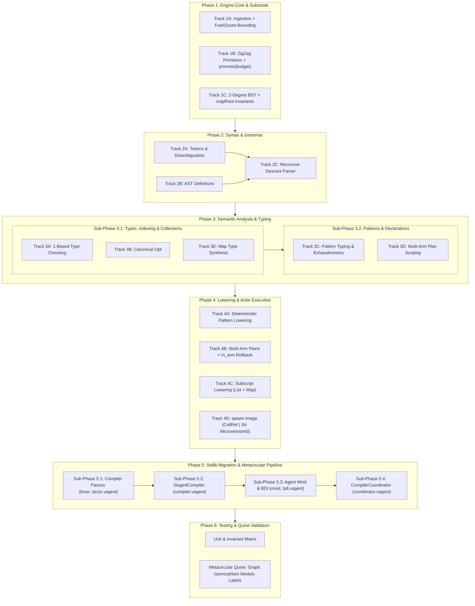

# Round 1 Critique: System Architect (`architect`)

**Review Target**: `design/vagent-harmonization-and-missing-features-implementation-plan.md`\
**Companion Documents**:

- `design/vagent-metacircular-missing-features.md` (Proposals P26–P30, P36–P37)
- `design/vagent-language-harmonization.md` (Proposals P31–P35)
- `design/vagent-metacircular-compiler-implementation.md` (Metacircular Pipeline Foundation)
- `design/vagent-metaprogramming.md` (V10 Substrate Architecture)

______________________________________________________________________

## 1. Executive Architectural Assessment

The *VAgent Harmonization & Missing Features Implementation Plan* provides an ambitious and
comprehensive roadmap uniting all twelve accepted proposals (P26–P37) into a phased engineering
progression. The technical grounding in Nelsonian hypermedia principles, strict 2-degree manifold
topology, capability-bounded actor execution, and deterministic pattern lowering is conceptually
rigorous.

However, from a System Architect perspective, the implementation plan exhibits four **MAJOR**
architectural issues and three **MINOR** specification gaps that threaten parallel execution,
Spool-Mesh actor isolation, and quine verification:

1. **The Metacircular Quine "Bit-for-Bit Identical" Fallacy**: Claiming that successive compiler
   passes yield bit-for-bit identical microversions contradicts the append-only Merkle ledger model
   of `SegmentedOpsSpool`, where monotonic op indices, wall-clock timestamps, and Ed25519 commit
   signatures prevent bitwise equality across distinct microversion commits.
1. **Phase 5 Architectural Dependency Inversion**: Track 5A (`StagedCompiler` and
   `CompilerCoordinator`) is scheduled prior to Track 5B (Full Stdlib Migration), yet
   `StagedCompiler` directly invokes and composes the eleven stdlib compiler passes.
1. **Spool-Mesh Actor Isolation Gap in `spawn image`**: Restricting `spawn image` to in-arena
   `CellRef` handles prevents distributed swarm actors from spawning processes from received
   `MicroversionId` strings without violating the prohibition against cross-actor `CellRef`
   transfers.
1. **Parallelizability Hazards in Phase 3 & 4**: All five Phase 3 tracks edit
   `apps/common/xanadu/vagent/checker.cpp` at heavily overlapping line ranges without an intra-phase
   serialization DAG, while Track 3A contains an architectural layering leak by modifying bytecode
   subscript lowering (`compiler.cpp`) during semantic analysis.

______________________________________________________________________

## 2. Phasing Dependencies, Topological Invariants & Parallelizability DAG

### 2.1 Inter-Phase DAG & Topological Invariants

The macro-phasing DAG ($1 \to 2 \to 3 \to 4 \to 5 \to 6$) is logically ordered: substrate primitives
precede grammar extensions, which precede type checking, which precedes operational lowering,
culminating in self-hosting and testing.

Furthermore, the document upholds two core topological invariants:

- **Strict 2-Degree Manifold Topology**: Ensuring $\text{deg}^+ \le 1$ and $\text{deg}^- \le 1$ on
  all dimensions, utilizing orthogonal dimensions `d.left` and `d.right` for tree branching, and
  fixing `zzCloneToChain` to append clone heads strictly to the rank tail.
- **Nelsonian Persistence Invariant**: Exposing zero arbitrary host filesystem write primitives and
  funneling all permanence through `std:zigzag:promote`.

### 2.2 Architectural Dependency Inversion: Track 5A vs Track 5B

The document presents Phase 5 as:

- Track 5A: Metacircular Pipeline & Swarm Coordination (`compiler.vagent`, `coordinator.vagent`)
- Track 5B: Full Stdlib Migration (All 11 Modules)

This is an architectural inversion. `behavior StagedCompiler` (§6.1) mounts:

```vagent
behavior StagedCompiler {
  uses VAgentLexer
  uses VAgentParser
  uses VAgentChecker
  uses VAgentEmitter
  uses VAgentFragment
  uses VAgentDecls
  ...
}
```

If Track 5A is undertaken before Track 5B, `StagedCompiler` attempts to bind and execute stdlib
modules that still use legacy 0-based indexing, legacy option tests (`[]`), verbose `if/else`
cascades instead of `Map`, and positional list destructuring (`node[0]`). Track 5A cannot compile or
execute until the core compilation modules are migrated.

**Architectural Requirement**: Phase 5 must be split into staged sub-phases:

1. **Sub-Phase 5.1 (Core Compiler Stdlib Migration)**: Migrate `token.vagent`, `lexer.vagent`,
   `ast.vagent`, `parser.vagent`, `expand.vagent`, `resolve.vagent`, `checker.vagent`,
   `emitter.vagent`, `fragment.vagent`, and `decls.vagent` to harmonized syntax and verify
   individually against the C++ bootstrap compiler.
1. **Sub-Phase 5.2 (Intra-Turn Pipeline)**: Implement `behavior StagedCompiler` in
   `compiler.vagent`.
1. **Sub-Phase 5.3 (Agent Mind & BDI Migration)**: Migrate `mind.vagent` and `bdi.vagent`.
1. **Sub-Phase 5.4 (Distributed Swarm Coordinator)**: Implement `agent CompilerCoordinator` in
   `coordinator.vagent`.

### 2.3 Parallelizability Hazards & Merge Collisions

The implementation plan does not define file-disjoint parallel tracks comparable to Stages 0–7 in
`design/vagent-metacircular-compiler-implementation.md`. In Phase 3:

- Track 3A touches `checker.cpp:1380–1405, 1960–1985` and `compiler.cpp:1730–1765`.
- Track 3B touches `checker.cpp:700–740, 1850–1890`.
- Track 3C touches `checker.cpp:2050–2120, 2740–2790`.
- Track 3D touches `checker.cpp:2747–2785` (direct collision with 3C).
- Track 3E touches `checker.cpp:1385–1395, 2060–2085` (direct collisions with 3A and 3C).

Concurrently assigning Phase 3 tracks to independent subagents will trigger irreconcilable git merge
conflicts. Furthermore, Track 3A modifies `compiler.cpp:1730–1765` for subscript compilation, which
directly overlaps with Track 4C (`compiler.cpp:1730–1760`).

**Architectural Requirement**:

1. Evict bytecode emission from Phase 3: Move subscript offset compilation from Track 3A into Phase
   4 (consolidated under Track 4C / Subscript Lowering).
1. Serialize Phase 3 into two disjoint sub-phases:
   - **Sub-Phase 3.1 (Types, Options & Indexing)**: Tracks 3A, 3B, and 3E.
   - **Sub-Phase 3.2 (Patterns & Plans)**: Tracks 3C and 3D.

______________________________________________________________________

## 3. Spool-Mesh Actor Isolation & Turn Atomicity

### 3.1 Swarm Actor Boundaries & The `spawn image` Parameter Gap

Invariant 1.1(3) correctly mandates:

> *"Actors inhabit isolated `WorkerContext` instances with independent `ArenaManifold` heaps. No raw
> `CellRef` pointers are transmitted across actors; distributed swarm workers exchange immutable
> `MicroversionId` strings."*

However, in Section 5.4 (Track 4D Deliverable 1), the runtime performative is defined as:

```vagent
spawn image(root: CellRef, grant: ActorGrant) -> Result<ActorPid, ActorError>
```

This signature assumes the spawner has an in-arena unpromoted `CellRef` graph. In the distributed
compilation pattern (Section 6.1 / P28):

1. `CompilationWorker` compiles `main.vagent` in its private arena.
1. `CompilationWorker` calls `std:zigzag:promote(image_root) -> MicroversionId`.
1. `CompilationWorker` sends `tell UnitCompiled("main.vagent", ver)` to `CompilerCoordinator`.
1. `CompilerCoordinator` receives `ver: Str`.

At this junction, `CompilerCoordinator` cannot spawn or execute the compiled unit because
`spawn image` requires a `CellRef`, which the coordinator does not possess (and cannot receive
without violating Spool-Mesh isolation).

**Architectural Requirement**: Expand the `spawn` performative to support spawning directly from a
sealed microversion:

```vagent
spawn version(version: Str, grant: ActorGrant) -> Result<ActorPid, ActorError>
```

Or define `spawn image` as accepting a union / overloaded handle `CellRef | Str`. If passed a `Str`,
`VagentAdapter` bypasses in-arena validation and promotion, directly resolving the cached manifold
from the store via `Store::rebuildManifold(version)` and invoking `MeshActorRuntime::spawn`.

### 3.2 Intra-Turn Speculative Rollback (`m_arm`) and Outbox Integrity

Track 4B establishes intra-turn speculative arm rollback:

> *"Before executing an arm body, capture an arm-scoped arena mark: `m_arm = arena.mark()`. If the
> arm body fails prior to external commit (`#Fail`, deadline expiry, subgoal failure), call
> `arena.release(m_arm)` to roll back speculative cells and un-stage pending `+d.outbox` entries."*

Codebase cross-check of `apps/common/xanadu/zigzag/arena_manifold.hpp:728–733` and
`apps/common/xanadu/vagent/executor.cpp:3366–3375`:

- `ArenaManifold::release(m)` replays its mutation trail in reverse and truncates allocations.
- Outbox messages ride exclusively on dimension `d.outbox` in the agent's arena manifold;
  `VagentExecutor::drainOutbox` reads along `d.outbox` strictly post-commit.
- Replaying the trail restores the `d.outbox` link rank to its exact pre-arm head, cleanly severing
  uncommitted outbox cells before trail truncation destroys them.

This mechanism is verified mechanically sound.

______________________________________________________________________

## 4. Memory, Fuel, and Resource Quota Management

### 4.1 Ingestion Bounding & DoS Prevention in `std:io:read_file`

Track 1A specifies that `std:io:read_file` reads files up to 64 MiB into an ephemeral scratch
string. However, it fails to specify fuel consumption and memory quota enforcement:

1. **Fuel Consumption**: Ingesting a 64 MiB file without fuel consumption allows zero-fuel CPU
   exhaustion. The implementation must deduct evaluation fuel via `core_.arena().consumeWork(bytes)`
   proportional to bytes ingested.
1. **Arena Quota Bounding**: Reading 64 MiB must be bounded by the actor's configured scratch memory
   quota (`ArenaManifold::setExecutionLimits`, `arena_manifold.hpp:475–482`). Exceeding the quota
   must refuse the operation with `Err(IoError:ResourceLimit)` rather than crashing or exhausting
   host RAM.

### 4.2 Budget Parameter in `std:zigzag:promote`

In Track 1B Deliverable 2, `promote` is specified as `promote(root) -> Result<Str, ZigzagError>`.
However, Proposal P27 in `vagent-metacircular-missing-features.md` §3.2 and §10 Question 2
explicitly specifies:

```vagent
promote(root: CellRef, budget: Opt<Int>) : Result<Str, ZigzagError>
```

The optional `budget` parameter bounds the promotion traversal, defaulting to the actor's remaining
`maxCells` grant. Omitting `budget` removes a critical defensive capability against runaway manifold
promotion.

### 4.3 Child Actor Grant Bounding in `spawn image`

When spawning child actors dynamically, the plan states that the child inherits an `ActorGrant`. To
prevent actor fork-bombs and runaway resource consumption, the child's `ActorGrant` must be strictly
subordinated to the parent:

$$
\begin{aligned}
\text{child.maxCells} &\le \text{parent.remainingCells} \\
\text{child.maxInstructions} &\le \text{parent.remainingInstructions}
\end{aligned}
$$

If unconstrained, an untrusted actor could spawn arbitrary child actors, multiplying its effective
resource allocation indefinitely.

______________________________________________________________________

## 5. 2-Degree Orthogonal BST Topology & Container Stability

### 5.1 Orthogonal Branching Dimensions (`d.left`, `d.right`)

The BST topology on `d.left` and `d.right` strictly respects 2-degree bounds:

- Every node has $\text{deg}^+ \le 1$ (at most one left/right child).
- Every node has $\text{deg}^- \le 1$ (at most one left/right parent).
- Reciprocal links ($A \xrightarrow{+d} B \iff B \xrightarrow{-d} A$) are fully preserved.

### 5.2 Container Stability (`mapRoot`), Invariant Iteration & Splice Rules

The container cell design solves the variable handle stability problem during rotations:

1. **Container Anchor**: `mapRoot` (text `"map"`) holds the root pointer on `+d.grab` and the
   minimum key on `+d.step`. Tree rotations alter only `mapRoot`'s `+d.grab` edge and internal
   branch pointers; user variables pointing to `mapRoot` remain 100% valid.
1. **In-Order Rotation Invariance**: Because an in-order traversal of a binary search tree is an
   algebraic invariant under rotations, tree balancing operations **never modify `+d.step` links**.
1. **Empty Map & Minimum Key Splice Rules (Specification Gap in Track 1C)**:
   - For an empty map, `mapRoot` has no `+d.grab` link and no `+d.step` link.
   - On first insertion, `mapRoot` links along `+d.grab` to the root key and along `+d.step` to the
     same key.
   - When inserting a key strictly smaller than the current minimum, the key cell splices between
     `mapRoot` and the former minimum along `+d.step`.
   - Node heights for AVL balancing must be stored in the cell's scalar value bits via
     `ArenaManifold::setValueBits` (`Int64`) to avoid consuming extra cells or dimensions.

______________________________________________________________________

## 6. Metacircular Quine Verification Roadmap

### 6.1 The "Bit-for-Bit Identical" Microversion Fallacy

Section 7.1 (Test Matrix, line 504) defines the pass criterion for `vagent_metacircular_quine_test`:

> *"Stage-1 VAgent compiler compiles Stage-2 VAgent compiler source; emitted microversion
> bit-for-bit identical."*

In the Nelsonian Xanadu and ZigZag store architecture, **two distinct microversion commits can never
be bit-for-bit identical**:

1. **Monotonic Op Indices**: Each compilation appends new `CompactOpNode` records to the author's
   segmented ops spool (`SegmentedOpsSpool`). The operations for Stage 2 start at an op index
   strictly greater than Stage 1 ($op_{\text{stage2}} > op_{\text{stage1}}$).
1. **Merkle Segment Rooting**: Because op indices and segment boundaries differ, the Merkle tree
   hash of the sealed microversion spool segment differs.
1. **Hypertime Provenance**: `MicroversionId` commits record wall-clock timestamps (`wallNow`) and
   unique Ed25519 digital signatures in `AUTHORSHIP.tsv` (`provenance.hpp`).
1. **Serial Suffixes**: Symbol generator gensym counters produce distinct serial suffixes across
   independent execution runs.

Requiring bit-for-bit equality will cause the quine test to fail permanently, blocking Phase 6.

### 6.2 Canonical Quine Verification Protocol

The implementation plan must replace the bit-for-bit requirement with the authoritative protocol
established in `design/vagent-metacircular-compiler-implementation.md` §3 Stage 7:

$$
\text{Fixpoint Criterion}: \quad I_2 \cong I_3 \pmod{\text{serial labels, base offsets}}
$$

The quine test must assert:

1. **Graph Isomorphism**: Identical operation counts, identical `OpcodeKind` sequences along
   `+d.recipe`, identical wing arities and slot layouts, and identical `+d.refs` relocation chains
   modulo base cell offsets and serial suffixes.
1. **Registration Status**: Every emitted opcode head in both $I_2$ and $I_3$ reports
   `registration(h) == "committed"`.
1. **Semantic Equivalence (Functional Fixpoint)**: The opcode graph $I_3$ executed on test program
   $P$ yields outputs and microversion structures identical to $I_2(P)$.

______________________________________________________________________

## 7. Structured Findings Register

### 7.1 Major Findings

#### [MAJOR-ARCH-01] Quine Pass Criteria Specifies Impossible Bit-for-Bit Identity

- **Location**: Section 7.1, line 504.
- **Defect**: Specifies "emitted microversion bit-for-bit identical" for the metacircular quine.
  Monotonic op indices, timestamps, and Ed25519 signatures in append-only `SegmentedOpsSpool` render
  bitwise identical microversions impossible.
- **Remediation**: Update pass criteria to **graph isomorphism modulo serial labels and base
  offsets** and functional semantic equivalence per `metacircular-compiler-implementation.md` §3
  Stage 7.

#### [MAJOR-ARCH-02] Phase 5 Exhibits Architectural Dependency Inversion

- **Location**: Section 6, lines 440–486.
- **Defect**: Track 5A (`StagedCompiler`, `CompilerCoordinator`) precedes Track 5B (Stdlib
  Migration). `StagedCompiler` imports and coordinates the very stdlib modules scheduled for
  migration in 5B.
- **Remediation**: Restructure Phase 5 into sub-phases where the compiler stdlib passes (lexer,
  parser, checker, emitter, decls) are migrated and unit-tested in Sub-Phase 5.1 before
  `StagedCompiler` is assembled in Sub-Phase 5.2.

#### [MAJOR-ARCH-03] `spawn image` Cannot Ingest `MicroversionId` Strings

- **Location**: Section 5.4, lines 425–432.
- **Defect**: `spawn image(root: CellRef, ...)` accepts only `CellRef`. Distributed swarm workers
  exchange immutable `MicroversionId` strings (`Str`). The coordinator actor has no mechanism to
  spawn a worker from a received microversion string without violating Spool-Mesh actor isolation.
- **Remediation**: Expose `spawn version(version: Str, grant: ActorGrant)` or overload `spawn image`
  to accept `CellRef | Str`.

#### [MAJOR-ARCH-04] Phase 3 Parallelizability Hazard & Layering Leak

- **Location**: Section 4.1 (lines 261–276), Section 4.3 (lines 300–312), Section 4.4 (lines
  316–328), Section 4.5 (lines 331–342).
- **Defect**: All Phase 3 tracks collide on `checker.cpp` at overlapping lines. Track 3A modifies
  `compiler.cpp:1730–1765` (lowering pass), creating a cross-phase collision with Track 4C.
- **Remediation**: Move subscript offset lowering to Phase 4 (Track 4C). Establish an explicit
  intra-phase DAG serializing Phase 3 into Sub-Phase 3.1 (Types/Options/Maps) and Sub-Phase 3.2
  (Patterns/Plans).

### 7.2 Minor Findings

#### [MINOR-ARCH-01] Missing Fuel Deduction & Scratch Quota Bounds in `std:io:read_file`

- **Location**: Section 2.1, lines 118–122.
- **Defect**: Ingesting up to 64 MiB does not mandate `core_.arena().consumeWork(bytes)` or
  enforcement of `ArenaManifold::setExecutionLimits`.
- **Remediation**: Explicitly mandate $O(\text{filesize})$ fuel consumption and `setExecutionLimits`
  scratch quota enforcement.

#### [MINOR-ARCH-02] Omission of `budget` Parameter in `std:zigzag:promote`

- **Location**: Section 2.2, line 141.
- **Defect**: Deliverable 2 specifies `promote(root)` instead of `promote(root, budget: Opt<Int>)`,
  omitting P27's quota bounding defense.
- **Remediation**: Update signature to `promote(root, budget: Opt<Int>)`, defaulting to remaining
  `maxCells`.

#### [MINOR-ARCH-03] Incomplete Splice Specification for Minimum Key in `mapRoot`

- **Location**: Section 2.3, lines 163–178.
- **Defect**: Deliverable 3 specifies splicing keys into `+d.step` between predecessor and
  successor, but omits the empty-map anchor and new-minimum key splice rules relative to `mapRoot`.
- **Remediation**: Document empty map initialization and minimum key splicing on `mapRoot` along
  `+d.step`, and mandate storing AVL node heights in scalar bits via `setValueBits`.

______________________________________________________________________

## 8. Architectural Recommendations & Disposition Plan

To achieve architectural convergence, the implementation plan should be updated as follows:



______________________________________________________________________

## 9. Verdict

`VERDICT: REVISE`

The plan is architecturally sound in its core Nelsonian and ZigZag foundations, but convergence is
blocked by four **MAJOR** issues:

1. `MAJOR-ARCH-01`: Quine test criterion requires unachievable bit-for-bit microversion identity.
1. `MAJOR-ARCH-02`: Phase 5 inverts dependency order between `StagedCompiler` and stdlib modules.
1. `MAJOR-ARCH-03`: `spawn image` cannot ingest `MicroversionId` strings across Spool-Mesh actor
   boundaries.
1. `MAJOR-ARCH-04`: Unmitigated merge collisions across `checker.cpp` and cross-phase layering leak
   in Track 3A.

Addressing the remediations outlined in Section 7 will achieve full architectural convergence.
