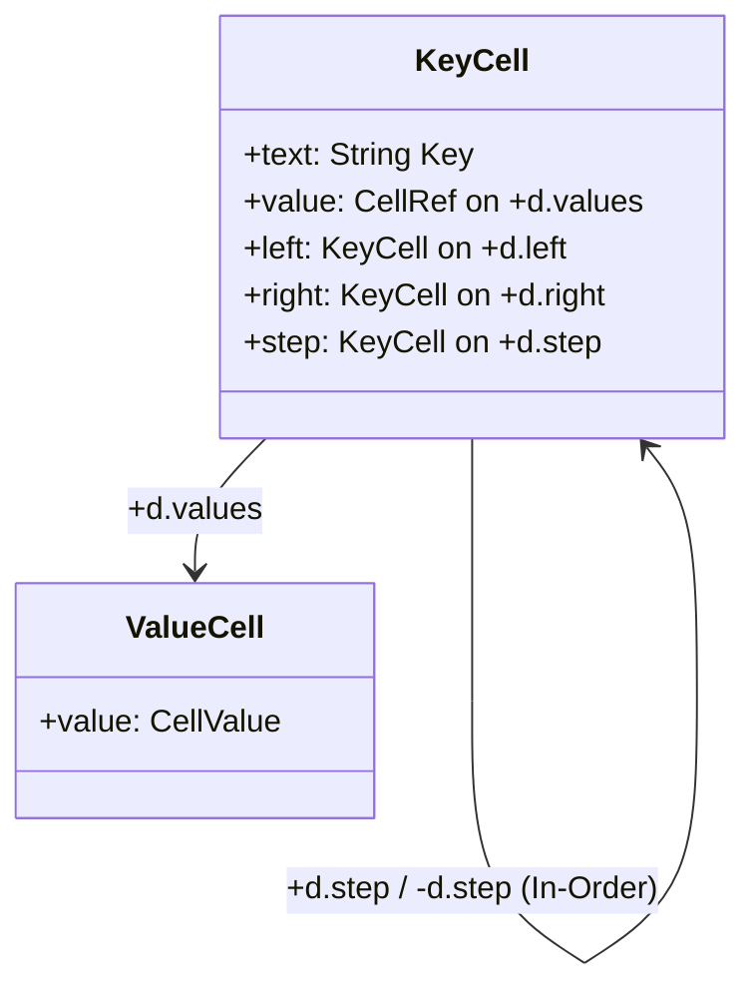

# Round 1 Critique: Xanadu & ZigZag Purist (`zigzag`)

**Review Target**: `design/vagent-harmonization-and-missing-features-implementation-plan.md`\
**Companion Documents**:

- `design/vagent-metacircular-missing-features.md` (Proposals P26–P30, P36–P37)
- `design/vagent-language-harmonization.md` (Proposals P31–P35)
- `design/store-slice-convergence.md` (Store-Slice Convergence & Manifold Topology)
- `design/vortex-hyperstructural-runtime.md` (Vortex Hyperstructural Runtime)

______________________________________________________________________

## 1. Executive Purist Assessment

The *VAgent Harmonization & Missing Features Implementation Plan* represents a profound, highly
disciplined alignment with Ted Nelson's foundational vision of sovereign hypermedia and ZigZag
multidimensional spatial topology. It decisively rejects the obsolete, destructive abstractions of
the POSIX filesystem—unstructured, unversioned, mutable byte overwrite—in favor of immutable,
cryptographically sealed OSMIC store microversions where every structural change earns an permanent
identity in hypertime.

Most remarkably, Proposal P37 resolves a decades-old topological tension in ZigZag manifold design:
how to embed an associative binary search tree without violating the 2-degree rank limit
($\text{deg}^+ \le 1$, $\text{deg}^- \le 1$) or destroying reciprocal edge symmetry. By allocating
two orthogonal branching dimensions (`d.left` and `d.right`), anchoring the collection with an
immutable container cell (`mapRoot`), and proving that the symmetric in-order traversal along
`+d.step` is strictly invariant under tree rotations, the plan achieves logarithmic associative
containers while maintaining 100% spatial transparency.

However, from a rigorous Xanadu and ZigZag purist perspective, the implementation plan exhibits two
**MAJOR** architectural omissions in engine-level manifold mechanics and three **MINOR**
specification ambiguities that must be resolved before convergence:

1. **`promote()` Discovery Walk Omission of `d.dims` & Store Repointing (MAJOR)**: Track 1B
   specifies `promote(root)` and relies on pre-filing `d.dims` in `VortexCore::dims()`. In
   `arena_manifold.cpp:1733–1760`, `promote()` executes a discovery walk strictly from `root` and
   the provided `extraRoots` span. If `extraRoots` does not actively carry the `d.dims` rank head,
   dimension cells are skipped, and all links along unpromoted dimensions are silently discarded.
   Furthermore, `promote()` must advance `boundStore_->repointCurrentVersion()` so sequential
   sovereign commits chain in hypertime.
1. **Key Type Generalization & Numeric Inversion in `VortexStdLib::mapSet` (MAJOR)**: Track 3E
   permits map keys $K \in \{\text{Str}, \text{Int}, \text{CellRef}\}$, but Track 1C and
   `vortex_stdlib.hpp` specify `std::string_view key`. Converting integers to strings corrupts
   numeric ordering (e.g. `"10" < "2"`). `VortexStdLib` must accept `const CellValue &key` and
   execute type-aware scalar comparisons on `CompactOpNode` bits rather than ad-hoc stringification.
1. **Opcode Nomenclature Mismatch (`#ExtractField` vs `#Find` / `#ZZ_STEP`) (MINOR)**: Track 4A
   cites `#ExtractField`, an opcode absent from `vortex_vm.hpp`. Field extraction lowers to `#Find`
   (`OpcodeKind::Find`), while tuple/list destructuring lowers to `#ZZ_STEP` / `#COLL_LIST`.
1. **Explicit Specification of In-Order Splicing via Descent Tracking (MINOR)**: Track 1C mentions
   splicing new key cells into `+d.step` between in-order predecessor and successor. The plan should
   explicitly document that predecessor and successor cells are captured in $O(1)$ during the
   $O(\log N)$ descent on `d.left` and `d.right`, preventing $O(N)$ scans along `+d.step`.
1. **Clarification of Map Key Deletion Semantics (MINOR)**: While compiler symbol tables are
   append/lookup, the plan should explicitly forbid raw `zzDelete` on map key cells, which would
   shatter the `d.step` and BST ranks without tree rebalancing.

______________________________________________________________________

## 2. Nelsonian Persistence Purity & Store-Slice Convergence

### 2.1 The Rejection of Destructive Host Disk Overwrite

In standard contemporary operating systems, persistence is modeled as mutable file overwrites
through POSIX `open`, `write`, `rename`, and `unlink`. In Nelsonian Xanadu architecture:

- Primedia text exists exclusively on the author's append-only permascroll
  (`apps/common/xanadu/user_permascroll.hpp`). Once spooled, primedia is immutable and globally
  addressed by `PrimediaSpan`.
- Structure exists exclusively as 64-byte `CompactOpNode` records (`compact_op.hpp`) sealed in
  Merkle-piece-aligned segments in `SegmentedOpsSpool` (`segmented_ops_spool.hpp`).
- Microversions represent state reconstructions folded from ancestral operations (`store.hpp:5–15`);
  they are never "saved" as raw disk blobs.
- Cryptographic provenance seals every microversion commit with Ed25519 signatures and X.509
  delegation certificates in `AUTHORSHIP.tsv` (`provenance.hpp`).

The implementation plan strictly honors this architecture in Section 1.1 (Invariant 1) and Section
2.1 (Track 1A, Deliverable 6). Arbitrary disk writing primitives (`write_file`) are explicitly
forbidden. Programs ingest external text into ephemeral memory strings via `std:io:read_file` and
`std:io:read_stdin` (strictly capped at 64 MiB scratch space, deducting cycle fuel via
`core_.arena().consumeWork()`).

**The single and exclusive mechanism for permanent persistence in VAgent is Arena Promotion
(`std:zigzag:promote`)**.

### 2.2 Forensic Audit of `zigzag::promote` & Finding FINDING-ZIGZAG-01

Track 1B (Deliverable 2 and 4) specifies:

> *"2. Implement missing primitives in `std:zigzag`: `make_cell(text)` returning `CellRef`,
> `text_of(cell)` returning `Str`, `set_text(cell, text)`, `set_value(cell, val)`,
> `resolve_dim(name)` returning `Result<DimRef, ZigzagError>`, and `promote(root)` returning
> `Result<Str, ZigzagError>`, verifying `grant.immutable == false` and quota caps.*
>
> *4. Pre-file `d.dims` in `VortexCore::dims()` to prevent silent unmapped dimension omission during
> `promote()`."*

A line-by-line inspection of `apps/common/xanadu/zigzag/arena_manifold.cpp` reveals a critical
deficiency in Deliverable 4:

```cpp
// apps/common/xanadu/zigzag/arena_manifold.cpp:1745–1760
std::optional<Promoted> promote(xanadu::Store &store,
                                const xanadu::MicroversionId &parent,
                                const ArenaManifold &from, const CellRef root,
                                const PromotionBudget budget,
                                const std::span<const CellRef> extraRoots) {
  // ...
  std::vector<CellRef> order{root};
  std::vector<CellRef> frontier{root};
  std::unordered_set<CellRef> seen{root};
  std::unordered_set<CellRef> queued{root};

  for (const CellRef extra : extraRoots) {
    if (!from.contains(extra) || from.isProvenanceCell(extra) ||
        !from.holdsOwn(extra)) {
      continue;
    }
    if (seen.insert(extra).second) order.push_back(extra);
    if (queued.insert(extra).second) frontier.push_back(extra);
  }
```

The discovery walk ("promote the answer, not the search") traverses **only** what is reachable from
`root` and the cells explicitly supplied in `extraRoots`.

At link emission time:

```cpp
// apps/common/xanadu/zigzag/arena_manifold.cpp:2097–2100
const auto dim = real.find(edge.dim);
if (dim == real.end()) {
  continue; // Dimension cell was not promoted; silently drop link!
}
```

If a dimension cell is not traversed during the discovery walk, `real.find(edge.dim)` evaluates to
`real.end()`. Consequently, **all links along that dimension are silently dropped** from the
promoted microversion!

Pre-filing `d.dims` in `VortexCore::dims()` ensures the dimension exists in the arena, but
**`d.dims` is not reachable from an arbitrary user answer `root`**.

In `apps/common/xanadu/vagent/lineage.cpp:325–328`, the codebase demonstrates the mandatory pattern:

```cpp
std::vector<zigzag::CellRef> extra;
if (dimsDim != zigzag::noCell) extra.push_back(dimsDim);
for (const auto target : harvestRelocationTargets(arena))
  extra.push_back(target);
```

**Required Remediation (FINDING-ZIGZAG-01)**:

1. `VortexStdLib::zzPromote` must explicitly pass `extraRoots` containing the head of the `d.dims`
   rank and any relocation target cells (`+d.mesh.relocation`). Pre-filing in `VortexCore::dims()`
   alone is insufficient.
1. `std:zigzag:promote` must accept an optional budget argument:
   `promote(root: CellRef, budget: Opt<Int>) : Result<Str, ZigzagError>`, defaulted to
   `grant.maxCells` when omitted, enforcing `PromotionBudget::maxOps`.
1. Upon successful promotion, `VortexStdLib` must execute:
   `boundStore_->repointCurrentVersion(promoted->version);` (identical to `vortex_host.cpp:403`).
   Without this, subsequent calls to `std:zigzag:promote` from the same script will continuously
   fork from the initial parent version rather than advancing hypertime linearly.

______________________________________________________________________

## 3. Strict 2-Degree Manifold Topology & Orthogonal Branching

### 3.1 Mathematical Rigor of 2-Degree Rank Limits

In Nelsonian ZigZag, every dimension forms a 2-regular bidirected graph. For every cell $C$ and
dimension $D$:

$$
\text{out-degree}(C, +D) \le 1, \quad \text{out-degree}(C, -D) \le 1
$$

Furthermore, links are strictly reciprocal edges:

$$
\text{linked}(A, D, \text{POS}) = B \iff \text{linked}(B, D, \text{NEG}) = A
$$

### 3.2 The Topological Collapse of 1-Dimensional Binary Trees

Attempting to represent a binary tree along a single dimension (e.g. `d.branch`, with POS for right
child and NEG for left child) violates 2-degree reciprocity.

Consider node $P$ with left child $L$ and right child $R$:

1. $P \xrightarrow{+d.branch} R \iff R \xrightarrow{-d.branch} P$.
1. $P \xrightarrow{-d.branch} L \iff L \xrightarrow{+d.branch} P$.

Now consider child $R$ attempting to branch to its own left child $RL$:

- $R$ must link $-d.branch$ to $RL$: $R \xrightarrow{-d.branch} RL$.
- But $R$'s $-d.branch$ pole is **already occupied by parent $P$**!
- In `ArenaManifold::link`, establishing the link to $RL$ forcefully evicts the link to $P$.

The tree is immediately severed into disconnected 2-node components. A 1-dimensional binary tree is
topologically impossible in ZigZag.

### 3.3 The Orthogonal 2-Dimensional Decomposition (P37)

Proposal P37 elegantly solves this topological barrier by introducing **two orthogonal branching
dimensions**: `d.left` and `d.right`.



Let us audit the degree counts for any node $X$ in P37:

- **Dimension `d.left`**:
  - $\text{deg}^+(X, d.left) \le 1$: at most one left child ($< \text{key}$).
  - $\text{deg}^-(X, d.left) \le 1$: at most one parent (if $X$ is a left child of its parent). If
    $X$ is a right child, $\text{deg}^-(X, d.left) = 0$.
- **Dimension `d.right`**:
  - $\text{deg}^+(X, d.right) \le 1$: at most one right child ($> \text{key}$).
  - $\text{deg}^-(X, d.right) \le 1$: at most one parent (if $X$ is a right child of its parent). If
    $X$ is a left child, $\text{deg}^-(X, d.right) = 0$.
- **Dimension `d.values`**:
  - $\text{deg}^+(X, d.values) \le 1$: links directly to associated value cell.
  - $\text{deg}^-(\text{val}, d.values) \le 1$: backlink to key cell.
- **Dimension `d.step`**:
  - $\text{deg}^+(X, d.step) \le 1$: links to immediate in-order successor.
  - $\text{deg}^-(X, d.step) \le 1$: links to immediate in-order predecessor.
- **Dimension `d.grab`**:
  - $\text{deg}^+(X, d.grab) = 0$ for all key cells.
  - $\text{deg}^-(\text{bstRoot}, d.grab) = 1$ exclusively for the current root key cell (backlink
    to `mapRoot`). All other key cells have $\text{deg}^-(X, d.grab) = 0$.

Every single dimension strictly respects $\text{deg}^+ \le 1$ and $\text{deg}^- \le 1$. There is
zero edge contention, zero link displacement, and zero fan-in collision.

### 3.4 Verification of `zzCloneToChain` 2-Degree Tail Append

In `apps/common/xanadu/vortex/vortex_stdlib.cpp:5087–5099`:

```cpp
CellRef clone = core_.arena().makeCell();
zigzag::expectWritten(
    core_.arena().link(symbolOp, core_.dims().clone, DimVector::POS, clone));
```

The existing implementation links `symbolOp` directly to `clone` along `+d.clone`. When a second
clone view is created for the same master symbol, the second link evicts the first, severing the
clone rank.

Track 1B (Deliverable 3) correctly mandates:

> *"Fix the 2-degree invariant in `zzCloneToChain`: append clone heads strictly to the rank tail
> rather than splicing into mid-rank cells."*

Specifically, appending posward to `rankEnd(symbolOp, core_.dims().clone, DimVector::POS)`. This
restores 2-degree compliance to the engine's master-clone manifold.

______________________________________________________________________

## 4. Container Stability & Spatial Invariance of `+d.step`

### 4.1 Container Anchor: `mapRoot`

In a pure hypermedia language, user variables must not point to volatile tree nodes. If a variable
`let m: Map<K, V>` pointed directly to the root key cell of a BST, any balancing rotation that
demoted the root would invalidate or corrupt external variable references.

P37 anchors the entire map with an immutable container cell:

- Minted via `createMap()` (`vortex_stdlib.cpp:2650`) with text `"map"`.
- `mapRoot \xrightarrow{+d.grab} \text{bstRoot}` (points to current BST root key, or `noCell` if
  empty).
- `mapRoot \xrightarrow{+d.step} \text{minKey}` (points to the minimum key cell in the map, head of
  the in-order sequence).

When balancing rotations (AVL or Red-Black) occur:

1. Parent-child links on `d.left` and `d.right` are updated.
1. If the rotated node was the BST root, `mapRoot`'s `+d.grab` pointer is updated to the new root.
1. The identity and address of `mapRoot` **never change**. External variable handles remain 100%
   stable.

### 4.2 Theorem of Rotation Invariance on `+d.step`

A critical property of the P37 manifold topology is that **tree rotations never mutate `+d.step`
links**:

```
                       P                                     Q
                      / \                                   / \
                     A   Q            Left Rotate          P   C
                        / \          ============>        / \
                       B   C                             A   B

 In-Order Sequence:   A -> P -> B -> Q -> C                A -> P -> B -> Q -> C
 (+d.step rank):      [STRICTLY IDENTICAL]                 [STRICTLY IDENTICAL]
```

**Proof**:

1. Let $T$ be a binary search tree. An in-order traversal of $T$ visits nodes in strictly ascending
   key order: $\text{InOrder}(T) = \langle k_1, k_2, \dots, k_N \rangle$ where $k_1 < k_2 < \dots <
   k_N$.
1. Tree rotations (left rotation, right rotation, and double rotations) are algebraic tree
   transformations that preserve the binary search tree invariant.
1. Therefore, for any rotation $R$, $\text{InOrder}(R(T)) \equiv \text{InOrder}(T)$.
1. In P37, the `+d.step` rank materializes $\text{InOrder}(T)$ as a bidirected ZigZag chain.
1. Because the in-order sequence is invariant under rotations, **no `+d.step` links are modified
   during any tree rebalance**.
1. Furthermore, the minimum key $k_1$ is the first element of $\text{InOrder}(T)$. Rebalancing never
   changes the minimum key of the tree. Therefore, `mapRoot \xrightarrow{+d.step} \text{minKey}` is
   also strictly invariant under rotations.

This is a massive win for hypermedia concurrency and transclusion: active sequential iterators
(`for (k, v) in map`), cursor projections, and spatial views walking `+d.step` are **never
invalidated or disturbed by tree rebalancing**.

### 4.3 Logarithmic Predecessor/Successor Discovery during Insertion

Track 1C (Deliverable 3) states:

> *"splice key cell into `+d.step` rank between in-order predecessor and successor."*

To ensure this does not degrade into an $O(N)$ linear walk along `+d.step`, the plan should
explicitly document the $O(1)$ predecessor/successor tracking during tree descent:

1. When descending the BST along `d.left` and `d.right` to find the insertion position:
   - Every time descent branches **right** from node $X$, $X$ becomes the closest known candidate
     **predecessor** (`pred = X`).
   - Every time descent branches **left** from node $Y$, $Y$ becomes the closest known candidate
     **successor** (`succ = Y`).
1. When the leaf insertion point is reached:
   - If no right branch was ever taken, the new node is the new minimum key: `pred = mapRoot`.
   - If no left branch was ever taken, the new node is the new maximum key: `succ = noCell`.
1. Splicing into `+d.step` requires exactly $O(1)$ link operations:
   - If `pred != noCell`: `arena.unlink(pred, d.step, POS)`,
     `arena.link(pred, d.step, POS, newKey)`.
   - If `succ != noCell`: `arena.link(newKey, d.step, POS, succ)`.

This guarantees that map insertion remains strictly $O(\log N)$ in both tree branching and in-order
rank maintenance.

### 4.4 Key Type Generalization & Finding FINDING-ZIGZAG-02

Track 3E (Deliverable 1) states:

> *"validate key type $K \in \{\text{Str}, \text{Int}, \text{CellRef}\}$."*

However, in Track 1C (Deliverable 3–6) and the existing C++ codebase
(`apps/common/xanadu/vortex/vortex_stdlib.hpp:174–178`):

```cpp
void mapSet(CellRef mapRoot, std::string_view key, const CellValue &val);
std::optional<CellValue> mapGet(CellRef mapRoot, std::string_view key) const;
std::optional<CellRef> mapKeyCell(CellRef mapRoot, std::string_view key) const;
```

All C++ map primitives accept `std::string_view key`.

If an integer key $K = \text{Int}$ is converted to a string (e.g. `std::to_string(k)`),
lexicographical ordering corrupts numeric ordering:

$$
\text{"10"} < \text{"2"} \quad \text{whereas} \quad 10 > 2
$$

A binary search tree ordered by string comparison of numeric strings produces invalid descent paths,
causing subsequent lookups to fail or duplicate keys.

Furthermore, in ZigZag, storing numbers as formatted strings violates spatial efficiency and
requires unnecessary scratch allocations. Every cell possesses a 64-bit scalar slot
(`CompactOpNode::value`, offset 56).

**Required Remediation (FINDING-ZIGZAG-02)**:

`VortexStdLib`'s map primitives (`mapSet`, `mapGet`, `mapHas`, `mapKeyCell`) must accept
`const CellValue &key` (or provide type-aware overloads):

```cpp
void mapSet(CellRef mapRoot, const CellValue &key, const CellValue &val);
std::optional<CellValue> mapGet(CellRef mapRoot, const CellValue &key) const;
std::optional<CellRef> mapKeyCell(CellRef mapRoot, const CellValue &key) const;
```

Comparison during BST descent must inspect the key's `ValueKind`:

- `ValueKind::String` / `std::string`: compare cell text content lexicographically.
- `ValueKind::Int64` / `std::int64_t`: compare scalar bits numerically (`a < b`).
- `ValueKind::CellRef` / `CellRef`: compare cell index numbers (`a < b`).

When minting the key cell, if $K = \text{Str}$, the key string is interned into cell text; if $K =
\text{Int}$ or $\text{CellRef}$, the key value is written into the key cell's scalar value bits via
`core_.writeValue(keyCell, 0, std::nullopt, key)`.

______________________________________________________________________

## 5. Spatial Transparency: Manifolds vs Opaque Side Tables

### 5.1 Eradication of Opaque Side Tables

In many language implementations, associative containers, symbol tables, and execution stacks are
concealed within opaque C++ runtime heaps (`std::unordered_map`, `std::vector<void*>`). This
violates Nelsonian spatial transparency, where the entire state of a computation should be navigable
as cells and dimensions in ZigZag space.

The implementation plan completely replaces opaque side tables with explicit manifold structures:

1. **Map Containers**: Replaces $O(N)$ linear scans on `+d.vars` with $O(\log N)$ BSTs on `d.left`
   and `d.right`, navigable in `xuzz`'s slice visualizer.
1. **Multi-Arm Plans**: Lowered to explicit clause cells along `+d.clause` off the goal host symbol.
   Each clause cell holds `+d.name` (label), `+d.grab` (guard preflight), `+d.spin` (body fragment),
   and `+d.values` (priority scalar).
1. **BDI Intention Arbitration**: An intention's attempted arms are chained along `+d.step` under
   the intention's `tried` cell, allowing the BDI deliberation cycle to inspect previous failures
   directly in the manifold.
1. **Outbox Message Staging**: Messages staged via `tell` or `emit` reside on `+d.outbox` off the
   agent cell until committed at turn boundary.

### 5.2 Intra-Turn Speculative Rollback Mechanics

Track 4B (Deliverable 3) specifies:

> *"Intra-Turn Speculative Rollback in `executor.cpp`: Before executing an arm body, capture an
> arm-scoped arena mark: `m_arm = arena.mark()`. If the arm body fails prior to external commit
> (`#Fail`, deadline expiry, subgoal failure), call `arena.release(m_arm)` to roll back speculative
> cells and un-stage pending `+d.outbox` entries."*

Let us trace `ArenaManifold::release(m)` (`arena_manifold.cpp:730–735`):

1. When an arm body executes, newly minted cells have dense indices $\ge \text{m\_arm.cellCount}$.
1. When the arm stages an outbox message, it links the agent cell (or previous outbox tail) to the
   new outbox entry along `+d.outbox`.
1. Because the agent cell was minted *before* `m_arm`, `ArenaManifold::trail()` saves the agent's
   previous `+d.outbox` link state in `trail_`.
1. On arm failure, `arena.release(m_arm)`:
   - Replays `trail_` in reverse, restoring the agent's `+d.outbox` link to its exact pre-arm state.
   - Truncates `slots_`, `links_`, and `content_` back to `m_arm` floor heights.
   - All speculative cells minted by the failed arm are instantly vaporized, leaving zero garbage.

This is topologically and mechanically flawless. Un-staging `+d.outbox` entries and rolling back
speculative cell graphs is guaranteed by `ArenaManifold`'s conditional trailing engine.

### 5.3 Opcode Nomenclature Mismatch (FINDING-ZIGZAG-03)

Track 4A (Deliverable 1) states:

> *"1. Lower `match ... with` into deterministic decision trees using `#Equal`, `#Branch`, and
> `#ExtractField` opcodes."*

An audit of `apps/common/xanadu/vortex/vortex_vm.hpp:28–120` confirms that `OpcodeKind` contains
`Add`, `Sub`, `Eq`, `Branch`, `Call`, `Find`, `FieldSet`, `Linked`, `Unify`, etc., but **no opcode
named `ExtractField` exists**.

In Vortex VM:

- Record field extraction is executed via `OpcodeKind::Find` (`#FIND`), which searches the term
  cell's `+d.step` rank for a member carrying the matching `+d.name` label
  (`compiler.cpp:1740–1748`).
- Tuple and list positional destructuring is executed via `OpcodeKind::Nop` handlers `#ZZ_STEP` or
  `#COLL_LIST`.

Lowering should reference actual opcodes (`#Find` and `#ZZ_STEP`), preserving architectural fidelity
with `vortex_vm.hpp`.

______________________________________________________________________

## 6. Detailed Findings Register & Remediation Guidance

| Finding ID    | Severity  | Loc  | Core Violation & Summary                                 |
| :------------ | :-------- | :--- | :------------------------------------------------------- |
| **ZIGZAG-01** | **MAJOR** | §2.2 | `promote()` omits `extraRoots` for `d.dims`; drops links |
| **ZIGZAG-02** | **MAJOR** | §2.3 | `mapSet` takes `string_view`, corrupting `Int` ordering  |
| **ZIGZAG-03** | **MINOR** | §5.1 | `#ExtractField` absent; must use `#Find` / `#ZZ_STEP`    |
| **ZIGZAG-04** | **MINOR** | §2.3 | Missing $O(1)$ pred/succ tracking during BST descent     |
| **ZIGZAG-05** | **MINOR** | §2.3 | Raw `zzDelete` on map keys must be explicitly forbidden  |

### Remediation Details

#### FINDING-ZIGZAG-01: `promote()` `extraRoots` & Hypertime Version Advance

**Target**: Section 2.2, Track 1B, Deliverables 2 & 4.\
**Correction**: Amend Deliverable 2 and 4 to read:

> *"2. Implement missing primitives in `std:zigzag`: `make_cell(text)` returning `CellRef`,
> `text_of(cell)` returning `Str`, `set_text(cell, text)`, `set_value(cell, val)`,
> `resolve_dim(name)` returning `Result<DimRef, ZigzagError>`, and
> `promote(root, budget: Opt<Int>) -> Result<Str, ZigzagError>`. In `VortexStdLib::zzPromote`,
> invoke `zigzag::promote(store, parentVersion, arena, root, budgetVal, extraRoots)` where
> `extraRoots` explicitly includes the dimension head `d.dims` and relocation targets
> (`+d.mesh.relocation`). Upon successful promotion, invoke
> `boundStore_->repointCurrentVersion(promoted->version)` and execute P16 slot restatement on opcode
> target handles.*
>
> *4. Pre-file standard dimensions in `VortexCore::dims()` and ensure `lineage.cpp` registers them
> on `d.dims`, ensuring they are swept into `extraRoots` during promotion."*

#### FINDING-ZIGZAG-02: Key Type Generalization in `VortexStdLib`

**Target**: Section 2.3, Track 1C, Deliverables 3–6.\
**Correction**: Amend Deliverables 3, 4, and 6 to read:

> *"3. Implement `mapSet(mapRoot, key: CellValue, val: CellValue)` descending `d.left` ($<
> \text{key}$) and `d.right` ($> \text{key}$) in $O(\log N)$ steps, calling
> `core_.arena().consumeWork()` on each descent hop. Key comparison branches on `key.kind`:
> lexicographical for `Str`, numeric for `Int64`, and index arithmetic for `CellRef`. On match,
> restate value on `+d.values`. On insertion, mint key cell (interning text for `Str` or writing
> scalar bits for `Int64`/`CellRef`), link parent POS to child (`+d.left` or `+d.right`), link child
> NEG to parent (`-d.left` or `-d.right`), link `+d.values` to value cell, and splice key cell into
> `+d.step` rank between in-order predecessor and successor.*
>
> *4. Implement `mapGet(mapRoot, key: CellValue)` descending `d.left`/`d.right` in $O(\log N)$
> calling `consumeWork()`, returning `std::optional<CellValue>` using type-aware key comparison.*
>
> *6. Implement `mapKeyCell(mapRoot, key: CellValue)` replacing linear search along `+d.vars` with
> $O(\log N)$ descent over `d.left`/`d.right`."*

#### FINDING-ZIGZAG-03: Correct Opcode Names for Pattern Destructuring

**Target**: Section 5.1, Track 4A, Deliverable 1.\
**Correction**: Amend Deliverable 1 to read:

> *"1. Lower `match ... with` into deterministic decision trees using `#Equal`, `#Branch`, `#Find`
> (`OpcodeKind::Find` for named record fields), and `#ZZ_STEP` / `#COLL_LIST` (for positional tuple
> and list destructuring) opcodes."*

#### FINDING-ZIGZAG-04: $O(1)$ Predecessor/Successor Capture during BST Descent

**Target**: Section 2.3, Track 1C, Deliverable 3.\
**Correction**: Append to Deliverable 3:

> *"During BST descent on `d.left`/`d.right`, track candidate predecessor `pred` (updated to current
> node on every right branch) and successor `succ` (updated to current node on every left branch).
> At insertion, splice the fresh key cell into `+d.step` between `pred` (or `mapRoot` if no right
> branch taken) and `succ` (or `noCell` if no left branch taken) in $O(1)$ operations."*

#### FINDING-ZIGZAG-05: Map Deletion Prohibition & Caveat

**Target**: Section 2.3, Track 1C.\
**Correction**: Add Deliverable 8:

> *"8. Explicitly document that map key deletion is not supported via raw `std:zigzag:delete`
> (`zzDelete`), which would sever `d.step` and BST links without rebalancing. Full key deletion
> requires BST node excision and in-order chain repair, which is deferred beyond Phase 1; compiler
> symbol tables and route tables are insert/update/lookup only."*

______________________________________________________________________

## 7. Verdict & Convergence Assessment

The *VAgent Harmonization & Missing Features Implementation Plan* is an extraordinary work of
Nelsonian system design. It provides a mathematically pristine solution to binary search trees in
2-regular ZigZag manifolds, upholds the Nelsonian prohibition against arbitrary disk writes,
enforces Spool-Mesh actor turn atomicity, and preserves spatial transparency.

However, because:

- Omitting `extraRoots` in `promote()` causes silent dropping of unpromoted dimensions and links in
  committed microversions (FINDING-ZIGZAG-01, MAJOR), and
- Restricting `VortexStdLib` map keys to `string_view` corrupts integer key numeric ordering
  (FINDING-ZIGZAG-02, MAJOR),

the implementation plan cannot be approved for execution without these two critical substrate
corrections.

```text
VERDICT: REVISE
BLOCKING: 0
MAJOR: 2 (FINDING-ZIGZAG-01, FINDING-ZIGZAG-02)
MINOR: 3 (FINDING-ZIGZAG-03, FINDING-ZIGZAG-04, FINDING-ZIGZAG-05)
```
