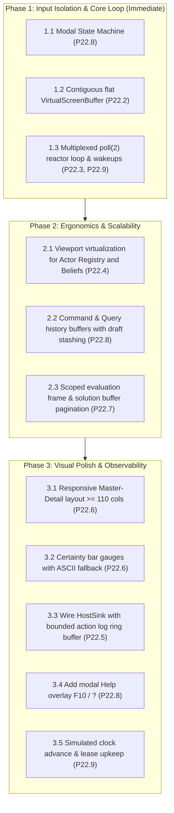

# Project Review: vagent TUI Architecture and Dashboard

Review directory for the multi-agent Vortex Design Critique of:

1. `design/terminal-ui-architecture.md` (v0.4) — foundational terminal engine and virtual screen
   driver.
1. `design/vagent-tui-dashboard.md` (v0.4) — domain-specific agent monitoring and deductive REPL
   dashboard.

All six critics have emitted `VERDICT: CONVERGED`. The proposal register (`P22.1`–`P22.10`) below is
submitted for project owner approval to begin phased implementation.

______________________________________________________________________

## 1. Critique Rounds & Convergence Metrics

The review progressed through four iterative critique and remediation rounds following
`.agents/skills/vortex-design-critique/SKILL.md`:

| Critic Lane                           | Round 1 (v0.1)    | Round 2 (v0.2)    | Round 3 (v0.3)     | Round 4 (v0.4) | Final Verdict     |
| :------------------------------------ | :---------------- | :---------------- | :----------------- | :------------- | :---------------- |
| **System Architect**                  | 3B, 6M, 4m        | **0B, 0M, 4m**    | — *(Converged R2)* | —              | **CONVERGED**     |
| **Xanadu / ZigZag Purist**            | 2B, 4M, 4m        | 2B, 4M, 3m        | **0B, 0M, 3m**     | —              | **CONVERGED**     |
| **Programming Language / Ergonomics** | 2B, 7M, 4m        | 0B, 4M, 3m        | **0B, 0M, 5m**     | —              | **CONVERGED**     |
| **Vortex & Spool-Mesh Expert**        | 3B, 4M, 3m        | 3B, 4M, 2m        | 0B, 2M, 1m         | **0B, 0M, 1m** | **CONVERGED**     |
| **Codebase Expert**                   | 3B, 4M, 3m        | 2B, 4M, 3m        | 0B, 2M, 2m         | **0B, 0M, 0m** | **CONVERGED**     |
| **Technical Writer**                  | 4B, 6M, 6m        | 3B, 4M, 5m        | 1B, 2M, 5m         | **0B, 0M, 0m** | **CONVERGED**     |
| **Total Findings**                    | **17B, 31M, 24m** | **10B, 20M, 20m** | **1B, 6M, 16m**    | **0B, 0M, 1m** | **ALL CONVERGED** |

### Review Artifacts

- Common Brief: [`brief-common.md`](brief-common.md)
- Round 1: [`r1-disposition.md`](r1-disposition.md) and individual critiques (`r1-*.md`)
- Round 2: [`r2-disposition.md`](r2-disposition.md) and individual critiques (`r2-*.md`)
- Round 3: [`r3-disposition.md`](r3-disposition.md) and individual critiques (`r3-*.md`)
- Round 4: [`r4-writer.md`](r4-writer.md), [`r4-vortex.md`](r4-vortex.md),
  [`r4-codebase.md`](r4-codebase.md)

______________________________________________________________________

## 2. Key Architectural Resolutions

1. **Zero-CPU Quiescence and Descriptor Multiplexing (`P22.3`, `P22.9`)**: Replaced the naive 30ms
   sleep loop with a POSIX `poll(2)` reactor loop multiplexing stdin, signalfd/self-pipe, and
   `AgentExecutor` notification eventfds. Polling timeout is clamped to the earliest active timer
   deadline. Injected test inputs bypass kernel sleeps via `TerminalDevice::hasPendingInput()`.
   Stdin EOF is cleanly caught via `TerminalDevice::isEof()`, preventing 100% CPU busy-spins.
1. **Deductive REPL Turn Isolation (`P22.7`)**: Interactive Vlog queries execute within an immediate
   mark/release frame (`Mark m = arena.mark(); ... arena.release(m);`). Up to
   `maxQuerySolutions = 50` solutions are pre-resolved into an in-memory `solutionBuffer_` before
   releasing the scratch mark. Local UI pagination advances through pre-resolved results without
   leaving outstanding arena marks, choice points, or trail state that could block actor compaction
   or live upgrades.
1. **ZigZag 2-Degree Rank Invariant & Epistemic Traversal (`P22.6`)**: Compound arguments strictly
   obey ZigZag topological rules by linking head-to-first-argument along `+d.grab` and subsequent
   arguments along `+d.step`. Positional scalar values are extracted via `asDouble()`, `asInt64()`,
   or `vprolog::formatTerm()` without string round-tripping. Belief claims connect along
   `+d.epistemic` and sensory sources along `+d.source` to peer trust profiles.
1. **Modal Input Safety & Ergonomics (`P22.8`)**: Established strict separation between
   `NAVIGATION MODE` and `EDIT MODE`. Pressing `Enter` executes commands while retaining
   `EDIT MODE`, completely eliminating the `'s'` hotkey trap where typing triggers `step()`.
   Navigating history with `Up`/`Down` stashes uncommitted active text in `draft_`.
1. **Real-Time Outbound Emission Streaming (`P22.5`)**: Chained `AgentExecutor::setHostSink` using
   `executor.hostSink()`, formatting real `Envelope` members (`from`, `ordinal`, `type`, `fields`)
   via `renderEmission`, and streaming entries to a bounded circular ring buffer (500 entries, ~64
   KiB) in `AgentTui`.
1. **Memory Bounding & Flat Buffer Layout (`P22.2`, `P22.4`)**: Replaced vector-of-vectors screen
   buffers with a contiguous flat vector of `ScreenCell`
   ($120 \times 30 \times 20 \text{ B} = 72 \text{ KiB}$), eliminating 31 heap allocations per
   frame. Viewport virtualization bounds rendering to $O(\text{viewport})$.
1. **Strict Zero Sentinels (`P22.9`)**: Replaced negative descriptor sentinels with
   `[[nodiscard]] std::optional<int> notificationDescriptor() const;` and
   `[[nodiscard]] std::optional<system_clock::time_point> earliestDeadline() const;`.
1. **Headless Verification Invariant (T1)**: 100% of terminal features (resizing, differential
   redraws, scrolling, color mapping, and command execution) run under
   `TerminalDevice::Options{.forceHeadless = true}` without `/dev/tty` or X11/Wayland dependencies.

______________________________________________________________________

## 3. Proposal Register (`P22.1`–`P22.10`)

The following proposals constitute the formal implementation package:

### Proposal P22.1: `TerminalDevice` Decoupled Driver

- **Files Touched**: `apps/common/ui/tui/terminal_device.hpp`, `terminal_device.cpp`,
  `apps/common/xanadu/vagent/tui/ncurses_actor.hpp` (aliased/deprecated).
- **Rationale**: Decouples curses initialization, terminfo handling, UTF-8 locale setup,
  `set_escdelay(25)`, synthetic event injection, and headless virtual screen buffers into a reusable
  generic UI driver.
- **Resource Pricing**: 120 bytes struct overhead; 0 heap allocations during steady-state operation.
- **Fallback**: Retain ad-hoc curses initialization duplicated across `vagent` and sibling CLI
  tools.

### Proposal P22.2: Contiguous Flat `VirtualScreenBuffer`

- **Files Touched**: `apps/common/ui/tui/screen_buffer.hpp`, `screen_buffer.cpp`.
- **Rationale**: Replaces fragmented `std::vector<std::vector<ScreenCell>>` with a single flat
  contiguous array of `ScreenCell` (`width * height`), maximizing cache locality and eliminating 31
  heap allocations per frame.
- **Resource Pricing**: $120 \times 30 \times 20 \text{ B} = 72 \text{ KiB}$ contiguous heap buffer.
- **Fallback**: Retain vector-of-vectors with double-pointer indirection.

### Proposal P22.3: Multiplexed Reactive Event Loop

- **Files Touched**: `apps/vagent/main.cpp`.
- **Rationale**: Replaces `std::this_thread::sleep_for(30ms)` spin loop with kernel `poll(2)` over
  `STDIN_FILENO`, notification descriptors, and signal multiplexers.
- **Resource Pricing**: 0% CPU quiescence; wakeups occur in $<100 \ \mu\text{s}$.
- **Fallback**: Retain 30ms sleep loop with constant CPU overhead and screen strobing.

### Proposal P22.4: Viewport Virtualization & Scroll Protocol

- **Files Touched**: `apps/common/ui/tui/viewport.hpp`.
- **Rationale**: Standardizes bounded window calculation ($O(\text{viewport})$) across all list and
  table widgets, preventing unbounded table iteration.
- **Resource Pricing**: 12 bytes per viewport instance; 0 heap allocations.
- **Fallback**: Clamp tables to hardcoded top-N items, hiding remaining elements.

### Proposal P22.5: `HostSink` Bounded Action Log Streaming & Chaining

- **Files Touched**: `apps/common/xanadu/vagent/tui/agent_tui.hpp`, `agent_tui.cpp`,
  `apps/common/xanadu/vagent/runtime/agent_executor.hpp`, `apps/vagent/main.cpp`.
- **Rationale**: Connects `executor.setHostSink` with `Envelope` formatting (`renderEmission`),
  chains existing sinks via `executor.hostSink()`, and appends to a bounded ring buffer
  (`maxEntries = 500`) in `AgentTui`, preventing memory leaks in active clusters. Explicitly
  declares:
  - `void AgentTui::appendActionLog(std::string entry);`
  - `[[nodiscard]] bool AgentTui::isDirty() const noexcept;`
  - `void AgentTui::markDirty() noexcept;`
  - `void AgentTui::clearDirty() noexcept;`
  - `[[nodiscard]] const HostSink &AgentExecutor::hostSink() const noexcept;`
- **Resource Pricing**: Bounded memory buffer of $500 \times 128 \text{ B} \approx 64 \text{ KiB}$.
- **Fallback**: Retain silent emissions where outbound events are invisible to the operator.

### Proposal P22.6: Responsive Master-Detail Dual-Mode Presentation & Gauges

- **Files Touched**: `apps/common/xanadu/vagent/tui/agent_tui.cpp`.
- **Rationale**: Dynamically splits the terminal into 38-column Actor Registry and contextual right
  work surface when width $\ge 110$ columns, falling back to full-width stacked tabs on narrow
  screens. Renders proportional bar gauges with ASCII fallbacks.
- **Resource Pricing**: 40 lines of layout geometry calculation; 0 heap allocations.
- **Fallback**: Retain static 3-pane tabs requiring manual tab switching.

### Proposal P22.7: Scoped Evaluation Frame & Solution Buffer Pagination

- **Files Touched**: `apps/common/xanadu/vagent/tui/agent_tui.cpp`.
- **Rationale**: Evaluates Prolog queries within an immediate mark/release frame, pre-resolves up to
  50 solutions into `solutionBuffer_`, and pages locally without leaving outstanding marks on the
  live arena.
- **Resource Pricing**: Scratch mark released immediately; bounded fuel limit of 10,000
  instructions.
- **Fallback**: Evaluate queries on live arena, risking turn corruption and compaction failure.

### Proposal P22.8: Command/Query History Draft Stashing, In-Line Editing & Modal Help

- **Files Touched**: `apps/common/xanadu/vagent/tui/agent_tui.cpp`.
- **Rationale**: Implements modal input state machine (`Enter` stays in Edit Mode), line editing,
  `draft_` stashing across history navigation, and `F10` / `?` help overlay.
- **Resource Pricing**: Ring buffer of 100 entries ($\approx 8 \text{ KiB}$).
- **Fallback**: Retain unbuffered input subject to `'s'` hotkey traps.

### Proposal P22.9: `AgentExecutor` Descriptors, Drain, Deadlines & Clock Advance

- **Files Touched**: `apps/common/xanadu/vagent/runtime/agent_executor.hpp`, `agent_executor.cpp`.
- **Rationale**: Adds `[[nodiscard]] std::optional<int> notificationDescriptor() const;` (`eventfd`
  / pipe), `void drainNotifications();`,
  `[[nodiscard]] std::optional<std::chrono::system_clock::time_point> earliestDeadline() const;`,
  and
  `std::size_t advanceSimulatedTime(std::chrono::milliseconds delta, std::size_t maxTurns = 100);`.
  Enables kernel wakeups, precise deadline timeouts in the reactor loop, and lease upkeep across
  simulated time jumps.
- **Resource Pricing**: 1 OS file descriptor per executor; 8-byte eventfd write per wake.
- **Fallback**: Fall back to polling timeout clamped to nearest timer deadline.

### Proposal P22.10: `system://settings` TUI Configuration Binding

- **Files Touched**: `apps/vagent/main.cpp`, `apps/common/xanadu/system_docs.hpp`.
- **Rationale**: Loads `vagent.tui.*` configuration parameters dynamically from the sovereign
  `system://settings` store via `SystemStoreModel`.
- **Resource Pricing**: 0 allocations in steady state; 4 cell reads at startup.
- **Fallback**: Hardcode defaults in C++ structs.

______________________________________________________________________

## 4. Implementation Phasing Roadmap

Execution will commence upon user approval of the Proposal Register.
