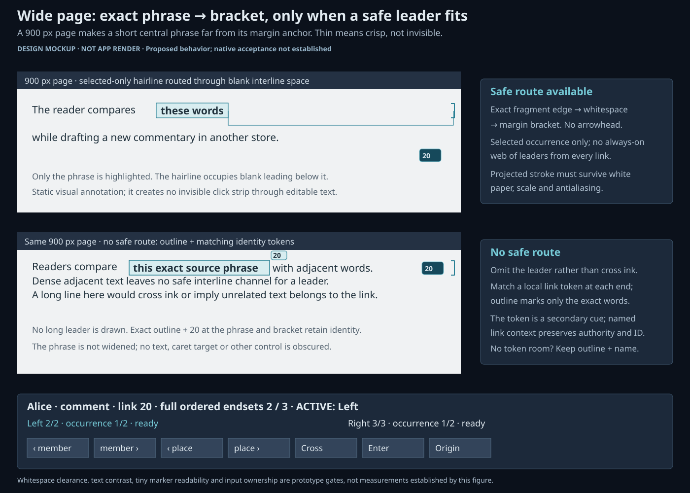

# Adversarial review: the combined NURBS beam proposal

The combined proposal survives **conditionally**. Keep the slim exact brackets, quiet satin,
controlled shoulders and independent cursor cues. Make overlap discovery, honest overflow and
page-local rendering requirements of the first prototype. The earlier sparse mockup does not prove
that complex arrangements work. Add a selected-occurrence text-to-anchor leader, with a safe
fallback.

Three independent antagonists reviewed the
[candidate report](ui_nurbs_beam_candidates_2026-10-08.md) using `xuzz-ui-design` and
`ux-validation`: a UI design critic, a Xanadu reader doing comparative research, and a pathological
user stressing topology, identity and resources. They inspected current source and captured frames.
The critic produced stress mockups; the reader independently reviewed them. This report separates
source findings, design predictions and required future acceptance. No production code was changed
for this review.

## Answers to the four challenges

| Challenge                                  | Verdict on the original combined proposal                                                                          | Required revision                                                                                                                                         |
| ------------------------------------------ | ------------------------------------------------------------------------------------------------------------------ | --------------------------------------------------------------------------------------------------------------------------------------------------------- |
| Ten links crisscrossing on a page          | Slimmer curves help readability but do not solve identity or picking.                                              | Named candidate chooser at ambiguous hits; quiet inactive routes; inspect one link without losing access to the others.                                   |
| First, middle and last pages of the KJV    | A document-wide spine or averaged gathering can span enormous unlinked gaps.                                       | Exact page-local fragments, offscreen member rows and local continuation markers; never highlight or bracket the intervening book.                        |
| Four or more competing anchor colours      | Colour layering cannot reliably distinguish identities; the fifth current lane overpaints the fourth.              | One selected exact outline/fill, quiet secondary marks and explicit overlap count opening all identities. Labels and shape survive monochrome.            |
| Short highlight far from its margin anchor | The sparse mockup conceals this ambiguity. A vertical bracket identifies a line, not necessarily the linked words. | Conditional thin static leader from exact highlight boundary to anchor through measured whitespace; matching token and outline when no safe route exists. |

With fixed endpoint order on opposing edges of a planar gutter, reversing ten links produces
`10 × 9 / 2 = 45` crossing relationships. This is a topological prediction, not a measured number of
separate raster intersections. NURBS does not remove those crossings. Changing route constraints may
reduce clutter, but a crossing never becomes a shared junction or an authored relationship.

## What the antagonists rejected

The design critic rejected a sparse attractive picture as evidence of dense readiness. The real-work
reader could not reliably identify a dissenting scholar's link among competing annotations, inspect
three widely separated passages without losing context, or trace a short quotation to a distant
margin. The pathological user rejected silent geometric truncation and unlimited work disguised by a
per-curve sample cap. All three retained the visual family with the following blockers resolved.

| Severity | Evidence and consequence                                                                                                                     | Required outcome                                                                                          |
| -------- | -------------------------------------------------------------------------------------------------------------------------------------------- | --------------------------------------------------------------------------------------------------------- |
| Blocker  | `LinkBeams::picked` consumes one GPU beam tag. A crossing currently exposes the winning strand's link, not all candidate identities.         | Semantic overlap query and named chooser; no topmost, nearest, brightest or first-authority substitution. |
| Blocker  | `marginLaneLimit` is four; `assignAnchorLanes` assigns the last lane when all are taken. Five-plus overlaps silently share paint/pick space. | Explicit overflow and complete identity access; a painting limit must never become an authoring limit.    |
| Blocker  | The 256-segment bound is per path. Discovery, lane processing, occurrence resolution and total staging remain separate costs.                | Bounded incremental work and complete semantic access, measured under load.                               |
| Major    | `HalfLink` retains only `.front()` when just one endset has local attachments.                                                               | Every local exact attachment remains represented when the other endset is absent.                         |
| Major    | Margin spines group by document, side and link rather than page, joining disjoint anchors.                                                   | Page-local exact fragments and disclosed continuation; no continuous mark over a disjoint gap.            |
| Major    | Current border-based anchors do not establish which short phrase on a wide line is attached.                                                 | Exact run boundary cue, optional safe leader and matching readable identity token.                        |
| Major    | The existing enlarged native frame has a registry-cell card over the target passage.                                                         | Content/control exclusions and companion framing before claiming the refined beams are usable.            |

Source evidence: [placement and half-links](../apps/common/xanadu/link_layout.cpp),
[lane limit](../apps/common/xanadu/anchor_lanes.hpp),
[lane assignment](../apps/common/xanadu/anchor_lanes.cpp),
[picking and margin spines](../apps/common/ui/xanadoc/beams.cpp), and
[presentation resolution](../apps/common/ui/xanadoc/link_context.cpp). The lane test currently
accepts the fifth anchor sharing lane 3; its passing result is not evidence of graceful overflow.
The native composition finding is visible in
`build/beam-candidate-review/current-scaled/entered.png`.

## Revised interaction and drawing contract

### Identity comes before route selection

One link remains one authority-scoped ID with two complete ordered endsets. Same numeric IDs from
different publications or enabled packages remain distinct. A shared passage, route crossing or
coincident marker never merges them. Member order remains authored order, independent of screen Y.
Geometry is view-only and mints neither cells nor operations.

An exact endpoint target can carry its precise side/member/occurrence. A body or trunk hit selects
only its link when unambiguous. A known ambiguous hit presents candidates with type, owner/curator,
authority, link ID, edition and both endset previews. The same chooser is reachable from linked
text, margin overflow and the named accessible link list. Stable ordering and full identity details
let a reader distinguish similar previews and same-hue annotations.

Choosing a candidate pins its context without moving the caret or entering a target. Both member and
occurrence cursors stay visible and independent; Cross changes active side, and explicit Enter
focuses the chosen occurrence. Cancel leaves the prior focus and context intact. Pointer, keyboard
and accessibility actions use the existing command boundary. Controls and editable text retain hit
ownership; wider invisible beam corridors may not steal their actions. A GPU tag can accelerate
candidate lookup but cannot establish that no other identity occupies the hit region.

### Dense fallback is mandatory; particular routing cosmetics are conditional

C4 means **Separate planar corridors**, the routing idea listed in the original candidate decision
table and deferred-proposals section. It was deferred before the surviving-proposal mockups were
made and was not part of the recommended combined bundle. The gallery now includes an
[annotated C4 comparison](ui/prototypes/beam-candidates/index.html#c4-corridors), alongside
[C8's deferred visual ladder](ui/prototypes/beam-candidates/index.html#c8-detail-ladder) and
[C9's rejected default carousel](ui/prototypes/beam-candidates/index.html#c9-carousel). These
illustrations highlight the disputed elements without promoting them into the bundle. C4's stable
local corridors remain an experiment, not a universal crossing-free promise. The required named
crossing chooser is an interaction correction; it does not promote corridor routing into the bundle.
C8's particular visual ladder may evolve, but its complete-access contract is mandatory now. Quiet
inactive routes in discrete steps, using visible origin/continuation marks and explicit link counts
where painting all routes becomes unreadable. Preserve the selected exact occurrence's primary cue.
Never combine separate authorities into a hub, invent a chosen-member pair, or thicken a trunk to
encode count. Avoid decorative depth braiding and rainbow identity assignments.

Every member and occurrence must be individually selectable through the world marker **or an exact
named list target**. Ready occurrences are enterable; pending or unavailable targets retain exact
identity, request/status and cancellation, without claiming a successful entry. Coincident targets
and finite screen area make simultaneous separate world hits impossible in general. A virtualized
two-sided list preserves complete authored order, search/jump and identity; it does not discard rows
from the semantic model. Selected unchosen members remain addressable even when their ornamental
routes reduce to counts. Count authored members, resolved occurrences, pending resolution and
currently drawn occurrences separately. An unfinished search never claims a complete occurrence
total.

At four-plus overlaps, show one legible selected range and quiet distinguishable attachment marks.
When the margin is saturated, use a neutral view-only count with a named chooser for every identity.
A four-slot budget is neither a four-link limit nor permission to hide a fifth. In monochrome, exact
outlines, tokens, names and focus cues must carry the same information as hue.

### Fragment by page, preserve stored spans

A stored member, its occurrences and each occurrence's page/run fragments are different concepts. A
three-span KJV endset remains three members; one continuous member crossing a page break remains one
member. Highlight all legitimately selected continuous text through its exact page-local fragments.
Never replace separate members with a covering extent. Draw exact fragments inside their pages and
clip regions. Leave disjoint gaps and inter-page space unmarked. Use local branch grouping and soft
continuation cues; a global averaged shoulder in a distant gap is not a usable anchor.

The two-endset identity survives even if its drawing requires several local sections. Do not force
all first/middle/last pages into one fan or zoom the entire book into view. Offscreen rows name
their exact location and selected edition. Preview does not pan the reader away; explicit Enter
brings the chosen occurrence into focus with origin and source companion intact. Represent every
local attachment when the opposite side is wholly absent, rather than just the first. Paint distinct
exact markers where budget and physical separation permit; named list/count access preserves every
remainder.

Distinguish ready-visible, ready-offscreen, layout pending, fetch pending, missing edition and
unavailable. A null geometry anchor alone does not determine status. Status belongs in panel/view
chrome, never as fabricated authored page text. Failed entry preserves identity and creates no
completed visit; delayed results must not replace a newer selection. Editions remain authorial
choices, with no nearest-version substitution.

### Add the thin inspection accent conditionally

The proposed leader is a selected or keyboard-focused occurrence cue, with optional hover preview.
It is static, unpickable and pass-through. It has no arrow, travelling texture, unilateral taper,
new link identity or navigation action. Preserve the distinction from the transclusion beam and drag
tendril. A matching small local token associates highlight, bracket and panel even without colour.

Start at the exact glyph-run highlight boundary with a small terminal tick, then route through
measured blank interline/margin space to the bracket. Do not cross letters, caret/IME decorations,
media or controls, or underline intervening unlinked words. Break cues at lines, columns and pages;
do not connect separate stored members across a gap. Both independent selections may retain local
markers while the active inspection side receives the long leader.

“Extremely thin” means restrained and perceptually visible at the tested scale/backend, not a
subpixel wisp. Use live theme metrics and settings, calibrated from captures. When there is no safe
route, omit the long leader and retain an exact outline/terminal plus matching identity name/token
in the margin and panel. Never guess another line, widen the span or trade prose legibility for a
complete-looking connector. The leader is supplementary; all navigation remains available without
it.

### Bound total work and preserve reading

Keep complete semantic endsets while bounding resolution queues, visible route staging, sampling,
collision presentation and retained caches. Resolve content off the UI thread, support cancellation
and validate response generations. Validate pick results against frame/layout generations too,
including package changes; an old strand index must never select rebuilt geometry. Cache occurrence
and layout products; reuse drawing scratch. A selected large link must remain responsive before
every remote occurrence resolves.

The existing grouped `L + R - 1` descriptor strategy avoids Cartesian staging, but is not proof of
bounded discovery or frame time. Measure occurrence discovery, lane layout, route preparation,
staged rows, memory, worst-frame stall and input latency independently. Replace repeated all-pairs
anchor scans with indexed/sweep processing where feasible. If intersection output itself grows
quadratically, bound its visual processing and retain indexed chooser access. Set performance
thresholds only after measurements, and make tunable policies system specifications.

## Stress mockups of the revised proposal

Open the [gallery](ui/prototypes/beam-candidates/index.html). Its selectors are native fragment
links and work without scripts. Pictured controls illustrate future behavior; they are not
interactive prototype controls. These stress pictures revise the sparse proposal, rather than
certify runtime support or NURBS performance.

| Mockup                                                                          | Decision illustrated                                                                    |
| ------------------------------------------------------------------------------- | --------------------------------------------------------------------------------------- |
| [Ten crossings](ui/prototypes/beam-candidates/stress-ten-crossings.png)         | Independent identities, quiet intersecting routes and a named chooser; no shared hub.   |
| [Distant pages](ui/prototypes/beam-candidates/stress-distant-pages.png)         | Three separate members with an offscreen row; page-local fragments without a gap spine. |
| [Overlapping colours](ui/prototypes/beam-candidates/stress-overlap-colours.png) | Selected exact range plus disclosed identity overflow, instead of five layered fills.   |
| [Wide-page anchor](ui/prototypes/beam-candidates/stress-wide-anchor.png)        | Safe thin inspection leader and an explicit no-safe-route fallback.                     |

KJV page labels use `1`, `ceil(P/2)` and `P` of the current presentation. No KJV fixture was found
in `tests/samples`; no canonical page count or measured KJV render is asserted. The final case needs
a real publication and layout. The schematic paths are static vector illustrations, not native NURBS
captures, measured hit regions or live resolver states. Independent final review corrected a route
that appeared to terminate at summary chrome, removed directional endset preview arrows, added
authority tokens and moved a local token clear of glyphs. The critic and reader retain these as
conditional concept illustrations; native interaction and layout clearance remain acceptance work.

## Acceptance work before implementation approval becomes a UX pass

| Native scenario                                                   | Required assertion                                                                                                                               |
| ----------------------------------------------------------------- | ------------------------------------------------------------------------------------------------------------------------------------------------ |
| Ten reverse-order links; several same hue                         | Each authority-scoped identity reachable from ambiguous hit, text, list and keyboard; no accidental Enter.                                       |
| Four, five and ten overlapping/nested anchors                     | Honest count/chooser; selected words legible; all links accessible in monochrome/CVD review.                                                     |
| KJV first/middle/last; continuous multi-page member               | Authored member count/order retained; exact page fragments; no gap fill/spine or forced whole-book framing.                                      |
| Other endset entirely outside view or unavailable                 | All local members represented and reachable, with exact markers where separable; offscreen distinguished from failure; explicit Enter or reason. |
| Wide page; two phrases on one line; multi-column; RTL             | Exact attachment association; safe leader or labelled fallback; caret and controls keep input.                                                   |
| Repeated occurrences; identical IDs from different packages       | Distinct occurrence/authority identity; package toggling cannot reassign stale picks.                                                            |
| 1,000-by-1,000 with repeated occurrences                          | Complete list access, bounded frame work, cancellable resolution and honest pending totals.                                                      |
| Self-link, same page/cell, coincident, reversed or oblique routes | Finite geometry or exact local fallback; independent sides; no invented relation.                                                                |
| Scrolling, zoom, package changes and delayed failures             | Stable semantic selection; no stale reply, guessed edition or false completed visit.                                                             |
| Successful entry, Origin, branching return and restart            | Source companion and context retained; completed visits only in private activity store; visited stores unchanged.                                |

Run these through pointer, bound keymap commands and accessibility with identical semantic results.
Inspect GL/GLES/Vulkan captures at scales 1 and 1.5, close/normal/distant zoom and reduced motion.
Add real content/control exclusions; do not accept a clean schematic while native prose is obscured.
Full J16 needs authoring affordances, distant cell traversal, private branching walk persistence and
restart. Platform assistive-technology usability still needs independent validation.

This review ran 11 existing device-free grouped-layout/lane tests and 33 existing navigation and
occurrence tests, all passing with isolated data/config/cache. They establish current foundations
and known behavior only. No new native density, hairline, KJV or full J16 journey was passed here.

Implementation order: establish candidate ownership and honest overflow; preserve all local
attachments and page fragments; add conditional leader with exact fallback; then refine satin,
shoulders and bounded projected quality. Measure dense scenes before finalizing thresholds. The
carousel, global shared hub and decorative depth weaving remain rejected defaults.
