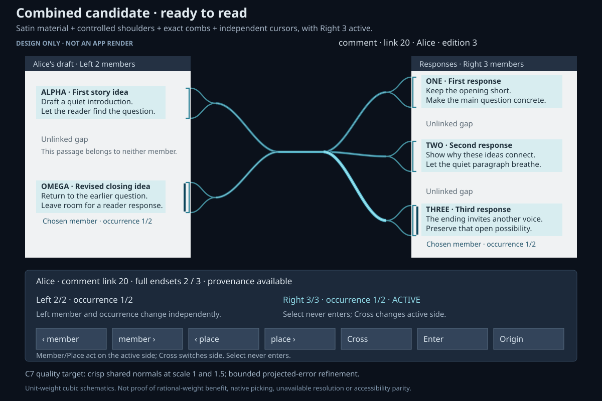

# NURBS beam candidates: UI proposals and UX review

The recommended first prototype combines **slim exact-range connectors (C3), controlled gathering
shoulders (C2), quiet satin material (C1), and independent cursor emphasis (C5)**. Explicit
unresolved states (C6) and bounded rendering quality (C7) are requirements of that prototype. The
subsequent [adversarial review](ui_nurbs_beam_adversarial_review_2026-10-08.md) makes named overlap
choice, honest overflow and page-local rendering requirements of the first prototype. Particular
corridor and detail-ladder treatments remain experiments; a carousel is rejected as the default
presentation. That review supersedes the dense-case deferrals below.

This is a design report with mockups, not a new beam implementation. The UI designer, independent
aesthetics reviewer and independent UX reviewer used the repository's `xuzz-ui-design` and
`ux-validation` skills. All three inspected actual captured frames and current source. UX refined or
rejected the proposals after the design pass. The lead checked the implementation claims and reran
the current browsing baseline. Candidate approval means approval to prototype, not proof that an
unbuilt feature works through the interface.

## Grounding in the current build

At `193b68e`, authored links already have exact occurrence branches, two view-only gathering points,
one common trunk, stationary filament shading and selected-link opacity emphasis. Transclusion has a
separate glass surface; drag feedback has a narrow textured taper. The panel exposes complete
endsets, independent member/occurrence cursors, Cross, explicit Enter and Origin. A beam-body pick
selects the whole link without choosing an arbitrary member.

The generic library accepts clamped degree-one through degree-three rational paths, interior knots
and analytic tangents. It samples at most 256 segments with cumulative chord distance and shared
endpoint normals. Application routes currently use single cubic spans, ordinary horizontal endpoint
handles and constant width per route. This already gives ordinary branch/trunk centrelines aligned
endpoint tangent directions. There is no generic authored-beam width profile, adaptive projected
sampling or union junction surface today.

The main visual weakness is **girth and junction coverage**, not lack of a smooth curve. The active
cyan link in `build/beam-candidate-review/current/entered.png` resembles a broad hose. The 4-by-4
diagnostic gathers into a compact bow-tie; the two-colour fan has crowded crossings. The enlarged
entered frame still has a hidden registry-cell card over the target passage. Beam polish does not
resolve that scene-composition defect.

NURBS supplies a common representation, analytic tangent frames and local control with interior
knots. Unit-weight cubics remain sufficient for most routes. Rational weights can tune shoulder
shape without moving attachments; exact circular arcs are useful only if a route actually needs that
clearance shape. NURBS does not automatically produce a smooth branching surface, variable width,
reliable picking, asynchronous endpoint resolution or cheap dense rendering.

## Final candidate decisions

| Candidate                                | UX disposition                    | What survives the review                                                                            | Priority                             |
| ---------------------------------------- | --------------------------------- | --------------------------------------------------------------------------------------------------- | ------------------------------------ |
| C1 Quiet satin material                  | Advance with constraints          | Flat, hue-preserving stationary core and restrained edges; no broad white shine                     | First bundle                         |
| C2 Controlled two-gathering shoulders    | Advance, enhanced                 | Shared junction frame and coordinated width/curvature; bounded coverage instead of bright overlap   | First bundle                         |
| C3 Exact-range comb into slim connectors | Advance, enhanced                 | Full exact brackets carry passage reach; thin connectors carry relation identity                    | First bundle, strongest clarity gain |
| C4 Separate planar corridors             | Conditional routing experiment    | Stable local lanes; named crossing disambiguation required regardless of routing                    | First-prototype ambiguity contract   |
| C5 Independent cursor emphasis           | Advance, enhanced                 | Member and explicit occurrence cues agree with each side's cursor; no chosen-pair path              | First bundle                         |
| C6 Honest unresolved endings             | Advance, enhanced                 | Engine-backed status text and restrained open endings at known anchors                              | Prototype requirement                |
| C7 Projected quality budget              | Advance as an enabling experiment | Bounded, stable refinement across zoom and scale with measured costs                                | Quality gate                         |
| C8 Dense fan detail ladder               | Required degradation contract     | Complete semantic access through exact world/list targets; honest counts when painting is saturated | First-prototype requirement          |
| C9 Two-endset carousel                   | Reject as default                 | Optional panel experiment only after comparison with two ordered lists                              | Lowest priority                      |

## Mockups of the surviving proposals

Open the [comparison gallery](ui/prototypes/beam-candidates/index.html) to switch between the
mockups and download their standalone SVGs. PNG previews are included for sharing. All pictures are
proposed static schematics, not native Xuzz screenshots. The sample author, link and edition labels
are illustrative. The panel uses the existing active-side member/occurrence command model; its
descriptive layout is not a separate proposal to redesign navigation.

The combined ready state is the recommended visual direction. Its unavailable variant keeps the
chosen member and complete count, but adds no destination or passage for the missing occurrence.

| Mockup                                                                          | What to inspect                                                                 |
| ------------------------------------------------------------------------------- | ------------------------------------------------------------------------------- |
| [C1: satin](ui/prototypes/beam-candidates/c1-satin.png)                         | Quiet stationary core and edges, with relation hue retained                     |
| [C2: shoulders](ui/prototypes/beam-candidates/c2-joins.png)                     | Annotated junction envelope and common trunk, without a new hub object          |
| [C3: exact ranges](ui/prototypes/beam-candidates/c3-comb.png)                   | Full brackets and readable gaps, with slim connector weight                     |
| [C5: cursors](ui/prototypes/beam-candidates/c5-cursors.png)                     | Independent members, explicit occurrences and active side; neutral common trunk |
| [C6: unresolved](ui/prototypes/beam-candidates/c6-status.png)                   | Status at the known gathering and panel, with no invented target trajectory     |
| [C7: quality target](ui/prototypes/beam-candidates/c7-quality.png)              | Unmeasured projected-quality illustration; sample dots are not controls         |
| [Combined: ready](ui/prototypes/beam-candidates/combined-ready.png)             | First bundle in a resolved reading scene                                        |
| [Combined: unavailable](ui/prototypes/beam-candidates/combined-unavailable.png) | Same bundle with a failed occurrence and disabled Enter                         |

C1 and C2 isolate complementary aspects of one treatment rather than two visually distinct
alternatives. Ordinary route mockups use static unit-weight cubic paths and do not demonstrate a
benefit from rational weights. C7 includes a separate rational quadratic arc example. Width, join
coverage, picking, refinement and resolver behavior still require native implementation. C7 is a
quality gate, so its picture is an explanatory inset rather than another beam style. Revised dense
fallbacks and a conditional wide-page leader are shown in the adversarial review’s four stress
mockups. C4, C8 and C9 now also have annotated comparison mockups below; their pictures do not
promote them into the recommended bundle.

Both independent reviewers inspected the final PNGs and approved them as concept illustrations.
Their review changed the first drafts: connector girth was reduced, a fabricated-looking missing
trajectory was removed, member/occurrence controls and active-side labels were made explicit, and
secondary page text was darkened to meet the 4.5:1 contrast target. This is approval of the
corrected illustrations, not runtime UX acceptance. The initial browser preview tool could not start
because its sandbox failed on the workspace's `.agents` symlink. After the gallery's
script-dependent selectors were reported as unusable, they were replaced with native fragment links
and CSS. A headless Firefox follow-up clicked all eight selectors and verified that each displays
only its corresponding mockup. SVGs were rendered to PNG and visually inspected independently.

### Annotated deferred and rejected proposals

These additional mockups illustrate the original alternatives. Neutral dashed frames and numbered
callouts highlight the elements under review without changing relation hues or pretending that the
annotations are Xuzz controls. The status heading and explanations identify what was deferred or
rejected, and what remains required. Open each picture in the gallery for its SVG download.

| Mockup                                                                  | Highlighted element and disposition                                                                                                                                 |
| ----------------------------------------------------------------------- | ------------------------------------------------------------------------------------------------------------------------------------------------------------------- |
| [C4: corridors](ui/prototypes/beam-candidates/c4-corridors.png)         | Per-link corridor reservation and local rerouting are deferred experiments. The crossing chooser remains required; routing cannot guarantee crossing-free geometry. |
| [C8: detail ladder](ui/prototypes/beam-candidates/c8-detail-ladder.png) | Specific quieting and count/list presentation stages remain deferred. Complete ordered target access, exact local markers and honest counts are required.           |
| [C9: carousel](ui/prototypes/beam-candidates/c9-carousel.png)           | Independent partial member tracks are rejected as the default. An optional experiment must retain both cursors, explicit Enter and ordinary ordered lists.          |

C4's gray bands annotate per-identity clearance studies, not a shared authored corridor or measured
hit area. C8 shows the same link at three illustrative detail levels; all visible exact markers
remain while ornamental routes reduce. Its authored member totals, resolved occurrence totals and
drawn fragment counts are explicitly different. C9's curved rails are panel chrome, not authored
links between members. Its cards are schematic preview placeholders. Hidden member windows and the
extra browsing mode explain the default rejection; paired rotation and a single world hub are not
attributed to the original proposal.

The independent UX and aesthetics reviewers checked these PNGs. Their corrections made active-side
labels explicit, matched C4 brackets to route hues, removed C8's apparent chosen-member pairing and
removed its disconnected floating trunk. These are concept comparisons, not native implementations,
measured layout clearance, live animations or UX acceptance. A headless Firefox follow-up clicked
all fifteen gallery selectors and verified that each displays only its corresponding picture. All
linked assets resolve and all fifteen SVGs parse.

### C1. Quiet satin material

Replace the cylindrical impression with a flatter transverse profile: a faint central filament and
two quiet edge accents. Keep the existing relation hue, stationary appearance and crisp
antialiasing. Texture can remain very subtle, based on distance, and is never the only semantic cue.
Selection changes brightness, outline or weight; it does not change hue. Shared primedia retains its
glass material and drag feedback its progressive pointer taper.

**UX enhancement:** evaluate contrast on white paper as well as the dark gutter. Keep brackets,
identity text and accessible actions visible. A shader-only change will not remove excessive girth
or swollen shoulders, so C1 ships with C2/C3 rather than as the whole solution.

**Seam:** generic surface shading in `assets/shaders/beam.frag.glsl`, with application policy and
live settings in the existing beam configuration. No bloom pass or idle pulse is proposed.

### C2. Controlled two-gathering shoulders

Keep two separate endsets and a common trunk. Branches settle into a shared junction frame, with
coordinated curvature and width transitions. Control local coverage so several arriving strands do
not create a bright bulb or pinched knot. A single junction mask or geometry patch is an experiment
to compare against bounded overlap; it must never union unrelated link identities.

**UX enhancement:** the common trunk selects only the link. Gathering points have no new interaction
mode, cell identity or navigation visit. Handle reversed, oblique, nearly coincident and short
routes, not only the ordinary horizontal case. Preserve complete stored counts when only some
attachments are visible. A branching surface has multiple paths; smooth centreline tangents alone do
not guarantee a smooth envelope or second-derivative continuity.

**Seam:** view-only junction records and route preparation in `LinkBeams`, shared generic geometry
and coverage in the library/shader. Interior knots allow local shoulder refinement without moving
the exact attachment. Keep positive weights and prefer unit weights unless captures justify more.

### C3. Exact-range comb into slim connectors

Separate attachment reach from connector thickness. A crisp bracket or short comb marks the full
exact passage; a slim connector leaves that marker and gathers into the trunk. Larger ranges
lengthen the marker instead of inflating the whole route. Start prototypes near the theme's border
weight, with a modest selected-state multiplier, then calibrate from captures at both scales. Those
are design ratios to test, not fixed pixel constants.

**UX enhancement:** taper symmetrically at both bracket approaches, without implying a source and
destination. Gaps between members stay unmarked; repeated occurrences stay distinct. Member count
does not become trunk thickness. Narrow appearance requires an independent stable hit corridor or
demonstrated usable visible hit area. The corridor must respect editable text, controls and other
owned targets. At ambiguous overlap expose candidate link identities rather than guessing a strand.

**Seam:** a generic distance-based width profile extending `Beams::addNurbs`, exact range markers in
the existing application margin layout, and shared picking infrastructure. Neither invisible hit
expansion nor the width profile exists for authored beams today.

### C5. Independent cursor emphasis

Within the selected link, mark the chosen left member and chosen right member independently. Use a
restrained outline or weight cue, while keeping the remaining branches and brackets visible. Mark
the active side separately, and distinguish an explicitly selected occurrence from a member that
still has several possible occurrences. The whole trunk remains the same link's trunk.

**UX enhancement:** do not draw a privileged connection between just the two chosen members. That
would suggest an authored pair. Selection and preview move no caret and enter no content. Existing
Cross, member, occurrence, Enter and accessible commands remain the boundary; geometry gains no
extra gesture. Reduced motion retains all static cues.

**Seam:** derive emphasis from stable `LinkContext` member/occurrence identity, not representative
strand indices. Route records need an exact attachment-to-occurrence mapping before branch emphasis
can reliably match the panel. Live view updates append no operations to visited stores.

### C6. Honest unresolved endings

Use a quiet open ending or marker at a known content anchor or viewport boundary. Keep readable
panel statuses for loading, outside the visible neighborhood, missing version and unavailable
content. Full endset counts and chosen cursors remain visible. Do not invent a destination position
simply to complete an attractive fan.

**UX enhancement:** a null anchor does not identify the failure state; status must come from the
engine/resolver. Labels and accessibility descriptions carry the distinction. A dash is only a
secondary cue and cannot conflict with a relation's stroke pattern. Loading needs no spinner or
traveling packet. Cancellation preserves the prior reading focus; failed entry creates no completed
visit and substitutes no nearby occurrence.

**Seam:** typed resolution state and presentation in `LinkContext`/the panel, with known-anchor
markers in `LinkBeams`. This is a usability addition, not a claim that current resolver states are
already complete.

### C7. Projected quality budget

Use a bounded refinement experiment for highly curved or enlarged routes. Retain analytic normals
and measure projected error, sample counts, staged rows and frame cost. Cache refinement with layout
revisions or use hysteresis so small zoom changes do not make the silhouette pop. Define budget
exhaustion and degenerate-tangent fallback before implementation.

**UX enhancement:** picking uses stable semantic geometry rather than whichever sampled segment
happens to be nearest. Refinement must not move attachments or create self-intersections. Measure
endpoint discovery separately from drawing; the existing 1,999-descriptor test is not a latency
benchmark. C7 is a quality requirement, not another surface style.

**Seam:** generic bounded sampling in `nurbs.cpp`, projected quality policy in shared UI. All
bounds, width ratios, status styling and thresholds become live system specifications with defaults
and theme metrics; new commands, if any, use the existing keymap/Vortex boundary.

## Routing experiments, density requirements and rejected defaults

**C4: planar corridors.** This idea was deferred in the initial review, omitted from the surviving
mockup gallery, and excluded from the recommended combined bundle. Retain separate identities,
authority and trunks. Stable view-local lanes remain a routing experiment. Named candidate selection
at crossings and reading/control exclusions are first-prototype requirements, even if corridor
routing is deferred. Fixed reversed endpoint order can force crossings; a crossing is not a new
junction. See the adversarial review for the chooser and hit-ownership contract.

**C8: density ladder.** Honest dense fallback is required in the first prototype. Simplify
ornamental routes in discrete reversible steps with hysteresis while preserving every ordered member
and occurrence through exact world markers or named list targets. Coincident targets need not be
separately world-pickable at once. Counts distinguish links, members, resolved occurrences and
pending targets. Aggregates are quiet view chrome, never stored cells or combined authorities.
Selected unchosen members remain accessible when visual routes reduce to disclosed counts.

**C9: carousel.** Reject as the default because existing independent controls already do the work,
and rotation would hide members and add a mode without fixing junction finish. A future optional
panel experiment must preserve both counts/previews, independent authored order and cursors, named
keyboard/accessibility actions, explicit Enter and a normal list fallback. Reject paired rotation, a
single world hub and spatial dragging as the only way to browse.

Both reviewers also reject idle wobble, decorative traveling pulses, additive bloom, rainbow hue
shifts, count-inflated trunks, arbitrary depth braiding and shared hubs across link identities.
Arrowheads or unilateral fade cannot invent direction for an ordinary two-endset link.

## Verification and release gates

The current prepared-store browsing journey was rerun on OpenGL at UI scales 1 and 1.5, with SDL
offscreen, dummy audio, software rendering and isolated XDG data/config/cache. Both runs passed.
Evidence is in `build/beam-candidate-review/current/` and `current-scaled/`, including frames and
`transcript.log`. The controls remain Ctrl+O, Alt+Shift+N/J/X/L/P, drawn member/Cross/Enter/Origin
buttons and native accessibility dumps. Both visited stores retain their operation counts.

| Journey / check                                                                  | Outcome this pass                    | Limit                                             |
| -------------------------------------------------------------------------------- | ------------------------------------ | ------------------------------------------------- |
| J16 subset: select, independent browsing, Enter, Origin, overlapping-link switch | Current baseline pass at both scales | Prepared native links, not UI authoring           |
| Enlarged scene readability                                                       | Finding retained                     | Registry-cell overlay obscures the target passage |
| GL/GLES/Vulkan material comparison                                               | Earlier captured evidence reviewed   | New candidates have no backend renders yet        |
| Candidate picking, status and density behavior                                   | Design review only                   | No implemented new feature to validate            |
| Full J16, distant cells, branching restart, live assistive technology            | Not validated                        | Separate journey work remains                     |

Before calling a candidate usable or finished:

1. Implement a bounded prototype of C3+C2+C1+C5 with C6/C7 gates. Fix or explicitly account for
   hidden slice overlays, content/panel exclusions and companion framing; clean gutters cannot
   compensate for obscured reading text.
1. Repeat exact 2-by-3 browsing with another overlapping link, repeated occurrences, gaps and a
   missing representative through pointer, keymap and accessibility commands. Compare authority,
   link ID, independent cursors, chosen occurrence, focus and visited-store operations.
1. Inspect native frames on GL, GLES and Vulkan at both UI scales and close/normal/distant zoom,
   including reversed, oblique, short, same-document and partially visible routes. Check cracks,
   hotspots, weight jumps, hue semantics and idle stability, including reduced motion.
1. Exercise thin and inactive branch hits, common-trunk selection, ambiguous crossings, editable
   text, caret placement and controls. Invisible corridors may not steal another target's action.
1. Exercise all resolver statuses and cancellation. Complete counts stay visible; failure preserves
   identity and focus and creates no fake target or completed activity visit.
1. Measure sparse, high-fanout and genuinely dense independent-link scenes. Record discovery,
   staging and rendering separately before setting performance thresholds. Mockups certify none of
   these costs.

The preferred visual family survives conditionally. The adversarial review requires overlap,
overflow and page-fragment correctness before dense readiness can be claimed; particular C4/C8
visual forms remain evidence-dependent. C9 does not survive as a default. The mockups show intended
appearance and state communication, not implemented runtime behavior or completed UX acceptance.
