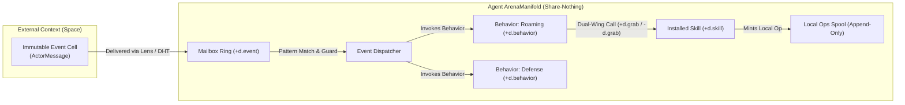
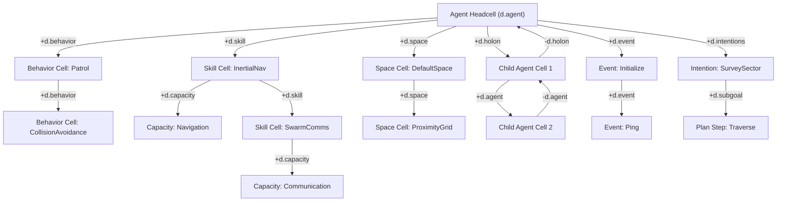
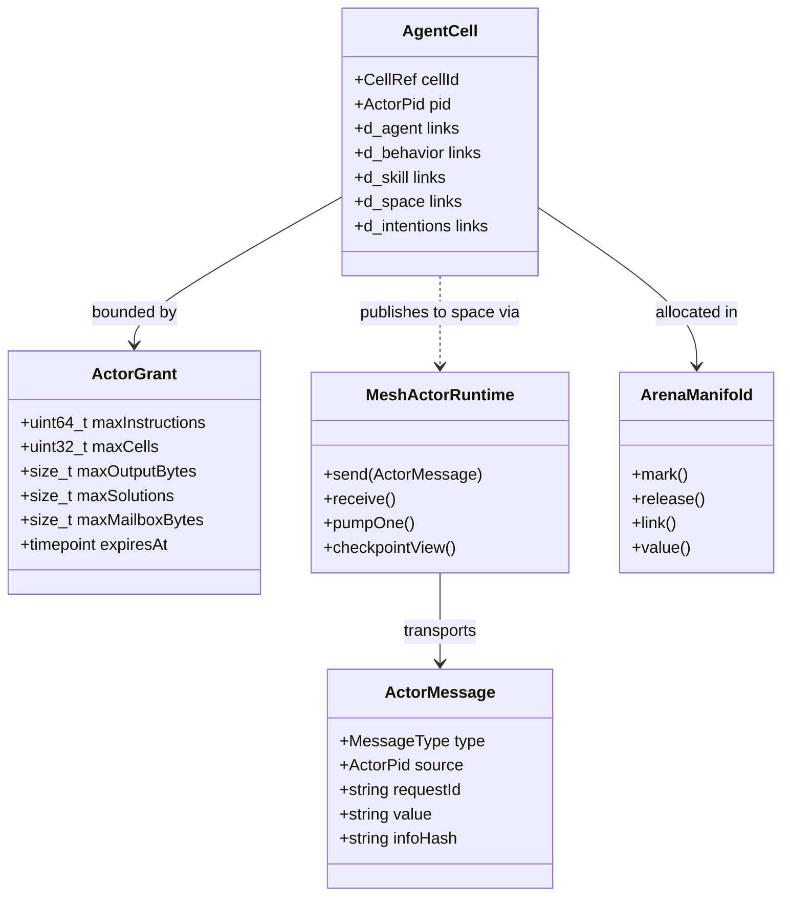
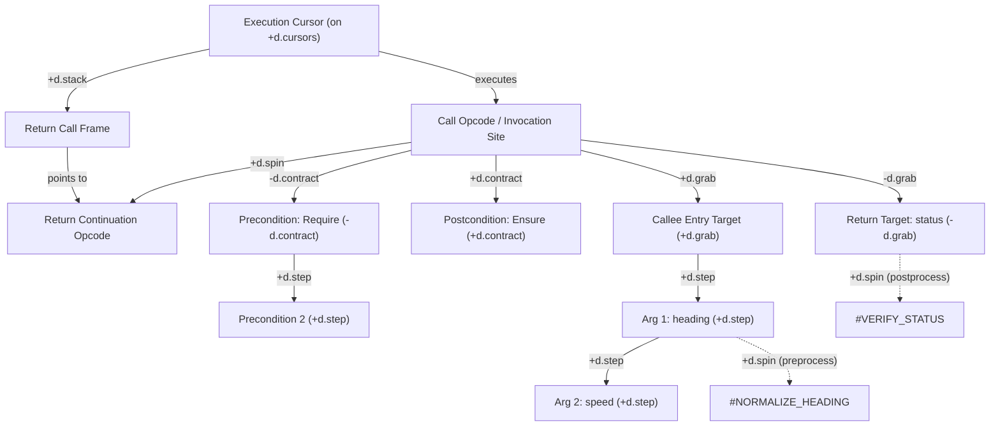
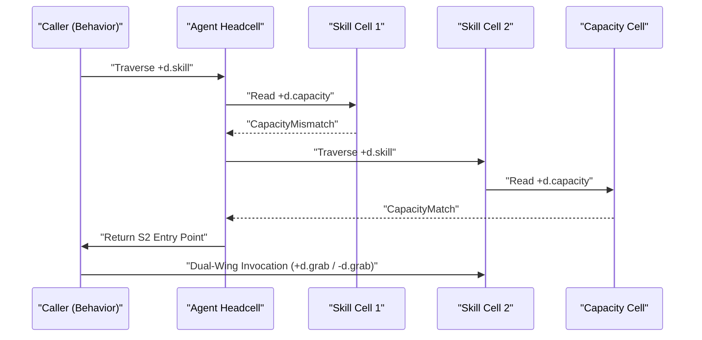
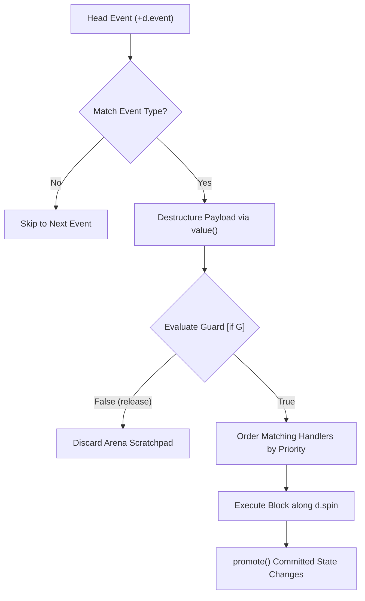
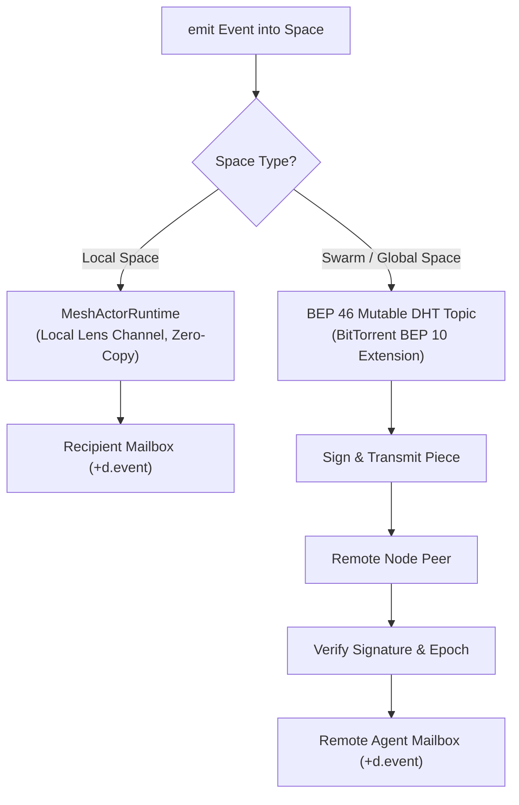
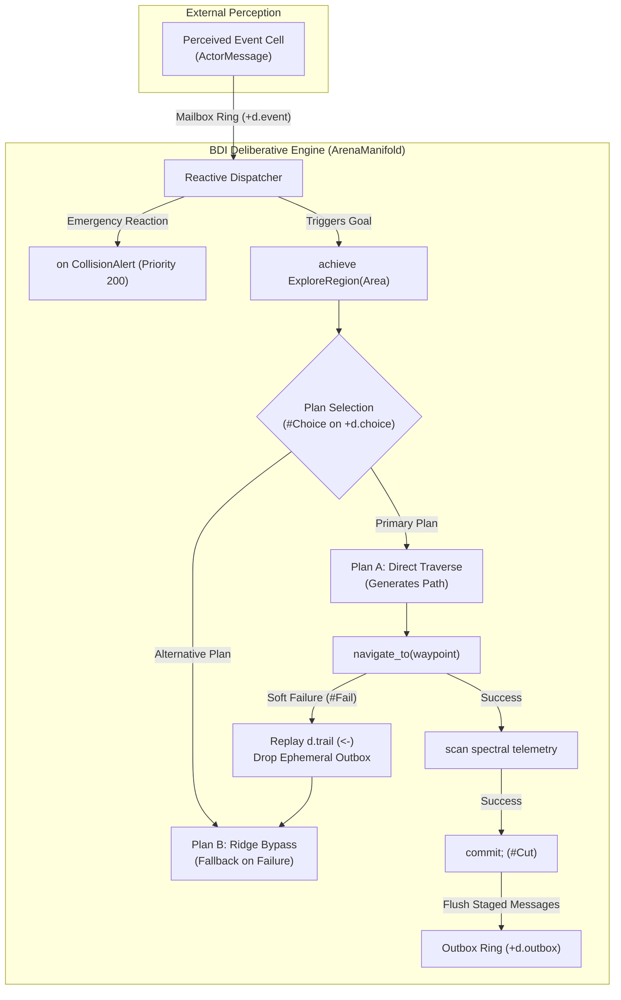

# vagent: An Agent-Oriented Programming Language Over a Multidimensional Spool-Mesh Manifold

**Document Version:** 1.0 — The SARL Metamodel on Vortex **Compilation Target:** Vortex
Hyperstructural Runtime Core (`link` and `value`), Spool-Mesh Distributed Actors
(`apps/common/xanadu/vortex/mesh_*`) **Status:** Specification only; nothing here is wired into the
gleditor build. It rests strictly upon mechanisms that *are* built — the `ArenaManifold` and its
`mark`/`release`/`promote` ([convergence](store-slice-convergence.md) step 21,
`zigzag/arena_manifold.hpp`), the dual-wing calling convention and `d.spin` instruction streams
([Vortex](vortex-hyperstructural-runtime.md)), and the Spool-Mesh share-nothing actor runtime
(`apps/common/xanadu/vortex/mesh_actor.hpp`, [vortex-distribution](vortex-distribution.md)) — and
asks the C++ core for nothing those did not already pay for.

`vagent` is a sixth front end onto the manifold that [Vortex](vortex-hyperstructural-runtime.md)
runs, [VQL](vql-query-language.md) queries, [VPL](vpl-array-language.md) indexes,
[Vlog](vlog-logic-extension.md) resolves, [vlace](vlace-functional-language.md) evaluates purely,
and [vicon](vicon-goal-directed-language.md) drives with goals. Where SARL established the canonical
agent-oriented metamodel on the JVM (unifying agents, behaviors, capacities, skills, events, spaces,
contexts, and holons), `vagent` liberates those concepts from linear memory heaps, thread locks, and
object references. In `vagent`, every agent is a **rooted spatial zzstructure** residing in a
share-nothing `ArenaManifold`; every interaction is an **immutable, content-addressed event**
propagated across dimensional spaces; and every capacity invocation lowers to Vortex's **dual-wing
calling convention** over `link` and `value`.

**Like its siblings, vagent is a surface syntax and nothing more.** Every construct compiles to
Vortex's single-primitive invariant — `link` and `value`, and nothing else — coupled with the
Spool-Mesh actor substrate. If an agent interaction below cannot be expressed as a finite sequence
of those primitives, it is a defect in this document rather than a feature of the language.

______________________________________________________________________

## Contents

- [1. Architectural Foundation & Design Invariants](#1-architectural-foundation--design-invariants)
  - [1.1 Autonomous Coordination over an Append-Only Manifold][toc-01]
  - [1.2 The Single-Primitive Invariant](#12-the-single-primitive-invariant)
  - [1.3 Why an Agent is Not an Actor: SARL versus Erlang/Akka][toc-02]
  - [1.4 What is Being Claimed](#14-what-is-being-claimed)
- [2. Topological Foundation: zzstructures in Zigzag Space][toc-03]
  - [2.1 The Strict 2-Degree Orthogonal Invariant](#21-the-strict-2-degree-orthogonal-invariant)
  - [2.2 System Dimensions for Deliberative Agents][toc-dims]
  - [2.3 Topological Anatomy of an Agent Cell](#23-topological-anatomy-of-an-agent-cell)
  - [2.4 Dynamic Ranks and Link Splicing](#24-dynamic-ranks-and-link-splicing)
  - [2.5 Identity Sharing via `d.clone` Rank Traversal][toc-04]
  - [2.6 Topological Garbage Collection and Pinning Cursors][toc-05]
- [3. The Core Metamodel Grounded in Spool-Mesh](#3-the-core-metamodel-grounded-in-spool-mesh)
  - [3.1 The Ten Metamodel Entities](#31-the-ten-metamodel-entities)
  - [3.2 Grounded Substrate Mapping: C++ Types and Layouts][toc-06]
- [4. Compilation Target & The Acceptance Test](#4-compilation-target--the-acceptance-test)
  - [4.1 The Acceptance Test: Strict Reduction to `link` and `value`][toc-07]
  - [4.2 Dual-Wing Calling Convention for Capacity and Skill Invocations][toc-08]
  - [4.3 Memory Discipline: `mark`, `release`, and `promote`][toc-09]
- [5. Concrete Syntax & Formal Grammar](#5-concrete-syntax--formal-grammar)
  - [5.1 Lexical Structure and Design Ergonomics](#51-lexical-structure-and-design-ergonomics)
  - [5.2 Declarations: Events, Capacities, Skills, and Behaviors][toc-10]
  - [5.3 Agent Declarations, Reactive Handlers, and Guards][toc-11]
  - [5.4 Scoped Event Emission and Holonic Spawning](#54-scoped-event-emission-and-holonic-spawning)
  - [5.5 Complete EBNF Grammar](#55-complete-ebnf-grammar)
- [6. Lowering to Vortex Primitives](#6-lowering-to-vortex-primitives)
  - [6.1 Production-to-Lowering Cross-Walk](#61-production-to-lowering-cross-walk)
  - [6.2 Structural Lowering of Agent Cells and Ranks][toc-12]
  - [6.3 Dynamic Skill Dispatch Ring Lowering](#63-dynamic-skill-dispatch-ring-lowering)
  - [6.4 Event Matching, Guards, and Priority Tree Lowering][toc-13]
  - [6.5 Holon Parent-Child Context Linkage Lowering][toc-14]
- [7. Distributed Execution & Spool-Mesh Concurrency][toc-15]
  - [7.1 Mapping Agents to `ActorPid`, `ActorGrant`, and `ActorMessage`][toc-16]
  - [7.2 The Law of Share-Nothing Distribution: NO REMOTE MUTATION][toc-17]
  - [7.3 Checkpoint Continuations and Message-Boundary Durability][toc-18]
  - [7.4 Intra-Process Lens Channels and Inter-Node DHT Topic Swarms][toc-19]
- [8. The `std:agent` Vortex Standard Library Module][toc-26]
  - [8.1 Module Topology along `d.stdlib`](#81-module-topology-along-dstdlib)
  - [8.2 Core Capacities and Default Built-In Skills][toc-20]
- [9. Comprehensive Worked Examples](#9-comprehensive-worked-examples)
  - [9.1 Example 1: Holonic Swarm Searcher and Aggregator][toc-21]
  - [9.2 Example 2: Dynamic Skill Swapping at Runtime][toc-22]
- [10. Deliberative Agency: Synthesizing `vagent` with `vicon`][toc-27]
  - [10.1 Reactive Events and Proactive Intentions: The BDI Dual Stance][toc-28]
  - [10.2 Goal-Directed Evaluation: Soft Failure vs. Hard Contract Errors][toc-29]
  - [10.3 Speculative Deliberation, Reversible Updates, and the Ephemeral Outbox][toc-30]
  - [10.4 Intentions as Reified Manifold Graphs & Turn Quiescence][toc-31]
  - [10.5 Sensory Telemetry and Stream Scanning][toc-32]
  - [10.6 Comprehensive Example: Planetary Rover with BDI Deliberation][toc-34]
- [11. Soundness Properties & Architectural Comparison][toc-23]
  - [11.1 Determinism, Isolation, and Deadlock Freedom][toc-24]
  - [11.2 Architectural Comparison Matrix](#112-architectural-comparison-matrix)

______________________________________________________________________

## 1. Architectural Foundation & Design Invariants

### 1.1 The Central Thesis: Autonomous Coordination over an Append-Only Manifold

Traditional Agent-Oriented Programming (AOP) systems—most notably SARL on the JVM, or Jade before
it—suffer from an impedance mismatch: their high-level conceptual models are decoupled, reactive,
and organizational, but their execution substrates are linear heaps, mutual-exclusion locks, and
ephemeral thread schedulers. Conversely, distributed actor systems (such as Erlang/OTP or Akka)
provide rock-solid failure boundaries and share-nothing isolation, but lack first-class abstractions
for dynamic roles, modular behaviors, abstract capacities, and scoped interaction spaces.

`vagent` resolves this divergence by implementing the SARL metamodel directly over the **Vortex
Hyperstructural Runtime** and the **Spool-Mesh Distributed Model**. In `vagent`:

1. **State is Topology**: An agent is not an object or a heap allocation; it is a **rooted spatial
   zzstructure** in a private `ArenaManifold`. All agent attributes, active behaviors, installed
   skills, and registered spaces are cells arranged along orthogonal dimensions.
1. **Execution is Share-Nothing**: Each agent executes in an isolated arena. Concurrency is governed
   by the Spool-Mesh distributed actor runtime (`apps/common/xanadu/vortex/mesh_actor.hpp`).
1. **No Remote Mutation**: An agent never mutates another agent's arena. All interaction occurs by
   emitting immutable, content-addressed events into **Spaces**, which lower to local lens channels
   or distributed BitTorrent BEP 10/46 topic swarms.
1. **Operations are Merged Locally**: When an agent reacts to an event, state changes are committed
   by minting new operations onto its local append-only spool, preserving full hypertime provenance.



### 1.2 The Single-Primitive Invariant

Like all front ends in the Vortex family, `vagent` complies strictly with the **Single-Primitive
Invariant** ([vortex-hyperstructural-runtime.md](vortex-hyperstructural-runtime.md) §1):

1. **`link(cell, dim, direction, [target]) -> std::optional<cell_id>`**:
   - Inspects, establishes, alters, or breaks dimensional connections.
   - Target `0` indicates isolation/absence (`noCell == 0`).
   - Target `-1` allocates a fresh cell linked in that direction.
   - Literal target links to an existing cell.
1. **`value(cell, [offset], [length], [replacement]) -> cell_id`**:
   - Reads or splices scalar payloads and spans.

Every language declaration in `vagent`—creating an agent, installing a skill, registering a
behavior, queuing an event, or spawning a sub-agent—lowers to a deterministic sequence of `link` and
`value` calls.

### 1.3 Why an Agent is Not an Actor: SARL versus Erlang/Akka

The Actor model is frequently conflated with Agent-Oriented Programming. `vagent` maintains the
essential distinctions established by the SARL metamodel:

| Dimension                    | Actor Model (Erlang, Akka)                                                                         | Agent-Oriented Programming (`vagent`)                                                                                         |
| :--------------------------- | :------------------------------------------------------------------------------------------------- | :---------------------------------------------------------------------------------------------------------------------------- |
| **Addressing**               | Direct point-to-point addressing (`PID ! Msg`). Tight coupling to recipient identity.              | Space-based, event-driven decoupling. Agents emit into a `Space`; recipients match via declarative filters.                   |
| **Message Handling**         | Explicit mailbox pull/dequeue (`receive Pattern -> ... end`). Blocking or selective receive loops. | Inverted reactive dispatch (`on Event [if guard] [with priority]`). System automatically matches patterns and fires handlers. |
| **Separation of Concerns**   | Role, state, and messaging logic are tangled inside the actor loop.                                | Tripartite decoupling: **Behaviors** (roles/policies), **Capacities** (interfaces), and **Skills** (mechanisms).              |
| **Dynamic Adaptation**       | State swapping requires explicit recursion (`become`/`unbecome`).                                  | First-class dynamic skill binding (`setSkill(Skill)`). Behaviors invoke capacities without knowing the concrete skill.        |
| **Organizational Structure** | Supervision trees handle lifecycle/restart boundaries only.                                        | **Holons**: Agents recursively host inner contexts with sub-agents, acting as unified external representatives.               |
| **Cognitive Stance**         | Pure message-passing reactive automata.                                                            | Multi-faceted agency: reactive event processing interleaved with proactive goal-directed execution.                           |

### 1.4 What is Being Claimed

| Agent / BDI Concept                  | Vortex / Spool-Mesh Substrate Mechanism                                   | New Machinery      |
| :----------------------------------- | :------------------------------------------------------------------------ | :----------------- |
| **Agent Identity & State**           | Rooted zzstructure cell on `+d.agent` in isolated `ArenaManifold`         | none               |
| **Reactive Event Dispatch**          | Mailbox ring on `+d.event`, pattern match, and `+d.spin` handler DAG      | none               |
| **Capacity Contract**                | Contract cell linked on `+d.capacity` with dual-wing calling convention   | none — Vortex §3   |
| **Dynamic Skill Binding**            | 1D rank walk and link splicing on `+d.skill`                              | none               |
| **Scoped Interaction Space**         | Directed links along `+d.space` mapped to `MeshActorRuntime` topics       | none               |
| **Holonic Super/Sub-Agent**          | Containment hierarchy along `+d.holon` and `±d.context`                   | none               |
| **Deliberative Goal / Plan**         | Goal root on `+d.intentions` heading plan candidate rank on `+d.choice`   | none — Vlog/Vicon  |
| **Goal-Directed Choice Point**       | `#Choice` frame on VM choice stack, backtracking via `arena.release()`    | none — Vlog/Vicon  |
| **Reversible Belief Update (`<-`)**  | `value()` write trailed by enclosing `Mark`, restored on `#Fail`          | none — the trail's |
| **Active Intention Thread**          | Reified state graph on `+d.intentions` satisfying turn quiescence         | none — Vortex §6   |
| **Sensory Stream Scanning (`scan`)** | Ephemeral clone-rank view on `d.scan` tracking `&pos`, input on `+d.grab` | none — Vicon §6    |
| **Distribution & Remoting**          | `ActorPid`, `ActorMessage`, and `ActorGrant` over BitTorrent DHT swarms   | none — Spool-Mesh  |

______________________________________________________________________

## 2. Topological Foundation: zzstructures in Zigzag Space

### 2.1 The Strict 2-Degree Orthogonal Invariant

The spatial manifold of `vagent` enforces the fundamental invariant of Nelsonian Zigzag space:
**every cell has at most one positive neighbour and at most one negative neighbour along any
dimension.** There are no branching pointers, no adjacency matrices, and no linear object heaps.
Every relationship is an orthogonal 1D rank or ring.

### 2.2 System Dimensions for Deliberative Agents

`vagent` coordinates execution by partitioning dimensions into two strictly governed categories:
**Vortex Core Execution Dimensions** (inherited from the underlying runtime core) and **Vagent
Deliberative Metamodel Dimensions** (governing agent structure, reactive routing, and BDI
deliberation):

#### Vortex Core Execution Dimensions

- **`d.grab`**: Dual-Wing parameter wings (`+d.grab` = inputs, `-d.grab` = outputs). Strictly
  reserved for call opcode argument passing; never overloaded for object pointers.
- **`d.step`**: Sequential operand chaining and instruction step progression.
- **`d.spin`**: Virtual machine instruction execution stream.
- **`d.stack`**: Call frame hierarchy and return continuations.
- **`d.contract`**: Design-by-Contract assertions (`-d.contract` = require/maintain, `+d.contract` =
  ensure).
- **`d.clone`**: Shared identity by rank traversal without pointer aliasing or mutable entanglement.
- **`d.cursors`**: Virtual machine scheduler process manifold.
- **`d.pinning_cursors`**: Pinned root set rank off `home` for global garbage collection
  reachability.
- **`d.stdlib`**: Standard library module directory rank.

#### Vagent Deliberative Metamodel Dimensions

- **`d.agent`**: The agent identity spine. Traverses populations and hierarchical trees. `+d.agent`
  links to the next peer agent; `-d.agent` links to the previous peer.
- **`d.behavior`**: The active behavior rank. `+d.behavior` points from the Agent Headcell to the
  first behavior cell, and links subsequent behaviors in dispatch order.
- **`d.capacity`**: The capacity contract link. Points from a skill cell or behavior cell to the
  abstract capacity contract cell it implements or requires.
- **`d.skill`**: The installed skill rank. Links all concrete skills currently mounted on the agent.
- **`d.space`**: Registered spaces rank. Links all interaction spaces (local or distributed) in
  which the agent participates.
- **`d.context`**: Context hierarchy dimension. `+d.context` descends into an inner context;
  `-d.context` ascends to the parent/outer context.
- **`d.holon`**: Holonic member rank. Links a super-agent headcell to the head of its contained
  child agent collective.
- **`d.event`**: The reactive mailbox ring. Sequences incoming pending event cells awaiting pattern
  matching and dispatch.
- **`d.intentions`**: The active intention pool rank. Chains roots of concurrent active goals and
  intentions off the Agent Headcell without overloading execution steps.
- **`d.subgoal`**: Hierarchical goal/plan descent. `+d.subgoal` steps down into a plan's constituent
  sub-goals or task decompositions; `-d.subgoal` returns to the parent goal.
- **`d.choice`**: Orthogonal alternation rank. Chains alternative candidate plan frames
  ($P_1 \xrightarrow{+d.choice} P_2$) for goal-directed backtracking without violating the 2-degree
  limit on plan steps.
- **`d.trail`**: Speculative undo chain. Sequences reversible assignments (`<-`) for automatic
  restoration upon plan branch failure (`#Fail`) or preemption abort.
- **`d.shadow`**: Copy-on-Write belief shadowing rank. Chains concurrent intention shadow cells
  rooted at a shared `Belief Master Cell`.
- **`d.scan`**: Stream and packet scanning cursor dimension. Cursors step along `+d.scan`.
- **`d.source`**: Subject source link. Connects a scanning cursor on `d.scan` to its ephemeral view
  cell on the subject's `d.clone` ring, strictly preserving `deg <= 1`.
- **`d.outbox`**: Speculative event outbox ring. Holds uncommitted event emissions during
  deliberative plan execution; drained and dispatched on `commit;`, or silently discarded on
  `#Fail`.

### 2.3 Topological Anatomy of an Agent Cell

An individual agent is rooted at an **Agent Headcell**. All capabilities, roles, contexts, and
queues radiate from this root along orthogonal dimensions:



### 2.4 Dynamic Ranks and Link Splicing

Modifying an agent's dynamic structure at runtime requires no memory reallocations or pointer
updates. It is performed via `O(1)` link splicing:

1. **Attaching a Behavior**: To insert a new behavior `B_new` at the head of the agent's behavior
   rank:

   ```
   let old_b = link(agent_cell, d.behavior, +1)
   link(agent_cell, d.behavior, +1, B_new)
   if old_b:
       link(B_new, d.behavior, +1, old_b)
   ```

1. **Dynamic Skill Swapping**: To swap the implementation of a capacity `C` from `S_old` to `S_new`:
   The agent traverses its `d.skill` rank to locate `S_old` (where
   `link(S_old, d.capacity, +1) == C`). It splices `S_new` into `S_old`'s position along `d.skill`,
   transfers the `d.capacity` link to `S_new`, and isolates `S_old`. All behaviors requiring `C`
   automatically invoke `S_new` on their subsequent calls.

### 2.5 Identity Sharing via `d.clone` Rank Traversal

In traditional object-oriented systems, sharing state across multiple behaviors or spaces requires
mutable references or synchronized pointers, leading to race conditions. In `vagent`, **entanglement
is deleted** ([vortex-hyperstructural-runtime.md](vortex-hyperstructural-runtime.md) §5.2).

Identity sharing is achieved through **`d.clone` rank traversal**:

- An agent's state cell is placed on a `d.clone` ring.
- When multiple behaviors or spaces need to reference the agent's state, they link to distinct cells
  belonging to the same `d.clone` rank.
- All cells on the rank share read access to the underlying spans.
- When an agent writes to its state using `value(cell, offset, length, replacement)`, the write
  lands on the clone rank's master cell. The update is instantly visible across all viewing cells
  without data copying and without aliasing bugs.

### 2.6 Topological Garbage Collection and Pinning Cursors

`vagent` eliminates tracing garbage collectors and reference counting in favor of **Topological
GC**:

1. **Reachability from Pinning Cursors**: An active agent is anchored by an execution cursor pinned
   to its Agent Headcell in the `ArenaManifold`. All reachable cells along `d.behavior`, `d.skill`,
   `d.space`, `d.holon`, `d.intentions`, and `d.event` are preserved.
1. **The Local Pinning Invariant**: No speculative plan node, choice frame, shadow cell, or
   ephemeral outbox envelope may link to `d.pinning_cursors` off `home`. All speculative liveness
   must be transitively derived solely through `Agent Headcell ──(+d.intentions)──► Intention Root`.
   Unlinking an intention isolates its entire speculative subtree, enabling `O(1)` topological GC
   upon `#Abort` or goal completion without leaving orphaned islands.
1. **Geometric Isolation**: When an agent terminates (`on Destroy`), it unlinks its spaces,
   terminates child holons, and unlinks its headcell from the population rank. The execution cursor
   unpins. A cell with all dimensional links set to `0` (`noCell`) is geometrically isolated. The
   `ArenaManifold` reclaims isolated cells during segment compaction without scanning heap tables.

______________________________________________________________________

## 3. The Core Metamodel Grounded in Spool-Mesh

### 3.1 The Ten Metamodel Entities

`vagent` formally realizes and extends the SARL metamodel into a complete BDI architecture through
ten native language constructs:

1. **Agent**: An autonomous, situated computational entity possessing identity, internal state, an
   installed skill rank, a behavior rank, an active intention rank, and space memberships.
1. **Event**: A first-class, immutable data occurrence emitted into a Space. An event carries a
   typed payload, a source address, and an optional scope.
1. **Capacity**: An abstract specification of agent competencies. Defines callable signatures
   without binding to an implementation.
1. **Skill**: A stateful or stateless realization of one or more Capacities. Skills provide the
   executable instructions that satisfy capacity contracts.
1. **Behavior**: A modular collection of reactive event handlers (`on Event [if guard] { ... }`) and
   localized state. Behaviors can be dynamically attached to or detached from agents.
1. **Space**: The interaction abstraction. Agents do not exchange messages directly via raw memory
   pointers; they emit events into Spaces. Spaces route events based on scopes and participant
   registrations.
1. **Context**: A logical sphere containing a set of Spaces. Every agent belongs to a default
   context (the outer environment) and may create private inner contexts.
1. **Holon**: An agent composed of nested sub-agents residing in its inner context. Externally, the
   holon acts as a single unified agent; internally, its sub-agents collaborate to fulfill the
   holon's collective goals.
1. **Goal**: A declarative specification of a desired world or belief state. Governed by dual-wing
   contracts: `-d.contract` for contextual invariants (`maintain`), and `+d.contract` for success
   criteria (`ensure`).
1. **Plan / Intention**: A deliberative means-ends generator that satisfies a Goal through
   sequential steps (`+d.step`), goal-directed conjunction (`&`), alternative exploration (`|` along
   `+d.choice`), and speculative belief updates (`<-`). When actively selected, a plan reifies as an
   intention cell chained on `+d.intentions`.

### 3.2 Grounded Substrate Mapping: C++ Types and Layouts

Every entity in `vagent` maps directly to verified C++ types in the gleditor codebase:



- **`ActorPid`** (`apps/common/xanadu/identity/identity_layout.hpp:304`): The 4-tuple process
  identifier (`node`, `cursor`, `epoch`, `spawnSequence`). Represents an agent's global identity
  across local and distributed meshes.
- **`ActorMessage`** (`identity_layout.hpp:315`): The envelope transporting events. Contains message
  `type`, `source`, `requestId`, and bulk data named by `value` or Merkle-piece `infoHash`.
- **`ActorGrant`** (`apps/common/xanadu/vortex/mesh_actor.hpp:44`): The resource bounds enforcing
  instruction budgets, cell allocation limits, solution caps, and mailbox byte quotas during event
  processing.
- **`MeshActorRuntime`** (`apps/common/xanadu/vortex/mesh_actor.hpp:111`): The execution engine
  providing share-nothing message routing, event pumping, and checkpoint validation.
- **`ArenaManifold`** (`apps/common/xanadu/zigzag/arena_manifold.hpp:247`): The ephemeral CSR arena
  hosting agent cells with dense vectors, watermarks (`mark()`, `release()`), and undo trailing.
  Committed modifications are sealed into the persistent `Store` via the free function
  `zigzag::promote()` (`arena_manifold.hpp:834`).

______________________________________________________________________

## 4. Compilation Target & The Acceptance Test

### 4.1 The Acceptance Test: Strict Reduction to `link` and `value`

The non-negotiable architectural gate for `vagent` is the **Acceptance Test**:

> *Every valid vagent program must lower entirely to invocations of `link` and `value` on an
> `ArenaManifold`, coupled with the Spool-Mesh actor message-boundary primitives. If any feature
> requires a native C++ runtime addition, a linear memory heap, or an unmanaged pointer, the design
> is rejected.*

The lowering cross-walk in [§6](#6-lowering-to-vortex-primitives) proves that this acceptance test
is satisfied across all language constructs.

### 4.2 Dual-Wing Calling Convention for Capacity and Skill Invocations

When an agent or behavior invokes a capacity method, the invocation compiles to Vortex's **Dual-Wing
Spatial Calling Topology** ([vortex-hyperstructural-runtime.md](vortex-hyperstructural-runtime.md)
§3, `apps/common/xanadu/vortex/vortex_core.hpp:34-41`). In Vortex, an opcode or method call does not
push to an abstract linear stack or mutate registers; its operands and return destinations exist as
structural nodes in the spatial manifold:



The calling sequence adheres strictly to the spatial architecture and `VortexVM::step()`:

1. **Dynamic Resolution**: The caller traverses `link(agent, d.skill, +1)` to locate the skill cell
   whose `link(skill, d.capacity, +1)` matches the target `CapacityId`.
1. **Inputs Wing (`+d.grab`)**:
   - The primary input parameter cell extends posward along **`+d.grab`** from the call opcode. For
     an invocation, input 0 holds the **Callee Entry Node**.
   - Additional argument values chain sequentially posward along **`+d.step`**
     (`Callee --(+d.step)--> Arg 1 --(+d.step)--> Arg 2`).
1. **Outputs Wing (`-d.grab`)**:
   - The primary return destination cell extends negward along **`-d.grab`** from the call opcode.
   - Multiple return values chain posward along **`+d.step`** from the primary output cell
     (`Out 1 --(+d.step)--> Out 2`).
1. **Preconditions (`-d.contract`, Negward / "Require")**:
   - Declared preconditions anchor negward along **`-d.contract`** from the call site, chaining
     along `+d.step`.
   - The runtime evaluates all precondition predicates **prior** to input snapshotting and opcode
     execution. If an architectural assertion fails, execution halts with a fatal
     `ContractViolation::Precondition`.
   - *(Note: Soft plan applicability conditions in BDI deliberation use `where Expr` and `#Choice`/
     `#Fail` backtracking rather than fatal contract halts).*
1. **Parameter Preprocessing (`+d.grab -> +d.spin`)**:
   - Each input parameter cell `P` on `+d.grab` or `+d.step` can itself head an instruction pipeline
     posward along `+d.spin` (`link(P, d.spin, +1) != noCell`).
   - If present, the VM executes these preprocessing instructions in-place to normalize or validate
     arguments before the skill method runs.
1. **Snapshot-Before-Write Invariant**:
   - The runtime snapshots all input payloads prior to executing the skill body or writing outputs,
     guaranteeing deterministic in-place execution without memory aliasing corruption.
1. **Instruction Dispatch & Call Stack (`+d.stack` on Cursor)**:
   - The call opcode's posward link along **`+d.spin`** links to the **sequential return
     continuation**.
   - The return frame is pushed dynamically onto the **Execution Cursor** along **`+d.stack`**
     (`link(cursor, d.stack, +1, frame)`), keeping opcode templates immutable and immune to
     concurrency collisions across reentrant skill calls.
1. **Output Postprocessing (`-d.grab -> +d.spin`)**:
   - When the skill body writes its raw result into an output cell `O` along `-d.grab` or `+d.step`,
     any attached postprocessing pipeline along `+d.spin` (`link(O, d.spin, +1) != noCell`) executes
     immediately in-place to clamp, format, or check ranges.
1. **Postconditions (`+d.contract`, Posward / "Ensure")**:
   - Declared postconditions anchor posward along **`+d.contract`** from the call site, chaining
     along `+d.step`. Evaluated **after** skill execution and output postprocessing. Pre-execution
     input snapshots (`old` values) remain accessible during evaluation. Failure halts with
     `ContractViolation::Postcondition`.

### 4.3 Memory Discipline: `mark`, `release`, and `promote` in `ArenaManifold`

Agent event execution adheres to a strict phase-separated memory discipline:

```
[Event Arrives] ──► mark() ──► [Evaluate Handlers] ──► State Change?
                                                               │
                       ┌───────────────────────────────────────┴──────────────────┐
                       ▼ (Yes)                                                    ▼ (No)
                  promote(state_root)                                         release()
                       │                                                 (Discard scratchpad)
                       ▼
                   release()
             (Commit ops to spool)
```

- **`mark()`**: Called before processing an incoming event. Establishes a watermark on the
  `ArenaManifold`. All scratch cells minted during pattern matching, guard evaluation, and temporary
  calculations are flagged with `ephemeralBit`.
- **`release()`**: Called if guards fail or event evaluation produces no permanent state change.
  Instantly resets the arena watermark, discarding all ephemeral allocations in `O(1)` time without
  garbage collection pauses.
- **`promote()`**: If an event handler commits state changes, `promote()` traverses the modified
  subgraph, strips `ephemeralBit`, seals the nodes into the `SegmentedOpsSpool`, and mints an atomic
  hypertime operation. A subsequent `release()` then reclaims any unpromoted temporary debris.

______________________________________________________________________

## 5. Concrete Syntax & Formal Grammar

### 5.1 Lexical Structure and Design Ergonomics

`vagent` adopts an expressive, modern syntax influenced by Rust and Kotlin, stripped of Java/Xtend
boilerplate. Semicolons are optional, expressions are first-class, and blocks yield values.

### 5.2 Declarations: Events, Capacities, Skills, and Behaviors

```vagent
// Immutable event with structured payload
event TargetDetected {
  targetId: String,
  distance: Float,
  coordinates: [Float; 3]
}

event CollisionWarning {
  obstacleId: String,
  threatLevel: Int
}

// Capacity: Abstract interface defining dual-wing contracts
capacity Navigation {
  def move(speed: Float, heading: Float) -> Bool
  def stop() -> ()
  def getPosition() -> [Float; 3]
}

// Skill: Concrete implementation of a Capacity
skill ThrusterNavigation implements Navigation {
  let mut currentSpeed: Float = 0.0
  let mut currentHeading: Float = 0.0

  def move(speed: Float, heading: Float) -> Bool {
    currentSpeed = speed
    currentHeading = heading
    true
  }

  def stop() -> () {
    currentSpeed = 0.0
  }

  def getPosition() -> [Float; 3] {
    [10.0, 20.0, 0.0]
  }
}

// Behavior: Modular, reusable reactive role
behavior ObstacleAvoidance {
  requires Navigation

  on CollisionWarning(obsId, level) if level > 7 with priority 100 {
    stop()
    emit ObstacleEvaded { obstacle: obsId }
  }
}
```

### 5.3 Agent Declarations, Reactive Handlers, and Guards

Agents declare installed skills, required capacities, dynamic behaviors, and reactive event
handlers:

```vagent
agent PatrolDrone {
  // Mount concrete skill for Navigation capacity
  uses ThrusterNavigation as Navigation

  // Mount modular behavior
  behavior ObstacleAvoidance

  // Internal state
  let mut targetsSeen: Int = 0

  // Lifecycle hooks
  on Initialize(args) {
    emit DroneOnline { id: self.id } into DefaultSpace
  }

  on Destroy {
    stop()
  }

  // Reactive handler with pattern matching, guard, and priority
  on TargetDetected(targetId, dist, coords) if dist < 50.0 with priority 50 {
    targetsSeen += 1
    move(10.0, 90.0)
    emit TargetLogged { drone: self.id, target: targetId } into DefaultSpace
  }
}
```

### 5.4 Scoped Event Emission and Holonic Spawning

`vagent` provides native syntax for scoped event routing and hierarchical holonic composition:

- **`emit Event`**: Broadcasts the event into the current context's default space.
- **`emit Event into SpaceExpr`**: Emits the event into an explicitly specified space (e.g.,
  `inner_context`, `outer_context`, or a named DHT topic space).
- **`emit Event to TargetExpr`**: Emits an event with a selective unicast/multicast recipient
  filter.
- **`spawn Agent into ContextExpr`**: Instantiates a child agent inside an inner context,
  establishing a holonic hierarchy.

```vagent
agent SwarmLeader {
  let mut workerPool: [AgentId] = []

  on Initialize(args) {
    // Spawn 4 child drones into the private inner context
    for i in 0..4 {
      let child = spawn PatrolDrone into inner_context
      workerPool.push(child)
    }
  }

  // Intercept event emitted from within the inner holon context
  on TargetLogged(drone, target) from inner_context {
    // Aggregate and re-emit out to the external world
    emit SwarmObjectiveMet { leader: self.id, target: target } into outer_context
  }
}
```

### 5.5 Complete EBNF Grammar

```ebnf
CompilationUnit    ::= { TopLevelDecl } ;

TopLevelDecl       ::= ModuleDecl
                     | ImportDecl
                     | EventDecl
                     | CapacityDecl
                     | SkillDecl
                     | BehaviorDecl
                     | AgentDecl
                     | SpaceDecl ;

ModuleDecl         ::= 'module' QualifiedIdent ';' ;
ImportDecl         ::= 'import' ( Identifier | StringLiteral ) [ 'as' Identifier ] [ '(' IdentList ')' ] ';' ;

(* --- SARL Structural Declarations --- *)

EventDecl          ::= 'event' Identifier '{' [ FieldList ] '}' ;
FieldList          ::= Field { ',' Field } [ ',' ] ;
Field              ::= Identifier ':' Type ;

SpaceDecl          ::= 'space' Identifier [ 'is' Identifier ] [ '{' [ FieldList ] '}' ] [ ';' ] ;

CapacityDecl       ::= 'capacity' Identifier [ 'extends' IdentList ] '{' { CapacityMember } '}' ;
CapacityMember     ::= MethodSig ';' ;
MethodSig          ::= 'def' Identifier '(' [ ParamList ] ')' [ '->' Type ] ;

SkillDecl          ::= 'skill' Identifier 'implements' IdentList '{' { SkillMember } '}' ;
SkillMember        ::= StateDecl | MethodDef ;

BehaviorDecl       ::= 'behavior' Identifier '{' { BehaviorMember } '}' ;
BehaviorMember     ::= RequiresDecl
                     | StateDecl
                     | HandlerDef
                     | GoalDecl
                     | PlanDecl
                     | MethodDef ;

AgentDecl          ::= 'agent' Identifier '{' { AgentMember } '}' ;
AgentMember        ::= UsesDecl
                     | RequiresDecl
                     | BehaviorMount
                     | StateDecl
                     | HandlerDef
                     | GoalDecl
                     | PlanDecl
                     | MethodDef ;

RequiresDecl       ::= 'requires' IdentList [ ';' ] ;
UsesDecl           ::= 'uses' Identifier 'as' Identifier [ ';' ] ;
BehaviorMount      ::= 'behavior' Identifier [ ';' ] ;

(* --- BDI Deliberation & Handlers --- *)

HandlerDef         ::= 'on' Pattern [ 'from' Expr ] [ 'if' Expr ] [ 'with' 'priority' IntegerLiteral ] Block ;

GoalDecl           ::= 'goal' Identifier '(' [ ParamList ] ')' Block ;
PlanDecl           ::= 'plan' Identifier '(' [ ParamList ] ')' [ 'where' Expr ] Block ;

MethodDef          ::= 'def' Identifier '(' [ ParamList ] ')' [ '->' Type ] Block ;

(* --- Statements --- *)

Block              ::= '{' { Stmt } '}' ;

Stmt               ::= StateDecl
                     | AchieveStmt
                     | IntentionStmt
                     | CommitStmt
                     | EmitStmt
                     | SpawnStmt
                     | SkillSwapStmt
                     | EveryStmt
                     | IfStmt
                     | ForStmt
                     | WhileStmt
                     | ReturnStmt
                     | ExprStmt ;

StateDecl          ::= 'let' [ 'mut' ] Identifier [ ':' Type ] '=' Expr [ ';' ] ;
AchieveStmt        ::= 'achieve' Expr [ 'else' Block ] ;
IntentionStmt      ::= ( 'abort' | 'suspend' | 'resume' ) 'intention' [ Expr ] [ ';' ] ;
CommitStmt         ::= 'commit' [ ';' ] ;
EmitStmt           ::= 'emit' Expr [ 'into' Expr ] [ 'to' Expr ] [ ';' ] ;
SpawnStmt          ::= 'spawn' Identifier [ '(' [ ArgList ] ')' ] [ 'into' Expr ] [ ';' ] ;
SkillSwapStmt      ::= 'setSkill' '(' Expr 'as' Identifier ')' [ ';' ] ;
EveryStmt          ::= 'every' Expr 'do' Block ;
IfStmt             ::= 'if' Expr Block [ 'else' ( IfStmt | Block ) ] ;
ForStmt            ::= 'for' Identifier 'in' Expr Block ;
WhileStmt          ::= 'while' Expr Block ;
ReturnStmt         ::= 'return' [ Expr ] [ ';' ] ;
ExprStmt           ::= Expr [ ';' ] ;

(* --- Expressions & Precedence Hierarchy --- *)

Expr               ::= AssignmentExpr ;

AssignmentExpr     ::= ReversibleExpr [ ( '=' | '+=' | '-=' ) AssignmentExpr ] ;
ReversibleExpr     ::= AlternationExpr [ '<-' ReversibleExpr ] ;

AlternationExpr    ::= ConjunctionExpr { '|' ConjunctionExpr } ;
ConjunctionExpr    ::= ComparisonExpr { '&' ComparisonExpr } ;

ComparisonExpr     ::= LimitationExpr [ RelOp LimitationExpr ] ;
RelOp              ::= '==' | '!=' | '<' | '<=' | '>' | '>=' ;

LimitationExpr     ::= RangeExpr [ '\' RangeExpr ] ;
RangeExpr          ::= AdditiveExpr [ ( 'to' | '..' ) AdditiveExpr [ 'by' AdditiveExpr ] ] ;

AdditiveExpr       ::= MultiplicativeExpr { ( '+' | '-' ) MultiplicativeExpr } ;
MultiplicativeExpr ::= ScanExpr { ( '*' | '/' | '%' ) ScanExpr } ;

ScanExpr           ::= 'scan' UnaryExpr Block
                     | UnaryExpr ;

UnaryExpr          ::= ( '!' | '-' | '~' ) UnaryExpr
                     | PostfixExpr ;

PostfixExpr        ::= PrimaryExpr { CallSuffix | IndexSuffix | FieldSuffix } ;
CallSuffix         ::= '(' [ ArgList ] ')' ;
IndexSuffix        ::= '[' Expr ']' ;
FieldSuffix        ::= '.' Identifier ;

PrimaryExpr        ::= Identifier
                     | Literal
                     | 'commit'
                     | '(' Expr ')'
                     | ArrayLiteral
                     | StructLiteral
                     | Block ;

(* --- Auxiliary Lexical Rules --- *)

ParamList          ::= Param { ',' Param } [ ',' ] ;
Param              ::= Identifier ':' Type ;
ArgList            ::= Expr { ',' Expr } [ ',' ] ;
IdentList          ::= Identifier { ',' Identifier } ;
QualifiedIdent     ::= Identifier { '::' Identifier } ;

Pattern            ::= Identifier [ '(' [ PatternFieldList ] ')' ] ;
PatternFieldList   ::= PatternField { ',' PatternField } [ ',' ] ;
PatternField       ::= [ Identifier ':' ] ( Identifier | Literal | '_' ) ;

ArrayLiteral       ::= '[' [ ArgList ] ']' ;
StructLiteral      ::= Identifier '{' [ StructFieldList ] '}' ;
StructFieldList    ::= StructField { ',' StructField } [ ',' ] ;
StructField        ::= Identifier ':' Expr ;

Type               ::= BasicType | ArrayType | TupleType ;
BasicType          ::= Identifier ;
ArrayType          ::= '[' Type [ ';' IntegerLiteral ] ']' ;
TupleType          ::= '(' Type { ',' Type } ')' ;
```

______________________________________________________________________

## 6. Lowering to Vortex Primitives

### 6.1 Production-to-Lowering Cross-Walk

The following table proves the Acceptance Test by mapping every `vagent` high-level production
directly to Vortex and Spool-Mesh primitives:

| `vagent` Construct               | Vortex / Spool-Mesh Lowering                                                                                                                                                                                                                                                       |
| :------------------------------- | :--------------------------------------------------------------------------------------------------------------------------------------------------------------------------------------------------------------------------------------------------------------------------------- |
| `agent Name { ... }`             | `link(pop_cell, d.agent, +1, -1)` allocates the Agent Headcell. Sets payload via `value()`. Allocates `d.behavior`, `d.skill`, `d.space`, `d.intentions`, and `d.event` rank anchors.                                                                                              |
| `uses Skill as Capacity`         | Allocates skill cell; links `link(skill_cell, d.capacity, +1, cap_id)`; inserts into agent's `d.skill` rank via `link(agent, d.skill, +1, skill_cell)`.                                                                                                                            |
| `behavior Name`                  | Instantiates behavior cell; links into agent's `d.behavior` rank via `link(agent, d.behavior, +1, beh_cell)`.                                                                                                                                                                      |
| `on Event(p1, p2) if G { B }`    | Compiles to a pattern matching entry node on the event dispatch tree. Evaluates guard `G` in arena. On success, executes block `B` along `d.spin`.                                                                                                                                 |
| `emit E into Space`              | Allocates immutable event cell `E` in arena; marshals to `ActorMessage`; calls `MeshActorRuntime::send` (local) or seeds to BEP 10/46 swarm topic. Within speculative plans, staged in `d.outbox` until `commit;`.                                                                 |
| `spawn Agent into inner_context` | Mints inner Agent Headcell; links `link(super_agent, d.holon, +1, child_cell)`; sets `link(child_cell, d.context, -1, inner_ctx)`.                                                                                                                                                 |
| `setSkill(NewSkill as Cap)`      | Rewires `d.skill` rank: breaks link to old skill cell (`link(old, d.skill, ..., 0)`); splices `NewSkill` cell into rank; redirects `d.capacity` link.                                                                                                                              |
| `capacityMethod(args)`           | Constructs call opcode cell; links callee entry to `+d.grab[0]` and args along `+d.step`; evaluates `-d.contract` preconditions; links `+d.spin` to return continuation; pushes frame to cursor on `+d.stack`; writes primary return to `-d.grab` and checks `+d.contract` ensure. |
| `abort intention`                | Executes Topological `#Abort` Protocol: replays `d.trail` negward restoring master cells, unlinks choice frames on `+d.choice`, severs `d.pinning_cursors`, and splices intention out of `d.intentions` in `O(1)`.                                                                 |
| `goal G(...) { ... }`            | Allocates goal cell; links contextual invariants along `-d.contract` (`maintain`) and success criteria along `+d.contract` (`ensure`); links `+d.subgoal` to candidate plan generators.                                                                                            |
| `plan P(...) where C { B }`      | Compiles applicability guard `C`; links alternative plans along `+d.choice`; sequences constituent action opcodes along `+d.step`.                                                                                                                                                 |
| `achieve Expr else { B }`        | Constructs commit barrier frame; sets choice point; executes generator `Expr`. On first success, drops choice points via `#Cut` and flushes staged emissions. On complete exhaustion, runs fallback `B`.                                                                           |
| `commit;`                        | Lowers to algebraic `#Cut`. Discards active choice points, promotes speculative allocations, and flushes staged outbound `emit` messages to destination lens channels or swarm topics.                                                                                             |
| `P1 \| P2`                       | Compiles to `#Choice` opcode. Chains alternative candidate plan cell along `+d.choice`; sets `altOp` to `P2`. On downstream `#Fail`, restores watermark mark, replays `d.trail` negward, and resumes `P2`.                                                                         |
| `S1 & S2`                        | Goal-directed conjunction. Links operand wings along `+d.grab` and chaining along `+d.step`. Executes `S2` only if `S1` succeeds; backtracks into `S1` on downstream failure.                                                                                                      |
| `target <- Expr`                 | Reversible assignment. Appends previous value cell to `d.trail` ring; writes new payload via `value()`. Automatically restored by `#Fail` or topological `#Abort`.                                                                                                                 |
| `scan S { B }`                   | Allocates cursor on `d.scan` linked via `+d.grab` to an ephemeral clone view on `S`'s `d.clone` rank, preserving 2-degree symmetry. Steps scanning primitives along `+d.spin`. Reverts cursor on pattern failure.                                                                  |
| `every G do B`                   | Compiles to iterative generator loop. Drives generator `G` to exhaustion, executing `B` on each yielded result; succeeds with empty cell once generator runs dry.                                                                                                                  |

### 6.2 Structural Lowering of Agent Cells and Ranks

An agent declaration lowers to an explicit graph of 2-degree links rooted at the Agent Headcell:

```
[Population Node]
       │
   (+d.agent)
       ▼
 [Agent Headcell] ──(+d.behavior)──► [Behavior 1] ──(+d.behavior)──► [Behavior 2]
       │
   (+d.skill)
       ▼
   [Skill 1] ──────(+d.capacity)───► [Capacity Contract Cell]
       │
   (+d.skill)
       ▼
   [Skill 2]
```

### 6.3 Dynamic Skill Dispatch Ring Lowering

When an agent executes an action associated with a capacity, dynamic dispatch operates purely by
traversing the `d.skill` rank:



### 6.4 Event Matching, Guards, and Priority Tree Lowering

Incoming events queued along `+d.event` are processed by a compiled decision DAG:



### 6.5 Holon Parent-Child Context Linkage Lowering

Holonic composition is established through orthogonal links between the super-agent and its inner
collective:

```
 [Super-Agent Headcell]
        │
    (+d.holon)
        ▼
  [Child Agent 1] ────────(+d.agent)────────► [Child Agent 2]
        │                                            │
    (-d.holon)                                   (-d.agent)
        ▼                                            ▼
 [Super-Agent Headcell]                        [Child Agent 1]
```

By Nelsonian link symmetry, only the head of the child collective (`Child Agent 1`) links `-d.holon`
to `Super-Agent Headcell` ($\text{deg} \le 1$). Child agents sequence posward among themselves along
`+d.agent`. Sub-agents ascend to the super-agent by traversing negward to their rank head and
following `-d.holon`.

The super-agent maintains an inner context cell linked along `+d.context`. All child agents link
along `-d.context` to this inner context, ensuring their default space emissions remain private to
the sub-holon collective. When an inner sub-agent exhausts all plan options on a delegated goal, the
sub-agent automatically emits a `HolonGoalFailed` Merkle event up to `-d.context`, unblocking the
super-agent's reactive dispatcher and preventing collective deadlocks.

______________________________________________________________________

## 7. Distributed Execution & Spool-Mesh Concurrency

### 7.1 Mapping Agents to `ActorPid`, `ActorGrant`, and `ActorMessage`

Every `vagent` agent instance is an actor in the Spool-Mesh runtime
(`apps/common/xanadu/vortex/mesh_actor.hpp`):

1. **Identity (`ActorPid`)**: Composed of the node's Ed25519 public key, a local sequential process
   index, and a monotonic epoch (`mesh_epoch.hpp`).
1. **Resource Admission (`ActorGrant`)**: An agent executes under strict resource contracts:
   - `maxInstructions`: Bounded opcode steps per event activation. Prevents runaway generators.
   - `maxCells`: Bounded manifold allocation quota per transaction.
   - `maxSolutions`: Upper ceiling on generator yield count before implicit `#Cut`.
   - `maxMailboxBytes`: Backpressure limit for pending event queues.
   - `expiresAt`: Wall-clock lease deadline. To support long-lived autonomous agents without abrupt
     termination, `vagent` implements the **Grant Renewal Protocol**: at 80% of lease duration, the
     agent initiates a quiescent checkpoint and executes a local re-admission handshake with
     `MeshActorRuntime::Authorizer` to extend `expiresAt`.
1. **Envelope (`ActorMessage`)**: Events crossing agent boundaries are serialized into signed
   `ActorMessage` payloads (`identity_layout.hpp:315`).

### 7.2 The Law of Share-Nothing Distribution: NO REMOTE MUTATION

`vagent` enforces the fundamental law of the Spool-Mesh architecture
([vortex-distribution.md](vortex-distribution.md)):

> **THERE IS NO REMOTE MUTATION.** *A node or worker never reaches into another agent's arena. An
> agent receives an immutable event value or a sealed write-set, and merges it locally by minting
> its own operations on its private spool.*

This rule guarantees:

- **Zero Race Conditions**: No concurrent thread ever writes to the same `ArenaManifold`.
- **Zero Distributed Locks**: Deadlocks are mathematically impossible because agents share no
  mutable state.
- **Location Transparency**: An event emitted to an agent on the same core, an adjacent worker
  process, or a remote node over the DHT uses the exact same semantic interface.

### 7.3 Checkpoint Continuations and Message-Boundary Durability

To ensure durability across node failures and swarm churn, `vagent` agents support
**Message-Boundary Continuations** (`mesh_actor.hpp:94`, `ActorContinuation`):

- Agents **never** attempt to serialize live thread stacks, VM registers, or raw program counters.

- Checkpoints are taken strictly at **quiescent turn boundaries** (`mesh_actor.cpp:668-682`),
  requiring:

  1. `choiceDepth() == 0`: Zero active choice points on the C++ choice stack.
  1. `outstandingMarks() == 0`: Zero uncommitted arena marks.
  1. `mailbox.empty()`: The inbound queue is drained. To prevent starvation under high load, the
     runtime applies an **Ingestion Gate**: freezing inbound packet arrivals into an uncommitted
     transit buffer while `pumpOne()` drains the mailbox to zero.
  1. Delivery completion: All outbound messages tracked in `deliveries_` have completed.

- An `ActorContinuation` captures:

  ```cpp
  struct ActorContinuation {
    ActorPid pid;
    std::string programRef; // Content-addressed hash of the vagent bytecode
    std::string baseRef;    // Hash of the committed base ops spool snapshot
    ActorMessage spawnRequest;
    std::vector<ActorCheckpointRecord> completed;
  };
  ```

- If a host node crashes, a replacement node fetches `programRef` and `baseRef` from the DHT,
  rebuilds the `ArenaManifold` locally up to the last committed checkpoint, and resumes event
  processing seamlessly.

### 7.4 Intra-Process Lens Channels and Inter-Node DHT Topic Swarms

Events emitted into spaces are transparently routed based on the space's topology:

- **Two Delivery Classes**:
  1. *Asynchronous Space Emissions (`emit`)*: Fire-and-forget broadcasts. Completed immediately upon
     transport acknowledgement (`ActorAck`), preventing unacknowledged deliveries from blocking
     actor checkpoint quiescence in `deliveries_`.
  1. *Epistemic Queries (`query` / `ask`)*: Request-response exchanges with dedicated correlation
     IDs, completed upon receiving `ActorDeliverValue`.



1. **Intra-Process Spaces**: Backed by `MeshLensChannel` (`mesh_lens_channel.hpp`). Events are
   transferred between local arenas via pointer promotion in microsecond latencies.
1. **Swarm Spaces**: Mapped to BitTorrent info-hashes via BEP 46 mutable names. Emitting an event
   seeds a signed, content-addressed Merkle torrent piece over local ID 6 / BEP 10. Peer agents
   subscribed to the topic receive, authenticate, and ingest the piece into their local arenas.

______________________________________________________________________

## 8. The `std:agent` Vortex Standard Library Module

### 8.1 Module Topology along `d.stdlib`

In accordance with Vortex standard library conventions
([vortex-hyperstructural-runtime.md](vortex-hyperstructural-runtime.md) §7.1), all built-in agent
capacities, skills, and spatial primitives are registered in the spatial standard library module
`std:agent`, anchored along `d.stdlib`:

```
 [d.stdlib Anchor] ──(+d.stdlib)──► [Module: std:agent]
                                           │
                                     (+d.capacity)
                                           ▼
                                 [Capacity: DefaultSpace]
                                           │
                                     (+d.capacity)
                                           ▼
                                 [Capacity: Lifecycle]
                                           │
                                     (+d.capacity)
                                           ▼
                                 [Capacity: Behaviors]
```

### 8.2 Core Capacities and Default Built-In Skills

The `std:agent` module exports standard capacities that every agent automatically imports:

1. **`DefaultSpace` Capacity**:
   - `def emit(event: Event) -> ()`: Broadcasts into default space.
   - `def emitInto(event: Event, space: SpaceId) -> ()`: Emits into designated space.
   - `def getSpaces() -> [SpaceId]`: Returns registered space identifiers.
1. **`Lifecycle` Capacity**:
   - `def spawn(agentType: String, args: Any) -> AgentId`: Spawns peer agent.
   - `def spawnChild(agentType: String, args: Any) -> AgentId`: Spawns sub-agent into inner context.
   - `def kill(agentId: AgentId) -> ()`: Requests graceful termination.
1. **`Behaviors` Capacity**:
   - `def attachBehavior(b: Behavior) -> ()`: Mounts dynamic behavior.
   - `def detachBehavior(b: Behavior) -> ()`: Unmounts behavior.
1. **`Schedules` Capacity**:
   - `def every(intervalMs: Int, event: Event) -> TimerId`: Periodic event emitter.
   - `def in(delayMs: Int, event: Event) -> TimerId`: Delayed one-shot event.
1. **`Logging` Capacity**:
   - `def logInfo(msg: String) -> ()`: Routed through `GLEDITOR_LOG_INFO` under category
     `"vortex.agent"`.
   - `def logDebug(msg: String) -> ()`: Routed through `GLEDITOR_LOG_DEBUG`.

______________________________________________________________________

## 9. Comprehensive Worked Examples

### 9.1 Example 1: Holonic Swarm Searcher and Aggregator

This example illustrates a complete holon: an external requester interacts only with a
`SearchCoordinator` holon. The coordinator spawns private `WorkerDrone` agents in its inner context,
distributes work across a swarm space, aggregates results, and returns the unified answer.

```vagent
// 1. Events
event SearchQuery {
  queryId: String,
  targetPattern: String
}

event SubTask {
  queryId: String,
  partitionIndex: Int,
  pattern: String
}

event PartitionResult {
  queryId: String,
  partitionIndex: Int,
  hits: [String]
}

event SearchCompleted {
  queryId: String,
  totalHits: [String]
}

// 2. Child Worker Agent (Executes inside Inner Context)
agent WorkerDrone {
  on SubTask(qId, partIdx, pattern) {
    // Perform localized partition scan
    let matches = scanPartition(partIdx, pattern)
    emit PartitionResult {
      queryId: qId,
      partitionIndex: partIdx,
      hits: matches
    } into outer_context
  }

  def scanPartition(idx: Int, pat: String) -> [String] {
    // Search simulation
    ["match_alpha_" + idx.toString(), "match_beta_" + idx.toString()]
  }
}

// 3. Super-Agent (The Holon Representative)
agent SearchCoordinator {
  let mut pendingQueries: [String; [String]] = []
  let mut expectedParts: Int = 4

  on Initialize(args) {
    // Spawn 4 sub-agents into the inner context
    for i in 0..expectedParts {
      spawn WorkerDrone into inner_context
    }
  }

  // Receive query from external clients in the outer space
  on SearchQuery(qId, pattern) from outer_context {
    pendingQueries.insert(qId, [])

    // Fan-out sub-tasks to child agents in inner context
    for i in 0..expectedParts {
      emit SubTask {
        queryId: qId,
        partitionIndex: i,
        pattern: pattern
      } into inner_context
    }
  }

  // Aggregate results emitted from children within inner context
  on PartitionResult(qId, partIdx, hits) from inner_context {
    let mut currentHits = pendingQueries.get(qId)
    currentHits.append(hits)
    pendingQueries.set(qId, currentHits)

    // When all partitions report, respond to outer space
    if currentHits.len() >= (expectedParts * 2) {
      emit SearchCompleted {
        queryId: qId,
        totalHits: currentHits
      } into outer_context
    }
  }
}
```

### 9.2 Example 2: Dynamic Skill Swapping at Runtime

This example demonstrates an agent that dynamically swaps its `Transport` capacity from an in-memory
loopback skill to an encrypted BitTorrent swarm transport upon entering high-security mode, without
modifying or interrupting running behaviors.

```vagent
// 1. Capacity Contract
capacity Transport {
  def sendPayload(dest: String, data: String) -> Bool
}

// 2. Skill A: Local In-Memory Loopback
skill LoopbackTransport implements Transport {
  def sendPayload(dest: String, data: String) -> Bool {
    // Direct intra-process transfer
    true
  }
}

// 3. Skill B: Swarm BitTorrent Encrypted Transport
skill SwarmTransport implements Transport {
  def sendPayload(dest: String, data: String) -> Bool {
    // Seeds encrypted Merkle piece onto DHT topic
    true
  }
}

// 4. Events
event SecurityAlert { threatLevel: Int }
event OutgoingReport { recipient: String, content: String }

// 5. Behavior using the Transport Capacity
behavior DataReporter {
  requires Transport

  on OutgoingReport(recp, content) {
    // Calls Transport capacity abstractly
    sendPayload(recp, content)
  }
}

// 6. Agent performing dynamic skill transition
agent AdaptiveAgent {
  uses LoopbackTransport as Transport
  behavior DataReporter

  on SecurityAlert(level) if level > 8 {
    // Dynamic Skill Swapping: O(1) link mutation along d.skill
    setSkill(SwarmTransport as Transport)
    emit SecurityModeUpgraded { activeTransport: "SwarmBitTorrent" }
  }
}
```

______________________________________________________________________

## 10. Deliberative Agency: Synthesizing `vagent` with `vicon`

While SARL established the canonical model for reactive event-driven multi-agent coordination,
real-world autonomous systems—planetary rovers, automated trading desks, search-and-rescue swarms,
and robotic collaborators—require **proactive deliberative planning**. An agent cannot merely react
to incoming signals; it must formulate multi-step intentions, pursue long-range goals, speculatively
evaluate candidate actions, and recover gracefully when an intermediate action fails.

By synthesizing `vagent` with [vicon](vicon-goal-directed-language.md) (the goal-directed language
over Vortex), `vagent` realizes the classical **Belief-Desire-Intention (BDI)** cognitive
architecture without introducing new virtual machine opcodes, unmanaged heap allocations, or hidden
C++ threads.

### 10.1 Reactive Events and Proactive Intentions: The BDI Dual Stance

The synthesis unifies two complementary execution models under a single spatial manifold:

1. **Reactive Stance (`on Event`)**: Handles spontaneous sensory signals, environmental alerts, and
   peer communications. Fast, inverted control with guards and priorities.
1. **Proactive Deliberative Stance (`goal` / `plan`)**: Drives intentional, multi-step goal
   pursuits. Expressions in plans evaluate under Icon's **goal-directed evaluation model**: every
   expression is a generator yielding a sequence of zero or more results (success) or running dry
   (failure).
1. **The BDI Operational Turn Cycle**: Execution within each Spool-Mesh turn
   (`apps/common/xanadu/vortex/mesh_actor.hpp`) follows a four-phase operational cycle bounded by
   `ActorGrant::maxInstructions`:
   - **Perception Phase**: Inbound `ActorMessage` envelopes are dequeued from `+d.event` and matched
     against reactive patterns and guards.
   - **Reactive Preemption Phase**: If an emergency event fires (`priority >= CRITICAL_THRESHOLD`),
     it executes immediately. The handler may suspend, adjust, or abort active intentions using the
     topological `#Abort` protocol.
   - **Deliberative Slice Phase**: If no emergency preempts, an instruction quota is allocated to
     the active intention on `+d.intentions`.
   - **Quiescence & Checkpoint Phase**: Deliberative search either reaches goal satisfaction,
     commits its staged actions, or suspends by reifying its state onto `+d.intentions`. All raw VM
     choice points and uncommitted marks are cleared (`choiceDepth() == 0`), satisfying Spool-Mesh's
     quiescence invariant (`mesh_actor.cpp:668-682`).



### 10.2 Goal-Directed Evaluation: Soft Failure vs. Hard Contract Errors

In a deliberative plan, control flow is driven by **success or failure** rather than boolean tests:

- **Conjunction (`&`)**: `step1() & step2()` executes `step2()` only if `step1()` succeeds (yields
  at least one result cell). If `step2()` fails, control backtracks into `step1()` to seek
  alternative solutions before failing outward.
- **Alternation (`|`)**: `planA() | planB() | planC()`:
  - Lowers directly to Vlog/Vicon's `#Choice` opcode
    ([vicon-goal-directed-language.md](vicon-goal-directed-language.md) §4.2).
  - Evaluates `planA()`. If `planA()` fails at any point downstream, the VM executes `#Fail`,
    restores the watermark mark, and resumes execution from `planB()`.
- **Limitation (`\ n`)**: Restricts a generator to at most `n` resumes: `retry_connect() \ 3`.
- **Iteration to Exhaustion (`every`)**: Drives a generator until it runs dry:
  `every $sample := identify_targets() do collect_sample($sample)`.
- **Decoupling Soft Failure from Hard Errors**:
  - **Soft Goal Failure (`#Fail`)**: A normal search outcome (e.g. path blocked, sensor timeout).
    Triggers arena rollback and choice alternation.
  - **Hard Contract Traps (`#Trap`)**: Fatal preconditions (`-d.contract`), type corruptions, or
    link severances. Halts execution immediately with `ContractViolation` and escalates an
    `IntentionFailed` event to the enclosing holon supervisor rather than silently backtracking.

### 10.3 Speculative Deliberation, Reversible Updates, and the Ephemeral Outbox

Autonomous planning frequently requires testing hypotheses that modify an agent's belief base (e.g.,
deducting estimated battery reserves or marking a route segment as occupied). If the hypothesis
proves unviable downstream, those speculative modifications must be cleanly undone.

`vagent` adopts Vicon's **reversible assignment operator (`<-`)**:

```vagent
plan TraverseRidge(dest: Point) {
  // Speculatively deduct estimated fuel and reserve route
  self.projectedPower <- self.projectedPower - 25.0
  self.reservedRoute <- dest

  // Attempt physical movement; if navigation fails, <- updates are automatically undone!
  check_feasibility(dest) & commit; & navigate_to(dest)
}
```

#### Action Commit (`commit;`) versus Goal Achievement (`achieve`)

It is critical to distinguish between plan-level action commitment and goal-level achievement:

1. **Plan Action Commit (`commit;` / `#Cut`)**: Prunes remaining alternative candidate plans on the
   current choice rank (`+d.choice`), converts speculative reversible updates (`<-`) into permanent
   state, and flushes staged performative messages from `+d.outbox`.
1. **Goal Achievement (`achieve G else { ... }`)**: Retires the parent Goal when its active plan
   reaches terminal success, or executes the `else` recovery block if all candidate plans on
   `+d.choice` fail.

#### Copy-on-Write (CoW) Intention Shadow Cells

When concurrent intentions (`Intention 1`, `Intention 2` on `d.intentions`) access shared belief
cells, speculative modifications via reversible assignment (`<-`) must not produce dirty reads
across intention boundaries:

1. **Shadow Cell Allocation**: Executing `self.state <- expr` does not mutate the master belief
   cell. Instead, it allocates an ephemeral **Shadow Cell** in the intention's private `ArenaSlice`.
1. **Trail Linkage**: The shadow cell records a `-d.trail` link to the master belief cell, while the
   intention's execution context traverses posward on `+d.trail`.
1. **Intention-Local Resolution**: Within the speculative intention, variable resolution routes to
   the shadow cell. Concurrent peer intentions continue reading the undisturbed master cell or their
   own independent shadow cells.
1. **Commit and Rollback**:
   - On `commit;` (`#Cut`), the shadow cell's value is written into the master cell, and the shadow
     cell is promoted or reclaimed.
   - On `#Fail` or `#Abort`, the private `ArenaSlice` watermark is reset, discarding all shadow
     cells in $O(1)$ without leaving residual links.

#### Epistemic Queries versus Performative Staged Emissions (`+d.outbox`)

In Spool-Mesh, **there is no remote mutation**. Messages emitted to external spaces cannot be
un-sent over the wire. To maintain strict causal consistency while preventing deadlock:

1. **Performative Outbox Staging (`emit`)**: Any `emit` statement executed within a speculative plan
   branch does not dispatch immediately to the wire. Instead, it allocates an ephemeral message cell
   linked to the **Outbox Ring (`+d.outbox`)** rooted on the active execution frame.
   - **Rollback Discard**: If downstream actions fail, `#Fail` restores the arena watermark,
     silently reclaiming all uncommitted cells on `+d.outbox`. No wire packet is ever generated.
   - **Commit Flush**: When `commit;` executes, the runtime drains `+d.outbox` and dispatches all
     staged `ActorMessage` envelopes to their destination spaces via `MeshActorRuntime::send`.
1. **Epistemic Reads and Queries (`query` / `ask`)**: In contrast to performative actions, epistemic
   queries gather environmental knowledge required to decide *which* plan arm to pursue. To prevent
   the **Epistemic Query Deadlock** (where an agent cannot commit until it reads sensor data, but
   cannot read sensor data because the request is trapped in an uncommitted outbox), `query` and
   `ask` statements bypass `+d.outbox`:
   - Epistemic requests are dispatched immediately with an ephemeral `correlationId`.
   - Queries are strictly read-only and generate no external side effects in the recipient.
   - The inquiring intention suspends until the corresponding `ActorDeliverValue` response arrives.
1. **Actuation Separation**: Physical capacity actions (e.g., hardware drill activation, physical
   thruster burns) are irreversible. Feasibility calculations and route selection must precede
   physical actuation and its corresponding `commit;`.

### 10.4 Intentions as Reified Manifold Graphs & Turn Quiescence

A situated agent often manages multiple concurrent goals (e.g., driving toward a waypoint,
monitoring atmospheric pressure, and maintaining radio link).

#### The Spool-Mesh Checkpoint Quiescence Invariant

In `apps/common/xanadu/vortex/mesh_actor.cpp:668-682`, Spool-Mesh strictly enforces that actor
checkpoints and migrations are permitted **only when**:

- `vm.choiceDepth() == 0` (no raw C++ VM choice points on `choiceStack_`).
- `arena.outstandingMarks() == 0` (no uncommitted memory watermarks).

This dictates a clean architectural separation:

- **Turn-Atomic Micro-Deliberation**: Backtracking search expressions (`|`, `&`, `\`, `<-`) operate
  strictly within the boundaries of a single Spool-Mesh turn. Any raw VM choice points on
  `choiceStack_` are resolved, committed, or failed before the turn completes.
- **Cross-Turn Macro-Intentions**: Long-running mission pursuits that span across multiple turns are
  reified as **explicit spatial zzstructures in the `ArenaManifold`** along `+d.intentions` and
  `+d.step`. At every turn boundary, `choiceDepth() == 0`, ensuring continuous checkpoint
  quiescence.

```
[Agent Headcell]
       │
  (+d.intentions)
       ▼
 [Intention 1 Root] ────────(+d.intentions)────────► [Intention 2 Root]
       │
   (+d.subgoal)
       ▼
 [Plan Step 1 Op] ──────────(+d.step)──────────────► [Plan Step 2 Op]
       │                                                    │
   (+d.choice)                                          (+d.spin)
       ▼                                                    ▼
 [Alt Choice Op]                                     [Execution Spin]
       │                                                    │
   (+d.trail)                                           (+d.subgoal)
       ▼                                                    ▼
 [Trailed Shadow Cell]                               [Scan Action Step]
       │                                                    │
   (+d.grab)                                            (+d.scan)
       ▼                                                    ▼
 [Belief Master Cell]                                [Scan Cursor Cell]
                                                            │
                                                        (+d.grab)
                                                            ▼
                                                     [Telemetry Clone View] ──(+d.clone)──► [Telemetry Master]
```

#### Topological Orthogonalization & Invariant Preservation

- **`d.intentions`**: 1D rank linking roots of active concurrent intentions off the Agent Headcell.
- **`d.subgoal`**: Hierarchical descent into an intention's plan graph.
- **`d.step`**: Sequential chaining of action steps within a plan.
- **`d.choice`**: Orthogonal rank chaining alternative candidate plans
  ($P_1 \xrightarrow{+d.choice} P_2$). Prevents $\text{deg} > 1$ branching on plan step cells.
- **`d.trail`**: Sequences reversible assignment undo nodes.
- **`d.stack` Return Continuations**: When an alternative plan arm on `+d.choice` succeeds, its
  continuation rejoins the downstream sequential plan steps (`+d.step`) via return frames on
  `+d.stack`, exactly mirroring the dual-wing calling convention.
- **Isolated Scratch Slices**: To prevent linear watermark collisions across concurrent intentions,
  each speculative intention executes in a private ephemeral `ArenaSlice`. Rollback resets only the
  slice watermark without destroying interleaved allocations of peer intentions.

#### Dynamic Lifecycle, Cursor Handover, and the `#Abort` Protocol

When a high-priority reactive event preempts or cancels an active intention, or when an intention
completes:

1. **Middle-of-Rank Deletion**: Removing an intention root from `d.intentions` splices its
   predecessor directly to its successor in $O(1)$: $\text{link}(P, +d.intentions, S)$.
1. **Pinning Cursor Handover**: Any active pinning cursors on `d.pinning_cursors` pointing to the
   decommissioned intention are handed over posward to the successor node (or the Agent Headcell if
   the rank becomes empty) before cell deallocation, preventing dangling cursor traps.
1. **Topological `#Abort` Protocol**:
   - Traverses `d.trail` negward, releasing shadow cells and restoring belief consistency.
   - Unlinks and isolates candidate choice frames on `+d.choice`.
   - Splices the aborted intention out of `d.intentions` in $O(1)$.
1. **Holonic Failure Escalation**: If an intention executing a delegated sub-goal exhausts all
   candidate plans on `+d.choice`, it emits a `HolonGoalFailed` event along `-d.holon` to its
   super-agent coordinator so the super-agent can initiate recovery or re-delegate the task.
1. **Interruption Re-evaluation**: When a suspended intention is resumed after an emergency
   reaction, it re-verifies its goal invariants (`maintain` contract along `-d.contract`). If
   environmental drift violated the invariant during suspension, the intention immediately triggers
   `#Abort`.

### 10.5 Sensory Telemetry and Stream Scanning

Agent environments transmit unstructured or framed binary telemetry (e.g., GPS sentences, LIDAR
sweeps, or encrypted radio packets). `vagent` provides clean keyword syntax for sensory scanning
over `d.scan`:

```vagent
on RawTelemetryPacket(packet: String) {
  scan packet {
    tab(many(" "))
    let header = tab(match("$GPGGA"))
    move(1)
    let lat = tab(upto(","))
    move(1)
    let lon = tab(upto(","))
    commit;
    emit GpsFix { latitude: lat, longitude: lon } into DefaultSpace
  }
}
```

#### Clone-Rank Transclusion for Multi-Reader Scanning

In zzstructures, links are bidirectional
($\text{link}(A, \text{dim}, +1) = B \iff \text{link}(B, \text{dim}, -1) = A$). If multiple
concurrent intentions or agents scan the same telemetry buffer simultaneously, linking their cursors
directly to the subject cell via `+d.grab` would overwrite `-d.grab`, violating the strict 2-degree
invariant ($\text{deg} \le 1$).

`vagent` resolves this via **Clone-Rank Transclusion**:

- The scanning subject is rooted on a `d.clone` ring (`apps/common/xanadu/zigzag/manifold.hpp`).
- Each scanning cursor links via `+d.grab` to a unique, ephemeral view cell on the subject's
  `d.clone` rank.
- All view cells share zero-copy access to the underlying permascroll spans while maintaining
  independent, non-colliding cursor positions on `d.scan`.

### 10.6 Comprehensive Example: Planetary Rover with BDI Deliberation

The following complete agent combines reactive event handling, abstract navigation capacities,
dynamic skills, goal-directed speculative planning with reversible assignments, sensory scanning,
and staged message emission:

```vagent
module mars::exploration;

import std:agent;
import std:goal;
import std:math (Point, distance);

capacity Mobility {
  def drive(target: Point) -> Bool
  def halt() -> ()
  def batteryLevel() -> Float
}

capacity ScienceInstruments {
  def sampleSpectra(targetId: String) -> String
  def drillCore(targetId: String) -> Bool
}

skill RoverChassis implements Mobility {
  let mut pos: Point = Point(0.0, 0.0)

  def drive(target: Point) -> Bool {
    // Hardware drive command; succeeds if wheels achieve traction
    pos = target
    true
  }
  def halt() -> () { /* engage mechanical brakes */ }
  def batteryLevel() -> Float { 85.0 }
}

agent MarsSurveyor {
  uses RoverChassis as Mobility
  requires ScienceInstruments

  let mut energyReserve: Float = 100.0
  let mut samplesAcquired: Int = 0

  // 1. Reactive Emergency Override (Highest Priority)
  on HazardDetected(hazardType, severity) if severity > 8 with priority 200 {
    halt()
    abort intention;
    emit EmergencyHalted { hazard: hazardType } into DefaultSpace
  }

  // 2. High-Level Mission Telecommand Trigger
  on MissionCommand(cmd, targetId, loc) if cmd == "survey" {
    achieve SurveyTarget(targetId, loc)
  }

  // 3. High-Level Mission Goal with Dual-Wing Contracts
  goal SurveyTarget(targetId: String, location: Point) {
    // Deliberative Plan: Attempt primary route, or backtrack to ridge bypass
    achieve TraverseToTarget(location) & CollectScientificData(targetId) else {
      emit SurveyFailed { target: targetId, reason: "All routes exhausted" } into DefaultSpace
    }
  }

  // 4. Goal-Directed Plan with Speculative Reversible Planning
  plan TraverseToTarget(loc: Point) {
    // Try Direct Flatland Path; if drive fails, backtrack along +d.choice to Ridge Route
    PlanDirectPath(loc) | PlanRidgeBypass(loc)
  }

  plan PlanDirectPath(loc: Point) {
    // Feasibility check and speculative deduction precede physical actuation
    (batteryLevel() > 20.0) & {
      self.energyReserve <- self.energyReserve - 15.0
      commit;
    } & drive(loc)
  }

  plan PlanRidgeBypass(loc: Point) {
    // Alternative path consumes more power but avoids flatland sand traps
    let waypoint = Point(loc.x + 10.0, loc.y + 5.0)
    (batteryLevel() > 35.0) & {
      self.energyReserve <- self.energyReserve - 35.0
      commit;
    } & drive(waypoint) & drive(loc)
  }

  plan CollectScientificData(targetId: String) {
    // Science sampling plan
    let rawSpectra = sampleSpectra(targetId)

    // Parse spectral packet using Vicon-style sensory scanning
    scan rawSpectra {
      tab(match("SPEC:"))
      let mineral = tab(upto(";"))
      commit;
      emit ScienceLog { mineralFound: mineral } into DefaultSpace
    } & drillCore(targetId) & {
      // Commit permanent state modification
      self.samplesAcquired = self.samplesAcquired + 1
      commit;
      emit SampleSecured { id: targetId, total: self.samplesAcquired } into DefaultSpace
    }
  }
}
```

______________________________________________________________________

## 11. Soundness Properties & Architectural Comparison

### 11.1 Determinism, Isolation, and Deadlock Freedom

1. **Isolation**: Because every agent lives in an isolated `ArenaManifold`, agent heaps do not
   overlap. Memory corruption or data races across concurrent agents are structurally impossible.
1. **Deadlock Freedom**: Event emissions are asynchronous and non-blocking. Synchronous RPC-style
   blocking cycles cannot be constructed in `vagent`, eliminating distributed deadlocks by design.
1. **Deterministic Local Replay**: Because state mutations produce atomic operations sealed into
   `SegmentedOpsSpool`, an agent's entire lifetime can be replayed deterministically from its
   genesis microversion.

### 11.2 Architectural Comparison Matrix

| Property                   | SARL (JVM)               | Erlang/OTP              | Akka Typed            | `vagent` (Vortex + Vicon)                     |
| :------------------------- | :----------------------- | :---------------------- | :-------------------- | :-------------------------------------------- |
| **Execution Substrate**    | JVM Heap / OS Threads    | BEAM Preemptive Sched   | JVM ForkJoinPool      | **Share-Nothing `ArenaManifold`**             |
| **Storage Model**          | Mutable Objects          | Process Heap            | Mutable Object Tree   | **Append-Only Ops Spool (`CompactOpNode`)**   |
| **Primitive Basis**        | Java Bytecode            | BEAM Opcodes            | Java Bytecode         | **`link` and `value` (Only)**                 |
| **Separation of Concerns** | Agent / Behavior / Skill | Modules / Functions     | Behavior / Protocol   | **Agent / Behavior / Capacity / Skill**       |
| **Cognitive Paradigm**     | Pure Reactive Handlers   | Reactive Actor Loop     | Reactive State        | **Dual Reactive (`on`) + BDI Goals (`plan`)** |
| **Deliberation / Search**  | Manual Loops / Threads   | Manual Recursion        | FSM                   | **Goal-Directed Generators & Backtracking**   |
| **Speculative State**      | Manual Rollback / Copy   | State Cloning           | State Cloning         | **Reversible Assignments (`<-`) via Trail**   |
| **Addressing**             | Space-based / Event      | Direct PID (`PID ! M`)  | ActorRef / Protocol   | **Spaces (Lens Channels & DHT Swarms)**       |
| **Composition**            | Holons (Inner Context)   | Supervision Trees       | Actor Trees           | **Native Holons via `d.holon` / `d.context`** |
| **Distribution**           | Janus Network Layer      | Erlang Distributed Node | Akka Cluster / Artery | **BitTorrent BEP 10/46 Spool-Mesh**           |
| **Dynamic Competencies**   | `setSkill()`             | Module Hot-Swap         | `Behaviors.receive()` | **`O(1)` Link Splicing on `d.skill`**         |

[toc-01]: #11-the-central-thesis-autonomous-coordination-over-an-append-only-manifold
[toc-02]: #13-why-an-agent-is-not-an-actor-sarl-versus-erlangakka
[toc-03]: #2-topological-foundation-zzstructures-in-zigzag-space
[toc-04]: #25-identity-sharing-via-dclone-rank-traversal
[toc-05]: #26-topological-garbage-collection-and-pinning-cursors
[toc-06]: #32-grounded-substrate-mapping-c-types-and-layouts
[toc-07]: #41-the-acceptance-test-strict-reduction-to-link-and-value
[toc-08]: #42-dual-wing-calling-convention-for-capacity-and-skill-invocations
[toc-09]: #43-memory-discipline-mark-release-and-promote-in-arenamanifold
[toc-10]: #52-declarations-events-capacities-skills-and-behaviors
[toc-11]: #53-agent-declarations-reactive-handlers-and-guards
[toc-12]: #62-structural-lowering-of-agent-cells-and-ranks
[toc-13]: #64-event-matching-guards-and-priority-tree-lowering
[toc-14]: #65-holon-parent-child-context-linkage-lowering
[toc-15]: #7-distributed-execution--spool-mesh-concurrency
[toc-16]: #71-mapping-agents-to-actorpid-actorgrant-and-actormessage
[toc-17]: #72-the-law-of-share-nothing-distribution-no-remote-mutation
[toc-18]: #73-checkpoint-continuations-and-message-boundary-durability
[toc-19]: #74-intra-process-lens-channels-and-inter-node-dht-topic-swarms
[toc-20]: #82-core-capacities-and-default-built-in-skills
[toc-21]: #91-example-1-holonic-swarm-searcher-and-aggregator
[toc-22]: #92-example-2-dynamic-skill-swapping-at-runtime
[toc-23]: #11-soundness-properties--architectural-comparison
[toc-24]: #111-determinism-isolation-and-deadlock-freedom
[toc-26]: #8-the-stdagent-vortex-standard-library-module
[toc-27]: #10-deliberative-agency-synthesizing-vagent-with-vicon
[toc-28]: #101-reactive-events-and-proactive-intentions-the-bdi-dual-stance
[toc-29]: #102-goal-directed-evaluation-soft-failure-vs-hard-contract-errors
[toc-30]: #103-speculative-deliberation-reversible-updates-and-the-ephemeral-outbox
[toc-31]: #104-intentions-as-reified-manifold-graphs--turn-quiescence
[toc-32]: #105-sensory-telemetry-and-stream-scanning
[toc-34]: #106-comprehensive-example-planetary-rover-with-bdi-deliberation
[toc-dims]: #22-system-dimensions-for-deliberative-agents
