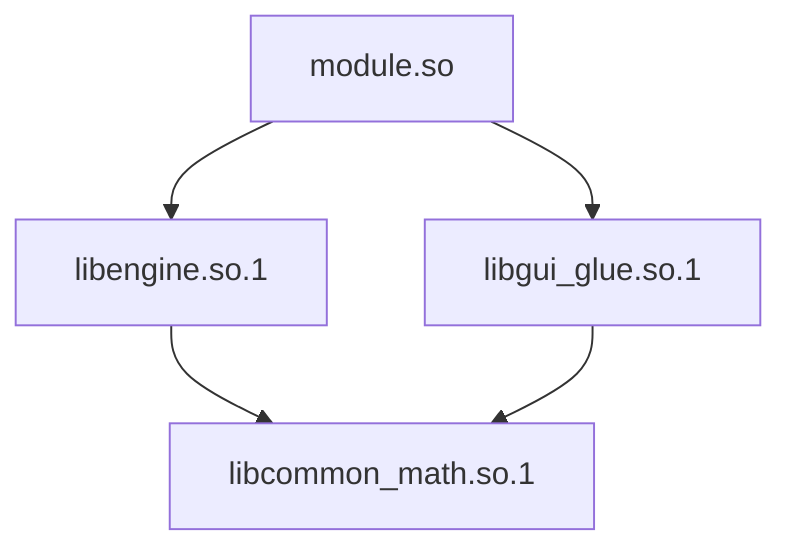
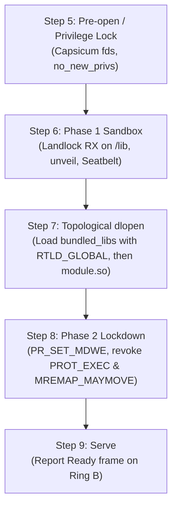
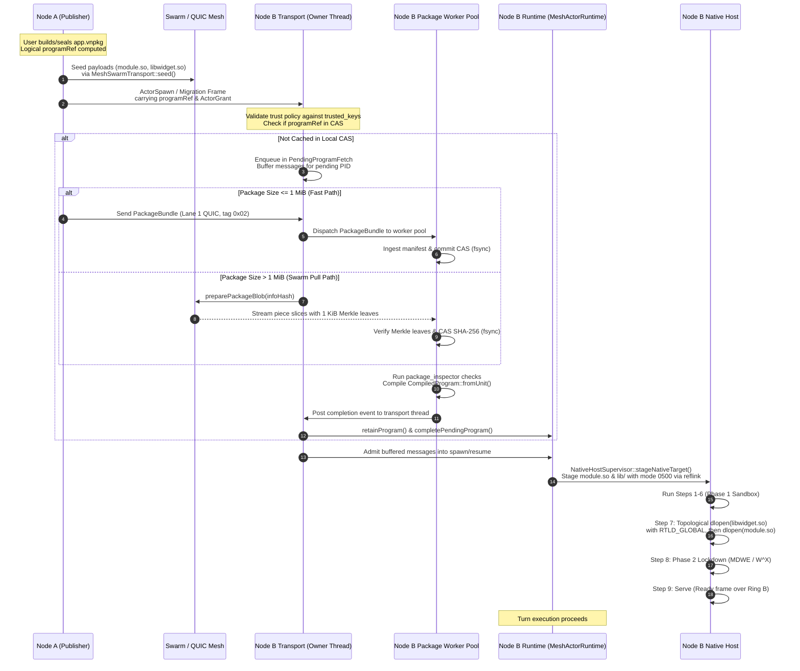

# vagent cluster packaging: content-addressed program, module & library distribution over the swarm

| field         | value                                                                                                                                                                                                                                                |
| ------------- | ---------------------------------------------------------------------------------------------------------------------------------------------------------------------------------------------------------------------------------------------------- |
| version       | 0.4 (see [change history](#change-history))                                                                                                                                                                                                          |
| status        | Approved (`P21.1`–`P21.8` owner-approved); review converged ([record](projects/vagent-cluster-packaging-review/README.md)); companion to P17 (shared program) and P20 (native agent); nothing is built                                               |
| prerequisites | P17.1–P17.5 ([shared program & live upgrade](vagent-shared-program-and-live-upgrade.md)), P20.1–P20.8 ([native agent](vagent-native-agent.md))                                                                                                       |
| companion to  | [vagent v3.13](vagent-agent-language.md) §§4–7, 10, 11; [shared program and live upgrade](vagent-shared-program-and-live-upgrade.md) (P17); [native agent](vagent-native-agent.md) (P20); [implementation progress](vagent-implementation.md)        |
| rests on      | `MeshSwarmTransport`, `PackageBundle`, `MeshHostTransport`, `preparePackageBlob`, `PublishedValue`, `CompiledProgram`, `AgentExecutor`, `NativeHostSupervisor`, `LocalHost`                                                                          |
| first test    | a native agent depending on a bundled non-system shared library (`libwidget.so`) migrates across two cluster nodes over `MeshSwarmTransport` without pre-installed local files, verifies CAS digests, stages into isolated directories, and executes |

Paths below are under `apps/common/xanadu/` unless stated.

______________________________________________________________________

## Contents

- [1. Motivation & Problem Statement](#1-motivation--problem-statement)
- [2. Glossary](#2-glossary)
- [3. The Cluster Distribution Contract](#3-the-cluster-distribution-contract)
- [4. Rulings (K1–K10)](#4-rulings-k1k10)
- [5. The .vnpkg Cluster Package Format](#5-the-vnpkg-cluster-package-format)
- [6. Content-Addressed Store (CAS) Layout](#6-content-addressed-store-cas-layout)
- [7. Bundled Native Library Dependencies](#7-bundled-native-library-dependencies)
- [8. Internode Swarm Distribution Protocol](#8-internode-swarm-distribution-protocol)
- [9. Authority Ledger and Security](#9-authority-ledger-and-security)
- [10. CLI Workflow & Tooling](#10-cli-workflow--tooling)
- [11. Implementation Architecture & New Code](#11-implementation-architecture--new-code)
- [12. Proposed Changes (P21.1–P21.8)](#12-proposed-changes-p211p218)
- [13. Settings](#13-settings)
- [14. Verification and Escape Probes](#14-verification-and-escape-probes)
- [15. Refused Alternatives](#15-refused-alternatives)
- [16. Properties and Costs](#16-properties-and-costs)
- [17. Open Questions](#17-open-questions)
- [Change History](#change-history)

______________________________________________________________________

## 1. Motivation & Problem Statement

### 1.1 The Problem Today: In-Memory `programRef` Resolution vs. Cluster Distribution

In the existing Vortex mesh runtime (`vortex/mesh_actor.hpp`, `vortex/mesh_actor.cpp`) and the
vagent actor executor (`vagent/runtime/agent_executor.hpp`, `vagent/runtime/agent_executor.cpp`),
actor lifecycles are fundamentally distributed:

- Spawning an actor over the network emits an `ActorSpawn` message carrying `ActorGrant::programRef`
  (`mesh_actor.hpp:47–57`, `:162–165`).
- Migrating an actor across nodes serializes the live agent's mutable state graph into an
  authenticated `PublishedValue` root via `publishValue` (`mesh_value.hpp:68–74, :87–94`),
  transmitting the state delta alongside an `ActorContinuation` carrying `programRef` and `baseRef`
  (`mesh_actor.hpp:114–120`, `:170–174`).
- Live-upgrading an agent advances its state in place from an old `programRef` to a new `programRef`
  (`mesh_actor.hpp:205–216`).

However, when a remote node receives an `ActorSpawn`, an `ActorContinuation` (resume/migration), or
an `ActorGrant` replacement (upgrade), `AgentExecutor::resolveProgram(programRef)`
(`agent_executor.hpp:247–248`) only inspects an in-memory `std::map<std::string, ...>` populated
manually on that specific node via `AgentExecutor::retainProgram(program)`
(`agent_executor.hpp:246`).

If the receiving node has not pre-loaded the referenced program out-of-band via CLI flags or local
scripting, `resolveProgram` returns `nullptr`. The actor runtime immediately aborts the operation
with `ActorError::ExecutionFailed` or `ActorError::NotAuthorized`. In a multi-node cluster,
autonomous spawning, dynamic load balancing, failover migration, and distributed upgrades are
impossible without an external file-distribution system.

### 1.2 The Native Agent Gap: Single-Target `.vnprog` & Unbundled Non-System Native Libraries

With the approval of `vagent-native-agent.md` (P20), vagent gained sandboxed native agents executing
behind the agent contract. However, P20's packaging artifact (`.vnprog`, `vagent-native-agent.md`
§7.1) introduces two critical limitations for cluster deployments:

1. **Architecture-Locked `programRef`:** A `.vnprog` artifact records `module_filename` and
   `module_digest` (the SHA-256 of the compiled `.so` / `.dylib` / `.dll` binary). Under P20 ruling
   N6, `programRef` directly incorporates this module digest:

   ```text
   programRef = SHA-256(L(kProgramFormat) || L("vagent-native/1") || L(op_log) || L(module_digest))
   ```

   Consequently, a program compiled for `x86_64-linux-gnu` produces a completely different
   `programRef` from the identical logical program compiled for `aarch64-linux-gnu`. Heterogeneous
   agent migration across architectures (`x86_64` \<-> `aarch64` \<-> `aarch64-apple-darwin`) fails
   because `resume` requires the target node to host the exact same `programRef`
   (`mesh_actor.cpp:238, :322–324`, `vagent-native-agent.md` §12.3).

1. **Missing Payload Bytes & Bundled Native Libraries:** A `.vnprog` file stores only the module's
   digest and filename, not the shared library bytes. The node must locate the binary locally via
   `NativeProgramLoadOptions::modulePath` or `<vnprog-dir>/<module_filename>`
   (`vagent-native-agent.md` §7.3). Furthermore, when native agent code depends on **non-system
   native shared libraries**—custom numerical engines, proprietary C/C++ acceleration libraries, or
   domain-specific dynamic libraries that are not pre-installed in standard host directories
   (`/usr/lib`)—there is currently no mechanism to package, content-address, distribute over the
   swarm, verify against tampering, stage into isolated guest directories, or configure OS sandbox
   allowlists alongside `module.so`.

### 1.3 Scope & Companion Grounding

This specification resolves both gaps by defining the `.vnpkg` cluster package container and its
distributed content-addressed store (CAS) protocol over `MeshSwarmTransport`
(`vortex/mesh_swarm.hpp`). It answers Open Question NQ4 from `vagent-native-agent.md` §17 and serves
as the cluster companion to:

- `vagent-agent-language.md` (v3.13) §§4–7, 10, 11
- `vagent-shared-program-and-live-upgrade.md` (P17) §§1–2
- `vagent-native-agent.md` (P20) §§4, 5.1, 7.1–7.3, 8.1–8.4, 10.5, 11.2, 12.3, 14.1–14.3

______________________________________________________________________

## 2. Glossary

| Term                           | Definition                                                                                                                                                                                                                                          |
| ------------------------------ | --------------------------------------------------------------------------------------------------------------------------------------------------------------------------------------------------------------------------------------------------- |
| **Cluster Package (`.vnpkg`)** | A self-contained, canonical bencoded container combining an architecture-independent program specification (`op_log` or pure AST), a multi-target binary manifest table, owner provenance signatures, and content-addressed binary payloads.        |
| **Logical `programRef`**       | A globally unique, architecture-independent SHA-256 digest identifying the program's abstract AST / op-log and its closed target manifest. Bare 64-hex string internally; `sha256:` is a CLI display label. Identical across all CPU architectures. |
| **Target Triple**              | Normalized LLVM-style target platform identifier (`x86_64-linux-gnu`, `aarch64-linux-gnu`, `x86_64-unknown-freebsd`, `x86_64-unknown-openbsd`, `aarch64-apple-darwin`, `x86_64-pc-windows-msvc`).                                                   |
| **Target Slice**               | The platform-specific binary bundle for one target triple, comprising one `module` binary and zero or more `bundled_libs`.                                                                                                                          |
| **System Library**             | A shared library provided by the host operating system in `vagent.native.library_paths` (e.g. `libncursesw.so.6`, `libc.so.6`). Excluded from package payloads and digests. Mapped across platforms via `system_library_aliases`.                   |
| **Bundled Library**            | A non-system dynamic shared library (`.so`, `.dylib`, `.dll`) shipped inside a target slice, staged into `<staging_dir>/lib/`, and verified before execution. Each entry declares `name`, `canonical_soname`, and target `soname`.                  |
| **Package CAS**                | Content-Addressed Store rooted at `<deployment>/packages/cas/`, indexing deduplicated binary blobs by SHA-256 and InfoHash. Governed by storage quota `vagent.cluster.cas_max_bytes` with ref-counted pinning.                                      |
| **Topological Pre-load**       | Loading bundled shared libraries with `RTLD_NOW` and `RTLD_GLOBAL` into the sandboxed process address space in leaf-first dependency order prior to Phase 2 W^X sandbox lockdown.                                                                   |
| **PackageBundle**              | A dedicated network container (`{version: 1, manifest: <bytes>, blobs: {<sha256>: <bytes>}}`) transmitted over authenticated direct QUIC side-channels (Lane 1, frame discriminator `0x02`), distinct from Xanadu `Store` slice bundles.            |
| **Inline Fast-Path**           | Pushing small cluster packages (\<= 1 MiB) directly over authenticated QUIC streams via `PackageBundle` (Lane 1, frame discriminator `0x02`).                                                                                                       |
| **Swarm Pull-Path**            | Fetching large binary payloads on demand via `preparePackageBlob` over `MeshSwarmTransport` (`mesh_swarm.hpp:91, :113`).                                                                                                                            |
| **`PendingProgramFetch`**      | A bounded admission tracker in `vagent/cluster/pending_fetch.{hpp,cpp}` holding remote lifecycle requests while missing packages or slices resolve asynchronously via a background package worker pool without stalling the transport thread.       |
| **`PackageProvenance`**        | Ed25519 author identity metadata and signature verified in-tree (`xanadu::PublicKey`, `Signature64`, `verifySignature`), replacing legacy GPG TSV provenance.                                                                                       |

______________________________________________________________________

## 3. The Cluster Distribution Contract

Cluster distribution preserves every guarantee established in `vagent-native-agent.md` §3 (the agent
contract C1–C12), extending them to distributed node topologies:

- **D1. Deterministic Multi-Node Identity:** An agent's logical identity, program semantics, and
  authority obligations are invariant under network transfer. Moving an agent from Node A to Node B
  produces identical turn behavior.
- **D2. Fail-Closed Cryptographic Verification:** No remote bytecode or native binary executes
  without passing: (1) cluster trust policy verification against `vagent.cluster.trusted_keys`, (2)
  author Ed25519 provenance signature verification, (3) BitTorrent piece and Merkle root validation,
  (4) whole-file SHA-256 CAS verification, and (5) dynamic linker inspection (`package_inspector`).
  Any corruption or mismatch terminates admission before process creation.
- **D3. Sandbox Invariant Preservation:** Distributing native libraries across nodes never relaxes
  OS sandbox boundaries. Bundled libraries reside in read-only staging directories (`0500`), cannot
  perform writes, cannot establish network connections, and are subject to immediate Phase 2 W^X
  lockdown revoking `PROT_EXEC` and `MREMAP_MAYMOVE` (`PR_SET_MDWE` + seccomp on Linux,
  `pledge("stdio rpath recvfd")` on OpenBSD, `ProhibitDynamicCode` on Windows). Read-only filesystem
  access remains strictly governed by Landlock / Capsicum / `unveil` / Seatbelt / AppContainer ACLs.
- **D4. Non-Blocking Control Plane:** Transport fetches for missing packages never block turn
  execution threads or `MeshActorRuntime::pumpOne`. Missing packages enter an asynchronous bounded
  pending queue processed by a background worker pool. Incoming actor messages targeting pending
  PIDs are buffered in a bounded pre-admission queue.
- **D5. Deduplication & CoW Staging:** Package payloads are stored once in the node's local CAS and
  shared across all agents and incarnations running on that node. Staging uses copy-on-write (CoW)
  reflink (`FICLONE` / `clonefile`) or streaming copy (`0500`), strictly forbidding raw POSIX
  `link()`. CAS disk usage is bounded by `vagent.cluster.cas_max_bytes` with ref-counted pinning.

______________________________________________________________________

## 4. Rulings (K1–K10)

Each ruling governs how packages are identified, distributed, verified, and loaded across the swarm.

### K1. One Logical `programRef`, Multi-Target Binary Manifest

A package possesses a single, architecture-independent logical `programRef`. It is computed from the
compiler format tag `kProgramFormat` (`vagent/runtime/program.hpp:37–39`), the program format tag
`vagent-package/1`, the canonical program kind, the canonical program body (the canonical `op_log`
for native agents or the canonical bencoded `Unit` AST for pure and source+native agents), and the
SHA-256 digest of the canonical, sorted multi-target manifest table:

```text
programRef = SHA-256(L(kProgramFormat) || L("vagent-package/1") || L(kind) || L(canonical_body) || L(targets_digest))
```

where `L(s)` is the 8-byte big-endian length prefix of byte sequence `s`, and `targets_digest` is
the SHA-256 of the canonical bencoded `targets` dictionary. Dictionary keys in `targets` are sorted
lexicographically by raw byte value per BEP-3. Internally, `programRef` is always stored, compared,
and indexed as a bare 64-character lowercase hex string (`sha256:` is a display label).

*Cross-Platform Library Mapping:* Module code continues to declare libraries via
`b.library(name, canonical_soname, ...)`, writing one canonical `soname` into `op_log`. To support
heterogeneous platforms without mutating `op_log` or `programRef`, each entry in
`targets[<triple>].bundled_libs` declares:

- `name`: Logical library name matching `b.library(name, ...)`.
- `canonical_soname`: The canonical soname recorded in `op_log` (e.g. `libengine.so.1`).
- `soname`: The target binary's actual filename/soname on that platform (e.g. `libengine.1.dylib`).

Additionally, `targets[<triple>]` may specify `system_library_aliases`
(`{canonical_soname: target_soname}`, e.g. `{"libncursesw.so.6": "libncurses.6.dylib"}`). At load
and Step 7 `dlopen` time, the target slice maps `canonical_soname` to the staged
`<staging>/lib/<soname>` or host alias, keeping `op_log` and `programRef` completely identical
across OSes.

*Why:* An agent can migrate seamlessly across heterogeneous cluster nodes (e.g., from an
`x86_64-linux-gnu` edge worker to an `aarch64-linux-gnu` server or `aarch64-apple-darwin` developer
workstation) because `ActorGrant::programRef` remains identical across all platforms
(`mesh_actor.cpp:238, :322–324`). Single-target `.vnprog` remains a degenerate 1-target case.

### K2. Swarm Trust Policy, Ed25519 Ingress Verification & PackageBundle

Every cluster package is cryptographically signed using in-tree Ed25519 (`PackageProvenance`,
`xanadu::PublicKey`, `xanadu::identity::Signature64`, `xanadu::verifySignature` in
`identity/identity_layout.hpp:220`, `mutable_link.hpp:58`, and
`identity/standard_crypto_engine.hpp`), matching the signature pattern of `PublishedValue`
(`mesh_value.hpp:33–43`).

*Ingress Authentication & Trust Policy:* Prior to allocating a `PendingProgramFetch` slot or pulling
any binary slice from the network, the receiving node validates the package manifest against
`vagent.cluster.trust_policy`:

- `pinned` (default): The manifest signature must verify against an author public key listed in
  `vagent.cluster.trusted_keys`. Untrusted or self-signed packages from unknown keys are rejected
  immediately with `ActorError::NotAuthorized`.
- `cluster_peers`: The manifest signature must verify against a known authenticated cluster peer
  identity key.
- `any`: The manifest signature must be cryptographically valid, accepting any self-signed key.

*Two-Tier Network Transport:*

1. **Inline Push Fast-Path (`PackageBundle`):** Small packages (\<= 1 MiB, bounded by
   `vagent.cluster.inline_bundle_bytes`) are transmitted directly inside the authenticated direct
   QUIC side-channel (QUIC Lane 1) as dedicated `PackageBundle` records
   (`{version: 1, manifest: <bytes>, blobs: {<sha256>: <bytes>}}`) via `sendPackageBundle` /
   `ingestPackageBundle` on `MeshHostTransport` and `MeshSwarmTransport`. A 1-byte frame
   discriminator on Lane 1 (`0x01` = `SpoolSliceBundle`, `0x02` = `PackageBundle`) ensures strict
   typing without reusing Xanadu `Store` structures.
1. **Swarm Pull-Path (`preparePackageBlob`):** Large packages or multi-megabyte bundled native
   libraries are announced via torrent metadata. Receiving nodes fetch missing piece slices on
   demand via public `preparePackageBlob(hash, maxBytes, destCasPath)` on `MeshHostTransport` and
   `MeshSwarmTransport` (`mesh_swarm.hpp:91, :113`).

### K3. Dynamic Linker Contract, Shadowing Denylist & Regex Allowlist

The packaging manifest strictly distinguishes host system libraries from bundled companion
libraries:

- **System Libraries:** Libraries expected to exist on the host OS within
  `vagent.native.library_paths`. Their bytes are excluded from `.vnpkg` packages and
  `targets_digest`.
- **Bundled Libraries:** Non-system companion shared libraries supplied at packaging time and
  recorded in `targets[<triple>].bundled_libs`.
- **SONAME Regex Allowlist:** Every bundled library `soname` must match the ASCII regular
  expression: `^[a-zA-Z0-9_][a-zA-Z0-9._-]*\.(so(\.[0-9]+)*|dylib|dll)$` with maximum length \<= 255
  bytes and no leading `-`. Any slash (`/` or `\`), directory separator, or relative path (`.` or
  `..`) fails immediately with `InvalidSonamePath`.
- **System Library Shadowing Denylist:** To prevent library hijacking, `bundled_libs` sonames must
  be strictly disjoint from declared system libraries and a reserved system library denylist:
  `libc.*`, `libm.*`, `libdl.*`, `libpthread.*`, `librt.*`, `ld-*`, `libnss_*`, `libSystem.*`,
  `kernel32.dll`, `ntdll.dll`. Any collision fails closed with `SystemLibraryShadowingForbidden`.

### K4. Topological Pre-Loading, DT_SONAME Contract & Sandbox Alignment

Bundled libraries are staged into `<staging_dir>/lib/<soname>` with file mode `0500`.

- **ELF Dynamic Linker Contract:** Every bundled ELF shared library must carry an internal
  `DT_SONAME` header tag exactly equal to its manifest `soname`. A missing or mismatched `DT_SONAME`
  fails closed with `MissingSonameTag` (never a silent fallback). Shared libraries must not contain
  `PT_INTERP` program headers. `DT_RUNPATH` is permitted only when set to `$ORIGIN` or `$ORIGIN/lib`
  as defense-in-depth; hardcoded absolute paths fail with `InsecureRpath`. On Mach-O,
  `@executable_path` is strictly rejected, permitting only `@loader_path` or `@rpath` resolving
  within staging.
- **Topological Global Loading:** During Step 7 of host startup, the single-tenant
  `vagent-native-host` loads bundled libraries in strict topological dependency order (leaves first,
  dependents last) via `dlopen("<staging>/lib/<soname>", RTLD_NOW | RTLD_GLOBAL)`. Using
  `RTLD_GLOBAL` ensures symbols from bundled dependencies resolve deterministically across
  subsequent `dlopen` invocations.
- **Phase 2 Sandbox Alignment with P20:** Step 8 applies Phase 2 lockdown aligned with
  `vagent-native-agent.md` §8.1–8.3:
  - Linux: `prctl(PR_SET_MDWE, PR_MDWE_REFUSE_EXEC_GAIN, 0, 0, 0)` plus seccomp filter revoking
    `PROT_EXEC` on `mmap`/`mprotect` and `MREMAP_MAYMOVE`. `openat` remains governed by Landlock
    (read-only access to staging and `/usr/share/terminfo`, zero writes).
  - FreeBSD: Capsicum mode drops `CAP_MMAP_X` on closed pre-opened descriptors.
  - OpenBSD: `pledge("stdio rpath recvfd", nullptr)` permanently drops `prot_exec` while retaining
    `rpath` so `newterm()` can read terminfo databases.
  - macOS: Seatbelt denies `file-map-executable` outside staging and denies `MAP_JIT`.
  - Windows: `ProhibitDynamicCode` mitigation policy enabled.

### K5. Background Worker Offloading & Non-Blocking Admission Pipeline

Missing package resolution never stalls `MeshActorRuntime::pumpOne` (`mesh_actor.hpp:190–191`) or
transport owner threads:

1. **Background Package Worker Pool:** Streaming SHA-256 and Merkle verification, atomic CAS commits
   (`fsync` + `renameat`), `package_inspector` header validation, and `CompiledProgram::fromUnit`
   compilation are offloaded to a dedicated background package worker thread pool
   (`vagent/cluster/pending_fetch.cpp`). The transport owner thread remains non-blocking.
1. **Layering Hygiene:** `PendingProgramFetch` stays strictly in
   `vagent/cluster/pending_fetch.{hpp,cpp}` at the cluster supervisor layer.
   `vortex/mesh_actor.{hpp,cpp}` provides a minimal, language-agnostic admission hook:
   `ActorError::ProgramPending`.
1. **Pre-Admission Mailbox Buffering:** When `spawn()` or `resume()` encounters a pending program,
   immediate `ActorSpawnAck` refusal is suppressed. Incoming actor messages (`ActorSend`,
   `ActorDeliverValue`, `ActorDown`) addressing the pending `ActorPid` are buffered in a bounded
   pre-admission queue (up to `grant.maxMailboxBytes`) rather than rejected with `UnknownProcess`.
1. **Lease Expiration Extension:** The runtime requires `grant.expiresAt > wallNow` at fetch
   initiation and credits elapsed fetch wait time at admission, preventing premature lease expiry.
1. **Live Upgrade Turn Suspension:** An actor undergoing a live `upgrade` fetch has its turn
   execution suspended until the target program is admitted, preventing mailbox overflow or
   mid-upgrade state corruption.

### K6. Deterministic Packaging, Bencode & Canonical BitTorrent

Every `.vnpkg` manifest is canonically bencoded (BEP-3) with dictionary keys sorted
lexicographically by raw byte value. Floating-point values are forbidden. In `makeTorrent`,
BitTorrent parameters are strictly standardized: canonical piece length is fixed at
`pieceLength = 262144` (256 KiB) with a flat basename `<sha256>`, guaranteeing deterministic
`info_hash` and `targets_digest` calculations. Re-running `vagent package` on identical source and
binaries produces bit-for-bit identical outputs.

### K7. Target Triples and Normalized Platform Matching

Target triples in the manifest follow normalized canonical strings:

- `x86_64-linux-gnu`
- `aarch64-linux-gnu`
- `x86_64-unknown-freebsd`
- `x86_64-unknown-openbsd`
- `aarch64-apple-darwin`
- `x86_64-pc-windows-msvc`

A node hosting agents checks its local target triple against `targets`. If no matching target slice
is present in the package manifest, native host launch fails closed with
`UnsupportedTargetArchitecture`.

### K8. CAS Quota, Pinning & Copy-on-Write (CoW) Staging

Payload blobs are stored deduplicated in `<deployment>/packages/cas/<sha256>`:

- **Storage Quota:** Total unpinned CAS blob storage is bounded by `vagent.cluster.cas_max_bytes`
  (default 10 GiB).
- **Reference-Counted Pinning:** Active `CompiledProgram` instances in `AgentExecutor`, staged host
  instances in `NativeHostSupervisor`, and in-flight fetch tasks hold reference-counted pins
  (`pin(sha256)` / `unpin(sha256)`). LRU eviction sweeps only unpinned blobs when quota is exceeded.
- **Durability & Cleanup:** Spooled downloads use `O_WRONLY | O_CREAT | O_EXCL | O_NOFOLLOW` (mode
  `0600`) at `<cas_dir>/tmp/<uuid>.part`. Commits require `fsync` on the file, atomic `renameat`,
  and `fsync` on `<cas_dir>/`. An epoch startup sweep unlinks stale `.part` files in
  `<cas_dir>/tmp/`.
- **CoW Reflink Staging:** Raw POSIX `link()` between `<cas_dir>/<sha256>` (`0400`) and
  `<staging_dir>/lib/<soname>` (`0500`) is strictly forbidden so staged files never share mutable
  inode metadata with the CAS. The supervisor stages files using copy-on-write (CoW) reflink
  (`ioctl(dst, FICLONE, src)` on Linux, `clonefile` on macOS) or streaming copy with
  `O_RDONLY | O_NOFOLLOW | O_CLOEXEC` and SHA-256 verification.

### K9. Immutable Staging with W^X and Owner-Isolated Paths

Staging directories are rooted in `<staging_dir>/<epoch>/<pid>-<incarnation>/` with directory mode
`0700` and file modes `0500`. The sandboxed host process is never granted write permission to its
staging directory. Filesystem mounts for staging roots must not have the `noexec` flag set; if
`noexec` is detected, staging refuses with `StagingNoexec` (`vagent-native-agent.md` §7.3).

### K10. Fail-Closed Verification & Authority Ledger Binding

Authority approvals in `authorities/` (`vagent-native-agent.md` §10.5) bind directly to the logical
`programRef`. Because `programRef` cryptographically incorporates `targets_digest`, an approval
covers the entire closed set of platform binaries and bundled library digests. The CLI commands
`vagent native approve` and `vagent native withdraw` accept `.vnpkg` packages directly,
automatically computing the logical `programRef`.

______________________________________________________________________

## 5. The `.vnpkg` Cluster Package Format

### 5.1 Package Taxonomy: Pure, Source+Native, and Native

The `.vnpkg` format supports three package kinds:

1. `"pure"`: Pure vagent programs containing no native skills or external shared libraries.
   `targets` is empty (`de`). `program_body` contains the canonical bencoded `Unit` AST. The
   receiving node compiles `Unit` via `CompiledProgram::fromUnit` into its local P17 sealed base
   `Store` and `programManifold`.
1. `"source+native"`: Vagent source programs carrying declared native skills (answering Open
   Question NQ2 from `vagent-native-agent.md` §17). `program_body` contains the canonical bencoded
   `Unit` AST, and `targets` supplies native modules implementing `vagent_native_skills`.
   - *CLI Workflow:* Packaging invokes
     `vagent package app.vagent --target <triple>=<path> -o app.vnpkg`. When `.vagent` source is
     paired with `--target`, the tool automatically infers `kind = "source+native"`.
   - *Verification:* The packager inspects the module binary to verify that it exports the C symbol
     `vagent_native_skills()`, returning a function table that covers all `native skill`
     declarations in the source `Unit`.
   - *Boundary:* `"source+native"` binds native skills strictly via `vagent_native_skills()`
     function tables. Low-level libffi sequences and fine-grained authority descriptors require the
     native builder API of `"native"`.
1. `"native"`: Native-op programs constructed via the C/C++ native builder API
   (`vagent-native-agent.md` §6). `program_body` contains the canonical bencoded `op_log`.

### 5.2 Canonical Bencode Schema

A standalone `.vnpkg` archive or swarm package manifest begins with the 8-byte magic header:
`\x89VAGNPKG\n` (`0x89 0x56 0x41 0x47 0x4E 0x50 0x4B 0x47 0x0A`), followed by a canonical bencoded
dictionary with the following schema:

```text
{
  "api_version": 1,
  "format": "vagent-package-1",
  "kind": "pure" | "source+native" | "native",
  "compiler_format": "vagent-program-3",
  "program_body": <byte string>,
  "targets": {
    "<target-triple>": {
      "module": {
        "filename": "<string>",
        "sha256": "<64-hex-string>",
        "size": <integer>,
        "info_hash": "<40-hex-string>"
      },
      "bundled_libs": [
        {
          "name": "<string>",
          "canonical_soname": "<string>",
          "soname": "<string>",
          "sha256": "<64-hex-string>",
          "size": <integer>,
          "info_hash": "<40-hex-string>"
        },
        ...
      ],
      "system_library_aliases": {
        "<canonical_soname>": "<target_soname>",
        ...
      }
    },
    ...
  },
  "provenance": {
    "author": "<string>",
    "device": "<string>",
    "timestamp": <integer-epoch-seconds>,
    "public_key": "<32-byte-ed25519-public-key-hex>"
  },
  "signature": "<64-byte-ed25519-signature-hex>"
}
```

#### Field Specifications

- `api_version`: Integer, must be `1`.
- `format`: String, must equal `"vagent-package-1"`.
- `kind`: String, one of `"pure"`, `"source+native"`, `"native"`.
- `compiler_format`: String, must match `kProgramFormat` (`vagent/runtime/program.hpp:37–39`).
- `program_body`: Canonical serialized byte string. For `"native"`, this is the canonical op-log
  bytes (`op_log`, `vagent-native-agent.md` §7.1). For `"pure"` and `"source+native"`, this is the
  canonical bencoded `Unit` representation.
- `targets`: Bencoded dictionary keyed by normalized target triple string. Keys must be sorted in
  ascending lexicographical byte order per BEP-3:
  - `module`: Target's primary host shared library:
    - `filename`: Base filename (`module.so`, `module.dylib`, `module.dll`). No directory slashes.
    - `sha256`: Lowercase 64-character hex string of the binary's SHA-256 digest.
    - `size`: Uncompressed byte count as integer.
    - `info_hash`: Lowercase 40-character hex string of the BitTorrent InfoHash.
  - `bundled_libs`: List of companion shared library descriptors, ordered in **topological
    dependency order** (deepest dependencies first, root dependents last).
    - `name`: Logical library name matching `b.library(name, ...)`.
    - `canonical_soname`: Canonical soname recorded in `op_log` (e.g. `libengine.so.1`).
    - `soname`: The actual platform soname (e.g. `libengine.1.dylib`). Must match the regex
      allowlist.
    - `sha256`, `size`, `info_hash`: Verification metadata matching the binary payload.
  - `system_library_aliases`: Optional dictionary mapping canonical sonames to target-specific host
    library names (e.g. `{"libncursesw.so.6": "libncurses.6.dylib"}`). Keys must be sorted in
    ascending lexicographical byte order per BEP-3. When a target defines no system library aliases,
    it is canonically encoded as an empty bencode dictionary (`de`) so `targets_digest` is
    deterministic.
- `provenance`: Authoring identity metadata matching `PackageProvenance` using in-tree Ed25519
  (`identity/identity_layout.hpp:220`, `mutable_link.hpp:58`, and
  `identity/standard_crypto_engine.hpp`).
- `signature`: Ed25519 cryptographic signature generated over the string prefix:
  `"xanadu:vagent-package:1:"` concatenated with the canonical bencoded dictionary of all preceding
  fields (`api_version` through `provenance`). Verified via `xanadu::verifySignature`.

### 5.3 Offline Standalone Archive vs. Swarm Seeding Manifest

The format functions in two operational modes:

1. **Standalone File Archive (`.vnpkg` file on disk):** Used for single-file artifact distribution,
   CLI execution (`vagent run app.vnpkg`), and air-gapped deployments. The manifest dictionary
   contains an additional key `"payloads"` mapping each SHA-256 hex string directly to raw binary
   byte strings.
1. **Swarm Seeding Manifest (Network Publication):** Used for internode cluster distribution over
   `MeshSwarmTransport`. The `"payloads"` key is omitted from the manifest. Instead, each binary
   blob is seeded into the swarm as a torrent object identified by its `info_hash` and cached in the
   node's local CAS.

______________________________________________________________________

## 6. Content-Addressed Store (CAS) Layout

### 6.1 Node Deployment Directory Structure

Each cluster node maintains a content-addressed package cache inside its deployment directory
(`vagent.cluster.cas_dir`, defaulting to `$XDG_DATA_HOME/vagent/packages/` or
`<deployment>/packages/`):

```text
<deployment>/packages/
├── manifests/
│   ├── sha256-a8f2...vnpkg       (canonical bencoded package manifests)
│   └── sha256-4b10...vnpkg
└── cas/
    ├── tmp/                      (atomic download spooling directory)
    ├── 1a2b3c4d...               (content-addressed blobs named by bare SHA-256)
    └── e5f60718...
```

### 6.2 Atomic Blob Storage, Retention Quota & Durability

When a package manifest or binary payload is ingested from the swarm or CLI:

1. **Staging to Temporary File:** Inbound bytes are written to `<cas_dir>/tmp/<uuid>.part` opened
   with `O_WRONLY | O_CREAT | O_EXCL | O_NOFOLLOW` and mode `0600`.
1. **Hash & Size Validation:** The node calculates the SHA-256 digest and total bytes during
   streaming. If the computed digest or byte count deviates from the manifest descriptor, the
   download is aborted and the temporary file is unlinked.
1. **Durability Commit:** The node invokes `fsync()` on the temporary file, atomically commits via
   `renameat` to `<cas_dir>/<sha256>`, sets file mode to `0400` (read-only), and invokes `fsync()`
   on `<cas_dir>/`.
1. **Startup Sweep:** During epoch initialization, the runtime scans `<cas_dir>/tmp/` and unlinks
   any orphaned `.part` files left by interrupted processes.
1. **Storage Quota & Ref-Counted Pinning:** Total storage in `<cas_dir>/` is governed by
   `vagent.cluster.cas_max_bytes` (default 10 GiB). Blobs in active use by running agents, staged
   hosts, or pending fetches are protected by reference-counted pins (`pin(sha256)` /
   `unpin(sha256)`). When unpinned CAS bytes exceed `vagent.cluster.cas_max_bytes`, background LRU
   eviction sweeps down to an 80% low watermark (8 GiB) to avoid thrashing on every incoming blob.

______________________________________________________________________

## 7. Bundled Native Library Dependencies

### 7.1 Binary Inspection and Hygiene

When packaging a native agent via `vagent package` (or during node ingestion), `package_inspector`
performs static ELF, Mach-O, or PE inspection on `module.so` and every candidate bundled library:

- **ELF Dynamic Linker Contract (`DT_NEEDED`, `DT_SONAME`, `DT_RPATH`, `DT_RUNPATH`):**
  - The tool reads dynamic section tags (`DT_NEEDED`).
  - It extracts each library's internal `DT_SONAME`. Every bundled ELF library must carry an
    internal `DT_SONAME` equal to its manifest `soname`. Missing or mismatched `DT_SONAME` tags fail
    closed with `MissingSonameTag` (never a warning).
  - Bundled shared libraries must not contain `PT_INTERP` program headers.
  - Slashes (`/`), relative components (`.`, `..`), and null bytes in SONAMEs are strictly
    forbidden, failing with `InvalidSonamePath`.
  - `DT_RPATH` and `DT_RUNPATH` are validated. The only permissible tokens are `$ORIGIN` and
    `$ORIGIN/lib` as defense-in-depth. Any other path fails closed with `InsecureRpath`.
- **System Library Shadowing Denylist:**
  - Bundled library `soname`s must be strictly disjoint from declared host system libraries and the
    reserved denylist: `libc.*`, `libm.*`, `libdl.*`, `libpthread.*`, `librt.*`, `ld-*`, `libnss_*`,
    `libSystem.*`, `kernel32.dll`, `ntdll.dll`. Collisions fail with
    `SystemLibraryShadowingForbidden`.
- **Mach-O (`LC_LOAD_DYLIB`, `LC_ID_DYLIB`):**
  - Install names must use `@loader_path` or `@rpath` resolving within the staging directory.
    `@executable_path` is strictly forbidden and rejected with `InsecureRpath`.
- **Windows PE (Import Directory):**
  - Import names must be valid DLL filenames without directory paths.

### 7.2 Topological Dependency Ordering & Cycle Detection

All shared libraries bundled in a target slice must form a Directed Acyclic Graph (DAG):



The packager builds the dependency graph and computes a topological sort using Kahn's algorithm or
Tarjan's strongly connected components algorithm:

1. Leaf nodes (libraries with no bundled dependencies, e.g. `libcommon_math.so.1`) are placed first.
1. Dependent libraries (e.g. `libengine.so.1`, `libgui_glue.so.1`) follow.
1. The root dependent (`module.so`) is placed last.
1. **Completeness Check:** Every `DT_NEEDED` entry in `module.so` and every bundled library must
   resolve either to another bundled library in the slice or to a known system library declared in
   `vagent.native.library_paths`. If an unresolved non-system library is detected, packaging fails
   with `UnresolvedLibraryDependency`.
1. **Cycle Detection:** If a circular dependency exists between bundled libraries, packaging aborts
   with `CyclicLibraryDependency`.

### 7.3 Staging Directory Lifecycle and Layout

Before spawning `vagent-native-host`, the receiving node's background worker runs
`package_inspector` on every downloaded blob before staging. The supervisor then prepares an
isolated staging root under `vagent.native.staging_dir` (`vagent-native-agent.md` §7.3):

```text
<staging_dir>/<epoch>/<pid>-<incarnation>/
├── module.so          (mode 0500, verified against target.module.sha256)
└── lib/               (mode 0700 dir)
    ├── libdep1.so.1   (mode 0500, verified against target.bundled_libs[0].sha256)
    └── libdep2.so.1   (mode 0500, verified against target.bundled_libs[1].sha256)
```

The supervisor populates this structure using CoW reflink (`ioctl(dst, FICLONE, src)` on Linux,
`clonefile` on macOS) or streaming copy (`0500`), forbidding raw POSIX `link()`. The staging
directory belongs to the supervisor's user ID and is set to directory mode `0700`. The binary files
are marked `0500` (read and execute only; no write permissions for anyone). When the native host
exits, the supervisor recursively removes the staging directory.

### 7.4 Cross-Platform Dynamic Loading & Sandbox Lockdown

The five OS backends enforce identical security invariants for bundled libraries:



#### 1. Linux (Landlock + Two-Phase Seccomp + MDWE)

- **Phase 1 (Step 6):** Landlock grants `LANDLOCK_ACCESS_FS_READ_FILE | LANDLOCK_ACCESS_FS_EXECUTE`
  for `<staging_dir>/lib` and all its entries, in addition to `<staging_dir>/module.so` and system
  paths.
- **Loader (Step 7):** The loader calls `dlopen("<staging>/lib/<soname>", RTLD_NOW | RTLD_GLOBAL)`
  in strict topological order. Using `RTLD_GLOBAL` ensures symbols from earlier bundled dependencies
  are visible to subsequent libraries. Finally,
  `dlopen("<staging>/module.so", RTLD_NOW | RTLD_LOCAL)` is invoked.
- **Phase 2 (Step 8):** The host calls `prctl(PR_SET_MDWE, PR_MDWE_REFUSE_EXEC_GAIN, 0, 0, 0)` and
  installs the second seccomp filter denying `mmap`/`mprotect` with `PROT_EXEC` and
  `MREMAP_MAYMOVE`. Filesystem access remains governed by Landlock (read-only access to staging and
  terminfo, zero writes).

#### 2. FreeBSD (Capsicum Capability Mode)

- **Step 5 Pre-Open:** Before entering capability mode, the host pre-opens file descriptors for each
  bundled library `<staging>/lib/<soname>` with `O_RDONLY | O_EXEC`.
- **Capability Limitation:** Each descriptor is restricted via
  `cap_rights_limit(fd, CAP_READ | CAP_MMAP_RX | CAP_FSTAT)` and `cap_enter()` is called.
- **Loader (Step 7):** Libraries are loaded in topological order via
  `fdlopen(fd, RTLD_NOW | RTLD_GLOBAL)`.
- **Phase 2 (Step 8):** All pre-opened library descriptors are closed. No remaining descriptors hold
  `CAP_MMAP_X`.

#### 3. OpenBSD (`unveil` + `pledge`)

- **Phase 1 (Step 6):** The host invokes `unveil("<staging>/lib", "rx")` and
  `unveil("<staging>/module.so", "rx")`, followed by `unveil(nullptr, nullptr)` to lock the path
  tree.
- **Loader (Step 7):** Topological `dlopen(..., RTLD_NOW | RTLD_GLOBAL)` loads all bundled libraries
  and the module.
- **Phase 2 (Step 8):** The host executes `pledge("stdio rpath recvfd", nullptr)` (or
  `"stdio rpath recvfd tty"` if terminal granted), permanently dropping `prot_exec` while retaining
  `rpath` so `newterm()` can read terminfo entries during Step 9.

#### 4. macOS (Seatbelt / Sandboxing)

- **Phase 1 (Step 6):** The Seatbelt profile includes:
  `(allow file-read* process-exec (subpath "<staging>/lib"))`.
- **Loader (Step 7):** `dlopen(..., RTLD_NOW | RTLD_GLOBAL)` loads libraries in topological order.
  Because dependent libraries are already resident, `@loader_path` resolution resolves cleanly.
- **Phase 2 (Step 8):** Seatbelt denies `file-map-executable` outside the staging directory and
  denies `MAP_JIT`.

#### 5. Windows (AppContainer + ACG)

- **Phase 1 (Step 6):** An AppContainer SID is granted Read and Execute access to `<staging>\\lib`.
- **Loader (Step 7):** The loader calls
  `SetDefaultDllDirectories(LOAD_LIBRARY_SEARCH_USER_DIRS | LOAD_LIBRARY_SEARCH_SYSTEM32)` and
  `AddDllDirectory(L"<staging>\\lib")`. It loads bundled libraries in topological order via
  `LoadLibraryExW(path, nullptr, LOAD_LIBRARY_SEARCH_USER_DIRS | LOAD_LIBRARY_SEARCH_SYSTEM32)`.
- **Phase 2 (Step 8):** The process applies
  `SetProcessMitigationPolicy(ProcessDynamicCodePolicy, ...)` with `ProhibitDynamicCode = 1`,
  preventing further executable memory creation.

______________________________________________________________________

## 8. Internode Swarm Distribution Protocol

### 8.1 Transport Architecture & Dual-Path Distribution

`MeshSwarmTransport` (`vortex/mesh_swarm.hpp:50–124`) manages swarm communication. Cluster package
distribution utilizes two complementary mechanisms:



### 8.2 Two-Tier Ingestion Logic

The decision between inline push and swarm pull is evaluated by the sending node based on payload
size:

- **Fast-Path (`PackageBundle`):** If total package size \<= 1 MiB (governed by
  `vagent.cluster.inline_bundle_bytes`), Node A packs the manifest and target binary slices into a
  dedicated `PackageBundle` record (`{version: 1, manifest: <bytes>, blobs: {<sha256>: <bytes>}}`).
  Node A transmits the bundle over QUIC stream Lane 1 using `sendPackageBundle(peer, bundleBytes)`
  (`vortex/mesh_swarm.hpp`). Lane 1 demultiplexes incoming frames by a 1-byte discriminator (`0x01`
  = `SpoolSliceBundle`, `0x02` = `PackageBundle`). Node B receives it in `ingestPackageBundle`,
  dispatching bytes to the background package worker pool for CAS commit (`fsync` + `renameat`).
- **Swarm Pull-Path (`preparePackageBlob`):** If package size exceeds the inline threshold, Node A
  announces torrent metadata. Node B's transport invokes
  `preparePackageBlob(infoHash, maxBytes, destCasPath)` on `MeshHostTransport` /
  `MeshSwarmTransport` (`mesh_swarm.hpp:91, :113`). The content source fetches slices across peers,
  verifying 1 KiB Merkle leaf hashes (`computeSpoolMerkleLeaves`, `verifySpoolMerkleLeaves`,
  `mesh_value.hpp:167–172`) and standard 256 KiB BitTorrent piece hashes before committing them to
  CAS via the worker pool.
- **Compilation:** For both pure and source+native packages, `program_body` contains exclusively the
  canonical bencoded `Unit` AST. The receiving node's worker pool compiles `Unit` via
  `CompiledProgram::fromUnit` into the local P17 sealed base `Store` and `programManifold`.

### 8.3 Non-Blocking Admission Pipeline: `PendingProgramFetch`

To protect `MeshActorRuntime::pumpOne` from blocking I/O:

1. **Queue Structure & Layering:** Defined strictly in
   `apps/common/xanadu/vagent/cluster/pending_fetch.hpp`:

   ```cpp
   struct PendingProgramFetch {
     std::string programRef;
     xanadu::identity::Fingerprint origin;
     std::vector<AuthenticatedActorEvent> waitingEvents;
     std::chrono::steady_clock::time_point deadline;
     std::uint64_t bytesFetched{0};
     std::vector<xanadu::InfoHash> requiredBlobs;
     std::vector<ActorPid> pendingPids;
   };
   ```

1. **Deduplication:** Multiple concurrent spawns or migrations referencing the same missing
   `programRef` coalesce into a single in-flight fetch operation.

1. **Queue Bounding & Rate Limiting:** The queue admits at most `vagent.cluster.max_pending_fetches`
   (default 32) globally and `vagent.cluster.max_pending_fetches_per_peer` (default 4) per peer.
   Excess requests are dropped immediately with `ActorError::ResourceLimit`.

1. **Pre-Admission Mailbox Buffering:** Incoming messages (`ActorSend`, `ActorDeliverValue`,
   `ActorDown`) targeting pending `ActorPid`s are buffered in a bounded per-PID pre-admission queue
   (up to `grant.maxMailboxBytes`). If an incoming message causes the pre-admission buffer to exceed
   `grant.maxMailboxBytes`, the message is rejected with `ActorError::MailboxFull`
   (`mesh_actor.cpp:387`).

1. **Lease Extension & Upgrade Suspension:** The runtime checks `grant.expiresAt > wallNow` at fetch
   start and credits the elapsed fetch wait time upon admission. Actors undergoing live `upgrade`
   have turn execution suspended until the target program is admitted.

1. **Timeouts & Limits:** If the fetch exceeds `vagent.cluster.fetch_timeout` (default 30 seconds)
   or `vagent.cluster.max_package_bytes` (default 64 MiB), the fetch is aborted. All queued messages
   for that `programRef` fail with `ActorError::TransportUnavailable`.

1. **Completion & Admission:** Upon successful CAS download, `package_inspector` validation, and
   compilation, the worker pool posts a completion event to the runtime thread driving
   `MeshActorRuntime`, calling `AgentExecutor::retainProgram` and invoking:

   ```cpp
   void completePendingProgram(std::string_view programRef,
                               std::expected<void, ActorError> result);
   ```

   to admit all parked events in FIFO order.

### 8.4 Heterogeneous Cluster Migration (x86_64 \<-> aarch64)

Heterogeneous migration operates cleanly because of the separation between the logical program and
the platform binaries:

1. **Logical Program Equivalence:** Under K1, `programRef` is identical on both architectures. The
   promoted base `Store` and `Manifold` (`CellRef`s 1..M) contain identical canonical instruction
   cells and dimension cells (`vagent-shared-program-and-live-upgrade.md` §2.2).
1. **State Delta Portability:** Checkpointing an agent serializes only mutable overlay cells
   (`$agent`, beliefs, intentions) as an authenticated `PublishedValue` delta. Ephemeral cell
   references map symbolically.
1. **Target Slice Selection & Library Mapping:** When Node B (`aarch64`) resumes the agent, its
   local `NativeHostSupervisor` selects `targets["aarch64-linux-gnu"]` from the `.vnpkg` manifest,
   maps canonical sonames to staged aarch64 libraries using `bundled_libs` and
   `system_library_aliases`, stages the binaries, and launches a local `aarch64` native host
   process. The migrated agent resumes execution without state reconstruction or source
   recompilation.

______________________________________________________________________

## 9. Authority Ledger and Security

### 9.1 Binding Authority Approvals to `.vnpkg`

Under `vagent-native-agent.md` §10.5, the broker logs authority decisions in a private deployment
store, `authorities/`. Approvals map `(programRef, kind)` pairs to `approve` / `withdraw` events.

Because a `.vnpkg` package's logical `programRef` cryptographically incorporates `targets_digest`
(which commits to every target triple's `module.sha256` and every bundled library's
`canonical_soname`, `soname`, and `sha256`), an approval recorded for `programRef`:

- Cryptographically binds all target platforms simultaneously.
- Approves the exact binary hashes of all bundled libraries.
- Prevents an attacker from tampering with an `aarch64` slice of a package originally audited on
  `x86_64`.

The author identity metadata and signature follow `PackageProvenance` using in-tree Ed25519
primitives (`identity/identity_layout.hpp:220`, `mutable_link.hpp:58`, and
`identity/standard_crypto_engine.hpp`). The CLI commands `vagent native approve` and
`vagent native withdraw` accept `<file.vnprog | file.vnpkg | programRef>`, automatically extracting
the K1 logical `programRef` when passed a `.vnpkg`.

### 9.2 Threat Analysis & Attack Mitigations

| Threat                                  | Attack Vector                                                                         | Defense Mechanism                                                                                                                                                       |
| --------------------------------------- | ------------------------------------------------------------------------------------- | ----------------------------------------------------------------------------------------------------------------------------------------------------------------------- |
| **Unauthenticated Swarm Ingress / DoS** | An unknown peer sends unapproved package requests to exhaust disk and worker threads. | Ingress validates author signature against `vagent.cluster.trusted_keys` (or peer key) before allocating fetch slots or downloading bytes. Reject with `NotAuthorized`. |
| **System Library Shadowing / Hijack**   | A package ships a malicious `libc.so.6` in `bundled_libs` to intercept system calls.  | `package_inspector` enforces system library shadowing denylist (`libc.*`, `libm.*`, `ld-*`, etc.), rejecting collisions with `SystemLibraryShadowingForbidden`.         |
| **Dynamic Linker Mismatch / Hijack**    | A bundled library lacks `DT_SONAME` or uses malicious `$ORIGIN` paths.                | ELF inspection enforces exact `DT_SONAME == soname` (`MissingSonameTag`), permits only `$ORIGIN` / `$ORIGIN/lib` in `DT_RUNPATH`, and rejects `PT_INTERP`.              |
| **Malicious Binary Substitution**       | A compromised swarm peer replaces `libwidget.so` with malware.                        | CAS ingestion validates the blob's SHA-256 against `target.bundled_libs[i].sha256`. Any bit flip fails CAS commit with `CorruptPackageSlice`.                           |
| **Manifest Tampering**                  | A peer alters the manifest to point to a malicious binary hash.                       | The manifest's `targets_digest` is covered by the owner's `PackageProvenance` Ed25519 signature and alters `programRef`. The local ledger denies unapproved refs.       |
| **Path Traversal via SONAME**           | A malicious `.vnpkg` specifies `soname: "../../etc/shadow"`.                          | Regex allowlist enforces clean ASCII basename (`<= 255` bytes); slashes and dots fail immediately with `InvalidSonamePath`.                                             |
| **Undeclared Library Hijacking**        | A bundled `.so` carries a hidden `DT_NEEDED` pointing to an unverified local library. | Topological inspection verifies that every `DT_NEEDED` resolves either to another bundled library or to an explicit system library allowlist.                           |
| **Post-Load Code Injection**            | Guest code in bundled library attempts `mmap(..., PROT_EXEC)` after Step 8.           | Phase 2 lockdown (`PR_SET_MDWE`, seccomp, Capsicum, `pledge`, `ProhibitDynamicCode`) revokes `PROT_EXEC` and `MREMAP_MAYMOVE`. Landlock maintains zero writes.          |
| **CAS Disk Exhaustion via Giant Blobs** | An attacker floods a node with multi-gigabyte package requests.                       | Hard quotas: `max_package_bytes` (64 MiB), `cas_max_bytes` (10 GiB), `max_pending_fetches_per_peer` (4), and ref-counted pinning with unpinned LRU sweeps.              |

Private keys for packaging must be stored with file permissions `0600`.

______________________________________________________________________

## 10. CLI Workflow & Tooling

### 10.1 `vagent package`

The `vagent package` command builds, verifies, and packages multi-target cluster artifacts:

```bash
# Package a pure vagent source program into a cluster package
vagent package app.vagent -o app.vnpkg

# Package a source+native agent (auto-infers kind = "source+native")
vagent package app.vagent \
  --target x86_64-linux-gnu=build/x86_64/myskills.so \
  --target aarch64-linux-gnu=build/aarch64/myskills.so \
  -o app.vnpkg

# Package a native agent for the local host platform (defaults --target to local triple)
vagent package app.vnprog -o app.vnpkg

# Package a multi-target native agent with bundled companion libraries and directories
vagent package greeter.vnprog \
  --target x86_64-linux-gnu=build/x86_64/greeter.so \
  --bundle-lib x86_64-linux-gnu=build/x86_64/libengine.so.1 \
  --bundle-dir aarch64-linux-gnu=build/aarch64/libs \
  --author "alice" --key ~/.vagent/keys/alice.key \
  -o greeter.vnpkg
```

When `--bundle-dir <triple>=<dir>` is specified, the packager scans `<dir>`, validates every library
basename against the K3 regex allowlist, extracts internal `DT_SONAME`s, and computes the
topological dependency order automatically. The packager checks that private key files have
permissions `0600`.

### 10.2 `vagent package inspect`

Inspects the canonical manifest, target slices, dependency graph, and digests of a `.vnpkg` package:

```text
$ vagent package inspect greeter.vnpkg
Package Format:    vagent-package-1
Kind:              native
Logical Ref:       sha256:9f8e7d6c5b4a... (bare: 9f8e7d6c5b4a...)
Author:            alice (ed25519:3b2a10...)
Signature:         Valid (verified against author public key)

Target: x86_64-linux-gnu
  Module:          greeter.so (size: 245,760, sha256: 4a5b6c...)
  Bundled Libs (topological load order):
    1. libmath.so.1   (canonical: libmath.so.1, size: 112,640, sha256: 8f7e6d...)
    2. libengine.so.1 (canonical: libengine.so.1, size: 524,288, sha256: 1c2b3a...)
  System Library Aliases:
    - none
  System Libs (unbundled host prerequisites):
    - libncursesw.so.6
    - libc.so.6

Target: aarch64-linux-gnu
  Module:          greeter.so (size: 258,048, sha256: 7d8e9f...)
  Bundled Libs (topological load order):
    1. libmath.so.1   (canonical: libmath.so.1, size: 118,784, sha256: 2b3c4d...)
    2. libengine.so.1 (canonical: libengine.so.1, size: 536,576, sha256: 5e6f7a...)
  System Library Aliases:
    - none
  System Libs (unbundled host prerequisites):
    - libncursesw.so.6
    - libc.so.6
```

### 10.3 Execution and Authority Management

Executes a cluster package locally or manages authority ledger approvals:

```bash
# Approve a .vnpkg package in the authority ledger (extracts logical programRef)
vagent native approve greeter.vnpkg --kind terminal --as deployer

# Withdraw approval for a .vnpkg package
vagent native withdraw greeter.vnpkg --kind terminal --as deployer

# Execute a package locally with authority policy
vagent run greeter.vnpkg --grant-policy ask --ledger authorities/
```

When invoking `vagent run <file.vnpkg>`, the runtime enables `vagent.cluster.enabled = true` and
`vagent.native.enabled = true`, accepting `--ledger` and `--grant-policy` options.

______________________________________________________________________

## 11. Implementation Architecture & New Code

### 11.1 New C++ Components

The cluster packaging subsystem introduces four focused C++ units under
`apps/common/xanadu/vagent/cluster/`:

```text
apps/common/xanadu/vagent/cluster/
├── package_format.hpp
├── package_format.cpp     (reusing bencode.hpp; PackageBundle and PackageProvenance schema)
├── package_cas.hpp
├── package_cas.cpp        (CAS blob storage, quota, ref-counted pinning, atomic commit, reflink)
├── package_inspector.hpp
├── package_inspector.cpp  (ELF/Mach-O DT_SONAME, DT_RUNPATH, shadowing denylist, topological sort)
├── pending_fetch.hpp
└── pending_fetch.cpp      (PendingProgramFetch queue, background worker pool, mailbox buffering)
```

`package_format.cpp` reuses the canonical parser in `apps/common/xanadu/bencode.hpp`.

### 11.2 Integration with Existing Runtimes

- **`MeshActorRuntime` Integration (P21.1):** Language-agnostic admission deferral hook in
  `vortex/mesh_actor.{hpp,cpp}`: returns `ActorError::ProgramPending`, buffers incoming messages
  (`ActorSend`, `ActorDeliverValue`, `ActorDown`) to pending PIDs up to `grant.maxMailboxBytes`,
  credits fetch wait time at admission, suspends turn execution during live upgrades, and exposes
  `void completePendingProgram(std::string_view programRef, std::expected<void, ActorError> result)`
  invoked on the runtime thread driving `MeshActorRuntime`.
- **`NativeHostSupervisor` Integration (P21.3):** Extended with `stageNativeTarget()` to stage
  bundled libraries into `<stagingDir>/lib/` using CoW reflink (`FICLONE` / `clonefile`) or
  streaming copy (`0500`), mapping canonical sonames via `bundled_libs` and
  `system_library_aliases`.
- **`vagent-native-host` Loader (P21.4):** Step 7 loader invokes `dlopen` with `RTLD_NOW` and
  `RTLD_GLOBAL` in topological order for bundled libraries before opening `module.so`. Step 8
  applies Phase 2 lockdown aligned with P20.
- **Transport Framing (P21.5):** `MeshHostTransport` and `MeshSwarmTransport` implement
  `sendPackageBundle` / `ingestPackageBundle` demultiplexed on QUIC Lane 1 (frame discriminator
  `0x02`), and public `preparePackageBlob(hash, maxBytes, destCasPath)`.

______________________________________________________________________

## 12. Proposed Changes (P21.1–P21.8)

The following eight proposals implement cluster packaging across the codebase:

| No.       | Status   | Change                                                                                                                                                                                                                                                                                                   | Where                                                                                 | Why it cannot live in new code                                                                                                | Without it                                                                                                                                   | Price / Cost                                                                               | Fallback                                                                         |
| --------- | -------- | -------------------------------------------------------------------------------------------------------------------------------------------------------------------------------------------------------------------------------------------------------------------------------------------------------- | ------------------------------------------------------------------------------------- | ----------------------------------------------------------------------------------------------------------------------------- | -------------------------------------------------------------------------------------------------------------------------------------------- | ------------------------------------------------------------------------------------------ | -------------------------------------------------------------------------------- |
| **P21.1** | Approved | Add `ActorError::ProgramPending` admission deferral hook, mailbox buffering for pending PIDs, lease wait crediting, upgrade suspension, and `completePendingProgram(programRef, result)`                                                                                                                 | `vortex/mesh_actor.{hpp,cpp}`, `vagent/runtime/agent_executor.{hpp,cpp}`              | Only `MeshActorRuntime` controls actor admission and message dispatch                                                         | Spawns, resumes, and upgrades for un-cached programs fail immediately with `ExecutionFailed`, dropping messages                              | `PendingProgramFetch` queue bounded at 32 entries (~256 KiB memory)                        | Local-only synchronous resolution; un-cached remote programs refused immediately |
| **P21.2** | Approved | Update `programRef` calculation for multi-target manifests (K1) and implement canonical bencoded `PackageBundle` and `PackageProvenance` schema reusing `bencode.hpp`                                                                                                                                    | `vagent/runtime/program.{hpp,cpp}`, `vagent/cluster/package_format.{hpp,cpp}`         | `CompiledProgram::fromSource` and `fromUnit` calculate program identity                                                       | Migrating native agents across CPU architectures fails due to mismatched `programRef`s                                                       | One SHA-256 calculation over canonical target manifest table (< 1 ms)                      | Single-target module digest (P20 behavior; breaks cross-arch migration)          |
| **P21.3** | Approved | Extend `NativeHostSupervisor` and `package_cas` to stage bundled companion libraries (`<staging>/lib/`) via CoW reflink (`FICLONE` / `clonefile`) or streaming copy (`0500`), enforce CAS quota (`cas_max_bytes`), ref-counted pinning, and cleanup                                                      | `vagent/native/supervisor.{hpp,cpp}`, `vagent/cluster/package_cas.{hpp,cpp}`          | Staging directory creation and host process spawn are supervisor responsibilities                                             | Bundled libraries cannot be staged, verified, or sandboxed alongside `module.so`                                                             | CoW reflink latency per host spawn (~1–2 ms)                                               | Refuse host launch if non-system companion libraries are missing                 |
| **P21.4** | Approved | Update `vagent-native-host` Step 6 sandbox allowlists and Step 7 loader to load `<staging>/lib/*` with `RTLD_NOW` and `RTLD_GLOBAL` in topological order, mapping canonical sonames, before Phase 2 lockdown aligned with P20                                                                            | `apps/vagent-native-host/loader.cpp`, `apps/vagent-native-host/sandbox_*.cpp`         | Sandboxing and dynamic library loading occur strictly inside the guest host process                                           | Bundled libraries fail to load under sandbox lockdown, or breach W^X post-load restrictions                                                  | $N$ additional `dlopen` invocations in Step 7 (< 0.5 ms per library)                       | Fail host startup with `NativeLoadError`                                         |
| **P21.5** | Approved | Declare public `sendPackageBundle`, `ingestPackageBundle` (demuxed via 1-byte frame tag `0x02` on QUIC Lane 1), and `preparePackageBlob(hash, maxBytes, destPath)` on `MeshHostTransport` and `MeshSwarmTransport`                                                                                       | `vortex/mesh_swarm.{hpp,cpp}`, `vortex/mesh_host.{hpp,cpp}`                           | Mesh transports own QUIC stream framing and BitTorrent content sources                                                        | Nodes cannot transmit or fetch package manifests and binary slices across the swarm                                                          | QUIC Lane 1 frame overhead for bundles \<= 1 MiB; swarm slice transfer for larger payloads | Local file distribution only; cluster swarm distribution disabled                |
| **P21.6** | Approved | Add `vagent package` CLI subcommands (supporting `"source+native"` inference and `--bundle-dir`) and extend `vagent run`, `vagent native approve`, and `vagent native withdraw` to accept `.vnpkg` packages                                                                                              | `apps/vagent/main.cpp`                                                                | CLI command routing and user argument parsing live in `main.cpp`                                                              | Users cannot build, inspect, sign, approve, or run `.vnpkg` cluster artifacts                                                                | CLI binary size +45 KiB                                                                    | Manual sealing via `vagent native seal` for single-target `.vnprog`              |
| **P21.7** | Approved | Add `defaultSettingSpecs()` entries for §13 (`vagent.cluster.*`), including `trust_policy`, `trusted_keys`, `max_pending_fetches_per_peer`, and `cas_max_bytes`, in `system_docs.cpp`; add a `ClusterSettings` struct in `LocalHost::Options`                                                            | `apps/common/xanadu/system_docs.cpp`, `apps/common/xanadu/vagent/runtime/program.hpp` | Configuration lives in system xanadocs (`system_docs.cpp`); host options are declared on `LocalHost::Options` (`program.hpp`) | Cluster settings cannot be read or validated from system xanadocs, and runtime code must use unvalidated constants                           | 14 schema entries in `system_docs.cpp`, parsing overhead < 0.1 ms on startup               | Built-in default values embedded in C++ constants                                |
| **P21.8** | Approved | Build and logging: note `Makefile:633` auto-discovers `apps/common/xanadu/vagent/cluster/` sources; test target `test/vagent-cluster-packaging` in `TEST_PROGRAMS`; fuzz target for `.vnpkg` bencode and archive decoding; record the `vagent.cluster` logging category in `design/logging-migration.md` | `Makefile`, `design/logging-migration.md`                                             | Build targets, test harnesses, fuzzing targets, and logging categories require central configuration                          | No automated compilation or CI execution of cluster packaging, un-fuzzed bencode decode boundary, and logging under an unregistered category | One test executable in `TEST_PROGRAMS`, one fuzz target; build time +2 s                   | Manual testing without CI or fuzzing regression protection                       |

______________________________________________________________________

## 13. Settings

Configuration options are integrated into system document schemas under the `vagent.cluster.*`
namespace:

| Setting                                        | Default                          | Bounds What                                                                                                   |
| ---------------------------------------------- | -------------------------------- | ------------------------------------------------------------------------------------------------------------- |
| `vagent.cluster.enabled`                       | `true`                           | Whether the node participates in cluster package distribution and swarm resolution                            |
| `vagent.cluster.trust_policy`                  | `pinned`                         | Ingress package signature trust policy: `pinned`, `cluster_peers`, or `any`                                   |
| `vagent.cluster.trusted_keys`                  | `[]`                             | List of trusted author Ed25519 public keys required under `pinned` trust policy                               |
| `vagent.cluster.cas_dir`                       | `$XDG_DATA_HOME/vagent/packages` | Filesystem path for the local content-addressed package and blob store                                        |
| `vagent.cluster.cas_max_bytes`                 | `10737418240` (10 GiB)           | Maximum disk storage capacity for unpinned blobs in CAS before LRU eviction down to 80% low watermark (8 GiB) |
| `vagent.cluster.inline_bundle_bytes`           | `1048576` (1 MiB)                | Maximum package size transmitted inline over QUIC Lane 1 before falling back to swarm pull                    |
| `vagent.cluster.max_package_bytes`             | `67108864` (64 MiB)              | Maximum total byte size of a package admitted for download from the swarm                                     |
| `vagent.cluster.max_pending_fetches`           | `32`                             | Maximum concurrent background package fetch operations in `PendingProgramFetch`                               |
| `vagent.cluster.max_pending_fetches_per_peer`  | `4`                              | Maximum concurrent pending fetch tasks admitted from a single swarm peer                                      |
| `vagent.cluster.fetch_timeout`                 | `30s`                            | Maximum time allowed to resolve and verify missing package blobs before refusing request                      |
| `vagent.cluster.max_bundled_libs`              | `32`                             | Maximum number of bundled native libraries permitted per target slice                                         |
| `vagent.cluster.max_bundled_lib_bytes`         | `33554432` (32 MiB)              | Maximum allowed size of an individual bundled shared library                                                  |
| `vagent.cluster.allow_heterogeneous_migration` | `true`                           | Whether agent migration across different target architectures is admitted                                     |
| `vagent.cluster.verify_torrent_pieces`         | `true`                           | Enforce 1 KiB Merkle leaf and BitTorrent piece verification during slice download                             |

______________________________________________________________________

## 14. Verification and Escape Probes

### 14.1 Two-Node Cluster Migration Test with Bundled `libwidget.so`

The primary regression test (`tests/xuzz/vagent_cluster_packaging_test.cpp`) validates end-to-end
distribution and migration:

1. **Setup:** Node A and Node B run as separate `LocalHost` instances connected via loopback
   `MeshSwarmTransport`. Node B's local CAS and staging directories are initialized completely
   empty.
1. **Packaging:** A sample agent (`greeter_bundled.cpp`) depending on a custom non-system shared
   library (`libwidget.so`, which is intentionally omitted from `/usr/lib`) is packaged into
   `greeter_bundled.vnpkg` with target slices for both `x86_64` and `aarch64`.
1. **Launch on Node A:** Node A runs `launch()`. The agent requests terminal authority, calls into
   `libwidget.so` through libffi, and verifies correct calculation.
1. **Checkpoint & Migration:** Node A checkpoints the agent (`MeshActorRuntime::checkpointView`) and
   transmits an `ActorContinuation` to Node B.
1. **Admission on Node B:**
   - Node B receives the continuation referencing `programRef`.
   - Node B validates manifest Ed25519 signature against `vagent.cluster.trusted_keys`.
   - Node B detects a CAS cache miss and queues the request in `PendingProgramFetch`.
   - Messages sent to the pending actor PID are buffered in the pre-admission mailbox queue.
   - Node B fetches `greeter_bundled.vnpkg` and the target slice via `preparePackageBlob`.
   - BitTorrent pieces and SHA-256 CAS hashes are verified in the background worker pool.
   - Background worker validates `package_inspector` checks (DT_SONAME, no shadowing).
   - Worker compiles the program and registers it via `retainProgram`.
   - Node B stages `module.so` and `libwidget.so.1` into `<staging_dir>/lib/` with mode `0500` via
     reflink.
   - Node B spawns `vagent-native-host`, executes Step 7 topological loading with `RTLD_GLOBAL`, and
     applies Phase 2 lockdown.
1. **Assertion:** The resumed agent on Node B executes a turn calling `libwidget.so`, confirming
   seamless state continuation, buffered message delivery, and execution parity.

### 14.2 Tampered Binary & Malicious Package Rejection Gates

Security escape probes verify fail-closed defenses against malicious cluster inputs:

| Test Case                      | Injected Fault                                                                             | Expected Outcome                                                                                                               |
| ------------------------------ | ------------------------------------------------------------------------------------------ | ------------------------------------------------------------------------------------------------------------------------------ |
| `UntrustedPackageIngress`      | Peer sends `.vnpkg` signed by key not in `vagent.cluster.trusted_keys` (under `pinned`)    | Signature check fails ingress policy; rejected with `ActorError::NotAuthorized` before fetch allocation or swarm pull.         |
| `SystemLibraryShadowing`       | Target slice bundled library names `soname: "libc.so.6"`                                   | `package_inspector` rejects packaging/staging with `SystemLibraryShadowingForbidden`. No host process spawned.                 |
| `MissingSonameTag`             | Bundled ELF shared library compiled without internal `DT_SONAME` header tag                | `package_inspector` rejects with `MissingSonameTag`. Fallback to filename strictly forbidden.                                  |
| `MachOExecutablePath`          | Bundled Mach-O library uses `@executable_path` in load commands                            | `package_inspector` rejects with `InsecureRpath`. Only `@loader_path` and `@rpath` within staging permitted.                   |
| `PendingFetchMailboxBuffering` | Peer sends `ActorSend` messages while target package is being fetched from swarm           | Messages buffered up to `maxMailboxBytes`; delivered in FIFO order upon admission without `UnknownProcess` errors.             |
| `TamperedBundledLibrary`       | Single byte flipped in `libwidget.so` payload during swarm transmission                    | CAS validation fails `DigestMismatch`. Ingestion aborted. Node B emits `ActorError::ExecutionFailed`. No host process spawned. |
| `TamperedManifestSignature`    | Signature byte corrupted in `.vnpkg` header                                                | `verifySignature` fails. Package rejected at network ingress.                                                                  |
| `PathTraversalSoname`          | Target descriptor contains `soname: "../../../libevil.so"`                                 | Regex allowlist fails `InvalidSonamePath`. Package refused.                                                                    |
| `UndeclaredDependency`         | Bundled binary contains `DT_NEEDED: "libevil.so"` not listed in bundle or system allowlist | Topological verification fails `UnresolvedLibraryDependency`. Packaging/load refused.                                          |
| `PostLoadExecutionAttempt`     | Guest code in bundled library attempts `mmap(..., PROT_EXEC)` after Step 8                 | Blocked by `PR_SET_MDWE` / phase-2 seccomp filter; returns `EPERM` or kills process.                                           |
| `FetchTimeout`                 | Simulated network partition during swarm slice download                                    | Request times out after `vagent.cluster.fetch_timeout`; waiting spawn rejected with `TransportUnavailable`.                    |

______________________________________________________________________

## 15. Refused Alternatives

| Alternative                                                                            | Refused Because                                                                                                                                                                                                                                                                  |
| -------------------------------------------------------------------------------------- | -------------------------------------------------------------------------------------------------------------------------------------------------------------------------------------------------------------------------------------------------------------------------------- |
| **Reuse `SpoolSliceBundle` and `ingestBundle` for `.vnpkg` fast-path**                 | `SpoolSliceBundle` is strictly typed for Xanadu `Store` slices (`PublishedValue` 11-field dictionary). Reusing it introduces unmaintainable type punning. Dedicated `PackageBundle` envelope ensures clean demuxing and protocol safety.                                         |
| **Raw POSIX `link()` from CAS to staging directory**                                   | Staged files would share mutable inode metadata with CAS files. CoW reflink (`FICLONE` / `clonefile`) or streaming copy (`0500`) provides true isolation without storage penalty.                                                                                                |
| **Permissive dynamic linker paths (`@executable_path` or arbitrary `DT_RUNPATH`)**     | `@executable_path` resolves relative to the supervisor or native host binary outside `<staging>`, enabling arbitrary library hijacking. Only `$ORIGIN` and `$ORIGIN/lib` within staging are permitted.                                                                           |
| **Legacy GPG TSV `SignedProvenance` for `.vnpkg` manifests**                           | `.vnpkg` uses modern in-tree Ed25519 signatures (`PackageProvenance`), matching `PublishedValue`. GPG TSV format is unsuitable for binary container manifests.                                                                                                                   |
| **Embed all native binaries inside the author's permascroll store**                    | Permascrolls store hypermedia edit decisions and UTF-8 primedia spans, not multi-megabyte platform binaries. Storing binaries in permascrolls inflates store sizes, destroys Nelsonian transclusion semantics, and bypasses OS paging optimizations.                             |
| **Bind `programRef` strictly to a single target module's SHA-256 (P20 status quo)**    | Breaks heterogeneous cluster migration. A cluster containing x86_64 and ARM64 nodes would view the same agent program as two completely unrelated programs, preventing load balancing and migration.                                                                             |
| **Rely on dynamic RPATH `$ORIGIN` without topological pre-loading**                    | RPATH resolution relies on the OS dynamic linker searching directories at runtime. Under Phase 2 sandbox lockdown, directory reads are denied, causing late symbol resolution to fail. Topological `dlopen` with `RTLD_GLOBAL` in Step 7 resolves all symbols prior to lockdown. |
| **Fetch missing packages synchronously inside `MeshActorRuntime::pumpOne`**            | Stalls the entire control-plane turn loop while waiting for network swarm round trips, causing heartbeat timeouts and cascading actor failures across unrelated agents.                                                                                                          |
| **Allow arbitrary dynamic paths in `soname`**                                          | Exposes the host to directory traversal attacks where a malicious package could overwrite or execute arbitrary libraries outside the staging root.                                                                                                                               |
| **Distribute packages via unauthenticated BitTorrent swarms without owner signatures** | Allows malicious relays to inject trojanized binary slices. All cluster packages must be signed and validated against `vagent.cluster.trusted_keys`.                                                                                                                             |

______________________________________________________________________

## 16. Properties and Costs

**Properties, with their conditions:**

- **Deterministic Multi-Node Identity (D1):** An agent running under logical `programRef` executes
  with identical turn semantics and dimension graphs on any node, given that the target node
  supplies a valid target slice for its architecture.
- **Fail-Closed Verification (D2):** No remote or bundled binary code executes without passing: (1)
  ingress trust policy verification against `vagent.cluster.trusted_keys`, (2) author Ed25519
  signature verification on the `.vnpkg` manifest, (3) BitTorrent piece and Merkle leaf validation,
  (4) CAS whole-file SHA-256 verification, and (5) static `package_inspector` verification
  (DT_SONAME, no shadowing). A single bit flip terminates admission before process creation.
- **Uncompromised Sandbox Invariants (D3):** Bundled native libraries are staged with file mode
  `0500` in isolated directories via CoW reflink, pre-loaded in Step 7 with `RTLD_GLOBAL`, and
  locked under Phase 2 W^X enforcement (`PR_SET_MDWE` + seccomp on Linux; Capsicum on FreeBSD;
  `pledge` on OpenBSD; Seatbelt on macOS; `ProhibitDynamicCode` on Windows). They cannot open files
  for writing, create sockets, or allocate executable memory.
- **Non-Blocking Control Plane (D4):** Missing packages pulled from the swarm never block turn
  execution threads or `MeshActorRuntime::pumpOne`. Requests wait in `PendingProgramFetch`,
  streaming verification and compilation execute in a background package worker pool, and incoming
  messages to pending PIDs are buffered up to `maxMailboxBytes`.
- **Deduplication and Zero-Copy Sharing (D5):** Payloads are stored once in CAS by SHA-256 and
  shared across all agents, child agents, and incarnations on the node. Staging uses CoW reflink
  without sharing mutable inode metadata.

**Operational Costs & Pricing:**

- **CAS Disk Footprint:** Payload blobs are stored under `<deployment>/packages/cas/<sha256>`.
  Deduplication ensures that if multiple packages depend on identical library builds (e.g.
  `libengine.so.1`), only one copy is stored on disk. Disk usage is bounded by
  `vagent.cluster.cas_max_bytes` (10 GiB) and purged via LRU unpinned blob sweeping down to the 80%
  low watermark (8 GiB).
- **Network Bandwidth & Latency (Fast-Path vs. Swarm Pull):**
  - *Inline Fast-Path:* Small packages (\<= 1 MiB) push inline over QUIC Lane 1 in a single
    `PackageBundle`, adding zero network round-trips beyond actor message transmission (< 5 ms on
    LAN).
  - *Swarm Pull-Path:* Large packages (> 1 MiB) pull piece slices over `preparePackageBlob`.
    Transfer latency is bounded by network bandwidth and `vagent.cluster.fetch_timeout` (30s).
- **Control Plane Memory Ceiling:** The `PendingProgramFetch` queue holds at most
  `vagent.cluster.max_pending_fetches` (32) operations, rate-limited to 4 per peer. Each entry
  tracks metadata, waiting messages, and bitfield piece status (~8 KiB per entry, totaling < 256 KiB
  control plane RAM). Streaming downloads buffer in 64 KiB slice windows directly into temporary
  files, never buffering multi-megabyte payloads in heap memory.
- **Worker Pool Offloading:** Verification (SHA-256 and Merkle), `package_inspector` ELF parsing,
  and `CompiledProgram::fromUnit` compilation run on the background package worker pool (~2–5 ms per
  binary), adding zero latency to the transport owner thread.
- **Staging Latency per Host Spawn:** At host launch, the supervisor stages blobs from CAS into
  `<staging>/lib/` using CoW reflink (`FICLONE` / `clonefile`). Reflink staging takes < 1 ms
  (directory creation + reflink). On filesystems lacking reflink support, streaming copy takes ~5 ms
  for a 10 MiB binary bundle on NVMe storage. Staging directories are unlinked on host exit.

______________________________________________________________________

## 17. Open Questions

| No.     | Question                                                                                   | Leaning                                                                                                                                                                      |
| ------- | ------------------------------------------------------------------------------------------ | ---------------------------------------------------------------------------------------------------------------------------------------------------------------------------- |
| **CQ1** | Should packages support delta compression across successive versions of bundled libraries? | Defer. CAS content-addressing already provides whole-file deduplication. Binary diffing (e.g. via bsdiff) adds compression complexity for modest gains on typical libraries. |
| **CQ2** | Should native packages support optional WebAssembly (Wasm) fallback slices?                | Promising future extension. A Wasm target slice would provide a universal fallback for architectures lacking native `.so` builds, at the cost of Wasm runtime integration.   |
| **CQ3** | How should GPU / CUDA companion libraries (`libcudart.so`) be handled?                     | Treat GPU runtime libraries as system libraries via `vagent.native.library_paths` due to tight coupling with host GPU driver kernel modules.                                 |

______________________________________________________________________

## Change History

| Version | Date       | Author / Context  | Changes                                                                                                                                                                                                                                                                                                                                                                                                                                                                                                                                                                                                                                                                                                                                              |
| ------- | ---------- | ----------------- | ---------------------------------------------------------------------------------------------------------------------------------------------------------------------------------------------------------------------------------------------------------------------------------------------------------------------------------------------------------------------------------------------------------------------------------------------------------------------------------------------------------------------------------------------------------------------------------------------------------------------------------------------------------------------------------------------------------------------------------------------------- |
| **0.4** | 2026-10-31 | `dist-sys` expert | Round 2 review convergence (0 BLOCKING, 0 MAJOR): applied minor polish items. Fixed header review record link; updated crypto citations (`identity_layout.hpp:220`, `mutable_link.hpp:58`, `standard_crypto_engine.hpp`); specified canonical empty dictionary (`de`) and BEP-3 key ordering for `system_library_aliases`; specified `completePendingProgram` signature and runtime thread marshaling; specified `ActorError::MailboxFull` on pre-admission queue overflow; documented 80% CAS eviction low watermark; added `--kind terminal` to CLI approval examples and detailed `--bundle-dir` scanning and topological sort.                                                                                                                   |
| **0.3** | 2026-11-01 | `dist-sys` expert | Specialist review round 1 multi-expert critique resolution: resolved 7 BLOCKING, 13 MAJOR, 23 MINOR findings from `r1-disposition.md`. Defined `PackageBundle` QUIC transport; added cross-platform `canonical_soname` and `system_library_aliases` in `targets`; introduced swarm trust policy (`vagent.cluster.trust_policy`, `trusted_keys`); enforced ELF `DT_SONAME` contract and system library shadowing denylist; aligned Phase 2 lockdown with P20; offloaded verification/compilation to background package worker pool; buffered pending PID messages; added CAS quota (10 GiB), ref-counted pinning, and CoW reflink staging; unified `program_body` to canonical `Unit` AST for pure and source+native; and polished CLI and citations. |
| **0.2** | 2026-11-01 | `dist-sys` expert | Specialist review round 1 (`writer`): added P21.7 (system settings & `ClusterSettings`), P21.8 (Makefile build/test/fuzz & logging category), §16 Properties and Costs; standardized on SHA-256 for `programRef`; aligned TOC link text; clarified §4 K3 library declarations, qualified §1.2 citation, and refined P21.5 bundle wording.                                                                                                                                                                                                                                                                                                                                                                                                            |
| **0.1** | 2026-11-01 | `dist-sys` expert | Initial complete specification drafted as companion to P17 and P20, establishing the `.vnpkg` format, K1–K10 rulings, topological bundled library staging, and non-blocking swarm distribution.                                                                                                                                                                                                                                                                                                                                                                                                                                                                                                                                                      |
