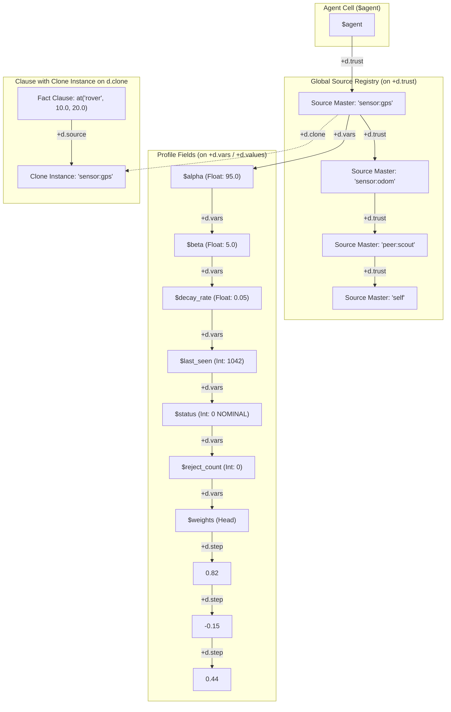
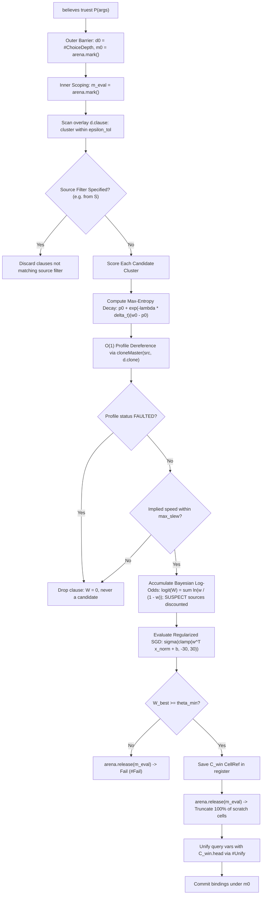

# vagent Dynamic Source Weighting & Epistemic Arbitration Framework

| field         | value                                                                                                                                                                                                                                                                                                                                                                                                                          |
| ------------- | ------------------------------------------------------------------------------------------------------------------------------------------------------------------------------------------------------------------------------------------------------------------------------------------------------------------------------------------------------------------------------------------------------------------------------ |
| version       | 1.2 (companion to \[vagent §5–§11\](file:///data/git/gleditor/design/vagent-agent-language.md), \[P18 Belief-Vlog Unification\](file:///data/git/gleditor/design/vagent-extended-capabilities-and-belief-vlog-unification.md), \[P17 Upgrade\](file:///data/git/gleditor/design/vagent-shared-program-and-live-upgrade.md), and \[Vlog §3–§8\](file:///data/git/gleditor/design/vlog-logic-extension.md))                      |
| status        | Revised Architectural Specification (Round 2 Review; Proposals P19.1–P19.7; Decisions U-C1–U-C7; R1 Disposition Incorporated; R2 Hardware-Fault Findings Incorporated)                                                                                                                                                                                                                                                         |
| compiles to   | Vortex bytecode instructions over an `ArenaManifold` overlay with a sealed, shared `programManifold` base; driven turn-by-turn by `MeshActorRuntime`                                                                                                                                                                                                                                                                           |
| rests on      | Vortex (\[runtime\](file:///data/git/gleditor/design/vortex-hyperstructural-runtime.md)), Vlog (\[logic\](file:///data/git/gleditor/design/vlog-logic-extension.md)), Spool-Mesh actor runtime (`apps/common/xanadu/vortex/mesh_actor.hpp`), `ArenaManifold` (`apps/common/xanadu/zigzag/arena_manifold.hpp`), P18 (\[beliefs\](file:///data/git/gleditor/design/vagent-extended-capabilities-and-belief-vlog-unification.md)) |
| prerequisites | P18.1 (`+d.source` provenance ranks on `d.clause`), P18.2 (isolated SLD query solver), P18.3 (keyed predicates and 1D rank excision); P17.1–P17.5 (sealed base manifold); Vortex scalar bit layout (R6); Proposal P19.7 (`#Exp`, `#Ln`, `#Sqrt` math opcodes)                                                                                                                                                                  |
| proposals     | P19.1 (Epistemic Dimensions & Source Profile Ranks), P19.2 (Analytic Bayesian Reputation & Decay in `std:epistemic`), P19.3 (Online SGD & Contextual Bandit Engine), P19.4 (Surface Syntax Extensions), P19.5 (Perceptual Attribution & Settle Queue), P19.6 (Native ML Epistemic Skill Binding), P19.7 (Vortex VM Elementary Math Opcodes)                                                                                    |

______________________________________________________________________

## Executive Summary

Under the P18 specification
(\[`design/vagent-extended-capabilities-and-belief-vlog-unification.md`\](file:///data/git/gleditor/design/vagent-extended-capabilities-and-belief-vlog-unification.md)),
`vagent` unifies agent beliefs with Vlog §6 Horn clauses and establishes multi-source coexistence
(Decision `U-B2`): when multiple external sources (host sensors, peer agents, deduced rules) assert
conflicting ground facts for a keyed predicate, all assertions coexist as distinct clauses along
`+d.clause`, each carrying its asserting sources on `+d.source`.

While coexistence guarantees that diverse perceptions are preserved without premature clobbering, it
leaves **epistemic arbitration**—deciding which source's statement possesses the highest warrant at
any given moment—either to ad-hoc procedural logic in user plans or to non-deterministic first-come
choice points. In autonomous robotics, distributed multi-agent teams, and open sensory meshes, this
equal-weight assumption fails:

1. **Physical Sensor Noise, Drift, and Faults**: Sensors experience calibration drift, thermal bias
   shifts, random walk noise, and transient faults (multipath, occlusion, backscatter).
   Dead-reckoning sensors (wheel odometry, IMUs) suffer unbounded error variance expansion over time
   ($\sigma^2
   \propto t^3$), while absolute sensors (GPS) experience discrete outages and multipath jumps.
1. **Epistemic Warrant vs. Ontological Truth**: An agent can never compute absolute ontological
   truth; it computes **subjective epistemic warrant** based on available evidence, temporal
   freshness, sensor health, and historical reliability.
1. **Continuous Domain Unification Failure**: In continuous domains ($\mathbb{R}^n$), independent
   sensors almost surely never output bitwise-identical floating-point values
   ($\mathbb{P}(X_1 = X_2)
   = 0$). Exact symbolic unification partitions sources into separate clauses, completely preventing
   corroboration without metric $\epsilon$-neighborhood clustering.
1. **Deliberation Demands Prioritized Hypotheses**: BDI deliberation should test the most credible
   hypotheses first, falling back to lower-warrant alternatives only when primary hypotheses fail.

This document specifies a comprehensive, hyperstructural **Dynamic Source Weighting and Epistemic
Arbitration Framework** for `vagent`. It establishes:

1. **Epistemic ZigZag Manifold Topology (P19.1)**: Source reliability profiles, calibration
   overrides, and learned weights reside entirely on orthogonal ZigZag dimensions (`d.trust`,
   `d.epistemic`) in the agent's ephemeral `ArenaManifold` overlay, with zero hidden C++ STL state.
   Source Profile cells on `+d.trust` act as **clone masters**; asserting source cells on
   `+d.source` are **clone instances** on `+d.clone`, enabling $O(1)$ profile dereference via
   `ArenaManifold::cloneMaster(cell, d.clone)`.
1. **Mathematically Rigorous Epistemic Formulation (P19.2, P19.3)**:
   - **Maximum-Entropy Temporal Decay**: Continuous discounting that regresses beliefs toward the
     uninformative prior ($p_0 = 0.5$) rather than false certainty: $w_S(\Delta t) = p_0 +
     e^{-\lambda_S \Delta t} (w_S(0) - p_0)$.
   - **Bayesian Posterior Log-Odds Combination**: Replaces flawed Noisy-OR formulas with proper
     Bayesian log-odds updating:
     $\text{logit}(W) = \text{logit}(P_0) + \sum \ln \frac{w_S}{1 - w_S}$, preventing coin-flip
     paradoxes and incorporating sub-additive correlation discounting for relayed peer testimony.
   - **Decoupled Physical Noise & Innovation-Gated Fusion**: Decouples physical measurement
     covariance $R_i$ from dimensionless trust $w_i$, using trust as a covariance inflation penalty
     $\tilde{R}_i = R_i / \max(w_i, \epsilon_{\text{floor}})$. Employs Chi-squared ($\chi^2$)
     Mahalanobis innovation gating to reject sensor outliers before fusion, refusing fusion and
     preserving disjunctive hypotheses in multi-modal scenarios.
   - **Regularized Online Machine Learning via SGD**: Pure-Vortex online logistic regression with
     $L_2$ weight regularization, Robbins-Monro learning rate scheduling ($\\eta_t =
     \\frac{\\eta_0}{\\sqrt{N_S
     - 1}}$), online Welford feature standardization, and logit clamping to $[-30.0, 30.0]$.
   - **Vortex Math Opcodes (P19.7)**: Formally adds `#Exp`, `#Ln`, and `#Sqrt` instructions to
     `OpcodeKind` in `vortex_vm.{hpp,cpp}` to support numeric and scientific computing natively.
1. **Clean Surface Language Integration (P19.4)**:
   - `believes truest P(...)`: Evaluates candidate facts and selects the single clause maximizing
     epistemic warrant, subject to an epistemic acceptance threshold $\theta_{\min}$.
   - `for believes ranked P(...)`: A descending priority generator yielding candidate hypotheses in
     order of credibility.
   - `believes consensus P(...)`: Synthesizes continuous attributes via innovation-gated Gaussian
     fusion over $\epsilon$-clustered clauses.
   - Declarative policies:
     `predicate at(...) arbitrated by truest(model: "online_sgd", decay: 2.5s)`.
   - Epistemic directives: `confirm P(...)` and `refute P(...)` with strict AGM contraction and 1D
     rank excision.
1. **Epistemic Attribution & Settle Queue (P19.5)**: Replaces flawed goal-outcome backpropagation
   (epistemic luck) with explicit perceptual verification. Epistemic updates are staged to an
   agent-level post-turn settle queue, ensuring that verified refutations are never rolled back by
   speculative turn failures.
1. **Expression Purity & Memory Lifecycle**:
   - Condition guards and expressions remain strictly pure and synchronous (`checker.cpp:2873`).
     Native ML skills run asynchronously as plan statements or background percept pipes, populating
     on-manifold feature embeddings for fast synchronous query evaluation.
   - Query candidate scoring is scoped under an inner evaluation mark $m_{\text{eval}}$, reclaiming
     all scratch candidate lists and score cells via `arena.release(m_{\text{eval}})` prior to
     binding the winning clause under the outer choice point.

______________________________________________________________________

## Contents

- [1. Core Problem & Architectural Gap](#1-core-problem--architectural-gap)
  - [1.1 The Equal-Weight Fallacy in Multi-Source Beliefs][toc-01]
  - [1.2 Physical Sensor Faults, Drift, and Epistemic Warrant][toc-02]
  - [1.3 Why Dynamic Weighting Must Be Hyperstructural][toc-03]
  - [1.4 Refused Alternatives][toc-04]
  - [1.5 Approved Architectural Decisions Table][toc-05]
- [2. Epistemic Manifold Topology & Representation](#2-epistemic-manifold-topology--representation)
  - [2.1 The `d.trust` and `d.epistemic` Dimensions][toc-06]
  - [2.2 Source Profile Rank Topology and Clone Master Links][toc-07]
  - [2.3 Epistemic Metadata Cells & R6 Scalar Layout][toc-08]
  - [2.4 Rule V12 Base/Overlay Partitioning & Memory Caps][toc-09]
- [3. Dynamic Weighting & ML Formulation][toc-sec-3]
  - [3.1 Maximum-Entropy Temporal Decay & Drift Dynamics][toc-10]
  - [3.2 Bayesian Posterior Log-Odds & Correlation Discounting][toc-11]
  - [3.3 Regularized Online SGD & Robbins-Monro Scheduling][toc-12]
  - [3.4 Contextual Bandits (LinUCB & Thompson Sampling)][toc-13]
  - [3.5 Continuous Metric Clustering ($\epsilon_{\text{tol}}$)][toc-14]
- [4. Surface Syntax & Compilation](#4-surface-syntax--compilation)
  - [4.1 Query Expressions: `truest`, `ranked`, `consensus`][toc-15]
  - [4.2 Declarative Predicate Arbitration Policies][toc-16]
  - [4.3 Explicit Epistemic Directives (`confirm`, `refute`)][toc-17]
  - [4.4 Compiler Lowering & Expression Purity][toc-18]
- [5. Query Resolution & SLD Integration](#5-query-resolution--sld-integration)
  - [5.1 The `truest` Selection Pipeline & Acceptance Thresholds][toc-19]
  - [5.2 The `ranked` Generator][toc-20]
  - [5.3 Continuous Value Fusion with $\chi^2$ Innovation Gating][toc-21]
  - [5.4 Inner Evaluation Scoping ($m_{\text{eval}}$) & Trail Safety][toc-22]
- [6. Closed-Loop Deliberation & Backpropagation][toc-sec-6]
  - [6.1 Epistemic Provenance Tokens on Intention Frames][toc-23]
  - [6.2 Perceptual Verification vs. Epistemic Luck][toc-24]
  - [6.3 Turn Settle Queue & Plan Failure Rollback Immunity][toc-25]
- [7. Comprehensive Worked Examples](#7-comprehensive-worked-examples)
  - [7.1 Example 1: Multi-Sensor Autonomous Rover Navigation][toc-26]
  - [7.2 Example 2: Byzantine Fault Tolerance in Distributed Swarms][toc-27]
  - [7.3 Example 3: Contextual Online Learning for Percepts][toc-28]
  - [7.4 Example 4: Native Deep-Learning Vision Skill Integration][toc-29]
- [8. Proposal Register (P19.1–P19.7)](#8-proposal-register-p191p197)
  - [8.1 Proposal P19.1: Epistemic ZigZag Dimensions & Profile Ranks][toc-30]
  - [8.2 Proposal P19.2: Analytic Bayesian Reputation Engine in `std:epistemic`][toc-31]
  - [8.3 Proposal P19.3: Online SGD & Contextual Bandit Engine][toc-32]
  - [8.4 Proposal P19.4: Surface Syntax Extensions in `vagent` Compiler][toc-33]
  - [8.5 Proposal P19.5: Perceptual Attribution & Turn Settle Queue][toc-34]
  - [8.6 Proposal P19.6: Native Epistemic ML Skill Binding][toc-35]
  - [8.7 Proposal P19.7: Vortex VM Elementary Math Opcodes][toc-38]
- [9. Compatibility & Verification Matrix][toc-sec-9]
  - [Acceptance Verification Battery][toc-37]

______________________________________________________________________

## 1. Core Problem & Architectural Gap

### 1.1 The Equal-Weight Fallacy in Multi-Source Beliefs

In P18 §2.3, the `vagent` belief subsystem adopted multi-source coexistence (Decision `U-B2`). When
multiple sources assert differing facts for a keyed predicate:

```vagent
assert at("rover", 10.0, 20.0) from "sensor:gps"
assert at("rover", 10.2, 20.1) from "sensor:wheel_odometry"
assert at("rover", 45.0, 80.0) from "peer:faulty_scout"
```

The manifold stores three distinct clause cells along `+d.clause` off the `at/3` descriptor.

When a plan evaluates a standard query:

```vagent
where: believes at("rover", ?x, ?y)
```

The underlying SLD resolution engine scans the clauses in arbitrary insertion order. If
`peer:faulty_scout` happened to assert its fact first, the plan adopts `(45.0, 80.0)` as its active
belief.

Treating all sources with equal weight or resolving them by insertion order is catastrophic:

- A compromised or miscalibrated sensor completely derails agent navigation.
- An outdated message from a remote peer clobbers fresh local sensor data.
- The agent has no mechanism to reason probabilistically about belief confidence during
  deliberation.

### 1.2 Physical Sensor Faults, Drift, and Epistemic Warrant

Physical sensors are subject to complex, well-documented hardware failure modes:

1. **Dead-Reckoning Drift Dynamics**: Inertial measurement units (accelerometers, gyroscopes) and
   wheel odometry measure differential motion increments. Errors integrate over time: gyro bias
   integrates into orientation error ($\sigma_\theta \propto \sqrt{t}$), which rotates accelerometer
   signals into integrated velocity and position errors ($\sigma_p \propto t^{3/2}$). Wheel odometry
   slips under wheel-spin or uneven terrain, accumulating positional error proportional to travel
   distance $s$. Treating dead-reckoning measurements as static absolute positions subject to simple
   half-life decay fails to model their true error growth.
1. **Absolute Sensor Fault Modes**: GNSS/GPS provides absolute positioning but suffers from
   satellite geometry degradation (high DOP), ionospheric delays, multipath reflections in urban
   canyons (causing step jumps of 10–50 meters), and jamming/spoofing. Vision sensors (cameras,
   LiDAR) suffer from motion blur, underexposure/overexposure, lens flare, dust backscatter, and
   featureless visual environments.
1. **The Concept of Epistemic Warrant**: An agent cannot know objective ontological truth; it can
   only assess **epistemic warrant**—the rational degree of confidence justified by its perceptual
   evidence, sensory health states, and historical reliability.

### 1.3 Why Dynamic Weighting Must Be Hyperstructural

In many AI architectures, trust scores and machine learning weights are held in auxiliary C++
`std::unordered_map` side tables or external Python processes. In Vortex, this is unacceptable:

- **Rule V12 & P17 (Shared Base / Overlay State)**: Actor state must be serializable, inspectable,
  and relocatable during live upgrades
  (\[`design/vagent-shared-program-and-live-upgrade.md`\](file:///data/git/gleditor/design/vagent-shared-program-and-live-upgrade.md)).
  Hidden C++ heap state cannot survive state reconciliation across program upgrades.
- **Nelsonian Purity (Single Primitive Invariant)**: Every epistemic relation (trust profiles, decay
  coefficients, observation counts, feature weights) must be represented as cells connected along
  orthogonal ZigZag dimensions.
- **Backtrack Safety (Trail Isolation)**: When an agent speculatively tests a hypothetical belief
  during goal deliberation, exploratory trial weights must unwind cleanly on `#Fail` without leaking
  into the agent's long-term reputation memory.

### 1.4 Refused Alternatives

1. **Static Hardcoded Priority Ranks**:
   - *Refused*: Assigning fixed integer priorities to sources (e.g., `self > gps > peer`) cannot
     adapt to sensor failure, noise, environmental context, or learning over time.
   - *Adopted*: Continuous dynamic epistemic weighting combining Bayesian priors, temporal decay,
     and online contextual learning.
1. **Ad-Hoc Procedural Arbitration in Plan Logic**:
   - *Refused*: Forcing every plan author to write `findall(?X, at(...))` and manually calculate
     averages or sort lists creates massive boilerplate and pollutes plan bodies with epistemic
     plumbing.
   - *Adopted*: First-class surface keywords (`truest`, `ranked`, `consensus`) and declarative
     predicate arbitration policies compiled into optimized VM bytecode.
1. **Noisy-OR Evidence Multiplication**:
   - *Refused*: Formula $W = 1 - \prod(1 - w_i)$ treats posterior probabilities as independent
     failure probabilities, causing uninformative coin-flip sources ($w = 0.5$) to compound into
     artificial certainty ($W \to 1.0$) and allowing multiple poor sources ($w = 0.2$) to flip a
     belief to true.
   - *Adopted*: Bayesian posterior log-odds accumulation with correlation discounting.
1. **Dimensionless Weights as Physical Inverse Variances**:
   - *Refused*: Equating dimensionless trust $w \in [0, 1]$ directly to physical inverse variance
     $\frac{1}{\sigma^2}$ breaks dimensional analysis ($[Units]^{-2}$) and caps physical accuracy at
     $\sigma^2 \ge 1.0$.
   - *Adopted*: Decoupling physical sensor measurement noise covariance $R_i$ from epistemic
     reliability $w_i$, using trust as a covariance inflation penalty $\tilde{R}_i = R_i / \max(w_i,
     \epsilon_{\text{floor}})$.
1. **Automated Plan Outcome Backpropagation (Epistemic Luck)**:
   - *Refused*: Rewarding/penalizing belief sources based on generic plan goal success/failure
     commits a Gettier fallacy: rewarding false beliefs that succeeded by lucky detour, and
     penalizing true sensor readings when downstream motors stall.
   - *Adopted*: Attribution restricted to explicit perceptual verification steps (`confirm`,
     `refute`, sensory residual parity).

### 1.5 Approved Architectural Decisions Table

| ID     | Topic                                | Approved Ruling                                                                                                                                                                                                                                 |
| ------ | ------------------------------------ | ----------------------------------------------------------------------------------------------------------------------------------------------------------------------------------------------------------------------------------------------- |
| `U-C1` | **Storage Topology for Trust State** | **Agent Overlay on `d.trust` with `d.clone` Masters**: Source profiles reside exclusively in the agent's overlay on `+d.trust` as clone masters. Sources on `+d.source` are clone instances on `+d.clone`, giving $O(1)$ dereference.           |
| `U-C2` | **Learning Execution Model**         | **Pure Vortex Bytecode with Elementary Math Opcodes**: Analytic calculations, Bayesian updates, and online SGD run in pure Vortex bytecode using new opcodes `#Exp`, `#Ln`, `#Sqrt` (Proposal P19.7).                                           |
| `U-C3` | **Feedback Attribution Scope**       | **Perceptual Verification vs. Epistemic Luck**: Belief rewards/penalties occur only on explicit perceptual verification (`confirm`, `refute`, residual parity), never on generic plan goal outcomes.                                            |
| `U-C4` | **Arbitration Indifference**         | **Principle of Indifference**: Exact ties between candidate facts branch into distinct non-deterministic choice points or yield `std::nullopt` under `truest` (no arbitrary pointer tie-breaking).                                              |
| `U-C5` | **Continuous Value Fusion**          | **Innovation-Gated Covariance Inflation**: Trust inflates physical covariance $\tilde{R}_i = R_i / \max(w_i, \epsilon_{\text{floor}})$. Chi-squared ($\chi^2$) innovation gating rejects outliers. Multi-modal disjunctions refuse fusion.      |
| `U-C6` | **Expression Purity Constraint**     | **Strictly Synchronous Queries**: Query expressions and `where:` guards are strictly pure and non-suspending. Native ML skills run in plan statements or percept pipes, populating on-manifold feature embeddings.                              |
| `U-C7` | **Memory Lifecycle & Truncation**    | **Inner Evaluation Scoping ($m_{\text{eval}}$)**: Query candidate scoring runs under an inner mark $m_{\text{eval}}$. Reclaiming scratch cells via `release(m_{\text{eval}})` precedes binding the winning clause under the outer choice point. |

______________________________________________________________________

## 2. Epistemic Manifold Topology & Representation

### 2.1 The `d.trust` and `d.epistemic` Dimensions

To represent epistemic profiles without violating Rule V12, two new ZigZag dimensions are registered
in `apps/common/xanadu/vagent/runtime_abi.hpp`:

- **`d.trust`**: Originates at the agent cell (`agentCell_`, `$agent`) and heads a rank of **Source
  Profile Cells** for every source known to the agent.
- **`d.epistemic`**: Originates at individual predicate descriptor cells on `+d.belief` and links
  domain-specific epistemic calibration overrides and feature weights.



### 2.2 Source Profile Rank Topology and Clone Master Links

Every source known to an agent has exactly **one canonical Source Profile Cell** along `+d.trust`.

To guarantee $O(1)$ dereferencing during candidate clause scoring:

1. **Clone Master Designation**: The Source Profile cell on `+d.trust` is designated as the **clone
   master** for that source.
1. **Clone Instances on `+d.source`**: When an assertion arrives from source $S$, the source cell
   linked on the clause's `+d.source` rank is minted as an authentic **clone instance** on $S$'s
   `+d.clone` rank.
1. **Instant Dereferencing**: The query engine resolves an asserting source cell directly to its
   profile via `ArenaManifold::cloneMaster(srcCell, core_.dims().clone)` in $O(1)$ time, eliminating
   all linear string searches across `+d.trust`.

### 2.3 Epistemic Metadata Cells & R6 Scalar Layout

The Source Profile cell holds its attributes along `+d.vars` with values on `+d.values`:

| Field Name      | Type    | Semantics                                                                          |
| --------------- | ------- | ---------------------------------------------------------------------------------- |
| `$alpha`        | `Float` | Cumulative positive evidence / confirmed predictions count ($\ge 1.0$)             |
| `$beta`         | `Float` | Cumulative negative evidence / refutations ($\ge 1.0$)                             |
| `$decay_rate`   | `Float` | Half-life decay factor $\lambda \in [0.0, 1.0]$ per turn                           |
| `$last_seen`    | `Int`   | Engine turn count at which this source last asserted or was verified               |
| `$obs_count`    | `Int`   | Total number of observations $N_S$ received from this source                       |
| `$status`       | `Int`   | Hardware health state: 0 (`NOMINAL`), 1 (`DEGRADED`), 2 (`SUSPECT`), 3 (`FAULTED`) |
| `$reject_count` | `Int`   | Consecutive $\chi^2$ or slew rejection counter                                     |
| `$sensor_kind`  | `Int`   | 0 (`ABSOLUTE`): trust decays per §3.1. 1 (`DEAD_RECKONING`): $R$ grows per §5.3    |
| `$r0`           | `Float` | Nominal measurement variance $R_0$ in squared units; used when a clause has none   |
| `$q_drift`      | `Float` | Drift variance rate $Q_{\text{drift}}$; read only when `$sensor_kind` is 1         |
| `$weights`      | `Head`  | Head cell linking canonical R6 float scalar cells along `+d.step`                  |
| `$bias`         | `Float` | Learned scalar bias term $b_S$                                                     |

All numeric values ($\alpha, \beta, \lambda, \mathbf{w}, b, R_0, Q_{\text{drift}}$) are stored as
canonical R6 scalar cells holding raw 64-bit IEEE 754 floats in their node values. Calculations
evaluate natively in Vortex bytecode via `#Add`, `#Sub`, `#Mul`, `#Div`, `#Exp`, `#Ln`, `#Sqrt`. The
profile diagram in §2.1 shows only the Bayesian fields; the kinematic fields hang off the same
`+d.vars` rank.

#### Health State Machine

`$status` is written only by the settle queue (§6.3), never by an in-turn expression:

| From                  | Event                                  | To         |
| --------------------- | -------------------------------------- | ---------- |
| `NOMINAL`             | skill-reported health warning          | `DEGRADED` |
| `NOMINAL`, `DEGRADED` | `$reject_count` reaches 3              | `SUSPECT`  |
| `SUSPECT`             | `$reject_count` reaches 5              | `FAULTED`  |
| `SUSPECT`, `DEGRADED` | measurement accepted, count reset to 0 | `NOMINAL`  |
| any                   | `isolate source`                       | `FAULTED`  |
| `FAULTED`             | `reset source`                         | `NOMINAL`  |

`FAULTED` is latched because a sensor that fails stuck-at a plausible value can pass the gate by
chance; only an explicit operator or plan decision releases it. `FAULTED` clauses never enter
arbitration (§5.1, §5.3), and `SUSPECT` sources contribute half their log-odds in `truest` and
`ranked` and four times their covariance in `consensus`.

### 2.4 Rule V12 Base/Overlay Partitioning & Memory Caps

In accordance with Rule V12:

- **Overlay Exclusivity**: Source profiles represent dynamic network peers and physical sensors.
  They reside **exclusively in the agent's ephemeral `ArenaManifold` overlay**. The sealed base
  `programManifold` holds no source profiles, preventing base-cell fan-in across agents.
- **Retention Caps & Pruning**: The agent enforces a maximum profile cap `vagent.max_sources`
  (default 128). When the registry fills, the runtime prunes the least-recently-seen source having
  status `NOMINAL` and no active clauses on `+d.clause` using standard 1D rank excision.

______________________________________________________________________

## 3. Dynamic Weighting & ML Formulation

### 3.1 Maximum-Entropy Temporal Decay & Drift Dynamics

Let $t_{\text{current}}$ be the current engine turn count, and let $t_{\text{asserted}}$ be the turn
at which source $S$ asserted the clause ($\Delta t = t_{\text{current}} - t_{\text{asserted}}$).

#### Regression Toward Maximum Entropy

Multiplying probabilities directly by $e^{-\lambda \Delta t}$ causes old observations to converge to
$0.0$ ($100\%$ certainly false). Instead, temporal decay regresses belief confidence toward the
uninformative, maximum-entropy prior ($p_0 = 0.5$):

```math
w_S(\Delta t) = p_0 + e^{-\lambda_S \Delta t} (w_S(0) - p_0)
```

Where $\lambda_S = \frac{\ln 2}{\tau_{1/2}}$ is derived from the source's half-life $\tau_{1/2}$.

- When $\Delta t = 0 \implies w_S(\Delta t) = w_S(0)$.
- As $\Delta t \to \infty \implies w_S(\Delta t) \to p_0 = 0.5$ (complete uncertainty).
- For static historical facts, $\lambda_S = 0 \implies w_S(\Delta t) = w_S(0)$.

#### Dead-Reckoning Covariance Expansion

For dead-reckoning sensors (IMU, wheel odometry), positional uncertainty expands dynamically with
traveled distance $s$ or elapsed time $\Delta t$:

```math
R_{\text{dead}}(\Delta t) = R_0 + Q_{\text{drift}} \cdot (\Delta t)^3
```

This dynamically expanding covariance is fed into continuous fusion, correctly reflecting growing
drift uncertainty without clobbering base reputation. $R_0$ and $Q_{\text{drift}}$ are the profile's
`$r0` and `$q_drift`; $\Delta t$ counts turns since the source's last absolute correction. The
equation is evaluated in step 3 of §5.3 and only for profiles with `$sensor_kind` =
`DEAD_RECKONING`. Increments such as wheel-encoder steps are integrated into a pose by a skill
before assertion; they are never asserted as absolute coordinates.

### 3.2 Bayesian Posterior Log-Odds & Correlation Discounting

For discrete truth evaluation, source reliability is modeled as a Bernoulli parameter $p \in [0, 1]$
with conjugate prior $\text{Beta}(\alpha_S, \beta_S)$:

```math
\mu_S = \frac{\alpha_S}{\alpha_S + \beta_S}, \qquad \sigma_S^2 = \frac{\alpha_S \beta_S}{(\alpha_S + \beta_S)^2 (\alpha_S + \beta_S + 1)}
```

#### Log-Odds Evidence Combination

When a candidate clause is corroborated by a set of sources $\mathcal{S}$, their evidence combines
via Bayesian posterior log-odds:

```math
\text{logit}(W) = \text{logit}(P_0) + \sum_{C \in \text{Clusters}} (1 - \rho_{|C|}) \sum_{S \in C} \ln \left( \frac{w_S}{1 - w_S} \right)
```

Where:

- $\text{logit}(p) = \ln \frac{p}{1 - p}$, and $P_0$ is the uninformative prior
  ($P_0 = 0.5 \implies \text{logit}(P_0) = 0$).
- If a source has $w_S = 0.5$, its evidence $\ln \frac{0.5}{0.5} = \ln 1 = 0$, contributing zero
  change in warrant.
- If $w_S < 0.5$, $\ln \frac{w_S}{1 - w_S} < 0$, correctly penalizing credibility.
- $\rho_{|C|} \in [0.0, 1.0)$ is the correlation coefficient for sources belonging to the same
  provenance cluster $C$ (e.g. peer agents in the same gossip group or sensors on the same I2C bus),
  preventing echo chambers and Sybil attacks.

The final combined warrant is recovered via the logistic sigmoid:

```math
W = \sigma(\text{logit}(W)) = \frac{1}{1 + e^{-\text{logit}(W)}}
```

### 3.3 Regularized Online SGD & Robbins-Monro Scheduling

When source competence depends on environmental context $\mathbf{x} \in \mathbb{R}^d$ (ambient
light, speed, battery, temperature), confidence is predicted via online logistic regression:

```math
z_S = \mathbf{w}_S^T \mathbf{x}_{\text{norm}} + b_S, \qquad \hat{y}_S = \sigma(\text{clamp}(z_S, -30.0, 30.0))
```

#### Numerical Stability & Regularization Rules

1. **Welford Feature Normalization**: Features are standardized online using running means
   $\hat{\mu}_j$ and variances $\hat{\sigma}_j^2$:
   $x_{\text{norm}, j} = \frac{x_j - \hat{\mu}_j}{\hat{\sigma}_j + \epsilon}$.

1. **Logit Clamping**: $z_S$ is clamped to $[-30.0, 30.0]$ prior to `#Exp`, preventing
   floating-point underflow/overflow in IEEE 754 floats.

1. **Robbins-Monro Learning Rate Schedule**: The learning rate decays with observation count $N_S$
   to guarantee stochastic convergence:

   ```math
   \eta_t = \frac{\eta_0}{\sqrt{N_S + 1}}
   ```

1. **$L_2$ Weight Regularization**: Weights are penalized by $-\lambda_{\text{reg}} \mathbf{w}_S$ to
   prevent weights from escaping to infinity on separable data:

   ```math
   \mathbf{w}_S \leftarrow (1 - \eta_t \lambda_{\text{reg}}) \mathbf{w}_S - \eta_t (\hat{y}_S - y) \mathbf{x}_{\text{norm}}
   ```

   ```math
   b_S \leftarrow b_S - \eta_t (\hat{y}_S - y)
   ```

### 3.4 Contextual Bandits (LinUCB & Thompson Sampling)

To balance epistemic exploration and exploitation:

- **Thompson Sampling (Recommended Default)**: Draw a stochastic confidence sample from the
  posterior:

  ```math
  \tilde{p}_S \sim \text{Beta}(\alpha_S, \beta_S)
  ```

- **Clamped Beta-UCB**:

  ```math
  \text{Score}_{\text{UCB}}(S) = \min(1.0, \mu_S + c \cdot \sigma_S)
  ```

- **Contextual LinUCB**: When context vector $\mathbf{x}$ is available, confidence includes the
  ridge-regression exploration bonus:

  ```math
  \text{Score}(S) = \mathbf{w}_S^T \mathbf{x} + c \sqrt{\mathbf{x}^T \mathbf{A}_S^{-1} \mathbf{x}}
  ```

  Where $\mathbf{A}_S^{-1}$ is updated online via the Sherman-Morrison rank-1 formula.

### 3.5 Continuous Metric Clustering ($\epsilon_{\text{tol}}$)

In continuous domains, independent physical sensors never output bitwise-identical floats. Before
arbitration, the engine clusters clauses along `+d.clause` using metric tolerance
$\epsilon_{\text{tol}}$:

```math
\text{Cluster}(C_1, C_2) \iff \|\mathbf{K}(C_1) - \mathbf{K}(C_2)\|_2 \le \epsilon_{\text{tol}}
```

Clauses within the same $\epsilon$-cluster are recognized as mutual hypotheses, enabling Bayesian
log-odds combination and Gaussian fusion to operate across distinct continuous sensor readings.

______________________________________________________________________

## 4. Surface Syntax & Compilation

### 4.1 Query Expressions: `truest`, `ranked`, `consensus`

The `vagent` grammar is extended with contextual query modifiers:

```ebnf
BeliefQueryExpr    = 'believes' [ EpistemicModifier ] GoalTerm [ 'from' Postfix ]
                     [ 'with' 'uncertainty' ':' LogicVar ] ;
EpistemicModifier  = 'truest' | 'ranked' | 'consensus' ;
AssertStmt         = 'assert' GoalTerm 'from' Postfix [ 'with' 'variance' ':' Expr ] ;
SourceDirective    = ( 'reset' | 'isolate' ) 'source' Postfix ;
```

`uncertainty` and `variance` are contextual after `with`; `reset`, `isolate` and `source` are
contextual at statement position. `with uncertainty` is legal only on `consensus` queries.

All pattern variables within `GoalTerm` use standard unifiable logic variable syntax (`?v`):

```vagent
// 1. Truest: Binds ?x, ?y to the single hypothesis with maximal epistemic warrant
if believes truest at("rover", ?x, ?y) then {
  log("Navigating to: (", ?x, ", ", ?y, ")")
}

// 2. Ranked: Generator yielding candidate hypotheses in descending order of warrant
for believes ranked target_position(?pos) do {
  if attempt_intercept(?pos) then {
    break
  }
}

// 3. Consensus: Fuses continuous attributes via innovation-gated Gaussian fusion
if believes consensus at("rover", ?x, ?y) then {
  log("Fused location: (", ?x, ", ", ?y, ")")
}
```

### 4.2 Declarative Predicate Arbitration Policies

Predicates are declared strictly as top-level declarations (`TopDecl`) with declarative policies:

```vagent
predicate at(key who: Agent, x: Float, y: Float)
  arbitrated by truest(
    decay: 1.5s,
    model: "online_sgd",
    min_confidence: 0.6,
    max_slew: 15.0,          // physical speed limit in the predicate's units per second
    cluster_tolerance: 0.25  // epsilon_tol in the predicate's units
  )

predicate temperature(key zone: Str, temp: Float)
  arbitrated by consensus(
    fusion: "gaussian",
    innovation_gate: 5.99,
    min_confidence: 0.5,
    cluster_tolerance: 0.5
  )
```

Arbitration parameters use string literals or typed identifiers to prevent expression ambiguity.
`cluster_tolerance` is required for any predicate with a `Float` non-key argument; the checker
reports `MissingClusterTolerance` rather than inventing a default. `max_slew` is optional and
enables the kinematic gate of §5.3.

Continuous assertions state their measurement noise explicitly:

```vagent
assert at(self, fix.lat, fix.lon) from "sensor:gps" with variance: fix.accuracy_sq
```

When the annotation is omitted the source profile's `$r0` is used (§2.3).

### 4.3 Explicit Epistemic Directives (`confirm`, `refute`, `reset`, `isolate`)

Agents execute explicit epistemic verification when ground truth is verified:

```vagent
// 1. Confirm: Verifies that the asserted fact is veridical.
// Increments alpha for all asserting sources; decrements beta for conflicting sources.
confirm at(self, ?dest_x, ?dest_y)

// 2. Refute: Retracts the false belief from +d.clause via 1D rank excision,
// marks an epistemic defeater for the key tuple, and increments beta for asserting sources.
refute obstacle("sector_7")

// 3. Reset: Releases a latched FAULTED source after a physical reboot or recalibration.
reset source "sensor:gps"

// 4. Isolate: Forces FAULTED without waiting for gate trips.
isolate source "sensor:wheel_odometry"
```

`reset` and `isolate` lower to settle-queue entries (§6.3) that write `$status` and `$reject_count`
on the profile master along `+d.trust`. `reset` additionally restores `$alpha` and `$beta` to the
uninformative prior, since a rebooted sensor has no earned reputation.

### 4.4 Compiler Lowering & Expression Purity

In accordance with Rule V6 and `checker.cpp:2873`:

- **Strict Expression Purity**: `believes truest` is a pure, non-suspending expression. It never
  invokes asynchronous native skills and never yields the turn.
- **Lowering Pipeline**:
  1. Emit `#ChoiceDepth` into $d_0$ and record outer mark $m_0 = \text{arena.mark()}$.
  1. Take inner evaluation mark $m_{\text{eval}} = \text{arena.mark()}$.
  1. Scan overlay ground fact clauses, clustering within $\epsilon_{\text{tol}}$.
  1. For each cluster, evaluate Bayesian log-odds using clone-master profiles from `+d.clone`.
  1. Select winning clause $C_{\text{win}}$ satisfying score $\ge \theta_{\min}$.
  1. Execute `arena.release(m_{\text{eval}})` to instantaneously truncate all scratch lists and
     score cells.
  1. Unify query logic variables with $C_{\text{win}}$'s head arguments via `#Unify`.

______________________________________________________________________

## 5. Query Resolution & SLD Integration

### 5.1 The `truest` Selection Pipeline & Acceptance Thresholds



### 5.2 The `ranked` Generator

For `for believes ranked P(args)`:

1. Candidate clusters are scored under $m_{\text{eval}}$, sorted into a priority array, and winning
   `CellRef`s are captured into registers.
1. `arena.release(m_{\text{eval}})` truncates scratch sorting artifacts.
1. The engine emits a `#Choice` instruction for the top candidate.
1. On resumption (`#Fail`), backtracking selects the next candidate in the priority sequence.

### 5.3 Continuous Value Fusion with $\chi^2$ Innovation Gating

When evaluating `believes consensus P(...)` over $N$ continuous sensor measurements
$x_1, \dots, x_N$:

1. **Health Filter**: Clauses whose source profile has `$status` $\ge$ `FAULTED` are excluded before
   any scoring. Clauses from `SUSPECT` sources stay in the pool with $R_i$ multiplied by
   $\kappa_{\text{suspect}}$ (default 4.0).

1. **Kinematic Slew Gate**: When the predicate declares `max_slew` ($v_{\max}$) and a prior fix
   $\mathbf{x}_{\text{prior}}$ exists, a candidate $\mathbf{x}_i$ is rejected as a teleportation
   anomaly if

   ```math
   v_{\text{implied}} = \frac{\|\mathbf{x}_i - \mathbf{x}_{\text{prior}}\|_2}{\Delta t} > v_{\max}
   ```

   A slew rejection is treated as an innovation failure (step 4) and also skips the candidate in
   `truest` and `ranked`.

1. **Nominal Covariance and Drift**: The measurement noise $R_i$ comes from the clause's
   `with variance:` annotation, else the profile's `$r0`. For `DEAD_RECKONING` profiles
   ($\texttt{\$sensor\_kind} = 1$) it grows with the time since the last absolute correction:

   ```math
   R_i(\Delta t) = R_0 + Q_{\text{drift}} (\Delta t)^3
   ```

   An absolute profile uses $R_i = R_0$ with trust decay applied to $w_i$ only. If neither the
   clause nor the profile supplies a variance the clause is refused (`MissingVariance`); there is no
   implicit default.

1. **Covariance Inflation**: Dimensionless trust inflates the physical noise:

   ```math
   \tilde{R}_i = \frac{R_i(\Delta t)}{\max(w_i, \epsilon_{\text{floor}})}
   ```

1. **Chi-Squared ($\chi^2$) Innovation Test**: Each measurement is tested against the reference
   state $(\hat{x}_0, P_0)$ using Mahalanobis distance:

   ```math
   d_M^2 = (x_i - \hat{x}_0)^T (\tilde{R}_i + P_0)^{-1} (x_i - \hat{x}_0) \le \chi^2_{\alpha, k}
   ```

   The reference state is the prior fused belief for the key tuple propagated with process noise
   $Q \Delta t$ when one exists. Otherwise the gate is median-referenced:
   $\hat{x}_0 = \operatorname{median}\{x_i\}$ and $P_0 = \operatorname{MAD}^2$ over the cluster.

1. **Health State Machine**: Gate outcomes drive `$status` and `$reject_count` on the source profile
   master, staged through the settle queue (§6.3) so plan failure cannot undo them:

   - A rejected measurement increments `$reject_count`. At $N_{\text{suspect}} = 3$ the status
     becomes `SUSPECT`; at $N_{\text{trip}} = 5$ it becomes `FAULTED`.
   - An accepted measurement resets `$reject_count` to 0 and restores `NOMINAL` from `SUSPECT` or
     `DEGRADED`.
   - `FAULTED` is latched. Only the `reset source` directive (§4.3) releases it.
   - `DEGRADED` is set by a skill-reported health flag (for example a battery or saturation warning)
     and also inflates $R_i$ by $\kappa_{\text{degraded}}$ (default 2.0).

1. **Disjunctive Hypotheses**: If candidate measurements form distinct clusters that cannot be
   reconciled within the gate (e.g. bimodal hypotheses), Gaussian fusion is **refused**, preserving
   the distinct hypotheses as alternative choices rather than averaging them into a nonexistent
   centroid.

1. **Kalman Fusion**: For validated measurements within the gate:

   ```math
   \hat{x}_{\text{consensus}} = \tilde{P}_{\text{consensus}} \sum_{i=1}^N \tilde{R}_i^{-1} x_i,
   \qquad
   \tilde{P}_{\text{consensus}} = \left( \sum_{i=1}^N \tilde{R}_i^{-1} \right)^{-1}
   ```

   The synthesized consensus clause is anchored to the caller's activation frame and carries
   $\tilde{P}_{\text{consensus}}$ as a scalar cell on `+d.epistemic`. A query may bind it with
   `believes consensus P(...) with uncertainty: ?sigma`, so closed-loop planners see the fix's
   uncertainty and not only its centroid.

### 5.4 Inner Evaluation Scoping ($m_{\text{eval}}$) & Trail Safety

- `ArenaManifold::discard` does not truncate cells (`arena_manifold.cpp:1612`).
- To guarantee zero memory leakage during candidate evaluation, all temporary lists, scores, and
  clustering arrays are allocated under an inner evaluation mark $m_{\text{eval}}$.
- `arena.release(m_{\text{eval}})` cleanly frees 100% of scratch cells before variable binding.
- Only the winning term's variable bindings survive under the outer mark $m_0$.

______________________________________________________________________

## 6. Closed-Loop Deliberation & Backpropagation

### 6.1 Epistemic Provenance Tokens on Intention Frames

When an intention deliberates over a belief:

1. An **Epistemic Provenance Token** is minted on the intention's frame:
   - `kTokenPredicate`: Symbol `CellRef` of the predicate descriptor.
   - `kTokenKeyHash`: 64-bit hash of the key tuple values.
   - `kTokenSources`: Clone view cell on `+d.clone` linking the asserting source profile masters.
1. The token stores unlinked scalar bits or authentic clone view cells, completely avoiding uncloned
   fan-in and preventing dangling pointers. Multiple tokens for multi-belief intentions chain along
   `+d.step`.

### 6.2 Perceptual Verification vs. Epistemic Luck

Generic plan goal outcome ($y \in \{0, 1\}$) is **strictly decoupled** from belief attribution:

- If a plan reaches a destination, it does not automatically reward positioning sources; attribution
  occurs only when an explicit verification step (`confirm`, `refute`, or landmark sensor match)
  executes.
- If a plan aborts due to a motor stall or obstacle timeout, healthy sensors are **not** penalized.
- Refutations require direct perceptual contradictions: e.g., a tactile bumper triggers where sonar
  reported free space, or a visual landmark is verified absent.

### 6.3 Turn Settle Queue & Plan Failure Rollback Immunity

In `agent_executor.cpp:1449–1496`, statement or plan failure triggers `arena.release(m_0)`, which
unwinds the arena trail to the start of the turn.

To ensure that valid refutations are never rolled back when a plan fails:

1. When `refute` or `confirm` executes, the update payload is staged to the **Agent Settle Queue**
   (`+d.epistemic` off `$agent`).
1. The settle queue resides outside the speculative intention frame.
1. During turn settlement (`compiler.cpp` bytecode `rtSettle_`), the queue drains and applies
   updates directly to the Source Profile masters on `+d.trust`.
1. Even if the active plan fails and unwinds its locals, verified epistemic penalties persist.

______________________________________________________________________

## 7. Comprehensive Worked Examples

### 7.1 Example 1: Multi-Sensor Autonomous Rover Navigation

```vagent
predicate at(key who: Agent, x: Float, y: Float)
  arbitrated by truest(decay: 1.0s, model: "online_sgd")

agent Rover {
  capacity Motors {
    effect def drive_to(x: Float, y: Float) within 60s
  }
  capacity Vision {
    def detect_landmark(id: Str): Opt<Str>
  }

  skill RealMotors implements Motors
  skill RealVision implements Vision

  on percept GPSFix as fix {
    assert at(self, fix.lat, fix.lon) from "sensor:gps" with variance: fix.accuracy_sq
  }

  // Wheel odometry measures increments (ds, dtheta), never absolute coordinates. A pose-integration
  // skill accumulates them into an estimated pose; the profile for "sensor:odometry" is declared
  // sensor_kind DEAD_RECKONING, so its variance grows as R_dead(dt) between absolute fixes.
  on percept PoseEstimate as est {
    assert at(self, est.x, est.y) from "sensor:odometry" with variance: est.r0
  }

  on percept SLAMMatch as slam {
    assert at(self, slam.x, slam.y) from "sensor:slam" with variance: slam.cov
  }

  plan NavigateToWaypoint for reach_waypoint(dest_x: Float, dest_y: Float)
    where believes truest at(self, ?cur_x, ?cur_y)
    body {
      log("Starting navigation from truest location: (", ?cur_x, ", ", ?cur_y, ")")
      drive_to(dest_x, dest_y)

      if let landmark := detect_landmark("waypoint_beacon") then {
        confirm at(self, dest_x, dest_y)
        log("Waypoint reached and verified. Source trust reinforced.")
      } else {
        refute at(self, dest_x, dest_y)
        fail("Beacon not found at destination. Reputations penalized.")
      }
    }
}
```

### 7.2 Example 2: Byzantine Fault Tolerance in Distributed Swarms

```vagent
predicate obstacle(key id: Str, x: Float, y: Float)
  arbitrated by truest(model: "beta_reputation", min_confidence: 0.7)

agent SwarmCoordinator {
  capacity DroneScan {
    def scan_area(x: Float, y: Float): Bool
  }

  on percept InterAgentMsg as msg {
    if msg.kind == "tell" and msg.pred == "obstacle" then {
      assert obstacle(msg.args.id, msg.args.x, msg.args.y) from msg.sender
    }
  }

  plan InvestigateObstacle for verify_threat(id: Str)
    where believes truest obstacle(id, ?x, ?y)
    body {
      let confirmed := scan_area(?x, ?y)
      if confirmed then {
        confirm obstacle(id, ?x, ?y)
        log("Threat verified at (", ?x, ", ", ?y, ")")
      } else {
        refute obstacle(id, ?x, ?y)
        log("False report detected! False asserting sources penalized.")
      }
    }
}
```

### 7.3 Example 3: Contextual Online Learning for Percepts

```vagent
predicate target_spotted(key id: Str, x: Float, y: Float)
  arbitrated by truest(model: "online_sgd")

agent DroneTracker {
  var ambient_lux: Float := 100.0

  on percept LightSensor as ls {
    ambient_lux := ls.lux
  }

  plan TrackTarget for track(id: Str)
    where believes truest target_spotted(id, ?tx, ?ty)
    body {
      engage_tracking(?tx, ?ty)
    }
}
```

### 7.4 Example 4: Native Deep-Learning Vision Skill Integration

```vagent
capacity SceneVerifier {
  effect def evaluate_defect(img: Str, candidate: Str): Float within 5s
}

native skill LocalONNXRuntime implements SceneVerifier

predicate defect_detected(key component: Str, severity: Str)
  arbitrated by truest(model: "online_sgd")

agent VisualInspector {
  skill LocalONNXRuntime

  on percept CameraFrame as frame {
    evaluate_defect(frame.uri, "crack")
  }

  plan InspectTurbine for inspect(part: Str)
    where believes truest defect_detected(part, ?sev)
    body {
      report_defect(part, ?sev)
    }
}
```

______________________________________________________________________

## 8. Proposal Register (P19.1–P19.7)

### 8.1 Proposal P19.1: Epistemic ZigZag Dimensions & Profile Ranks

- **Files Affected**:
  - `apps/common/xanadu/vagent/runtime_abi.hpp`
  - `apps/common/xanadu/vagent/compiler.cpp`
  - `apps/common/xanadu/vagent/reconciler.cpp`
  - `apps/common/xanadu/vagent/agent_executor.cpp`
- **Description**: Register `d.trust` and `d.epistemic` dimensions in `runtime_abi.hpp`. Update
  `kAgentDimensionNames` array size constant from 14 to 16. Head the global source registry rank
  along `+d.trust` off `$agent` exclusively in the ephemeral overlay (Rule V12). Designate profile
  cells as clone masters; source cells on `+d.source` are clone instances on `+d.clone`. Update
  `reconciler.cpp:465–480` `fromDims` and live upgrade migration to preserve source profiles across
  P17 upgrades. Update `agent_executor.cpp:restoreState()` to restore `d.trust` ranks on checkpoint
  resume.
- **Pricing**: Zero new VM opcodes. Memory: 1 master cell + 8 field cells per source (~576 bytes).
- **Invariants Maintained**: Conforms strictly to Rule V12 and 2-degree ZigZag connectivity.

### 8.2 Proposal P19.2: Analytic Bayesian Reputation Engine in `std:epistemic`

- **Files Affected**:
  - `apps/common/xanadu/vortex/vortex_stdlib.hpp`
  - `apps/common/xanadu/vortex/vortex_stdlib.cpp`
- **Description**: Add `std:epistemic` routines in pure Vortex bytecode:
  1. `epistemic_decay(last_turn, current_turn, lambda)`
     $\to p_0 + e^{-\lambda \Delta t} (w_0 - p_0)$.
  1. `epistemic_log_odds_combine(weights_list, correlation_matrix)` $\to W$.
  1. `epistemic_gaussian_fuse(values_list, variances_list, threshold)`
     $\to \hat{x}_{\text{consensus}}$.
  1. `epistemic_cluster_clauses(clause_list, epsilon_tol)` $\to$ grouped candidate clusters.
- **Pricing**: Built using standard Vortex arithmetic plus new P19.7 math opcodes.
- **Invariants Maintained**: Single-threaded actor execution safety.

### 8.3 Proposal P19.3: Online SGD & Contextual Bandit Engine

- **Files Affected**:
  - `apps/common/xanadu/vortex/vortex_stdlib.hpp`
  - `apps/common/xanadu/vortex/vortex_stdlib.cpp`
- **Description**: Implement regularized online SGD and contextual bandit routines in
  `std:epistemic`:
  1. `epistemic_predict_confidence(weights_list, bias, context_list)` with logit clamping.
  1. `epistemic_sgd_update(weights_list, bias, context_list, y, obs_count, lambda_reg)`.
  1. `epistemic_linucb_score(mu, covariance_matrix, context_list, c)`.
- **Pricing**: $O(d)$ arithmetic operations; in-place scalar updates on existing R6 value cells.
- **Invariants Maintained**: Bounded memory and numerical overflow protection.

### 8.4 Proposal P19.4: Surface Syntax Extensions in `vagent` Compiler

- **Files Affected**:
  - `apps/common/xanadu/vagent/token.hpp`
  - `apps/common/xanadu/vagent/lexer.cpp`
  - `apps/common/xanadu/vagent/ast.hpp`
  - `apps/common/xanadu/vagent/parser.cpp`
  - `apps/common/xanadu/vagent/checker.hpp`
  - `apps/common/xanadu/vagent/checker.cpp`
  - `apps/common/xanadu/vagent/compiler.cpp`
- **Description**: Designate `truest`, `ranked`, `consensus`, `arbitrated` as contextual keywords.
  Reserve action keywords `confirm` and `refute`; `reset`, `isolate` and `source` are contextual at
  statement position. Parse declarative policies on `PredicateDecl` (`TopDecl`), including
  `max_slew` and `cluster_tolerance`, and the `with variance:` and `with uncertainty:` clauses.
  Lower `believes truest` with inner evaluation mark $m_{\text{eval}}$ and acceptance threshold
  $\theta_{\min}$. Add static semantic error codes to `CheckErrorCode`, including
  `MissingClusterTolerance` (a `Float` non-key argument without `cluster_tolerance`). A continuous
  clause with neither `with variance:` nor a profile `$r0` cannot be known statically, because
  profiles are dynamic; it is refused at query time as `MissingVariance` (§5.3).
- **Pricing**: Compile-time check $O(\text{params})$; adds ~35 instructions per query site.
- **Invariants Maintained**: Strict expression purity (`CheckErrorCode::ImpureCondition`).

### 8.5 Proposal P19.5: Perceptual Attribution & Turn Settle Queue

- **Files Affected**:
  - `apps/common/xanadu/vagent/compiler.cpp`
  - `apps/common/xanadu/vagent/agent_executor.cpp`
  - `apps/common/xanadu/vagent/runtime_abi.hpp`
- **Description**: Add `EpistemicProvenanceToken` recording key hashes and source clone masters on
  intention frames. Stage `confirm` and `refute` operations to the Agent Settle Queue on
  `+d.epistemic` off `$agent`. Drain and apply updates during bytecode `rtSettle_`, ensuring
  verified refutations persist even when speculative plans fail.
- **Pricing**: 1 token cell + 3 link cells per active intention frame (~128 bytes).
- **Invariants Maintained**: Eliminates Gettier epistemic luck and plan rollback vulnerabilities.

### 8.6 Proposal P19.6: Native Epistemic ML Skill Binding

- **Files Affected**:
  - `apps/common/xanadu/vagent/host_bindings.hpp`
  - `apps/common/xanadu/vagent/host_bindings.cpp`
- **Description**: Define `EpistemicModel` capacity for heavy neural models (TensorRT, ONNX
  Runtime). Native skills execute asynchronously as plan statements or background percept pipes,
  populating on-manifold feature embeddings for fast synchronous query evaluation.
- **Pricing**: Zero overhead when native skills are not configured.
- **Invariants Maintained**: Rule V6: No device calls run inside synchronous actor turns.

### 8.7 Proposal P19.7: Vortex VM Elementary Math Opcodes

- **Files Affected**:
  - `apps/common/xanadu/vortex/vortex_vm.hpp`
  - `apps/common/xanadu/vortex/vortex_vm.cpp`
  - `apps/common/xanadu/vortex/vortex_core.cpp`
- **Description**: Add three elementary floating-point opcodes to `OpcodeKind` in `vortex_vm.hpp`:
  1. `OpcodeKind::Exp`: computes IEEE 754 $e^x$ (`std::exp`).
  1. `OpcodeKind::Ln`: computes IEEE 754 $\ln(x)$ (`std::log`).
  1. `OpcodeKind::Sqrt`: computes IEEE 754 $\sqrt{x}$ (`std::sqrt`). Operate directly on R6
     canonical float scalar bits with NaN and infinity clamping.
- **Pricing**: ~15 lines in `vortex_vm.cpp` dispatch switch; standard CPU FPU vector latency (3–15
  cycles).
- **Invariants Maintained**: Native numeric performance without slow polynomial loops in bytecode.

______________________________________________________________________

## 9. Compatibility & Verification Matrix

| Component             | Current State (P18)                               | Post-Proposal State (P19)                                   | Breaking Changes & Migration                                | Verification Strategy                                           |
| --------------------- | ------------------------------------------------- | ----------------------------------------------------------- | ----------------------------------------------------------- | --------------------------------------------------------------- |
| **Belief Storage**    | Clauses on `d.clause`, sources on `d.source`      | Same layout; adds `d.trust` master rank and `d.clone` links | **None**: Completely backward-compatible with P18 layout    | Unit tests: verify source master linking and $O(1)$ dereference |
| **Math Execution**    | Basic arithmetic (`#Add`, `#Sub`, `#Mul`, `#Div`) | Adds `#Exp`, `#Ln`, `#Sqrt` opcodes (P19.7)                 | **None**: Purely additive to `OpcodeKind`                   | VM tests: assert float precision and boundary handling          |
| **Belief Queries**    | `believes P(...)` evaluates insertion order       | `truest`, `ranked`, `consensus` with $\theta_{\min}$        | **Opt-In**: Existing unannotated queries behave identically | Unit tests: compare insertion order vs. `truest` under noise    |
| **Truth Maintenance** | No feedback; manual `believe`/`forget`            | Closed-loop feedback via `confirm`, `refute`, settle queue  | **New feature**: Verified perceptual feedback               | Test harness: verify refutations persist across plan failures   |
| **Live Upgrades**     | Reconciles actor state and plans (P17)            | Reconciles `d.trust` source profiles and weights            | **Compatible**: Preserves learned trust across reloads      | Live upgrade test: verify source profiles survive reload        |

______________________________________________________________________

### Acceptance Verification Battery

The implementation will be verified across existing repository test suites per `AGENTS.md`:

1. **`tests/xuzz/vortex_vm_test.cpp` (P19.7)**:
   - Asserts `#Exp`, `#Ln`, `#Sqrt` accuracy across domain edges ($0.0$, negative inputs, large
     exponents).
1. **`tests/xuzz/vortex_stdlib_test.cpp` (P19.2, P19.3)**:
   - Asserts maximum-entropy decay, Bayesian log-odds accumulation, and $\chi^2$ innovation gating.
   - Asserts regularized online SGD convergence under temperature noise.
1. **`tests/xuzz/vagent_compiler_test.cpp` (P19.4, P19.5)**:
   - Asserts compilation of `truest`, `ranked`, `consensus`, `confirm`, `refute`.
   - Asserts inner evaluation scoping ($m_{\text{eval}}$) and zero memory leakage.
1. **`tests/xuzz/vagent_reconciler_test.cpp` (P19.1)**:
   - Asserts state reconciliation of `d.trust` source profiles and weights across live upgrades.
1. **`tests/xuzz/vagent_executor_test.cpp` (P19.5, P19.6)**:
   - Asserts that plan failure does not roll back refutations staged in the settle queue.
   - Asserts asynchronous native ML skill execution and cached feature embedding evaluation.

[toc-01]: #11-the-equal-weight-fallacy-in-multi-source-beliefs
[toc-02]: #12-physical-sensor-faults-drift-and-epistemic-warrant
[toc-03]: #13-why-dynamic-weighting-must-be-hyperstructural
[toc-04]: #14-refused-alternatives
[toc-05]: #15-approved-architectural-decisions-table
[toc-06]: #21-the-dtrust-and-depistemic-dimensions
[toc-07]: #22-source-profile-rank-topology-and-clone-master-links
[toc-08]: #23-epistemic-metadata-cells--r6-scalar-layout
[toc-09]: #24-rule-v12-baseoverlay-partitioning--memory-caps
[toc-10]: #31-maximum-entropy-temporal-decay--drift-dynamics
[toc-11]: #32-bayesian-posterior-log-odds--correlation-discounting
[toc-12]: #33-regularized-online-sgd--robbins-monro-scheduling
[toc-13]: #34-contextual-bandits-linucb--thompson-sampling
[toc-14]: #35-continuous-metric-clustering-epsilontol
[toc-15]: #41-query-expressions-truest-ranked-consensus
[toc-16]: #42-declarative-predicate-arbitration-policies
[toc-17]: #43-explicit-epistemic-directives-confirm-refute
[toc-18]: #44-compiler-lowering--expression-purity
[toc-19]: #51-the-truest-selection-pipeline--acceptance-thresholds
[toc-20]: #52-the-ranked-generator
[toc-21]: #53-continuous-value-fusion-with-chi2-innovation-gating
[toc-22]: #54-inner-evaluation-scoping-meval--trail-safety
[toc-23]: #61-epistemic-provenance-tokens-on-intention-frames
[toc-24]: #62-perceptual-verification-vs-epistemic-luck
[toc-25]: #63-turn-settle-queue--plan-failure-rollback-immunity
[toc-26]: #71-example-1-multi-sensor-autonomous-rover-navigation
[toc-27]: #72-example-2-byzantine-fault-tolerance-in-distributed-swarms
[toc-28]: #73-example-3-contextual-online-learning-for-percepts
[toc-29]: #74-example-4-native-deep-learning-vision-skill-integration
[toc-30]: #81-proposal-p191-epistemic-zigzag-dimensions--profile-ranks
[toc-31]: #82-proposal-p192-analytic-bayesian-reputation-engine-in-stdepistemic
[toc-32]: #83-proposal-p193-online-sgd--contextual-bandit-engine
[toc-33]: #84-proposal-p194-surface-syntax-extensions-in-vagent-compiler
[toc-34]: #85-proposal-p195-perceptual-attribution--turn-settle-queue
[toc-35]: #86-proposal-p196-native-epistemic-ml-skill-binding
[toc-37]: #acceptance-verification-battery
[toc-38]: #87-proposal-p197-vortex-vm-elementary-math-opcodes
[toc-sec-3]: #3-dynamic-weighting--ml-formulation
[toc-sec-6]: #6-closed-loop-deliberation--backpropagation
[toc-sec-9]: #9-compatibility--verification-matrix
