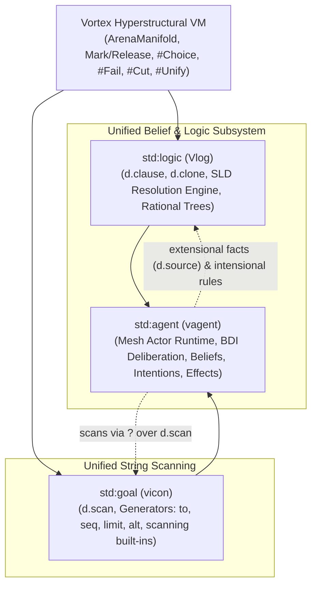
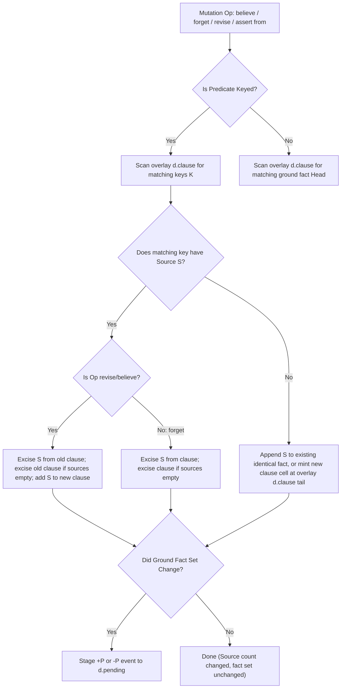
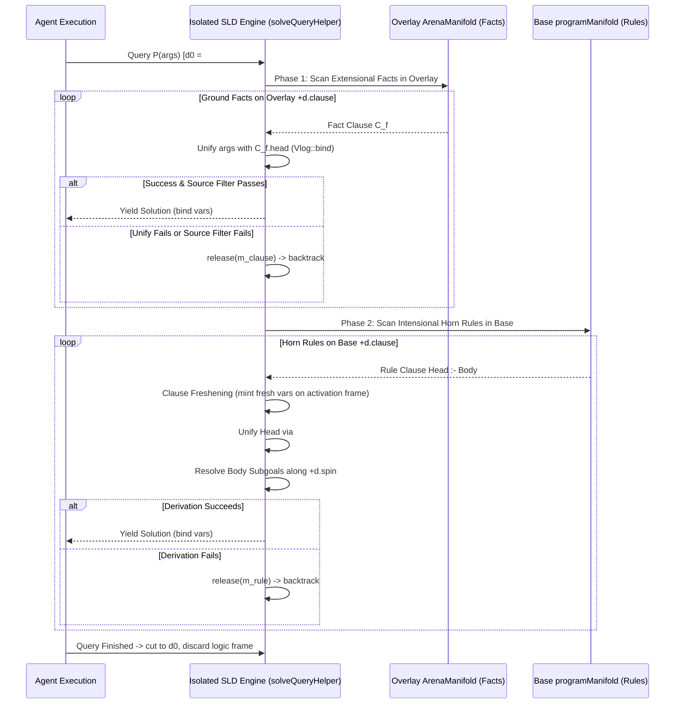
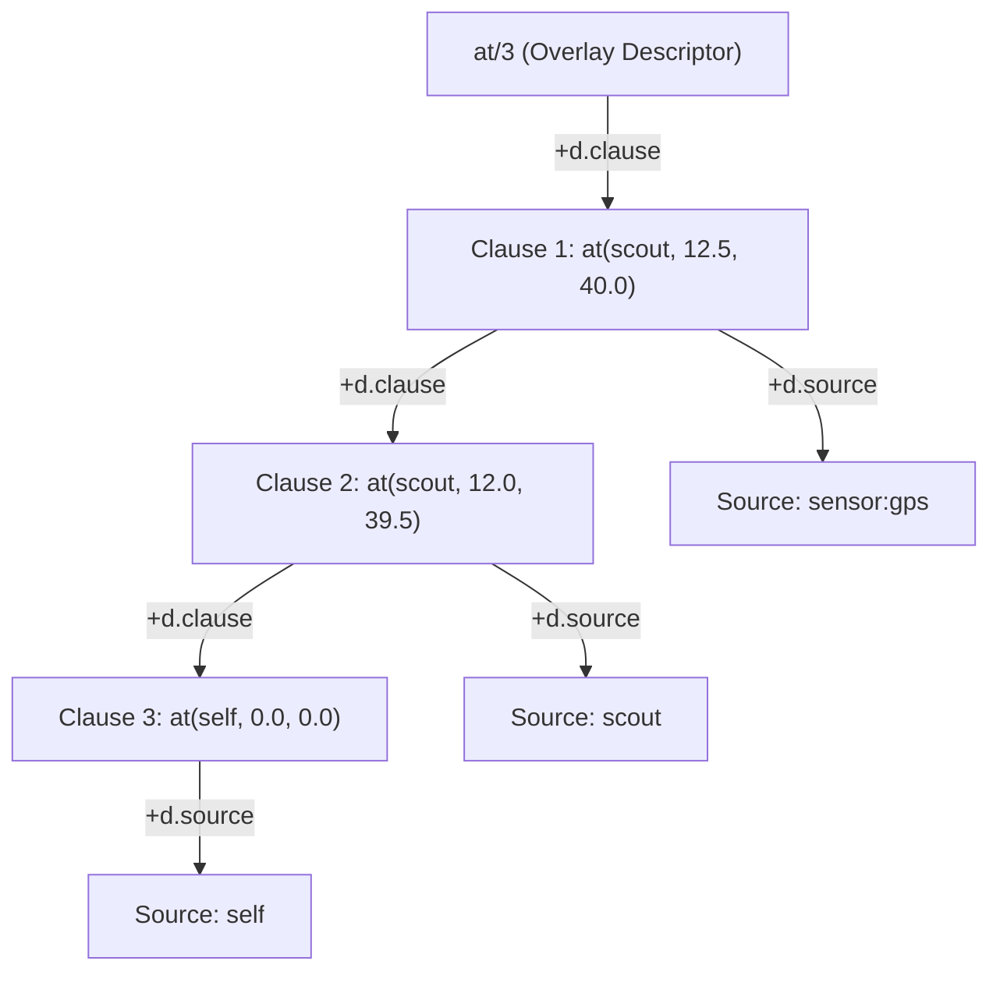
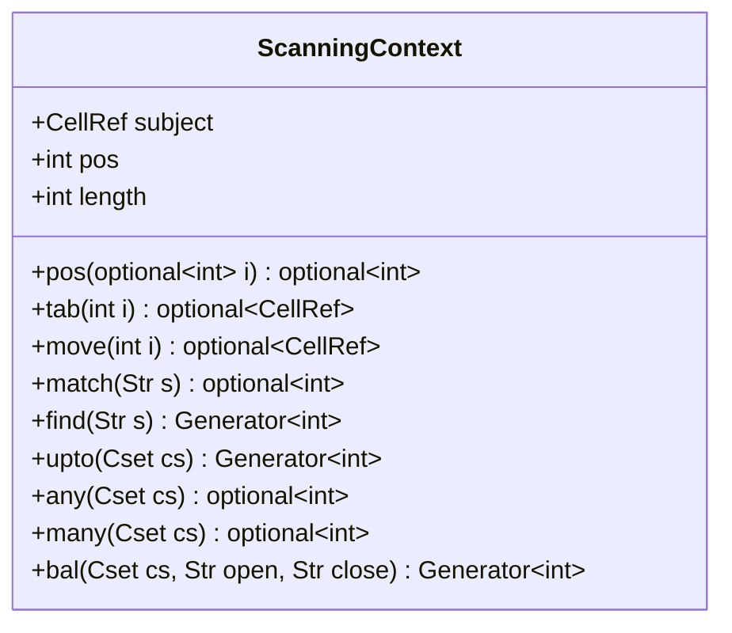
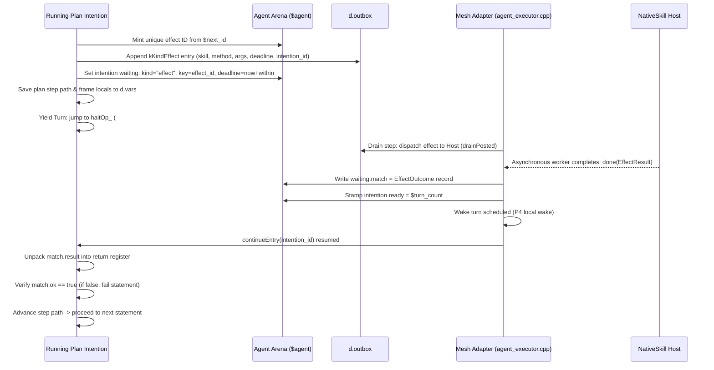

# vagent Extended Capabilities: Belief-Vlog Unification, Goal Scanning, and Native Skill Lowering

| field         | value                                                                                                                                                                                                                                                                                                                                                                                              |
| ------------- | -------------------------------------------------------------------------------------------------------------------------------------------------------------------------------------------------------------------------------------------------------------------------------------------------------------------------------------------------------------------------------------------------- |
| version       | 1.2 (companion to \[vagent §5–§11\](file:///data/git/gleditor/design/vagent-agent-language.md), \[Vlog §3–§8\](file:///data/git/gleditor/design/vlog-logic-extension.md), \[vicon §6–§7\](file:///data/git/gleditor/design/vicon-goal-directed-language.md), and \[P17 Upgrade\](file:///data/git/gleditor/design/vagent-shared-program-and-live-upgrade.md))                                      |
| status        | Approved & Adopted Architectural Specification; Proposals P18.1–P18.6 accepted; Decisions U-B1–U-B4 approved; Multi-Agent Critique converged and gated                                                                                                                                                                                                                                             |
| compiles to   | Vortex bytecode instructions over an `ArenaManifold` overlay with a sealed, shared `programManifold` base; driven turn-by-turn by `MeshActorRuntime`                                                                                                                                                                                                                                               |
| rests on      | Vortex (\[runtime\](file:///data/git/gleditor/design/vortex-hyperstructural-runtime.md)), Vlog (\[logic\](file:///data/git/gleditor/design/vlog-logic-extension.md)), vicon (\[goals\](file:///data/git/gleditor/design/vicon-goal-directed-language.md)), Spool-Mesh actor runtime (`apps/common/xanadu/vortex/mesh_actor.hpp`), `ArenaManifold` (`apps/common/xanadu/zigzag/arena_manifold.hpp`) |
| prerequisites | Vlog §4 (`zigzag/vlog.cpp` `#Unify`), Vlog §5 (`mark`/`release`/`discard`/trail), Vlog §6 clause database layout; vicon §6 `d.scan` scanning cursor; vagent P1–P16 (VM `#ChoiceDepth`, `#Point`, delivery reaping, local wakes, handle operands); P17.1–P17.5 (sealed shared program base manifold)                                                                                                |
| proposals     | P18.1 (Unified Clause/Fact Database with Source Ranks), P18.2 (Stratified Negation & Isolated SLD Solver), P18.3 (Keyed Predicates & Multi-Source Conflict Resolution), P18.4 (`std:goal` Full String Scanning Registration), P18.5 (1-Based Scanning ABI Harmonization), P18.6 (Native Skill Lowering, Suspension & Preemption)                                                                   |

______________________________________________________________________

## Executive Summary

`vagent` provides an agent-oriented surface language integrating SARL's metamodel (agents,
capacities, skills, contexts, spaces) with the BDI deliberation model (beliefs, declarative goals,
plan selection, intentions). In the initial iterations of the implementation
(\[`apps/common/xanadu/vagent/compiler.cpp`\](file:///data/git/gleditor/apps/common/xanadu/vagent/compiler.cpp#L4150-L4250)),
beliefs were implemented as an isolated, ad-hoc fact table: predicate cells headed ranks of ground
facts where variable lookup bypassed first-class logic variables and Horn clause deduction. In
parallel, Vlog
(\[`vlog-logic-extension.md`\](file:///data/git/gleditor/design/vlog-logic-extension.md)) specified
a first-order logic engine operating directly over Vortex's hyperstructural primitives (`link` and
`value`), unifying terms via clone-rank splicing (`d.clone`) and backtracking over `ArenaManifold`
marks.

This document resolves the architectural divergence between `vagent` beliefs and Vlog's logic
engine. It establishes:

1. **A Unified Manifold Topology for Beliefs and Rules**: Ground assertional facts and Horn
   deductive clauses (`Head :- Body`) follow Vlog §6 conventions. In accordance with Rule V12,
   static Horn rules reside in the sealed base `programManifold`, while mutable assertional facts
   reside in the agent's ephemeral `ArenaManifold` overlay. Facts carry multi-source provenance on
   `+d.source` (`self`, peer agent names, host percept drivers).
1. **Keyed Predicates and Source Provenance Invariants**: Keyed predicates enforce functional
   dependencies per source. Disagreements between sources are retained as distinct co-existing
   clauses, while `revise` and `forget` execute atomic multi-source truth maintenance with proper 1D
   ZigZag rank excision without disturbing Nelsonian invariants.
1. **Deductive vs. Assertional Query Engine**: `believes P(...)` evaluates overlay ground facts
   first, falling back to SLD resolution over base Horn rules via `solveQueryHelper` in
   `vortex_stdlib.cpp`. Query evaluation is isolated under an arena mark barrier (`#ChoiceDepth`),
   guaranteeing that goal-directed backtracking during deliberation never leaks logic bindings or
   trails into mutable actor state.
1. **Complete String Scanning Integration**: Reconciles the gap where `std:goal` registered only
   `scan`, `subject`, and `pos`, providing the complete suite (`tab`, `move`, `match`, `find`,
   `upto`, `any`, `many`, `bal`) with 1-based indexing, position-returning generators, and automatic
   `&pos` trail restoration on backtrack.
1. **Native Skills and Host Effect Lowering**: Formalizes the lifecycle and bytecode lowering of
   native skills: asynchronous effect staging, turn yielding (`haltOp_`), intention suspension on
   `kIntentionWaiting`, deadline scheduling, host completion wakes, and preemption dispatch.

______________________________________________________________________

## Contents

- [1. Core Problem & Architectural Gap](#1-core-problem--architectural-gap)
  - [1.1 The Schism Between Vagent Beliefs and Vlog Logic][toc-01]
  - [1.2 Why Re-Implementing Logic in Front End Is Defective][toc-02]
  - [1.3 Unifying `std:logic`, `std:goal`, and `std:agent`][toc-03]
  - [1.4 Refused Alternatives][toc-refused]
  - [1.5 Approved Architectural Decisions Table][toc-questions]
- [2. Belief & Vlog §6 Unification](#2-belief--vlog-6-unification)
  - [2.1 Unified ZigZag Manifold Topology (Rule V12)](#21-unified-zigzag-manifold-topology)
  - [2.2 Term and Logic Variable Representation](#22-term-and-logic-variable-representation)
  - [2.3 Keyed Predicates and Source Provenance](#23-keyed-predicates-and-source-provenance)
  - [2.4 Belief Mutation Mechanics (`believe`, `forget`, etc.)][toc-04]
  - [2.5 Deductive vs. Assertional Reasoning][toc-05]
  - [2.6 Source Filtering Semantics](#26-source-filtering-semantics)
  - [2.7 Stratified Negation as Failure (`not believes`)][toc-06]
  - [2.8 Choice-Point Isolation and State-Trail Safety][toc-07]
  - [2.9 Belief Event Generation and Truth Maintenance][toc-08]
  - [2.10 Comprehensive Examples: Beliefs in Practice][toc-25]
- [3. Full String Scanning Integration (`vicon` §6 & `std:goal`)][toc-09]
  - [3.1 The Missing Scanning Built-ins](#31-the-missing-scanning-built-ins)
  - [3.2 The Scanning Contract: 1-Based Indices, Csets][toc-10]
  - [3.3 Exhaustive Specification of Scanning Built-ins][toc-11]
  - [3.4 Backtracking Over `d.scan` via the Conditional Trail][toc-12]
  - [3.5 Harmonization: `std:goal` vs. Compiler Lowering][toc-13]
- [4. Native Skills & Host Effects Lowering](#4-native-skills--host-effects-lowering)
  - [4.1 Architecture and Declaration Contract](#41-architecture-and-declaration-contract)
  - [4.2 Host Binding Contract and Contention Dispatch][toc-14]
  - [4.3 Effect Lowering in Plans: Suspension & Turn Yielding][toc-15]
  - [4.4 Effect Staging in Handlers: Fire-and-Forget][toc-16]
  - [4.5 Preemption, Cancellation, and Deadlines][toc-17]
- [5. Proposal Register (P18.1–P18.6)](#5-proposal-register-p181p186)
  - [5.1 Proposal P18.1: Unified Clause DB on `d.clause`][toc-18]
  - [5.2 Proposal P18.2: Isolated SLD Resolution Engine][toc-19]
  - [5.3 Proposal P18.3: Keyed Predicates & Revision Engine][toc-20]
  - [5.4 Proposal P18.4: Complete `std:goal` Scanning][toc-21]
  - [5.5 Proposal P18.5: 1-Based Scanning ABI Harmonization][toc-22]
  - [5.6 Proposal P18.6: Native Skill Effect Lowering][toc-23]
- [6. Compatibility, Verification & Migration Matrix][toc-24]

______________________________________________________________________

## 1. Core Problem & Architectural Gap

### 1.1 The Schism Between Vagent Beliefs and Vlog Logic

In the Nelsonian hyperstructural architecture of Vortex, every computational structure is an
arrangement of cells along bidirectional dimensions. Vlog
(\[`design/vlog-logic-extension.md`\](file:///data/git/gleditor/design/vlog-logic-extension.md))
proved that logic programming requires no new VM primitives:

- A compound term $f(A_1, \dots, A_n)$ is a functor cell on `+d.grab` followed by arguments on
  `+d.step`.
- A logic variable is a bare cell on `d.vars`.
- Variable binding is splicing clone ranks along `+d.clone` (`Vlog::unify` in
  \[`apps/common/xanadu/zigzag/vlog.cpp`\](file:///data/git/gleditor/apps/common/xanadu/zigzag/vlog.cpp)).
- Backtracking is restoring arena extents via `ArenaManifold::release(mark)`.
- The clause database is a rank along `d.clause` posward from a predicate symbol.

However, during early implementation of the `vagent` compiler
(\[`apps/common/xanadu/vagent/compiler.cpp:4156–4164`\](file:///data/git/gleditor/apps/common/xanadu/vagent/compiler.cpp#L4156-L4164)),
a pragmatic shortcut was introduced:

```cpp
// Deviation from the §9.1 text ("copy `t`, `#Choice`, `#Unify`"): a query is
// matched argument by argument. A value argument is compared with `#Eq`
// (scalars) or `#Unify` (lists), and a `?v` captures the ref of the clause's
// argument cell. A `?v` therefore never becomes a Vlog variable. MakeVar
// appends to the rank headed by the d.vars dimension cell...
```

This divergence created an architectural schism:

1. **No Deductive Knowledge in Belief Bases**: An agent can store ground assertional facts, but it
   cannot declare or evaluate Horn rules ($Head \leftarrow Body_1 \land \dots \land Body_m$).
   Intensional reasoning (e.g. `path(X, Y) :- edge(X, Z), path(Z, Y)`) must be hardcoded as
   procedural `while` loops or goal plans.
1. **Duplicate Unification Semantics**: The compiler implements an inline matching routine comparing
   operands with `#Eq`, rather than dispatching through the unified `#Unify` opcode.
1. **Inability to Compose Logic Programs**: An agent cannot query a static logic program defined in
   Vlog, nor can Prolog/Vlog code query an agent's dynamic belief base without data marshaling.

### 1.2 Why Re-Implementing Logic in the Agent Front End Is Defective

Re-implementing a dedicated fact-matcher in `compiler.cpp` violates several core design tenets:

- **Nelsonian Purity (Single Primitive Invariant)**: Creating special-cased matching logic rather
  than relying on `link` and `value` over the standard `d.clone` unification rank duplicates the
  surface of potential bugs.
- **Rule V12 & P17 (Shared Program Manifold)**: Under the P17 architecture
  (\[`design/vagent-shared-program-and-live-upgrade.md`\](file:///data/git/gleditor/design/vagent-shared-program-and-live-upgrade.md)),
  rules and static clauses belong in the immutable, content-addressed base `Manifold`
  (`programManifold`), while dynamic assertions belong in the agent's ephemeral overlay
  `ArenaManifold`. An ad-hoc fact table cannot bridge base Horn rules with overlay ground facts.
- **Cognitive Expressiveness**: BDI agents in rich environments need rule-based perception and
  deductive belief derivation. Forcing agents to emit procedural plans for purely logical inferences
  pollutes the intention stack (`d.intention`) with trivial subgoals.

### 1.3 Unifying `std:logic`, `std:goal`, and `std:agent`

The architecture requires three sibling standard libraries to form a coherent hierarchy:



By unifying `vagent` beliefs with Vlog §6, `std:agent` delegates query solving to `std:logic`, and
string scanning in plans/guards to `std:goal`.

### 1.4 Refused Alternatives

1. **Monolithic Single `d.clause` Spanning Base and Overlay**:

   - *Refused*: Interleaving mutable overlay facts and immutable base Horn rules on a single
     bidirectional ZigZag rank violates Rule V12. Linking an overlay fact negward to an immutable
     base rule or posward to a base cell invokes `ArenaManifold::shadow(*to)`, causing COW shadowing
     of base program cells and corrupting P17 live upgrades.
   - *Adopted*: Partitioned topology. Static Horn rules reside in the sealed base `programManifold`
     on `+d.clause` off the base predicate symbol. Dynamic assertional facts reside in the actor's
     ephemeral `ArenaManifold` overlay on an overlay predicate descriptor cell. The query solver
     evaluates overlay facts first and falls back to base rules without direct cross-boundary links.

1. **Ad-Hoc Fact Matcher in Compiler Front End**:

   - *Refused*: Bypassing Vlog term unification with an inline `#Eq` matcher duplicates logic,
     prevents first-class logic variable bindings, and forbids deductive Horn clauses.
   - *Adopted*: First-class unification via `Vlog::unify` / `#Unify` and shared SLD resolution via
     `solveQueryHelper` in `vortex_stdlib.cpp`.

1. **String Scanning Functions Returning Substrings Instead of Positions**:

   - *Refused*: Having `find`, `match`, `any`, and `many` advance `&pos` and return `Str` destroys
     Icon/vicon composability (e.g. `tab(find("foo"))` where $|\text{old} - i| = 0$, producing empty
     strings) and violates `compiler.cpp:2501` (`Ty::K::Int`).
   - *Adopted*: Canonical separation of concerns: position functions (`find`, `upto`, `any`, `many`,
     `match`) test/generate 1-based `Int` positions without advancing `&pos`; movement functions
     (`tab`, `move`) advance `&pos` and produce traversed `Str` substrings.

1. **Direct Unification of Horn Rules Without Clause Freshening**:

   - *Refused*: Unifying a query goal directly with a base rule head binds logic variables in-place,
     mutating the shared base manifold and breaking recursion.
   - *Adopted*: Fresh variable allocation on the query activation frame prior to unification.

### 1.5 Approved Architectural Decisions Table

All candidate recommendations have been formally accepted and approved as definitive architectural
decisions:

| ID     | Topic                             | Question                                                      | Approved Ruling                                                                                                         |
| ------ | --------------------------------- | ------------------------------------------------------------- | ----------------------------------------------------------------------------------------------------------------------- |
| `U-B1` | Full TMS vs. Turn-Boundary Settle | Should derived beliefs maintain full justification graphs?    | **Turn-Boundary**: Full TMS graph walks exhaust fuel; condition re-evaluation occurs at turn settle.                    |
| `U-B2` | Multi-Source Conflict Arbitration | How are conflicting assertions from different peers resolved? | **Coexistence**: All assertions coexist on `+d.clause`; query `from S` filters sources; arbitration is in plan logic.   |
| `U-B3` | Ephemeral Quoting vs. Copy        | Does `VortexCore::value` copy substrings?                     | **Documented Copy**: Current engine copies scratch text; P18.4 prices this and specifies zero-copy span cell migration. |
| `U-B4` | Scanning Cursor Scope             | Where does the scanning cursor cell reside?                   | **Activation Frame**: Cursor cell resides on the expression stack/frame, not global `home`, supporting nested scans.    |

______________________________________________________________________

## 2. Belief & Vlog §6 Unification

### 2.1 Unified ZigZag Manifold Topology (Rule V12)

Every predicate known to an agent is represented as a symbol cell in the manifold. To strictly
satisfy **Rule V12** and prevent copy-on-write shadowing of shared base cells:

1. **Base Horn Rules (`programManifold`)**:

   - Declared Horn rules reside in the sealed, immutable `programManifold`.
   - The predicate symbol cell in base heads a rank along **`+d.clause`**.
   - Each rule clause links its head term on **`+d.grab`** (functor cell, arguments on `+d.grab` and
     chained on `+d.step`).
   - The body goal conjunction forms a process instruction stream chained posward along
     **`+d.spin`** (Vlog §6.1, `vprolog`).
   - Rule provenance on `+d.source` links to `"rule"`.

1. **Overlay Assertional Facts (`ArenaManifold`)**:

   - Asserted ground facts reside in the actor's ephemeral `ArenaManifold` overlay.
   - The actor cell (`agentCell_`, `$agent`) maintains its declared predicate descriptors along
     `+d.belief`.
   - The overlay descriptor heads an overlay rank of ground fact clauses along **`+d.clause`**.
   - Each fact clause links its head term on `+d.grab`, has `+d.spin` unlinked (`std::nullopt`), and
     heads a rank of asserting sources along **`+d.source`** (`"self"`, peer agent names, sensor
     drivers).
   - **No cross-boundary mutable links**: An overlay fact clause never links directly along
     `d.clause` to a base rule clause. The solver queries the overlay fact rank first, then queries
     the base rule rank via the program resolver.

```mermaid
graph TD
    subgraph OVERLAY["Ephemeral ArenaManifold Overlay (Mutable Facts)"]
        Agent["Agent Cell ($agent)"] -->|"+d.belief"| PredOverlay["Overlay Predicate: 'at/3'"]
        PredOverlay -->|"+d.clause"| C1["Fact Clause 1"]
        C1 -->|"+d.clause"| C2["Fact Clause 2"]

        C1 -->|"+d.grab"| H1["Head: at"]
        H1 -->|"+d.grab"| A1["arg1: 'rover_1'"]
        A1 -->|"+d.step"| A2["arg2: 10.5"]
        A2 -->|"+d.step"| A3["arg3: 20.0"]

        C1 -->|"+d.source"| S1["Source: 'self'"]
        S1 -->|"+d.source"| S2["Source: 'satellite_nav'"]
    end

    subgraph BASE["Sealed Base programManifold (Immutable Horn Rules)"]
        PredBase["Base Predicate: 'at/3'"] -->|"+d.clause"| R1["Horn Rule Clause"]
        R1 -->|"+d.grab"| HR["Head: at"]
        HR -->|"+d.grab"| RA1["arg1: ?who"]
        RA1 -->|"+d.step"| RA2["arg2: ?x"]
        RA2 -->|"+d.step"| RA3["arg3: ?y"]

        R1 -->|"+d.spin"| B1["Body Goal 1: beacon(?who, ?b)"]
        B1 -->|"+d.spin"| B2["Body Goal 2: beacon_pos(?b, ?x, ?y)"]
        R1 -->|"+d.source"| SR["Source: 'rule'"]
    end
```



### 2.2 Term and Logic Variable Representation

Terms within clauses conform strictly to Vlog §3.1:

1. **Scalar Cells**: Numeric values (`Int`, `Float`) and booleans are stored as canonical R6 scalar
   cells holding binary bits in the node. Unification compares bits directly without string parsing.
1. **Atoms and Strings**: Stored as text cells interned in the arena scratch scroll.
1. **Lists**: Stored as a term with content `kListContent` (`"[]"`), with first element on `+d.grab`
   and remainder on `+d.step`
   (\[`vagent §5.9`\](file:///data/git/gleditor/design/vagent-agent-language.md#L650-L665)).
1. **Logic Variables (`?x`)**: Stored as bare cells on the cursor's `d.vars` rank.
   - An unbound variable has no content (`value_is_empty`) and its clone master is itself.
   - Unification of variable $X$ with term $T$ calls `zigzag::Vlog::bind(X, T)`
     (\[`apps/common/xanadu/zigzag/vlog.hpp:111`\](file:///data/git/gleditor/apps/common/xanadu/zigzag/vlog.hpp#L111)),
     linking $X$'s clone rank to the posward tail of $T$'s clone rank along `+d.clone`
     (\[`vlog §4.1`\](file:///data/git/gleditor/design/vlog-logic-extension.md#L216-L253)).
   - Evaluation of `deref(X)` is `Manifold::cloneMaster(X, d.clone)`.

### 2.3 Keyed Predicates and Source Provenance

In multi-agent and sensor environments, statements about entity state frequently conflict or require
continuous updates. A predicate may be declared with key parameters:

```vagent
predicate at(key who: Agent, x: Float, y: Float)
predicate battery_charge(key device: Str, level: Float)
predicate connection(from: Agent, to: Agent) // unkeyed: multiple facts allowed
```

#### The Functional Dependency Invariant

Let $P(K_1, \dots, K_k, V_1, \dots, V_m)$ be a predicate where $K_1, \dots, K_k$ are marked `key`.
For any source $S$:

```math
\forall t_1, t_2 \in \text{Clauses}(P), \quad \left(S \in \text{Sources}(t_1) \land S \in \text{Sources}(t_2) \land \mathbf{K}(t_1) = \mathbf{K}(t_2)\right) \implies t_1 = t_2
```

Each source asserts **at most one value tuple per key tuple**.

#### Multi-Source Agreement and Coexistence

1. **Agreement**: If source $S_1$ and source $S_2$ both assert `at("drone1", 10.0, 20.0)`, there is
   exactly **one clause cell** for `at("drone1", 10.0, 20.0)` in the overlay. Its `+d.source` rank
   contains two peer cells: `S1` and `S2`.
1. **Disagreement (Multi-World Epistemics)**: If $S_1$ asserts `at("drone1", 10.0, 20.0)` while
   $S_2$ asserts `at("drone1", 15.0, 25.0)`, both clauses exist along `+d.clause`:
   - Clause 1: `at("drone1", 10.0, 20.0)`, `Sources = [S1]`
   - Clause 2: `at("drone1", 15.0, 25.0)`, `Sources = [S2]`
1. **Query Resolution**:
   - `believes at("drone1", ?x, ?y)` produces two solutions (Clause 1, then Clause 2).
   - `believes at("drone1", ?x, ?y) from self` produces only the clause containing `"self"` in its
     sources.
   - `believes at("drone1", ?x, ?y) from "satellite"` produces only the satellite's reported
     coordinates.

### 2.4 Belief Mutation Mechanics (`believe`, `forget`, `revise`, `assert ... from`)

All belief mutation operations maintain the logical update view (Vlog §6.2) and preserve 2-degree
ZigZag invariants through strict **1D rank excision**:



#### Detailed Operational Semantics

1. **`believe P(args)` (implicit source: `self`) / `assert P(args) from S` (explicit source: `S`)**:

   - *Note*: `tell peer P(...)` is an external communication performative that stages an envelope on
     `d.outbox` to be sent across the network (§4.2). Local assertions with explicit provenance are
     written `assert P(...) from S` (used when handling incoming percepts or sensor drivers).
   - If $P$ is **keyed** with key values $\mathbf{k}$:
     - Walk `+d.clause` of $P$ in the overlay. If a clause $C_{old}$ exists having keys $\mathbf{k}$
       and $S \in \text{Sources}(C_{old})$:
       - If $C_{old}$ matches `args` identically, no-op (already believed).
       - Otherwise, unlink $S$ from $C_{old}$'s `+d.source` rank using 1D rank excision
         ((\\text{link}(\\mathit{prev}, +d, \\mathit{next}) \\land \\text{link}(\\mathit{next}, -d,
         \\mathit{prev}))), unlinking $S$ posward and negward.
       - If $C_{old}$'s `+d.source` is now empty, unlink $C_{old}$ from `+d.clause` using identical
         1D excision, recycle $C_{old}$ into the overlay free-list, and stage event `-P(C_old.head)`
         to `d.pending`.
   - Search for a clause $C_{target}$ on `+d.clause` matching `args` identically:
     - If found: link a new peer cell for $S$ to the posward tail of $C_{target}$'s `+d.source`
       rank.
     - If not found: mint a new clause cell $C_{new}$ in the overlay. Link its head term on
       `+d.grab`. Link a peer cell for $S$ on its `+d.source`. Append $C_{new}$ to the posward tail
       of $P$'s overlay `+d.clause` rank. Stage event `+P(args)` to `d.pending`.

1. **`forget P(args)` (implicit source: `self`) / `retract P(args) from S` (source: `S`)**:

   - Walk `+d.clause` of $P$ in the overlay. For every clause $C$ that unifies with `args` and
     contains $S$ in $\text{Sources}(C)$:
     - Excise $S$ from `+d.source`.
     - If $\text{Sources}(C)$ is now empty: excise $C$ from `+d.clause`, recycle its cells to the
       overlay free-list, and stage event `-P(C.head)` to `d.pending`.

1. **`revise P(args)` (implicit source: `self`)**:

   - Keyed: Atomically remove source `self` from all overlay clauses of $P$ with matching keys
     $\mathbf{k}$, retracting with rank excision any clause whose sources become empty (emitting
     `-P`). Then add $P(args)$ with source `self` (emitting `+P`). If the resulting fact is
     identical to the previous belief, no events are emitted.
   - Unkeyed: Atomically remove source `self` from **all** overlay clauses of $P$, then believe
     $P(args)$.

### 2.5 Deductive vs. Assertional Reasoning in `believes` and `findall`

When evaluating a belief query `believes P(t_1, \dots, t_n)` or `findall(?X, P(...))`, the solver
executes a two-phase stratified query:



1. **Phase 1: Assertional (Extensional) Fact Scan**:

   - The engine iterates through ground facts along `+d.clause` on the overlay predicate descriptor.
   - For each fact clause, it matches query arguments against the fact's head arguments via
     `zigzag::Vlog::unify`.
   - If sources are filtered (`from S`), it verifies that $S$ is present on `+d.source`.
   - On match, it binds free variables and yields.

1. **Phase 2: Deductive (Intensional) SLD Resolution**:

   - The engine queries the base predicate symbol in `programManifold` and invokes
     `zigzag::vortex::VortexStdLib::solveQueryHelper`
     (\[`apps/common/xanadu/vortex/vortex_stdlib.cpp:289–1420`\](file:///data/git/gleditor/apps/common/xanadu/vortex/vortex_stdlib.cpp#L289-L1420)).
   - **Clause Freshening**: Before unifying the query term with a rule head, all logic variables in
     the base rule are instantiated as fresh bare variable cells on the query's local activation
     frame. The immutable base cells are never modified.
   - **Body Resolution along `+d.spin`**: The body goal conjunction is traversed posward along
     `+d.spin` as an instruction process stream. Subgoals recursively query overlay facts and base
     rules.
   - **Depth Bounding**: Recursion depth is bounded by `vagent.condition_fuel` (default 1,000
     steps).

### 2.6 Source Filtering Semantics

The surface syntax and EBNF grammar support provenance filtering across all query contexts:

```ebnf
BeliefQuery    = 'believes' GoalTerm [ 'from' Postfix ] ;
ForBeliefStmt  = 'for' 'believes' GoalTerm [ 'from' Postfix ] 'do' Block ;
FindallExpr    = 'findall' '(' Term ',' GoalTerm [ 'from' Postfix ] ')' ;
```

| Syntax                         | Scope of Evaluation                                                               |
| ------------------------------ | --------------------------------------------------------------------------------- |
| `believes P(...)`              | Any ground fact matching across all sources, **plus** any deduced rule solutions  |
| `believes P(...) from self`    | Ground facts where `"self"` $\in \text{Sources}$, **plus** locally deduced rules  |
| `believes P(...) from peer`    | Ground facts where `peer` $\in \text{Sources}$ only                               |
| `believes P(...) from sensor`  | Ground facts asserted by specified sensor/host driver                             |
| `believes P(...) from deduced` | Exclusively solutions derived via Horn clauses (matching `"rule"` on `+d.source`) |

### 2.7 Stratified Negation as Failure (`not believes`)

Negation as failure is evaluated under Clark's Completion: `not believes P(...)` succeeds if and
only if `believes P(...)` fails.

#### Safety and Floundering Prevention

Negation as failure is sound only for **ground** goals. If an unbound variable appears within a
negated belief query, the query would mean $\neg \exists X. P(X)$ rather than $\exists X. \neg
P(X)$, which is unsound under standard logic programming semantics.

- **Static Check**: The `vagent` checker verifies that every variable occurring inside a
  `not believes` literal is bound by an earlier positive literal in the same conjunction, guard, or
  rule body.
- **Dynamic Guard**: If an unbound logic variable reaches `not believes P(?X)`, the runtime triggers
  a contract violation (`floundered_negation`), failing the statement with cause `"floundered"`.

#### Stratification

To prevent infinite loops through negation (e.g. `p :- not q. q :- not p.`), the compiler builds a
Predicate Dependency Graph (PDG). Edges traversed through `not` are marked negative. The checker
verifies that no cycle in the PDG contains a negative edge (strict stratification).

### 2.8 Choice-Point Isolation and State-Trail Safety

In `vagent`, an agent's turn maintains mutable state:

- Actor variables (`var x := e`) reside on `$agent`'s `d.vars` rank.
- Assignment `:=` writes directly to value cells.
- Reversible assignment `<-` records writes on the arena trail (`zigzag::TrailEntry`).

To guarantee complete choice-point safety:

1. **The Isolation Barrier**: Before entering query evaluation, the compiler emits `#ChoiceDepth`
   into temporary register $d_0$, followed by a mark snapshot $m_0 = \text{arena.mark()}$.
1. **Local Mark Frame**: Every alternative within the query takes its own mark $m_i \ge m_0$.
1. **Backtrack Containment**: Backtracking within the query replays trails only down to $m_0$. It
   cannot scrub past $d_0$.
1. **Binding Discard**: On query completion:
   - For `believes`: once a solution is found, the engine cuts to $d_0$, dropping logic choice
     points while preserving the bindings made to query variables.
   - For `findall`: solutions are copied into an ephemeral list value; then `arena.release(m_0)` is
     executed, unwinding all logic variables and choice points completely, returning only the copied
     list.

```math
\text{Trail safety condition: } \quad \forall t \in \text{QueryTrail}, \quad t.\mathit{dense} < m_0.\mathit{cellCount}
```

In `ArenaManifold::trail`
(\[`apps/common/xanadu/zigzag/arena_manifold.cpp:1530`\](file:///data/git/gleditor/apps/common/xanadu/zigzag/arena_manifold.cpp#L1530)),
cell writes with $\mathit{dense} \ge m_0.\mathit{cellCount}$ (cells minted *inside* the query) are
omitted from the trail because `release(m_0)` truncates them in bulk. Only pre-existing actor cells
($\mathit{dense} < m_0.\mathit{cellCount}$) are recorded. The barrier guarantees that choice
failures during deliberation never roll back pre-query actor mutations.

### 2.9 Belief Event Generation and Truth Maintenance

Whenever an assertional ground fact is added or removed, `vagent` emits internal events to
`d.pending`:

- `+P(args)` when a previously non-existent ground fact becomes believed.
- `-P(args)` when a ground fact loses its last remaining source and is unlinked.

#### Why Deductive Beliefs Do Not Emit Events

A naive reactive logic system attempts to emit `+P` and `-P` whenever a deductive Horn clause
becomes satisfied or unsatisfied. In hypermedia architectures, this is strictly forbidden:

- **Cost of Full Truth Maintenance (TMS)**: Tracking justification dependencies for every derived
  head would require linking dependency cells across all participating facts. A single ground fact
  invalidation could trigger cascading graph walks across thousands of cells, easily exhausting the
  turn's fuel budget (`vagent.condition_fuel`).
- **Turn-Boundary Reconsideration**: `vagent` already solves this through the settle loop (§4.2 step
  6). Goals that depend on conditions—such as maintain goals' `holds` condition and plans' `where`
  clauses—are re-evaluated at the turn boundary in an isolated slice.
- **Contract**: Events `+P` and `-P` reflect **extensional ground fact transitions only**. Deductive
  beliefs are queried on demand.

### 2.10 Comprehensive Examples: Beliefs in Practice

To illustrate the unified belief architecture, the following four end-to-end examples walk through
declaration, assertion, keyed revision, multi-source conflict tracking, deductive Horn reasoning,
inter-agent communication, and choice-point isolation.

#### 2.10.1 Example 1: Spatial Tracking with Keyed Predicates and Multi-Source Provenance

Consider an agent tracking locations of entities in a spatial environment. Entities have a unique
location at any given time, but different sources (e.g., self-observation, teammate reports, and
noisy sensor perceptions) may provide differing coordinates.

##### 1. Declaration

```vagent
predicate at(key who: Agent, x: Float, y: Float)
```

##### 2. Assertions with Diverse Provenance

During execution, perceptions arrive from different sources:

```vagent
// 1. Host GPS sensor reports scout's location
assert at(scout, 12.5, 40.0) from "sensor:gps"

// 2. Scout directly reports its own location via inter-agent message
assert at(scout, 12.0, 39.5) from scout

// 3. Local agent sets its own position (syntactic sugar for assert ... from "self")
revise at(self, 0.0, 0.0)
```

##### 3. ZigZag Manifold Representation

In the actor's `ArenaManifold` overlay, the predicate symbol cell `at/3` heads a rank along
`+d.clause`. Because `who` is declared as `key`, each source holds at most **one** fact for a given
agent key:



##### 4. Keyed Revision and 1D Rank Excision

Suppose the GPS sensor updates its reading for `scout`:

```vagent
assert at(scout, 13.0, 41.0) from "sensor:gps"
```

The runtime executes an atomic revision:

1. Traverses `+d.clause` from `at/3` looking for clauses matching key `who == scout` that carry
   `"sensor:gps"` on `+d.source`.
1. Locates `C1`.
1. Performs 1D rank excision: (\\text{link}(\\mathit{prev}(C1), +d.\\mathit{clause},
   \\mathit{next}(C1)) \\land \\text{link}(\\mathit{next}(C1), -d.\\mathit{clause},
   \\mathit{prev}(C1))). `C1` and its head/argument cells are returned to the overlay free-list.
1. Mints a new clause cell `C1_new` containing `at(scout, 13.0, 41.0)`, links `"sensor:gps"` to
   `+d.source`, and appends `C1_new` to `+d.clause`.
1. Notice that `C2` (the report from `scout`) remains completely intact and uncorrupted:
   multi-source disagreements co-exist predictably without clobbering.

##### 5. Querying with Source Filters

```vagent
// Query 1: What is scout's location according to GPS?
if believes at(scout, let gx, let gy) from "sensor:gps" do {
  log("GPS reports scout at ({gx}, {gy})")
}

// Query 2: What is scout's location according to scout?
if believes at(scout, let sx, let sy) from scout do {
  log("Scout reports itself at ({sx}, {sy})")
}

// Query 3: Any believed location across all sources (non-deterministic generator)
for believes at(scout, let x, let y) do {
  log("Hypothesis: scout at ({x}, {y})")
}
```

#### 2.10.2 Example 2: Deductive Reasoning with Horn Rules and Base/Overlay Partitioning

Consider a pathfinding and reachability model combining static map topology with dynamic obstacle
perceptions.

##### 1. Declaration of Base Horn Rules

Rules are defined at the module level and reside in the immutable, shared `programManifold`:

```vagent
predicate edge(from: Str, to: Str)
predicate blocked(node: Str)
predicate path(from: Str, to: Str)
predicate reachable(from: Str, to: Str)

// Horn rules (Vlog §6.1)
rule path(X, Y) :- edge(X, Y)
rule path(X, Y) :- edge(X, Z), path(Z, Y)
rule reachable(X, Y) :- path(X, Y), not blocked(Y)
```

##### 2. Static Map vs. Dynamic Overlay Facts

- The static topological edges (`edge("hall", "lab")`, `edge("lab", "office")`, etc.) are compiled
  into `programManifold` on `+d.clause` off the base `edge/2` predicate cell.
- During navigation, the robot senses that the `"lab"` is blocked by smoke:

```vagent
assert blocked("lab") from "sensor:smoke"
```

This fact is allocated strictly in the actor's ephemeral `ArenaManifold` overlay. The base
`programManifold` is never written, conforming strictly to Rule V12.

##### 3. SLD Query Resolution Walk

When evaluating:

```vagent
believes reachable("hall", let dest)
```

The unified query engine (`solveQueryHelper` in `vortex_stdlib.cpp:289–1420`) proceeds as follows:

1. **Query Frame Allocation**: Allocates a fresh activation frame in `ArenaManifold`. Variable
   `dest` is represented as an unbound variable cell on `+d.vars`.
1. **Clause Freshening**: The engine selects the `reachable(X, Y)` rule from `programManifold`. To
   preserve the immutability of the base program, fresh variable cells $X_1, Y_1$ are minted on the
   query activation frame rather than mutating the base rule cells.
1. **Head Unification (`#Unify`)**: Unifies `reachable("hall", dest)` with `reachable(X_1, Y_1)`.
   - $X_1$ binds to `"hall"`.
   - $Y_1$ binds to `dest` (via clone-rank alias on `+d.clone`).
1. **Body Conjunction Traversal (`+d.spin`)**: The body goals are traversed posward along `+d.spin`:
   - **Goal 1**: `path("hall", Y_1)`. Recursively invokes `path/2`. It tests `edge("hall", Z_1)`.
     The solver finds `edge("hall", "lab")` in `programManifold`, binding
     $Z_1 \mapsto \text{"lab"}$. Next, it resolves `path("lab", Y_1)`. It finds
     `edge("lab", "office")`, binding $Y_1 \mapsto \text{"office"}$.
   - **Goal 2**: `not blocked("office")`. The solver enters stratified negation as failure. Since
     $Y_1$ is ground (`"office"`), floundering cannot occur. The solver queries `blocked("office")`.
     The overlay has `blocked("lab")`, but no clause for `"office"`. The goal fails, so
     `not blocked("office")` succeeds under Clark's Completion!
1. **Success**: The query succeeds, producing binding `dest = "office"`.

#### 2.10.3 Example 3: Inter-Agent Speech Acts (`tell`/`untell`) and Belief Lifecycle

`vagent` cleanly distinguishes between local belief maintenance (`believe`/`forget`) and external
speech acts (`tell`/`untell`):

##### 1. Sender Agent (Leader)

The leader dispatches a belief update to a worker via `tell`:

```vagent
agent Leader {
  plan AssignTarget(w: Agent, target: Str) {
    goal: delegate_task(w)
    body: {
      tell peer: w, target_assigned(target)
    }
  }
}
```

- Bytecode lowering mints an outbox record on `d.outbox` with `kind = "tell"`,
  `predicate = "target_assigned"`, and argument values.
- The transport delivers an envelope carrying `sender = "Leader"` to the worker.

##### 2. Receiver Agent (Worker)

Upon receiving the `"tell"` message:

1. **Overlay Assertion with Provenance**: The actor runtime's percept loop extracts the belief
   payload and asserts it into the worker's overlay with explicit sender provenance:

   ```vagent
   assert target_assigned(target) from "Leader"
   ```

1. **Internal Event Generation**: Because this is a newly believed fact, the runtime emits an
   internal belief percept to `d.pending`:

   ```vagent
   +target_assigned(target)
   ```

1. **Handler Execution**: The worker's belief event handler triggers:

   ```vagent
   agent Worker {
     on +target_assigned as ev {
       log("Received new target {ev.target} from {ev.source}")
       adopt GoalAchieveTarget(ev.target)
     }
   }
   ```

1. **Retraction via Untell**: If the Leader later issues `untell peer: w, target_assigned(target)`,
   the worker runtime excises the matching clause cell for source `"Leader"`. When no other source
   supports the fact, it emits `-target_assigned(target)`.

#### 2.10.4 Example 4: Deliberation and Choice-Point Isolation in Plan Selection

During agent deliberation, candidate plans test their applicability using `where` guards. These
guards can evaluate complex backtracking queries.

```vagent
agent Rover {
  var energy: Int := 85

  plan TraverseDirect(dest: Str) {
    goal: travel(dest)
    where: believes direct_route(self.loc, dest) and energy >= 50
    body: {
      move_direct(dest)
    }
  }

  plan TraverseWaypoint(dest: Str) {
    goal: travel(dest)
    where: believes (path(self.loc, let mid) and path(mid, dest)) and energy >= 30
    body: {
      move_via(mid, dest)
    }
  }
}
```

##### State-Trail Isolation Mechanics

1. Before evaluating the `where` guard, the deliberation engine records the arena mark: (m_0 =
   \\text{arena.mark()}).
1. While evaluating `path(self.loc, mid) and path(mid, dest)`, the SLD solver may evaluate multiple
   candidate waypoints (`mid = "waypoint_alpha"`, `mid = "waypoint_beta"`).
   - Each trial creates choice points, instantiates variable cells, and binds terms along
     `+d.clone`.
   - If `"waypoint_alpha"` fails to reach `dest`, the engine backtracks via `#Fail`.
   - All variable bindings minted past $m_0$ are truncated cleanly.
1. Crucially, the actor's mutable state (`var energy := 85`) and overlay beliefs are completely
   isolated from the SLD search trail:
   - Trailed cell modifications satisfy (t.\\mathit{dense} < m_0.\\mathit{cellCount}).
   - When the `where` expression finishes, the engine executes `arena.discard(m_0)` on success
     (cutting logic choice points while committing the `let mid` plan binding to the intention's
     frame), or executes `arena.release(m_0)` on failure to instantaneously sweep all trial search
     artifacts.

______________________________________________________________________

## 3. Full String Scanning Integration (`vicon` §6 & `std:goal`)

### 3.1 The Missing Scanning Built-ins

`design/vicon-goal-directed-language.md §6` specified string scanning as a first-class control
environment using a cursor on `d.scan`. However, in the current tree
(\[`apps/common/xanadu/vortex/vortex_stdlib.cpp:3580–3736`\](file:///data/git/gleditor/apps/common/xanadu/vortex/vortex_stdlib.cpp#L3580-L3736)),
`VortexStdLib::buildGoalModule` registered only three symbols:

- `scan`: establishes `s ? e`.
- `subject`: returns `&subject`.
- `pos`: returns `&pos`.

The eight core scanning built-ins (`tab`, `move`, `match`, `find`, `upto`, `any`, `many`, `bal`)
were left unbuilt in `std:goal`. In `compiler.cpp:2413–2700`, the compiler generated ad-hoc inline
scanning instructions using 0-based indexing.

This proposal registers all missing built-ins in `std:goal` and aligns `vagent`'s surface syntax
with the canonical vicon contract.

### 3.2 The Scanning Contract: 1-Based Indices, Csets, and Substrings

1. **1-Based Indexing**: Conforming to Icon and vicon §6, string positions are 1-based:
   - Position $1$ is before the first character.
   - Position $\text{length}(s) + 1$ is after the last character.
   - Non-positive positions ($i \le 0$) count backward from the end: $0$ is after the last character
     ($\text{len} + 1$), $-1$ is before the last character, and $-\text{len}$ is before the first
     character ($1$).
1. **Separation of Position Testing and Movement**:
   - **Position Functions & Generators** (`find`, `upto`, `any`, `many`, `match`, `bal`): produce
     1-based integer position indices (`Int`) and do **NOT** advance `&pos`.
   - **Movement Functions** (`tab`, `move`): accept target integer positions or relative offsets,
     advance `&pos`, and produce the traversed substring (`Str`).
   - This provides natural composability: `tab(find("foo"))` evaluates `find("foo")` yielding
     position $k$, and `tab(k)` moves `&pos` to $k$ and produces the traversed text.
1. **Substring Allocation & Ephemeral Quoting**:
   - In the live runtime, `VortexCore::value(subjectCell, offset, length)` copies the substring into
     scratch text in the arena. P18.4 prices this $O(L)$ copy. A future zero-copy span cell
     optimization is cataloged under Open Questions `U-B3`.
1. **Csets (Character Sets)**: A cset is represented as a string atom containing characters in
   sorted order, or a 256-bit bitset stored in canonical scalar bits.

### 3.3 Exhaustive Specification of the Scanning Built-ins



#### 1. `pos(i: optional<Int>): optional<Int>`

Tests if `&pos` is equal to $i$ (normalizing negative indices). If equal, produces $i$; if unequal,
fails (`std::nullopt`). If called with no arguments, produces current `&pos`.

#### 2. `tab(i: Int): optional<Str>`

Moves `&pos` to absolute index $i$ (where $1 \le i \le \text{len} + 1$).

- Produces the substring between the old `&pos` and new `&pos`:
  $\text{offset} = \min(\text{old}, i) - 1$, $\text{length} = |\text{old} - i|$.
- If $i$ is out of bounds, fails (`std::nullopt`) and leaves `&pos` unchanged.

#### 3. `move(i: Int): optional<Str>`

Equivalent to `tab(&pos + i)`. Moves `&pos` relatively by $i$ positions and produces the traversed
substring. Fails if the resulting position is out of bounds.

#### 4. `match(s: Str): optional<Int>`

Tests whether $s$ is a prefix of the subject starting at `&pos`.

- If the subject from `&pos` matches $s$: produces $\text{pos} + \text{length}(s)$ without advancing
  `&pos` (conventionally paired with `tab(match(s))`).
- If it does not match: fails (`std::nullopt`).

#### 5. `find(s: Str): Generator<Int>`

A generator that produces every 1-based position in the subject at or after `&pos` where $s$ occurs
as a substring.

- On each produce: yields the 1-based start position integer without advancing `&pos`.
- On resumption (`#Fail`): continues scanning posward for the next occurrence.
- When no further occurrences exist: fails.

#### 6. `upto(cs: Str): Generator<Int>`

A generator that produces every position in the subject at or after `&pos` whose character is a
member of cset $cs$.

- On each produce: yields the position integer without advancing `&pos` (paired with
  `tab(upto(cs))`).

#### 7. `any(cs: Str): optional<Int>`

Tests if the character immediately at `&pos` is in cset $cs$.

- If so: produces $\text{pos} + 1$ without advancing `&pos` (paired with `tab(any(cs))`).
- If not or if at end-of-string: fails (`std::nullopt`).

#### 8. `many(cs: Str): optional<Int>`

Matches the longest non-empty run of characters from cset $cs$ starting at `&pos`.

- Produces the position immediately past the matched run without advancing `&pos` (paired with
  `tab(many(cs))`).
- Fails (`std::nullopt`) if the character at `&pos` is not in $cs$.

#### 9. `bal(cs: Str, open: Str = "(", close: Str = ")"): Generator<Int>`

Balanced string scanning generator. Generates positions at or after `&pos` where a character from
$cs$ occurs outside of any nested delimiters defined by $open$ and $close$.

- Yields each matching position without advancing `&pos`.
- Delimiters balance strictly; unbalanced closing delimiters cause failure.

### 3.4 Backtracking Over `d.scan` via the Conditional Trail

The load-bearing property of string scanning in Vortex is that **scanning position backtracking
requires zero specialized code**.

- The scanning cursor cell $C_{\text{scan}}$ is created at the beginning of the scan expression
  `s ? e` and linked to the active **activation frame** on `+d.scan` (supporting reentrancy and
  nested scans without evicting outer cursor cells).
- Its content holds `&pos` (a scalar cell).
- Any generator invoked within $e$ (e.g. `find`, `upto`, or an alternation `tab(10) | tab(20)`)
  executes `#Choice`, recording an arena mark $m_k$.
- Because $C_{\text{scan}}$ was minted *before* $m_k$, its index satisfies the WAM conditional trail
  condition:

```math
\text{denseOf}(C_{\text{scan}}) < m_k.\mathit{cellCount}
```

- Consequently, updating `&pos` during a match pushes a `zigzag::TrailEntry` onto the arena trail.
- When an alternative downstream fails and executes `#Fail`, `ArenaManifold::release(m_k)` replays
  the trail in reverse, automatically restoring `&pos` to its exact pre-match position.

### 3.5 Harmonization: `std:goal` Library vs. Compiler Lowering

To avoid divergent behavior, `compiler.cpp` will no longer emit ad-hoc 0-based string loops.
Instead:

1. `VortexStdLib::buildGoalModule` registers the complete family of scanning opcodes and routine
   bindings under `std:goal/*`, taking the active cursor operand as an activation parameter.
1. The `vagent` compiler lowers `tab`, `move`, `match`, etc., to standard instructions targeting the
   exported `std:goal` routines, passing the activation frame's scanning cursor operand.
1. In-plan scanning expressions (`s ? e`) compile using the 1-based convention. The compiler adjusts
   any internal array indexing automatically.

______________________________________________________________________

## 4. Native Skills & Host Effects Lowering

### 4.1 Architecture and Declaration Contract

`vagent` distinguishes pure computation from real-world device actions through **capacities**,
**skills**, and **effects**
(\[`vagent §5.3, §6.6`\](file:///data/git/gleditor/design/vagent-agent-language.md#L516-L542)).

```vagent
capacity Mobility {
  effect def navigate_to(x: Float, y: Float) within 30s
  effect preempts def emergency_halt() within 2s
  def battery_reserve(): Float
}

native skill RealRoverHardware implements Mobility
```

#### Rules Governing Native Skills

1. **No Language Body**: A `native skill` declaration contains no executable vagent statements.
1. **Effect Exclusivity (Rule V6)**: Capacity methods declared with modifier `effect` can **only**
   be implemented by native skills. Pure methods (without `effect`) in a native skill are
   synchronous read-only host queries that return immediately.
1. **Mandatory Deadline**: Every `effect` method declaration must specify a timeout duration with
   `within <Duration>`.
1. **Host Registration**: The host environment registers native skills by qualified name via
   `HostBindings` before agents start.

### 4.2 Host Binding Contract and Contention Dispatch

The host interface is defined in
\[`apps/common/xanadu/vagent/host_bindings.hpp`\](file:///data/git/gleditor/apps/common/xanadu/vagent/host_bindings.hpp):

```cpp
class NativeSkill {
public:
  virtual ~NativeSkill() = default;
  virtual void start(const EffectRequest &request, EffectCompletion done) = 0;
  virtual void cancel(std::uint64_t token) {}
};
```

#### The Host Binding Invariants

1. **Non-Blocking Execution**: `NativeSkill::start` must return immediately to the caller.
   Long-running operations (e.g. driving motors, downloading large assets) must dispatch to a
   background worker thread or hardware queue. The runtime thread must never stall.
1. **One-Shot Completion Callback**: The host reports results by invoking
   `done(EffectResult::success(val))` or `done(EffectResult::failure(cause))`. The callback is
   thread-safe and enqueues an asynchronous host delivery to the adapter's queue.
1. **Contention Policies**: When an effect is requested on a skill that already has an effect in
   flight:
   - `Contention::Shared`: Multiple effects run concurrently.
   - `Contention::Queue`: Subsequent requests wait in arrival order until the active effect
     finishes.
   - `Contention::Refuse`: Subsequent requests fail immediately with cause `"busy"`.
   - `preempts` Modifier: Bypasses the contention policy, cancels the in-flight effect with cause
     `"preempted"`, and starts the new effect immediately.

### 4.3 Effect Lowering in Plans: Suspension and Turn Yielding

When an intention executes an effect method within a plan:

```vagent
plan traverse for MoveTo where battery_level > 20.0 {
  navigate_to(target.x, target.y)
  log.info("Navigation complete")
}
```

The compiler lowers the call into a multi-step turn suspension:



#### Step-by-Step Lowering Bytecode

1. **Token Allocation**: Read `$next_id`, increment it, and bind the token to $T_{\text{effect}}$.
1. **Outbox Entry Staging**: Mint a cell on `d.outbox` of kind `kKindEffect` with fields:
   - `kOutboxEffectId`: $T_{\text{effect}}$
   - `kOutboxEffectSkill`: Qualified skill name
   - `kOutboxEffectCapacity`: Qualified capacity name
   - `kOutboxEffectMethod`: Method name string
   - `kOutboxEffectArgs`: Evaluated argument values (`WireList` list cell)
   - `kOutboxEffectDeadline`: Absolute timestamp ($\text{Clock.now()} + \text{within}$)
   - `kOutboxEffectIntention`: Current intention's integer id
   - `kOutboxEffectPreempts`: Boolean flag
1. **Intention State Update**:
   - Write `waiting.kind = "effect"`.
   - Write `waiting.key = token`.
   - Write `waiting.deadline = timestamp`.
   - Remove `ready` attribute from the intention cell.
1. **Frame Spill & Turn Yielding**: Spills all live statement registers into the intention's frame
   (`d.vars` off `kIntentionFrame`). The VM jumps to `haltOp_` (`#Halt`), completing the turn and
   allowing `agent_executor.cpp` to execute `drainPosted` to dispatch to the host device.

### 4.4 Effect Staging in Handlers: Fire-and-Forget Semantics

In accordance with Rule V6, **event handlers and methods cannot suspend**. A handler must complete
within its allocated turn.

When an effect method is called inside an event handler:

1. The compiler generates code that mints the `kKindEffect` outbox entry on `d.outbox`.
1. The `kOutboxEffectIntention` field is **omitted** (`std::nullopt`).
1. The handler **does not suspend**; execution continues immediately to the next statement in the
   handler block.
1. If the effect subsequently succeeds in the host, the result is discarded silently.
1. If the effect fails or times out in the host, the adapter constructs an
   `EffectFailed{capacity, method, cause}` event record and delivers it to the agent's mailbox as an
   asynchronous percept turn.
1. Attempting to bind or capture the return value of an effect method within an event handler or
   lifecycle block is rejected at compile time (`CompileError::CannotSuspend`), enforcing that
   effect calls in handlers can only appear as standalone statement expressions.

### 4.5 Preemption, Cancellation, and Deadlines

1. **Preemption Dispatch**:
   - When an outbox entry carrying `kOutboxEffectPreempts = true` is drained, the adapter
     immediately invokes `NativeSkill::cancel(in_flight_token)`.
   - The in-flight intention's `waiting.match` is set to
     `EffectOutcome{ok: false, cause: "preempted"}`.
   - The preempting effect starts immediately on the host device.
1. **Deadline Watchdog**:
   - The adapter derives its timer heap from `waiting.deadline` cells across all intentions (§5.6).
   - If the deadline timestamp expires before the host reports completion, the adapter:
     1. Invokes `NativeSkill::cancel(token)` to notify the host.
     1. Sets `waiting.timed_out = true` and
        `waiting.match = EffectOutcome{ok: false, cause: "deadline"}`.
     1. Stamps `intention.ready = $turn_count`, scheduling a wake turn.
1. **Plan Failure Handling**:
   - When the resumed intention detects `match.ok == false`, the effect statement fails with
     `cause = match.cause`.
   - In accordance with V13, statement failure triggers the plan's failure path: unhandled failure
     raises `PlanFailed` and triggers deliberation to select alternative plans.

______________________________________________________________________

## 5. Proposal Register (P18.1–P18.6)

> [!IMPORTANT] All proposals P18.1 through P18.6 have been accepted and approved for implementation.

Each proposal is formally numbered, specifies file impacts, prices costs, and records strict
invariants.

### 5.1 Proposal P18.1: Unified Clause Database on `d.clause` with `d.source` Provenance

- **Files Affected**:
  - `apps/common/xanadu/vagent/compiler.cpp`
  - `apps/common/xanadu/vagent/runtime_abi.hpp`
  - `apps/common/xanadu/vortex/vortex_stdlib.cpp`
  - `design/vagent-agent-language.md` (§5.6, §6.1)
- **Description**: Structure all declared beliefs and Horn rules into the standard Vlog §6.1 layout
  on `+d.clause` off predicate symbol cells. Partition topology to satisfy Rule V12: base Horn rules
  reside in sealed `programManifold`, while mutable assertional facts reside on an overlay
  descriptor in `ArenaManifold`. Ground facts carry multi-source peer cells on `+d.source`.
  Retractions execute standard 1D rank excision (`prev.pos = next <=> next.neg = prev`). Eliminate
  the ad-hoc argument comparison code in `compiler.cpp:4156–4164`, routing query unification through
  standard term structures.
- **Pricing**:
  - Zero new opcodes; uses existing `#Link`, `#Break`, `#Unify`.
  - Memory: 1 clause cell + 1 head term cell + $K$ argument cells + 1 peer cell per source.
  - Performance: Clause scanning is $O(C)$ over $C$ clauses of that predicate.
- **Invariants Maintained**:
  - Preserves 2-degree ZigZag connectivity: `link(a, d, POS, b) <=> link(b, d, NEG, a)`.
  - Conforms to Rule V12: Base program predicates in `programManifold` are read-only; dynamic fact
    cells live exclusively in the agent's ephemeral overlay.

### 5.2 Proposal P18.2: Isolated SLD Resolution Engine with Stratified Negation

- **Files Affected**:
  - `apps/common/xanadu/vagent/checker.cpp`
  - `apps/common/xanadu/vagent/compiler.cpp`
  - `apps/common/xanadu/vortex/vortex_stdlib.hpp`
  - `apps/common/xanadu/vortex/vortex_stdlib.cpp`
  - `apps/common/xanadu/zigzag/vlog.hpp`
  - `apps/common/xanadu/zigzag/vlog.cpp`
- **Description**: Implement two-phase query evaluation in `believes`: scanning overlay ground facts
  first, then evaluating intensional Horn rules via `solveQueryHelper` in
  `vortex_stdlib.cpp:289–1420`. Enforce clause freshening on the query activation frame prior to
  unification, preserving immutable base rule cells. Traverse rule body goals posward along
  `+d.spin`. Enforce query isolation via `#ChoiceDepth` ($d_0$) and arena mark barrier ($m_0$),
  preventing search backtracking from rolling back mutable actor variables. Enforce static
  stratification and variable safety on `not believes`.
- **Pricing**:
  - Uses P1 (`#ChoiceDepth`) and standard `mark()`/`release()`.
  - Memory: Zero heap allocation; variable bindings reside entirely on the arena mark stack and
    clone ranks.
  - Recursion limit bounded by `vagent.condition_fuel` (default 1,000 steps).
- **Invariants Maintained**:
  - Nelsonian hypertime integrity: No persistent `CompactOpNode` operations minted during query
    search.
  - Choice-point safety: Isolation barrier ensures query failure cannot pop statement-level choice
    points.

### 5.3 Proposal P18.3: Keyed Predicates and Atomic Revision Engine

- **Files Affected**:
  - `apps/common/xanadu/vagent/checker.cpp`
  - `apps/common/xanadu/vagent/compiler.cpp`
  - `apps/common/xanadu/vagent/runtime_abi.hpp`
- **Description**: Add compiler validation for `key` modifiers in `PredicateDecl`. Implement atomic
  key-replacement mechanics for `believe`, `revise`, `assert ... from`, and `retract ... from`: a
  source may hold at most one fact per key tuple. Retract clauses with 1D rank excision and recycle
  reclaimed cells to the overlay free-list when source ranks become empty.
- **Pricing**:
  - Compile time: Typecheck key positions ($O(\text{params})$).
  - Run time: $O(C \cdot K)$ where $C$ is clauses in predicate, $K$ is number of key arguments.
  - Memory: Retracted clause and source cells are recycled immediately to the overlay free-list.
- **Invariants Maintained**:
  - Logical Update View: Queries evaluating concurrently with revisions see a consistent snapshot
    frozen at call entry.

### 5.4 Proposal P18.4: Complete `std:goal` Scanning Built-in Registration

- **Files Affected**:
  - `apps/common/xanadu/vortex/vortex_stdlib.hpp`
  - `apps/common/xanadu/vortex/vortex_stdlib.cpp`
- **Description**: Register the remaining eight scanning functions (`tab`, `move`, `match`, `find`,
  `upto`, `any`, `many`, `bal`) in `VortexStdLib::buildGoalModule`. Generators (`find`, `upto`,
  `any`, `many`, `match`, `bal`) produce 1-based integer position indices (`Int`) without advancing
  `&pos`. Movement functions (`tab`, `move`) advance `&pos` and produce traversed substrings
  (`Str`). Routines take the scanning cursor operand cell dynamically from the caller's activation
  frame, ensuring reentrancy across nested scans and multiple agents.
- **Pricing**:
  - Zero VM opcode changes; built purely using existing Vortex opcodes (`#Choice`, `#Fail`,
    `#Value`, `#Add`, `#Sub`, `#Lt`, `#Gt`).
  - Substring copies: `VortexCore::value` copies substring text into arena scratch ($O(L)$ bytes).
- **Invariants Maintained**:
  - Rule V12 & Reentrancy: Cursor cells are allocated on caller activation frames, never in sealed
    `programManifold`.

### 5.5 Proposal P18.5: 1-Based Scanning ABI Harmonization

- **Files Affected**:
  - `apps/common/xanadu/vagent/compiler.cpp`
  - `apps/common/xanadu/vagent/checker.cpp`
  - `apps/common/xanadu/vagent/runtime_abi.hpp`
  - `tests/xuzz/vagent_compiler_test.cpp`
- **Description**: Harmonize the `vagent` front-end string scanning lowering with `std:goal`'s
  1-based indexing contract. Register `d.scan` in `runtime_abi.hpp`. Deprecate the ad-hoc inline
  0-based scanning loops in `compiler.cpp`, emitting calls to canonical `std:goal` routines over the
  activation frame's `d.scan` cursor.
- **Pricing**:
  - Reduces compiled bytecode size in agent programs by delegating to shared `std:goal` routines.
  - Reversible position updates: `&pos` restoration on failure is handled automatically by the arena
    trail.
- **Invariants Maintained**:
  - Exact correspondence between vicon §6 and vagent surface syntax.

### 5.6 Proposal P18.6: Native Skill Effect Lowering and Preemption Dispatch

- **Files Affected**:
  - `apps/common/xanadu/vagent/compiler.cpp`
  - `apps/common/xanadu/vagent/agent_executor.cpp`
  - `apps/common/xanadu/vagent/host_bindings.hpp`
  - `apps/common/xanadu/vagent/runtime_abi.hpp`
- **Description**: Complete the front-end lowering pipeline for native skills to connect with
  existing runtime dispatch in `agent_executor.cpp`:
  1. Plans calling `effect` methods stage outbox entries (`kKindEffect`, `WireList args`, deadline),
     save step paths, suspend intentions on `kIntentionWaiting`, and yield the turn by jumping to
     `haltOp_` (`#Halt` / `rtSettle_`).
  1. Handlers calling `effect` methods stage non-suspending fire-and-forget entries.
  1. Result values from asynchronous host completion are unpacked into the resumed intention's
     return register.
  1. Preempting effects trigger cancellation of in-flight host operations (`NativeSkill::cancel`).
- **Pricing**:
  - Zero blocking calls in the execution thread.
  - Intention suspension overhead: ~15 ephemeral cells per wait point (cleaned up upon intention
    completion).
- **Invariants Maintained**:
  - Rule V6: No device calls run inside turns.
  - Single-threaded actor execution: Mesh runtime thread remains responsive under all device loads.

______________________________________________________________________

## 6. Compatibility, Verification & Migration Matrix

| Component               | Current Status                                               | Post-Proposal State (P18.1–P18.6)                             | Breaking Changes & Migration                                                                       | Verification Strategy                                                                             |
| ----------------------- | ------------------------------------------------------------ | ------------------------------------------------------------- | -------------------------------------------------------------------------------------------------- | ------------------------------------------------------------------------------------------------- |
| **Belief Storage**      | Ad-hoc fact rank in `compiler.cpp` with `#Eq` matching       | Unified `d.clause` rank with `d.source` multi-source tracking | **None**: Surface syntax (`believe`, `forget`, `revise`) remains unchanged. Internal layout shifts | Unit tests: verify multi-source coexistence, key replacement, and 1D rank excision                |
| **Deductive Reasoning** | Not supported; procedural plans only                         | Full Horn clause resolution via `solveQueryHelper` in stdlib  | **New feature**: Horn rules compile into base `d.clause` with `d.spin` bodies                      | Unit tests: recursive rules (`path/2`, `ancestor/2`), stratified negation, cut isolation          |
| **String Scanning**     | Ad-hoc 0-based inline loops in compiler                      | Canonical 1-based built-ins registered in `std:goal`          | **Behavioral fix**: Scanning positions align with 1-based vicon/Icon standard                      | Unit tests: verify all 9 scanning functions, backtrack restoration of `&pos`, and paren balancing |
| **Native Skills**       | Runtime dispatch built in `agent_executor`; AST lowering gap | Complete lowering, plan suspension via `haltOp_`, and unpack  | **None**: Connects compiler AST with existing `agent_executor` effect dispatch                     | Harness tests: mock `NativeSkill` verifying asynchronous completion, preemption, and timeout      |
| **Shared Program Base** | P17 base manifold for opcodes                                | Rules reside in base; mutable facts reside in overlay         | **Compatible with P17**: Preserves Rule V12 (no overlay-to-base mutable links)                     | Test checkpoint/resume across upgrade: ensure facts survive and rules resolve across versions     |

______________________________________________________________________

### Acceptance Verification Battery

The implementation of P18.1–P18.6 will be validated through dedicated test suites under
`tests/xuzz/`:

1. `VagentBeliefVlogUnificationTest`:
   - Asserts ground fact unification via `#Unify`.
   - Asserts multi-source provenance: two sources assert different values for a keyed predicate,
     both coexist, and `from S` queries isolate them.
   - Asserts SLD resolution over recursive Horn clauses with cut and negation as failure.
   - Asserts state isolation: verifies that backtracked logic searches do not revert mutable `var`
     assignments.
1. `VagentStringScanningTest`:
   - Tests `pos`, `tab`, `move`, `match`, `find`, `upto`, `any`, `many`, `bal` over varied subjects.
   - Asserts 1-based position math and composability (`tab(find("foo"))`).
   - Asserts that a failing alternation `tab(10) | tab(20)` restores `&pos` to its initial value
     upon backtrack.
1. `VagentNativeSkillEffectTest`:
   - Drives a mock motor controller native skill.
   - Tests asynchronous suspension: intention enters waiting, turn yields to `haltOp_`, host
     completion wakes agent, plan resumes at next statement with unpacked return value.
   - Tests preemption: staging an emergency stop cancels active navigation and reports
     `"preempted"`.
   - Tests deadline watchdog: elapsed time cancels effect and fails plan with `"deadline"`.

[toc-01]: #11-the-schism-between-vagent-beliefs-and-vlog-logic
[toc-02]: #12-why-re-implementing-logic-in-the-agent-front-end-is-defective
[toc-03]: #13-unifying-stdlogic-stdgoal-and-stdagent
[toc-04]: #24-belief-mutation-mechanics-believe-forget-revise-assert--from
[toc-05]: #25-deductive-vs-assertional-reasoning-in-believes-and-findall
[toc-06]: #27-stratified-negation-as-failure-not-believes
[toc-07]: #28-choice-point-isolation-and-state-trail-safety
[toc-08]: #29-belief-event-generation-and-truth-maintenance
[toc-09]: #3-full-string-scanning-integration-vicon-6--stdgoal
[toc-10]: #32-the-scanning-contract-1-based-indices-csets-and-substrings
[toc-11]: #33-exhaustive-specification-of-the-scanning-built-ins
[toc-12]: #34-backtracking-over-dscan-via-the-conditional-trail
[toc-13]: #35-harmonization-stdgoal-library-vs-compiler-lowering
[toc-14]: #42-host-binding-contract-and-contention-dispatch
[toc-15]: #43-effect-lowering-in-plans-suspension--turn-yielding
[toc-16]: #44-effect-staging-in-handlers-fire-and-forget
[toc-17]: #45-preemption-cancellation-and-deadlines
[toc-18]: #51-proposal-p181-unified-clause-database-on-dclause-with-dsource-provenance
[toc-19]: #52-proposal-p182-isolated-sld-resolution-engine-with-stratified-negation
[toc-20]: #53-proposal-p183-keyed-predicates-and-atomic-revision-engine
[toc-21]: #54-proposal-p184-complete-stdgoal-scanning-built-in-registration
[toc-22]: #55-proposal-p185-1-based-scanning-abi-harmonization
[toc-23]: #56-proposal-p186-native-skill-effect-lowering-and-preemption-dispatch
[toc-24]: #6-compatibility-verification--migration-matrix
[toc-25]: #210-comprehensive-examples-beliefs-in-practice
[toc-questions]: #15-approved-architectural-decisions-table
[toc-refused]: #14-refused-alternatives
