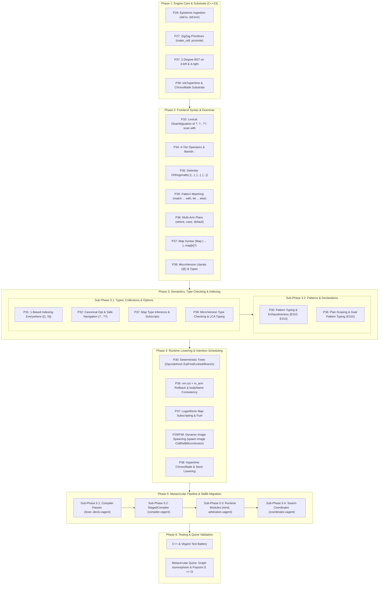

# VAgent Harmonization & Missing Features Implementation Plan

**Companion Documents**:

- `design/vagent-metacircular-missing-features.md` (Proposals P26–P30, P36–P38)
- `design/vagent-language-harmonization.md` (Proposals P31–P35)
- `design/vagent-metacircular-compiler-implementation.md` (Metacircular Pipeline Foundation)
- `design/vagent-metaprogramming.md` (V10 Substrate Architecture)

______________________________________________________________________

## 1. Scope, Architectural Mandates & System Invariants

This document establishes the authoritative, phased engineering plan to implement the complete suite
of thirteen numbered proposals (**P26 through P38**) spanning the VAgent metacircular runtime,
language harmonization, BDI execution model, Nelsonian hypertime substrate, and standard library.

Executing this plan transitions VAgent from a hybrid system dependent on C++ lowering passes into a
fully self-hosting, sovereign hypermedia language operating natively within Nelsonian ZigZag
manifolds.



### 1.1 Non-Negotiable System Invariants

Every phase of this implementation plan strictly adheres to four fundamental invariants:

1. **Nelsonian Persistence Invariant**: VAgent exposes **zero arbitrary host filesystem write
   primitives**. Programs can ingest source text via ephemeral read-only streams
   (`std:io:read_file`, `std:io:read_stdin`), capped at 64 MiB and deducting fuel via
   `core_.arena().consumeWork()`. The single and exclusive path to permanent storage is **Arena
   Promotion** (`std:zigzag:promote`) into an OSMIC append-only Merkle ops spool. Promotion must
   traverse dimension roots via `extraRoots` to prevent link stripping and must advance hypertime
   via `boundStore_->repointCurrentVersion()`.

1. **Strict 2-Degree Manifold Topology**: Every dimension in ZigZag is a 2-regular graph with
   reciprocal links ($A \xrightarrow{+D} B \iff B \xrightarrow{-D} A$). Tree-backed maps use **two
   orthogonal branching dimensions** (`d.left` and `d.right`) anchored by a persistent `mapRoot`
   container cell. Tree rotations modify only branch pointers; the symmetric in-order traversal rank
   on `+d.step` is strictly rotation-invariant ($\text{InOrder}(R(T)) \equiv \text{InOrder}(T)$),
   guaranteeing that active sequential iterators are never disturbed by tree rebalancing.

1. **Spool-Mesh Actor Isolation & Turn Atomicity**: Actors inhabit isolated `WorkerContext`
   instances with independent `ArenaManifold` heaps. No raw `CellRef` pointers are transmitted
   across actors; distributed swarm workers exchange immutable `MicroVersion` identities (e.g.
   `@2a4`). Dynamic image spawning (`spawn image`) accepts both in-arena `CellRef` and unforgeable
   `MicroVersion` literals `@<id>`. Intra-turn plan arm speculation captures an arm-scoped mark
   `m_arm = arena.mark()` and choice depth `cp_arm = vm.choiceStack().size()`. On arm failure, the
   executor strictly cuts choice points via `vm.cut(cp_arm)` before calling `arena.release(m_arm)`,
   preventing VM choice stack / trail desynchronization while un-staging speculative `+d.outbox`
   entries.

1. **Universal 1-Based Indexing & Delimiter Orthogonality**: All user-facing sequences (strings,
   lists, grids) use 1-based indexing ($[1, N]$), with $N+1$ designating the append point and
   literal index 0 statically rejected via `E101`. Delimiters are orthogonally partitioned: `(...)`
   for fixed-arity tuples, `[...]` for dynamic lists (with `...` spread), and `{...}` for named
   records and event payloads.

______________________________________________________________________

## 2. Phase 1: Engine Core & Substrate Extensions (C++23 Infrastructure)

**Objective**: Equip the underlying C++23 engine with epistemic ingestion, missing manifold
primitives, 2-degree orthogonal tree dimensions, and the hypertime substrate bridging to
`Chronofilade`.

### 2.1 Track 1A: Epistemic Ingestion & Host Environment Substrate (P26)

#### Target Files (Track 1A)

- `apps/common/xanadu/vortex/vortex_stdlib.hpp:420–445, 510`
- `apps/common/xanadu/vortex/vortex_stdlib.cpp:4760–4850`
- `apps/vagent/main.cpp:56–76, 380–426`

#### Deliverables (Track 1A)

1. In `vortex_stdlib.hpp:510`, add private member `std::vector<std::string> cliArgs_;`. Add public
   method `setArgs(std::vector<std::string> args)` to `VortexStdLib`.
1. In `vortex_stdlib.hpp:420–445`, declare new standard library modules `std:io` and `std:env`.
1. In `vortex_stdlib.cpp:4760–4850`, implement `buildEnvModule`:
   - `std:env:args() -> [Str]` returning `cliArgs_` as a ZigZag cell list along `+d.step`.
   - `std:env:get_var(key: Str) -> Opt<Str>` reading environment variables via `std::getenv`.
1. In `vortex_stdlib.cpp`, implement `buildIoModule`:
   - `std:io:read_file(path: Str) -> Result<Str, IoError>` reading files up to 64 MiB into an
     ephemeral scratch string. Deduct cycle fuel via `core_.arena().consumeWork(file_size)`. Files
     exceeding the cap or missing return typed `Err(IoError)`.
   - `std:io:read_stdin() -> Result<Str, IoError>` reading standard input up to 64 MiB, deducting
     fuel via `consumeWork()`.
   - `std:io:print(text: Str) -> ()` emitting to standard output.
   - `std:io:eprint(text: Str) -> ()` emitting to standard error.
1. Enforce that **no `write_file` primitive exists** in `VortexStdLib`. Arbitrary host disk writing
   is strictly prohibited.
1. In `apps/vagent/main.cpp:398–420`, forward positional CLI arguments past the target script into
   `stdlib.setArgs(argv)`.

### 2.2 Track 1B: First-Class ZigZag & Manifold Structural Primitives (P27)

#### Target Files (Track 1B)

- `apps/common/xanadu/vortex/vortex_stdlib.hpp:317–330, 505`
- `apps/common/xanadu/vortex/vortex_stdlib.cpp:4634–4760, 5087–5099`
- `apps/common/xanadu/vortex/vortex_core.hpp:50–55`

#### Deliverables (Track 1B)

1. In `vortex_stdlib.hpp:505`, change `const xanadu::Store *boundStore_{nullptr};` to mutable
   pointer `xanadu::Store *boundStore_{nullptr};` to support store promotion from sovereign scripts.
1. In `vortex_stdlib.hpp:317–330` and `vortex_stdlib.cpp:4634–4760`, implement missing primitives in
   `std:zigzag`:
   - `make_cell(text: Str) : Result<CellRef, ZigzagError>`.
   - `text_of(cell: CellRef) : Result<Str, ZigzagError>`.
   - `set_text(cell: CellRef, text: Str) : Result<(), ZigzagError>`.
   - `set_value(cell: CellRef, val: CellValue) : Result<(), ZigzagError>`.
   - `resolve_dim(name: Str) : Result<DimRef, ZigzagError>`.
   - `promote(root: CellRef, budget: Opt<Int>) : Result<Str, ZigzagError>`, verifying
     `grant.immutable == false` and quota caps (`PromotionBudget::maxOps` defaulted from
     `grant.maxCells`).
1. **Discovery Walk & Hypertime Continuity in `VortexStdLib::zzPromote`**:
   - Explicitly pass `extraRoots` containing the head of the `d.dims` rank and any relocation
     targets (`+d.mesh.relocation`) to `arena.promote()`, preventing dimension cells from being
     skipped and links along those dimensions from being silently dropped at
     `arena_manifold.cpp:2097–2100`.
   - Upon successful promotion, advance the bound store version via
     `boundStore_->repointCurrentVersion(promoted->version)` (matching `vortex_host.cpp:403`),
     ensuring sequential promotions from the same script advance hypertime linearly.
1. Fix the 2-degree invariant in `zzCloneToChain` (`vortex_stdlib.cpp:5087–5099`): append clone
   heads strictly to the rank tail via `rankTail(core_.arena(), targetCell, core_.dims().spin)`
   rather than splicing into mid-rank cells.

### 2.3 Track 1C: Orthogonal Tree Dimensions & 2-Degree BST Substrate (P37 Substrate)

#### Target Files (Track 1C)

- `apps/common/xanadu/vortex/vortex_core.hpp:34–57`
- `apps/common/xanadu/vortex/vortex_core.cpp:31–72`
- `apps/common/xanadu/vagent/lineage.hpp:46–52`
- `apps/common/xanadu/vortex/vortex_stdlib.hpp:170–190`
- `apps/common/xanadu/vortex/vortex_stdlib.cpp:2650–2695, 2785–2791`

#### Deliverables (Track 1C)

1. Add orthogonal dimensions `DimRef left{noCell};` and `DimRef right{noCell};` to
   `struct SystemDimensions` in `vortex_core.hpp:34–57`.
1. In `vortex_core.cpp:31–72`, mint `dims_.left` and `dims_.right` off `dims_.dims` inside
   `VortexCore::initGenesis()`.
1. In `lineage.hpp:46–52`, append `"d.left"` and `"d.right"` to `kGenesisDimensionNames`.
1. In `vortex_stdlib.hpp` and `vortex_stdlib.cpp`, register module `std:map` in `bootstrap()`
   exporting `get`, `set`, `has`, `keys`, and `len`.
1. Implement `createMap()` in `VortexStdLib` to mint a stable container cell `mapRoot` with text
   `"map"`.
1. **Type-Aware Key Operations in `VortexStdLib`**:
   - `mapSet(mapRoot, const CellValue &key, const CellValue &val)`: descend `d.left`
     ($< \text{key}$) and `d.right` ($> \text{key}$) in $O(\log N)$ steps. Perform type-aware scalar
     comparisons on `CellValue` (lexicographical for `Str`, numeric scalar bits for `Int64`, index
     arithmetic for `CellRef`), preventing numeric inversion (`"10" < "2"`).
   - On match, restate value on `+d.values`.
   - On insertion, mint key cell (interning text for `Str`, writing scalar bits for
     `Int`/`CellRef`), link parent to child (`+d.left` or `+d.right`), link child to parent
     (`-d.left` or `-d.right`), link `+d.values` to value cell.
   - **$O(1)$ Splicing via Descent Tracking**: Track candidate predecessor `pred` (on right
     branches) and successor `succ` (on left branches) during $O(\log N)$ descent. Splice into
     `+d.step`: `arena.unlink(pred, d.step, POS)`, `arena.link(pred, d.step, POS, newKey)`,
     `arena.link(newKey, d.step, POS, succ)`. If inserting minimum key:
     `arena.unlink(mapRoot, d.step, POS)`, `arena.link(mapRoot, d.step, POS, newKey)`,
     `arena.link(newKey, d.step, POS, oldMin)`.
1. Implement `mapKeyCell(mapRoot, const CellValue &key) const` replacing linear scan along `+d.vars`
   (`vortex_stdlib.cpp:2785–2791`) with $O(\log N)$ descent over `d.left`/`d.right`. Centralize
   cycle fuel deduction (`core_.arena().consumeWork()`) strictly inside `mapKeyCell` to eliminate
   duplicate fuel accounting in `mapGet` and `mapSet`.
1. Implement `mapGet(mapRoot, key)` calling `mapKeyCell`, returning `std::optional<CellValue>`.
1. Implement `mapHas(mapRoot, key)` returning `bool`, and `mapKeys(mapRoot)` iterating along
   `+d.step`.
1. **Container Stability & Deletion Caveat**: Ensure tree rotations update only `mapRoot`'s
   `+d.grab` pointer and `d.left`/`d.right` branch links, leaving `+d.step` strictly invariant.
   Explicitly document that raw `zzDelete` on a map key cell is forbidden without tree rebalancing;
   map key deletion is deferred beyond Phase 1.

### 2.4 Track 1D: First-Class MicroVersion & Hypertime Substrate Bindings (P38 Substrate)

#### Target Files (Track 1D)

- `apps/common/xanadu/vortex/vortex_stdlib.hpp:420–445`
- `apps/common/xanadu/vortex/vortex_stdlib.cpp:4850–4960`
- `apps/common/xanadu/enfilade/chronofilade.hpp:80–140`
- `apps/common/xanadu/store.hpp:280–310, 850–890`

#### Deliverables (Track 1D)

1. In `vortex_stdlib.hpp` and `vortex_stdlib.cpp`, register module `std:hypertime` in
   `VortexStdLib::bootstrap()`.
1. **Lowest Common Ancestor (LCA)**: Implement
   `lca(a: MicroVersion, b: MicroVersion) -> MicroVersion` calling
   `boundStore_->chronofilade()->lowestCommonAncestor(opA, opB)` in $O(\log N)$ time using binary
   lifting (`up_` table with `MaxLiftingPower = 18`).
1. **Replay Path Enumeration**: Implement `path(v: MicroVersion) -> [MicroVersion]` calling
   `MicroversionId::path()`, returning every ancestral state required to replay state `v` from `@0`.
1. **Ancestry & Precedence Queries**:
   - `is_ancestor_of(a: MicroVersion, d: MicroVersion) -> Bool` calling
     `MicroversionId::isAncestorOf()`.
   - `depth(v: MicroVersion) -> Int` calling `boundStore_->chronofilade()->depth(opIndex)`.
   - `jump_ancestor(v: MicroVersion, steps: Int) -> MicroVersion` calling `jumpAncestor` in
     $O(\log \text{steps})$.
1. **Stepping & Navigation Primitives**:
   - `parent(v: MicroVersion) -> MicroVersion` calling `MicroversionId::parent()` (stepping back 1
     state; `@2a4` $\to$ `@2a3`, `@2a1` $\to$ `@2`, `@0` $\to$ `@0`).
   - `next(v: MicroVersion) -> MicroVersion` calling `MicroversionId::next()` (stepping forward 1
     state; `@2a4` $\to$ `@2a5`).
1. **Branch & Tip Discovery**:
   - `children(v: MicroVersion) -> [MicroVersion]` calling `boundStore_->children(v)`.
   - `branch(v: MicroVersion, ordinal: Int) -> MicroVersion` calling
     `MicroversionId::branch(ordinal)`.
   - `branch_letters(ordinal: Int) -> Str` calling `MicroversionId::branchLetters(ordinal)`.
   - `latest() -> MicroVersion` calling `boundStore_->latest()`.
   - `head() -> MicroVersion` calling `boundStore_->primaryCurrentVersion()`.
   - `heads() -> [MicroVersion]` calling `boundStore_->currentVersions()`.
   - `repoint_head(v: MicroVersion) -> ()` calling `boundStore_->repointCurrentVersion(v)`.
1. **Conversion & String Interop**:
   - `to_str(v: MicroVersion) -> Str` calling `MicroversionId::str()`.
   - `parse(s: Str) -> Result<MicroVersion, HypertimeError>` calling `MicroversionId::parse(s)`.

______________________________________________________________________

## 3. Phase 2: Lexical Analysis, Token Disambiguation & Surface Grammar (Frontend Syntax)

**Objective**: Extend the lexer, AST, and parser to support harmonized operators, orthogonal
delimiters, algebraic pattern matching, multi-arm plans, first-class map literals, and
`MicroVersion` literals.

### 3.1 Track 2A: Lexer Tokens & Operator Disambiguation (P33, P34, P35, P37, P38)

#### Target Files (Track 2A)

- `apps/common/xanadu/vagent/token.hpp:15–55`
- `apps/common/xanadu/vagent/token.cpp:20–95`
- `apps/common/xanadu/vagent/lexer.cpp:60–180, 267–339`
- `apps/common/xanadu/vagent/parser.cpp:840–865`

#### Deliverables (Track 2A)

1. In `token.hpp:15–55` and `token.cpp:20–95`, add reserved keyword tokens: `TokenKind::KwMap`
   (`Map`), `TokenKind::KwMatch` (`match`), `TokenKind::KwWith` (`with`), `TokenKind::KwDefault`
   (`default`), `TokenKind::KwCase` (`case`).
1. In `token.hpp` and `lexer.cpp:267–339` (`Lexer::punctuation()`), add punctuation tokens:
   - `TokenKind::Ellipsis` (`...`).
   - `TokenKind::FatArrow` (`=>`).
   - `TokenKind::QuestionDot` (`?.`).
   - `TokenKind::DoubleQuestion` (`??`).
   - `TokenKind::At` (`@`).
   - `TokenKind::MicroVersionLiteral` (e.g. `@0`, `@1`, `@2a4`, `@HEAD`).
1. **MicroVersion Literal Lexing (P38)**:
   - When character `@` is encountered in `Lexer::punctuation()`, scan subsequent alphanumeric run
     `[0-9a-zA-Z_]+`.
   - If matching `HEAD` or `head`, emit `TokenKind::MicroVersionLiteral` with
     `stringValue = "HEAD"`.
   - Otherwise, validate via `xanadu::MicroversionId::parse()`. If valid, emit
     `TokenKind::MicroVersionLiteral` with canonical string representation; if invalid, report
     `E105: Invalid MicroVersion literal syntax: '@<text>'`.
1. **Sigil `?` Lexical Disambiguation & Scanning Cleanup (P33)**:
   - Prefix `?ident`: emits `TokenKind::LogicVariable` (`?ident`) in Tier 4 / unification contexts.
   - Postfix `expr?`: emits `TokenKind::Question` (`?`) for soft unwrap of `Opt<T>`.
   - Infix `subject ? expr`: emits `TokenKind::Scan` via predictive lookahead in
     `Lexer::punctuation()`, deprecated in favor of structured `scan subject with { ... }`.
   - Access scanning state via built-in functions `subject()` and `pos()`; remove prefix `&` sigils.
   - **Parser State Cleanup**: Delete modal state `allowScan_` from
     `apps/common/xanadu/vagent/parser.cpp:847`.
1. **Four-Tier Evaluation Hierarchy (P34)**:
   - Strictly banish `;` as a disjunction operator in plan guards and boolean expressions.
   - Ground the four-tier evaluation framework:
     - **Tier 1 (Procedural Sequencing)**: `\n`, `;` executing sequentially along `+d.spin`.
       Statement-boundary choice cutting via `#CutChoiceDepth` (compiled via `bounded()` sequence of
       `ChoiceDepth` and `Cut`) prevents backtracking from destroying procedural side effects.
     - **Tier 2 (Pure Boolean Logic)**: `not`, `and`, `or` operating strictly on `Bool` values with
       short-circuiting and emitting zero choice points.
     - **Tier 3 (Goal-Directed Execution)**: `&` (goal conjunction chaining success), `|`
       (alternation introducing backtracking choice points `#Choice`), and `!` (cut cutting choice
       points `#Cut`).
     - **Tier 4 (Relational Belief Queries)**: `believes (...)` evaluating Horn clause queries over
       `d.clause` ranks, composing via Tier 3 `&` and `|`.

### 3.2 Track 2B: AST Definitions & Pipeline Infrastructure (P30, P35, P36, P37, P38)

#### Target Files (Track 2B)

- `apps/common/xanadu/vagent/ast.hpp:38–95, 177–185, 208–245`
- `apps/common/xanadu/vagent/ast.cpp:40–120`
- `apps/common/xanadu/vagent/ast_clone.cpp:45–85`
- `apps/common/xanadu/vagent/r1_ast.hpp:25–65`
- `apps/common/xanadu/vagent/r1_ast.cpp:78–270, 272–425, 480–565`
- `apps/common/xanadu/vagent/resolve.cpp:391–682`

#### Deliverables (Track 2B)

1. In `ast.hpp:183`, define `struct PlanArm` immediately after `struct GoalClause` with fields:
   `ExprPtr pattern{nullptr}; ExprPtr guard{nullptr}; ExprPtr body{nullptr}; SourceLocation loc{};`.
1. In `ast.hpp:208–231`, add `std::vector<PlanArm> planArms;` to `struct Decl`.
1. In `ast.hpp:38–95`, add new `ExprKind` variants to `enum class ExprKind : std::uint8_t`: `Match`,
   `MatchArm`, `SafeNav`, `Coalesce`, `Map`, `Tuple`, `TuplePattern`, `ListPattern`,
   `RecordPattern`, `WildcardPattern`, `CtorPattern`, `MicroVersionLiteral`.
1. In `ast.cpp`, add string mappings for all new `ExprKind` variants in `exprKindName()`.
1. In `ast_clone.cpp:45–85`, extend `cloneDecl` to deep-clone `decl.planArms`, and extend
   `cloneExpr` to clone `Match`, `SafeNav`, `Coalesce`, `Map`, and `MicroVersionLiteral` subtrees.
1. In `r1_ast.cpp`, update `marshalAstToR1` (lines 78–270), `unmarshalR1ToAst` (lines 272–425),
   `marshalDeclToR1` (lines 480–505), and `unmarshalR1ToDecl` (lines 543–565) to serialize and
   deserialize new AST nodes, `planArms`, and `MicroVersionLiteral` to and from ZigZag manifolds.
1. In `resolve.cpp:391–682`, update `Resolver::walk` to handle all new `ExprKind` variants in its
   exhaustive expression switch.

### 3.3 Track 2C: Recursive Descent Parser Extensions (P30, P35, P36, P37, P38)

#### Target Files (Track 2C)

- `apps/common/xanadu/vagent/parser.cpp:560–625, 840–925, 1010–1090`

#### Deliverables (Track 2C)

1. **Delimiter Orthogonality (P35)**:
   - Parse `(...)` as `ExprKind::Tuple` (single-element tuple requires trailing comma `(?a,)`).
   - Parse `[...]` as `ExprKind::List` with `...rest` spread syntax (`TokenKind::Ellipsis`).
   - Parse `{...}` as `ExprKind::Record`.
   - Parse `on Event where Guard Block` and event payload destructuring:
     `on Event { field: Pat, ... } where Guard Block`.
1. **Multi-Arm Plans (P36)**:
   - Parse `PlanDecl ::= "plan" Ident "for" GoalPattern PlanBody`.
   - Parse `PlanBody ::= SinglePlanBody | MultiArmPlanBody`.
   - Parse `SinglePlanBody ::= ("where" Expr)? Block` (preserving backward compatibility).
   - Parse `MultiArmPlanBody ::= "{" PlanArmList "}"`.
   - Parse `PlanArmList` containing `where Expr => Block`, `case Pattern ("where" Expr)? => Block`,
     and `default => Block`.
   - Enforce syntactically that `default => Block` can only appear as the strictly terminal arm.
1. **Pattern Matching & Destructuring (P30)**:
   - Parse `match Expr with { MatchArmList }`.
   - Parse patterns: `LiteralPattern`, `WildcardPattern` (`_`), `VariablePattern` (`?var`),
     `CtorPattern` (`Ident(...)`), `TuplePattern` (`(...)`), `ListPattern` (`[...]`),
     `RecordPattern` (`Ident { field: Pat, ... }`), and `MicroVersionLiteral` (`@<id>`).
   - Parse `let Pattern := Expr else Block`.
1. **First-Class Map Literals (P37)**:
   - Parse `MapType ::= "Map" "<" Type "," Type ">"`.
   - Parse `MapLiteral ::= "Map" "{" MapEntryList? "}"` with `MapEntry ::= Expr ":" Expr`.
   - Parse `SubscriptAssignStmt ::= Expr "[" Expr "]" ":=" Expr`.
1. **MicroVersion Literal & Type Parsing (P38)**:
   - Parse `MicroVersionLiteral ::= "@" ( [0-9]+ [a-z0-9]* | "HEAD" | "head" )`.
   - Parse type annotation `MicroVersion`.
1. **Safe Navigation, Null Coalescing & Structured String Scanning (P32, P33)**:
   - Parse postfix safe navigation: `base?.field` (`TokenKind::QuestionDot`).
   - Parse binary null coalescing: `opt ?? fallback` (`TokenKind::DoubleQuestion`) at Precedence 5.
   - Parse structured string scanning: `scan subject with { ... }`.

______________________________________________________________________

## 4. Phase 3: Semantic Analysis, Type Checking & Indexing Harmonization

**Objective**: Implement 1-based indexing, canonical `Opt<T>` semantics, exhaustiveness checking for
pattern matches, multi-arm plan scoping, map type synthesis, and `MicroVersion` type checking across
two structured sub-phases.

### 4.1 Sub-Phase 3.1: Types, Collections, Options & Hypertime

#### Track 3A: Universal 1-Based Indexing Harmonization (P31)

##### Target Files (Track 3A)

- `apps/common/xanadu/vagent/checker.cpp:1380–1405, 1960–1985`
- `apps/common/xanadu/vortex/vortex_vm.cpp:1898–1937`

##### Deliverables (Track 3A)

1. Base indices for strings, lists, arrays, and maps are 1-based ($[1, N]$).
1. Static Rejection of Literal Index 0: Literal index `coll[0]` raises compile-time diagnostic
   `E101: Index 0 is invalid in 1-based indexing; indices start at 1`. Dynamic runtime evaluation of
   index 0 or out-of-bounds index emits `#Fail` in goal contexts or `ActorError::ContractViolation`.
1. Length of a collection is $N$; the append index is $N+1$.
1. Range slicing `coll[start..end]` is 1-based closed-interval $[start, end]$. Slicing edge case:
   when $end = start - 1$, produce an empty slice (`""` or `[]`).
1. Negative indices $-k$ access from the end: $-1$ accesses position $N$, $-2$ accesses $N-1$.
1. Provide built-in scanning primitive `tab_end()` to replace legacy `tab(0)`.
1. In `apps/common/xanadu/vortex/vortex_vm.cpp:1898–1937`, update VM opcodes `OpcodeKind::ByteAt`
   and `OpcodeKind::StrSlice` to 1-based closed intervals $[start, end]$ and symmetric negative
   indexing ($N + 1 + k$).

#### Track 3B: Canonical Option (`Opt<T>`), Safe Navigation & Tripartite Lookup (P32, P33, P37)

##### Target Files (Track 3B)

- `apps/common/xanadu/vagent/checker.cpp:700–740, 1850–1890, 1960–1990`

##### Deliverables (Track 3B)

1. Standardize option type to `Opt<T>` with variants `Some(T)` and `none`. Banish legacy `[]`
   empty-check syntax.
1. Implement **Soft Goal-Directed Unwrap (`opt?`, `map[k]?`)**: Type `Opt<T> -> T`. If `Some(val)`,
   yields `val`; if `none`, jumps to `cells_->fail` (`#Fail`), initiating goal-directed
   backtracking.
1. Implement **Assertive Hard Unwrap (`opt!`, `opt.unwrap()`, `map[k]!`)**: Type `Opt<T> -> T`. If
   `Some(val)`, yields `val`; if `none`, raises unrecoverable `ActorError::ContractViolation` (or
   `KeyNotFound`).
1. Implement **Safe Navigation Typing (`base?.field`)**: If `base : Opt<T>` and `T` has field
   `field : U`, `base?.field` yields `Opt<U>`.
1. Implement **Null Coalescing Typing (`opt ?? fallback`)**: If `opt : Opt<T>` and `fallback : T`,
   `opt ?? fallback` yields `T`.

#### Track 3E: Map Type Synthesis, Methods & Subscript Validation (P37)

##### Target Files (Track 3E)

- `apps/common/xanadu/vagent/checker.cpp:1385–1395, 2060–2085, 2450–2490`

##### Deliverables (Track 3E)

1. In `Checker::infer`, add `case ExprKind::Map:`: infer types of all entry keys and values, unify
   key types to $K$ and value types to $V$, synthesize `Type{"Map", {K, V}}`, and validate key type
   $K \in \{\text{Str}, \text{Int}, \text{CellRef}\}$.
1. Bidirectional Type Inference: Support empty map literals `Map {}` by inferring $K$ and $V$ from
   expected context type.
1. Method Type Checking:
   - `map.get(k: K) : Opt<V>`.
   - `map.contains(k: K) : Bool`.
   - `map.keys() : [K]`.
   - `map.len() : Int`.
1. Subscript Assignment Validation: In `Checker::place`, validate `map[key] := val` where `map` is
   mutable, `key` matches $K$, and `val` matches $V$.
1. Loop Target Inference: In `for (k, v) in map do`, infer 2-tuple binding `k : K` and `v : V`.

#### Track 3F: `MicroVersion` Type Checking & Hypertime Operators (P38)

##### Target Files (Track 3F)

- `apps/common/xanadu/vagent/checker.cpp:1970–2020, 2450–2500`

##### Deliverables (Track 3F)

1. In `Checker::infer`, add `case ExprKind::MicroVersionLiteral:`: synthesize primitive type
   `Type{"MicroVersion"}`.
1. Type check relational comparisons between two `MicroVersion` operands (`==`, `!=`, `<`, `<=`,
   `>`, `>=`) yielding `Bool`.
1. Enforce strict type isolation: `MicroVersion` is non-unifiable with `Str` or `Int`; implicit
   string coercion is forbidden.
1. Type check invocations of `std:hypertime` functions (`lca`, `path`, `is_ancestor_of`, `parent`,
   `next`, `jump_ancestor`, `depth`, `children`, `branch`, `latest`, `head`).

### 4.2 Sub-Phase 3.2: Patterns & Declarations

#### Track 3C: Pattern Matching Typing & Static Exhaustiveness (P30, P38)

##### Target Files (Track 3C)

- `apps/common/xanadu/vagent/checker.cpp:2050–2120`

##### Deliverables (Track 3C)

1. In `Checker::infer` (lines 2050–2120), infer scrutinee type $T$ and unify arm patterns against
   $T$.
1. Support `MicroVersionLiteral` pattern matching when scrutinee is `MicroVersion`.
1. Implement static exhaustiveness verification in `Checker::matchExpr`: verify all constructors of
   an algebraic data type are covered or a wildcard `_` / variable arm exists. Non-exhaustive match
   emits diagnostic `E310: Non-exhaustive match; missing variants: ...`.
1. Verify `let Pattern := Expr else Block`: if pattern is refutable and `else` block is missing,
   emit diagnostic `E313: Refutable pattern in let binding requires else clause`. Verify `else`
   block diverges (`return`, `fail`, `terminate`).

#### Track 3D: Multi-Arm Plan Checking & Variable Scoping (P36)

##### Target Files (Track 3D)

- `apps/common/xanadu/vagent/resolve.cpp:763–785`
- `apps/common/xanadu/vagent/checker.cpp:2747–2785`

##### Deliverables (Track 3D)

1. Extend `Resolver::declaration` case `DeclKind::Plan` to walk all `decl.planArms`.
1. In `Checker::declaration`, check `GoalPattern` arity $N$. For each `PlanArm`: if `case Pattern`
   is present, match against single parameter type for $N = 1$, or tuple type `(T1, ..., TN)` for
   $N > 1$. Emit `E315: Cannot match pattern on nullary goal; use where or default` for $N = 0$.
1. Check `where Expr` evaluates to `Bool`.
1. Pattern variable bindings `?v` are lexically scoped strictly to that arm's guard and body.

______________________________________________________________________

## 5. Phase 4: Runtime Execution, Bytecode Lowering & BDI Deliberation

**Objective**: Implement deterministic decision tree lowering for pattern matching, multi-arm plan
compilation to `d.clause` ranks with intention scheduler reconsideration, logarithmic map
subscripting, dynamic image spawning from `MicroVersion`, and hypertime bindings.

### 5.1 Track 4A: Deterministic Pattern Lowering (P30, P38)

#### Target Files (Track 4A)

- `apps/common/xanadu/vagent/compiler.cpp:1540–1640, 1850–1920`

#### Deliverables (Track 4A)

1. Lower `match ... with` into deterministic decision trees using `OpcodeKind::Eq`,
   `OpcodeKind::Find` (for record member extraction), `OpcodeKind::Linked` (for tuple/Crum argument
   navigation), and `OpcodeKind::Branch`.
1. Lower `MicroVersionLiteral` patterns via string/scalar comparison against `MicroversionId` bits.
1. **Strict Invariant**: Zero `#Choice` or `#Fail` opcodes are generated for pattern matching. Zero
   choice points are pushed to `choiceStack_`, guaranteeing arm side effects cannot be destroyed by
   trailing rollbacks.
1. Lower `let Pattern := Expr else Block`: test pattern match, bind variables on success and proceed
   to continuation; on failure, branch directly to the compiled `else` block.
1. Lower safe navigation (`?.`) and null coalescing (`??`) to conditional branching testing
   `tag == 1` (`Some`).
1. Lower structured string scanning `scan subject with { ... }` using `OpcodeKind::ScanPush` and
   `OpcodeKind::ScanPop`.

### 5.2 Track 4B: Multi-Arm Plan Lowering & BDI Intention Scheduler (P36)

#### Target Files (Track 4B)

- `apps/common/xanadu/vagent/decls.cpp:1268–1301, 1979–2000`
- `apps/common/xanadu/vagent/executor.cpp:206–273, 3210–3275`
- `apps/common/xanadu/vagent/meta.cpp:1270–1360`

#### Deliverables (Track 4B)

1. **Declaration Precondition & Lowering in `decls.cpp`**:
   - In `decls.cpp:1984`, update precondition check to `if (!decl.body && decl.planArms.empty())` so
     multi-arm plans are not rejected.
   - Lower a multi-arm plan with $M$ arms into $M$ sequential clause cells along the goal host's
     `+d.clause` rank. Primary arm is labelled `PlanName`; auxiliary arms are labelled `PlanName$2`
     through `PlanName$M`. `MetaRuntime::planNamed(PlanName)` resolves the primary entry clause
     verbatim.
1. For each arm, emit guard preflight on `+d.grab` (pattern tests and boolean guard) and body
   fragment on `+d.spin`. Emit pattern variable bindings into the body fragment prologue as well as
   the guard preflight.
1. **Intra-Turn Speculative Rollback & Choice Stack Safety in `executor.cpp`**:
   - Before executing an arm body, capture *both* the arena mark and choice depth:
     `const auto m_arm = arena.mark(); const auto cp_arm = vm.choiceStack().size();`.
   - If the arm body fails prior to external commit (`#Fail`, deadline expiry, subgoal failure),
     **cut choice points strictly before releasing the arena mark**:
     `vm.cut(cp_arm); arena.release(m_arm);`. This strictly guarantees choice points holding marks
     into truncated memory do not remain on `vm.choiceStack_`, while cleanly rolling back
     speculative cells and un-staging `+d.outbox` entries.
1. **Intention Scheduler Arm Deliberation & State Consistency (`executor.cpp:3240–3275`)**:
   - Hook deliberation directly at the execution failure site (`executor.cpp:3269`) rather than the
     delayed fault backoff ladder.
   - Append the failed clause cell to the intention's `tried` rank along `+d.step`, and invoke
     `MetaRuntime::selectClause` passing the updated `tried` set.
   - If an untried arm matches:
     - Update intention `plan` to the matched auxiliary clause cell.
     - **Update `bodyName` and `owner` on the intention record** to match the new arm's body
       fragment, preventing the sanity check in `executor.cpp:3233` (`liveName != bodyName`) from
       failing with `"body_replaced"`.
     - Reset `step := 0`, clear `faulted`, and set `ready := 1`.
   - If no untried arms remain, escalate to `GoalFailed`.
1. **Turn Atomicity & Bounded Expressions**: Ensure `#CutChoiceDepth` (compiled via `bounded()`
   sequence of `ChoiceDepth` and `Cut`) cuts choice points at statement boundaries, preventing
   procedural side effects from backtracking.

### 5.3 Track 4C: Logarithmic Map Subscript Lowering (P31, P37)

#### Target Files (Track 4C)

- `apps/common/xanadu/vagent/compiler.cpp:770–790, 1730–1765`

#### Deliverables (Track 4C)

1. In `compiler.cpp`, add `case ExprKind::Index:` to `preflight()` (around line 770) and
   `emitValue()` (around line 1739).
1. Translate 1-based index $i$ to 0-based memory offset $i - 1$ for lists, strings, and arrays.
1. Subscript access `map[key]?` lowers to standard library invocation `std:map:get(map, key)`
   (`VortexStdLib::mapGet`), branching to `cells_->fail` if `none`.
1. Assertive subscript access `map[key]` and `map[key]!` lowers to `mapGet`, checking for `none` and
   raising `ActorError::ContractViolation` (or `KeyNotFound`).
1. **Strict Invariant**: Do NOT lower map subscripts via `OpcodeKind::Find` (which performs an
   $O(N)$ linear scan on records). Ensure lookup executes the logarithmic descent along `d.left` and
   `d.right`.
1. For `map[key] := val`, lower to `std:map:set(map, key, val)`.

### 5.4 Track 4D: Dynamic Image Spawning Performative (P29, P38)

#### Target Files (Track 4D)

- `apps/vagent/main.cpp:275–296`
- `apps/common/xanadu/vagent/adapter.hpp:85–115`
- `apps/common/xanadu/vagent/adapter.cpp:140–185`
- `apps/common/xanadu/vagent/executor.cpp:1433–1477, 3423–3440`

#### Deliverables (Track 4D)

1. Add
   `spawn image(root: CellRef | MicroVersion, grant: ActorGrant) -> Result<ActorPid, ActorError>`
   performative to `VagentAdapter`, accepting an in-arena `CellRef` or a strongly typed
   `MicroVersion`.
1. If passed `CellRef`: validate the image root via `MetaRuntime::validate` (`meta.cpp:490–623`),
   and promote the ephemeral image graph into an immutable microversion via `std:zigzag:promote`.
1. If passed `MicroVersion`: resolve and load the immutable microversion directly from the bound
   store spool. Arbitrary raw strings `Str` are rejected at compile time.
1. Anchor the rebuilt `Manifold` in a runtime image cache keyed by `MicroversionId`.
1. Spawn live child actor on `MeshActorRuntime` with inherited `ActorGrant`. The child initializes
   cooperatively on subsequent runtime turns.

### 5.5 Track 4E: Hypertime Operation Lowering & Chronofilade Dispatch (P38 Lowering)

#### Target Files (Track 4E)

- `apps/common/xanadu/vagent/compiler.cpp:1650–1700`
- `apps/common/xanadu/vortex/vortex_stdlib.cpp:4850–4960`

#### Deliverables (Track 4E)

1. Lower `MicroVersionLiteral` expressions by compiling a constant descriptor holding the parsed
   `MicroversionId`.
1. Lower relational comparisons between `MicroVersion` values directly to `VortexStdLib` comparison
   primitives evaluating `MicroversionId::operator<=>`.
1. Lower hypertime calls (`lca`, `path`, `parent`, etc.) to standard library dispatch into
   `std:hypertime` in `vortex_stdlib.cpp`.

______________________________________________________________________

## 6. Phase 5: Metacircular Pipeline & Stdlib Migration

**Objective**: Migrate the sovereign `.vagent` standard library modules to harmonized syntax and
deliver the metacircular pipeline via `behavior StagedCompiler` and `agent CompilerCoordinator`
through four cleanly staged sub-phases.

### 6.1 Sub-Phase 5.1: Compiler Passes Migration

Migrate the core compiler passes to harmonized syntax, verified using the C++ bootstrap compiler:

1. `apps/common/xanadu/vagent/stdlib/lexer.vagent`
1. `apps/common/xanadu/vagent/stdlib/parser.vagent`
1. `apps/common/xanadu/vagent/stdlib/ast.vagent`
1. `apps/common/xanadu/vagent/stdlib/expand.vagent`
1. `apps/common/xanadu/vagent/stdlib/resolve.vagent`
1. `apps/common/xanadu/vagent/stdlib/checker.vagent`
1. `apps/common/xanadu/vagent/stdlib/emitter.vagent`
1. `apps/common/xanadu/vagent/stdlib/fragment.vagent`
1. `apps/common/xanadu/vagent/stdlib/decls.vagent`

### 6.2 Sub-Phase 5.2: Metacircular Pipeline (`behavior StagedCompiler`) (P28)

#### Target Files (Track 5A)

- `apps/common/xanadu/vagent/stdlib/compiler.vagent`

#### Deliverables (Track 5A)

1. Implement `behavior StagedCompiler` for single-turn intra-file compilation: sequentially executes
   Lexer → Parser → Macro Expander → Resolver → Type Checker → Emitter → Lowerer → Assembler within
   a single `WorkerContext` and `ArenaManifold`.
1. Mounts `fragment.vagent` for descriptor assembly and link validation.

### 6.3 Sub-Phase 5.3: Runtime & Decision Modules Migration

Migrate runtime and BDI arbitration modules to harmonized syntax:

1. `apps/common/xanadu/vagent/stdlib/mind.vagent`
1. `apps/common/xanadu/vagent/stdlib/arbitration.vagent` (Utility scoring, intention state machine,
   deadline queue).

### 6.4 Sub-Phase 5.4: Swarm Coordinator (`agent CompilerCoordinator`) (P28, P38)

#### Target Files (Track 5B)

- `apps/common/xanadu/vagent/stdlib/coordinator.vagent`

#### Deliverables (Track 5B)

1. Implement `agent CompilerCoordinator` for distributed multi-module compilation: spawns worker
   actors for compilation units (`main.vagent`, `lib.vagent`), workers compile their unit and
   promote to a store microversion, workers send
   `tell UnitCompiled(path: Str, version: MicroVersion)` back to coordinator, coordinator links
   microversions and emits `CompilationComplete(version)`.
1. Preserve Spool-Mesh isolation: zero raw `CellRef` leaks across workers; all coordination occurs
   via strongly-typed `MicroVersion` values.

______________________________________________________________________

## 7. Phase 6: Testing, Quine Verification & End-to-End Validation

**Objective**: Comprehensive verification of all thirteen proposals through unit, integration,
hypertime, and metacircular quine test suites.

### 7.1 Test Matrix & Deliverables

| Test Suite                 | Test File                                       | Proposals Covered | Pass Criteria                                                                                                                                                                                                                                                                  |
| :------------------------- | :---------------------------------------------- | :---------------- | :----------------------------------------------------------------------------------------------------------------------------------------------------------------------------------------------------------------------------------------------------------------------------- |
| **Ingestion & Invariants** | `tests/xuzz/vagent_ingestion_test.cpp`          | P26, P27          | File reads capped at 64 MiB; disk writes prohibited; `make_cell`/`text_of`/`promote` work without sentinels; `std:env:args` and CLI argument forwarding verified; fuel deducted via `consumeWork()`.                                                                           |
| **Tree-Backed Map BST**    | `tests/xuzz/vagent_map_test.cpp`                | P37               | $O(\log N)$ descent on `d.left`/`d.right`; container `mapRoot` stable across rebalances; `+d.step` rotation-invariant; fuel deducted via `consumeWork()`; type-aware scalar comparisons prevent `"10" < "2"` inversion.                                                        |
| **Harmonization & Syntax** | `tests/xuzz/vagent_harmonization_test.cpp`      | P31–P35           | 1-based indexing ($[1, N]$); `E101` on literal 0; closed intervals $[start, end]$; `tab_end()`; `Opt<T>` soft/hard unwraps; `?.` and `??`; `scan subject with { ... }`; 4-tier evaluation operators; delimiter orthogonality `(...)` vs `[...]`.                               |
| **Pattern Matching**       | `tests/xuzz/vagent_pattern_match_test.cpp`      | P30               | Deterministic decision trees; `OpcodeKind::Eq`/`Find`/`Linked`/`Branch` only; zero choice points; static exhaustiveness `E310`; refutable let `else` requirement `E313`.                                                                                                       |
| **Multi-Arm Plans & BDI**  | `tests/xuzz/vagent_multi_arm_plan_test.cpp`     | P36               | Multi-arm EBNF; nullary goal diagnostic `E315`; intra-turn speculative mark `m_arm` + `vm.cut(cp_arm)` un-stages outbox; BDI scheduler untried-arm ladder on `#Fail` with consistent `bodyName` and `owner`.                                                                   |
| **Dynamic Spawning**       | `tests/xuzz/vagent_image_spawn_test.cpp`        | P29, P38          | `spawn image` accepts `CellRef` and `MicroVersion`, promotes microversion, anchors in cache, launches live actor with `ActorGrant`. Arbitrary `Str` rejected.                                                                                                                  |
| **Hypertime Substrate**    | `tests/xuzz/vagent_hypertime_test.cpp`          | P38               | `@0`, `@1`, `@2a4`, `@HEAD` literal parsing; rejection of malformed literals (`E105`); $O(\log N)$ LCA via `Chronofilade`; stepping (`parent`, `next`, `jump_ancestor`, `depth`); ancestry check `is_ancestor_of`.                                                             |
| **Metacircular Quine**     | `tests/xuzz/vagent_metacircular_quine_test.cpp` | P28, P26–P38      | Stage-1 VAgent compiler compiles Stage-2 VAgent compiler source, and Stage-2 compiles Stage-3; verifies **graph isomorphism of opcode/descriptor manifolds modulo serial labels and base offsets**, identical wing topologies, and functional fixpoint $I_2(P) \equiv I_3(P)$. |

### 7.2 Headless Execution Gate

All test execution strictly adheres to the headless execution contract in `AGENTS.md`:

```sh
SDL_VIDEODRIVER=offscreen SDL_AUDIODRIVER=dummy LIBGL_ALWAYS_SOFTWARE=1 \
  XDG_DATA_HOME=$PWD/build/xdg/data XDG_CONFIG_HOME=$PWD/build/xdg/config \
  XDG_CACHE_HOME=$PWD/build/xdg/cache make -j$(nproc) test
```

______________________________________________________________________

## 8. Numbered Proposal Register (P26–P38)

The complete register of substrate and surface proposals governed by this implementation plan:

| ID      | Title & Files Touched                                                                           | Mechanism & Specification                                                                                                                                                                       | Cost & Complexity                                                                                  |
| :------ | :---------------------------------------------------------------------------------------------- | :---------------------------------------------------------------------------------------------------------------------------------------------------------------------------------------------- | :------------------------------------------------------------------------------------------------- |
| **P26** | Epistemic Ingestion (`vortex_stdlib.cpp`, `main.cpp`)                                           | Expose `read_file`, `read_stdin`, `args`, `get_var`, `print`, `eprint`. Enforce read-only buffer caps. Prohibit disk writes. Fuel via `consumeWork`.                                            | $O(\text{filesize})$ scratch memory; fuel deducted via `consumeWork`.                              |
| **P27** | ZigZag Primitives (`vortex_stdlib.cpp`, `vortex_core.hpp`)                                      | Add `make_cell`, `text_of`, `set_text`, `set_value`, `resolve_dim`, `promote(root, budget)`. Fix `zzCloneToChain` 2-degree end append. Include `d.dims` in `extraRoots`. Advance hypertime.     | 0 extra runtime bytes; leverages `ArenaManifold::makeCell`.                                        |
| **P28** | Metacircular Swarm (`compiler.vagent`, `coordinator.vagent`)                                    | Implement `behavior StagedCompiler` and `agent CompilerCoordinator` exchanging immutable `MicroVersion` values across Spool-Mesh isolation boundaries.                                          | 0 C++ lines; 100% sovereign VAgent code.                                                           |
| **P29** | Dynamic Image Spawning (`adapter.cpp`, `main.cpp`, `executor.cpp`)                              | Expose `spawn image(root: CellRef \| MicroVersion, grant: ActorGrant)` performative in `VagentAdapter` dispatching through `MeshActorRuntime::spawn`.                                           | 1 `ActorPid` allocation; capabilities verified against `ActorGrant`.                               |
| **P30** | Algebraic Pattern Matching (`parser.cpp`, `compiler.cpp`, `checker.cpp`)                        | Implement `match ... with`, `let Pattern := Expr else Block`, and deterministic `Eq`/`Find`/`Linked`/`Branch` decision trees. Static exhaustiveness `E310`, refutable let check `E313`.         | 0 runtime bytes; eliminates choice points and trail destruction.                                   |
| **P31** | 1-Based Indexing Everywhere (`checker.cpp`, `compiler.cpp`, `vortex_vm.cpp`)                    | Standardize $[1, N]$ indexing, $N+1$ append, `E101` out-of-bounds check across strings, lists, arrays, maps, and VM opcodes `ByteAt`/`StrSlice`. Slicing edge case $end = start - 1$.           | 0 runtime overhead; index offset adjusted by $-1$ at emit time.                                    |
| **P32** | Canonical Option (`checker.cpp`, `compiler.cpp`)                                                | Canonical `Opt<T>` (`Some(v)`/`none`), soft unwrap `opt?` emitting `#Fail`, hard unwrap `opt!` raising fault, safe navigation `?.`, null coalescing `??`.                                       | 0 overhead; soft unwrap lowers to branch on tag.                                                   |
| **P33** | Sigil Disambiguation & Scanning (`token.hpp`, `lexer.cpp`, `parser.cpp`)                        | `?ident` for pattern variables, `expr?` for soft unwrap. Access scanning state via `subject()` and `pos()`. Structured `scan subject with { ... }`. Delete `allowScan_`.                        | 0 runtime bytes; simplifies lexer lookahead.                                                       |
| **P34** | Banishment of `;` & 4-Tier Operators (`lexer.cpp`, `parser.cpp`, `compiler.cpp`)                | Banish `;` as disjunction. Ground 4-tier evaluation: Tier 1 (procedural sequencing with `#CutChoiceDepth`), Tier 2 (pure boolean logic), Tier 3 (goal-directed `&`/`\|`/`!`), Tier 4 (beliefs). | 0 runtime overhead; cleaner AST precedence.                                                        |
| **P35** | Delimiter Orthogonality (`parser.cpp`, `ast.hpp`)                                               | `(...)` for tuples, `[...]` for lists with `...` spread (`TokenKind::Ellipsis`), `{...}` for records, `on Event { pat } where Guard Block`.                                                     | 0 runtime overhead; eliminates bracket overloading.                                                |
| **P36** | Multi-Arm Plan Guards (`decls.cpp`, `executor.cpp`, `meta.cpp`)                                 | Implement `where =>`, `case =>`, `default =>` arms, intra-turn rollback `m_arm` + `vm.cut(cp_arm)`, intention scheduler untried-arm loop at execution failure site with consistent `bodyName`.  | 0 runtime bytes; lowers directly to `d.clause` ranks.                                              |
| **P37** | Tree-Backed Map on `d.left` & `d.right` (`vortex_core.hpp`, `vortex_stdlib.cpp`, `checker.cpp`) | Allocate `d.left` and `d.right`, implement 2-degree BST with stable `mapRoot` and rotation-invariant `+d.step`, reserved `Map` keyword, type-aware scalar comparisons, bidirectional typing.    | 2 dimension allocations (`d.left`, `d.right`); $O(\log N)$ traversal replaces $O(N)$ linear scans. |
| **P38** | MicroVersion Literals & Hypertime Substrate (`token.hpp`, `lexer.cpp`, `chronofilade.hpp`)      | Add `TokenKind::At`, `TokenKind::MicroVersionLiteral` (`@<id>`), `MicroVersion` type, `spawn image` overload, and `std:hypertime` module hooking `Chronofilade` ($O(\log N)$ LCA, depth, jump). | 0 runtime bytes; wraps `MicroversionId` and `Chronofilade`. Eliminates stringly-typed hypertime.   |

______________________________________________________________________

## 9. Refused Alternatives & Risk Mitigations

1. **Refused: Executing Swarm Coordination via Raw Shared `ArenaManifold` Pointers**:
   - *Risk*: Passing raw `CellRef` pointers across worker actors causes data races, breaks memory
     isolation, and makes cross-node network distribution impossible.
   - *Mitigation*: Workers exchange immutable `MicroVersion` values sealed into store spools.
1. **Refused: Single Dimension `d.branch` for Binary Tree Representation**:
   - *Risk*: Violates Nelsonian 2-degree reciprocity invariant. Linking alternating child nodes
     overwrites parent backlinks, severing the tree into disconnected 2-node components.
   - *Mitigation*: Allocated two orthogonal dimensions (`d.left`, `d.right`) with $O(1)$
     bidirectional navigation.
1. **Refused: Lowering Pattern Matching via Backtracking `#Choice` and `#Fail`**:
   - *Risk*: Uncut choice points leak across returns; subsequent failures backtrack and silently
     destroy arm side effects and allocations via trail rollback.
   - *Mitigation*: Lower strictly to deterministic `OpcodeKind::Eq`, `OpcodeKind::Find`,
     `OpcodeKind::Linked`, and `OpcodeKind::Branch` decision trees.
1. **Refused: Cross-Statement Backtracking of Procedural Side Effects**:
   - *Risk*: Staged outbox messages emitted before a failed subgoal would be transmitted alongside
     messages from fallback arms.
   - *Mitigation*: Statement-boundary choice cutting via `ChoiceDepth` + `Cut` (`bounded()`), and
     intra-turn speculative arena marks `m_arm` with `vm.cut(cp_arm)` releasing un-staged outbox
     cells on arm failure.
1. **Refused: Stringly-Typed Microversions in Dynamic Actor Spawning**:
   - *Risk*: Passing unvalidated `Str` strings to `spawn image` delays syntax and existence checks
     to runtime turn execution, making swarm failures untypable and unrecoverable.
   - *Mitigation*: Introduced first-class `MicroVersion` literals (`@<id>`) statically checked at
     compile time and mapped directly to `MicroversionId`.
