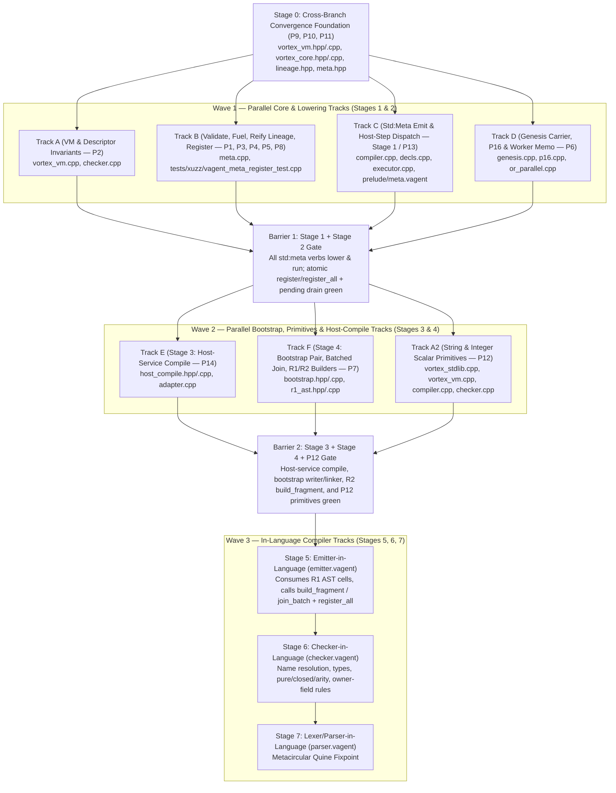

# VAgent Metacircular Compiler — Staged & Parallelizable Implementation Plan

**Companion to:** `design/vagent-metacircular-compiler.md` (architecture & §1–§7, D1–D7, P1–P8),
`design/vagent-metaprogramming.md` (the V10 specification),
`design/vagent-metaprogramming-implementation.md` (Phases 0–7 baseline on `HEAD`), and
`design/vagent-implementation.md` (P15–P21 runtime & epistemic arbitration roadmap).

**Baseline commit:** `9d91bfdc`
(`design: metacircular compiler critique r4-r6 — atomic register surface`).

______________________________________________________________________

## 0. Scope, Thesis, and Execution Contract

The VAgent metacircular compiler replaces the C++23 lowering pipeline (`lexer.cpp` → `parser.cpp` →
`expand.cpp` → `checker.cpp` → `compiler.cpp` → `decls.cpp` → `fragment.cpp`) with an in-language
VAgent/Vortex compiler whose output is a live, validated, kind-registered fragment graph in the
agent's `ArenaManifold`. Because Vortex `>Value` and `>Link` instructions cannot populate the
per-context `VortexVM::opcodeMap_` table (`apps/common/xanadu/vortex/vortex_vm.hpp:269`), the entire
architecture hinges on one narrow trusted primitive — **`register(h: Cell): Opt<Code<Cell>>`** (and
its batch twin **`register_all`**) — backed by `validate`
(`apps/common/xanadu/vagent/meta.cpp:490-623`) and deferred under live marks to the
`outstandingMarks() == 0` post-commit boundary (`apps/common/xanadu/vagent/executor.cpp:3024-3029`).

At the same time, four active branch families diverge across the repository and its sibling
worktrees:

1. **`main` (`9d91bfdc`)** — carries the complete V10 metaprogramming engine directly in
   `apps/common/xanadu/vagent/` (`compiler.cpp`, `decls.cpp`, `fragment.cpp`, `meta.cpp`,
   `executor.cpp`, `adapter.cpp`, `genesis.cpp`, `lineage.cpp`, `p16.cpp`), P15 opcode registration
   (`OpcodeKind::Linked..RunResume`), and `ShadowCommit::Clears`.
1. **`origin/worktree-bridge-cse_01JyeD4AMjEywzundTw7BvJ7` (`46402f26` / `c8844ee3`)** — carries an
   alternate `apps/common/xanadu/vagent/` tree (`agent_executor.cpp`, `program.cpp`,
   `host_bindings.cpp`, `prelude.cpp`, `runtime_abi.hpp`, `wire.cpp`, `reconciler.cpp`), P16
   `OpcodeKind::Point`, and P17 `SharedProgramManifold` + `promoteOverlay`.
1. **`origin/design/vagent-epistemic-arbitration` (`5e5cfe42`) & `feat/promote-followups`
   (`c9654efe`)** — nests `bridge-cse`'s runtime under `apps/common/xanadu/vagent/runtime/` bridged
   via `ast_bridge.{hpp,cpp}`, adds `OpcodeKind::Point..ScopedEvaluate`,
   `VortexCore::rawWingSlotsOf` (`vortex_core.hpp:257`), P19 (`epistemic_translator.cpp` T1a–T1c,
   source health, signed ingress, scoped evaluation), P20 (`native/`), P21 (`cluster/`), and `tui/`.
1. **`feature/vql-completion` (`4143dcc0` in `/data/git/gleditor-restore`)** — appends 29 VQL/VM
   opcodes (`MatchContract..VqlMaskLinks`, including `InvokeFrame`, `ReturnFrame`, `VqlString`,
   `ScopedChoice`, `PushGuard`, `PopGuard`, `BeginMutationGroup`, `EndMutationGroup`) after
   `ChoiceDepth` in `vortex_vm.hpp`.

Landing the metacircular compiler without a strict convergence architecture would cause three-way
conflicts on `OpcodeKind`, `vagent/` translation units, and the P16/P17/P19 promotion and
live-upgrade boundaries. This plan partitions the work into:

- **Stage 0 (Cross-Branch Convergence Foundation):** Unify the `OpcodeKind` enum and content-decode
  ceiling (`P9`), reconcile P16/P17 `SharedProgramManifold` with `LineageStore` and `p16.cpp`
  (`P10`), and wire P19's `ScopedEvaluate` mark/frame guards and T1 live-upgrade translator to
  `MetaRuntime`'s durable carriers (`P11`).
- **Stages 1–7 (The Metacircular Ladder):** Execute the seven stages of
  `design/vagent-metacircular-compiler.md` §4 D1 across decoupled, file-disjoint parallel tracks
  (**Tracks A, A2, B, C, D, E, F**) so multiple engineers or subagents can work concurrently in
  separate worktrees without touching the same translation units.

______________________________________________________________________

## 1. Cross-Branch Conflict Matrix & Convergence Architecture (Stage 0)

### 1.1 Hazard 1: `OpcodeKind` Enum Ordering & Content-Decode Ceiling (`P9`)

On `main` (`apps/common/xanadu/vortex/vortex_vm.hpp:22-72`), `OpcodeKind` ends with:

```cpp
ChoiceDepth, // #CHOICE-DEPTH
Linked,      // #LINKED
Find,        // #FIND
FieldSet,    // >SET
RunCall,     // #RUN
RunResume    // #RESUME
```

Three hardcoded range checks depend on those tail enumerators:

- `VortexVM::getOpcodeKind` (`apps/common/xanadu/vortex/vortex_vm.cpp:190-202`) content-decodes raw
  cell integers only when `val <= static_cast<int64_t>(OpcodeKind::FieldSet)`. `RunCall` and
  `RunResume` are excluded from content-decoding (`vortex_vm.cpp:181-189`) because an unregistered
  content integer forging `#RUN`/`#RESUME` would bypass `validate` and hijack `d.stack`.
- `VortexVM::registerProgramOps` (`vortex_vm.cpp:109-118`) and `MetaRuntime::validate`
  (`apps/common/xanadu/vagent/meta.cpp:94`,
  `linkedCeiling = static_cast<int64_t>(OpcodeKind::RunResume)`) bound valid registered opcodes at
  `OpcodeKind::RunResume`.
- Meanwhile, `bridge-cse` appends `Point` after `ChoiceDepth`; `epistemic-arbitration` appends
  `Point`, `Exp`, `Ln`, `Sqrt`, `ScopedEvaluate`; and `feature/vql-completion` appends 29 VQL
  opcodes (`MatchContract..VqlMaskLinks`).

**Resolution (`P9`):**

1. Partition `OpcodeKind` into two explicit, contiguous bands terminated by `static constexpr`
   markers in `vortex_vm.hpp`:
   - **Band A (Content-Decodable Scalar / Data / Read-Only Query Opcodes,
     `<= kLastContentDecodableOpcode`):** `Nop` through `FieldSet`, plus `Point`, `Exp`, `Ln`,
     `Sqrt`, `P12`'s five pure string/int opcodes (`StrLen`, `ByteAt`, `StrSlice`, `IntToStr`,
     `StrToInt`), and the pure/trailed VQL data and query opcodes from `feature/vql-completion`
     (`MatchContract`, `Navigate`, `Project`, `Filter`, `Join`, `Group`, `Order`, `Limit`,
     `Aggregate`, `Distinct`, `Union`, `Intersect`, `Except`, `Window`, `Coalesce`, `Case`, `Cast`,
     `VqlString`, `VqlConcat`, `VqlRegex`, `VqlMaskLinks`), bounded by
     `kLastContentDecodableOpcode`.
   - **Band B (Registration-Only Control / Frame / Mutation-Boundary Opcodes,
     `> kLastContentDecodableOpcode && <= kLastOpcodeKind`):** `RunCall`, `RunResume`,
     `ScopedEvaluate` (`epistemic-arbitration`), and the VQL control/frame/mutation-group opcodes
     from `feature/vql-completion` (`InvokeFrame`, `ReturnFrame`, `ScopedChoice`, `PushGuard`,
     `PopGuard`, `BeginMutationGroup`, `EndMutationGroup`), bounded by `kLastOpcodeKind`.
1. Replace `val <= static_cast<int64_t>(OpcodeKind::FieldSet)` in `vortex_vm.cpp:192` with a named
   constexpr predicate `isContentDecodableOpcode(std::int64_t raw)` and replace
   `OpcodeKind::RunResume` bounds in `vortex_vm.cpp:110` and `meta.cpp:94` with `kLastOpcodeKind`
   (while keeping `validate`'s `kArity` table in `meta.cpp:102-158` limited to the
   fragment-admissible subset).
1. **Price:** 0 bytes per cell, 0 links, 1 integer comparison in `getOpcodeKind` (unchanged cycle
   cost). Eliminates silent security-boundary drift across all four branches.

### 1.2 Hazard 2: Dual `vagent` Trees (`main` vs `bridge-cse` / `epistemic-arbitration`) (`P10`)

`origin/design/vagent-epistemic-arbitration` placed `bridge-cse`'s runtime in
`apps/common/xanadu/vagent/runtime/` (`agent_executor.cpp`, `compiler.cpp`, `program.cpp`,
`reconciler.cpp`, `epistemic_translator.cpp`) and bridged the frontend via `ast_bridge.{hpp,cpp}`,
while `main` evolved the canonical V10 compiler/executor directly in `apps/common/xanadu/vagent/`
(`compiler.cpp`, `decls.cpp`, `fragment.cpp`, `meta.cpp`, `executor.cpp`, `adapter.cpp`,
`genesis.cpp`, `lineage.cpp`, `p16.cpp`).

**Resolution (`P10`):**

1. **Canonical Engine Root:** `apps/common/xanadu/vagent/` on `main` (`compiler.cpp`, `decls.cpp`,
   `fragment.cpp`, `meta.cpp`, `executor.cpp`, `genesis.cpp`, `lineage.cpp`, `p16.cpp`) is the
   single source of truth for VAgent compilation, metaprogramming, and turn execution.
1. **Retire `ast_bridge.{hpp,cpp}` and `vagent/runtime/compiler.cpp`:** During the
   `epistemic-arbitration` merge, do not keep two compilers. Port P19's epistemic primitives
   (`ScopedEvaluate` host/VM hooks, source-health tracking, signed ingress verification, and T1a–T1c
   `epistemic_translator`) and P20/P21 (`native/`, `cluster/`, `tui/`) onto `main`'s
   `VagentExecutor` (`executor.cpp`) and `MetaRuntime` (`meta.cpp`).
1. **Reconcile P16 (`EngineP16Ceremony` vs `OpcodeKind::Point`) and P17 (`SharedProgramManifold` vs
   `LineageStore`):**
   - On `main`, `MetaRuntime::imageRef` (`meta.cpp:2129-2143`) tests whether a cell is program-side
     via `(arena().base() == nullptr && dense < extent) || (!isEphemeral(cell) && cell <= extent)`.
     Under P17's shared base overlay (`arena().base() == programManifold`), program-side cells are
     persistent base cells (`!zigzag::isEphemeral(cell) && programManifold->contains(cell)`), while
     agent state lives in the overlay (`promoteOverlay` promotes only overlay cells).
   - Update `MetaRuntime::imageRef` (`meta.cpp:2129-2143`) and `EngineP16Ceremony::onFlagged`
     (`p16.cpp:108`) so both per-agent `LineageStore` (where `imageExtent` bounds the prefix band)
     and P17's `SharedProgramManifold` base overlay (`!isEphemeral(cell)`) agree on program-side vs
     session-side residency.
   - Update `EngineP16Ceremony::markedCells` (`p16.cpp:155-184`) to union `d.code`,
     `d.kind-registered` (Stage 2's durable carrier), and `installedCopies_` so runtime-registered
     heads have their `+d.refs` relocation cells re-kinded across P16 checkpoints.

### 1.3 Hazard 3: P19 Scoped Evaluation & T1 Live-Upgrade Translation (`P11`)

On `origin/design/vagent-epistemic-arbitration`:

- `VortexCore::rawWingSlotsOf(CellRef op, bool rightWing)` (`vortex_core.hpp:257`) enumerates raw
  `+d.left`/`+d.right` wing slot cells as `std::vector<CellRef>` without coercing integers or
  following `OpHandle`s. We port this signature directly into `main`'s `vortex_core.{hpp,cpp}`
  (without any `ScopedRefusal` dependency) for Stage 2's `P1` two-hop `validate` repair.
- `VortexVM::ScopedEvaluate` pushes `scopedFrames_` and records `scopedAssignmentTail` on
  `ChoicePoint`. Stage 2's universal deferral rule for `register`
  (`design/vagent-metacircular-compiler.md` §3.2) requires that no untrailed `opcodeMap_` mutation
  occur while any mark or scoped frame is live: the immediate-apply check is
  `arena.outstandingMarks() == 0 && vm.scopedDepth() == 0`.
- P19's T1 live-upgrade ceremony (`epistemic_translator.cpp`) migrates an agent across
  `oldProgramManifold → newProgramManifold`. When merged with `main` + Stage 2, T1 runs
  `genesis.cpp`'s `(b½)`/`(d)`/`(e)` rehydration pass over `d.code`, `d.patch`, and
  `d.kind-registered` against `newProgramManifold` and evicts incompatible patches via `dropPatch`
  (`genesis.cpp:219-228`).

______________________________________________________________________

## 2. Parallel Execution Topology & File-Ownership Matrix

To maximize parallelism across worktrees and subagents, the implementation is decomposed into
**seven file-disjoint tracks (Tracks A, B, C, D in Wave 1; Tracks E, F, A2 in Wave 2)** synchronized
at explicit stage barriers:



### File-Ownership Matrix (Waves 1 & 2 — Zero TU Collisions)

| Wave / Track        | Owner Scope                                                     | Exclusive Files Modified                                                                                                                | Shared Header Seam (Frozen in Stage 0)             |
| ------------------- | --------------------------------------------------------------- | --------------------------------------------------------------------------------------------------------------------------------------- | -------------------------------------------------- |
| **Wave 1 Track A**  | `P2` Descriptor/Param Shadowing & First-Match `RunResume`       | `apps/common/xanadu/vortex/vortex_vm.cpp`, `apps/common/xanadu/vagent/checker.cpp`                                                      | `vortex_vm.hpp`, `checker.hpp`                     |
| **Wave 1 Track B**  | `P1`, `P3`, `P4`, `P5`, `P8` in `MetaRuntime`                   | `apps/common/xanadu/vagent/meta.cpp`, `tests/xuzz/vagent_meta_register_test.cpp`                                                        | `meta.hpp`, `lineage.hpp`                          |
| **Wave 1 Track C**  | Stage 1 (`P13`) `std:meta` Lowering, `runHostStep` & Drain Hook | `apps/common/xanadu/vagent/compiler.cpp`, `decls.cpp`, `executor.cpp`, `prelude/meta.vagent`, `tests/xuzz/vagent_meta_surface_test.cpp` | `compiler.hpp`, `meta.hpp`                         |
| **Wave 1 Track D**  | `P6` Genesis Carrier Sweep, Failure Counter, Worker Memo, `P16` | `apps/common/xanadu/vagent/genesis.cpp`, `p16.cpp`, `apps/common/xanadu/vortex/or_parallel.cpp`                                         | `genesis.hpp`, `or_parallel.hpp`, `meta.hpp`       |
| **Wave 2 Track E**  | Stage 3 (`P14`) Host-Service Compile Boundary                   | `apps/common/xanadu/vagent/host_compile.hpp`, `host_compile.cpp`, `adapter.cpp`                                                         | `meta.hpp` (`runMetaHostStep` hook from Track B/C) |
| **Wave 2 Track F**  | Stage 4 (`P7`) Bootstrap Pair, `join_batch`, R1/R2 Builders     | `apps/common/xanadu/vagent/bootstrap.hpp`, `bootstrap.cpp`, `r1_ast.hpp`, `r1_ast.cpp`                                                  | `meta.hpp` (`runMetaHostStep` hook from Track B/C) |
| **Wave 2 Track A2** | `P12` Scalar String/Char & Int-Conversion Primitives            | `apps/common/xanadu/vortex/vortex_stdlib.cpp`, `vortex_vm.cpp`, `vagent/checker.cpp`, `vagent/compiler.cpp`                             | `vortex_vm.hpp`                                    |

By freezing the header additions to `meta.hpp`, `lineage.hpp`, `genesis.hpp`, and `vortex_vm.hpp` in
the **Stage 0 Header Commit**, Tracks A, B, C, and D in Wave 1 and Tracks E, F, and A2 in Wave 2
compile and test in parallel worktrees with zero TU collisions.

______________________________________________________________________

## 3. Staged Implementation Plan

### Stage 0: Cross-Branch Convergence Foundation & Header Seam (`P9`, `P10`, `P11`)

**Goal:** Land the shared header contracts (`vortex_vm.hpp`, `vortex_core.hpp`, `lineage.hpp`,
`meta.hpp`, `genesis.hpp`) and `OpcodeKind` band partition so Wave 1 tracks can branch cleanly and
`bridge-cse` / `epistemic-arbitration` / `vql-completion` have a deterministic merge target.

1. **`vortex_vm.hpp` & `vortex_vm.cpp` (`P9`, `P12`):**
   - Introduce Band A (`StrLen`, `ByteAt`, `StrSlice`, `IntToStr`, `StrToInt` placed before
     `kLastContentDecodableOpcode = OpcodeKind::FieldSet`) and Band B (`RunCall`, `RunResume`,
     bounded by `kLastOpcodeKind = OpcodeKind::RunResume`).
   - Add `constexpr bool isContentDecodableOpcode(std::int64_t raw) noexcept` and
     `constexpr bool isRegistrableOpcode(std::int64_t raw) noexcept`.
   - Expose `std::size_t VortexVM::scopedDepth() const noexcept` (returns `0` on `main`,
     `scopedFrames_.size()` when `epistemic-arbitration` merges) so `MetaRuntime::registerCode` can
     gate immediate registration on `arena.outstandingMarks() == 0 && vm.scopedDepth() == 0`.
1. **`vortex_core.hpp` & `vortex_core.cpp` (`P11`):**
   - Port `std::vector<CellRef> VortexCore::rawWingSlotsOf(CellRef op, bool rightWing) const` from
     `origin/design/vagent-epistemic-arbitration` (`vortex_core.hpp:257`) so `MetaRuntime::validate`
     can inspect raw wing slot cells directly without `ScopedRefusal`.
1. **`lineage.hpp` (`P4`, `P5`, `P7`):**
   - Extend `kMetaDimensionNames` (`apps/common/xanadu/vagent/lineage.hpp:58-62`) from its existing
     **12** apparatus dimensions to **16** entries by preserving all 12 existing names verbatim and
     appending `"d.lineage"`, `"d.kind-registered"`, `"d.pending-reg"`, and `"d.ast.kinds"`:

     ```cpp
     inline constexpr std::string_view kMetaDimensionNames[] = {
         "d.code",        "d.patch",           "d.weight",          "d.synapse",
         "d.entry",       "d.patch-head",      "d.validate",        "d.refs",
         "d.ref",         "d.recipe",          "d.refFor",          "d.mesh.relocation",
         "d.lineage",     "d.kind-registered", "d.pending-reg",     "d.ast.kinds",
     };
     ```

   - Note: `"d.validate"` remains filed in `kMetaDimensionNames` to preserve store vocabulary
     harmony across existing folds even after `validate()` stops minting per-op tag cells (`P1`).

   - Price: 4 additional dimension cells on `d.dims` per manifold (256 bytes total in the ops
     spool), swept automatically by `sweepDimensionVocabulary` (`genesis.cpp:524-525`).
1. **`meta.hpp` (`P1`–`P5`, `P8`, `P13`):**
   - Add `DimRef lineage{noCell};`, `DimRef kindRegistered{noCell};`, `DimRef pendingReg{noCell};`,
     and `DimRef astKinds{noCell};` to `MetaDimensions`
     (`apps/common/xanadu/vagent/meta.hpp:72-85`).
   - Add `MetaRuntimeLimits` struct (`maxRegisterOps = 512`, `maxPendingRegisters = 64`,
     `maxRegisteredHeads = 256`, `maxReplayFailures = 1`) passed from `VagentExecutor`'s `setting()`
     reader (`executor.cpp:212-222`).
   - Preserve `[[nodiscard]] MetaMutation registerHead(CellRef head) const;` (`meta.hpp:684`) for
     `d.code` rank membership, and declare the new Stage 2 / Stage 4 methods on `MetaRuntime`:
     - `[[nodiscard]] bool kindRegistered(CellRef head) const;`
     - `[[nodiscard]] std::expected<CellRef, std::string> registerCode(CellRef head);`
     - `[[nodiscard]] std::expected<std::vector<CellRef>, std::string>`
       `registerAll(std::span<const CellRef> heads);`
     - `[[nodiscard]] std::string_view registration(CellRef head) const;` (`"absent"` | `"pending"`
       | `"committed"`)
     - `[[nodiscard]] std::optional<CellRef> dimNamed(std::string_view name) const;`
     - `[[nodiscard]] std::optional<CellRef> asBody(CellRef head) const;`
     - `[[nodiscard]] std::optional<CellRef> varOf(CellRef owner, std::string_view key) const;`
     - `[[nodiscard]] std::size_t drainPendingRegisters();`
     - `[[nodiscard]] bool runMetaHostStep(std::string_view verb, CellRef step, CellRef intention);`

**Exit Gate:** `make -j$(nproc) xuzz_test` builds and passes with zero regressions.

______________________________________________________________________

### Stage 1: Lowering & Executor Wiring for the `std:meta` Surface (Track C — `P13`)

**Goal:** Close the lowering/dispatch gap (`design/vagent-metacircular-compiler.md` §3.2, §4 D1
Stage 1): every `std:meta` function declared in `apps/common/xanadu/vagent/prelude/meta.vagent` and
typed in `apps/common/xanadu/vagent/checker.cpp:966-1025` lowers in `compiler.cpp` / `decls.cpp` and
dispatches in `executor.cpp` to `MetaRuntime` without introducing any reverse dependency from
`vortex` to `vagent`.

1. **In-Fragment Expression Lowering (`apps/common/xanadu/vagent/compiler.cpp`):**
   - `VortexVM` remains strictly layer-isolated from `vagent`. Inside a pure scalar fragment,
     `compiler.cpp` lowers the `std:meta` operations that map directly to existing manifold cells or
     native opcodes:
     - `program()` → constant `refCell` holding `Int64(programRoot)`.
     - `agent_cell()` → constant `refCell` holding `Int64(agentCell)`.
     - `head_of(c: Code): Cell` → identity unboxing of the `Code` ref-box slot (`0` extra ops).
     - `make_cell(v: <any>): Cell` → `OpcodeKind::New` + `OpcodeKind::Value` (`[cell, 0, -1, v]`),
       solving the Value-Cell Paradox so VAgent code can box dynamic `Int`, `Float`, `Bool`, or
       `Str` values into fresh arena cells.
1. **Spine Host-Step Lowering & Dispatch (`decls.cpp`, `executor.cpp`, `prelude/meta.vagent`):**
   - Extend `Lowerer::isHostVerb` / `hostVerbOf` / `mintHostStep`
     (`apps/common/xanadu/vagent/decls.cpp:218-276`, `:422-905`) to recognize calls to the
     `std:meta` reflection, validation, mutation, and synthesis verbs in statement or hoisted
     (`let x := <verb>(...)` / `x := <verb>(...)`) position when `std:meta` is imported:
     - **Reflection & validation verbs:** `module_named`, `symbol_named`, `clauses_of`, `test_of`,
       `body_of`, `plan_named`, `code_named`, `label_of`, `weight_of`, `value_of`, `var_of`,
       `validate`, `registration`, `dim_named`, `as_body`, `head_of`, `make_cell`.
     - **Session mutation verbs:** `graft_where`, `graft_body`, `graft_plan`, `graft_handler`,
       `graft_method`, `prune`, `set_weight`, `sprout_synapse`, `next_rand`, `reify`.
     - **Durable & registration verbs:** `learn_where`, `learn_body`, `learn_plan`, `learn_handler`,
       `learn_method`, `unlearn`, `register`, `register_all` (plus Stage 3's `compile_fragment` and
       Stage 4's `join_batch` / `build_fragment` plugged into `MetaRuntime::runMetaHostStep`).
   - Dynamic arguments in `mintHostStep` evaluate into temp cells via sub-fragment heads attached to
     the host-step cell so runtime variables (`Cell`, `Code<T>`, `Str`, `Int`, `[Cell]`) pass into
     `runHostStep` without requiring literal-only arguments.
   - In `VagentExecutor::executeTurn` (`apps/common/xanadu/vagent/executor.cpp`):
     1. Delegate `"meta:*"` host-step verbs in `runHostStep` (`executor.cpp:808-1642`) to
        `meta.runMetaHostStep(verb, step, intention)`.
     1. At post-commit (`executor.cpp:3029`, immediately after `vm.cut(0); arena.discard(m0);` and
        the `arena.outstandingMarks() != 0` check), invoke `(void)meta.drainPendingRegisters();`.
   - Update `apps/common/xanadu/vagent/prelude/meta.vagent` to list the complete Stage 2 / Stage 4
     capacity signatures.

**Exit Gate (Adapter-Level):** `tests/xuzz/vagent_meta_surface_test.cpp` compiles `.vagent` source
programs that invoke every `std:meta` verb through `compileProgram` + `lowerDeclarations` +
`VagentExecutor::executeTurn` and verifies identical outcomes to the kernel-level tests in
`tests/xuzz/vagent_meta_test.cpp`.

______________________________________________________________________

### Stage 2: Atomic `register`, `validate` Repair, Fuel Billing & Lineage (`P1`–`P6`, `P8`)

Stage 2 runs in parallel across **Track A**, **Track B**, and **Track D** (with Track C wiring the
1-line `drainPendingRegisters()` call at `executor.cpp:3029`).

#### Track A: Descriptor/Param Collision Fix (`P2`) & Checker Typing (`P4`)

1. **Reserve Descriptor Channel Keys as Parameter Names (`apps/common/xanadu/vagent/checker.cpp`):**
   - In fragment and declaration parameter checking (`checker.cpp`), refuse any parameter named
     `"result"`, `"produced"`, `"pure"`, `"closed"`, or `"arity"` with a diagnostic citing `P2`
     (preventing a parameter's `d.vars` record on the descriptor from colliding with
     `descriptorField` at `meta.cpp:654-663`).
1. **Make `RunResume` First-Match (`apps/common/xanadu/vortex/vortex_vm.cpp:1119-1134`):**
   - In `OpcodeKind::RunResume` (`vortex_vm.cpp:1121-1133`), stop overwriting `resultVal` and
     `producedCell` after their first match on the `d.vars` rank and `break` once both are found,
     matching `descriptorField`'s first-match semantics (`meta.cpp:658-661`).
   - **Price:** 0 bytes; reduces `d.vars` walk in `#RESUME` from $O(5 + \text{arity})$ to $O(1)$ (2
     hops).
1. **Type Stage 2 & Ergonomic `std:meta` Additions (`checker.cpp:966-1025`, `:1138-1264`):**
   - Add reserved-name checks (gated behind `import std:meta`) and type signatures in
     `checker.cpp:966-1025`:
     - `register(h: Cell): Opt<Code<Cell>>` (impure)
     - `register_all(hs: List<Cell>): Opt<List<Code<Cell>>>` (impure)
     - `registration(h: Cell): Str` (pure)
     - `dim_named(name: Str): Opt<Cell>` (pure)
     - `as_body(c: Code): Opt<Code<()>>` (pure; parameter uses the bare `Code` wildcard
       `Type{"Code", {}}` so any `Code<T>` narrows to `Opt<Code<()>>` after descriptor verification,
       per `design/vagent-metacircular-compiler.md` §3.2 and §4 D7)
     - `head_of(c: Code): Cell` (pure; unboxes any `Code<T>` handle to its underlying `Cell` head so
       authors can pass it to `registration`, `validate`, `label_of`, etc.)
     - `var_of(owner: Cell, key: Str): Opt<Cell>` (pure; reads `owner`'s `d.vars` record for `key`
       so `fault:<label>` tombstones and `$validate_error` diagnostics are inspectable in-language)
     - `make_cell(val: <any>): Cell` (impure special form `MetaForm::MakeCell` in
       `checker.cpp:1138-1163` accepting `Int`, `Float`, `Bool`, `Str`, or `Cell`).

#### Track B: `validate`, Fuel, `registerCode`, `+d.lineage` & `learnGate` (`P1`, `P3`–`P5`, `P8`)

1. **`P1` — Repair `MetaRuntime::validate`
   (`apps/common/xanadu/vagent/meta.cpp:94, 102-158, 490-623`):**
   - **Two-hop control-flow target resolution (`meta.cpp:593-620`):** Use
     `core_.rawWingSlotsOf(op, /*rightWing=*/false)` (`P11`) to inspect raw left-wing slot cells and
     resolve `slotCell → operandCell (via asInt64) → targetOp (via asInt64)` for the emission
     convention (`compiler.cpp:1201-1240`, `:1967-2018`):
     - `Jump`, `Call`, `Choice`: left-wing slot 0 names a ref-box cell whose `asInt64` is the target
       op cell.
     - `Branch`: left-wing slot 1 names a ref-box cell whose `asInt64` is the `onTrue` target op
       cell.
     - `RunCall`: left-wing slot 2 (`compiler.cpp:2017`) names a ref-box cell whose `asInt64` is the
       `failOp` target op cell (while `runCall +d.spin` is `runResume`).
     - `RunResume`: left-wing slot 1 (`compiler.cpp:2009`) names a ref-box cell whose `asInt64` is
       the `failOp` target op cell.
     - Verify every resolved target satisfies `arena.contains(target) && isOpCell(target)` and
       enqueue it into `frontier`.
   - **Refuse unsupported op-bearing regions (`design/vagent-metacircular-compiler.md:333-339`):**
     If any visited op carries `±d.contract` links or if any parameter cell on the head's descriptor
     carries a `+d.spin` pipeline head, refuse in `validate`
     (`"validate: contract or parameter pipeline op-graphs are out of v1 scope"`).
   - **Admit bound-output `New` under `runReachable` (`meta.cpp:566-569`):** Remove the
     unconditional rejection of bound-output `OpcodeKind::New` when `options.runReachable` is true
     (`compiler.cpp` emits 4-in/1-out `New` for `cells"..."` creation steps inside fragment bodies;
     purity is already enforced by `options.expectPure && impure.contains(*ordinal)` at
     `meta.cpp:570-571` because `New` is in `kImpure` at `meta.cpp:173`).
   - **`Linked` 3/4/6-in Arity in `kArity` (`meta.cpp:121`, `:507-522`):** Add
     `{static_cast<std::int64_t>(OpcodeKind::Linked), 3, 1}` and
     `{static_cast<std::int64_t>(OpcodeKind::Linked), 6, 1}` alongside `{..., 4, 1}` in `kArity`
     (`meta.cpp:121`, matching `vortex_vm.cpp:812-875`), and change `arity` in `validate`
     (`meta.cpp:507`) to `std::map<std::int64_t, std::vector<std::pair<std::size_t, std::size_t>>>`
     so an opcode with multiple valid wing signatures matches any of its triples.
   - **Zero-Mint Seen-Set (`meta.cpp:528-554`):** Delete `nextSerial()` and the per-op
     `arena.link(cell, binds_.dims.validate, ...)` tag mints in `validate`; rely solely on the
     in-memory `std::set<CellRef> seen` (`meta.cpp:543`). `validate` becomes strictly read-only (0
     cells minted, 0 links written; saves $O(N_{\text{ops}})$ cell and link allocations per call).
   - **Fix Stale Diagnostic (`meta.cpp:557`):** Report `[0, ceiling]` instead of `[0, Linked]`.
1. **`P3` — Bill `consumeWork` Across `MetaRuntime` Walks (`meta.cpp`):**
   - Bill `core_.arena().consumeWork()` per visited cell in:
     - `validate` (`meta.cpp:490-623`): per visited op cell and wing slot cell, enforcing
       `limits_.maxRegisterOps` (default `512`).
     - `verifyClosed` (`meta.cpp:2700-2823`): per recipe member and `+d.refs` record.
     - `programCells` (`meta.cpp:2156-2175`): cache the `std::set<CellRef>` on `MetaRuntime` keyed
       by `(binds_.programRoot, binds_.lineage ? binds_.lineage->imageExtent : 0)` and bill
       `consumeWork()` per cell on cache build.
     - `reify` (`meta.cpp:1428-1715`): per cloned cell, link tuple, and ref record.
1. **`P5` — Native 2-Degree `+d.lineage` Rank at `reify` (`meta.cpp:1709-1715`):**
   - When `reify(CellRef head)` mints `newHead`:
     - Link `newHead` into `head`'s **`d.lineage`** rank immediately **negward of `head`** so the
       rank order is `twin_k +d.lineage → ... → twin_1 +d.lineage → head` (`head` is always the
       posward terminus of its lineage rank, and each new `reify` splices `newHead` immediately
       before `head` using `arena.linked(head, binds_.dims.lineage, Negward)`):

       ```cpp
       if (const auto prev =
               arena.linked(head, binds_.dims.lineage, Negward)) {
         zigzag::expectWritten(
             arena.link(*prev, binds_.dims.lineage, Posward, newHead));
       }
       zigzag::expectWritten(
           arena.link(newHead, binds_.dims.lineage, Posward, head));
       ```

     - **Why this exact 2-degree rank geometry (`ZIGZAG-2`):**

       1. Every cell on `d.lineage` has at most 1 posward and 1 negward neighbor (strictly 2-degree;
          arbitrary numbers of `reify` calls on the same `head` never evict prior twins).
       1. Walking `+d.lineage` posward from any twin (`zigzag::rankTail(arena, twin, dims.lineage)`)
          reaches the original `source` head (`design/vagent-metacircular-compiler.md:555-557`).
       1. Walking `-d.lineage` negward from `source` enumerates **all-time twins** of `source`!
       1. Because `d.lineage` uses native ZigZag links rather than `Int64` ref-carrier cells,
          `ArenaManifold::promote()` relocates every edge automatically across checkpoints with
          **0** extra cells and **0** P16 ceremony overhead.
1. **`P4` & `P8` — Implement `registerCode`, `registerAll`, `registration`, `dimNamed`, `asBody`,
   `varOf`, and `learnGate` (`meta.cpp`):**
   - **Request-time checks in `registerCode(CellRef head)`
     (`design/vagent-metacircular-compiler.md:282-355`):**
     1. Verify `arena.contains(head)`, `!isOpCell(head)`, `head +d.entry` exists, `head +d.values`
        (descriptor) exists, and `labelOf(head)` is non-empty and does not start with reserved
        prefixes (`"decl:"`, `"patch:"`, `"boot:"`).
     1. **Idempotency (`ZIGZAG-7`):** If `registration(head) == "committed"` (i.e.,
        `kindRegistered(head)` or `imageRef(head)`), return `head` immediately without re-walking or
        re-linking. If `registration(head) == "pending"`, return `head` idempotently.
     1. Check label collision against existing heads on `d.code`, `d.kind-registered`, and
        `d.pending-reg`.
     1. Check `limits_.maxRegisteredHeads` (default `256`) and `limits_.maxPendingRegisters`
        (default `64`).
   - **Immediate Path (`arena.outstandingMarks() == 0 && vm_.scopedDepth() == 0`):**
     - Run fused enumeration + `validate(head, {.runReachable = true})` + `verifyClosed(head)` +
       callee terminus check (every `run`/`call`-role name record on `+d.refs` must resolve to a
       committed head).
     - On failure: write `fault:<label>` on `agentCell +d.vars` and return `std::unexpected`.
     - On success: for every op cell in the enumerated op set, call
       `vm_.setOpcodeKind(op, static_cast<OpcodeKind>(*arena.asInt64(op)))`; call
       `registerHead(head)` (filing `head` on `d.code` if not already present); and append `head` to
       `agentCell +d.kind-registered` (checking `!kindRegistered(head)` first).
   - **Deferred Path (`arena.outstandingMarks() > 0 || vm_.scopedDepth() > 0` — Universal
     Deferral):**
     - Do **not** mutate `vm_.opcodeMap_` and do **not** link `head` onto `d.kind-registered` or
       `d.code` (`WRITER-4`, `ZIGZAG-6`).
     - Mint a trailed request cell `req = arena.makeScalarCell(static_cast<std::int64_t>(head))`
       (with an optional `$batch_id` scalar link when called from `registerAll`) and append `req` to
       `agentCell +d.pending-reg`.
     - If the enclosing choice point or turn rolls back (`failTurn`, `executor.cpp:260-265`), the
       arena trail unwinds `+d.pending-reg` completely.
     - During the pending window, `registration(head)` sees `head` on `+d.pending-reg` and returns
       `"pending"`. If the caller invokes `run(c)` before turn commit, `RunCall` fails closed
       (`produced = false`) and `MetaRuntime::runFragment` sets
       `MetaRunOutcome::detail = "pending_registration"`.
   - **Non-Reentrant Two-Pass Drain (`drainPendingRegisters()`):**
     - Invoked when `arena.outstandingMarks() == 0 && vm_.scopedDepth() == 0` at post-commit
       (`executor.cpp:3029`). Guarded by `bool drainingRegisters_{false}`.
     - Pop all request cells off `agentCell +d.pending-reg`.
     - **Pass 1 (Per-Head & Batch Validation with Fixed-Point Callee Check):**
       - Validate each candidate head $h_i$ (`!isOpCell`, `validate`, `verifyClosed`).
       - Verify that every static `run`/`call`-role referent on $h_i$'s `+d.refs` resolves to a head
         in $\text{committed} \cup \text{surviving\_pending}$. If a callee in the same drain unit
         fails validation, transitively fail its callers in the drain unit
         (`design/vagent-metacircular-compiler.md:382-387`).
       - If any member of a `registerAll` batch (`$batch_id`) fails, fail all members of that batch.
     - **Pass 2 (Commit Survivors & Write Tombstones):**
       - For each surviving head $h_i$: register its enumerated op set via `vm_.setOpcodeKind`,
         append $h_i$ to `agentCell +d.code` (`registerHead`) and `agentCell +d.kind-registered`.
       - For each failed head $h_j$: write `fault:<label>` on `agentCell +d.vars` with the refusal
         reason (`genesis.cpp:219-228` pattern); $h_j$ is never added to `d.kind-registered` or
         `d.code`, so `registration(h_j)` returns `"absent"`.
   - **`learnGate` Hard `validate` Arm (`P8`, `meta.cpp:1887-1900`, `:2189-2204`):**
     - In `learnGate`, run `validate(head, {.runReachable = true, .expectPure = pureRequired})` in
       addition to `headShape` and `learnable`.
     - In `learnCopies` (`meta.cpp:2189-2204`), invoke `registerCode(*installed)` so the installed
       twin's op cells are kind-registered (deferred to post-commit drain under marks, or immediate
       at genesis).

#### Track D: Genesis Carrier Pass, Eviction Policy, Worker Memoization, and P16 (`P6`)

1. **Genesis `(b½)` and `(e)` Unified Sweep (`apps/common/xanadu/vagent/genesis.cpp:529-610`):**
   - In `replayPatch` (`genesis.cpp:257-261`), when `meta.reify(*head)` produces an installed copy,
     register its op cells via `meta.registerCode(*copy)` (`outstandingMarks() == 0` in
     `runGenesis`, so it applies synchronously).
   - In step `(e)` (`genesis.cpp:590-610`), construct `sweep` over the union of `d.code`,
     `d.kind-registered`, and `out.installedCopies` using `std::unordered_set<CellRef> seen`:
     - First rebind `+d.recipe` dim records and `+d.refs` relocation records (`rebindDimRecords`,
       `rebindRefs`).
     - Then, for every head on `d.kind-registered` and `out.installedCopies`, re-derive its op set
       via a single union `seenOps` walk and register each op via `vm.setOpcodeKind` (restore, not
       re-verification of E1-iv, so a faulted callee cannot strand dependent heads across a fold,
       per `design/vagent-metacircular-compiler.md:431-433`).
     - **Eviction after $N$ failed replays:** If a head on `d.kind-registered` has a corrupted op
       graph that fails op enumeration during genesis, increment `$replay_failures` on the head's
       `d.vars`; when `$replay_failures >= N` (default `1`, `vagent.max_register_replay_failures`),
       unlink the head from `d.kind-registered` and write `fault:<label>` on `roots.agentCell`.
1. **P16 Checkpoint Relocation Inventory (`apps/common/xanadu/vagent/p16.cpp:63-70, 155-184`):**
   - Pass `binds.dims.kindRegistered` into `EngineP16Ceremony` and include
     `zigzag::rankAfter(arena_, agentCell_, kindRegistered_)` in `markedCells()` (`p16.cpp:161-165`)
     using the existing `std::unordered_set<CellRef> seen` deduplication.
1. **OR-Parallel Worker Opcode Memoization & Ephemeral Guard
   (`apps/common/xanadu/vortex/or_parallel.cpp:351-359`):**
   - Build a per-incarnation memoized vector `std::vector<std::pair<CellRef, OpcodeKind>>`
     containing all **persistent (`!zigzag::isEphemeral(op)`)** opcodes from `imageRecord` and
     `d.kind-registered` (`ARCHITECT-5`).
   - Inside `bindProgramOpcodes(workerCore, workerVm)`:
     - Bind the persistent opcode vector in $O(N_{\text{ops}})$ flat loop.
     - For `ShadowDeltaPrefix` sparks where `spark.prefixSnapshot` hydrated ephemeral cells into
       `workerArena`, bind any session-registered ephemeral opcodes only after checking
       `workerCore.arena().contains(op)`.

______________________________________________________________________

### Stage 3: Host-Service Compile Boundary (Wave 2 Track E — `P14`)

**Goal:** Expose the C++23 frontend (`parseProgram` → `expandProgram` → `checkProgram` →
`compileFragment`) as a host-service boundary (`design/vagent-metacircular-compiler.md` §4 D1 Stage
3\) with the **exact input/output contract** that the in-language compiler (Stages 5–7) will
implement, following the VProlog `consult`/`assert` precedent (never `eval(string)`).

1. **Interface Contract (`apps/common/xanadu/vagent/host_compile.hpp` & `.cpp`):**
   - Exposed in `std:meta` (`prelude/meta.vagent`, `checker.cpp`) as:
     `compile_fragment(label: Str, params: Cell, result_type: Str, src: Cell): Opt<Code<Cell>>`
     (impure; plugs into `MetaRuntime::runMetaHostStep` so `executor.cpp` requires no Wave 2 edits).

   - **Inputs:**

     - `label`: head label string (must not start with `"decl:"`, `"patch:"`, `"boot:"`).
     - `params`: a cell whose `+d.grab` → `+d.step` chain holds parameter cells (`text` = parameter
       name, `+d.values` → type-name cell).
     - `result_type`: result type string (e.g., `"Int"`, `"Str"`, `"()"`).
     - `src`: cell whose text content is the fragment body expression source.

   - **Execution & Fuel Billing:**

     - Bills `core.arena().consumeWork()` per byte of `src` and per AST/emitted cell.
     - Runs `parseProgram` → `expandProgram` → `checkProgram` → `compileFragment` into the agent's
       live `ArenaManifold` (respecting `D6` — single arena, no secondary arena).
     - Invokes `meta.registerCode(object->head)` and returns `Opt<Code<Cell>>`. On parse/check
       failure, writes the diagnostic to `var_of(agent_cell(), "fault:" + label)` and returns
       `Opt::none`.

   - **Using `compile_fragment` with `learn_body` / `graft_body` (`D7`):** Because
     `compile_fragment` returns `Opt<Code<Cell>>` and `learn_body`/`graft_body` require `Code<()>`,
     callers narrow via `as_body`:

     ```vagent
     let raw := compile_fragment("custom:plan1", params_cell, "()", src_cell)
     if raw? {
       let body := as_body(raw)
       if body? {
         learn_body(clause_cell, body)
       }
     }
     ```

**Exit Gate:** A `.vagent` agent synthesizes a new plan body at runtime from a source cell via
`compile_fragment`, commits the turn (draining `d.pending-reg` to `d.kind-registered` and `d.code`),
and in turn $T+1$ narrows with `as_body`, installs via `learn_body`, and executes the plan.

______________________________________________________________________

### Stage 4: Bootstrap Pair, `join_batch`, R1 AST & R2 Builder (Wave 2 Tracks F & A2 — `P7`, `P12`)

**Goal:** Break the circularity where emitting an op requires `>Value` and `>Link` ops by minting
the image-side bootstrap fragment pair (`boot:writer` and `boot:linker`), adding the 2-degree-safe
batched join verb (`join_batch`) and R2 fragment builder (`build_fragment`), locking down the
2-degree R1 AST cell schema, and landing Track A2's string/integer primitives (`P12`).

1. **Bootstrap `boot:writer` and `boot:linker` (`apps/common/xanadu/vagent/bootstrap.hpp` & `.cpp`,
   `CODEBASE-3`):**
   - Minted at image-lowering time into the program image with full head, descriptor, `+d.refs`, and
     `+d.recipe` apparatus via `emitWrapped` (`compiler.cpp:1888-1895`) so both graphs wrap in a
     `Choice` mark, run the reverse-order `Resolve` prologue, publish `result`/`produced`, and
     **tail `OpcodeKind::Return`** (`meta.cpp:587-591`):
     - **`boot:writer(target: Cell, source: Cell): Cell`**
       - Descriptor: `arity = 2`, `pure = 0`, `closed = 1`, `result = "Cell"`, params
         `("target", "Cell")`, `("source", "Cell")`.
       - Body: `OpcodeKind::Value` (`vortex_vm.cpp:1200-1228`, `compiler.cpp:1211-1223`,
         `meta.cpp:123`) with **4 left-wing inputs**
         `[targetSlot, zeroCell(0), minusOneCell(-1), sourceSlot]` and **1 right-wing output**
         `[outSlot]`, followed by `copy(result, outSlot)` and `Return`.
     - **`boot:linker(from: Cell, dim: Cell, dir: Int, to: Cell): Cell`**
       - Descriptor: `arity = 4`, `pure = 0`, `closed = 1`, `result = "Cell"`, params
         `("from", "Cell")`, `("dim", "Cell")`, `("dir", "Int")`, `("to", "Cell")`.
       - Body: `OpcodeKind::Link` (`vortex_vm.cpp:774-796`, `meta.cpp:119`) with **4 left-wing
         inputs** `[fromSlot, dimSlot, dirSlot, toSlot]` and **1 right-wing output** `[outSlot]`,
         followed by `copy(result, outSlot)` and `Return`.
   - **Visibility:** `MetaRuntime::codeNamed` (`meta.cpp:415-425`) refuses labels starting with
     `"boot:"`; they are accessed via `boot_writer(): Code<Cell>` and `boot_linker(): Code<Cell>`
     under `import std:meta`.
1. **2-Degree-Safe Batched Join Host Verb (`join_batch(batch: Cell): Bool` — `P7`, `ZIGZAG-1`):**
   - Gated behind `import std:meta` and dispatched via `MetaRuntime::runMetaHostStep`.
   - **Why direct `tuple +d.grab → endpoint` links are refused (`ZIGZAG-1`):** In a 2-degree ZigZag
     manifold (`arena_manifold.cpp:1369-1373`), linking `tuple1 +d.grab → X` sets
     `X -d.grab → tuple1`. A second tuple in the same batch linking `tuple2 +d.grab → X` silently
     overwrites `X -d.grab` and breaks `tuple1 +d.grab`!
   - **2-Degree-Safe Tuple Schema:** `batch` chains operation tuples on `batch +d.grab` (first
     tuple) → `+d.step` (subsequent tuples). Each `tuple` links its own private argument cells on
     `tuple +d.grab` (first arg cell) → `+d.step` (subsequent arg cells), where each arg cell holds
     its `CellRef` or scalar operand in its own cell content (minted via `make_cell` or
     `cells"..."`, matching `fragment.cpp:353-369` and `#LINKED`'s ref-box list at
     `vortex_vm.cpp:864-868`):
     - **Write tuple (`tuple` text == `"write"`):** 2 arg cells on `+d.grab` → `+d.step`:
       `[targetRefBox, valueCell]`. Calls `core.writeValue(target, 0, std::nullopt, value)`
       (refusing if `imageRef(target)` or `vm.hasOpcodeKind(target)`) and bills `consumeWork()`.
     - **Link tuple (`tuple` text == `"link"`):** 4 arg cells on `+d.grab` → `+d.step`:
       `[fromRefBox, dimRefBox, dirIntCell, toRefBox]`. Calls `arena.link(from, dim, dir < 0, to)`
       (refusing if `imageRef(from)` or `imageRef(to)`) and bills `consumeWork()`.
   - Because every arg cell is freshly owned by its tuple, a single target cell `X` can appear in
     100 tuples in one `join_batch` call with **zero** fan-in link eviction on `X`.
1. **2-Degree-Safe R1 Cells-Encoded AST Schema (`apps/common/xanadu/vagent/r1_ast.hpp` & `.cpp` —
   `ZIGZAG-3`, `ZIGZAG-4`, `ZIGZAG-8`, `ERGO-6`, `VORTEX-5`):**
   - The canonical kind vocabulary is filed as data on `programRoot +d.ast.kinds` (chained on
     `+d.ast.kinds`): `"lit.int"`, `"lit.float"`, `"lit.bool"`, `"lit.str"`, `"lit.unit"`,
     `"ident"`, `"unary"`, `"binary"`, `"call"`, `"field"`, `"let"`, `"assign"`, `"if"`, `"block"`,
     `"list"`, `"cells"`, `"believes"`, `"code"`. (Note: `while` and `clause_count` are omitted per
     `VORTEX-5` as neither exists in VAgent's AST).
   - **Per-Node Layout (Zero Shared-Target Fan-In):**
     - **Kind tag:** Stored as the AST node cell's own string content (e.g.,
       `arena.makeCell("binary")`), never as a `+d.verb` link to the shared vocabulary rank
       (`ZIGZAG-3`).
     - **Token / operator / identifier text:** Linked on `node +d.name → arena.makeCell(tokenText)`.
     - **Children (`ZIGZAG-4`, `WRITER-10`):** Parent links posward on **`+d.grab`** to its first
       child (`node +d.grab → child_0`), and sibling children chain posward on **`+d.step`**
       (`child_0 +d.step → child_1 +d.step → ...`). Because `+d.grab` is parent→first-child and
       `+d.step` is sibling→sibling, an interior AST node is both a child on its siblings' `d.step`
       rank and a parent on its own `d.grab` link with zero dimension collision!
     - **Type annotation (populated by Stage 6, `ZIGZAG-8`):** Linked on
       `node +d.values → arena.makeCell(typeString)` using a freshly minted cell per node.
     - **Source coordinates (`ERGO-6`):** Optional `"line"` and `"col"` `d.vars` records on `node`.
   - Provide `marshalAstToR1(ArenaManifold &, VortexCore &, const Expr &)` in `r1_ast.cpp` so Stage
     5 and Stage 6 can be tested immediately against C++-parsed ASTs before Stage 7 lands.
1. **In-Language R2 Builder Surface (`build_fragment(spec: Cell): Opt<Cell>` — `ERGO-2`):**
   - Exposed under `import std:meta` and implemented by
     `MetaRuntime::buildFragmentFromSpec(CellRef spec)` (shared with U-M9 `specialize` and U-M2 wire
     receive).
   - Given a `spec` cell holding:
     - `spec` text = head label (`"src:<n>"`).
     - `spec +d.vars` records: `"entry"` (`Int64(entryOp)`), `"result_slot"` (`Int64(resultCell)`),
       `"produced_slot"` (`Int64(producedCell)`), `"result_type"` (`Str`), `"pure"` (`Int64`),
       `"closed"` (`Int64`).
     - `spec +d.grab` → `+d.step` = parameter cells (`text` = param name, `+d.values` → param type
       text cell).
     - `spec +d.refs` → `+d.step` = covered body cells (`Int64(cellRef)`), with optional `+d.name`
       (symbol/dim name) and `+d.grab` (role `"call"` / `"run"` / `"dim"` / `"capture"`).
   - `build_fragment(spec)` mints the head cell, the descriptor on `head +d.values` (with
     `"result"`, `"produced"`, `"pure"`, `"closed"`, `"arity"` in exact `fragment.cpp:291-302`
     order), the parameter chain on `descriptor +d.grab` → `+d.step`, and the complete `+d.recipe`
     and `+d.refs` chains (including `d.mesh.relocation → "cell"` markers on every ref-record cell)
     in one host step, returning `Opt<Cell>` (`some(head)`).
1. **Track A2 — String, Character, and Integer Scalar Primitives (`P12` — `VORTEX-3`, `VORTEX-4`,
   `ARCHITECT-2`):**
   - Landed in Wave 2 so Stage 5 (`emitter.vagent`) has `int_to_str` for `cap$N` and serial labels:
     - Add five Band A `OpcodeKind` enumerators in `vortex_vm.hpp`, `kArity` (`meta.cpp:137-140`),
       `executeOpcodeBody` (`vortex_vm.cpp`), `checker.cpp`, and `compiler.cpp`:
       1. `StrLen` — `str_len(s: Str): Int` (1-in, 1-out).
       1. `ByteAt` — `byte_at(s: Str, idx: Int): Opt<Int>` (2-in, 1-out; returns `Opt::none` when
          `idx < 0 || idx >= s.size()`, zero sentinels per Standing Rule 3).
       1. `StrSlice` — `str_slice(s: Str, start: Int, end: Int): Str` (3-in, 1-out; clamped byte
          slice).
       1. `IntToStr` — `int_to_str(n: Int): Str` (1-in, 1-out).
       1. `StrToInt` — `str_to_int(s: Str): Opt<Int>` (1-in, 1-out; returns `Opt::none` on invalid
          integer text).

**Exit Gate (Barrier 2):**

1. A VAgent program using `boot_writer()` and `boot_linker()` (and equivalently `join_batch` +
   `build_fragment`) synthesizes a 3-op arithmetic fragment, calls `register(h)`, commits, and runs
   it via `let res := value_of(run(c, [args]))`.
1. `marshalAstToR1` round-trips every `ExprKind` in the lowering corpus into 2-degree-clean R1
   cells.
1. All five `P12` scalar primitives pass unit tests in `vagent_compiler_test.cpp` and `validate`.

______________________________________________________________________

### Stage 5: Emitter-in-Language (Wave 3 — `apps/common/xanadu/vagent/stdlib/emitter.vagent`)

**Goal:** Write the fragment emitter in VAgent (`emitter.vagent`), consuming R1 type-annotated AST
cells and emitting a fragment graph via `join_batch` + `build_fragment` + `register_all` that
satisfies every invariant of `compiler.cpp` and `fragment.cpp`
(`design/vagent-metacircular-compiler.md` §3.3, §4 D1 Stage 5, D5).

1. **Exact Emission Contract Reproduced in VAgent (via Recursive AST Walk):**
   - **Wrapper & Prologue (`compiler.cpp:1880-1902`):** Wrap the body in a `Choice` mark (with
     `Fail` alt target), emit `Resolve` ops in **reverse parameter order**
     (`i = paramCount; i-- > 0;`), and tail `OpcodeKind::Return`.
   - **Body DAG (`compiler.cpp:1195-1879`):**
     - Literals (`lit.int`, `lit.float`, `lit.bool`, `lit.str`, `lit.unit`): mint scalar/text cell
       via `make_cell` and copy into target slot via 4-in `OpcodeKind::Value`.
     - Binary/Unary/String ops: emit 2-in/1-out, 1-in/1-out, or 3-in/1-out op cells with two-hop
       `Jump` continuations (`slot → refBox(Int64(targetOp))`).
     - Conditionals (`if`, short-circuit `&&`/`||`): emit `Branch` (`[condSlot, refBox(onTrueOp)]`,
       `+d.spin → Jump(onFalseOp)`).
     - Owner fields (`$owner`): when the enclosing declaration has owner fields and an `ident` or
       `assign` matches an owner field, emit `#FIND($ownerSlot, fieldNameCell)` or
       `>SET($ownerSlot, fieldNameCell, valSlot)`.
     - Scope & Exclusions (`D5`, `design/vagent-metacircular-compiler.md:609-617`): v1 emits scalar
       fragment bodies; nested `code"..."`, `static`, member `def` calls, and nested `run` inside
       runtime-compiled bodies return `Opt::none` with a diagnostic record on `$compile_error`.
   - **Apparatus & Registration:**
     - Assemble the `spec` cell and call `build_fragment(spec)` to mint the head, descriptor,
       parameter chain, `+d.recipe`, and `+d.refs` chains, then call `register(head)` (or
       `register_all` for multi-head batches).
1. **Self-Application Equivalence Gate:**
   - Run `emitter.vagent` on the R1 ASTs of:
     1. `boot:writer` and `boot:linker` (verifying graph isomorphism modulo cell indices and serial
        labels against Stage 4's C++-minted bootstrap pair).
     1. The scalar fragment corpus in `tests/xuzz/vagent_compiler_test.cpp`.
   - Every emitted head must pass `validate(h)`, commit through `register(h)`, survive a P16
     checkpoint + `runGenesis` round-trip, and produce identical results under `run(c, args)`.

______________________________________________________________________

### Stage 6: Checker-in-Language (Wave 3 — `apps/common/xanadu/vagent/stdlib/checker.vagent`)

**Goal:** Implement the static checker in VAgent over R1 AST cells
(`design/vagent-metacircular-compiler.md` §3.3, §4 D1 Stage 6), reproducing
`apps/common/xanadu/vagent/checker.cpp`'s typing, purity, closure, and reserved-name invariants so
untyped R1 ASTs are validated and annotated entirely in-language before Stage 5 emits them.

1. **In-Language Checker Passes (Recursive over `+d.grab` / `+d.step` R1 Tree):**
   - **Pass 1 (Symbol & Parameter Scope Resolution):**
     - Reject reserved parameter names (`"result"`, `"produced"`, `"pure"`, `"closed"`, `"arity"` —
       `P2`).
     - Reject unimported reserved `std:meta` identifiers (`reify`, `validate`, `register`,
       `register_all`, `registration`, `dim_named`, `as_body`, `head_of`, `var_of`, `make_cell`,
       `join_batch`, `build_fragment`, `compile_fragment`).
     - Resolve local `let` bindings, parameter bindings, and owner fields.
   - **Pass 2 (Bidirectional Type Inference & Per-Node Annotation):**
     - Mint a fresh type-name cell (`"Int"`, `"Float"`, `"Bool"`, `"Str"`, `"Cell"`, `"()"`,
       `"Opt<...>"`, `"List<...>"`, `"Code<...>"`) on each R1 AST node's `+d.values` link
       (`ZIGZAG-8`).
     - Enforce condition-position rules (`where`, `holds when`, `succeed when`, `drop when` forbid
       bare `Bool` literals unless comparison/predicate).
   - **Pass 3 (`pure`, `closed`, `arity`, and Capture Synthesis):**
     - Compute `pure` (`0` if `>SET`, mutating `cells"..."`, or impure callee appears; `1`
       otherwise).
     - Compute `closed` (`1` if no free outer variables; if captures exist, synthesize `cap$N` using
       `int_to_str` and `+d.clone` capture slots).

**Exit Gate:** Run the in-language Stage 6 + Stage 5 pipeline on positive and negative test cases
from `tests/xuzz/vagent_checker_test.cpp`, confirming identical accept/refuse decisions and
identical descriptor metadata (`pure`, `closed`, `arity`, `result`) to C++ `checker.cpp`.

______________________________________________________________________

### Stage 7: Lexer/Parser-in-Language & Metacircular Quine (`stdlib/parser.vagent`)

**Goal:** Complete the self-hosting loop by implementing the VAgent lexer and
Pratt/recursive-descent parser in VAgent using `P12`'s string/byte primitives and passing the
**metacircular quine fixpoint test** (`design/vagent-metacircular-compiler.md` §3.3, §4 D1 Stage 7).

1. **In-Language Lexer & Parser (`parser.vagent`):**
   - Define pure VAgent character-classification helpers (`is_space`, `is_digit`, `is_alpha`) over
     `byte_at(s, idx)` (`ERGO-7`, leveraging `P12` without adding redundant C++ opcodes per
     `GEMINI.md`).
   - Tokenize VAgent source strings using `str_len`, `byte_at`, `str_slice`, and `str_to_int`.
   - Construct 2-degree R1 AST cells (`+d.grab` first child, `+d.step` sibling chain, `+d.name`
     token text) and pass the root R1 AST cell to Stage 6 (`checker.vagent`) → Stage 5
     (`emitter.vagent`) → `register_all`.
   - **Arena Discipline (`D6`):** Because R1 AST cells and intermediate builder cells are arena
     allocations that `compact()` does not reclaim until the next checkpoint `promote()`
     reachability sweep (`design/vagent-metacircular-compiler.md:625-629`), size the compile turn's
     `maxCells` grant explicitly for self-compilation (~40–60 cells per AST + emitted op).
1. **Terminal Gate — The Metacircular Quine Fixpoint Test
   (`tests/xuzz/vagent_metacircular_quine_test.cpp`):**
   - Let $S_{\text{comp}}$ be the VAgent source of the Stage 7 + Stage 6 + Stage 5 compiler
     pipeline.
   - **Step 1 (Bootstrap Compile):** Compile $S_{\text{comp}}$ via the C++ Stage 3 pipeline to
     produce compiler image $I_1$ (a rank of registered heads on `d.code` and `d.kind-registered`).
   - **Step 2 (Self-Compile 1):** Run $I_1$ on the source cell holding $S_{\text{comp}}$ to produce
     and `register_all` a second compiler image $I_2$ in the arena (draining at turn commit).
   - **Step 3 (Self-Compile 2):** In the next turn, run $I_2$ on $S_{\text{comp}}$ to produce $I_3$.
   - **Fixpoint Assertion:** Verify that $I_2$ and $I_3$ are **graph-isomorphic modulo serial-keyed
     labels** (`design/vagent-metacircular-compiler.md:515-518`: identical op counts, identical
     `OpcodeKind` sequences on `+d.recipe`, identical wing topologies, identical descriptor records,
     and identical `+d.refs` relocation chains modulo base cell offsets and serial suffixes) and
     that every head in $I_2$ and $I_3$ reports `registration(h) == "committed"`.

______________________________________________________________________

## 4. Careful Merge Execution Protocol Across Active Branches

To merge this implementation with `origin/worktree-bridge-cse_01JyeD4AMjEywzundTw7BvJ7`,
`origin/design/vagent-epistemic-arbitration`, `feat/promote-followups`, and `feature/vql-completion`
without breaking any branch's test suite:

1. **Step M1 — Land Stage 0 (`P9`–`P11`) on `main` First:**
   - Commit the `OpcodeKind` Band A / Band B split (`isContentDecodableOpcode`, `kLastOpcodeKind`)
     and `VortexCore::rawWingSlotsOf` on `main`.
1. **Step M2 — Rebase `feature/vql-completion` onto Stage 0:**
   - Place the 21 pure/data VQL opcodes into Band A (before `kLastContentDecodableOpcode`) and the 8
     control/frame/mutation-group VQL opcodes (`InvokeFrame`, `ReturnFrame`, `ScopedChoice`,
     `PushGuard`, `PopGuard`, `BeginMutationGroup`, `EndMutationGroup`) into Band B (`ARCHITECT-4`).
     Because `vortex_vm.cpp:192` and `meta.cpp:94` use the band predicates instead of hardcoded
     `OpcodeKind::FieldSet` / `OpcodeKind::RunResume`, all VQL tests and all VAgent metaprogramming
     tests pass together immediately.
1. **Step M3 — Converge `bridge-cse` & `epistemic-arbitration` onto `main` + Stage 2:**
   - Place `OpcodeKind::Point`, `Exp`, `Ln`, `Sqrt` in Band A and `OpcodeKind::ScopedEvaluate` in
     Band B.
   - Wire `VortexVM::scopedDepth()` to `scopedFrames_.size()` so `MetaRuntime::registerCode`
     automatically defers registration inside `ScopedEvaluate` frames.
   - Port `epistemic-arbitration`'s `epistemic_translator.cpp` (T1a–T1c), `native/`, `cluster/`, and
     `tui/` onto `main`'s `apps/common/xanadu/vagent/` headers, retiring `vagent/runtime/`'s
     duplicate compiler and `ast_bridge.{hpp,cpp}`.
   - Extend T1 live-upgrade (`epistemic_translator.cpp`) to invoke `genesis.cpp`'s `(b½)` and `(e)`
     rehydration sweep over `d.kind-registered` so runtime-compiled metacircular heads survive live
     agent upgrades alongside `d.code` and `d.patch`.
1. **Step M4 — Regenerate Sample Fixtures if `CompactOpNode` or System Stores Change:**
   - None of `P1`–`P14` alter `sizeof(CompactOpNode)` (64 bytes, `compact_op.hpp`). If any branch
     merge alters `system://` store layouts, run `./tools/create-sample-xanadocs.sh` and
     `./tools/create-floating-image-sample.sh` per `AGENTS.md`.

______________________________________________________________________

## 5. Proposal Register (`P1`–`P14`)

Every change to existing C++23 code is registered and priced below:

| ID      | Target Files (`file:line`)                                                                                                   | Summary of Change                                                                                                                                                                                                                                                                                         | Cost (Bytes / Links / Cycles) & Refused Alternative                                                                                                        |
| ------- | ---------------------------------------------------------------------------------------------------------------------------- | --------------------------------------------------------------------------------------------------------------------------------------------------------------------------------------------------------------------------------------------------------------------------------------------------------- | ---------------------------------------------------------------------------------------------------------------------------------------------------------- |
| **P1**  | `apps/common/xanadu/vagent/meta.cpp:94, 102-158, 490-623`; `design/vagent-metaprogramming.md:535-557`                        | Two-hop target resolution in `validate` (`Jump`/`Call`/`Choice` slot 0, `Branch` slot 1, `RunCall` slot 2 `failOp`, `RunResume` slot 1 `failOp`); admit bound-output `New` under `runReachable`; 3/4/6-in `Linked` in `kArity`; refuse contract/param-pipeline op graphs; delete `d.validate` cell mints. | **Saves** $O(N_{\text{ops}})$ cell + link mints per `validate` call (now 0 mints, read-only). Refused: 1-hop `inputsOf` (misreads emitted code).           |
| **P2**  | `apps/common/xanadu/vortex/vortex_vm.cpp:1119-1134`; `apps/common/xanadu/vagent/checker.cpp`                                 | Reserve `"result"`, `"produced"`, `"pure"`, `"closed"`, `"arity"` as parameter names in `checker.cpp`; make `RunResume` stop at first match on `d.vars`.                                                                                                                                                  | 0 bytes, fewer rank hops in `RunResume`. Refused: separate dimension per descriptor channel (adds 5 dims).                                                 |
| **P3**  | `apps/common/xanadu/vagent/meta.cpp:490-623, 1428-1715, 2156-2175, 2700-2823`                                                | Bill `core_.arena().consumeWork()` per visited cell in `validate`, `verifyClosed`, `programCells` (cached per incarnation), and `reify`; plumb `MetaRuntimeLimits`.                                                                                                                                       | 1 integer add/cmp per visited cell; `programCells` drops from $O(E_{\text{image}})$ per call to $O(1)$ amortized.                                          |
| **P4**  | `apps/common/xanadu/vagent/meta.hpp:72-85, 684`, `meta.cpp`, `checker.cpp:966-1025, 1138-1264`                               | Add `register` (`registerCode`), `register_all` (`registerAll`), `registration`, `dim_named`, `as_body`, `head_of`, `var_of`, `make_cell`; trailed `d.pending-reg` rank; non-reentrant two-pass drain at `marks == 0`; `d.kind-registered` + `d.code` commit; `fault:<label>` tombstones.                 | 1 link on `d.kind-registered` + 1 link on `d.code` per committed head; 0 untrailed mutations under live marks. Refused: mutating `opcodeMap_` under marks. |
| **P5**  | `apps/common/xanadu/vagent/lineage.hpp:58-62`, `meta.cpp:1709-1715`                                                          | Extend 12-entry `kMetaDimensionNames` to 16 entries (`"d.lineage"`, `"d.kind-registered"`, `"d.pending-reg"`, `"d.ast.kinds"`); splice `newHead` negward of `sourceHead` on `d.lineage` in `reify`.                                                                                                       | 4 dim cells per manifold; 1 native 2-degree link per `reify` (0 carrier cells, 0 P16 overhead). Refused: fan-in link or `Int64` carrier cell.              |
| **P6**  | `apps/common/xanadu/vagent/genesis.cpp:257-261, 590-610`, `p16.cpp:155-184`, `vortex/or_parallel.cpp:351-359`                | Replay `d.kind-registered` and `installedCopies` in `runGenesis` `(e)` with union seen-set and `$replay_failures` eviction cap; include `d.kind-registered` in `p16.cpp`; memoize persistent op vector for `bindProgramOpcodes`.                                                                          | $O(N_{\text{registered}})$ once at genesis/checkpoint; $O(N_{\text{ops}})$ flat vector bind per OR-parallel worker spark.                                  |
| **P7**  | `apps/common/xanadu/vagent/bootstrap.hpp/.cpp`, `r1_ast.hpp/.cpp`, `meta.cpp`                                                | Image-side `boot:writer` (4-in `Value` + `Return`) and `boot:linker` (4-in `Link` + `Return`) pair + 2-degree-safe `join_batch` + R2 `build_fragment` + R1 AST marshaler.                                                                                                                                 | 2 small fragments (~14 cells each) per image; `join_batch` + `build_fragment` cut $K$-op fragment assembly to 2 host steps.                                |
| **P8**  | `apps/common/xanadu/vagent/meta.cpp:1887-1900, 2189-2204`                                                                    | Add `validate(head)` to `learnGate` alongside `verifyClosed(head)`; route `learnCopies`'s `reify` twin through `registerCode`.                                                                                                                                                                            | 1 `validate` pass per `learn_*` call (read-only after `P1`). Closes unvalidated `learn_*` gap.                                                             |
| **P9**  | `apps/common/xanadu/vortex/vortex_vm.hpp:22-72`, `vortex_vm.cpp:109-118, 190-202`, `meta.cpp:94`                             | Partition `OpcodeKind` into Band A (`isContentDecodableOpcode`) and Band B (`kLastOpcodeKind`); expose `VortexVM::scopedDepth()`.                                                                                                                                                                         | 0 bytes, 0 extra cycles. Prevents silent content-decode privilege escalation when merging `bridge-cse`, `epistemic-arbitration`, and `vql-completion`.     |
| **P10** | `apps/common/xanadu/vagent/meta.cpp:2129-2143`, `p16.cpp:108`                                                                | Unify `MetaRuntime::imageRef` across per-agent `LineageStore` (`cell <= imageExtent`) and P17 `SharedProgramManifold` (`arena().base() != nullptr && !isEphemeral(cell)`); retire `ast_bridge`.                                                                                                           | 1 pointer + bit check in `imageRef`. Enables clean merge of P17 shared base manifold with V10 `MetaRuntime`.                                               |
| **P11** | `apps/common/xanadu/vortex/vortex_core.hpp/.cpp`                                                                             | Port `VortexCore::rawWingSlotsOf(CellRef op, bool rightWing) const -> std::vector<CellRef>` from `origin/design/vagent-epistemic-arbitration` (`vortex_core.hpp:257`).                                                                                                                                    | ~25 LoC helper in `vortex_core.cpp`, 0 bytes overhead. Eliminates duplicate wing-slot walkers between `validate` and `ScopedEvaluate`.                     |
| **P12** | `apps/common/xanadu/vortex/vortex_vm.hpp/.cpp`, `vortex_stdlib.cpp`, `vagent/checker.cpp`, `vagent/compiler.cpp`             | Add five Band A scalar opcodes (`StrLen`, `ByteAt` returning `Opt<Int>`, `StrSlice`, `IntToStr`, `StrToInt` returning `Opt<Int>`) in Wave 2 before Stage 5.                                                                                                                                               | 5 Band A enum values, ~75 LoC in `vortex_vm.cpp`. Refused: `-1` sentinel in `byte_at` or exploding strings into 1 cell per char ($64\times$ memory cost).  |
| **P13** | `apps/common/xanadu/vagent/compiler.cpp`, `decls.cpp:218-276, 422-905`, `executor.cpp:808-1642, 3029`, `prelude/meta.vagent` | Stage 1 lowering and `VagentExecutor::runHostStep` → `MetaRuntime::runMetaHostStep` dispatch for all `std:meta` verbs + post-commit `drainPendingRegisters()` call at `:3029`.                                                                                                                            | 1 host-step dispatch table on `MetaRuntime`; keeps `VortexVM` 100% independent of `vagent` and isolates `executor.cpp` to Track C.                         |
| **P14** | `apps/common/xanadu/vagent/host_compile.hpp/.cpp`, `adapter.cpp`                                                             | Stage 3 host-service compilation boundary (`compile_fragment`) driving C++ frontend into the live arena and registering via `MetaRuntime::registerCode`.                                                                                                                                                  | ~120 LoC in `host_compile.cpp`; bills `consumeWork()` per source byte and emitted cell; drop-in compatible with Stages 5–7.                                |
