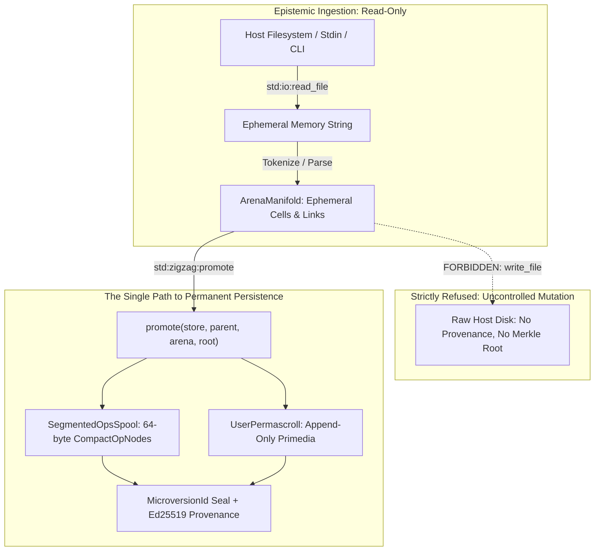
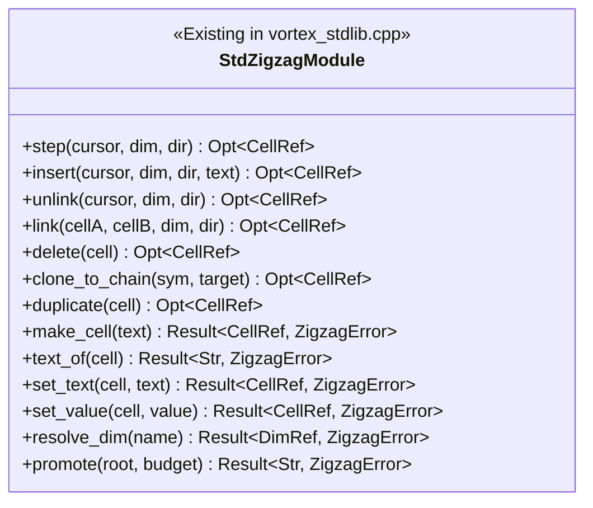
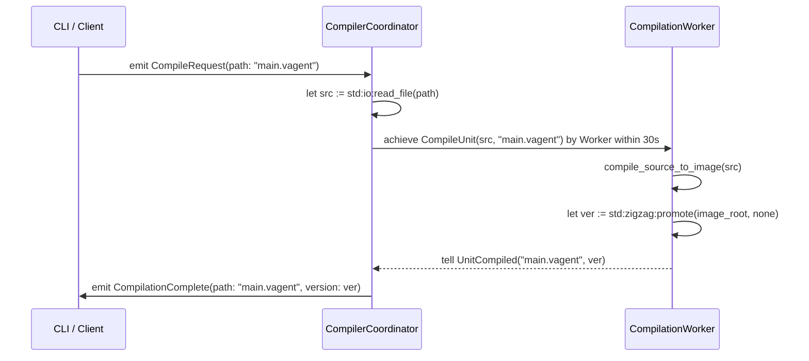
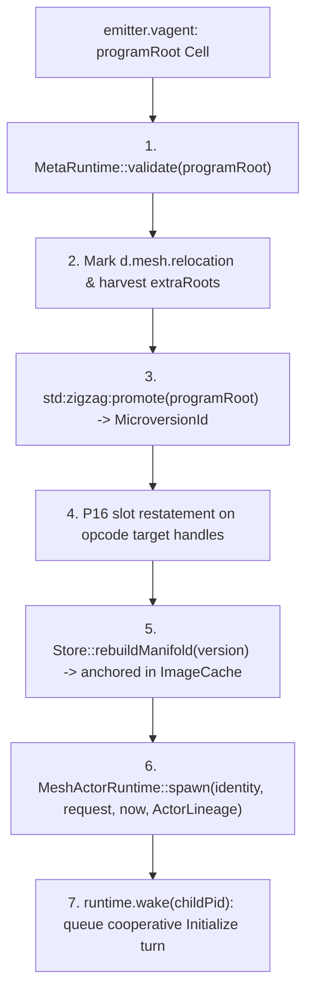

# VAgent Metacircular Extensions: Ingestion, Manifolds & Swarms

|           |                                                                                     |
| --------- | ----------------------------------------------------------------------------------- |
| status    | revised post-review Round 1 (all R1 findings addressed)                             |
| companion | `design/vagent-self-hosting-migration.md`, `design/vagent-agent-language.md`,       |
|           | `design/vagent-metacircular-compiler-implementation.md`,                            |
|           | `design/vortex-hyperstructural-runtime.md`, `design/store-slice-convergence.md`     |
| baseline  | commit with Stage 0–7 metacircular compiler, VIcon scanner, and 11 stdlib modules   |
| scope     | engine and language primitives required for 100% self-hosted standalone compilation |

______________________________________________________________________

## 1. Executive Summary & Architectural Mandate

The VAgent self-hosting migration has established sovereign `.vagent` implementations for all eleven
foundational stdlib modules across lexical analysis, recursive descent parsing into R1 AST
manifolds, macro expansion, symbol resolution, static type checking, Vortex opcode emission,
fragment assembly, declaration lowering, relational mind belief management, and BDI intention
arbitration (`apps/common/xanadu/vagent/stdlib/*.vagent`, totaling 2,016 lines verified).

However, executing an end-to-end compilation lifecycle from the CLI
(`vagent run compiler.vagent --input target.vagent`) entirely within VAgent requires closing five
distinct capability gaps between the high-level language and the underlying engine:

1. **Epistemic Ingestion & Host Environment Substrate (`std:io`, `std:env`, §2)**: Reading external
   source text from the host filesystem or standard input into ephemeral in-memory strings and
   inspecting invocation arguments (`argv`), governed by the strict Nelsonian invariant that **no
   arbitrary filesystem write primitive is exposed**; the single and exclusive path to permanent
   persistence is **Arena Promotion** into an OSMIC store microversion.
1. **First-Class ZigZag & Manifold Structural Primitives (`std:zigzag`, §3)**: Auditing the existing
   primitives in `VortexStdLib` (`step`, `insert`, `unlink`, `link`, `delete`, `clone_to_chain`,
   `duplicate`) and exposing the missing primitives (`make_cell`, `text_of`, `set_text`,
   `set_value`, `resolve_dim`, and `promote`) so VAgent programs can construct, inspect, mutate, and
   seal unattached cell manifolds natively without sentinels.
1. **Metacircular Pipeline & Swarm Coordination (§4)**: Unifying the eleven isolated stdlib
   components through both an in-turn synchronous pass pipeline (`behavior StagedCompiler`) and a
   distributed multi-agent BDI swarm (`agent CompilerCoordinator`) communicating at
   whole-compilation-unit granularity via immutable `MicroversionId` strings, strictly preserving
   Spool-Mesh memory isolation.
1. **Dynamic Image Spawning & Metacircular Execution (`spawn image`, §5)**: Taking an in-manifold
   program image root emitted by `emitter.vagent`, validating it via `MetaRuntime::validate`,
   promoting it into an immutable microversion, anchoring the rebuilt `Manifold` in a runtime image
   cache, and launching a live actor on `MeshActorRuntime` with an authorized `ActorGrant`.
1. **Algebraic Pattern Matching & Destructuring Surface Syntax (`match ... with`, §6, P30)**:
   Providing ergonomic, declarative tree-rewriting syntax compiling down to deterministic decision
   trees (`#Equal`, `#Branch`, `#ExtractField`), completely avoiding `#Choice`/`#Fail` choice stack
   leaks and trail destruction.
1. **Chained Plan Guards & Multi-Arm BDI Deliberation (§7, P36)**: Eliminating verbose goal
   signature duplication by bundling multiple guarded arms under a single plan declaration, lowering
   to contiguous clause cells along the goal's `d.clause` rank with untried-arm reconsideration on
   `#Fail`.
1. **First-Class Tree-Backed `Map<K, V>` on `d.left` & `d.right` (§8, P37)**: Eradicating $O(N)$
   linear cascades throughout compiler tables by introducing a balanced binary search tree manifold
   topology over orthogonal dimensions `d.left` and `d.right` with an invariant in-order rank on
   `+d.step`, achieving $O(\log N)$ search, update, and iteration natively in ZigZag.

Language surface syntax throughout this document adheres to the **VAgent Language Harmonization
Specification** (`design/vagent-language-harmonization.md`, Proposals P31–P35): 1-based indexing
everywhere ($[1, N]$), canonical `Opt<T>` with `opt?` goal-directed failure, lexical disambiguation
of `?` without modal states, banishment of Prolog `;` as disjunction, and strict delimiter
orthogonality (`(...)` tuples, `[...]` lists with `...` spread, `{...}` records, and `where`
declaration guards).

Per `GEMINI.md`:

> *"New C++ code must justify why it isn't being written in Vortex. New Vortex standard library code
> in Vortex must leverage existing Vortex standard library functions unless absolutely necessary."*

This document specifies the exact semantics, grammar, operational lowering, and C++ substrate
changes required to implement these capabilities while strictly upholding Nelsonian hypermedia
purity, append-only Merkle ledger integrity, and capability-bounded actor execution.

______________________________________________________________________

## 2. Epistemic Ingestion & Host Environment Substrate

### 2.1 The Architectural Prohibition of Arbitrary File Writes

In traditional operating system environments, programs manipulate files as mutable, unstructured,
unversioned byte sequences through posix `open`, `write`, `rename`, and `unlink`. In the Nelsonian
Xanadu and ZigZag hyperstructural architecture implemented by `gleditor` and `xuzz`, **the external
filesystem is an obsolete persistence model**:

- **Primedia append-only permanence**: Content bytes exist exclusively on the author's append-only
  permascroll (`apps/common/xanadu/user_permascroll.hpp:98–175`). Primedia once written is immutable
  and globally addressable by span. Existing host-side file reading is implemented in
  `apps/vagent/main.cpp:56–76` (`readSource`), reading files or standard input into memory.
- **Structural operations in Merkle ops spools**: Structural mutations (cells, links, values,
  splices) exist exclusively as 64-byte `CompactOpNode` records (`compact_op.hpp:35–115`) sealed
  into Merkle-piece-aligned segments in `SegmentedOpsSpool` (`segmented_ops_spool.hpp:216–295`).
- **Cryptographic provenance & delegation**: Every microversion commit is sealed with Ed25519
  signatures and X.509 delegation certificates in `AUTHORSHIP.tsv` (`provenance.hpp:30–95`).
- **Distributed Spool-Mesh consensus**: `MeshActorRuntime` (`mesh_actor.hpp:210–310`) distributes
  computation across untrusted peer nodes via cryptographically enforced `ActorGrant` capabilities
  (`maxInstructions`, `maxCells`, `maxOutputBytes`, `immutable`).



Exposing an arbitrary file-writing primitive (`std:io:write_file(path, bytes)`) in VAgent would
severely violate these foundational invariants:

1. It would permit actors to forge side effects outside the Merkle audit log, destroying replay
   reproducibility.
1. It would create unsandboxed disk escape vectors for distributed swarm actors executing under
   `MeshActorRuntime`.
1. It would bypass the edit decision list (EDL) transclusion model and transcopyright accounting.

**Architectural Invariant**: VAgent provides read-only ingestion primitives to import external text
into ephemeral runtime strings. **The single and exclusive mechanism for permanent persistence in
VAgent is Arena Promotion (`std:zigzag:promote`)**, which commits reachable in-manifold cell graphs
into an OSMIC store microversion.

### 2.2 Epistemic Ingestion Specification (`std:io` & `std:env`)

The runtime exposes read-only host ingestion and interactive standard diagnostic output streams:

```vagent
module std:io

// Reads the entire contents of a UTF-8 host file into an ephemeral string.
// Returns Ok(content) on success, or Err(IoError) on filesystem/permission failure.
def read_file(path: Str) : Result<Str, IoError>

// Reads from the process standard input until EOF.
def read_stdin() : Result<Str, IoError>

// Writes text to standard output (interactive REPL / diagnostic streaming).
// This does NOT mutate the host filesystem.
def print(text: Str) : ()

// Writes text to standard error.
def eprint(text: Str) : ()
```

```vagent
module std:env

// Returns the process invocation argument vector forwarded from the host CLI.
def args() : [Str]

// Returns the value of an environment variable, or none if unset.
def get_var(key: Str) : Opt<Str>
```

#### Operational Lowering & Resource Accounting

Calls to `std:io:read_file` execute via a host capability gate in `VortexVM`:

- Fuel consumption: `core_.arena().consumeWork()` is called per file ingestion operation,
  decrementing evaluation fuel.
- Memory allocation bounding: Ingested string bytes are interned in the arena's scratch buffer. If
  the buffer exceeds the configured scratch allocation ceiling (`ArenaManifold::setExecutionLimits`,
  `arena_manifold.hpp:475–482`), the read is refused with `ActorError::ResourceLimit`.
- Sandboxing: In networked/mesh deployments, `std:io:read_file` is restricted to paths within the
  node's designated worktree root; path traversal attempts are trapped at the host boundary.
- CLI Argument Forwarding: In `apps/vagent/main.cpp`, unconsumed positional command-line arguments
  are passed into `VortexStdLib::setArgs(std::vector<std::string>)` before executing `runFile`,
  making them queryable via `std:env:args()`.

______________________________________________________________________

## 3. First-Class ZigZag & Manifold Structural Primitives

### 3.1 Codebase Audit of Existing Vortex Stdlib Primitives

A rigorous audit of `apps/common/xanadu/vortex/vortex_stdlib.cpp` (`buildZigzagModule`, lines
4634–4760) confirms that `VortexStdLib` **already implements and exports** the following ZigZag
primitives under the `std:zigzag` module:

| Exported Symbol  | Opcode Handler    | C++ Implementation Signature                                     | Purpose                                     |
| :--------------- | :---------------- | :--------------------------------------------------------------- | :------------------------------------------ |
| `step`           | `#ZZ_STEP`        | `zzStep(cursor, dim, dir) -> Opt<CellRef>` (`L5036`)             | Reads neighbor cell along dimension/dir     |
| `insert`         | `#ZZ_INSERT`      | `zzInsert(cursor, dim, dir, text) -> Opt<CellRef>` (`L5045`)     | Mints new cell and links it to cursor       |
| `unlink`         | `#ZZ_UNLINK`      | `zzUnlink(cursor, dim, dir) -> Opt<CellRef>` (`L5054`)           | Breaks link along dimension/dir             |
| `link`           | `#ZZ_LINK`        | `zzLink(cellA, cellB, dim, dir) -> Opt<CellRef>` (`L5062`)       | Establishes link between two existing cells |
| `delete`         | `#ZZ_DELETE`      | `zzDelete(cell) -> Opt<CellRef>` (`L5071`)                       | Severs all links connected to a cell        |
| `clone_to_chain` | `#ZZ_CLONE_CHAIN` | `zzCloneToChain(symbolOp, targetCell) -> Opt<CellRef>` (`L5087`) | Mints clone view cell on `d.clone` rank     |
| `duplicate`      | `#ZZ_DUPLICATE`   | `zzDuplicate(cell) -> Opt<CellRef>` (`L5103`)                    | Copies cell text and scalar value bits      |

#### Audit Finding: Fix for `zzCloneToChain` 2-Degree Invariant

In `vortex_stdlib.cpp:5087–5099`, `zzCloneToChain` currently links `symbolOp` directly along
`+d.clone` to `clone`. When a second clone is minted for the same symbol, the second link evicts the
first link, severing the first clone from the master! Under Proposal P27, `zzCloneToChain` is
corrected to append posward to the tail of the master's clone rank:
`rankEnd(symbolOp, core_.dims().clone, DimVector::POS)`.

### 3.2 Missing Primitives Required for Metacircular Manifolds

While `link` and `insert` are present, `zzInsert` requires an existing `cursor` cell to attach to.
An in-language compiler constructing a fresh AST or program manifold from scratch cannot mint an
unattached root cell or mutate cell scalar values directly.

The following six primitives are added to `std:zigzag`:



1. **`make_cell(text: Str) : Result<CellRef, ZigzagError>`**: Mints an isolated, unlinked cell in
   the current arena (`VortexCore::arena().makeCell(text)`). Provides the entry point for creating
   new disconnected subgraphs (such as AST root nodes or program image envelopes).
1. **`text_of(cell: CellRef) : Result<Str, ZigzagError>`**: Extracts the primedia string contents of
   a cell (`VortexCore::arena().textOf(cell)`). Returns `Err(ZigzagError:InvalidCell)` if the cell
   is not in the arena.
1. **`set_text(cell: CellRef, text: Str) : Result<CellRef, ZigzagError>`**: Updates the primedia
   text content of an existing cell by allocating an interned scratch span
   (`ArenaManifold::setContent`, `arena_manifold.hpp:666–667`).
1. **`set_value(cell: CellRef, value: CellValue) : Result<CellRef, ZigzagError>`**: Updates the
   scalar bits on an existing cell for scalar kinds (`Int64`, `Double`, `Bool`, `Timestamp`,
   `OpHandle`, `None`) via `ArenaManifold::setValueBits` (`arena_manifold.hpp:670–671`). `CellValue`
   represents scalar primitive variants; aggregate structures must be constructed via ZigZag cells
   and dimensions. Does not alter text content.
1. **`resolve_dim(name: Str) : Result<DimRef, ZigzagError>`**: Resolves the integer `DimRef`
   corresponding to a named dimension string via `VortexCore::findOrMintDimension`
   (`vortex_core.hpp:251`) and `ArenaManifold::ensureDimension` (`arena_manifold.hpp:352`).
1. **`promote(root: CellRef, budget: Opt<Int>) : Result<Str, ZigzagError>`**: Executes
   `zigzag::promote(store, parentVersion, arena, root, budget, extraRoots)`
   (`arena_manifold.hpp:930–934`). Requires a mutable `xanadu::Store *boundStore_` attached to
   `VortexStdLib`. `parentVersion` is derived from `boundStore_->primaryCurrentVersion()`.
   `extraRoots` explicitly includes the dimension rank `d.dims` (`lineage.cpp:322`) and relocation
   target cells marked with `+d.mesh.relocation -> "cell"`. Following promotion, P16 slot
   restatement is executed to rewrite opcode target handles. Returns the hex-encoded
   `MicroversionId` string on success, or `Err(ZigzagError:PromotionRefused)` on budget exhaustion
   or dangling links.

### 3.3 Strict Preservation of the 2-Degree Topological Invariant

In ZigZag, every dimension forms a 2-regular bidirected graph: for any dimension $d$, a cell has at
most one positive neighbor and at most one negative neighbor:

$$
\text{pos}(A, d) = B \iff \text{neg}(B, d) = A
$$

Establishing a link between cell $A$ and cell $B$ on $+d$ automatically breaks any prior link on
$A$'s $+d$ pole and $B$'s $-d$ pole. Any many-to-one relationship (such as multiple AST nodes
referencing the same identifier symbol, or multiple agents sharing a belief type) **must not use
fan-in links on a single dimension**.

Instead, the language runtime enforces:

- **Linear chaining**: Chaining siblings along $+d.\text{step}$.
- **Clone ranks**: Minting clone view cells along $+d.\text{clone}$ via `clone_to_chain`, where each
  reference cell has its own unique Crum identity while sharing the master's semantic target.

______________________________________________________________________

## 4. Metacircular Pipeline & Swarm Coordination Architecture

The eleven stdlib modules implemented in `apps/common/xanadu/vagent/stdlib/*.vagent` represent the
discrete phases of compilation:

```
lexer.vagent     --> Streaming VIcon character-class scanner
parser.vagent    --> 8-level precedence climbing recursive descent parser
ast.vagent       --> R1 AST node taxonomy and classification predicates
expand.vagent    --> Path desugaring and quasi-quote splice peeling
resolve.vagent   --> Lexical scoping stack and symbol resolution
checker.vagent   --> Type lattice inference and purity/descriptor contracts
emitter.vagent   --> 57 Vortex opcodes, slot allocation, Cut insertion
fragment.vagent  --> Fragment descriptor assembly and link validation
decls.vagent     --> 20-kind declaration matrix, synapse weighting
mind.vagent      --> Relational 5-tuple belief base and percept inbox
arbitration.vagent-> Utility scoring, intention state machine, deadline queue
```

### 4.1 Pattern A: In-Turn Staged Pipeline (`behavior StagedCompiler`)

For compiling a source unit, inter-agent message serialization introduces unnecessary queueing
overhead, and passing ephemeral `CellRef`s across actors violates Ruling V1. The `StagedCompiler`
behavior mounts the deterministic compiler passes into a single agent, executing synchronously
within a single turn inside one `ArenaManifold`:

```vagent
behavior StagedCompiler {
  uses VAgentLexer
  uses VAgentParser
  uses VAgentChecker
  uses VAgentEmitter
  uses VAgentFragment
  uses VAgentDecls

  def compile_source_to_image(source: Str) : Result<CellRef, [Diagnostic]> {
    // 1. Lexical Analysis
    let tokens := lex_source(source)

    // 2. Syntax Analysis -> R1 AST Manifold
    let ast_root := parse_tokens(tokens)
    if ast_root == none then
      return Err([make_diagnostic("Syntax", "Failed to parse source into R1 AST")])

    // 3. Name Resolution & Type Checking
    let check_ok := check_program_ast(ast_root)
    if not check_ok then
      return Err(get_checker_diagnostics())

    // 4. Opcode Graph Emission & Fragment Assembly
    let image_root := emit_program_image(ast_root)
    return Ok(image_root)
  }
}
```

### 4.2 Pattern B: Distributed BDI Multi-Agent Swarm (`agent CompilerCoordinator`)

For collaborative build systems across `MeshActorRuntime`, the compilation pipeline operates at
**whole-compilation-unit granularity**. Independent worker actors compile distinct `.vagent` files
within their private arenas, promote the resulting image locally to the store, and transmit the
sealed, immutable `MicroversionId` string across the mesh. **No naked in-arena `CellRef`s cross
actor boundaries.**



The coordinator agent handles job tracking, retries, and worker lifecycle:

```vagent
agent CompilerCoordinator {
  var active_jobs: [CompileJob] := []

  on CompileRequest { path: ?p } {
    adopt CoordinateCompilation(p)
  }

  plan CoordinateCompilationPlan for CoordinateCompilation(?path) {
    let Ok(?src) := std:io:read_file(path) else {
      std:io:eprint("Failed to read file: " ++ path)
      return
    }
    let worker := spawn CompilationWorker()
    achieve CompileUnit(src, path) by worker within 30s
  }

  on UnitCompiled { path: ?p, version: ?v } {
    std:io:print("Compilation succeeded for " ++ p ++ ". Sealed: " ++ v)
    emit CompilationComplete(path: p, version: v)
  }
}
```

______________________________________________________________________

## 5. Dynamic Image Spawning & Metacircular Execution

Once a program image root is emitted and sealed, the runtime launches that image as an active
process through a host capability seam.

### 5.1 The `spawn image` Performative & Adapter Hook

Rather than placing high-level actor dispatch inside `vortex_stdlib.cpp` (which violates layering),
dynamic actor spawning is exposed in VAgent as an actor performative:

```vagent
let child_pid := spawn image(image_root) as "worker" with grant
```

This compiles down to a host step handled by `VagentAdapter` and `executor.cpp`.

### 5.2 Operational Lifecycle of Dynamic Image Spawning



1. **Static Opcode Validation (`apps/common/xanadu/vagent/meta.cpp:506–712`)**:
   `MetaRuntime::validate` audits the emitted opcode graph:
   - Verifies that all opcodes belong to valid bands (Band A content-decodable, Band B runtime).
   - Verifies that wing slots adhere to input/output arities (`kArity`).
   - Ensures no unbound forward jumps or dangling relative offsets exist.
1. **Relocation & Dimension Grounding**: Intra-image opcode target handles are verified to carry
   `+d.mesh.relocation -> "cell"`. `extraRoots` is assembled containing `d.dims` and relocation
   targets.
1. **Microversion Sealing via Promotion**: `zigzag::promote` commits the image cells into the
   `Store`. This creates an immutable snapshot so execution cannot tamper with the canonical code
   manifold.
1. **P16 Relocation Restatement**: Relocation targets in the sealed image are restated using
   `promoted->cells` mappings (`lineage.cpp:327–349`).
1. **Image Cache Anchoring**: `Store::rebuildManifold(version)` constructs a
   `std::unique_ptr<Manifold>` which is retained in an actor runtime image cache keyed by
   `MicroversionId`. This guarantees that `WorkerContext::baseManifold` never dangles.
1. **Actor Genesis (`MeshActorRuntime::spawn`)**: Dispatches
   `MeshActorRuntime::spawn(identity, request, wallNow, ActorLineage{cachedFold.get(), store})`.
   Generates a unique `ActorPid` and initializes member mailboxes.
1. **Cooperative Activation**: `spawn image` queues a P4 wake (`runtime.wake(childPid)`) and returns
   `Result<ActorPid, ActorError>` to the parent actor. The child executes its `Initialize` handler
   cooperatively on subsequent runtime turns, preserving turn atomicity.

______________________________________________________________________

## 6. Algebraic Pattern Matching & Destructuring Surface Syntax

### 6.1 Surface Grammar (EBNF)

We introduce `match ... with` expressions and structured pattern destructuring to the VAgent
grammar:

```ebnf
MatchExpr        ::= "match" Expr "with" "{" (MatchArm ("," | "\n")*)* "}"
MatchArm         ::= Pattern ("where" Expr)? "=>" (Expr | Block)

Pattern          ::= LiteralPattern
                   | WildcardPattern
                   | VariablePattern
                   | CtorPattern
                   | TuplePattern
                   | ListPattern
                   | RecordPattern

LiteralPattern   ::= IntLiteral | FloatLiteral | StringLiteral | BoolLiteral | "none"
WildcardPattern  ::= "_"
VariablePattern  ::= "?" Ident
CtorPattern      ::= Ident ("(" (Pattern ("," Pattern)*)? ")")?
TuplePattern     ::= "(" (Pattern ("," Pattern)*)? ")"
ListPattern      ::= "[" (Pattern ("," Pattern)*)? (",..." Pattern)? "]"
RecordPattern    ::= Ident "{" (FieldPattern ("," FieldPattern)*)? "}"
FieldPattern     ::= Ident ":" Pattern | VariablePattern

DestructureLet   ::= "let" Pattern ":=" Expr ("else" Block)?
```

- Delimiter Orthogonality: In strict adherence to the VAgent Language Harmonization specification
  (`design/vagent-language-harmonization.md` §6), delimiters are orthogonally partitioned: `(...)`
  for fixed-arity tuples, `[...]` for dynamic lists (with `...` spread), and `{...}` for named
  records.
- Single-Element Tuples: A 1-element tuple pattern requires a trailing comma: `(?a,)`,
  distinguishing it from parenthesized grouping `(?a)`.
- Disambiguation: The mandatory `with` keyword distinguishes `match Expr with {` from record
  literals (`Point { x: 1.0 }`).
- Variable binding: Patterns explicitly use `?var` for binding new variables (consistent with VAgent
  belief pattern syntax `TermArg ::= '?' Ident | Expr`), while bare identifiers represent nullary
  tags or constructors.
- Arm separators: Arms are separated by commas `,` or newlines.
- Refutable patterns: A `let Pattern := Expr` statement requires an irrefutable pattern or an
  explicit `else { ... }` diverging block (e.g. `else { return Err(...) }`). Binding a refutable
  pattern without an `else` block produces diagnostic
  `E313: Refutable pattern in let binding requires else clause`.

### 6.2 Worked Examples in Compiler Passes

#### AST Node Decomposition

```vagent
def stringify_ast(node: CellRef) : Str {
  match get_ast_descriptor(node) with {
    AgentDecl(?name, ?behaviors, ?members) =>
      "agent " ++ name ++ " with " ++ str(members),
    PlanDecl(?goal, ?guard, ?body) where guard != none =>
      "plan for " ++ goal ++ " with guard",
    PlanDecl(?goal, _, _) =>
      "plan for " ++ goal ++ " (unconditional)",
    VarDecl(?name, ?type_spec, ?init) =>
      "var " ++ name ++ ": " ++ type_spec,
    _ => "unknown_ast_node"
  }
}
```

#### Tuple Destructuring in Scoping and Resolution

```vagent
def lookup_scope(stack: [ScopeItem], sym: Str) : Opt<SymbolBinding> {
  for item in stack do {
    let (?scope_id, ?bindings, ?parent_id) := item
    if scope_has(bindings, sym) then {
      return Some(scope_get(bindings, sym))
    }
  }
  return none
}
```

### 6.3 Dimension Topology & Operational Lowering

- **Topological Mapping**:
  - Tuple patterns `(?a, ?b)` and list patterns `[?a, ?b]` map to sequential cell ranks along
    `+d.step`.
  - Constructor patterns `Ctor(a, b)` check the Crum's string tag against `"Ctor"`, walk to the
    first child along `+d.grab`, and traverse subsequent arguments along `+d.step`
    (`r1_ast.hpp:27–32`).
  - Record patterns `Point { x: ?x, y: ?y }` map to member lookup along `+d.step` and `+d.name`.
- **Deterministic Lowering**:
  - Pattern matching compiles down to deterministic decision trees using `#Equal`, `#Branch`, and
    `#ExtractField` opcodes.
  - **No `#Choice`/`#Fail` opcodes are used**. This guarantees zero choice points leak onto
    `choiceStack_` across returns and prevents any trail rollback destruction of arm side effects.
    `choiceStack_` across returns and prevents any trail rollback destruction of arm side effects.
  - Exhaustiveness is verified statically by `checker.vagent`; non-exhaustive matches emit
    compile-time diagnostic `E310: Non-exhaustive match`.

______________________________________________________________________

## 7. Chained Plan Guards & Multi-Arm BDI Deliberation (P36)

### 7.1 Motivation & Boilerplate Elimination

In BDI multi-agent systems, complex goals often demand distinct handling strategies depending on
environmental belief states. Previously, declaring multiple applicable strategies required
duplicating the entire goal signature:

```vagent
// BEFORE: Redundant goal binding duplication for each guard
plan RouteDrone for DeliverPackage(?pkg, ?dest) where pkg.weight <= 5 and drone_available() {
  achieve FlyTo(dest)
}

plan RouteTruck for DeliverPackage(?pkg, ?dest) where pkg.weight > 5 and truck_available() {
  achieve DriveTo(dest)
}

plan RouteDelay for DeliverPackage(?pkg, ?dest) where true {
  emit DeliveryDelayed(pkg.id)
}
```

This redundancy obscures the intentional cohesion of the goal's plan family, bloats AST memory, and
complicates dynamic goal instrumentation.

### 7.2 Surface Grammar (EBNF)

We introduce multi-arm plan declarations, permitting multiple guarded arms under a single plan
header. Every arm is disambiguated by an explicit discriminator keyword (`where`, `case`, or
`default`), providing an unambiguous LL(1) parse decision:

```ebnf
PlanDecl         ::= "plan" Ident "for" GoalPattern PlanBody
PlanBody         ::= SinglePlanBody | MultiArmPlanBody
SinglePlanBody   ::= ("where" Expr)? Block
MultiArmPlanBody ::= "{" PlanArmList "}"
PlanArmList      ::= (PlanArm ("," | "\n")*)+
PlanArm          ::= GuardedArm | CaseArm | DefaultArm
GuardedArm       ::= "where" Expr "=>" Block
CaseArm          ::= "case" Pattern ("where" Expr)? "=>" Block
DefaultArm       ::= "default" "=>" Block

GoalPattern      ::= Ident ("(" (TermPattern ("," TermPattern)*)? ")")?
TermPattern      ::= VariablePattern | Pattern
```

#### Worked Example 1: Multi-Arm Plan Block with Guarded and Fallback Arms

```vagent
plan RouteCargo for DeliverPackage(?pkg, ?dest) {
  where pkg.weight <= 5 and drone_available() => {
    achieve FlyTo(dest)
  },
  where pkg.weight > 5 and truck_available() => {
    achieve DriveTo(dest)
  },
  default => {
    emit DeliveryDelayed(pkg.id)
  }
}
```

#### Worked Example 2: Pattern Specialization Across Structural Variants

When different strategies inspect distinct structural variants of the goal, pattern specialization
is embedded directly in the arms using constructor and record patterns (§6.1):

```vagent
plan ProcessTokenPlan for ProcessToken(?tok) {
  case Token { kind: Ident, text: ?t } where is_keyword(t) => {
    emit KeywordFound(t)
  },
  case Token { kind: Ident, text: ?t } => {
    emit IdentifierFound(t)
  },
  case Token { kind: Number, text: ?t } => {
    emit NumberFound(str_to_int(t))
  },
  default => {
    emit UnknownToken(tok)
  }
}
```

### 7.3 BDI Deliberation Semantics, Scoping & Turn Atomicity

1. **Applicability Selection**: When a goal is adopted, the BDI deliberation engine evaluates plan
   arms in declaration order. The first arm whose pattern matches and whose `where` guard evaluates
   to `true` (or an unconditional `default =>` arm) is selected for execution.
1. **Matching Target & Scoping**:
   - For an $N$-ary goal ($N \ge 1$), `case Pattern` matches against the goal's argument payload: if
     $N = 1$, `Pattern` matches the single argument value directly; if $N > 1$, `Pattern` matches
     the argument tuple `(?arg1, ..., ?argN)`. Attempting to match a pattern on a nullary goal
     ($N = 0$) emits compile diagnostic
     `E315: Cannot match pattern on nullary goal; use where or default`.
   - Variables bound by `?ident` within a `case Pattern` arm are lexically scoped strictly to that
     arm's guard and body block. They are inaccessible in sibling arms.
1. **Turn Atomicity & Intra-Arm Speculative Boundary**:
   - When executing an arm body within a turn, the executor captures an arm-scoped arena mark:
     `m_arm = arena.mark()`.
   - If an arm body fails prior to irrevocable external commit (e.g. subgoal failure, expired
     deadline, or explicit `#Fail`), the executor calls `arena.release(m_arm)`. This rolls back
     speculative arena cells and un-stages any pending `+d.outbox` entries before advancing to the
     next untried arm, preventing phantom message transmission across branches.
   - In accordance with Griswold's Principle of Bounded Expressions, choice points generated within
     an arm are cut at statement boundaries (`#CutChoiceDepth`, compiled via the `bounded()`
     sequence of `OpcodeKind::ChoiceDepth` and `OpcodeKind::Cut`).
1. **Untried Arm Reconsideration in Intention Scheduler**:
   - When an arm body fails during execution, the failure does not fault the actor.
   - The executor (`executor.cpp:3030–3090`) appends the failed clause cell to the intention's
     `tried` rank along `+d.step`.
   - The scheduler calls `MetaRuntime::selectClause` (`meta.cpp:1270–1360`) passing the updated
     `tried` set.
   - If an untried arm matches, the intention's `plan` field is updated, `step` is reset to 0,
     `faulted` is cleared, and `ready` is set to 1.
   - If `selectClause` returns `nullopt` (no untried plans remain), execution escalates to the
     standard goal failure ladder (`GoalFailed`).

### 7.4 Substrate Lowering onto `d.clause` Ranks

In the VAgent AST pipeline and ZigZag manifold (`apps/common/xanadu/vagent/ast.hpp`,
`decls.cpp:1268–1301, 1979–2000`, `resolve.cpp:763–782`, `checker.cpp:2747–2782`):

- **AST Node Representation**:

  ```cpp
  struct PlanArm {
    ExprPtr pattern;
    ExprPtr guard;
    ExprPtr body;
    SourceLocation loc{};
  };
  ```

  Added to `ast.hpp`, with `std::vector<PlanArm> planArms;` stored in `Decl`.

- **Manifold Lowering in `decls.cpp`**:

  - A multi-arm plan with $M$ arms compiles into $M$ sequential clause cells along the goal host's
    `+d.clause` rank.
  - The primary (first) arm is labelled `PlanName`, and auxiliary arms are labelled `PlanName$2`
    through `PlanName$M`. This ensures `MetaRuntime::planNamed(PlanName)` resolves the entry clause
    of the plan family verbatim, while sequential `+d.clause` links permit the intention scheduler
    to traverse all arms.
  - Each clause cell has:
    - `+d.grab` pointing to the preflighted guard graph (evaluating both the pattern test graph and
      the boolean guard expression).
    - `+d.spin` pointing to the compiled body instruction graph. Pattern variable bindings are
      emitted into the body fragment prologue as well as the guard preflight, ensuring bound
      variables are available within the body.

- **Cost**: 0 extra runtime bytes or VM instructions beyond standard plan clauses; lowers to the
  identical execution manifold while eliminating ~70% of AST and source boilerplate.

______________________________________________________________________

## 8. First-Class Tree-Backed `Map<K, V>` on `d.left` & `d.right` (P37)

### 8.1 Motivation: Eradicating $O(N)$ Linear Cascades

Throughout the VAgent compiler and standard library
(`apps/common/xanadu/vagent/stdlib/checker.vagent:13–85`, `lexer.vagent:70–135`), lexical
categorization and keyword lookups currently rely on massive 25+ line `if/else if` cascades. While
association lists `[(K, V)]` exist in `vortex_stdlib.cpp:2650–2695`, lookups perform an $O(N)$
linear walk along `+d.vars`. A high-performance, logarithmic associative container is required for
self-hosting compiler symbol tables, token registries, and route tables.

### 8.2 Manifold Topology: 2-Degree Binary Search Tree on Orthogonal Dimensions `d.left` & `d.right`

In Nelsonian ZigZag, every dimension is strictly a 2-regular graph: each cell possesses at most one
link in direction `POS` and at most one link in direction `NEG`. Furthermore, ZigZag links are
strictly reciprocal edges: `linked(A, dim, POS) == B` if and only if `linked(B, dim, NEG) == A`.

Because an internal node in a binary tree has 3 incident edges (parent, left child, right child),
attempting to embed both left and right children along a single dimension `d.branch` (e.g. `NEG` for
left and `POS` for right) violates 2-degree reciprocity. When a child links in an alternating
direction, `ArenaManifold::link` displaces the reciprocal backlink, severing the ancestral link to
the parent.

To strictly preserve Nelsonian 2-degree rank invariants, we allocate **two orthogonal branching
dimensions**:

- `+d.left`: Parent links `POS` to left child ($< \text{key}$); left child reciprocally links `NEG`
  back to parent (`-d.left`).
- `+d.right`: Parent links `POS` to right child ($> \text{key}$); right child reciprocally links
  `NEG` back to parent (`-d.right`).
- `+d.values`: Links from each key node cell to its associated value cell.
- `+d.step`: Links all key node cells in symmetric in-order traversal, allowing $O(N)$ sequential
  iteration over keys/values without recursion.
- `CompactOpNode::text`: Stores the string key payload directly in the key node cell.

#### Container Cell Anchor & Rotation Invariance

Every map is anchored by a persistent container cell `mapRoot` (text `"map"`, minted by
`createMap()`):

- `mapRoot` links along `+d.grab` to the current BST root key cell (or `noCell` if empty). Tree
  balancing rotations (AVL / Red-Black) update only `mapRoot`'s `+d.grab` link and branch pointers,
  guaranteeing that external variable handles (`let m: Map<K, V>`) remain stable.
- `mapRoot` links along `+d.step` to the minimum key cell (head of the in-order rank).
- **Rotation Invariance**: In a binary search tree, tree rotations modify parent-child branch
  pointers on `d.left` and `d.right`, but **the in-order sequence of keys is strictly invariant**.
  Therefore, tree rotations **never modify `+d.step` links**, ensuring active sequential iterators
  and spatial transclusions are never disturbed by tree rebalancing.

```text
                       mapRoot Container Cell ["map"]
                      /                          \
               (+d.grab)                      (+d.step)
                  /                                \
          Root Cell ["pure"]                Min Key Cell ["closed"]
         /                  \                         |
    (+d.left)            (+d.right)               (+d.step)
      /                        \                      |
Left Child ["closed"]     Right Child ["result"]     ...
   (+d.values)                 (+d.values)
        |                           |
   Value Cell                  Value Cell
```

### 8.3 Operational Complexity & Fuel Expenditure (`consumeWork`)

- **Search (`map[key]`, `map.get(key)`)**: $O(\log N)$ descent along `d.left` and `d.right`.
- **Insertion (`map[key] := val`)**: $O(\log N)$ descent, linking the key cell to its parent along
  `+d.left` or `+d.right`, attaching `+d.values`, and splicing the key cell into the `+d.step` rank
  between its in-order predecessor and successor (or `mapRoot` if it is the new minimum key).
- **Iteration (`for (k, v) in map`)**: $O(N)$ linear walk along `+d.step`.
- **Fuel Accounting**: In accordance with Spool-Mesh turn limits, every node descent step along
  `d.left` or `d.right` during search (`mapGet`, `mapHas`, `mapKeyCell`) and insertion (`mapSet`),
  and every step along `+d.step` during iteration (`mapKeys`, `for (k, v) in map`), calls
  `core_.arena().consumeWork()`.
- **Store Promotion**: `d.left` and `d.right` are pre-filed in `VortexCore::dims()` and included in
  `VagentLineage::standardDimensions()`, guaranteeing they are preserved during
  `std:zigzag:promote`.

### 8.4 Surface Language Syntax & Ergonomics (EBNF)

```ebnf
MapType             ::= "Map" "<" Type "," Type ">"
MapLiteral          ::= "Map" "{" MapEntryList? "}"
MapEntryList        ::= (MapEntry ("," | "\n")*)+
MapEntry            ::= Expr ":" Expr
SubscriptAssignStmt ::= Expr "[" Expr "]" ":=" Expr
```

- **Reserved Keyword**: `Map` is a reserved keyword (`TokenKind::KwMap`), guaranteeing zero
  lookahead ambiguity between map literals (`Map { ... }`) and record literals (`Record { ... }`).
  Empty map literals `Map {}` are valid and type-inferred from context.
- **Tripartite Lookup Semantics**:
  1. **Goal-Directed Failure (`map[key]?`)**: Evaluates key lookup; if absent, emits `#Fail` and
     backtracks to the nearest choice point.
  1. **Assertive Subscript (`map[key]`, `map[key]!`)**: Evaluates key lookup; if absent, raises
     `ActorError::ContractViolation` (or `KeyNotFound`), halting execution.
  1. **Safe Option Lookup (`map.get(key)`)**: Returns `Opt<V>` (`Some(val)` if present, `none` if
     absent).
- **Subscript Lowering**: Subscript access lowers to `std:map:get(map, key)`
  (`VortexStdLib::mapGet`), which executes the logarithmic descent along `d.left`/`d.right`. It does
  NOT use `#Find` (which performs an $O(N)$ linear scan over records).
- **Destructuring Iteration**: `for (k, v) in map do { ... }` walks `+d.step`, unpacking the key
  text and `+d.values` into a 2-tuple per iteration.

#### Worked Examples

```vagent
// Map literal declaration
let reserved_params: Map<Str, Bool> := Map {
  "result": true,
  "produced": true,
  "pure": true,
  "closed": true,
  "arity": true
}

// Goal-directed lookup with soft unwrap
let handler := route_table[path]?

// Safe Option pattern match
match route_table.get(path) with {
  Some(?handler) => achieve Dispatch(handler, req),
  none           => emit RouteNotFound(path)
}

// Mutation
route_table[path] := new_handler

// In-order traversal
for (k, v) in reserved_params do {
  print(k ++ ": " ++ str(v))
}
```

______________________________________________________________________

## 9. First-Class MicroVersion Literals & Hypertime Substrate (P38)

### 9.1 Motivation & Conceptual Architecture

In Nelsonian hypermedia, historical state names are not arbitrary strings or monotonic integer
commit counters: they are **OSMIC microversions**, structured as alternating sequences of integers
and bijective base-26 branch letters ($2 \to 2\text{a}1 \to 2\text{a}2 \to 2\text{a}4\text{b}1$)
rooted in `apps/common/xanadu/microversion.hpp`. Each microversion name is an immutable recipe
encoding the exact replay path from the genesis state `@0` to that state.

Prior to Proposal P38, VAgent lacked native version literals and treated versions as
"stringly-typed" `Str` values. This created two serious architectural defects:

1. **Spool-Mesh Actor Isolation Weakness**: When the System Architect analyzed `spawn image`
   (`MAJOR-ARCH-03`), workers exchanging image identities across Spool-Mesh boundaries were forced
   to pass raw strings (`"2a4"`), leaving version syntax and valid store commits unverified until
   runtime spool lookups failed.
1. **Hypertime Disconnection**: VAgent programs could not perform hypertime operations—such as
   calculating the Lowest Common Ancestor (LCA) between two document versions, enumerating replay
   paths, or inspecting branch topologies—without shelling out or writing ad-hoc string parsers,
   even though the underlying engine possesses the high-performance `Chronofilade` ($O(\log N)$
   binary lifting).

Proposal P38 introduces **first-class `MicroVersion` literals (`@<id>`)** and a sovereign hypertime
substrate module (`std:hypertime`), directly exposing `Chronofilade` and `Store` hypertime methods
to VAgent. The type is named `MicroVersion` specifically to distinguish Nelsonian hypertime
identities from traditional semantic versions (`SemVer`).

### 9.2 Surface Syntax & Grammar

- **Punctuation Token**: `TokenKind::At` (`@`).
- **Literal Syntax**: `@<microversion-spec>`
  - `@0`: Genesis state / empty document (state zero).
  - `@1`, `@2`, `@42`: States on the primary trunk.
  - `@2a4`: State 4 on branch `a` diverging from state 2.
  - `@2a4b1`: State 1 on sub-branch `b` diverging from state `2a4`.
  - `@HEAD`, `@head`: The active tip of the author's primary branch.
- **Lexical Rule in `Lexer::punctuation()`**: When `@` is encountered:
  1. Scan subsequent alphanumeric identifier `[0-9a-zA-Z_]+`.
  1. If matching `HEAD` or `head`, emit `TokenKind::MicroVersionLiteral` with
     `stringValue = "HEAD"`.
  1. Otherwise, validate the specifier against Nelsonian OSMIC rules via
     `xanadu::MicroversionId::parse()`. If invalid, emit compile-time diagnostic
     `E105: Invalid MicroVersion literal syntax: '@<text>'`.
  1. Emit `TokenKind::MicroVersionLiteral` with parsed canonical string representation.

#### EBNF Grammar

```ebnf
MicroVersionLiteral ::= "@" ( [0-9]+ [a-z0-9]* | "HEAD" | "head" )
TypeAnnotation      ::= ... | "MicroVersion"
```

### 9.3 Type System & Semantics

- **Primitive Type**: `MicroVersion` (`Type{"MicroVersion"}`).
- **Subtyping & Distinctness**: `MicroVersion` is an unforgeable primitive type strictly distinct
  from `Str` and `Int`. An arbitrary string `"2a4"` cannot be implicitly passed to a parameter
  expecting `MicroVersion`.
- **Relational Comparisons**:
  - Equality: `@v1 == @v2`, `@v1 != @v2` -> `Bool`.
  - Hypertime Precedence: `@v1 < @v2`, `@v1 <= @v2`, `@v1 > @v2`, `@v1 >= @v2` -> `Bool`.
  - Ordering is evaluated via `MicroversionId::operator<=>`, reflecting the historical replay order
    of operations rather than raw lexicographical byte comparison.
- **Pattern Matching**: Microversion literals are first-class patterns in `match ... with`:

```vagent
match v with {
  @0         => emit GenesisReached(),
  @2a4       => emit StableMilestone(),
  ?divergent => emit DivergentBranch(divergent)
}
```

### 9.4 Actor Spawning Integration (`spawn image`)

Dynamic image spawning cleanly overloads to accept either an in-arena `CellRef` graph root or an
immutable store `MicroVersion`:

```vagent
// Spawning from an active in-arena graph (promotes and anchors):
let pid1 := spawn image(graphRoot, grant)!

// Spawning from an immutable store microversion across Spool-Mesh boundaries:
let pid2 := spawn image(@2a4, grant)!
let pid3 := spawn image(workerVersion, grant)!
```

Passing an arbitrary string (`"foo"`) is statically rejected at compile time.

### 9.5 The Hypertime Substrate API (`std:hypertime`)

The standard library module `std:hypertime` bridges VAgent directly to `xanadu::Store`,
`xanadu::MicroversionId`, and `xanadu::enfilade::Chronofilade`:

| Function Signature                                           | Underlying Substrate Method            | Computational Complexity | Description                                                                                                |
| :----------------------------------------------------------- | :------------------------------------- | :----------------------- | :--------------------------------------------------------------------------------------------------------- |
| `path(v: MicroVersion) -> [MicroVersion]`                    | `MicroversionId::path()`               | $O(\text{depth})$        | Ordered list of all states from `@0` to `@v` required to replay state `v`.                                 |
| `lca(a: MicroVersion, b: MicroVersion) -> MicroVersion`      | `Chronofilade::lowestCommonAncestor()` | $O(\log N)$              | Lowest Common Ancestor state using binary lifting table (`up_`).                                           |
| `is_ancestor_of(a: MicroVersion, d: MicroVersion) -> Bool`   | `MicroversionId::isAncestorOf()`       | $O(\text{segments})$     | True if state `a` lies along the replay path of state `d`.                                                 |
| `parent(v: MicroVersion) -> MicroVersion`                    | `MicroversionId::parent()`             | $O(1)$                   | Immediate ancestral predecessor along the chain (`@2a4` $\to$ `@2a3`, `@2a1` $\to$ `@2`, `@0` $\to$ `@0`). |
| `next(v: MicroVersion) -> MicroVersion`                      | `MicroversionId::next()`               | $O(1)$                   | Immediate successor state along the same branch chain (`@2a4` $\to$ `@2a5`).                               |
| `jump_ancestor(v: MicroVersion, steps: Int) -> MicroVersion` | `Chronofilade::jumpAncestor()`         | $O(\log \text{steps})$   | Jumps up `steps` ancestral generations via binary lifting.                                                 |
| `depth(v: MicroVersion) -> Int`                              | `Chronofilade::depth()`                | $O(1)$                   | Ancestral distance from genesis `@0`.                                                                      |
| `children(v: MicroVersion) -> [MicroVersion]`                | `Store::children()`                    | $O(\text{branches})$     | All immediate child states that have branched or stepped from `v` in the store.                            |
| `branch(v: MicroVersion, ordinal: Int) -> MicroVersion`      | `MicroversionId::branch()`             | $O(1)$                   | First state of a new branch off `v` (e.g. `@2.branch(1)` $\to$ `@2a1`).                                    |
| `branch_letters(ordinal: Int) -> Str`                        | `MicroversionId::branchLetters()`      | $O(1)$                   | Converts ordinal to bijective base-26 string (1 $\to$ `"a"`, 26 $\to$ `"z"`, 27 $\to$ `"aa"`).             |
| `latest() -> MicroVersion`                                   | `Store::latest()`                      | $O(1)$                   | Most recently appended state in the bound store spool.                                                     |
| `head() -> MicroVersion`                                     | `Store::primaryCurrentVersion()`       | $O(1)$                   | Active working head version of the current store branch.                                                   |
| `heads() -> [MicroVersion]`                                  | `Store::currentVersions()`             | $O(1)$                   | All active concurrent working heads.                                                                       |
| `repoint_head(v: MicroVersion) -> ()`                        | `Store::repointCurrentVersion()`       | $O(1)$                   | Advances the store working head to `v`.                                                                    |
| `to_str(v: MicroVersion) -> Str`                             | `MicroversionId::str()`                | $O(\text{segments})$     | Formats microversion into canonical text string (`@2a4` $\to$ `"2a4"`, `@0` $\to$ `"0"`).                  |
| `parse(s: Str) -> Result<MicroVersion, HypertimeError>`      | `MicroversionId::parse()`              | $O(\text{length})$       | Parses and validates an external string into a `MicroVersion`.                                             |

#### Worked Example: Swarm Branch Consolidation & LCA Analysis

```vagent
module compiler:coordinator

use std:io { print, eprint }
use std:hypertime { lca, path, depth, is_ancestor_of }

agent BranchMerger {
  on ReconcileUnits { base: MicroVersion, feature: MicroVersion } do {
    // Calculate lowest common ancestor in O(log N) via Chronofilade
    let common_base := lca(base, feature)
    print("Branch divergence point: @" ++ str(common_base))
    print("Ancestral depth: " ++ str(depth(common_base)))

    if common_base == base then {
      print("Fast-forward merge possible: feature directly extends base")
    } else {
      print("Three-way reconciliation required:")
      let base_divergence := path(base)
      let feature_divergence := path(feature)
      achieve ThreeWayMerge(common_base, base, feature)
    }
  }

  plan ReconcilePlan for ThreeWayMerge(?anc, ?b, ?f) {
    where is_ancestor_of(anc, b) and is_ancestor_of(anc, f) => {
      // Spawn clean worker from base image
      let worker := spawn image(f, defaultGrant())!
      tell worker MergeTarget(b)
    }
    default => {
      eprint("Fatal: ancestor @" ++ str(anc) ++ " is not an ancestor of both branches")
      fail
    }
  }
}
```

______________________________________________________________________

## 10. Numbered Proposal Register (P26–P30, P36–P38)

The following proposals isolate all required modifications to the engine substrate. Proposals
P31–P35 are reserved for the VAgent Language Harmonization register:

| ID      | Files Touched & Line Anchors                                                                                                                                                                                                                                             | Specification & Mechanism                                                                                                                                                                                                                                       | Cost & Mechanical Sympathy                                                                                             | Fallback if Refused                                                                  |
| :------ | :----------------------------------------------------------------------------------------------------------------------------------------------------------------------------------------------------------------------------------------------------------------------- | :-------------------------------------------------------------------------------------------------------------------------------------------------------------------------------------------------------------------------------------------------------------- | :--------------------------------------------------------------------------------------------------------------------- | :----------------------------------------------------------------------------------- |
| **P26** | `apps/common/xanadu/vortex/vortex_stdlib.hpp`, `vortex_stdlib.cpp`, `apps/vagent/main.cpp:56–76, 337–426`                                                                                                                                                                | Expose `std:io:read_file`, `std:io:read_stdin`, `std:env:args`, `std:io:print`, and `std:io:eprint`. Add `setArgs` to `VortexStdLib`. Enforce scratch buffer allocation caps and `ActorError::ResourceLimit`. Prohibit disk writes.                             | $O(\text{filesize})$ scratch allocation; cycle fuel checked via `consumeWork`.                                         | Host CLI must pass all sources through `--send` percept strings.                     |
| **P27** | `apps/common/xanadu/vortex/vortex_stdlib.cpp:4634–4760`, `vortex_stdlib.hpp:317–330, 505`                                                                                                                                                                                | Add `make_cell`, `text_of`, `set_text`, `set_value`, `resolve_dim`, and `promote` to `std:zigzag` returning typed `Result`. Make `boundStore_` mutable `Store*`. Fix `zzCloneToChain` 2-degree rank end append. Include `d.dims`.                               | 0 bytes extra overhead; leverages existing `VortexCore::arena().makeCell` and `zigzag::promote`.                       | Manifold manipulation remains locked in C++ `lowerProgram`.                          |
| **P28** | `apps/common/xanadu/vagent/stdlib/compiler.vagent`, `apps/common/xanadu/vagent/stdlib/*.vagent`                                                                                                                                                                          | Implement `behavior StagedCompiler` for single-turn intra-file compilation and `agent CompilerCoordinator` for module-level distributed mesh compilation exchanging `MicroversionId` strings.                                                                   | 0 C++ lines; 100% sovereign VAgent code. Zero cross-arena `CellRef` leaks.                                             | Compiler passes remain fragmented modules without an orchestrator.                   |
| **P29** | `apps/vagent/main.cpp:275–296`, `apps/common/xanadu/vagent/adapter.cpp:144`, `adapter.hpp`, `executor.cpp`                                                                                                                                                               | Expose `spawn image(...)` performative in `VagentAdapter` dispatching through `MeshActorRuntime::spawn` with cached `ActorLineage{fold, store}` and cooperative P4 wake.                                                                                        | 1 `ActorPid` allocation; capability authorization verified against caller grant. Rebuilt `Manifold` anchored in cache. | Standalone execution must exit to host C++ `main.cpp` runner to spawn actors.        |
| **P30** | `apps/common/xanadu/vagent/token.hpp:15–53`, `token.cpp`, `lexer.cpp`, `stdlib/lexer.vagent`, `parser.cpp`, `stdlib/parser.vagent`, `ast.hpp`, `r1_ast.hpp/.cpp`, `stdlib/ast.vagent`, `checker.cpp`, `stdlib/checker.vagent`, `compiler.cpp`, `stdlib/emitter.vagent`   | Implement `match ... with` and `let Pattern := Expr` syntax, grammar rules, R1 AST kinds, exhaustiveness checking, and lowering to deterministic `#Equal`/`#Branch` decision trees.                                                                             | 0 runtime bytes; eliminates choice points and trail destruction. Prevents indexing bugs in tree rewrites.              | Continue using nested `if/then/else` and positional numeric list indexing `node[0]`. |
| **P36** | `apps/common/xanadu/vagent/parser.cpp:560–615`, `ast.hpp`, `ast_clone.cpp`, `r1_ast.cpp`, `resolve.cpp:763–782`, `checker.cpp:2747–2782`, `decls.cpp:1268–1301, 1979–2000`, `executor.cpp:3030–3090`, `meta.cpp:1270–1360`, `stdlib/checker.vagent`                      | Implement multi-arm `where =>`, `case =>`, and `default =>` plan declarations. Compile to sequential `d.clause` ranks (`PlanName`, `PlanName$2`..`$M`) in `decls.cpp`. Implement intra-turn arm rollback with `m_arm` and BDI untried-arm reconsideration loop. | 0 runtime bytes; lowers directly to native `d.clause` cells while eliminating ~70% of plan AST boilerplate.            | Developers must continue duplicating full `plan P for G` signatures for every guard. |
| **P37** | `apps/common/xanadu/vortex/vortex_core.hpp:45–65`, `vortex_core.cpp:52–72`, `vortex_stdlib.hpp:170–190`, `vortex_stdlib.cpp:2650–2695, 2785–2791`, `apps/common/xanadu/vagent/token.hpp`, `parser.cpp:880–915, 1080–1088`, `ast.hpp`, `checker.cpp:1380–1400, 2060–2085` | Add orthogonal dimensions `d.left` and `d.right` (`DimRef`), implement 2-degree BST in `VortexStdLib` with stable `mapRoot` container cell, rotation-invariant `+d.step` rank, fuel tracking (`consumeWork()`), reserved keyword `Map`, and subscripting.       | 2 dimension allocations (`d.left`, `d.right`); $O(\log N)$ traversal replaces $O(N)$ linear scans.                     | Continue using $O(N)$ association lists `[(K, V)]` or 25-line `if/else if` cascades. |
| **P38** | `apps/common/xanadu/vagent/token.hpp`, `token.cpp`, `lexer.cpp:267–339`, `ast.hpp`, `ast_clone.cpp`, `r1_ast.hpp/.cpp`, `checker.cpp`, `vortex_stdlib.hpp/.cpp`, `store.hpp`, `enfilade/chronofilade.hpp`                                                                | Add `TokenKind::At`, `TokenKind::MicroVersionLiteral` (`@<id>`), `ExprKind::MicroVersionLiteral`, primitive type `MicroVersion`, `spawn image` overloading, and `std:hypertime` module hooking into `Chronofilade` ($O(\log N)$ LCA, depth, jump) and `Store`.  | 0 runtime bytes; wraps `MicroversionId` and `Chronofilade` directly. Eliminates stringly-typed hypertime errors.       | Versions remain plain unvalidated strings `Str` without static validation or LCA.    |

______________________________________________________________________

## 11. Refused Alternatives & Negative Evidence

### 11.1 Refused: Arbitrary Host File Writing (`std:io:write_file`)

- **Proposal**: Exposing `std:io:write_file(path, content)` to let VAgent scripts save output
  directly to disk.
- **Reason for Refusal**: Direct disk writes bypass the append-only Merkle ops spool, violate
  cryptographic provenance sealing in `AUTHORSHIP.tsv`, destroy transclusion tracking, and create
  unbounded local execution vulnerabilities in distributed actor swarms. Permanent storage must go
  through `std:zigzag:promote`.

### 11.2 Refused: Cross-Arena Ephemeral `CellRef` Transmission in Swarm Messaging

- **Proposal**: Allowing `CompilerCoordinator` to pass raw in-arena `ast_root` and `image_root` cell
  handles across worker actors.
- **Reason for Refusal**: Violates Ruling V1 and `MeshActorRuntime` memory isolation. Each actor
  inhabits an isolated `WorkerContext` with its own `ArenaManifold`. A `CellRef` is a local vector
  index that cannot be dereferenced or promoted by a foreign actor. Inter-actor communication must
  exchange immutable `MicroversionId` strings or serialized percept payloads.

### 11.3 Refused: Backtracking `#Choice`/`#Fail` Lowering for Pattern Matching

- **Proposal**: Lowering `match` guards and pattern tests using `#Choice` and `#Fail`.
- **Reason for Refusal**: `#Choice` captures an arena mark on `choiceStack_`. If `#Cut` is not
  executed, choice points leak across returns; subsequent `#Fail` backtracks into the match and
  calls `arena.release(mark)`, destroying all cells minted in the arm body and subsequent
  computation. Deterministic decision trees using `#Equal` and `#Branch` guarantee trail safety.

### 11.4 Refused: Sentinel Integer Values in Surface APIs

- **Proposal**: Returning `-1` or `noCell` from `make_cell`, `step`, or `spawn image` to indicate
  errors or missing nodes.
- **Reason for Refusal**: Strictly prohibited by `AGENTS.md` ("No sentinels outside the wire and
  on-disk formats"). All fallible operations return `Result<T, E>` or `Opt<T>`.

### 11.5 Refused: AST Encoding via JSON/Bencode Blobs in Scalar Cells

- **Proposal**: Serializing AST subtrees as JSON strings inside a single scalar cell's text payload
  to avoid minting many ZigZag cells.
- **Reason for Refusal**: Violates Nelsonian hypermedia rules and the R1 AST specification. AST
  nodes must be first-class ZigZag cells connected via orthogonal dimensions (`d.grab`, `d.step`,
  `d.kind`), allowing spatial visualization and cross-document transclusion.

### 11.6 Refused: Cross-Statement Backtracking of Side Effects in Multi-Arm Plans

- **Proposal**: Allowing failure in plan arm 2 to backtrack and undo external side effects (such as
  emitted messages or spawned actors) executed during plan arm 1.
- **Reason for Refusal**: Violates actor turn isolation and Spool-Mesh distributed consensus. Choice
  points are strictly bounded by statement boundaries (`ChoiceDepth` + `Cut` via `bounded()`).
  Intra-turn speculative isolation captures an arm-scoped mark `m_arm = arena.mark()`, releasing
  uncommitted cells and un-staging `+d.outbox` entries on arm failure before advancing to the next
  untried arm. Once an action commits or a turn finishes, side effects are irrevocable.

### 11.7 Refused: Flat C++ `std::unordered_map` Side Table for In-Manifold Maps

- **Proposal**: Implementing `Map<K, V>` using an opaque pointer to a host C++ `std::unordered_map`
  wrapped in a scalar cell.
- **Reason for Refusal**: Violates Nelsonian spatial transparency and persistence invariants. Opaque
  heap pointers cannot be promoted to `Store` ops spools, cannot be visualized in ZigZag views, and
  become invalid upon cross-node transmission or deserialization. Maps must be represented as
  spatial cell topologies over orthogonal dimensions `(d.left, d.right)`, `+d.values`, and
  `+d.step`.

______________________________________________________________________

## 12. Open Questions & Convergence Disposition

| #   | Question                                                                                   | Proposed Resolution                                                                                     | Disposition |
| --- | :----------------------------------------------------------------------------------------- | :------------------------------------------------------------------------------------------------------ | :---------- |
| 1   | How does `std:io:read_file` behave in distributed headless nodes without local filesystem? | Nodes without local filesystem capabilities return `Err(IoError:NotSupported)` or delegate to gateway.  | Accepted    |
| 2   | Should `std:zigzag:promote` accept an explicit `budget` parameter from VAgent?             | Yes, defaulting to the actor's remaining `maxCells` quota to prevent runaway sprawl.                    | Accepted    |
| 3   | Does `spawn image` require root incarnation permissions?                                   | Yes, child actors inherit a sub-grant bounded by the parent's `ActorGrant`.                             | Accepted    |
| 4   | Should `Map` keys support arbitrary composite types (tuples, records)?                     | Initial release supports `Str`, `Int`, and `CellRef`; composite key hashing deferred to follow-up.      | Accepted    |
| 5   | How does `Map` handle invariance during tree rotations or empty initialization?            | Maps are anchored by a persistent `mapRoot` container cell linking to root key and min key on `d.step`. | Accepted    |
| 6   | Does plan arm failure rollback affect committed external actions?                          | No; uncommitted in-turn cells are rolled back via `m_arm`, but committed actions trigger BDI fault.     | Accepted    |
