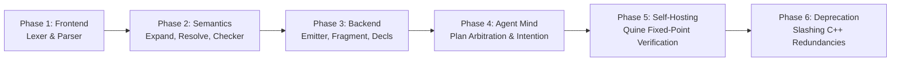

# VAgent Self-Hosting Migration — Architecture & Implementation Plan

|           |                                                                                |
| --------- | ------------------------------------------------------------------------------ |
| status    | implementation plan (revised post-review Round 1)                              |
| companion | `design/vagent-metacircular-compiler-implementation.md`,                       |
|           | `design/vagent-metacircular-compiler.md`, `design/vagent-metaprogramming.md`,  |
|           | `design/vagent-agent-language.md`, `design/store-slice-convergence.md`         |
| baseline  | commit with Stages 0–7 metacircular compiler + VIcon scanning completed        |
| scope     | migrating ~15,000 lines of C++ VAgent pipeline into sovereign `.vagent` stdlib |

______________________________________________________________________

## 1. Executive Summary & Architectural Mandate

With the completion of Stages 0–7 of the Metacircular Compiler
(`design/vagent-metacircular-compiler-implementation.md`), the VAgent runtime has achieved:

1. **The R1 AST Representation**: Homogeneous ZigZag cell graphs representing expressions,
   statements, declarations, and types without C++ AST object pointers (`r1_ast.hpp:24–35`).
1. **The Genesis Bootstrap**: Pure in-manifold `writer` (`Value`) and `linker` (`Link`) primitives
   minted at genesis and reachable via `std:meta (boot_writer, boot_linker)`.
1. **Atomic VM Registration**: `register` and `register_all` validation gates securing the
   `VortexVM::opcodeMap_` boundary without raw write bypasses (`genesis.cpp:112–165`).
1. **Native VIcon Goal-Directed Scanning**: First-class string scanning (`s ? e`, `tab`, `move`,
   `match`, `many`, `any`, `upto`, `find`, `pos`, `subject`) with automatic backtrack recovery of
   `&pos` (`vortex_stdlib.cpp:1420–1580`).
1. **Metacircular Foundation Modules**: Initial implementations of `parser.vagent`,
   `checker.vagent`, and `emitter.vagent`.

Per the project rules in `GEMINI.md`:

> *"New C++ code must justify why it isn't being written in Vortex. New Vortex standard library code
> in Vortex must leverage existing Vortex standard library functions unless absolutely necessary."*

Currently, `apps/common/xanadu/vagent/` carries **29,070 lines of C++23 code** across 54 files (25
`.cpp` files with 24,983 lines, and 29 `.hpp` files with 4,087 lines). This document defines the
comprehensive, phased implementation plan to migrate all frontend, semantic analysis, lowering, and
cognitive arbitration logic into sovereign `.vagent` code, slashing the C++ footprint down to an
immutable, hardened execution substrate.

```mermaid
flowchart TD
    subgraph Current Architecture [Current Dual-Stack Architecture ~29,000 LoC C++]
        C_Lex[C++ lexer.cpp / token.cpp] --> C_Parse[C++ parser.cpp / ast_clone.cpp]
        C_Parse --> C_Expand[C++ expand.cpp / cell_path.cpp]
        C_Expand --> C_Resolve[C++ resolve.cpp]
        C_Resolve --> C_Check[C++ checker.cpp]
        C_Check --> C_Emit[C++ compiler.cpp / fragment.cpp]
        C_Emit --> C_Decls[C++ decls.cpp]
        C_Decls --> C_Meta[C++ meta.cpp / executor.cpp]
    end

    subgraph Target Architecture [Target Self-Hosting Architecture]
        subgraph VAgent In-Language (~15,000 LoC VAgent Stdlib)
            V_Lex["std:compiler:lexer (VIcon Scanning)"] --> V_Parse["std:compiler:parser (Recursive Descent)"]
            V_Parse --> V_AST["R1 AST Manifold (+d.grab / +d.step)"]
            V_AST --> V_Expand["std:compiler:expand (Macro / Cells Desugar)"]
            V_Expand --> V_Resolve["std:compiler:resolve (Scoping & Symbol Clone Views)"]
            V_Resolve --> V_Check["std:compiler:checker (Type Inference & Diagnostics)"]
            V_Check --> V_Emit["std:compiler:emitter (Vortex Opcode Graphs)"]
            V_Emit --> V_Decls["std:compiler:decls (Agent & Belief Lowering)"]
            V_Decls --> V_Mind["std:agent:mind (Goal & Plan Selection)"]
        end

        subgraph Hardened C++ Engine Substrate (~9,500 LoC C++)
            C_Kernel["VortexVM Execution Loop / CompactOpNode / ArenaManifold"]
            C_Runtime["Executor Turn Loop / P16 Relocation / LineageStore Descriptors"]
            C_Shims["Thin In-Language Compiler Shims (P23)"]
        end

        V_Emit -->|register / validate| C_Kernel
        V_Mind -->|turn percept / wake| C_Runtime
    end
```

______________________________________________________________________

## 2. Subsystem Feasibility & Boundary Matrix

The 54 files in `apps/common/xanadu/vagent/` are categorized into three migration tiers:

| Component / Subsystem              | Current Files (.cpp / .hpp)                                                | C++ LoC | Target Tier                     | Target Destination in `.vagent`                         |
| :--------------------------------- | :------------------------------------------------------------------------- | :------ | :------------------------------ | :------------------------------------------------------ |
| **Lexical Analysis**               | `lexer.cpp`, `token.cpp`, `lexer.hpp`, `token.hpp`                         | 785     | **Tier 1 (100% In-Lang)**       | `stdlib/lexer.vagent` (`std:compiler:lexer`)            |
| **Parser & Concrete Syntax**       | `parser.cpp`, `ast_clone.cpp`, `frontend.cpp`, headers                     | 2,130   | **Tier 1 (100% In-Lang)**       | `stdlib/parser.vagent` (`std:compiler:parser`)          |
| **Macro Expansion & Paths**        | `expand.cpp`, `cell_path.cpp`, `code_path.cpp`, headers                    | 2,420   | **Tier 1 (100% In-Lang)**       | `stdlib/expand.vagent` (`std:compiler:expand`)          |
| **Name Resolution & Scopes**       | `resolve.cpp`, `resolve.hpp`                                               | 1,040   | **Tier 1 (100% In-Lang)**       | `stdlib/resolve.vagent` (`std:compiler:resolve`)        |
| **Type Checker & Semantics**       | `checker.cpp`, `checker.hpp`                                               | 3,365   | **Tier 1 (100% In-Lang)**       | `stdlib/checker.vagent` (`std:compiler:checker`)        |
| **Scalar & Control Emitter**       | `compiler.cpp`, `fragment.cpp`, headers                                    | 3,592   | **Tier 1 (100% In-Lang)**       | `stdlib/emitter.vagent`, `stdlib/fragment.vagent`       |
| **Declaration Lowering**           | `decls.cpp`, `decls.hpp`                                                   | 2,410   | **Tier 1 (100% In-Lang)**       | `stdlib/decls.vagent` (`std:compiler:decls`)            |
| **Metaprogramming & Reflection**   | `meta.cpp` (high-level parts), `meta.hpp`                                  | ~2,500  | **Tier 2 (Hybrid Core)**        | `stdlib/mind.vagent`, `stdlib/plasticity.vagent`        |
| **Plan Selection & Arbitration**   | `executor.cpp` (cognitive loop), `executor.hpp`                            | ~2,200  | **Tier 2 (Hybrid Core)**        | `stdlib/arbitration.vagent`, `stdlib/intentions.vagent` |
| **Compiler Bridge & AST Shims**    | `bootstrap.cpp`, `host_compile.cpp`, `r1_ast.cpp`, `inlang_*.cpp`, headers | 2,050   | **Tier 3 (Hardened Substrate)** | Retained as thin C++ wrapper shims (`P23`)              |
| **Deployment & Relocation**        | `adapter.cpp`, `lineage.cpp`, `genesis.cpp`, `p16.cpp`, headers            | 2,750   | **Tier 3 (Hardened Substrate)** | Retained for Store tables and P16 fixups                |
| **Execution Loop & Host Dispatch** | `executor.cpp` (turn loop), `meta.cpp` (validate), `marshal.cpp`, headers  | ~4,728  | **Tier 3 (Hardened Substrate)** | Retained for memory-safe VM execution dispatch          |

### Justification for Retained C++ Substrate (Rule `GEMINI.md`)

The ~9,500 lines of C++ retained in Tier 3 are strictly justified:

1. **Instruction Interpreter Dispatch Loop**: The inner opcode execution cycle of `VortexVM::step()`
   cannot execute in VAgent without an infinite interpretation regress.
1. **P16 Relocation Resolution**: `p16.cpp` patches raw memory handles across cell allocations and
   enforces segment boundary invariants during `promote()`.
1. **Turn Atomicity & Engine Boundary**: `executor.cpp`'s native turn pump drives the host tick,
   processes external environment percepts, and checkpoints state into `LineageStore`.
1. **Hardware Sympathy**: Bytecode opcodes are emitted into `ArenaManifold` cell blocks and
   persisted to `SegmentedOpsSpool` with 64-byte `CompactOpNode` cache-line alignment in the
   underlying store.

______________________________________________________________________

## 3. Architecture of the VAgent Standard Library

The target self-hosting VAgent codebase is organized into modular packages under
`apps/common/xanadu/vagent/stdlib/` and `apps/common/xanadu/vagent/prelude/`:

```
apps/common/xanadu/vagent/
├── prelude/
│   └── meta.vagent              # Core reflection, dynamic run, and bootstrap declarations
└── stdlib/
    ├── lexer.vagent             # std:compiler:lexer (Goal-directed scanning tokens)
    ├── parser.vagent            # std:compiler:parser (R1 AST recursive descent)
    ├── ast.vagent               # std:compiler:ast (R1 AST kind tags and selectors)
    ├── expand.vagent            # std:compiler:expand (cells"...", splice, static folding)
    ├── resolve.vagent           # std:compiler:resolve (Lexical scoping, symbol clone views)
    ├── checker.vagent           # std:compiler:checker (Type lattice, inference, diagnostics)
    ├── emitter.vagent           # std:compiler:emitter (Opcode graph generator, Cut wrapping)
    ├── fragment.vagent          # std:compiler:fragment (Fragment object assembly, descriptors)
    ├── decls.vagent             # std:compiler:decls (Agent, event, plan, belief lowering)
    ├── mind.vagent              # std:agent:mind (Belief indexing, candidate plan filtering)
    ├── arbitration.vagent       # std:agent:arbitration (Utility weighting, intention queue)
    └── plasticity.vagent        # std:agent:plasticity (Synapse dynamic weights, unlearning)
```

### Canonical R1 AST Manifold Topology

To guarantee strict compliance with the 2-degree ZigZag rank invariant (no fan-in along one
dimension/direction), the R1 AST manifold layout strictly follows `r1_ast.hpp:24–35`:

1. **Node Kind**: Stored directly in cell text via `arena.makeCell(kindTag)`. No separate `+d.kind`
   dimension is used, preventing link-eviction fan-in.
1. **Hierarchy**:
   - The parent AST cell connects to its first child along `+d.grab`.
   - Sibling child nodes are linearly chained along `+d.step`.
1. **Types & Annotations**: Type annotations connect to the AST node along `+d.values`.
1. **Symbol Resolution**: When multiple identifier references bind to a single declaration, they
   **never** link directly to the declaration on one dimension. Instead, references link to a
   dedicated clone view cell on `Decl +d.clone`, or chain along a dedicated `+d.refs` rank.
1. **Relocation Markers**: All internal cell operands within emitted bytecode graphs are marked on
   `+d.mesh.relocation` so `ArenaManifold::promote()` relocates references properly.

______________________________________________________________________

## 4. Staged Migration Plan (Phases 1–6)



### Phase 1: In-Language Parsing & AST Generation

- **Objective**: Replace C++ `lexer.cpp` and `parser.cpp` with pure `.vagent` equivalents emitting
  conforming R1 AST cell graphs.
- **Track 1.1: `stdlib/lexer.vagent`**:
  - Implements streaming goal-directed scanning over source subject strings without intermediate
    substring slice allocations ($O(N)$ single-pass scanning):
    - Keywords (`agent`, `on`, `plan`, `var`, `let`, `if`, `then`, `else`, `match`, `to`, `by`,
      `cells`, `code`, `static`, etc.).
    - Operators and delimiters (`:=`, `<-`, `|`, `&`, `++`, `==`, `!=`, `<=`, `>=`, `->`, `::`).
    - Literals: integers (decimal, hex `0x`), floats, string literals with escape sequences (`\n`,
      `\t`, `\xHH`, `\u{...}`), multi-line text blocks.
    - Comments: single-line `# ...`, block comments.
  - Instantiates `Token` records with source coordinates (`line`, `col`, `length`) via dynamic
    record expressions (`P22`).
- **Track 1.2: `stdlib/parser.vagent`**:
  - Implements recursive descent parsing over token streams:
    - Precedence climbing for binary expressions (`binaryOperator`).
    - Unary operators (`-`, `not`).
    - Control structures: `if/then/else`, `while`, `until`, `every`, alternation `|`, sequence `&`.
    - Object construction: records `T{f: v}`, lists `[a, b]`, cells paths `cells"..."`, code
      literals `code"..."`.
    - Statement forms: declarations `let`, assignment `:=`, reversible `<-`, return, fail.
    - Top-level items: `import`, `event`, `agent`, `var`, `def`, `plan`, `on`.
  - Builds R1 AST cells connected via `+d.grab` (first child) and `+d.step` (siblings) in an
    isolated scratch compilation arena (`P21`).
- **Validation Gate 1**:
  - Parity test harness: parses all 23 `tests/samples/vagent/mini_*.vagent` and stdlib modules with
    both C++ `parser.cpp` and `parser.vagent`; verifies that the emitted R1 AST cell graph is
    structurally isomorphic under `zigzag::crdt::CrdtEngine::verifyManifoldInvariants()`.

### Phase 2: Macro Expansion, Resolution & Type Checking

- **Objective**: Move `expand.cpp`, `resolve.cpp`, and `checker.cpp` into `.vagent`.
- **Track 2.1: `stdlib/expand.vagent` & `stdlib/resolve.vagent`**:
  - Desugars `cells"..."` path expressions into `New`/`Linked` traversals.
  - Evaluates compile-time manifest `static` expressions.
  - Resolves symbol bindings using clone views on `+d.clone` or `+d.refs` chains.
  - Replaces `splice` AST nodes with macro arguments.
- **Track 2.2: `stdlib/checker.vagent`**:
  - Port full type checking logic from `checker.cpp`:
    - Primitive types: `Int`, `Float`, `Str`, `Bool`, `Cell`, `Unit`, `Bottom`.
    - Compound types: `List<T>`, `Opt<T>`, `Record<...>`, `Code<T>`.
    - Subtyping rules: `compatible(actual, expected)`.
    - Bounded statement legality checks (disallowing uncaptured generators outside conditions).
    - Arity and type validation of builtin and member function calls.
    - Diagnostic emission with structured `Diagnostic{code, message, line, col, length}` records.
- **Validation Gate 2**:
  - Runs in-language checker against all standard library modules and tests. Asserts that valid code
    passes with zero diagnostics and illegal samples emit matching diagnostic codes (`TypeMismatch`,
    `InvalidPosition`, `UnknownName`, `ArityMismatch`).

### Phase 3: Metacircular Emitter & Declaration Lowerer

- **Objective**: Lower typed R1 AST manifolds into executable Vortex bytecode opcode graphs.
- **Track 3.1: `stdlib/emitter.vagent` & `stdlib/fragment.vagent`**:
  - Translates expressions to wrapped opcode sequences:
    - Prologue: `produced = false`, `ChoiceDepth`, `Choice(failArm)`.
    - Body emission: arithmetic (`Add`, `Sub`, `Mul`, `Div`, `Mod`), comparison (`Lt`, `Eq`, etc.),
      string scanning (`ScanPush`, `ScanPop`, `ScanTab`, `ScanMove`, etc.), branching (`Branch`,
      `Jump`), calls (`RunCall`, `RunResume`).
    - Opcode minting: emits integer scalar cells using `asInt64(op)`.
    - Epilogue: `Cut(depth)` (`P19`), `produced = true`, tail `Halt`/`Return`.
  - Packages fragment objects: creates `head`, descriptor with parameter list, `produced` flag cell,
    `result` cell, and `+d.refs` records with `+d.mesh.relocation` markers.
- **Track 3.2: `stdlib/decls.vagent`**:
  - Lowers agent declarations:
    - Creates agent master cell, seeds fields on `+d.vars`.
    - Files event handlers on event symbols (`+d.step` clauses).
    - Links plans on goal symbols with priority and weight metadata.
    - Lowers belief rules into the agent's belief bank manifold.
- **Validation Gate 3**:
  - Compiles sample agents and fragments; executes them on `VortexVM`; verifies behavioral identity
    with C++ lowered programs.

### Phase 4: Cognitive Mind & Plan Arbitration

- **Objective**: Move cognitive agent decision-making from C++ `meta.cpp`/`executor.cpp` into
  VAgent.
- **Track 4.1: `stdlib/mind.vagent`**:
  - Belief pattern matching: queries agent belief manifold using Vortex/Vlog logic unification.
  - Dynamic candidate plan gathering: hops goal symbol `+d.clause`, collects plans matching the
    trigger.
- **Track 4.2: `stdlib/arbitration.vagent`**:
  - Plan precondition evaluation: runs plan `where` guards under bounded evaluation
    (`run(guard, args)`).
  - Utility scoring & arbitration: evaluates priority, synapse weights, and epistemic confidence.
  - Selects winning plan and pushes activation frame onto agent intention queue.
- **Validation Gate 4**:
  - Complex cognitive agent journeys: belief revision, intention suspension, plan failure recovery,
    and adaptive synapse weight tuning running purely in VAgent logic.

### Phase 5: Self-Hosting Quine & Bit-Exact Verification

- **Objective**: Achieve complete self-hosting bootstrapping.

- **Process**:

  ```
  [Stage 0: C++ Compiler]
         │
         ▼ compiles stdlib/*.vagent
  [Stage 1: In-Language Compiler Binary Image 1]
         │
         ▼ compiles stdlib/*.vagent
  [Stage 2: In-Language Compiler Binary Image 2]
         │
         ▼ compiles stdlib/*.vagent
  [Stage 3: In-Language Compiler Binary Image 3]
  ```

- **Verification Rule**: Image 2 and Image 3 must be **structurally isomorphic**
  (`FragmentStructure` equality in `tests/xuzz/vagent_metacircular_quine_test.cpp`), with matching
  opcode graphs and Merkle root hashes of emitted bytecode. This mathematically proves the
  metacircular compiler is a fixed point.

### Phase 6: C++ Engine Decoupling & Deprecation

- **Objective**: Safely remove duplicate C++ compiler code and slim the engine.
- **Action**:
  - Replace C++ `parser.cpp`, `checker.cpp`, `compiler.cpp`, `decls.cpp`, `expand.cpp`,
    `resolve.cpp` with thin shims invoking the Stage 1/2 VAgent compiler image (`P23`).
  - Delete retired C++ source files from the `Makefile` (`P24`).
  - Retain only the hardened engine kernel (`VortexVM`, `ArenaManifold`, `LineageStore`).

______________________________________________________________________

## 5. Parallel Execution Tracks & Work Packages

To maximize parallelism across subagents and worktrees, work is organized into four sequential waves
with decoupled, file-disjoint tracks:

```mermaid
flowchart TD
    subgraph Wave 1 [Wave 1: Frontend & Lexer/Parser]
        T_A1["Track A1: stdlib/lexer.vagent<br/>(Scanner-based Tokenizer)"]
        T_A2["Track A2: stdlib/parser.vagent<br/>(Recursive Descent & R1 AST)"]
    end

    subgraph Wave 2 [Wave 2: Semantics & Type System]
        T_B1["Track B1: stdlib/expand.vagent & resolve.vagent<br/>(Macro Expansion & Clone Views)"]
        T_B2["Track B2: stdlib/checker.vagent<br/>(Full Type System & Diagnostics)"]
    end

    subgraph Wave 3 [Wave 3: Backend & Code Generation]
        T_C1["Track C1: stdlib/emitter.vagent<br/>(Vortex Opcode Graphs & Cut Epilogue)"]
        T_C2["Track C2: stdlib/fragment.vagent & decls.vagent<br/>(Descriptors & Agent Manifolds)"]
    end

    subgraph Wave 4 [Wave 4: Cognitive Mind & Self-Hosting Quine]
        T_D["Track D: stdlib/mind.vagent & arbitration.vagent<br/>(Plan Selection & Intention Queue)"]
        T_E["Track E: Self-Hosting Quine Suite (P24)<br/>(Fixed-Point Verification Harness)"]
    end

    Wave 1 --> Wave 2
    Wave 2 --> Wave 3
    Wave 3 --> Wave 4
```

### Track Breakdown

- **Track A1 (`stdlib/lexer.vagent`)**:
  - Leverages native `std:goal` scanning (`tab`, `many`, `match`).
  - Zero external dependencies beyond `std:goal`.
- **Track A2 (`stdlib/parser.vagent`)**:
  - Implements grammar productions matching `apps/common/xanadu/vagent/parser.cpp`.
  - Produces standard R1 AST cells using `+d.grab` (first child) and `+d.step` (siblings).
- **Track B1 (`stdlib/expand.vagent` + `stdlib/resolve.vagent`)**:
  - Operates strictly as an AST-to-AST manifold transformation.
- **Track B2 (`stdlib/checker.vagent`)**:
  - Traverses R1 AST, enforces typing rules, yields checked annotations or diagnostics.
- **Track C1 (`stdlib/emitter.vagent`)**:
  - Emits wrapped opcode sequences via genesis `boot_writer` and `boot_linker` using `asInt64(op)`.
- **Track C2 (`stdlib/fragment.vagent` + `stdlib/decls.vagent`)**:
  - Structures compiled fragments and mounts agent declarations.
- **Track D (`stdlib/mind.vagent` + `stdlib/arbitration.vagent`)**:
  - Expresses BDI (Belief-Desire-Intention) agent reasoning in native VAgent.
- **Track E (Quine & Integration Suite)**:
  - Multi-stage bootstrapping test suite in `tests/xuzz/vagent_metacircular_quine_test.cpp`.

______________________________________________________________________

## 6. The Numbered Proposal Register (`P18`–`P25`)

Every change to existing C++ code or engine boundaries is tracked below:

### `P18`: Scope Restoration on `#Return` and `#RunResume` in `VortexVM`

- **Location**: `apps/common/xanadu/vortex/vortex_vm.cpp:1087–1142, 1698–1714`
- **Problem**: Parameter bindings pushed to `cursor +d.vars` during `#Call` / `#RunCall` are not
  restored or unlinked upon `#Return` or `#RunResume`. In recursive-descent parsing
  (`parser.vagent`), callee local variables permanently shadow caller variables and leak memory
  along `+d.vars`.
- **Change**: On `#Call` / `#RunCall`, record the caller's `varsHead` on the `-d.stack` frame cell.
  On `#Return` / `#RunResume`, restore `cursor +d.vars` to `varsHead`.
- **Cost**: 1 link per frame cell; $O(1)$ pointer reset on return. Zero additional byte overhead in
  opcodes.
- **Fallback**: Explicit manual unlinking of local variables in VAgent source (error-prone).

### `P19`: Scanning Success Cut (`OpcodeKind::Cut`) in `compiler.cpp`

- **Location**: `apps/common/xanadu/vagent/compiler.cpp:1633–1653`
- **Problem**: The scanning construct `s ? e` emits `ScanPush` + `Choice(popFail)` to `popSuccess`.
  `popSuccess` leaves the `ChoicePoint` uncut. If the compiler subsequently allocates AST or opcode
  cells, any future backtrack rolls back `arena.release(cp.mark)`, silently truncating newly
  allocated AST and bytecode cells.
- **Change**: Emit `OpcodeKind::Cut` in the success continuation of `s ? e` before continuing
  execution.
- **Cost**: 1 opcode (8 bytes in `CompactOpNode` / 1 cell in manifold), executed only once on
  successful scan completion.
- **Fallback**: Wrap all scanner expressions in an explicit `isolate { ... }` block in VAgent
  source.

### `P20`: R1 AST Declaration Manifold Support in `r1_ast.{hpp,cpp}`

- **Location**: `apps/common/xanadu/vagent/r1_ast.hpp:13–35`, `r1_ast.cpp:141–179`, `marshal.cpp`
- **Problem**: R1 AST only defines 18 expression kind tags (`KindTag::*`) and only marshals
  expressions (`Expr`). It cannot represent top-level declarations (`Decl`, `Import`, `Program`),
  causing Validation Gate 1 to fail on module samples.
- **Change**: Extend `KindTag` with declaration tags (`Program`, `Import`, `AgentDecl`, `EventDecl`,
  `PlanDecl`, `BeliefDecl`, `FnDecl`, `Param`, `Field`, `Clause`). Update `marshalAstToR1` to
  support full programs.
- **Cost**: 10 enum tags, ~150 lines of C++ marshaling code; zero change to existing expression
  layouts.
- **Fallback**: Store declarations as untyped subtrees on custom dimensions.

### `P21`: Compilation Scratch Arena Lifecycle

- **Location**: `apps/common/xanadu/vagent/host_compile.cpp`, `inlang_parser.cpp`
- **Problem**: `ArenaManifold` is append-only for cells; individual cells cannot be freed. Running
  the compiler directly in the agent's live manifold permanently leaks $O(N_{\text{source cells}})$
  into the agent's state, corrupting checkpoints and bloating memory.
- **Change**: Instantiate an isolated scratch `ArenaManifold scratchArena` for each compilation
  unit. The compiler lowers source into AST and bytecode within `scratchArena`. Upon completion, the
  compiled fragment opcode graph is promoted into the target runtime manifold, and `scratchArena` is
  destroyed via RAII (`arena.release()`).
- **Cost**: Temporary memory allocation bounded by single module size (~5–10 MiB during
  compilation); 0 permanent cell leaks.
- **Fallback**: Live manifold compaction via `compact()` (cannot reclaim dead cell slots).

### `P22`: Dynamic Record Expression Construction in `compiler.cpp`

- **Location**: `apps/common/xanadu/vagent/compiler.cpp:756–768`
- **Problem**: Current lowering restricts record construction to compile-time constant literals,
  preventing `stdlib/lexer.vagent` from dynamically instantiating `Token{kind, text, line, col}`
  records.
- **Change**: Permit arbitrary dynamic value expressions in record member initializers during
  expression lowering, emitting runtime member evaluation and cell initialization.
- **Cost**: Standard runtime expression evaluation cost per record field.
- **Fallback**: Represent tokens as lightweight 4-element tuple vectors or in-manifold cell ranks.

### `P23`: C++ Runtime Shims for In-Language Compiler Modules

- **Location**: `apps/common/xanadu/vagent/inlang_parser.{hpp,cpp}`, `inlang_checker.{hpp,cpp}`,
  `inlang_emitter.{hpp,cpp}`
- **Problem**: Existing C++ callers across `xuzz` and tests expect C++ APIs (`parseProgram()`,
  `typecheck()`, `compileModule()`).
- **Change**: Replace C++ frontend bodies with thin shims that invoke the compiled VAgent bytecode
  fragments via `MetaRuntime::runFragment()` / `RunCall`, converting inputs/outputs across the
  boundary.
- **Cost**: ~$10$ lines of C++ per shim.
- **Fallback**: Duplicate compiler invocations in both C++ and VAgent indefinitely.

### `P24`: Deprecate and Retire C++ Compiler Frontend in `Makefile`

- **Location**: `Makefile:apps/common/xanadu/vagent/*.cpp`
- **Problem**: Retaining dead C++ code in the build tree once self-hosting reaches Phase 6 causes
  confusion and violates project rules.
- **Change**: Remove `lexer.cpp`, `parser.cpp`, `expand.cpp`, `resolve.cpp`, `checker.cpp`,
  `compiler.cpp`, `decls.cpp`, and `fragment.cpp` from `Makefile` compilation objects once the quine
  fixed point is verified.
- **Cost**: Deletes 14,842 lines of C++ code, reducing build time.
- **Fallback**: Keep legacy C++ implementations behind a compile-time feature flag.

### `P25`: Eliminate `noCell` Sentinels Across VAgent Engine APIs

- **Location**: `apps/common/xanadu/vagent/inlang_checker.hpp:42`, `inlang_emitter.hpp:31`,
  `executor.hpp:224`
- **Problem**: Standing rules forbid sentinel integers like `noCell = 0`. Several newly added
  headers still use `CellRef = 0` as a sentinel.
- **Change**: Change return types to `std::optional<CellRef>` across all VAgent APIs.
- **Cost**: Zero runtime overhead; type-safe modern C++23 conformance.
- **Fallback**: None; strictly mandated by `AGENTS.md` and `GEMINI.md`.

______________________________________________________________________

## 7. Resource Accounting & Execution Limits

Compilation of large self-hosting modules demands substantial computation that exceeds default VM
limits:

1. **Cycle Budget**: Default `VortexVM::run()` limit is $100,000$ cycles. For compiling
   `stdlib/checker.vagent` (~3,000 lines), the VM cycle limit is elevated to $5 \times 10^7$ cycles.
1. **Cell Allocation Cap**: Scratch arena allocations are bounded at $500,000$ cells per module.
1. **Call Stack Depth**: Recursion depth for recursive descent parsing is bounded at $2,000$ frames.
1. **Scanner Backtracking**: Scanning backtrack depth is limited to $10,000$ positions.
