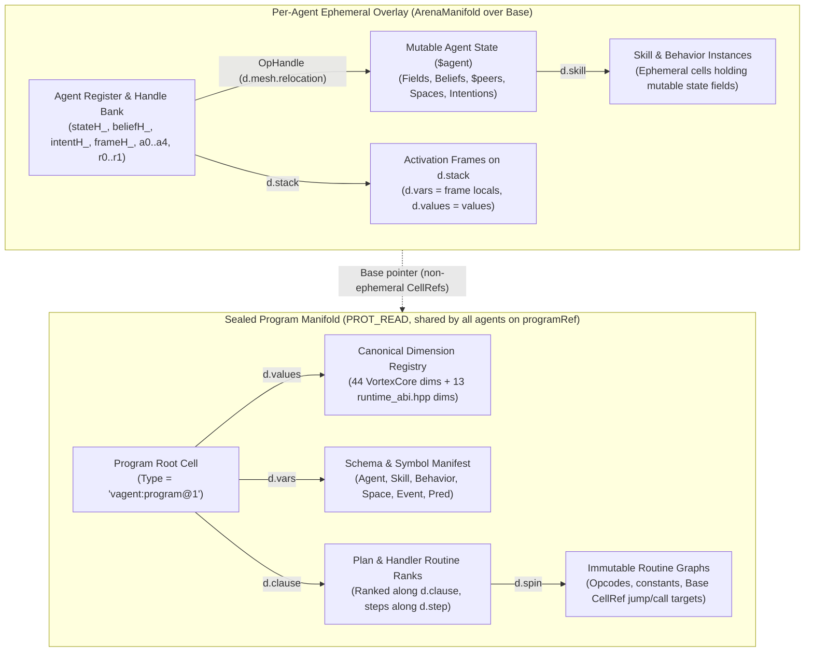

# Vagent Shared Program Manifold (`U-A14`) and Live Agent Upgrade

**Status:** Approved Specification (Proposals P17.1–P17.5 approved; Open Questions 1–3 resolved with
Option B; companion to [`vagent-agent-language.md`](vagent-agent-language.md) v3.12, §11.1, §11.2,
and §18 `U-A14`)

This companion design was imported with its review history in a documentation-only merge. Its
implementation-specific examples refer to the source branch at `46402f26` (and its earlier commits),
not to code imported into this checkout. The current frontend, scalar compiler and runtime
interfaces are preserved. Approved design status is separate from implementation status; full agent
execution and shared-program/live-upgrade integration remain outstanding here.

______________________________________________________________________

## 1. Motivation & Problem Statement

### 1.1 Per-Agent Program Duplication Today

In the current `vagent` runtime (`apps/common/xanadu/vagent/program.cpp` and
`apps/common/xanadu/vagent/agent_executor.cpp`), a `CompiledProgram` holds only the parsed
`TranslationUnit` AST (`unit_`) and a diagnostic report. No Vortex instruction cells or dimension
cells are minted when `compileProgram` succeeds. Instead, on every agent's first turn
(`AgentExecutor::prepare`), the runtime invokes
`CompiledProgram::instantiate(WorkerContext &context, std::string_view agentType)`:

```cpp
// apps/common/xanadu/vagent/program.cpp:52
std::expected<CompiledAgent, std::string>
CompiledProgram::instantiate(zigzag::vortex::WorkerContext &context,
                             std::string_view agentType) const {
  Compiler compiler(context.core);
  compiler.setBeliefEventDepth(beliefEventDepth_)
      ->setConditionFuel(conditionFuel_)
      ->setMaintainBackoffMs(maintainBackoffMs_);
  return compiler.compileAgent(unit_, agentType);
}
```

`Compiler::compileAgent` lowers the entire `TranslationUnit` directly into that single agent's
private `context.arena` (`zigzag::ArenaManifold`), minting ephemeral cells (`CellRef` with bit 31
set, `0x80000000u | index`) for:

- The 13 canonical `vagent` dimensions defined in `apps/common/xanadu/vagent/runtime_abi.hpp:66–69`
  (`kAgentDimensionNames`: `d.behavior`, `d.skill`, `d.capacity`, `d.space`, `d.member`, `d.holon`,
  `d.intention`, `d.subgoal`, `d.outbox`, `d.belief`, `d.pending`, `d.source`, `d.extends`),
  alongside the 44 `VortexCore` genesis dimensions (`d.First`, `d.next`, `d.grab`, `d.point`,
  `d.handle`, `d.stack`, `d.vars`, `d.values`, `d.mesh.relocation`). Timers are managed on
  `$agent`'s `$timers` field rank.
- Every compiled opcode chain (`OpcodeKind::Add`, `OpcodeKind::Link`, `OpcodeKind::Jump`,
  `OpcodeKind::Branch`, `OpcodeKind::Call`, `OpcodeKind::Choice`, `OpcodeKind::Cut`,
  `OpcodeKind::Fail`, `OpcodeKind::Point`, `OpcodeKind::Deref`, `OpcodeKind::Value`) for all pure
  functions, methods, rules, plans, and event handlers across all declarations in the unit.
- All static constants (`cInt`, `cBool`, `cFloat`, `cStr`), register cells (`a0_..a4_`, `r0_..r1_`),
  scratch cells (`scratch_[0..31]`), and the dynamic allocation pool (`pool_`).
- The initial `$agent` state root (`agentCell_`), field slots, belief head, `$peers` root, and
  intention head.

Consequently, spawning $N$ agents on a node—or spawning child agents via `spawn Child(...)` in
`AgentExecutor::stepChildAgents`—runs full AST-to-Vortex compilation $N$ times and duplicates every
dimension cell, constant cell, and opcode graph inside each agent's private `ArenaManifold`.

### 1.2 Why `restoreState` Must Re-Instantiate and Copy Cell-by-Cell Today

When an agent checkpoints its state via `MeshActorRuntime::checkpointView`
(`apps/common/xanadu/vortex/mesh_actor.cpp:924`) and resumes via `MeshActorRuntime::resume`
(`mesh_actor.cpp:301`), the checkpoint payload is serialized by `publishValue` and reconstructed by
`materializeValue` as a standalone `Store` + `Manifold` containing only the cells reachable from
`stateRoot` (`$agent`).

During Task U (`design/projects/vagent-review/impl-frames-analysis.md`), `vagent` adopted **P16**
(`OpcodeKind::Point` and `OpHandle` operand resolution with `xanadu::cellRelocationMarker` on
`d.mesh.relocation`). While P16 eliminated raw `Int64` cell references for mutable state roots
(`stateH_`, `beliefH_`, `intentH_`, `peersH_`, `frameH_`, `walkH_`) and dynamic pool allocations,
four structural barriers still prevent promoting or resuming an agent arena without re-compiling and
copying state:

1. **Control-Flow Targets Are `Int64` Scalar `CellRef`s:** `Compiler::opref(CellRef target)` emits
   `cInt(static_cast<std::int64_t>(target))`—an `Int64` scalar cell connected on `d.grab` to
   `#Jump`, `#Branch`, `#Call`, and `#Choice` instructions. The Vortex VM
   (`apps/common/xanadu/vortex/vortex_vm.cpp:655–694`) reads the jump/call target via
   `toInt(inputs[0])` and casts it to `CellRef`. When `zigzag::promote`
   (`apps/common/xanadu/zigzag/arena_manifold.cpp:1750`) promotes ephemeral cells into persistent
   `Store` operations (`1..M`), it remaps `d.mesh.relocation`-marked `UInt64` handles
   (`arena_manifold.cpp:2011`), but it cannot distinguish an `Int64` jump target from an ordinary
   integer constant (`42`). Furthermore, `materializeValue` on the receiving node only materializes
   cells reachable from `stateRoot` (`$agent`); compiled routine graphs are not reachable from
   `$agent` and are omitted from the state checkpoint.
1. **Dimension Cells Are Embedded as `Int64` Constants in Instructions:** Every `#Link`, `#Unlink`,
   and `#Step` instruction takes its dimension operand as `cInt(static_cast<std::int64_t>(dim))`.
   When `resume` creates a fresh `WorkerContext` over the checkpoint's `Manifold`
   (`mesh_actor.cpp:301`) and then calls `program_.instantiate(*actor->context, ...)`,
   `compileAgent` mints a *new* set of ephemeral dimension cells (`0x80000000 | d_new`) in the
   overlay arena, whereas the checkpoint's restored state graph in `base_` is linked along the *old*
   promoted dimension `CellRef`s (`d_old` in `1..M`).
1. **In-Place Opcode Output Slots (`-d.grab`):** Placing opcode output slots in the base manifold
   causes `ArenaManifold::shadow` to run on every instruction result, ballooning heap allocations.
   More critically, `ArenaManifold::release(turnMark)` rolls back all slots and shadows minted since
   `turnMark`, meaning turn-end scratch cleanup via mark/release would destroy legitimate mutable
   state mutations produced during the turn.
1. **Consequence (`AgentExecutor::restoreState`):** Because the resumed `AgentInstance` has newly
   minted dimension `CellRef`s and newly minted handle slots in its ephemeral overlay,
   `AgentExecutor::prepare` must run `restoreState(oldArena, oldRoot)`
   (`agent_executor.cpp:3158–3294`), which looks up old dimensions by string name, walks every
   field, belief, space entry, child descriptor, and intention in `oldArena`, and deep-copies them
   via `cloneGraph` into the new ephemeral dimensions—losing mounted skills and behaviors in the
   process and incurring $O(|state| + |program|)$ work on every resume.

### 1.3 How a Shared, Sealed, Versioned Program Manifold Solves Both Problems

`zigzag::ArenaManifold` already implements a clean split between a read-only base `Manifold`
(persistent `CellRef`s with bit 31 clear, `!isEphemeral(ref)`) and a per-worker ephemeral overlay
(ephemeral `CellRef`s with bit 31 set, `isEphemeral(ref)`). Furthermore, `zigzag::promote`
(`arena_manifold.cpp:1757, 1867, 2037`) leaves any unshadowed base `CellRef` untouched, promoting
only ephemeral overlay cells and shadowed base cells.

By compiling a `vagent` program once into a **sealed, content-addressed base `Store` + `Manifold`**
identified by `programRef` (and shared across every agent, child agent, and worker thread on the
node):

- Every canonical dimension cell (`kAgentDimensionNames` and `VortexCore` dimensions), every
  compiled opcode cell, every control-flow target `CellRef`, and every static constant has a
  **canonical, non-ephemeral base `CellRef`** (`!isEphemeral(ref)`) that is identical on every node
  holding `programRef`.
- Each running agent's `WorkerContext::arena` is an `ArenaManifold(&programManifold)` overlay whose
  mutable state (`$agent`, fields, beliefs, `$peers`, spaces, children, intentions, P16 `d.stack`
  frames, and mounted skill/behavior instances) lives in the overlay.
- To eliminate runaway copy-on-write shadowing on instruction executions, opcodes write their
  transient outputs directly into ephemeral overlay registers and activation frames on `d.vars` and
  `d.values`. Base opcode output wings are not shadowed across turns.
- Checkpointing an agent promotes the ephemeral state subgraph reachable from `$agent` as a compact
  standalone store whose segment 0 seeds the canonical 44 `VortexCore` and 13 `vagent` dimension
  cells. Resuming that checkpoint on any node holding `programRef` mounts the state delta on
  `programManifold` with **zero re-compilation and zero `restoreState` copying**.
- Advancing a running agent from `programRef` $V_1$ to $V_2$ at a quiescent turn boundary becomes a
  deterministic **live upgrade** that reconciles the agent's symbolic state overlay onto $V_2$'s
  base `Manifold` in-place under the same `ActorPid`.

______________________________________________________________________

## 2. Sealed Versioned Program Manifold (§11.1 + `U-A14`)

### 2.1 Hypertime Store Identity and Microversioning

A compiled `vagent` package is stored as an OSMIC `xanadu::Store` whose Structure operations fold
into a frozen `zigzag::Manifold` (`programManifold`).

1. **Permascroll Transclusion Model:** In Nelsonian hypermedia, stores contain edit decisions over
   primedia. The sealed program store holds `OpKind::Structure` operations that transclude opcode
   templates, schema manifests, and string literals from the author's deployment permascroll
   (`apps/common/xanadu/user_permascroll.hpp`).
1. **Cryptographic Identity (`programRef`):** When a `vagent` translation unit is compiled and
   sealed into a program store (globalizing primedia spans via `xanadu::publish`), its
   `SegmentedOpsSpool` segments are sealed (`PROT_READ`) and hashed into the store's Merkle root
   (`xanadu::Key`, 32-byte digest). In `MeshActorRuntime`, this digest is formatted as the canonical
   `programRef` URI (`blake3:<64-hex>` or `merkle:<64-hex>`) carried in `ActorGrant::programRef` and
   `ActorGrant::baseRef`.
1. **Hypertime Microversioning in One Store History:** Successive builds of a `vagent` program do
   not require disconnected stores. In `xanadu::Store`, each build is committed as a hypertime
   branch/microversion frontier (`Store::currentFrontier()` / `GlobalOpRef` seal) in the author's
   program store:
   - Version $V_1$ seals segments $0..k_1$ at frontier $F_1$ (`programRef` $= H(F_1)$).
   - Version $V_2$ appends new or updated routine graphs and metadata cells in segments $k_1+1..k_2$
     at frontier $F_2$ (`programRef` $= H(F_2)$), or is published as a self-contained sealed
     snapshot store via `historyFromSeal`.
   - Because sealed `CompactOpNode` segments are immutable (`PROT_READ`), $V_1$'s `Manifold`
     snapshot and $V_2$'s `Manifold` snapshot coexist simultaneously in memory on the same
     `LocalHost` while some agents run $V_1$ and upgraded agents run $V_2$. Base manifolds are
     retained in an LRU cache bounded by `LocalHost::Options::maxCachedPrograms` (default 32).

### 2.2 Exact Layout of the Sealed Program Manifold



The sealed program `Manifold` contains exclusively **immutable** cells (all having persistent,
non-ephemeral `CellRef`s where `!zigzag::ArenaManifold::isEphemeral(ref)`):

1. **Canonical Dimension Registry:**
   - All 44 `VortexCore` genesis dimensions (`d.First`, `d.next`, `d.grab`, `d.point`, `d.handle`,
     `d.stack`, `d.vars`, `d.values`, `d.mesh.relocation`, etc.).
   - All 13 canonical `vagent` dimensions defined in `runtime_abi.hpp:66–69` (`d.behavior`,
     `d.skill`, `d.capacity`, `d.space`, `d.member`, `d.holon`, `d.intention`, `d.subgoal`,
     `d.outbox`, `d.belief`, `d.pending`, `d.source`, `d.extends`).
   - Because these dimensions are promoted into the base `Manifold`, their persistent `DimRef`s are
     identical across every overlay `ArenaManifold` attached to this base.
1. **Program Manifest & Reflection Spine:** A structured subgraph rooted at the program cell:
   - **Agent Declarations:** Linked along `d.vars`; cells store agent type names, parameter types,
     field declarations (name, type, pure default initializer routine), and mounted skill/behavior
     names.
   - **Predicate Declarations:** Linked along `d.values`; cells record predicate name, arity,
     argument types, and key positions (`+d.vars`).
   - **Capacities, Skills, and Behaviors:** Linked along `d.clause`; cells record method signatures,
     effect contracts (`within` durations, `requires`/`ensures`), and whether the skill is native.
   - **Event Types:** Linked along `d.vars`; cells record event name, parent event name, and field
     records.
1. **Immutable Routine Bytecode Graphs:**
   - Compiled opcode chains for all functions, methods, guards, and handlers.
   - Control-flow targets (`#Jump`, `#Branch`, `#Call`, `#Choice`) name **base `CellRef`s** directly
     in their static operand cells.
   - Static constants (`Int64`, `Float`, `Str`, `Bool`, `Unit`) are deduplicated and shared across
     all agents running that program version.
1. **Plan & Handler Registry:**
   - Handlers are linked along `d.clause` from their container cell; cells name the event type,
     priority, guard routine `CellRef`, and body routine `CellRef`.
   - Plans are linked along `d.clause` by qualified name (`<Owner>.<Plan>`); cells record target
     goal name, `where` condition routine `CellRef`, AST content hash (`planGraphHash`), and a
     suspension rank along `d.step` linking step ordinals ($0, 1, \dots, K$) to their resume labels
     via `+d.point`.

### 2.3 Strict ZigZag Rank Invariants Across Base and Overlay

The repository enforces strict Nelsonian ZigZag topology (`A.pos(d) = B <=> B.neg(d) = A` for all
valid connections). To preserve this invariant across the base-overlay boundary:

1. **Skill Instances Live in the Ephemeral Overlay:** Skill and behavior instances hold mutable
   field state cells. In accordance with Rule V12, they **must live in the ephemeral overlay**,
   never in the frozen base manifold. The base manifold holds only the immutable capacity
   definitions and compiled method bytecode. When an agent mounts a skill, the overlay allocates the
   skill instance cell and links it into the agent's `d.skill` rank. This ensures no uncloned fan-in
   occurs across multiple agents referencing the same skill.
1. **Overlay State Cells Never Link Directly to Base Program Cells (Rule V12):** In
   `ArenaManifold::link`, linking any cell to a base cell invokes `shadow(*to)`, which would
   unintentionally drag base program cells into the ephemeral overlay and state checkpoints.
   Therefore, mutable overlay cells link only to other ephemeral cells. When mutable state must
   refer to a program declaration (such as an intention referencing its plan, or an instance
   referencing a capacity), it does so via symbolic strings (e.g., qualified plan name on
   `kIntentionPlan`), or via a P16 handle (`OpcodeKind::Point` on `d.mesh.relocation`) that resolves
   immutably through `WorkerContext`.
1. **Base Cells Never Point Directly to Ephemeral Overlay Cells:** The frozen base `Manifold` is
   `PROT_READ` and shared across hundreds of concurrent agent overlays. No base cell is ever
   modified or shadowed to point to an ephemeral cell.
1. **No Uncloned Fan-In:** Every rank maintains a maximum degree of 1 in POS and 1 in NEG
   directions. Where multiple agents reference the same base declaration, each agent's overlay
   maintains its own distinct traversal path.

______________________________________________________________________

## 3. Eliminating `restoreState` Copying via Delta Checkpoints

### 3.1 Checkpoint Representation as an Overlay Delta Store

When an agent checkpoints its state, the runtime must not serialize the immutable program bytecode.
Instead:

1. **State Isolation:** The checkpoint encompasses only the cells reachable from the agent's
   ephemeral state roots (`stateH_`, `beliefH_`, `intentH_`, `peersH_`, and active frames on
   `d.stack`).
1. **Dimension Seeding in Segment 0:** To satisfy `Store::requireCellOp` (`store.cpp:609`) when
   `Store::setLink` executes, `zigzag::promoteOverlay` seeds the 44 `VortexCore` and 13 `vagent`
   dimension declarations in segment 0 of the promoted checkpoint store. All intra-state links
   validate locally without requiring foreign parent spool lookups in `OpsSegmentHeader`.
1. **Handle Relocation:** P16 handles (`OpcodeKind::Point`) recorded on `d.mesh.relocation` remap
   cleanly into the checkpoint's segment.

### 3.2 Resuming on Any Node Holding `baseRef`

When node $B$ resumes a checkpoint created on node $A$:

```
1. Resolve baseRef -> LocalHost fetches or opens base programManifold (PROT_READ).
2. Construct WorkerContext(baseManifold, spanReader).
3. Mount checkpoint delta into context.arena.
4. Bind agent state handles (stateH_, beliefH_, intentH_, peersH_).
5. Resume execution from mailbox or deadline heap.
```

Because base `CellRef`s are invariant across all nodes holding `baseRef`, jump targets, call
targets, and dimension identifiers match perfectly. The resume operation takes $O(|state|)$ time
independent of program size, and incurs **zero re-compilation, zero AST parsing, and zero
`restoreState` copying**.

______________________________________________________________________

## 4. Live Upgrade Semantics & Protocol ($V_1 \to V_2$)

### 4.1 Quiescent Turn Boundary Invariant

A live upgrade never interrupts an active turn. In `vagent`, an upgrade occurs exclusively at a
**quiescent turn boundary**:

- The agent has finished its current turn (`state.inTurn == false`).
- All outbox emissions (`kKindEvent`, `kKindAsk`, `kKindLog`, `kKindTimer`) for the turn have been
  drained and committed to the mesh.
- No choice points or backtrack frames remain on the VM trail (`core.trailDepth() == 0`).
- If in-flight requests exist (`state.requests`), the upgrade policy specifies whether to drain
  first or re-correlate (see §4.2).

### 4.2 Handling In-Flight Operations During Live Upgrade

Unlike node migration (where an agent changes physical network addresses), a live upgrade happens
**in-place on the same node under the same `ActorPid`**:

1. **Mailbox Messages:** Messages queued in `state.mailbox` remain untouched in memory and are
   processed by $V_2$ in FIFO order after the upgrade turn completes.
1. **Active Timers:** Registered timers retain their scheduled deadlines and fire as `event`
   deliveries in $V_2$. If the event type was modified in $V_2$, delivery uses $V_2$'s schema.
1. **In-Flight Requests (`ask` / delegated `achieve`):** Pending requests in `state.requests` remain
   tracked by their correlation ID. When the delegate replies:
   - If the waiting intention is still active in $V_2$, the reply settles the wait.
   - If the intention was dropped or replanned during upgrade, the reply is dropped and recorded in
     `$stats.reply_stale`.
   - If a delegated intention is aborted during upgrade, the reconciler stages a `$cancel` message
     to the remote delegate (§7.1).
1. **In-Flight Native Effects:** Native skill effects currently running outside the engine continue.
   When `EffectCompletion` reports back:
   - If the calling intention is intact at the same step ordinal, the effect outcome resumes the
     plan.
   - If the plan was modified or dropped, the effect outcome is safely discarded.

### 4.3 State Reconciliation Rules

State reconciliation runs as a deterministic translation from the $V_1$ overlay to a new $V_2$
overlay attached to `programManifoldV2`:

#### 4.3.1 Agent, Skill, and Behavior Fields

Fields are matched by `(owner, field_name, type)`:

- **Preserved Fields:** If field $F$ exists in both $V_1$ and $V_2$ with identical type, its current
  value is copied to the $V_2$ overlay.
- **Added Fields:** New fields in $V_2$ are initialized using their declared default expressions
  (evaluated in a pure initialization context).
- **Removed Fields:** Fields present in $V_1$ but absent in $V_2$ are dropped from the agent's
  active `d.vars` rank. To support manual data migration, dropped fields are preserved in a
  transient lookup accessible via `dropped_field(name: Str) -> Str` during `on Upgrade`.
- **Type Mismatches:** If field $F$ changed type (e.g. `Int` to `Float`), the upgrade is rejected
  ahead of time by `vagent check --upgrade`.

#### 4.3.2 Belief Base

Beliefs are matched by predicate signature `(name, arity, arg_types)`:

- Facts matching identical predicate signatures are transferred directly into $V_2$'s belief head.
- Predicates removed in $V_2$ have their facts discarded.
- If $V_2$ adds key constraints to an existing predicate, existing duplicate facts are pruned
  deterministically (retaining the most recently asserted fact).

#### 4.3.3 Mounted Skills and Behaviors

- **Re-Mounting:** Skills and behaviors mounted on the agent in $V_1$ are re-mounted in $V_2$ by
  qualified name, binding against $V_2$'s compiled method entry points.
- **Removed Skills/Behaviors:** Any skill or behavior removed in $V_2$ has its instance unlinked.
- **Skill Upgrade Hooks:** Both native and non-native skills support lifecycle upgrade hooks:
  - Native skills are notified via `NativeSkill::upgrade(fromVersion, toVersion)`.
  - Non-native skills support an `on upgrade(from_version: Str)` lifecycle handler allowing
    encapsulated migration of private skill fields.

#### 4.3.4 Intentions, Plans, and Activation Frames

For each active intention cell on `d.intention`:

1. **Goal Verification:** If the intention's goal is no longer declared in $V_2$, the intention is
   dropped with cause `"goal_removed"`, raising `GoalDropped` and recursively cancelling subgoals.
1. **Plan Hash Equivalence:** If the goal exists, the reconciler checks the currently executing
   plan:
   - **Identical Plan (`planGraphHash` matches):** The plan bytecode, suspension table, and local
     variable layout are identical. The intention continues seamlessly: its activation frame locals
     on `d.vars`/`d.values` are transcribed to the new overlay, its `step` ordinal is preserved, and
     execution resumes at the next wake turn.
   - **Modified or Removed Plan:** If `planGraphHash` differs or the plan was deleted, resuming at
     `step` would jump into arbitrary bytecode. The runtime aborts the current plan attempt:
     - The intention's `tried` list is cleared.
     - Any active subgoals on `d.subgoal` are recursively cancelled (`GoalDropped`).
     - If the intention was delegated to a peer, a `$cancel` message is staged to the delegate.
     - The intention's current step fails with cause `"upgraded"`, raising `PlanFailed`.
     - At the next turn, deliberation re-evaluates all applicable plans for the goal under $V_2$ and
       selects a fresh plan.
1. **Maintain Goals:** Maintain goals (`holds` condition) have their condition re-evaluated
   immediately upon upgrade completion. If `holds` is false, a restorer intention is adopted at
   once.

#### 4.3.5 The `on Upgrade` Surface Event

Authors may define custom state migration logic in an agent or behavior using the built-in `Upgrade`
event:

```vagent
event Upgrade {
  from_version: Str
}

agent Worker {
  var config_cache: Str := ""

  on Upgrade as u {
    Logging.info("Upgraded to new program version")
  }
}
```

- **Typing & Semantics:** `from_version` is of type `Str`. Removed fields from $V_1$ may be
  inspected via `dropped_field(name: Str) -> Str`.
- **Effect Ceiling:** The `on Upgrade` handler may read and write fields, assert or retract beliefs,
  and adopt goals (`adopt G(...)`). It may **not** perform suspension operations (`await`, `ask`,
  `achieve ... by ... within`) or call asynchronous effects, ensuring the upgrade turn completes
  synchronously and atomically.
- **Rollback on Error:** If `on Upgrade` fails a contract or exhausts turn fuel, the entire upgrade
  transaction rolls back to the $V_1$ overlay state, and the agent continues running $V_1$.

______________________________________________________________________

## 5. Numbered Proposal Register (For Owner Approval)

In accordance with `GEMINI.md` ("New C++ code must justify why it isn't being written in Vortex"),
all structural schema inspection, field/belief/intention reconciliation walks, and `on Upgrade`
dispatch belong in Vortex cells and the `vagent` compiler/runtime adapter (`std:agent` /
`apps/common/xanadu/vagent/`). Only the low-level manifold dimension seeding, frozen program store
hosting, and `MeshActorRuntime` grant transition require small, surgical C++ changes in `zigzag` and
`vortex`.

### Proposal P17.1: `zigzag::ArenaManifold` Dimension Seeding & Overlay Promotion

- **Files:** `apps/common/xanadu/zigzag/arena_manifold.hpp`,
  `apps/common/xanadu/zigzag/arena_manifold.cpp`
- **Why this must be in C++ (`zigzag`):** `ArenaManifold::arenaDims_` is a private C++ member
  populated during construction (`arena_manifold.cpp:254`). Constructing
  `ArenaManifold(const Manifold *base)` leaves `arenaDims_` empty, preventing $O(1)$ resolution of
  base dimensions.
- **Exact Change:**
  1. In `ArenaManifold::ArenaManifold(const Manifold *base)`, seed `arenaDims_` with base dimensions
     (preserving non-ephemeral base `DimRef`s).
  1. Add `zigzag::promoteOverlay(const ArenaManifold &arena, CellRef root, Store *targetStore)` to
     serialize only overlay cells reachable from `root`, seeding canonical dimensions in segment 0
     of the target store.
- **Pricing:**
  - *Memory:* Zero additional heap overhead; reuses existing `std::unordered_map` storage.
  - *Cycles:* $O(|baseDims|)$ once at arena construction (~57 string hash lookups,
    $< 2\ \mu\text{s}$).
  - *Links:* No new link operations created.
- **Fallback if Refused:** Overlay arenas must continue re-declaring all dimensions as ephemeral
  cells, requiring `restoreState` deep-copying on every resume.

### Proposal P17.2: Sealed Program `Store` Builder in `vagent::CompiledProgram` (`U-A14`)

- **Files:** `apps/common/xanadu/vagent/program.hpp`, `apps/common/xanadu/vagent/program.cpp`,
  `apps/common/xanadu/vagent/compiler.hpp`, `apps/common/xanadu/vagent/compiler.cpp`
- **Why this cannot be pure Vortex yet:** `vagent::Compiler` is the bootstrap compiler lowering
  `vagent` AST into Vortex cells. Emitting into a shared `Store` once at `compileProgram` time is
  where `programManifold` is created.
- **Exact Change:**
  1. During `compileProgram(std::string_view source)`, compile the translation unit once into a
     staging context and promote it into a sealed `Store` + frozen `Manifold` owned by
     `CompiledProgram` (with Merkle digest `programRef`).
  1. In `Compiler::run()`, route opcode instruction outputs to overlay registers and frames on
     `d.vars`/`d.values`, keeping base opcode cells immutable.
  1. Change `CompiledProgram::instantiate` to construct an `ArenaManifold` overlay directly over
     `programManifold()`, executing the pre-compiled initializer without re-compilation.
- **Pricing:**
  - *Memory:* Reduces memory by $(N - 1) \times |program|$ bytes on every node running $N$ agents.
    For 1,000 agents running a 500 KB compiled program, saves ~488 MB of RAM.
  - *Cycles:* Spawning an agent drops from ~5 ms (full AST compile) to $< 50\ \mu\text{s}$ (overlay
    init).
- **Fallback if Refused:** Keep duplicating compilation per agent instance.

### Proposal P17.3: `WorkerContext` Base-Manifold Construction in `MeshActorRuntime`

- **Files:** `apps/common/xanadu/vortex/mesh_actor.hpp`, `apps/common/xanadu/vortex/mesh_actor.cpp`

- **Why this must be in C++ (`vortex`):** `MeshActorRuntime::spawn` (`mesh_actor.cpp:188`) and
  `MeshActorRuntime::resume` (`mesh_actor.cpp:301`) construct `WorkerContext` directly in C++.

- **Exact Change:**

  1. Add a program resolver callback to `MeshActorRuntime`:

     ```cpp
     using ProgramManifoldResolver =
         std::function<const zigzag::Manifold *(std::string_view programRef)>;
     ```

  1. In `spawn` and `resume`, resolve `grant.programRef` to `programManifold` and construct
     `WorkerContext(programManifold, spanReader)`.

- **Pricing:**

  - *Memory:* Bounded by LRU cache size (`maxCachedPrograms` $\times$ average program size).
  - *Cycles:* $O(1)$ pointer assignment during actor setup.

- **Fallback if Refused:** Actors must load standalone stores and cannot share program segments.

### Proposal P17.4: `MeshActorRuntime::upgrade` In-Place Grant Transition

- **Files:** `apps/common/xanadu/vortex/mesh_actor.hpp`, `apps/common/xanadu/vortex/mesh_actor.cpp`

- **Why this must be in C++ (`vortex`):** Grant validation and actor state ownership live in
  `MeshActorRuntime`.

- **Exact Change:** Add `MeshActorRuntime::upgrade`:

  ```cpp
  std::expected<void, ActorError>
  upgrade(const identity::ActorPid &pid, const ActorGrant &newGrant,
          std::chrono::system_clock::time_point wallNow,
          const StateReconciler &reconciler);
  ```

  Atomically validates the new grant, waits for a quiescent turn boundary, constructs a new
  `WorkerContext` over the new program manifold, executes `reconciler` to transcribe state, and
  re-initializes `actor->cursor` to the continuation entry in $V_2$ while preserving mailbox, pid,
  and monitors.

- **Pricing:**

  - *Cycles:* $O(1)$ grant verification + duration of the reconciliation turn.
  - *Messages:* Zero extra wire messages; upgrade runs locally on the hosting node.

- **Fallback if Refused:** Upgrades must stop the actor and spawn a new one under a different pid.

### Proposal P17.5: `vagent` Surface Additions (`on Upgrade` + `vagent check --upgrade`)

- **Files:** `apps/common/xanadu/vagent/parser.cpp`, `apps/common/xanadu/vagent/checker.cpp`,
  `apps/common/xanadu/vagent/agent_executor.hpp`, `apps/common/xanadu/vagent/agent_executor.cpp`
- **Justification:** Implements user-facing upgrade handlers and static compatibility verification.
- **Exact Change:**
  1. Add `Upgrade` event to prelude with signature `event Upgrade { from_version: Str }`.
  1. Add `dropped_field(name: Str) -> Str` reflection function for accessing historical fields.
  1. Add `on upgrade` lifecycle handler for non-native skills.
  1. Implement `vagent check --upgrade <old.vagent> <new.vagent>` in CLI to compare schema manifests
     and report breaking field/predicate/plan changes.
- **Pricing:**
  - *Cycles:* CLI comparison runs in $O(|symbols|)$ ahead of deployment ($< 10\ \text{ms}$).
- **Fallback if Refused:** Authors must write manual initialization logic triggered by custom
  messages, with no static verification against schema breaking changes.

______________________________________________________________________

## 6. Refused Alternatives

| Refused Alternative                                    | Technical Reason for Rejection                                                                                                                                                                                     | Cost / Penalty of Refused Approach                                                       |
| :----------------------------------------------------- | :----------------------------------------------------------------------------------------------------------------------------------------------------------------------------------------------------------------- | :--------------------------------------------------------------------------------------- |
| **1. Shadowing Opcode Outputs (`-d.grab`) via COW**    | Triggering `ArenaManifold::shadow` on every instruction result allocates a `CellSlot` and heap node per write. Turn scratch cleanup via `mark()/release()` destroys live state, leading to unbounded memory leaks. | Hundreds of KB leaked per turn; degrades cache locality and crashes long-running agents. |
| **2. Ad-hoc C++ Side-Tables for Schema Matching**      | Violates Rule 2 ("Cells and dimensions over side tables"). Storing schemas in C++ maps hides them from hypermedia tools and prevents transclusion.                                                                 | Bypasses OSMIC hypertime; prevents inspecting agent structure across the network.        |
| **3. String vs. Str Type Aliasing**                    | `String` does not exist in `vagent`; surface types are strictly `Str`, `Int`, `Float`, `Bool`, `Time`, `Duration`, `Agent`. Introducing `String` creates confusion and parser ambiguity.                           | Inconsistent grammar; fails checker type-name validation.                                |
| **4. Arbitrary Program Cache Ceilings**                | Hardcoding a fixed ceiling (e.g. 16 programs) without configuration causes eviction churn on nodes running diverse multi-agent workloads.                                                                          | Memory thrashing when workload exceeds fixed cap.                                        |
| **5. Retaining Old Field Access in $V_2$ Agent Scope** | Allowing $V_2$ code to name removed fields breaks static type checking, since those fields no longer exist in the agent declaration.                                                                               | Undermines static guarantees; requires dynamic fallbacks in compiled code.               |

______________________________________________________________________

## 7. Open Questions Table

|   #   | Question                                                                      | Options Considered                                                                  | Recommended Resolution                                                                                            | Architectural Impact                                        |
| :---: | :---------------------------------------------------------------------------- | :---------------------------------------------------------------------------------- | :---------------------------------------------------------------------------------------------------------------- | :---------------------------------------------------------- |
| **1** | How should plan migration handle modified loops with suspension points?       | A) Re-evaluate loop condition from frame; B) Abort plan and replan from goal level. | **Option B (Recommended)**: Safe replan. Loop state re-entry across altered ASTs is undecidable in general.       | Ensures deterministic recovery without invalid frame reads. |
| **2** | What happens if `on Upgrade` exhausts its turn fuel?                          | A) Commit partial changes; B) Atomically roll back to $V_1$.                        | **Option B (Recommended)**: Atomic rollback to $V_1$. The actor continues running the old program version safely. | Requires snapshotting overlay mark before upgrade turn.     |
| **3** | Where should `check --upgrade` warnings be emitted during production deploys? | A) Node rejects grant locally; B) Build tool rejects package at signing.            | **Option B (Recommended)**: Build tool gate. Prevents broken upgrades from ever reaching the network swarm.       | Zero runtime overhead on deployment nodes.                  |

______________________________________________________________________

## 8. End-to-End Lifecycle Walkthrough

### 8.1 Spawn -> Checkpoint -> Resume (Same Version $V_1$)

1. **Compile Once:** `CompiledProgram::compile(srcV1)` builds `programStoreV1` (`programRef = V1`)
   containing canonical dimensions, manifest spine, and all opcode graphs.
1. **Spawn $N$ Agents:** `LocalHost` spawns 1,000 agents on `programRef = V1`. Each agent's
   `WorkerContext` wraps `&programManifoldV1` with zero AST compilation. Each agent shadows only its
   state handles and its `$agent` state cells (~a few dozen overlay cells per agent).
1. **Checkpoint:** `runtime.checkpointView(pid)` calls `promoteOverlay(arena, stateRoot, V1)`. Only
   the ephemeral cells reachable from `$agent` are written into the delta store referencing base
   dimensions in `V1`.
1. **Resume on Any Node:** `runtime.resume(checkpoint)` attaches a fresh `ArenaManifold` to
   `&programManifoldV1`, loads the checkpoint's state cells into the overlay, and binds `stateH_`,
   `beliefH_`, `intentH_`, `peersH_` in $O(1)$. No AST compilation and no `restoreState` copying
   occur.

### 8.2 Live Upgrade ($V_1 \to V_2$) at Same `ActorPid`

1. **Publish $V_2$:** The author compiles and seals `programStoreV2` (`programRef = V2`) and runs
   `vagent check --upgrade V1.vagent V2.vagent` to verify schema compatibility.
1. **Issue Upgrade Grant:** Supervisor calls
   `runtime.upgrade(pid, newGrant, wallNow, vagentReconciler)`.
1. **Quiescent Turn Transition:** At the end of `pid`'s current turn, `vagentReconciler` constructs
   a new `WorkerContext` over `&programManifoldV2`, transcribes `$agent` fields, beliefs, skills,
   behaviors, spaces, children, and intentions according to §4.3, stages any `$cancel` messages for
   aborted delegated intentions, and runs `on Upgrade` in $V_2$.
1. **Seamless Continuation:** The actor continues at the same `ActorPid` on `&programManifoldV2` and
   processes its next mailbox message or timer tick without dropping a single message or supervision
   link.
