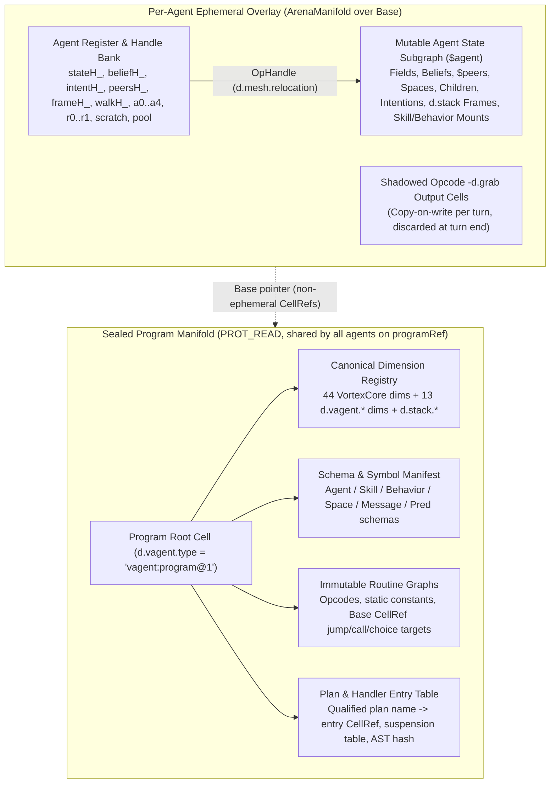
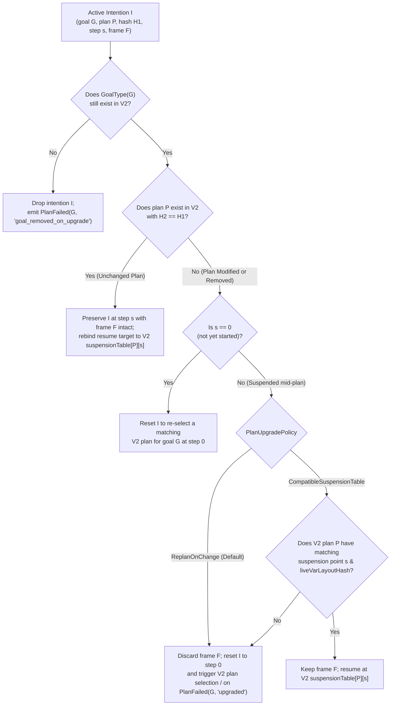

# Vagent Shared Program Manifold (`U-A14`) and Live Agent Upgrade

**Status:** Design Specification (Companion to
[`vagent-agent-language.md`](vagent-agent-language.md) v3.12, §11.1, §11.2, and §18 `U-A14`)

______________________________________________________________________

## 1. Motivation & Problem Statement

### 1.1 Per-Agent Program Duplication Today

In the current `vagent` runtime (`apps/common/xanadu/vagent/program.cpp` and `agent_executor.cpp`),
a `CompiledProgram` holds only the parsed `TranslationUnit` AST (`unit_`) and a pre-Execution
diagnostic report. No Vortex instruction cells or dimension cells are minted when `compileProgram`
succeeds. Instead, on every agent's first turn (`AgentExecutor::prepare`), the runtime invokes
`CompiledProgram::instantiate(WorkerContext &context, std::string_view agentType)`:

```cpp
// apps/common/xanadu/vagent/program.cpp
std::expected<AgentInstance, Diagnostic>
CompiledProgram::instantiate(vortex::WorkerContext &context,
                             std::string_view agentType) const {
  return Compiler::compileAgent(unit_, agentType, context);
}
```

`Compiler::compileAgent` lowers the entire `TranslationUnit` directly into that single agent's
private `context.arena` (`zigzag::ArenaManifold`), minting ephemeral cells (`CellRef` with bit 31
set, `0x80000000u | index`) for:

- All 13 `vagent` dimensions (`d.vagent.field`, `d.vagent.belief`, `d.vagent.pred`, `d.vagent.arg`,
  `d.vagent.intent`, `d.vagent.plan`, `d.vagent.step`, `d.vagent.goal`, `d.vagent.event`,
  `d.vagent.space`, `d.vagent.entry`, `d.vagent.child`, `d.vagent.type`) on top of the 44
  `VortexCore` genesis dimensions.
- Every compiled opcode chain (`#Add`, `#Move`, `#Step`, `#Select`, `#Link`, `#Unlink`, `#Isolate`,
  `#Content`, `#SetContent`, `#Jump`, `#Branch`, `#Call`, `#Choice`, `#Return`, `#Point`, `#Grab`,
  `#Release`, `#Save`, `#Yield`, `#Clock`, `#Digest`) for all pure functions, methods, rules, plans,
  and event handlers across all declarations in the unit.
- All static constants (`cInt`, `cBool`, `cFloat`, `cStr`), register cells (`a0_..a4_`, `r0_..r1_`),
  scratch cells (`scratch_[0..31]`), and the 64-entry dynamic allocation pool (`pool_`).
- The initial `$agent` state root (`instance.agentRoot`), field slots, belief head, `$peers` root,
  and intention head.

Consequently, spawning $N$ agents on a node—or spawning child agents via `spawn Child(...)` in
`AgentExecutor::stepChildAgents`—runs full AST-to-Vortex compilation $N$ times and duplicates every
dimension cell, constant cell, and opcode graph inside each agent's private `ArenaManifold`.

### 1.2 Why `restoreState` Must Re-Instantiate and Copy Cell-by-Cell Today

When an agent checkpoints its state via `MeshActorRuntime::checkpoint` (`mesh_actor.cpp:251`) and
resumes via `MeshActorRuntime::resume` (`mesh_actor.cpp:277`), the checkpoint payload is serialized
by `SwarmTransport::publishValue(actor->context->arena, actor->stateRoot, ...)` and reconstructed by
`SwarmTransport::materializeValue(checkpoint.state)` as a standalone `Store` + `Manifold` containing
only the cells reachable from `stateRoot` (`$agent`).

During Task U (`design/projects/vagent-review/impl-frames-analysis.md`), `vagent` adopted **P16**
(`#Point` and `OpHandle` operand resolution with `xanadu::cellRelocationMarker` on
`d.mesh.relocation`). While P16 eliminated raw `Int64` cell references for mutable state roots
(`stateH_`, `beliefH_`, `intentH_`, `peersH_`, `frameH_`, `walkH_`) and dynamic pool allocations,
four structural barriers still prevent promoting or resuming an agent arena without re-compiling and
copying state:

1. **Control-Flow Targets Are `Int64` Scalar `CellRef`s:** `Compiler::opref(CellRef target)`
   (`compiler.cpp:431`) emits `cInt(static_cast< std::int64_t >(target))`—an `Int64` scalar cell
   connected on `d.grab` to `#Jump`, `#Branch`, `#Call`, and `#Choice` instructions. The Vortex VM
   (`core.cpp:1735`, `1766`, `1831`, `1929`) reads the jump/call target via `readScalarValue` as a
   raw `uint64_t` and casts it to `CellRef`:

   ```cpp
   const auto target = static_cast< CellRef >(
       readScalarValue(context.arena, *targetCell, context.StringInterner));
   ```

   When `zigzag::promote` (`arena_manifold.cpp:1750`) promotes ephemeral cells (`0x80000000 | i`)
   into persistent `Store` operations (`1..M`), it remaps `d.mesh.relocation`-marked `UInt64`
   handles (`arena_manifold.cpp:2011`), but it cannot distinguish an `Int64` jump target from an
   ordinary integer constant (`42`). Even if jump targets were marked for relocation,
   `materializeValue` on the receiving node only materializes cells reachable from `stateRoot`
   (`$agent`); compiled routines are not reachable from `$agent` (except suspended plan step
   pointers if stored) and therefore are not part of the state checkpoint.

1. **Dimension Cells Are Embedded as `Int64` Constants in Instructions:** Every `#Step`, `#Select`,
   `#Link`, `#Unlink`, and `#Isolate` instruction in compiled routines takes its dimension operand
   as `cInt(static_cast< std::int64_t >(dim))` (`compiler.cpp:552`, `632`). When `resume` creates a
   fresh `WorkerContext` over the checkpoint's `Manifold` (`mesh_actor.cpp:301`) and then calls
   `program_.instantiate(*actor->context, ...)` (`agent_executor.cpp:663`), `compileAgent` mints a
   *new* set of ephemeral dimension cells (`0x80000000 | d_new`) in the overlay arena, whereas the
   checkpoint's restored state graph in `base_` is linked along the *old* promoted dimension
   `CellRef`s (`d_old` in `1..M`). Moreover, `ArenaManifold(const Manifold *base)`
   (`arena_manifold.cpp:254`) does not populate `arenaDims_` from `base->dimensionNames()`, so
   `ensureDimension(arena, name)` mints duplicate ephemeral dimensions instead of reusing the base's
   dimensions.

1. **In-Place Opcode Output Slots (`-d.grab`) and Global Registers:** Compiled instructions allocate
   an ephemeral `out` cell linked at `-d.grab` on each opcode cell (`compiler.cpp:512`), plus shared
   per-instance register cells (`a0_..a4_`, `r0_..r1_`, `scratch_[0..31]`, `pool_[0..63]`,
   `frameH_`, `walkH_`). Executing a routine mutates those `-d.grab` cells directly.

1. **Consequence (`AgentExecutor::restoreState`):** Because the resumed `AgentInstance` has newly
   minted dimension `CellRef`s and newly minted handle slots in its ephemeral overlay,
   `AgentExecutor::prepare` (`agent_executor.cpp:687`) must run `restoreState(oldArena, oldRoot)`
   (`agent_executor.cpp:3158–3294`), which looks up old dimensions by string name, walks every
   field, belief, space entry, child descriptor, and intention in `oldArena`, and deep-copies them
   via `cloneGraph` into the new ephemeral dimensions—losing mounted `skills_` and `behaviors_` in
   the process and incurring $O(|state| + |program|)$ work on every resume.

### 1.3 How a Shared, Sealed, Versioned Program Manifold Solves Both Problems

`zigzag::ArenaManifold` already implements a clean split between a read-only base `Manifold`
(persistent `CellRef`s with bit 31 clear, `!isEphemeral(ref)`) and a per-worker ephemeral overlay
(ephemeral `CellRef`s with bit 31 set, `isEphemeral(ref)`), with copy-on-write shadowing
(`ArenaManifold::shadow`, `overlay_`) whenever a base cell's value or links are mutated.
Furthermore, `zigzag::promote` (`arena_manifold.cpp:1757`, `1867`, `2037`) leaves any unshadowed
base `CellRef` untouched (`real.emplace(arena, arena)`), promoting only ephemeral overlay cells and
shadowed base cells.

By compiling a `vagent` program once into a **sealed, content-addressed base `Store` + `Manifold`**
identified by `programRef` (and shared across every agent, child agent, and worker thread on the
node):

- Every dimension cell (`d.vagent.*` and `VortexCore` dimensions), every compiled opcode cell, every
  control-flow target `CellRef`, and every static constant has a **canonical, non-ephemeral base
  `CellRef`** (`!isEphemeral(ref)`) that is identical on every node holding `programRef`.
- Each running agent's `WorkerContext::arena` is an `ArenaManifold(&programManifold)` overlay whose
  mutable state (`$agent`, fields, beliefs, `$peers`, spaces, children, intentions, P16 `d.stack`
  frames, and mounted skill/behavior instances) lives in the overlay while linking directly along
  the canonical base dimension `CellRef`s.
- Checkpointing an agent promotes only the ephemeral state subgraph reachable from `$agent` as a
  compact delta over `programRef`. Resuming that checkpoint on any node holding `programRef` mounts
  the state delta on `programManifold` with **zero re-compilation and zero `restoreState` copying**.
- Advancing a running agent from `programRef` $V_1$ to $V_2$ at a quiescent turn boundary becomes a
  deterministic **live upgrade** that reconciles the agent's symbolic state overlay onto $V_2$'s
  base `Manifold` in-place under the same `ActorPid`.

______________________________________________________________________

## 2. Sealed Versioned Program Manifold (§11.1 + `U-A14`)

### 2.1 Hypertime Store Identity and Microversioning

A compiled `vagent` package is stored as an OSMIC `xanadu::Store` whose Structure operations fold
into a frozen `zigzag::Manifold` (`programManifold`).

1. **Cryptographic Identity (`programRef`):** When a `vagent` translation unit is compiled and
   sealed into a program store, its `SegmentedOpsSpool` segments are sealed (`PROT_READ`) and hashed
   into the store's Merkle root (`xanadu::Key`, 32-byte digest). In `MeshActorRuntime`, this digest
   is formatted as the canonical `programRef` URI (`blake3:<64-hex>` or `merkle:<64-hex>`) carried
   in `ActorGrant::programRef` and `ActorGrant::baseRef`.
1. **Hypertime Microversioning in One Store History:** Successive builds of a `vagent` program do
   not require disconnected stores. In `xanadu::Store`, each build is committed as a hypertime
   branch/microversion frontier (`Store::currentFrontier()` / `GlobalOpRef` seal) in the author's
   program store:
   - Version $V_1$ seals segments $0..k_1$ at frontier $F_1$ (`programRef` $= H(F_1)$).
   - Version $V_2$ appends new or updated routine graphs and metadata cells in segments $k_1+1..k_2$
     at frontier $F_2$ (`programRef` $= H(F_2)$), or is published as a self-contained sealed
     snapshot store via `historyFromSeal`.
   - Because sealed `CompactOpNode` segments are immutable (`PROT_READ`), $V_1$'s `Manifold`
     snapshot and $V_2$'s `Manifold` snapshot coexist simultaneously in memory on the same
     `LocalHost` while some agents run $V_1$ and upgraded agents run $V_2$.

### 2.2 Exact Layout of the Sealed Program Manifold



The sealed program `Manifold` contains exclusively **immutable** cells (all having persistent,
non-ephemeral `CellRef`s where `!zigzag::ArenaManifold::isEphemeral(ref)`):

1. **Canonical Dimension Registry:**
   - All 44 `VortexCore` genesis dimensions (`d.First`, `d. Next`, `d.grab`, `d.point`, `d.handle`,
     `d.stack`, `d.vars`, `d.values`, `d.mesh.relocation`, etc.) created once by
     `VortexCore::initializeGenesis` in an ephemeral staging arena and promoted into the program
     `Store` in deterministic order.
   - All 13 `vagent` dimensions (`d.vagent.field`, `d.vagent.belief`, `d.vagent.pred`,
     `d.vagent.arg`, `d.vagent.intent`, `d.vagent.plan`, `d.vagent.step`, `d.vagent.goal`,
     `d.vagent.event`, `d.vagent.space`, `d.vagent.entry`, `d.vagent.child`, `d.vagent.type`).
   - Because these dimensions are promoted into the base `Manifold`, their persistent `DimRef`s are
     identical across every overlay `ArenaManifold` attached to this base.
1. **Program Manifest & Reflection Spine (`d.vagent.type = "vagent:program@1"`):** A structured
   metadata spine anchored at the program root cell (`programRoot`), recording:
   - `programVersion`: semantic version string + build Merkle digest (`programRef`).
   - **Agent Type Descriptors** (`d.vagent.entry` rank under `programRoot`): for each `agent A`, its
     qualified name, ordered field descriptors `(field_name, type_tag, init_routine_entry)`, initial
     belief initializer routine entry, declared skill mounts, declared behavior mounts, event
     handler entries `(event_kind, trigger_type, guard_entry, body_entry)`, and plan entries.
   - **Skill & Behavior Descriptors:** for each `skill S` and `behavior B`, its qualified name,
     field descriptors `(field_name, type_tag, init_routine_entry)`, method table
     `(method_name -> routine_entry)`, and reactive handler table.
   - **Belief Predicate Descriptors:** `(pred_name, arity, arg_type_tags...)`.
   - **Plan Descriptors & Suspension Tables:** for each plan $P$ (`plan_qualified_name`, e.g.
     `Coordinator::Achieve#0/handle`), its:
     - `planEntry`: base `CellRef` of the plan's compiled opcode entry.
     - `planGraphHash`: 64-bit structural hash of $P$'s normalized AST / compiled opcode graph and
       local variable layout.
     - `suspensionPoints`: ordered rank on `d.vagent.step` mapping each suspension ordinal
       $s \in \{0, 1, \dots, K-1\}$ (at `achieve`, `Wait`, `Request`, or action yield boundaries) to
       `(resumeEntryCellRef, liveVarLayoutHash)`.
1. **Immutable Opcode Graphs and Constants:**
   - Every compiled instruction cell (`#Add`, `#Move`, `#Step`, `#Select`, `#Link`, `#Unlink`,
     `#Isolate`, `#Jump`, `#Branch`, `#Call`, `#Choice`, `#Return`, `#Point`, `#Grab`, `#Release`,
     `#Save`, `#Yield`, `#Clock`, `#Digest`) and its static operand cells (`cInt`, `cBool`,
     `cFloat`, `cStr`, and `opref` control-flow target cells).
   - Because the entire routine graph is promoted into the sealed program `Store` at compile time,
     `zigzag::promote` remaps every `opref` target (`d.mesh.relocation`-marked `UInt64` during
     program promotion, then frozen as the promoted base `CellRef`) so that every `#Jump`,
     `#Branch`, `#Call`, and `#Choice` target in the base `Manifold` holds its exact, permanent base
     `CellRef`.

### 2.3 Separation of Immutable Code Cells vs. Mutable Per-Agent State Cells

To share the base `Manifold` safely across concurrent worker threads and multiple agents on the same
node without locks or cross-agent interference, **no turn execution may mutate the underlying base
`Manifold`**.

| Category                                                                                   | Location                                                                | Addressing & Mutability                                                                                                         |
| :----------------------------------------------------------------------------------------- | :---------------------------------------------------------------------- | :------------------------------------------------------------------------------------------------------------------------------ |
| Genesis & `vagent` dimensions (`DimRef`)                                                   | Base `Manifold`                                                         | Fixed base `CellRef` (`!isEphemeral`); read-only                                                                                |
| Opcode cells, `d.First` chains, static constants, jump/call/choice targets                 | Base `Manifold`                                                         | Fixed base `CellRef` (`!isEphemeral`); read-only                                                                                |
| Opcode `-d.grab` output slots                                                              | Base `Manifold` cell ID, **shadowed on write** in agent `ArenaManifold` | `ArenaManifold::setValueBits` / `setContent` shadows cell into `overlay_` on write; reset/discarded per turn                    |
| Per-agent handle roots (`stateH_`, `beliefH_`, `intentH_`, `peersH_`, `frameH_`, `walkH_`) | Base `OpHandle` cell IDs, **shadowed once** in agent `ArenaManifold`    | Each agent overlay shadows the base `OpHandle` cells to point (via `d.mesh.relocation`) to that agent's private ephemeral roots |
| Per-agent registers (`a0..a4`, `r0..r1`, `scratch_[0..31]`, `pool_[0..63]`)                | Base `OpHandle` cell IDs, **shadowed** in agent `ArenaManifold`         | Mutated only inside the agent's private `overlay_`; scratched at turn end                                                       |
| `$agent` root, fields, beliefs, `$peers`, spaces, children, intentions                     | Agent `ArenaManifold` (ephemeral or checkpoint-delta cells)             | Reached from `stateH_` (`$agent`); promoted on checkpoint                                                                       |
| Active P16 call/plan frames (`d.stack`, `d.vars`, `d.values`)                              | Agent `ArenaManifold`                                                   | Reached from `frameH_` during turn or attached to suspended intention cells across turns                                        |
| Mounted skills & behaviors                                                                 | Agent `ArenaManifold` (`d.vagent.entry` under `$agent`)                 | Explicit first-class subgraphs under `$agent` (survive checkpoint/resume and live upgrade)                                      |

#### Why Base `OpHandle` Cells Shadow Cleanly in `ArenaManifold`

In the base `Manifold`, the compiler allocates canonical base `CellRef`s for the handle cells
(`stateH_`, `beliefH_`, `intentH_`, `peersH_`, `frameH_`, `walkH_`, `a0_..a4_`, `r0_..r1_`,
`scratch_[0..31]`, `pool_[0..63]`) and connects the compiled instructions in the base `Manifold` to
those base `CellRef`s via `d.grab` / `d.point` / `d.handle`.

When an agent is initialized in its overlay `ArenaManifold(&programManifold)`:

1. Writing the agent's ephemeral `$agent` root `CellRef` into `stateH_` calls
   `arena.setValueBits(stateH_, ValueKind::UInt64, agentRoot)` which invokes
   `ArenaManifold::shadow(stateH_)` (`arena_manifold.cpp:277`), creating a private copy of `stateH_`
   inside `arena.overlay_` without touching `programManifold`.
1. When the Vortex VM executes an instruction in `programManifold` that reads `stateH_` via
   `resolveOperandCell(context.arena, slotCell)` (`core.cpp:178`),
   `context.arena.valueKind(stateH_)` and `context.arena.valueBits(stateH_)` transparently read the
   agent's shadowed `overlay_` entry and resolve to that agent's private `agentRoot`.
1. Similarly, when an opcode in `programManifold` writes its result to its `-d.grab` output cell via
   `writeScalarValue(context.arena, *outputCell, ...)` (`core.cpp:104`), `ArenaManifold` shadows
   `*outputCell` into `context.arena.overlay_`. Other agents running concurrently on the same
   `programManifold` have their own `ArenaManifold` overlays and never see each other's shadowed
   values.

### 2.4 First-Class Representation of Mounted Skills and Behaviors in `$agent`

In the existing implementation, `AgentExecutor::skills_` and `AgentExecutor::behaviors_` were kept
only in C++ `std::vector`s on `AgentExecutor`, with a separate ephemeral `instance.agentRoot` per
mounted skill/behavior (`agent_executor.cpp:801–836`). As noted in `iter3-notes.md`, this meant
mounted skills and behaviors were lost on checkpoint/resume.

Under the shared program manifold design, mounted skills and behaviors are stored directly in the
`$agent` state graph using two new canonical dimensions in the program manifold (`d.vagent.skill`
and `d.vagent.behavior`, bringing the `vagent` dimension set to 15 dimensions):

- Each mounted skill is a state cell $S_i$ linked on the `d.vagent.skill` rank from `$agent`, with:
  - `S_i` content (`ValueKind::Bytes`): qualified skill type name (e.g. `"Navigation"`).
  - `d.vagent.field` rank from `S_i`: the skill instance's own field cells (each holding its field
    value and a `d.vagent.type` cell naming the field).
- Each mounted behavior is a state cell $B_j$ linked on the `d.vagent.behavior` rank from `$agent`,
  with:
  - `B_j` content (`ValueKind::Bytes`): qualified behavior type name (e.g. `"ObstacleAvoidance"`).
  - `d.vagent.field` rank from `B_j`: the behavior instance's own field cells.
- When invoking a skill method or behavior handler, the executor temporarily binds `stateH_` (or a
  dedicated `selfH_` handle) to $S_i$ or $B_j$ while executing the skill/behavior routine from the
  shared `programManifold`, and restores `stateH_` to `$agent` afterward. Because $S_i$ and $B_j$
  are reachable from `$agent`, `zigzag::promote` automatically checkpoints them alongside `$agent`.

______________________________________________________________________

## 3. Eliminating `restoreState` Copying via Base-Relative / Handle Addressing

### 3.1 Why Task U Solved Only Half the Problem

Task U (P16) introduced `#Point` (`OpPoint`) and `OpHandle` cells marked with
`xanadu::cellRelocationMarker` on `d.mesh.relocation`, allowing `zigzag::promote` to rewrite a
handle's `UInt64` payload from an ephemeral `CellRef` (`0x80000000 | k`) to its newly minted
persistent `CellRef` (`1..M`) upon store promotion (`arena_manifold.cpp:2005–2021`).

However, Task U still compiled all routines into the ephemeral overlay (`0x80000000 | i`). When
`publishValue` promoted `$agent`, it produced a state-only `Store` whose dimension cells received
newly minted `CellRef`s `1..D` and whose state cells received `D+1..M`. On `resume`,
`MeshActorRuntime` mounted that state `Store` as `base_` and `AgentExecutor::prepare` re-compiled
the program into the new ephemeral overlay—minting *different* ephemeral dimension `CellRef`s
(`0x80000000 | d`) and *different* ephemeral routine `CellRef`s, forcing `restoreState` to copy the
entire state graph from the old base dimensions to the new ephemeral dimensions.

### 3.2 Zero-Copy Promotion and Resume Over `programManifold`

When the compiled program and all canonical dimensions live in the shared, frozen `programManifold`
(`baseRef = programRef`):

1. **Invariant Base `CellRef`s (`!isEphemeral(ref)`):** Every dimension (`d.First`,
   `d.vagent.field`, `d.vagent.belief`, etc.) and every compiled routine cell has a permanent
   non-ephemeral `CellRef` in `1..N_prog` inside `programManifold`.
1. **Pre-Populated `arenaDims_` in `ArenaManifold`:** When `ArenaManifold(const Manifold *base)`
   constructs an overlay over `programManifold`, it populates `arenaDims_` from
   `base->dimensionNames()` (see Proposal **P17.1** in §5). Thus,
   `ensureDimension(arena, "d.vagent.field")` returns the exact base `DimRef` in
   $1..N_{\text{prog}}$ without minting any ephemeral dimension cell.
1. **Turn Execution & Scratch Cleanup:** At the start of a turn, the executor records an
   `ArenaManifold::Mark turnMark = arena.mark()` before running transient scratch computations, or
   resets shadowed `-d.grab` output slots after the turn completes, so only `$agent` state mutations
   and handle updates remain in `overlay_`.
1. **Checkpointing (`publishValue` / State Promotion):** When `checkpoint(pid)` is called:
   - The agent's state subgraph rooted at `stateRoot` (`$agent`) consists of overlay cells linked
     along base `DimRef`s (`1..D` in `programManifold`).
   - `promoteOverlayState(arena, stateRoot, programRef)` walks the cells reachable from `stateRoot`:
     - Any reference to an unshadowed base cell $b \in [1, N_{\text{prog}}]$ (such as a dimension
       `DimRef`, a static string/type cell, or a suspended plan step's base `CellRef`) is already
       non-ephemeral and is recorded as a base reference (`b`), **not** copied into the state
       checkpoint!
     - Only the agent's mutable state cells (`$agent`, field cells, belief tuples, `$peers`, spaces,
       children, mounted skills/behaviors, active intentions, and suspended `d.stack` frames) are
       serialized into the compact state snapshot (`ValueSeed` with `baseRef = programRef`).
1. **Resuming (`resume` on Any Node Holding `programRef`):** When `MeshActorRuntime::resume`
   restores the actor on any node:
   - `LocalHost` resolves `checkpoint.grant.programRef` to the node's shared, already-loaded
     `programManifold` (`const Manifold *`).
   - `WorkerContext` is initialized with `programManifold` as its base `Manifold`, and the
     checkpoint's state cells are loaded directly into the agent's `ArenaManifold` overlay on top of
     `programManifold` (re-binding `stateH_`, `beliefH_`, `intentH_`, `peersH_` to the restored
     roots in $O(1)$).
   - **No AST compilation runs on resume (`instantiate` is not called), and `restoreState` is
     completely eliminated.**

### 3.3 Symbolic Root Table for Cross-Version Handle Rebinding

To support live upgrades where `programRef` changes from $V_1$ to $V_2$ (and therefore base
`CellRef`s of dimensions or routines may shift if $V_2$ was compiled independently rather than as an
append-only microversion of $V_1$), every `$agent` root carries a self-describing symbolic root
table using standard `vagent` dimensions:

- `$agent` (`d.vagent.type = "agent:<AgentTypeName>@<programRef>"`)
  - `d.vagent.field` rank: field cells, each carrying its field name on `d.vagent.type` (`Bytes`)
    and its value on the field cell itself (or `d.vagent.entry` for composite values).
  - `d.vagent.belief` head -> `d.vagent.entry` rank: belief cells, each with `d.vagent.pred`
    (`Bytes` predicate name) and `d.vagent.arg` rank of typed argument cells.
  - `d.vagent.intent` head -> `d.vagent.entry` rank: intention cells, each with:
    - `d.vagent.goal`: goal tuple cell (`d.vagent.pred` = goal type name, `d.vagent.arg` rank = goal
      fields).
    - `d.vagent.plan`: `Bytes` qualified plan identifier
      (`"<Owner>::<GoalType>#<Index>/<PlanName>"`) plus `d.vagent.type` holding the `UInt64`
      `planGraphHash` of the plan version that created the intention.
    - `d.vagent.step`: `Int64` logical suspension point ordinal $s \in \{0, 1, \dots\}$ (never a raw
      opcode `CellRef`!).
    - `d.stack`: optional suspended P16 activation frame (`d.vars` rank of variable name `Bytes`
      cells and `d.values` rank of corresponding local value cells).
  - `d.vagent.skill` rank: mounted skill instance cells (`Bytes` skill name + `d.vagent.field`
    rank).
  - `d.vagent.behavior` rank: mounted behavior instance cells (`Bytes` behavior name +
    `d.vagent.field` rank).
  - `d.vagent.space` rank: local tuple space cells (`Bytes` space name + `d.vagent.entry` rank).
  - `d.vagent.child` rank: spawned child agent descriptors (`Bytes` child name + child state root).

Because every edge in `$agent` is keyed by canonical `d.vagent.*` dimensions and every code
reference inside `$agent` (such as an active intention's `d.vagent.plan` and `d.vagent.step`) uses a
symbolic qualified name + suspension ordinal + `planGraphHash` rather than a raw opcode `CellRef`,
`$agent` contains **zero raw pointers into compiled code**.

______________________________________________________________________

## 4. Live Upgrade Semantics & Protocol

### 4.1 Quiescent Turn Boundary Requirement

A live upgrade transitions a running agent at an existing `ActorPid` from sealed program version
$V_1$ (`oldProgramRef`) to sealed program version $V_2$ (`newProgramRef`) **in-place**, without
changing `ActorPid`, without dropping its mailbox or monitors, and without migrating to a new actor
identity.

**Rule 1 (Turn-Boundary Exclusivity):** Live upgrades execute strictly at a **quiescent turn
boundary**—after a `step(pid, maxSteps, wallNow)` call has returned (`RunState::Waiting`,
`RunState::Yielded`, or between an `inbound.pop()` turn completion and the next turn's `prepare()`)
and **never mid-turn** while the Vortex VM is inside `VortexCore::execute` or mid-deliberation step.

- If an upgrade request arrives while the actor's worker is actively executing a turn, the upgrade
  request is queued on the actor's control slot (`pendingUpgrade_`) and applied immediately after
  the current turn commits its state and returns to the scheduler.
- Within a single `vagent` deliberation turn, all synchronous rule steps (`on E`, pure helper calls,
  local belief/field updates, and synchronous plan prefix steps up to a suspension boundary)
  complete under $V_1$ before the upgrade transition runs.

### 4.2 In-Flight Effects, Timers, Mailbox, and Pending Requests

Because an in-place live upgrade preserves the `MeshActorRuntime::ActorEntry` (`mesh_actor.hpp:404`)
at the same `ActorPid`:

1. **Mailbox (`inbound` and `remembered`):** Untouched. Any message queued in `actor->inbound`
   before or during the upgrade remains in FIFO order and will be processed under $V_2$'s message
   schemas and `on Message` handlers on the next turn after the upgrade completes.
1. **In-Flight Host Effects (`actor->flights`, `MeshFlight`):**
   - If the agent has uncompleted asynchronous host effects in `actor->flights`
     (`EffectStatus::Pending`), the upgrade protocol offers two deterministic modes controlled by
     `UpgradePolicy::flightMode`:
     - `DrainFlights` (default, recommended): the actor enters a transient draining barrier where
       new external messages are held in `inbound` while completion deliveries for already-issued
       `flights` are processed under $V_1$ until `actor->flights.empty()`, at which point the $V_1
       \to V_2$ state transition executes atomically.
     - `CarryOverFlights`: the upgrade executes immediately between turns; `actor->flights` (keyed
       by `effectId` and `idempotencyKey`) are retained across the transition, and when their
       completion messages arrive, $V_2$ processes them.
1. **Active Timers (`$timers` / `TimerSpec`) and Pending Request/Reply Futures (`requests`):**
   - Active timers registered in `AgentExecutor` (`timers_`) and `MeshActorRuntime` survive in-place
     with their existing `timer_id`, deadline (`dueAtMs`), and period (`everyMs`). When a timer
     fires after the upgrade, it delivers `TimerFired(timer_id)` to $V_2$.
   - Pending outbound request futures (`requests_` correlation table awaiting a `Reply` or timeout)
     survive with their correlation IDs intact. If the suspended plan step awaiting that reply is
     preserved by plan reconciliation (§4.3.4), the reply resumes the suspended plan in $V_2$; if
     the suspended plan was aborted by plan reconciliation, its pending correlation ID is marked
     cancelled so a late reply is safely ignored.
1. **Supervision Links, Monitors (`monitors_`), and Causal Floors (`floors`):**
   - All supervision links, `MonitorRef` entries, and per-sender causal `floors` on `ActorEntry`
     remain intact. Monitored peers see no `ActorDown` event because the actor does not terminate.

### 4.3 Deterministic State Reconciliation Rules ($V_1 \to V_2$)

When transitioning an agent of type `A` from $V_1$ (`oldManifest`) to $V_2$ (`newManifest`):

#### 4.3.1 Agent, Skill, and Behavior Fields

Fields are matched by `(owner_qualified_name, field_name)` where `owner_qualified_name` is the agent
type `A`, a mounted skill type `S`, or a mounted behavior type `B`:

| Case in $V_2$ vs. $V_1$                                                                                       | Reconciliation Action                                                                                                                                                                                         |
| :------------------------------------------------------------------------------------------------------------ | :------------------------------------------------------------------------------------------------------------------------------------------------------------------------------------------------------------ |
| **Unchanged** `(name, T)` where $T_{V_1} = T_{V_2}$                                                           | Value cell (or composite subgraph) is **preserved verbatim** in the overlay.                                                                                                                                  |
| **Added** `(name, T_new)` in $V_2$                                                                            | Initialized by evaluating the field's pure default initializer expression in $V_2$ (or `T_new`'s zero value if uninitialized), before invoking any `on Upgrade` handler.                                      |
| **Removed** `(name, T_old)` not in $V_2$                                                                      | Dropped from the live `$agent` (or skill/behavior) `d.vagent.field` rank. (Before dropping, its old value is exposed in the read-only `old_state` snapshot passed to `on Upgrade(from_version)` if declared.) |
| **Widened / Compatible Type** (e.g. `Int32 -> Int64`, or record subtype with added optional/defaulted fields) | Deterministically coerced if `UpgradePolicy` permits widening, or transformed by a declared `on Upgrade` migration rule.                                                                                      |
| **Incompatible Type Change** ($T_{V_1} \neq T_{V_2}$ with no coercion/migration rule)                         | Rejected before upgrade execution by `vagent check --upgrade` and by `MeshActorRuntime::upgrade` (`UpgradeError::IncompatibleFieldType`), leaving the actor running $V_1$ unharmed.                           |

#### 4.3.2 Belief Base (`d.vagent.belief`)

Beliefs are matched by predicate signature `(pred_name, arity, arg_types...)`:

- **Unchanged signature:** Every belief tuple `pred_name(a_1, ..., a_k)` in the agent's belief base
  is **preserved verbatim** (keeping its insertion order on `d.vagent.entry` and its content hash in
  `beliefSet_`). Furthermore, $V_2$'s initial `belief` declarations are **not** re-asserted for
  predicates that already existed in $V_1$ (preventing duplicate assertions of initial facts that
  the agent may have deliberately `retract`ed during its lifetime).
- **Newly declared predicate in $V_2$** (not present in $V_1$'s manifest): Any initial `belief`
  facts declared for that new predicate in $V_2$ are asserted once during upgrade initialization.
- **Removed predicate in $V_2$:** All belief tuples for that predicate are retracted from
  `d.vagent.belief` and `beliefSet_`.
- **Arity or argument type change for an existing predicate name:** Rejected by default at upgrade
  check time (`UpgradeError::IncompatibleBeliefSignature`) unless $V_2$ declares an explicit belief
  migration rule `migrate belief OldPred(x) -> NewPred(x, defaultVal)` in its `on Upgrade` block.

#### 4.3.3 Mounted Skills (`d.vagent.skill`) and Behaviors (`d.vagent.behavior`)

- **Retained mount** (`uses skill S` / `uses behavior B` present in both $V_1$ and $V_2$): The
  mounted instance cell under `$agent` is retained, its fields are reconciled using the rules in
  §4.3.1, and its method/handler entry pointers bind to $V_2$'s `programManifold`.
- **Newly mounted skill/behavior in $V_2$:** A fresh skill/behavior instance cell is minted on
  `d.vagent.skill` / `d.vagent.behavior` under `$agent` and its field initializers in $V_2$ are
  executed.
- **Unmounted / removed skill or behavior in $V_2$:** The skill/behavior instance cell is unlinked
  from `$agent`. Any active intention currently executing a plan owned by a removed skill/behavior
  is handled via the removed-plan rule in §4.3.4.

#### 4.3.4 Active Intentions & Suspended Plans (`d.vagent.intent` and §5.6 Frames)

Each active intention cell $I$ on `d.vagent.intent` records:

- `goal`: the goal instance cell `GoalType(args...)`,
- `plan`: the symbolic plan identifier `"<Owner>::<GoalType>#<Idx>/<PlanName>"`,
- `planGraphHash`: the 64-bit hash of the plan's compiled graph and suspension table in $V_1$,
- `step`: the suspension point ordinal $s \in \mathbb{N}$ (`0` if not yet started, or the ordinal of
  the `achieve`, `Wait`, `Request`, or action yield boundary where $I$ suspended),
- `frame`: the P16 `d.stack` activation frame (`d.vars` -> `d.values`) holding live plan locals
  across the suspension point.

When upgrading from $V_1$ to $V_2$, each intention $I$ is reconciled deterministically:



1. **Unchanged Plan (`H_2 == H_1`):** If $V_2$ contains plan $P$ and its `planGraphHash` equals
   $V_1$'s `planGraphHash` ($H_2 = H_1$), the plan's AST, local variable layout (`d.vars`), and
   suspension ordinals are identical. The intention $I$ **resumes seamlessly at `step` $s$ with its
   `d.stack` frame $F$ completely intact**, resolving `suspensionPoints[s]` in $V_2$'s
   `programManifold`.
1. **Modified or Removed Plan ($H_2 \neq H_1$ or $P \notin V_2$):**
   - If `step == 0` (the goal was posted via `achieve G`, `adopt(G)` created the intention, and no
     plan body step has suspended yet): $I$ simply re-runs plan selection against $V_2$'s plan table
     for `goal` $G$.
   - If `step > 0` (the intention is suspended mid-plan at an `achieve SubGoal`, `Wait`, or
     `Request`):
     - **Default safe policy (`ReplanOnChange`):** Because local variables or control flow around
       suspension point $s$ changed in $V_2$, resuming raw bytecode mid-plan is unsafe. The runtime
       cleanly unwinds frame $F$, cancels any sub-intention spawned specifically for step $s$, and
       either invokes $V_2$'s `on PlanFailed(G, "upgraded")` handler (if declared) or resets $I$ to
       re-select an applicable $V_2$ plan for $G$ from step `0`.
     - **Opt-in compatible checkpoint resumption (`CompatibleSuspensionTable`):** If the author
       annotates the suspension point with a stable label (or if $V_2$'s suspension ordinal $s$ has
       the exact same `liveVarLayoutHash` and subgoal/wait signature), $I$ retains frame $F$ and
       resumes at $V_2$'s `suspensionPoints[s]`.
1. **Child Agents (`d.vagent.child`):** Spawned child agents are either independent mesh actors
   (upgraded via their own `ActorPid` upgrade grant) or in-process stepped child instances under
   `d.vagent.child`. In-process child instances stored on `d.vagent.child` are recursively
   reconciled against $V_2$'s declaration of their child agent type using the exact same rules
   (§4.3.1–§4.3.4).

#### 4.3.5 Optional Lifecycle Hook: `on Upgrade(from_version: String)`

After structural reconciliation (§4.3.1–§4.3.4) completes on `$agent` in $V_2$'s overlay and before
normal mailbox/timer processing resumes, if the agent (or a mounted behavior) in $V_2$ declares a
lifecycle handler:

```vagent
on Upgrade(from_version: String) {
  // May inspect/update fields, assert/retract beliefs, or post goals via achieve
}
```

the runtime executes `on Upgrade(oldProgramVersion)` as a single synchronous initialization turn
under $V_2$. If `on Upgrade` traps or fails a `require` contract, the entire upgrade transaction
rolls back atomically to the pre-upgrade mark on the $V_1$ overlay, and `MeshActorRuntime::upgrade`
returns `UpgradeFailed` while the actor continues running $V_1$.

______________________________________________________________________

## 5. Numbered Core & Engine Proposals (For Owner Approval)

In accordance with `GEMINI.md` ("New C++ code must justify why it isn't being written in Vortex"),
all structural schema inspection, field/belief/intention reconciliation walks, and `on Upgrade`
dispatch belong in Vortex cells and the `vagent` compiler/runtime adapter (`std:agent` /
`apps/common/xanadu/vagent/`). Only the low-level manifold dimension seeding, frozen program store
hosting, and `MeshActorRuntime` grant transition require small, surgical C++ changes in `zigzag` and
`vortex`.

### Proposal P17.1: `zigzag::ArenaManifold` Base Dimension Inheritance & Overlay-Only Promotion

- **Files:** `apps/common/xanadu/zigzag/arena_manifold.hpp`,
  `apps/common/xanadu/zigzag/arena_manifold.cpp`
- **Why this must be in C++ (`zigzag`):** `ArenaManifold::arenaDims_` is a private C++ member
  populated during `ArenaManifold` construction (`arena_manifold.cpp:254`). Currently, constructing
  `ArenaManifold(const Manifold *base)` leaves `arenaDims_` empty, so
  `ArenaManifold::dimensionNames()` only returns ephemeral dimensions and
  `VortexCore::ensureDimension` cannot see dimensions that already exist in `base` without scanning
  `base->dimensionNames()`.
- **Exact Change:**
  1. In `ArenaManifold::ArenaManifold(const Manifold *base)` (`arena_manifold.cpp:254`), seed
     `arenaDims_` with `base->dimensionNames()` (preserving their non-ephemeral base `DimRef`s) so
     `ensureDimension` and `dimensionNames()` in any overlay arena resolve base dimensions in $O(1)$
     without minting duplicate ephemeral dimension cells.
  1. Add `zigzag::promoteOverlay(const ArenaManifold &arena, CellRef root, Store *targetStore)` (or
     a `bool promoteBaseDims = false` option on `zigzag::promote`) that serializes only the overlay
     cells reachable from `root` while recording non-ephemeral base `CellRef`s (`!isEphemeral(ref)`)
     by their canonical base index in `programManifold`.

### Proposal P17.2: Sealed Program `Store` Builder in `vagent::CompiledProgram` (`U-A14`)

- **Files:** `apps/common/xanadu/vagent/program.hpp`, `apps/common/xanadu/vagent/program.cpp`,
  `apps/common/xanadu/vagent/compiler.hpp`, `apps/common/xanadu/vagent/compiler.cpp`
- **Why this cannot be pure Vortex yet:** `vagent::Compiler` is the bootstrap compiler that lowers
  `vagent` AST into Vortex cells. Changing it to emit into a shared `Store` + frozen `Manifold` once
  at `compileProgram` time (rather than per-agent in `instantiate`) is where `programManifold` is
  created.
- **Exact Change:**
  1. During `compileProgram(std::string_view source)`, compile the `TranslationUnit` once into a
     staging `WorkerContext`, mark `opref` control-flow target cells (`#Jump`, `#Branch`, `#Call`,
     `#Choice`) with `xanadu::cellRelocationMarker` on `d.mesh.relocation`, and promote the staging
     arena into a sealed `xanadu::Store` + frozen `zigzag::Manifold` owned by `CompiledProgram`
     (with Merkle digest `programRef()`).
  1. Emit the reflection & schema manifest spine (`d.vagent.type = "vagent:program@1"`) into
     `programManifold` so reconciliation can run as a graph walk over `programManifold`.
  1. Change `CompiledProgram::instantiate(WorkerContext &context, std::string_view agentType)` so it
     does **not** re-run `Compiler::compileAgent`. Instead, it attaches `context.arena` as an
     overlay on `programManifold()` (`context.attachBase(&programManifold())`), shadows the 6 base
     handle cells (`stateH_`, `beliefH_`, `intentH_`, `peersH_`, `frameH_`, `walkH_`), and runs the
     pre-compiled agent initializer routine from `programManifold()` to populate `$agent` in the
     overlay.

### Proposal P17.3: `WorkerContext` Base-Manifold Attachment & `MeshActorRuntime` Program Registry

- **Files:** `apps/common/xanadu/vortex/core.hpp`, `apps/common/xanadu/vortex/core.cpp`,
  `apps/common/xanadu/vortex/mesh_actor.hpp`, `apps/common/xanadu/vortex/mesh_actor.cpp`
- **Why this must be in C++ (`vortex`):** `MeshActorRuntime::spawn` (`mesh_actor.cpp:188`) and
  `MeshActorRuntime::resume` (`mesh_actor.cpp:301`) construct `WorkerContext` directly in C++ and
  currently hardcode an empty `WorkerContext()` on `spawn`.

**Exact Change:**

1. Add a resolver callback type to `MeshActorRuntime` (or `LocalHost`):

   ```cpp
   using ProgramManifoldResolver =
       std::function<const zigzag::Manifold *(std::string_view programRef)>;
   ```

1. In `MeshActorRuntime::spawn`, if a `ProgramManifoldResolver` is registered and returns a non-null
   `const Manifold *base` for `grant.programRef`, construct `WorkerContext(base)` so the actor's
   `ArenaManifold` overlays the shared `programManifold` from turn 0.

1. In `MeshActorRuntime::resume`, resolve `checkpoint.grant.programRef` to `programManifold` and
   mount the checkpoint's state cells onto `WorkerContext(programManifold)` instead of an isolated
   `Manifold` missing the program's dimension table and routines.

### Proposal P17.4: `MeshActorRuntime::upgrade` In-Place Grant & Base Transition

- **Files:** `apps/common/xanadu/vortex/mesh_actor.hpp`, `apps/common/xanadu/vortex/mesh_actor.cpp`
- **Why this must be in C++ (`vortex`):** `MeshActorRuntime::renew` (`mesh_actor.cpp:651`)
  explicitly rejects any grant where `grant->programRef != actor->grant.programRef`, and
  `ActorEntry` is a private struct inside `MeshActorRuntime`.

**Exact Change:** Add `MeshActorRuntime::upgrade`:

```cpp
struct UpgradeRequest {
  // ActorGrant with same actorPid, monotonic epoch/seq, new programRef/baseRef
  std::string signedUpgradeGrant;
  UpgradePolicy policy{};
};

using StateReconciler = std::function<std::expected<zigzag::CellRef, RuntimeError>(
    WorkerContext &oldContext, zigzag::CellRef oldStateRoot,
    std::string_view oldProgramRef,
    WorkerContext &newContext, std::string_view newProgramRef,
    const UpgradePolicy &policy)>;

std::expected<ActorGrant, RuntimeError>
upgrade(std::string_view actorPid, const PeerIdentity &callerIdentity,
        const UpgradeRequest &request, std::uint64_t wallNow,
        const StateReconciler &reconciler);
```

`MeshActorRuntime::upgrade` verifies:

1. The caller is authorized and `signedUpgradeGrant` is a valid `ActorGrant` for `actorPid` with
   `grant.epoch > oldGrant.epoch` (or `grant.epoch == oldGrant.epoch` and
   `grant.seq > oldGrant.seq`).
1. The actor is at a quiescent turn boundary (not currently inside `step`), and if
   `policy.flightMode == DrainFlights`, `actor->flights` is empty (otherwise queues the upgrade on
   `actor->pendingUpgrade` to run as soon as the turn/flights drain).
1. Constructs `newContext` over the resolved `newProgramManifold` (`grant.programRef`), invokes
   `reconciler` (which executes the Vortex/vagent state reconciliation rules of §4.3 and any
   `on Upgrade` hook), and on success swaps `actor->context = std::move(newContext)`,
   `actor->stateRoot = newRoot`, and `actor->grant = *grant` **atomically** while preserving
   `actor->inbound`, `actor->remembered`, `actor->floors`, `actor->monitors_`, and `actor->timers`.
1. On any error in `reconciler`, discards `newContext` and leaves the actor running `oldGrant` with
   zero state corruption.

### Proposal P17.5: `vagent` Language & Tooling Additions (`on Upgrade` + `vagent check --upgrade`)

- **Files:** `apps/common/xanadu/vagent/parser.cpp`, `apps/common/xanadu/vagent/sema.cpp`,
  `apps/common/xanadu/vagent/agent_executor.hpp`, `apps/common/xanadu/vagent/agent_executor.cpp`
- **Justification:** Implements the user-facing language surface and static upgrade compatibility
  verifier over two sealed program manifests.

**Exact Change:**

1. **`on Upgrade(from_version: String)` handler:** Recognized in `agent` and `behavior` blocks;
   typechecked with effect ceiling allowing field mutations, belief assertions/retractions, and
   `achieve` goal postings, but forbidding suspension (`Wait` / `Request`) so the upgrade hook
   completes atomically in one turn at the upgrade boundary.
1. **Static Upgrade Compatibility Checker (`vagent::checkUpgradeCompatibility(oldProg, newProg)`):**
   Compares the `vagent:program@1` manifest spines of `oldProg` and `newProg` ahead of deployment
   and reports:
   - Added, removed, and preserved fields per agent, skill, and behavior, flagging any incompatible
     field type changes as hard errors.
   - Added, removed, and preserved belief predicates, flagging any arity/type conflicts.
   - Per-plan `planGraphHash` comparison showing which plans are unchanged (seamless mid-plan
     resumption) vs. modified/removed (will replan or invoke `on PlanFailed(..., "upgraded")`).

______________________________________________________________________

## 6. End-to-End Lifecycle Walkthrough

### 6.1 Spawn -> Checkpoint -> Resume (Same Version $V_1$)

1. **Compile Once:** `CompiledProgram::compile(srcV1)` builds `programStoreV1` (`programRef = V1`)
   containing the 44 `VortexCore` dimensions, 15 `vagent` dimensions, manifest spine, and all
   compiled opcode graphs with base `CellRef` jump/call/choice targets.
1. **Spawn $N$ Agents:** `LocalHost` spawns 1,000 agents on `programRef = V1`. Each agent's
   `WorkerContext` wraps `&programManifoldV1` with zero AST compilation. Each agent shadows only its
   6 handle cells, register bank, and its `$agent` state cells (~a few dozen overlay cells per
   agent).
1. **Checkpoint:** `runtime.checkpoint(pid)` calls `promoteOverlay(arena, stateRoot, V1)`. Only the
   ephemeral cells reachable from `$agent` are written into the checkpoint `ValueSeed` (referencing
   base `DimRef`s in `V1`).
1. **Resume on Any Node:** `runtime.resume(checkpoint)` attaches a fresh `ArenaManifold` to
   `&programManifoldV1`, loads the checkpoint's state cells into the overlay, and binds `stateH_`,
   `beliefH_`, `intentH_`, `peersH_` in $O(1)$. No `instantiate` and no `restoreState` copy occur.

### 6.2 Live Upgrade ($V_1 \to V_2$) at Same `ActorPid`

1. **Publish $V_2$:** The author compiles and seals `programStoreV2` (`programRef = V2`) and runs
   `checkUpgradeCompatibility(V1, V2)` to verify schema compatibility.
1. **Issue Upgrade Grant:** Supervisor or deployment controller calls
   `runtime.upgrade(pid, id, upgradeReq, wallNow, vagentReconciler)`.
1. **Quiescent Turn Transition:** At the end of `pid`'s current turn (and after pending flights
   drain, if configured), `vagentReconciler` mounts a new overlay on `&programManifoldV2`, migrates
   `$agent` fields, beliefs, skills, behaviors, spaces, children, and intentions according to §4.3,
   and runs `on Upgrade(V1)` in `V2`.
1. **Seamless Continuation:** The actor continues at the same `ActorPid` on `&programManifoldV2` and
   processes its next mailbox message or timer tick without dropping a single message or supervision
   link.
