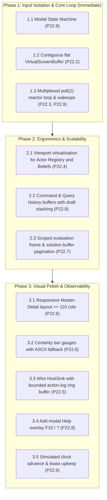

# vagent TUI Dashboard: Cluster Monitoring and Deductive Logic REPL

| field         | value                                                                                                                                                                                             |
| :------------ | :------------------------------------------------------------------------------------------------------------------------------------------------------------------------------------------------ |
| version       | 0.5                                                                                                                                                                                               |
| status        | Implemented (P22.5–P22.10 landed); companion to [terminal UI architecture](terminal-ui-architecture.md)                                                                                           |
| prerequisites | Modern C++23, zero-sentinel conventions, [terminal UI architecture](terminal-ui-architecture.md) (P22.1–P22.4, P22.9, P22.10)                                                                     |
| companion to  | [terminal UI architecture](terminal-ui-architecture.md), [vagent agent language](vagent-agent-language.md), [epistemic arbitration](vagent-dynamic-source-weighting-and-epistemic-arbitration.md) |
| rests on      | `AgentTui`, `TerminalDevice`, `VirtualScreenBuffer`, `MeshActorRuntime`, `AgentExecutor`, `ArenaManifold`, `vprolog::Compiler`                                                                    |
| first test    | a cluster of 15 agents executes steps while the operator scrolls the actor table, inspects compound beliefs, and pages through Vlog query results                                                 |

Paths below are under `apps/common/xanadu/` unless stated otherwise.

______________________________________________________________________

## Contents

- [1. Motivation & Problem Statement](#1-motivation--problem-statement)
- [2. Relationship to Terminal Architecture](#2-relationship-to-terminal-architecture)
- [3. Dashboard Layout & Information Architecture](#3-dashboard-layout--information-architecture)
- [4. View Specifications](#4-view-specifications)
- [5. Outbound Emission Streaming (`HostSink`)](#5-outbound-emission-streaming-hostsink)
- [6. Phased Implementation Plan](#6-phased-implementation-plan)
- [7. Proposed Changes (P22.5–P22.10)](#7-proposed-changes-p225p2210)
- [8. Settings](#8-settings)
- [9. Verification and Escape Probes](#9-verification-and-escape-probes)
- [10. Refused Alternatives](#10-refused-alternatives)
- [11. Open Questions](#11-open-questions)
- [Change History](#change-history)

______________________________________________________________________

## 1. Motivation & Problem Statement

### 1.1 Operating Distributed Agent Clusters in Real Time

The `vagent` actor runtime manages autonomous agents deliberating with Belief-Desire-Intention (BDI)
cycles, epistemic certainty arbitration, and causal event distribution across the Spool-Mesh
(`apps/common/xanadu/vortex/mesh_actor.hpp:134–286`). In development and production clusters alike,
operators need a high-density, real-time control plane to:

1. **Monitor Cluster Actor Health**: Observe actor process states (`QUIESCENT`, `RUNNING`, `BUSY`,
   `STOPPED`), mailbox queues, memory utilization, cycle counts, and fuel consumption across nodes.
1. **Inspect Grounded Beliefs and Epistemic Confidence**: Inspect live beliefs stored in
   `ArenaManifold` (`apps/common/xanadu/zigzag/arena_manifold.hpp:45–180`), trace epistemic
   certainty scores ($0.0 \\dots 1.0$), inspect contributing sensory sources along `+d.source`, and
   examine transition states (`current`, `stale`, `retired`).
1. **Execute Interactive Deductive Queries**: Formulate Vlog / Prolog queries evaluated via
   `vprolog::Compiler` (`apps/common/xanadu/vprolog/compiler.hpp:35–120`) against an actor's
   relational knowledge without interrupting background turn execution or corrupting arena
   backtracking trails.
1. **Orchestrate Cluster Lifecycle**: Inject percepts, dispatch inter-actor causal events,
   single-step turns, advance simulated time, and perform validated live upgrades.

### 1.2 Identified Prototype Deficiencies

The initial dashboard prototype (`apps/common/xanadu/vagent/tui/agent_tui.cpp:1–520`) exhibited five
severe operational defects:

- **Catastrophic Input Collision**: Typing primary commands (`spawn`, `step`, `send`, `stop`) or
  queries (`status(X)`) immediately triggered single-step execution because `'s'` was intercepted as
  a global step hotkey whenever the input line was empty (`agent_tui.cpp:322`).
- **Severe Display Strobing**: Full-screen clears (`werase()` / `wclear()`) executed every 30ms,
  destroying curses' differential screen cache and pegging a full CPU core
  (`apps/vagent/main.cpp:240–248`).
- **Unvirtualized Display Clamping**: Tables and lists were clamped to fixed row counts, rendering
  actors 7+ completely invisible (`agent_tui.cpp:115–140`).
- **Invisible Outbound Emissions**: Outbound actor events emitted via `emit ... in outer` were lost
  because `executor.setHostSink(...)` was not wired to the action log.
- **Topological Invariant Violations**: Predicate argument rendering assumed multiple arguments
  could be linked directly to `dims().grab`, violating ZigZag's strict 2-degree rank invariant and
  failing to render compound argument tuples (`agent_tui.cpp:210–235`).

______________________________________________________________________

## 2. Relationship to Terminal Architecture

This specification inherits all low-level device contracts, virtual screen buffering, event loop
reactors, and modal input handling defined in
[Terminal UI Architecture](terminal-ui-architecture.md):

- **I/O Decoupling**: Low-level curses and buffer mechanics are provided by `TerminalDevice` and
  `VirtualScreenBuffer` in `apps/common/ui/tui/` (`terminal-ui-architecture.md` §§3–4).
- **Reactor Wait Loop**: The event loop in `apps/vagent/main.cpp` uses the multiplexed `poll(2)`
  wait loop (`terminal-ui-architecture.md` §5).
- **Modal Isolation**: Text entry is strictly isolated from global navigation hotkeys
  (`terminal-ui-architecture.md` §7). Submitting a command with `Enter` retains `EDIT MODE`.

______________________________________________________________________

## 3. Dashboard Layout & Information Architecture

### 3.1 Responsive Dual-Mode Presentation

The dashboard automatically adapts to terminal dimensions:

1. **Master-Detail Split View (Width $\\ge 110$ columns)**:
   - **Left Column (38 columns)**: Persistent Live Actor Registry + Selected Actor Telemetry Card.
   - **Right Column (Remaining columns)**: Contextual Work Surface (switchable between Beliefs/REPL
     and Orchestration Log).
1. **Stacked Tab View (Width $< 110$ columns)**:
   - Full-width discrete panes (`[1: Monitoring]`, `[2: Querying]`, `[3: Orchestration]`), with a
     persistent 2-line target context strip at the top of Panes 2 & 3.

```
┌─ [1] ACTOR REGISTRY (3/18) ────────┐┌─ [2] BELIEFS & CERTAINTY (echo_agent) ──────────────────────┐
│ PID      NAME      TYPE    STAT    ││ PREDICATE/KEY        SOURCE   UNCERT    CERTAINTY SCORE STAT│
│*001:tui  tui       NCurses RUN     ││ route(edge_node)     sensor_1  0.050   [█████████░] 95% curr│
│ 002:echo echo_ag   Echo    QUIESC  ││ target(pos_y, 40.0)  gps_mod   0.450   [██████░░░░] 69% curr│
│ 003:ping ping_bot  Pinger  BUSY    │├─ VLOG DEDUCTIVE REPL ───────────────────────────────────────┤
│                                    ││ Query: ?- route(X).                                         │
├─ SELECTED ACTOR TELEMETRY ─────────┤│ Results: X = edge_node                                      │
│ Full PID: node-a:002:echo_agent    │├─ [3] ORCHESTRATION ACTION LOG ──────────────────────────────┤
│ Cycles: 142   Dropped: 0   Mal: 0  ││ [11:24:02 #echo_agent:1 PingAck] latencyMs=12               │
│ Fuel:   1.0G  Cells:   104c/12e    ││ command> spawn EchoAgent worker_2                           │
└────────────────────────────────────┘└─────────────────────────────────────────────────────────────┘
 [NAV] [F1] Registry  [F2] Query  [F3] Orchestrate │ [Tab] Focus │ [↑↓] Select │ [s] Step │ [F10] Help
```

______________________________________________________________________

## 4. View Specifications

### 4.1 Live Actor Registry (Monitoring)

- **Viewport Scrolling**: Maintains `actorScrollOffset_` via `Viewport`
  (`terminal-ui-architecture.md` §6) and auto-scrolls to follow selection.
- **Columns**: `PID` (short), `TYPE/NAME`, `PROGRAM REF`, `STATUS`, `MBOX`, `OUTBOX`, `FUEL`,
  `MEMORY`, `DEADLINE`.
- **Preserved Status Colors**: Selected row highlights with bold text and a pointer glyph (`❯`),
  preserving status badges in green (`QUIESCENT`), cyan (`RUNNING`), yellow (`BUSY`), or red
  (`STOPPED`).
- **Telemetry Card**: Displays full PID, lifecycle statistics, memory breakdown (where `c` denotes
  worker scratch cells via `ctx->arena.cellCount()` and `e` denotes epistemic cells under the
  epistemic ingestion budget via `executor.epistemicCells(pid)`), and next deadline.

### 4.2 Beliefs & Epistemic Arbitration (Querying)

- **Compound Argument Traversal (ZigZag 2-Degree Rank Invariant)**: In the runtime ABI
  (`apps/common/xanadu/vagent/runtime/runtime_abi.hpp:23` and `compiler.cpp:1615`), compound terms
  link their *first* argument cell along `+d.grab`, and all subsequent argument cells chain along
  `+d.step`. The renderer steps along `+d.step` until `pos(d) == std::nullopt`, extracting scalar
  arguments via `asDouble()`, `asInt64()`, or `vprolog::formatTerm()` rather than calling
  `textOf()`, reconstructing positional tuples: `target(pos_y, 40.0)`.
- **Normative Epistemic Traversal (P19 Grounding)**: Grounded observations in `ArenaManifold`
  (`apps/common/xanadu/zigzag/arena_manifold.hpp:200–260`) connect claims along `+d.epistemic`,
  sensory origins along `+d.source`, terms along `+d.vars`/`+d.values`, and peer identities to
  `profile_master` along `+d.clone` on `$agent +d.trust`, enabling inspection of authenticated
  source certainty weights.
- **Proportional Certainty Bar**:
  - High ($\ge 0.85$): `[████████░░] 85.0%` (Green); ASCII fallback: `[========..] 85.0%`
  - Medium ($0.60 \le s < 0.85$): `[██████░░░░] 60.0%` (Yellow); ASCII fallback:
    `[======....] 60.0%`
  - Low ($< 0.60$): `[███░░░░░░░] 30.0%` (Red); ASCII fallback: `[===.......] 30.0%`
- **Deductive REPL Scoped Evaluation Frame & Solution Buffer**:
  - To prevent background turn corruption, compaction failure (`ArenaRefusal::MarksOutstanding`),
    and upgrade refusals, queries execute within an immediate mark/release scope:
    `Mark m = arena.mark(); ... arena.release(m);`.
  - Up to `static constexpr std::size_t maxQuerySolutions = 50;` solutions are pre-resolved into an
    in-memory `std::vector<std::string> solutionBuffer_` before calling `arena.release(m)`.
  - The UI pages through `solutionBuffer_` 5 entries at a time via `QueryPaginationState`
    (`windowOffset`, `pageSize = 5`). Pressing `;` in Navigation Mode advances `windowOffset` by 5
    without touching the worker arena.
  - Queries are bounded by `maxQueryFuel = 10'000` to prevent unbounded loops from freezing the UI.

### 4.3 Cluster Orchestrator (Orchestration)

- **Formal EBNF Command Grammar**:

  ```ebnf
  Command       ::= SpawnCmd | PerceptCmd | SendCmd | StepCmd | AdvanceCmd | UpgradeCmd | StopCmd ;
  SpawnCmd      ::= "spawn" Ident Ident ;
  PerceptCmd    ::= "percept" Ident Ident ( FieldEntry )* ;
  SendCmd       ::= "send" Ident Ident ( FieldEntry )* ;
  FieldEntry    ::= Ident "=" ( StringLiteral | NumberLiteral | BoolLiteral | Ident ) ;
  StepCmd       ::= "step" [ Integer ] ;
  AdvanceCmd    ::= "advance" Integer [ "ms" | "s" ] ;
  UpgradeCmd    ::= "upgrade" Ident Ident [ "--check" ] ;
  StopCmd       ::= "stop" Ident ;
  ```

- **Command Semantics**:

  - `spawn <type> <name>`: Spawns an actor instance.
  - `percept <target> <name> key=val...`: Injects a sensory percept into the actor.
  - `send <target> <type> key=val...`: Enqueues an event envelope into the actor mailbox.
  - `step [<count>]`: Advances execution turns. During manual stepping, actor leases are refreshed
    to prevent `ActorError::NotAuthorized` expiration.
  - `advance <durationMs>`: Advances the simulated cluster clock by the specified milliseconds,
    dispatching expired timers.
  - `upgrade <target> <programRef> [--check]`: Performs a live upgrade. With `--check`, compares
    schemas via `compareUpgradeSchemas()` without mutating state.
  - `stop <target>`: Cleanly terminates an actor.

- **Bounded Buffers**: Command history is retained in a circular ring buffer (`maxHistory = 100`).
  Action log entries are bounded in `actionLog_` (`maxEntries = 500`), preventing memory leaks.

- **In-Line Editing**: Full line editing (`Left`, `Right`, `Home`, `End`, `Delete`, `Backspace`).
  Navigating history with `Up` / `Down` stashes active uncommitted text in `draft_`.

______________________________________________________________________

## 5. Outbound Emission Streaming (`HostSink`)

To make outbound actor emissions visible without leaking memory, `apps/vagent/main.cpp` installs a
host sink conforming to `AgentExecutor::HostSink`
(`apps/common/xanadu/vagent/runtime/agent_executor.hpp:301`), querying `executor.hostSink()` to
chain with any existing sink, and rendering emissions via `renderEmission`
(`apps/vagent/main.cpp:458`):

```cpp
executor.setHostSink([prevSink = executor.hostSink(), &tui](const runtime::Envelope &envelope) {
  if (prevSink) {
    prevSink(envelope);
  }
  auto now = std::chrono::system_clock::now();
  auto timestamp = std::format("{:%H:%M:%S}", now);
  std::string rendered = renderEmission(envelope);
  std::string formatted = std::format("[{} #{}:{} {}] {}",
                                      timestamp, envelope.from, envelope.ordinal,
                                      envelope.type, rendered);
  tui.appendActionLog(std::move(formatted));
  tui.markDirty();
});
```

`AgentTui` maintains dirty flags (`isDirty()`, `markDirty()`, `clearDirty()`) and pushes entries
into a bounded circular buffer (capacity 500). When full, the oldest entry is evicted in $O(1)$
time.

______________________________________________________________________

## 6. Phased Implementation Plan



- **Phase 1 (Immediate)**: Eliminates typing collisions, screen strobing, and idle CPU burn.
- **Phase 2 (Ergonomics)**: Enables large cluster monitoring with virtualized scrolling and REPL
  safety.
- **Phase 3 (Observability)**: Delivers rich visual telemetry, bounded real-time event streaming,
  and simulated time jumping.

______________________________________________________________________

## 7. Proposed Changes (P22.5–P22.10)

The dashboard-specific additions to the Proposal Register are:

### Proposal P22.5: `HostSink` Bounded Action Log Streaming & Chaining

- **Files Touched**: `apps/common/xanadu/vagent/tui/agent_tui.hpp`, `agent_tui.cpp`,
  `apps/common/xanadu/vagent/runtime/agent_executor.hpp`, `apps/vagent/main.cpp`.
- **Rationale**: Connects `executor.setHostSink` with `Envelope` formatting (`renderEmission`),
  chains existing sinks via `executor.hostSink()`, and appends to a bounded ring buffer
  (`maxEntries = 500`) in `AgentTui`, preventing memory leaks in active clusters. Explicitly
  declares the following interface member signatures:
  - `void AgentTui::appendActionLog(std::string entry);`
  - `[[nodiscard]] bool AgentTui::isDirty() const noexcept;`
  - `void AgentTui::markDirty() noexcept;`
  - `void AgentTui::clearDirty() noexcept;`
  - `[[nodiscard]] const HostSink &AgentExecutor::hostSink() const noexcept;`
- **Resource Pricing**: Bounded memory buffer of $500 \times 128 \text{ B} \approx 64 \text{ KiB}$.
- **Fallback**: Retain silent emissions where outbound events are invisible to the operator.

### Proposal P22.6: Responsive Master-Detail Dual-Mode Presentation & Gauges

- **Files Touched**: `apps/common/xanadu/vagent/tui/agent_tui.cpp`.
- **Rationale**: Dynamically splits the terminal into 38-column Actor Registry and contextual right
  work surface when width $\ge 110$ columns, falling back to full-width stacked tabs on narrow
  screens. Renders proportional bar gauges with ASCII fallbacks.
- **Resource Pricing**: 40 lines of layout geometry calculation; 0 heap allocations.
- **Fallback**: Retain static 3-pane tabs requiring manual tab switching.

### Proposal P22.7: Scoped Evaluation Frame & Solution Buffer Pagination

- **Files Touched**: `apps/common/xanadu/vagent/tui/agent_tui.cpp`.
- **Rationale**: Evaluates Prolog queries within an immediate mark/release frame, pre-resolves up to
  50 solutions into `solutionBuffer_`, and pages locally without leaving outstanding marks on the
  live arena.
- **Resource Pricing**: Scratch mark released immediately; bounded fuel limit of 10,000
  instructions.
- **Fallback**: Evaluate queries on live arena, risking turn corruption and compaction failure.

### Proposal P22.8: Command/Query History Draft Stashing, In-Line Editing & Modal Help

- **Files Touched**: `apps/common/xanadu/vagent/tui/agent_tui.cpp`.
- **Rationale**: Implements modal input state machine (`Enter` stays in Edit Mode), line editing,
  `draft_` stashing across history navigation, and `F10` / `?` help overlay.
- **Resource Pricing**: Ring buffer of 100 entries ($\approx 8 \text{ KiB}$).
- **Fallback**: Retain unbuffered input subject to `'s'` hotkey traps.

### Proposal P22.9: `AgentExecutor` Descriptors, Drain, Deadlines & Clock Advance

- **Files Touched**: `apps/common/xanadu/vagent/runtime/agent_executor.hpp`, `agent_executor.cpp`.
- **Rationale**: Adds `[[nodiscard]] std::optional<int> notificationDescriptor() const;` (`eventfd`
  / pipe), `void drainNotifications();`,
  `[[nodiscard]] std::optional<std::chrono::system_clock::time_point> earliestDeadline() const;`,
  and
  `std::size_t advanceSimulatedTime(std::chrono::milliseconds delta, std::size_t maxTurns = 100);`.
  Enables kernel wakeups, precise deadline timeouts in the reactor loop, and lease upkeep across
  simulated time jumps.
- **Resource Pricing**: 1 OS file descriptor per executor; 8-byte eventfd write per wake.
- **Fallback**: Fall back to polling timeout clamped to nearest timer deadline.

### Proposal P22.10: `system://settings` TUI Configuration Binding

- **Files Touched**: `apps/vagent/main.cpp`, `apps/common/xanadu/system_docs.hpp`.
- **Rationale**: Loads `vagent.tui.*` configuration parameters dynamically from the sovereign
  `system://settings` store via `SystemStoreModel`.
- **Resource Pricing**: 0 allocations in steady state; 4 cell reads at startup.
- **Fallback**: Hardcode defaults in C++ structs.

______________________________________________________________________

## 8. Settings

The dashboard configuration integrates with `system://settings` via `SystemStoreModel`
(`apps/common/xanadu/system_docs.hpp`):

| Key                               | Type     | Default     | Description                                            |
| :-------------------------------- | :------- | :---------- | :----------------------------------------------------- |
| `vagent.tui.borders`              | `string` | `"rounded"` | Border style (`"rounded"`, `"single"`, `"ascii"`)      |
| `vagent.tui.history_size`         | `int64`  | `100`       | Maximum command/query history entries retained         |
| `vagent.tui.split_threshold`      | `int64`  | `110`       | Minimum terminal width to enable Master-Detail split   |
| `vagent.tui.max_log_entries`      | `int64`  | `500`       | Maximum entries retained in the outbound action log    |
| `vagent.tui.query_solution_limit` | `int64`  | `50`        | Maximum solutions pre-resolved in query buffer         |
| `vagent.tui.inspect_depth`        | `int64`  | `32`        | Maximum recursion depth for compound belief inspection |

______________________________________________________________________

## 9. Verification and Escape Probes

1. **Input Isolation Probe**: Focus the command input box; type `"spawn EchoAgent worker\n"`; assert
   the actor is spawned, `step(1)` was not triggered, and input remains in `EDIT MODE`.
1. **Scroll Virtualization Probe**: Spawn 25 actors; verify `actorScrollOffset_` advances when
   navigating past visible rows, rendering in $O(\text{viewport})$ time.
1. **Compound Argument Probe**: Insert compound fact `target(pos_y, 40.0)`; assert both argument
   cells are traversed along `+d.step` and rendered correctly.
1. **REPL Isolation Probe**: Run query `route(X)`; verify solutions resolve without leaving active
   marks on `arena.outstandingMarks()`, and verify background actor turn execution succeeds.
1. **Event Stream Probe**: Trigger an actor that emits an outer event; assert the emission appears
   in `actionLog()` and that the log does not exceed 500 entries after 1,000 emissions.

______________________________________________________________________

## 10. Refused Alternatives

1. **Full-Screen Terminal Clearing on Redraw**: Refused due to visible strobe and high CPU burn.
1. **Overloaded Single-Key Global Shortcuts in Inputs**: Refused because primary commands begin with
   overloaded keys (`s` in `spawn`/`send`/`step`/`stop`).
1. **Fixed Split Panes on Narrow Terminals**: Refused because narrow terminals (\<110 cols) require
   full-width stacked views to prevent severe column clipping.

______________________________________________________________________

## 11. Open Questions

| ID          | Title                             | Question                                                                                               | Default Resolution                                                                                   | Status   |
| :---------- | :-------------------------------- | :----------------------------------------------------------------------------------------------------- | :--------------------------------------------------------------------------------------------------- | :------- |
| **U-D1**    | Live Actor Filter                 | Should `/` open an interactive actor search filter?                                                    | Phase 3 extension; default to unfiltered table.                                                      | Resolved |
| **U-TUI-1** | Manifold Viewport Cursor Stepping | Should viewport scrolling lazily step cell cursors along manifold ranks rather than caching row views? | Defer; caching row views for terminal frames avoids repeated manifold walks on differential redraws. | Resolved |

______________________________________________________________________

## Change History

- **v0.5 (2026-11-02)**: Implementation landed. `AgentTui`
  (`apps/common/xanadu/vagent/tui/agent_tui.{hpp,cpp}`) was rebuilt on the shared `xanadu::ui::tui`
  foundation: modal input with `[NAV]`/`[EDIT]` badge and history/draft (P22.8),
  viewport-virtualized registry and beliefs (P22.4), scoped mark/release Vlog frame with 5-at-a-time
  pagination (P22.7), bounded action-log ring with dirty flags and chained `HostSink` wiring in
  `runTui` (P22.5), responsive master-detail layout and Unicode/ASCII certainty gauges (P22.6), and
  a `TuiSettings`/`TuiSettings::fromModel` binding for the six `vagent.tui.*` keys in
  `system://settings` (P22.10). All five §9 escape probes are covered by
  `tests/xuzz/vagent_tui_test.cpp` (`AgentTuiEscapeProbes.*`, `AgentTuiSettings.*`).
- **v0.4 (2026-11-02)**: Addressed Round 3 Vortex Design Critique:
  - Formatted all GFM tables with standard multi-line layout and unescaped pipe delimiters.
  - Specified scalar argument extraction (`asDouble()`, `asInt64()`, `formatTerm()`) in §4.2.
  - Declared `static constexpr std::size_t maxQuerySolutions = 50;` in §4.2.
  - Refined EBNF command grammar in §4.3.
  - Chained `prevSink` with `executor.hostSink()` and fixed `renderEmission` namespace in §5.
  - Added Roadmap Task 3.5 for simulated clock advance and lease upkeep in §6.
  - Enumerated `AgentTui` dirty tracking and `AgentExecutor::hostSink()` signatures in `P22.5` (§7).
  - Added `advanceSimulatedTime` and lease upkeep to `P22.9` (§7).
- **v0.3 (2026-11-02)**: Addressed Round 2 Vortex Design Critique:
  - Reconciled `HostSink` with `Envelope` members (`type`, `fields`, `ordinal`) and `renderEmission`
    (§5).
  - Added scoped evaluation frame pre-resolving solutions into `solutionBuffer_` before releasing
    mark (§4.2).
  - Added formal EBNF command grammar and consolidated proposals P22.5–P22.10 (§4.3, §7).
  - Documented P19 normative epistemic traversal along `+d.epistemic` and `+d.source` (§4.2).
  - Reconciled column width to 38 cols and updated ASCII mockups.
- **v0.2 (2026-11-02)**: Addressed Round 1 Vortex Design Critique:
  - Corrected compound argument traversal to chain along `+d.step` (§4.2).
  - Consolidated upgrade commands and clarified simulated clock advance (§4.3).
- **v0.1 (2026-11-02)**: Initial specification for Vortex Design Critique.
