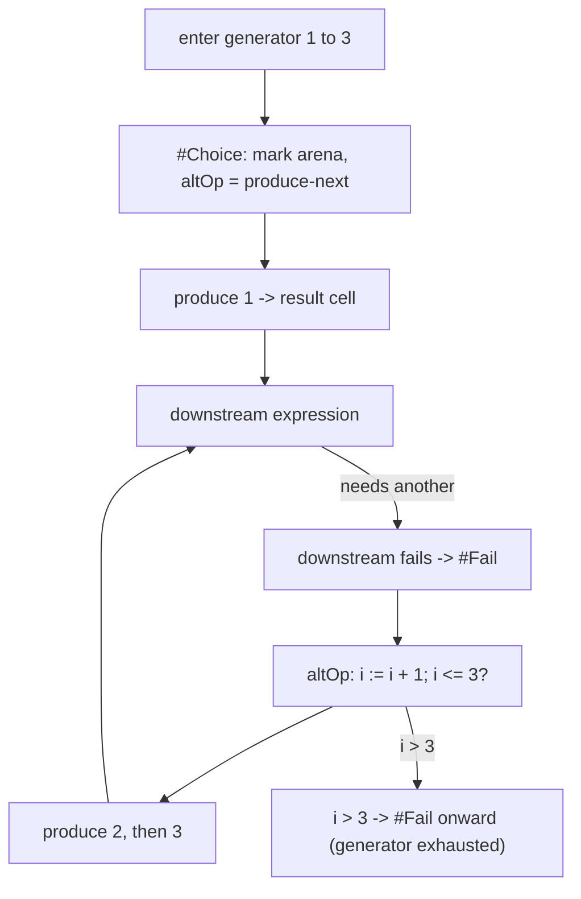

# vicon: Goal-Directed Evaluation in Vortex

**Document Version:** 1.0 — Icon Over an Arena **Compilation Target:** Vortex Hyperstructural
Runtime Core — `link` and `value`, and nothing else (§3) **Status:** specification only; nothing
here is wired into the gleditor build. It leans on mechanisms that *are* built —
[Vlog](vlog-logic-extension.md)'s `ArenaManifold`, its `Mark`/`release`/`discard`, and the VM's
`#Choice`/`#Fail`/`#Cut` opcodes — and asks the C++ core for nothing those did not already pay for
(§8).

vicon is a fourth front end onto the manifold that [Vortex](vortex-hyperstructural-runtime.md) runs,
[VQL](vql-query-language.md) queries, and [VPL](vpl-array-language.md) indexes. It is an
[Icon](https://www2.cs.arizona.edu/icon/)-shaped language: expression-oriented, imperative in its
surface, but with Icon's one radical idea at its centre — **every expression is a generator that
produces a sequence of zero or more results, and control is driven by whether a result was produced
(success) or the sequence ran dry (failure), not by a boolean.** `i > j` is not a test that returns
true or false; it is a generator that produces `j` if `i` is greater and produces *nothing*
otherwise, and the surrounding `if` reacts to the presence or absence of a result.

**Like its three siblings, vicon is a surface syntax and nothing more.** Every construct compiles to
Vortex's `link` and `value`, and introduces no primitive of its own. If an expression below cannot
be written as a finite sequence of those two calls — plus the choice-point frame the VM already
keeps for Vlog — it is a defect in this document rather than a feature of the language. §3 gives the
acceptance test and §4 the lowerings.

The reason vicon is worth writing down is that Icon's evaluation model and Vlog's resolution model
are **the same mechanism seen from two directions**, and only one of them was built. Vlog arrived at
an arena of choice points because Prolog needs backtracking; Icon needs backtracking too, for a
completely different-sounding reason (expression-level generators rather than clause selection), and
it turns out to want the identical machinery. A `#Choice` that Vlog takes before trying a clause is
the same `#Choice` vicon takes before resuming a generator. So vicon is not a second logic engine
bolted on beside Vlog — it is Vlog's control core given an imperative notation, which is exactly the
relationship Icon has to Prolog in the literature (both are goal-directed; neither compiles to the
other). This document's job is to show that the notation reaches the primitives, and that everything
new lives in a `std:goal` package written in Vortex.

______________________________________________________________________

## Contents

- [1. What is being claimed](#1-what-is-being-claimed)
- [2. The one idea: success, failure, and sequences of results][toc-01]
- [3. The acceptance test: `link`, `value`, and the choice-point frame][toc-02]
- [4. Goal-directed evaluation as a program over the arena][toc-03]
  - [4.1 An outcome is a cell, not a boolean](#41-an-outcome-is-a-cell-not-a-boolean)
  - [4.2 A generator is a resumable choice point](#42-a-generator-is-a-resumable-choice-point)
  - [4.3 Goal-directed evaluation is Vlog's backtracking, bounded differently][toc-04]
  - [4.4 Bounded versus unbounded expressions](#44-bounded-versus-unbounded-expressions)
- [5. Control structures](#5-control-structures)
  - [5.1 `if`/`then`/`else`, `while`, `until`, `every`](#51-ifthenelse-while-until-every)
  - [5.2 Alternation `|` and generation `to`/`!`](#52-alternation--and-generation-to)
  - [5.3 Limitation `\`, `every`, and iterating a generator to exhaustion][toc-05]
  - [5.4 `break`, `next`, and goal-directed loops](#54-break-next-and-goal-directed-loops)
- [6. String scanning](#6-string-scanning)
  - [6.1 `?` is a cursor on a `d.scan` rank](#61--is-a-cursor-on-a-dscan-rank)
  - [6.2 Matching functions move the cursor and backtrack with it][toc-06]
- [7. The `std:goal` standard-library package](#7-the-stdgoal-standard-library-package)
  - [7.1 Package anchoring and exported symbols](#71-package-anchoring-and-exported-symbols)
  - [7.2 Generators, outcomes, and scanning built in Vortex][toc-07]
  - [7.3 What is reused, unchanged, from `std:logic` and the seven core modules][toc-08]
- [8. What the C++ core actually has to gain](#8-what-the-c-core-actually-has-to-gain)
  - [8.1 Nothing in the VM or the arena](#81-nothing-in-the-vm-or-the-arena)
  - [8.2 A front end: lexer, parser, compiler, driver](#82-a-front-end-lexer-parser-compiler-driver)
  - [8.3 Coding standards the front end is held to](#83-coding-standards-the-front-end-is-held-to)
- [9. Worked examples](#9-worked-examples)
  - [9.1 `every write(1 to 3)`](#91-every-write1-to-3)
  - [9.2 Generating the subscripts where a substring occurs][toc-09]
  - [9.3 `find` as a reversible generator, and the fence against persistence][toc-10]
- [10. What this buys that a conventional Icon does not have][toc-11]
- [11. Breakages and costs](#11-breakages-and-costs)
- [12. Reconciliation with the convergence](#12-reconciliation-with-the-convergence)
- [Appendix: Versioning and Change History](#appendix-versioning-and-change-history)

______________________________________________________________________

## 1. What is being claimed

| Icon concept                    | Vortex mechanism                                                 | New machinery      |
| ------------------------------- | ---------------------------------------------------------------- | ------------------ |
| Expression yields a value       | An expression yields a `CellRef`                                 | none               |
| Expression succeeds             | It produced a result cell this activation                        | none               |
| Expression fails                | Its generator is exhausted; no cell produced                     | none               |
| A generator                     | A resumable `ChoicePoint` on the VM's choice stack               | none — Vlog's      |
| Resuming a generator            | `#Fail` into the choice point, then continue from `altOp`        | none — Vlog's      |
| Backtracking within an expr     | `arena.release(mark)` to the generator's `Mark`                  | none — Vlog's      |
| Bounded expression (one result) | A generator whose first `#Fail` finds no alternative             | none               |
| Alternation `e1 \| e2`          | Two `#Choice` arms off one opcode                                | none               |
| `i to j by k`                   | A generator that mints the next integer scalar cell per resume   | `std:goal/to`      |
| Element generation `!x`         | A walk along `x`'s first axis, one `#Choice` per step            | `std:goal/bang`    |
| Comparison `i < j`              | Produces `j` or fails; `#Lt` feeding a `#Choice`/`#Fail`         | `std:goal/cmp`     |
| `if e1 then e2 else e3`         | Run `e2` if `e1` produced a result, else `e3`                    | `std:goal/if`      |
| `while e1 do e2`                | Resume `e1`'s generator; on failure, stop                        | `std:goal/while`   |
| `every e1 do e2`                | Drive `e1` to exhaustion, running `e2` per result                | `std:goal/every`   |
| Limitation `e \ n`              | Cap a generator at `n` resumes                                   | `std:goal/limit`   |
| String scan `s ? e`             | A cursor cell on a `d.scan` rank; `&subject`, `&pos`             | `std:goal/scan`    |
| `tab`, `move`, `find`, `many`   | Cursor moves that are generators and backtrack the cursor        | `std:goal/scan`    |
| A substring result              | `value(subjectCell, offset, length)` — an ephemeral quoting cell | none               |
| `&fail`, `&null`                | The exhausted generator; the bare cell                           | none               |
| Co-expression `create e`        | A choice stack and arena mark captured as a pinned island        | `std:goal/coexpr`  |
| Reversible assignment `<-`      | A write trailed by the enclosing `Mark`, undone on backtrack     | none — the trail's |

The right-hand column is the argument, and it is Vlog's argument reused. Everything that drives
control — choice points, failure, the arena mark that undoes a backtracked write — is already built
and tested (`vlog_test.cpp`, `vortex_logic_test.cpp`, `arena_manifold_test.cpp`). What is new is a
`std:goal` package of generators written in Vortex, and a front end that parses Icon notation and
emits the VM's existing opcodes. **No new opcode, no new dimension outside `std:goal`'s own
`d.scan`, no change to the arena.**

______________________________________________________________________

## 2. The one idea: success, failure, and sequences of results

Icon has exactly one idea that is not in ALGOL's lineage, and everything else in the language is a
consequence of it. An expression does not evaluate to a value; it evaluates to a *sequence* of
values, produced one at a time, on demand. The sequence may be empty (the expression **fails**),
have one element (an ordinary expression), or have many (a **generator**). Control structures are
not driven by boolean tests — there are no booleans — but by whether the expression they govern
produced a result at all.

Three consequences, each a design decision rather than a quirk of notation:

- **Comparison is a generator of its right operand.** `i < j` produces `j` when `i < j` holds and
  fails otherwise. This is why `if a < b < c` means what a mathematician reads: `a < b` produces
  `b`, which `< c` then tests, so the chain succeeds iff both hold. There is no boolean to combine.

- **Failure propagates outward until a control structure catches it.** `write(find("the", line))`
  writes nothing — the whole call fails — if `find` fails, because a failed argument fails the call.
  The expression is not evaluated to `&null` and passed on; the failure *is* the control flow.

- **A generator suspends and resumes.** `1 to 3` produces `1`, and if the surrounding context later
  demands another result (because something downstream failed and control backtracked into it), it
  resumes and produces `2`. This resumption-on-demand is **goal-directed evaluation**, and it is the
  same resumption a Vlog clause makes when the caller asks for another solution.

The claim of this document is that the third consequence — suspend-and-resume with backtracking — is
not a thing vicon must build, because Vlog built it. §4 is that claim worked out.

______________________________________________________________________

## 3. The acceptance test: `link`, `value`, and the choice-point frame

VQL, VPL, and Vlog are each held to the rule that every construct must lower to a finite sequence of

```text
link(cell, ±dim, [target])                       ->  cell_id or nothing
value(cell, [offset], [length], [replacement])   ->  cell_id
```

and that an expression which cannot be written that way is a defect in the document rather than a
feature of the language. vicon is held to the same rule, with one honest addition that is **not** a
new primitive: it may use the VM's choice-point frame, the one Vlog already drives with `#Choice`,
`#Fail`, and `#Cut`. That frame is already defined in the built VM:

```cpp
struct ChoicePoint {           // vortex_vm.hpp, today
  CellRef cursor{noCell};
  CellRef altOp{noCell};       ///< the opcode to resume at on failure
  zigzag::Mark mark{};         ///< the arena high-water marks to truncate back to
  CellRef stackFrame{noCell};
  std::size_t cutBarrier{0};
};
```

A generator *is* a `ChoicePoint`: `altOp` is where it resumes to produce its next result, and `mark`
is the arena state its backtracking restores. vicon adds no field to this struct and no opcode
beside the eight the VM already carries (`vortex_vm.hpp`'s `OpcodeKind`). The sharper form of the
acceptance test, inherited from Vlog §2, is therefore:

> Every vicon control structure lowers to `#Choice`/`#Fail`/`#Cut` over the existing arena, and
> every vicon value is a `CellRef`. A construct that needs a ninth logic opcode, or a second kind of
> choice point, is a defect in this document.

The rest of the document earns that claim.

______________________________________________________________________

## 4. Goal-directed evaluation as a program over the arena

### 4.1 An outcome is a cell, not a boolean

Icon has no boolean type, and neither does vicon. An expression produces a `CellRef` or it fails.
"Fails" has a precise meaning on the arena: the generator the expression compiled to was resumed,
found no alternative at its `altOp`, and so executed `#Fail`, which `release`d its `Mark` and
returned control to the enclosing choice point. There is no `false` cell to confuse with the empty
string or the integer zero — absence is the *absence of a produced cell*, exactly as `noCell == 0`
is the absence of a cell in the manifold (convergence R5), not a cell holding zero.

This is the Vlog relationship stated for an imperative surface. Vlog's `unify()` returns
`std::expected<void, UnifyFailure>` — success carries nothing, failure carries a reason — and that
is the C++ shape of "produced a result or did not." vicon's compiled generators answer the same way:
the driver that resumes a generator gets back `std::optional<CellRef>`, `std::nullopt` being
failure. The optional-or-reason split is the same boundary §8.3 insists the front end draw with
`std::expected`.

### 4.2 A generator is a resumable choice point

When the compiler emits code for a generator — `1 to 3`, `!list`, `find(s, line)` — it emits a
`#Choice` opcode whose `altOp` points at the code that produces the *next* result. Producing the
first result falls through; producing a later one happens only when control `#Fail`s back into this
choice point. This is mechanically identical to how Vlog tries a second clause: `#Choice` records
the arena `Mark` and the alternative, the body runs, and a later `#Fail` restores the mark and jumps
to the alternative.



The integer `i` the generator steps is a **scalar cell** (convergence R6): canonical 64-bit bits in
the node for the `#Lte` comparison, the shortest round-trip rendering spooled only when a result is
promoted out of the arena. An all-integer generator loop therefore allocates **no content bytes**,
for exactly the reason Vlog §5.5's arithmetic row does: unification and comparison read only the
bits, and the text is deferred to promotion. `1 to 1000000` mints a million bare scalar cells in the
arena and spools none of them unless an answer survives.

### 4.3 Goal-directed evaluation is Vlog's backtracking, bounded differently

The difference between Icon and Prolog is not the backtracking mechanism; it is the *shape of the
search tree* and *where the choice points live*. Prolog's choice points come from clause selection;
Icon's come from generators inside a single expression. Both are a stack of `ChoicePoint` frames
over one `ArenaManifold`, and both undo a backtracked step by `release`ing a `Mark`.

So vicon reuses Vlog's regime wholesale:

- **Taking a choice point** is `#Choice`: read the arena's `Mark` (seven lengths, no allocation —
  Vlog §5.2) and push a frame. A generator takes one when it first produces.
- **Resuming** is `#Fail`: `release` the `Mark` (truncate the arena, replay the trail tail in
  reverse — the WAM's conditional-trailing rule, which falls out of the arena being an arena, Vlog
  §5.3), then jump to `altOp`.
- **Committing** is the choice point going out of scope without being resumed — Icon's bounded
  expressions and `#Cut`'s cousin. `discard(mark)` keeps the bindings and gives up the retry, which
  is exactly Icon's "the expression produced its value and will not be asked again."

The trail is the one place a vicon-specific subtlety enters, and it is a *feature*, not a cost:
Icon's **reversible assignment** `x <- e` undoes the assignment to `x` if control backtracks past
it. That is a write to a cell older than the enclosing generator's `Mark`, which Vlog §5.3's
condition says is exactly the write that gets trailed. So reversible assignment is free — it is an
ordinary `value()` write, and the arena's existing trail undoes it on `release` with no new
mechanism. Irreversible assignment `x := e` is the same write performed *below* no live mark, or
with the mark discarded, so truncation never reaches it.

### 4.4 Bounded versus unbounded expressions

Icon distinguishes **bounded** expressions (those that can produce at most one result before control
moves on — the top level of a statement) from **unbounded** ones (generators whose results are
demanded by a surrounding goal-directed context). The distinction is not a type; it is *whether a
choice point survives*. A bounded expression is compiled with a `discard(mark)` at its boundary: the
first result is taken and the generator's choice point is dropped, so it is never resumed. An
unbounded expression leaves its choice point live for the enclosing context to `#Fail` into.

This is the single rule that makes `every` and `while` differ: `every e1 do e2` leaves `e1`
unbounded and drives it to exhaustion; `e1` at statement level is bounded and produces once. Both
compile the same generator; they differ only in whether a `discard` is emitted at the boundary.
Nothing structural distinguishes them, which is why §7's `std:goal/every` and the bare-statement
driver share all their code but the last opcode.

______________________________________________________________________

## 5. Control structures

### 5.1 `if`/`then`/`else`, `while`, `until`, `every`

Each is a `std:goal` routine taking its sub-expressions as **operand cells on the Inputs Wing**
(`+d.grab`, chained on `+d.step`) — Vortex's ordinary dual-wing calling convention, which is why a
control structure needs no special opcode. The routine resumes an operand's generator and reacts to
whether a result came back:

- **`if e1 then e2 else e3`**: resume `e1` once. If it produced a result, run `e2`; else run `e3`.
  The result of the `if` is the result of whichever arm ran. With no `else`, a failing `e1` makes
  the whole `if` fail (Icon's rule), which is `#Fail` onward — not a silent `&null`.
- **`while e1 do e2`**: resume `e1`; on success run `e2` and loop; on failure stop and the `while`
  succeeds with `&null`. `e1`'s choice point is discarded each iteration (`while` wants the first
  result each time, not the next of a stale generator).
- **`until e1 do e2`**: the same with the success/failure sense of `e1` inverted — `until` runs `e2`
  while `e1` keeps failing.
- **`every e1 do e2`**: §4.4's unbounded form — resume `e1` repeatedly, running `e2` after each
  result, until `e1` is exhausted. This is the loop that iterates a generator, and it is the one
  place a generator is deliberately driven dry.

### 5.2 Alternation `|` and generation `to`/`!`

`e1 | e2` is the generator that produces all of `e1`'s results, then all of `e2`'s. It compiles to a
`#Choice` whose fall-through is `e1` and whose `altOp` is `e2`: resuming past `e1`'s exhaustion
lands in `e2`. This is literally Vlog's two-clause `append/3` shape (vlog §7), one `#Choice` off a
cell with two arms on `+d.clause` — vicon spells the arms along `+d.step` off the alternation
opcode, but the control is identical.

`i to j by k` is `std:goal/to`: a generator holding the current scalar cell, producing it, and on
resume stepping by `k` (default `1`) and comparing against `j` with `#Lte` (or `#Gte` for negative
`k`). `!x` is `std:goal/bang`: a walk along `x`'s first axis, one `#Choice` per cell, producing each
cell's content. For a string, `!s` generates the one-character substrings `value(s, i, 1)` — each an
ephemeral quoting cell, never a copied character (§6).

### 5.3 Limitation `\`, `every`, and iterating a generator to exhaustion

`e \ n` caps a generator at `n` results. It is `std:goal/limit`: a counter cell decremented per
resume, which emits `#Fail` once it hits zero regardless of whether `e` has more to give.
`(1 to 10) \ 3` produces `1, 2, 3` and then fails. The counter is a scalar cell; the comparison is
`#Gt` against zero. No new control flow — a limitation is a generator wrapping a generator,
intercepting the resume.

### 5.4 `break`, `next`, and goal-directed loops

`break` and `next` inside `while`/`every` are `#Cut`-shaped: `break` prunes the loop's own choice
point and the generator feeding it (Vlog §5.4 — a comparison against a recorded barrier, undoing no
bindings), landing after the loop; `next` prunes only the current iteration's inner choice points
and resumes the loop generator. Both are the barrier comparison Vlog's cut already is; neither
touches a cell. `break e` additionally carries `e`'s result out as the loop's value, which is a
write to the loop's result cell before the barrier prune.

______________________________________________________________________

## 6. String scanning

String scanning is the one subsystem with structure of its own, and even it introduces only a
dimension — `d.scan` — minted the way every dimension is (R12: a dimension is a cell on `d.dims`, so
minting one is `MakeCell` plus `SetLink`, and nothing in C++ learns its name).

### 6.1 `?` is a cursor on a `d.scan` rank

`s ? e` establishes a **scanning environment**: the subject `s` and a position into it. In Icon
these are the keywords `&subject` and `&pos`. In vicon they are a cursor cell on a `d.scan` rank:
the cursor's content is the position (a scalar cell), and its `+d.grab` link is the subject cell.
`s ? e` mints such a cursor, links it as the current scanning cursor, evaluates `e` with it in
scope, and on exit unlinks it — a nested `s2 ? e2` pushes a second cursor posward on `d.scan` and
pops it after, so scanning environments nest exactly as cursors on a rank nest.

This reuses the Vortex spec's own cursor machinery (§4 of the Vortex doc, the `d.vars`/`d.values`
associative scope): `&subject` resolves by walking the current `d.scan` cursor's `+d.grab`, and
`&pos` by reading its content. No global state — the "current subject" is just the posward-most cell
on `d.scan`, exactly as the current scope is the posward-most cursor elsewhere.

### 6.2 Matching functions move the cursor and backtrack with it

`tab(i)` sets `&pos` to `i` and produces the substring between the old and new positions —
`value(subject, oldPos, i - oldPos)`, an ephemeral quoting cell. `move(i)` is `tab(&pos + i)`.
`find(sub)` is a **generator**: it produces the first position where `sub` occurs, and on resume
produces the next, moving `&pos` each time. `many(cs)`, `upto(cs)`, `match(sub)` are the same shape.

The point where this becomes a Vortex program rather than a string library is backtracking: **`&pos`
is a write to the cursor cell, and the cursor is older than any generator mark taken inside the
scan, so moving `&pos` is trailed and `release`d on backtrack** (§4.3). That is Icon's rule that a
failed match restores the position — and it is not a rule vicon enforces, it is a consequence of the
cursor being an ordinary cell written under a live mark. `s ? (tab(find("a")) | tab(find("b")))`
tries the first alternative, and if downstream fails, the `#Fail` that resumes the alternation
restores `&pos` because the trail undoes the `tab` write. The scanning position backtracks for free,
by the same mechanism reversible assignment does.

______________________________________________________________________

## 7. The `std:goal` standard-library package

### 7.1 Package anchoring and exported symbols

`std:goal` is an eighth module on the `d.stdlib` rank off `home`, beside the seven the Vortex spec
§7.2 lists and the `std:logic` module Vlog §8.3 adds. It is anchored and resolved exactly as they
are (Vortex §7.1): the module is a cell on `+d.stdlib` whose content is `"std:goal"`, its exported
symbols extend posward on `+d.vars`, and each symbol's entry opcode hangs on `+d.values`. Resolving
`import("std:goal/to")` walks
`home/d.stdlib[./d.name = "std:goal"]/d.vars[./d.name = "to"]/d.values` — the same walk
`VortexStdLib::resolve()` already performs for `std:math/abs` (verified against
`vortex_stdlib.hpp`).

Bootstrapping adds one line to the sequence `VortexStdLib::bootstrap()` already runs: weave
`std:goal` after `std:logic`, because its generators call `std:logic`'s `#Choice`/`#Fail` plumbing.

### 7.2 Generators, outcomes, and scanning built in Vortex

Every `std:goal` symbol is a Vortex routine — an opcode stream along `+d.spin` — assembled by the
single-primitive invariant, exactly as the seven core modules and `std:logic` are (Vortex §7.3,
metacircular construction in an `ArenaManifold`). The package exports:

- **Outcome / comparison**: `cmp` (the goal-directed `<`, `<=`, `=`, `>=`, `>`, `~=`, each producing
  the right operand or failing), `fail` (the exhausted generator — a `#Fail` with no alternative),
  `succeed` (produce `&null` once).
- **Generators**: `to` (`i to j by k`), `bang` (`!x` over any rank), `alt` (the `|` alternation),
  `limit` (`e \ n`), `repeat` (produce one value forever — the unbounded `|repeat`), `seq` (the
  integer sequence from `i` by `k`, unbounded).
- **Control**: `if`, `while`, `until`, `every`, `case` (Icon's `case … of`, which is sugar over `|`
  and `cmp`). Each takes its arms on the Inputs Wing (§5.1).
- **String scanning**: `scan` (establish `s ? e`), `subject`, `pos`, `tab`, `move`, `find`, `match`,
  `many`, `upto`, `any`, `bal`. All produce ephemeral quoting cells via `value()` and backtrack
  `&pos` via the trail (§6.2).
- **Co-expressions** (optional, §10): `coexpr` (`create e`), `activate` (`@`), using a pinned
  ephemeral island (`d.pinning-cursors`, Vortex §5.6) to hold a suspended choice stack. This is the
  one symbol that is more than a thin wrapper, and it is marked optional because Icon programs that
  avoid co-expressions — the majority — never load it.

### 7.3 What is reused, unchanged, from `std:logic` and the seven core modules

`std:goal` is deliberately thin because most of what Icon needs is already exported:

- **`std:logic`** supplies the entire control core: `choice`, `fail`, `cut`, and the SLD driver's
  resume loop. `std:goal`'s generators are `std:logic/choice` with Icon's suspension discipline
  layered on; they add notation, not mechanism.
- **`std:string`** (Vortex §7.2) supplies `split`, `join`, `starts_with`, `ends_with`, `to_upper`,
  `to_lower`, `regex_match` — so vicon's `find`, `match`, and `upto` are built *on* `std:string`'s
  `value()`-splice utilities rather than reimplementing them.
- **`std:collections`** supplies the list, table, and set that Icon's `list`, `table`, and `set`
  constructors wrap; `!x` (`std:goal/bang`) walks a `std:collections` sequence rank directly.
- **`std:math`** supplies `abs`, `min`, `max`, `clamp` — Icon's numeric built-ins by their own
  names.
- **`std:functional`** supplies `map`/`filter`/`fold`, which Icon programs reach through generator
  comprehensions; `every x := !list do …` is `std:functional/map` with the result discarded.

The rule from AGENTS.md — *new Vortex standard-library code reuses existing standard-library
functions unless it cannot* — is why §7.2 is short. The only genuinely new routines are the
suspension discipline (`to`, `bang`, `alt`, `limit`, the `if`/`while`/`every` drivers) and the
`d.scan` cursor family. Everything else delegates.

______________________________________________________________________

## 8. What the C++ core actually has to gain

### 8.1 Nothing in the VM or the arena

This is the whole argument, and it is Vlog's argument a second time. The eight logic opcodes
(`#Unify`, `#MakeVar`, `#IsVar`, `#MakeTerm`, `#Deref`, `#Choice`, `#Fail`, `#Cut` — verified in
`vortex_vm.hpp`'s `OpcodeKind`), the `ChoicePoint` frame, and `ArenaManifold`'s
`mark`/`release`/`discard` are everything vicon's control model needs. vicon uses `#Choice`/`#Fail`
for generators and `#Cut` for `break`/`next`; it never touches `#Unify`/`#MakeTerm` unless a program
also uses Vlog's logic layer, which is allowed and composes. **No ninth opcode. No new `ChoicePoint`
field. No change to the trail or the mark.**

The one dimension vicon mints, `d.scan`, is minted at genesis the way `d.clause` is (Vlog §8.1,
`VortexCore::initGenesis()` mints it on the `d.dims` rank), which the C++ core already supports for
`d.clause` and every other system dimension — adding one is a `MakeCell` plus `SetLink`, data not
code.

### 8.2 A front end: lexer, parser, compiler, driver

What vicon *does* need in C++ is a front end, structured exactly like the four that exist
(`apps/common/xanadu/{vql,vpl,vprolog}` and the Vortex assembler). The parallel to vprolog is exact
— compare `apps/common/xanadu/vprolog/compiler.hpp`'s shape:

```
apps/common/xanadu/vicon/
  token.hpp        // the token kinds: identifiers, operators, &keywords, string/number literals
  lexer.{hpp,cpp}  // Icon's lexical rules, including significant newlines as statement separators
  ast.hpp          // expression nodes; every node is a generator in the model of §2
  parser.{hpp,cpp} // precedence-climbing over Icon's operator table; `|`, `to`, `\`, `?` are operators
  compiler.{hpp,cpp} // lowers the AST to opcode streams, emitting #Choice/#Fail per §4
  driver.{hpp,cpp} // resumes the top-level generator; the REPL/batch loop
apps/vicon/main.cpp // the REPL/runner, mirroring apps/vprolog/main.cpp
apps/viconc/main.cpp // the standalone compiler, mirroring apps/vqueryc and apps/vplc
```

The compiler's public surface mirrors `vprolog::Compiler` and should return outcomes, not void:

```cpp
namespace xanadu::vicon {

/// One compiled vicon program: its entry opcode and the names it exported.
struct CompiledProgram {
  zigzag::CellRef entry{zigzag::noCell};
  std::vector<std::pair<std::string, zigzag::CellRef>> procedures;
};

/// Why a source expression could not be compiled -- named, so a REPL can say
/// which, rather than returning an empty program for a thing it did not parse.
enum class CompileError : std::uint8_t {
  LexicalError,
  UnexpectedToken,
  UnboundIdentifier,
  UnbalancedScan,
};

class Compiler {
public:
  explicit Compiler(zigzag::vortex::VortexCore &core);

  /// Compile a whole program; std::expected so a failure names its reason
  /// rather than throwing or returning a half-built stream.
  [[nodiscard]] std::expected<CompiledProgram, CompileError>
  compile(const Program &program);

  /// Compile one expression for the REPL.
  [[nodiscard]] std::expected<zigzag::CellRef, CompileError>
  compileExpression(std::string_view source);

  /// Setters chain: configure the compiler and get it back (AGENTS.md).
  Compiler *withScanningSubject(zigzag::CellRef subject) noexcept {
    scanSubject_ = subject;
    return this;
  }

  [[nodiscard]] zigzag::vortex::VortexCore &core() noexcept { return core_; }

private:
  zigzag::vortex::VortexCore &core_;
  zigzag::vortex::VortexVM vm_;
  zigzag::vortex::VortexStdLib stdlib_;
  zigzag::CellRef scanSubject_{zigzag::noCell};
};

} // namespace xanadu::vicon
```

The driver resumes a generator and answers in the §4.1 currency:

```cpp
/// Resume the top-level generator once. nullopt is Icon failure -- the
/// sequence ran dry -- not an error; an error would be a different type.
[[nodiscard]] std::optional<zigzag::CellRef> Driver::resume();

/// Drive the generator to exhaustion, projecting each result to text through
/// render() at the arena boundary (the same boundary Version::materialize
/// draws). gleditor::cpp26::function_ref because the sink is called and not
/// kept.
Driver &Driver::every(gleditor::cpp26::function_ref<void(std::string_view)> sink);
```

### 8.3 Coding standards the front end is held to

The front end is new C++ and is held to AGENTS.md's "Code style" section, which the sketch above
already follows:

- **Functional style with `std::optional`/`std::expected`.** `resume()` returns
  `std::optional<CellRef>` (failure is a value, not an exception); `compile()` returns
  `std::expected<CompiledProgram, CompileError>` (a refusal names its reason — the "refuse loudly,
  by number" habit applied to a compiler). No sentinel return values; `noCell` is absence, never a
  reserved id.
- **Chainable mutators.** A method that configures the object and has nothing else to return gives
  back the object (`withScanningSubject` returns `Compiler*`), as `ArenaManifold`'s setters do; one
  that can refuse returns `std::expected` of it.
- **C++23/26 via the polyfill.** `gleditor::cpp26::function_ref` for the per-result sink in
  `every()` (called, not stored); `gleditor::cpp26::inplace_vector` for the operand wings of a
  control structure, where the arity is a fact of the design (an `if` has at most three arms, a
  `cmp` exactly two); `gleditor::cpp26::optional<T&>` for an optional reference to the current
  `d.scan` cursor. These come from `<gleditor/cpp26*.hpp>` as the library and apps already use them;
  never test `__cpp_lib_*` directly (AGENTS.md, `design/cpp26-compatibility.md`).
- **Logging.** Diagnostics use a named spdlog category — `vicon.compile`, `vicon.resume` — guarded
  so expensive traces cost nothing when disabled, the way the engine's categories are.
- **Tests sit with the code, once.** `tests/xudu/vicon_lexer_test.cpp`, `vicon_parser_test.cpp`,
  `vicon_compiler_test.cpp`, `vicon_e2e_test.cpp`, beside `vprolog_*_test.cpp` (which is where the
  logic front-end tests already live). vicon exercises the engine with no graphics device, so it
  belongs in `xudu_test`, not `gleditor_test`.

______________________________________________________________________

## 9. Worked examples

### 9.1 `every write(1 to 3)`

```icon
every write(1 to 3)
```

1. `1 to 3` compiles to `std:goal/to`: a `#Choice` whose fall-through produces the scalar cell `1`
   and whose `altOp` steps and compares. Taking the choice point reads the arena `Mark` — nothing
   written.
1. `every` (§5.1) leaves the `to` generator unbounded and resumes it in a loop, running `write` on
   each result.
1. First resume: `1`. `write` renders it (`render()` at the arena boundary — bits to text now, since
   it is leaving the arena to stdout) and prints `1`.
1. `every` demands another: `#Fail` into the `to` choice point, `release` its `Mark` (the scalar `1`
   is truncated away — it was younger than the mark), `altOp` steps to `2`, `#Lte 3` succeeds,
   produce `2`. Print `2`. Again for `3`.
1. Fourth resume: `altOp` steps to `4`, `#Lte 3` fails, so `to` executes `#Fail` with no alternative
   — the generator is exhausted. `every` sees failure and stops, succeeding with `&null`.

Persistent writes across the whole program: **zero**. The three integers lived and died in the
arena; only their renderings reached stdout, and stdout is not the manifold.

### 9.2 Generating the subscripts where a substring occurs

```icon
line ? every write(find("the"))
```

1. `line ? …` mints a `d.scan` cursor over `line` and makes it the current scanning cursor (§6.1).
1. `find("the")` is `std:goal/find`, a generator: it searches from `&pos`, and on each result sets
   `&pos` past the match and produces the match position (a scalar cell). The write to `&pos` is
   trailed, because the cursor is older than `find`'s mark (§6.2).
1. `every` drives `find` to exhaustion, `write` printing each position.
1. When `find` runs off the end of `line` it `#Fail`s with no alternative; `every` stops; the `?`
   unlinks the cursor from `d.scan`, restoring the enclosing scanning environment (there is none
   here, so the rank is empty again).

Note what did *not* happen: no copy of `line` was made, no substring was allocated. Each match's
text, had the program asked for it with `tab`, would be `value(line, pos, 3)` — an ephemeral cell
quoting three bytes of `line`'s spans, carrying `ephemeralBit`, which `applyStructure()` refuses to
weave into persistent structure. The quoting-cell boundary R8 wants arrives with no special case,
exactly as it does for Vlog's substring unification.

### 9.3 `find` as a reversible generator, and the fence against persistence

```icon
line ? write(tab(find("a")) || tab(find("b")))
```

`||` is Icon string concatenation; the expression writes the text from the first `a` to the first
`b` after it, and **fails cleanly, restoring `&pos`, if there is no such pair** — which is the
subtlety worth tracing:

1. `tab(find("a"))` moves `&pos` to the first `a` and produces the substring before it. The `&pos`
   write is trailed under the enclosing mark.
1. `tab(find("b"))` searches onward for `b`. Suppose there is none: `find("b")` `#Fail`s.
1. The `#Fail` `release`s back to the choice point, and the trail replay **restores `&pos` to where
   it was before step 1's `tab`** — Icon's guarantee that a failed scan leaves the position
   untouched, delivered by the arena trail with no scanning-specific code.
1. `write` never runs, because its argument failed; the failure propagates and the whole bounded
   statement fails, producing nothing. No persistent op was written at any point.

Run the same expression in the *persistent* regime (Vlog §5.1's symmetry applies to vicon unchanged)
and every `tab` and every `find` resume has a microversion id; `xudu-dump --section=ops` renders the
scan as a branching walk, and `d.ops_dag` steps from the query root to each dead end. **The scan is
a document** — a visual debugger for a goal-directed program, which nobody wrote, because it is what
the store does with the operations it is given. The arena regime is the one a REPL actually runs;
the persistent regime is there when a program's search is itself the thing worth inspecting.

______________________________________________________________________

## 10. What this buys that a conventional Icon does not have

- **Reversible assignment and position backtracking are not features; they are the arena.** Classic
  Icon implements `<-` and scanning-position restoration with explicit save/restore stacks. Here
  both are the arena's conditional trail (§4.3, §6.2), so they cannot be inconsistent with each
  other or with generator backtracking — there is one undo mechanism, not three.

- **Substrings never copy.** Icon's `s[i:j]` and the result of `tab` allocate a new string. vicon's
  are `value(s, i, j - i)` — ephemeral quoting cells, zero bytes copied, and refused as persistent
  link targets by the `ephemeralBit` fence (§9.2). A scan over a megabyte subject that produces a
  thousand substrings allocates no subject bytes at all.

- **The search tree is inspectable.** Run goal-directed evaluation persistently and every suspension
  and resume is a named microversion; the generator tree is a document walkable along `d.ops_dag`
  (§9.3). No Icon implementation offers a time-travel debugger over expression-level backtracking,
  because no Icon implementation stores its choice points as versioned operations.

- **Co-expressions are pinned islands, not threads.** Icon's co-expressions are typically coroutines
  with their own C stacks. A vicon co-expression (§7.2, optional) is a suspended choice stack held
  in a pinned ephemeral island on `d.pinning-cursors` (Vortex §5.6) — released by breaking one link,
  provably unable to leak into the document, and with no OS thread or separate stack to manage.

- **It composes with Vlog.** Because vicon and Vlog share the choice stack and the arena, a vicon
  generator can drive a Vlog query and vice versa: `every solve(member(x, L))` iterates a logic
  predicate's solutions as an Icon generator, with one set of choice points. Two front ends, one
  control core.

______________________________________________________________________

## 11. Breakages and costs

- **First-result latency on a cold arena.** The first generator in a session pays for `d.scan` and
  `std:goal`'s bootstrap. This is the `std:logic` bootstrap cost Vlog already measured, plus one
  module; it is a session constant, not per-expression.

- **Indexing a long rank is `O(n)`, which is U1.** `!bigList` and `s[1000000]` walk the rank, the
  same wall VPL hit from the array side and Vlog from the clause side (Vlog §6.3). vicon is a third
  independent consumer of convergence U1 (random access into a rank). The mitigation is identical: a
  pinned ephemeral index keyed by ordinal, from
  [`enfilade-rank-indexing.md`](enfilade/enfilade-rank-indexing.md). That three languages now reach
  U1 from three directions is the strongest argument yet for resolving it.

- **Deep generator nesting is deep choice-point stacking.** An expression with many live generators
  keeps many `ChoicePoint` frames and their `Mark`s. This is bounded by the arena, not the C stack,
  so it does not overflow the way a recursive-descent evaluator would; but a pathological `every` of
  an `every` of an `every` holds `O(product)` marks. The cost is linear in live generators, which is
  the honest cost of goal-directed evaluation and not specific to this implementation.

- **No new primitive means no new fuzz target is strictly required**, but the front end's parser and
  the `d.scan` cursor lifecycle are new surface and should get the same `tests/fuzz/` treatment the
  binary-ops and link-package fuzzers get, since a malformed scan nesting is the kind of thing a
  fuzzer finds and a unit test does not.

______________________________________________________________________

## 12. Reconciliation with the convergence

- **R5 (`noCell == 0`, zero is absence).** vicon's failure is the absence of a produced cell, not a
  cell holding a falsy value; it reuses the convergence's own meaning of absence and introduces no
  second one.
- **R6 (scalar cells: bits plus rendering).** vicon's integers and the `to`/`limit` counters are
  scalar cells; arithmetic and comparison read the bits, text is spooled only at promotion, so
  numeric loops allocate no content (§4.2).
- **R8 (navigation does not mutate; the ephemeral/persistent split).** Goal-directed evaluation runs
  in an `ArenaManifold` and promotes only answers; substrings are ephemeral quoting cells refused as
  persistent link targets (§9.2). Speculative generation writes no hypertime.
- **R12 (a dimension is a cell on `d.dims`).** `d.scan` is minted at genesis as data, like
  `d.clause`; the C++ core learns no new dimension name (§8.1).
- **U1 (random access into a rank).** vicon is a third independent consumer, from the indexing side
  (§11). It does not resolve U1 and does not need to for correctness, only for the speed of indexing
  long ranks.

vicon changes nothing in `store.hpp`, `CompactOpNode`, the arena, or the VM. It is a front end and a
`std:goal` package, held to the same acceptance test as VQL, VPL, and Vlog, and resting entirely on
mechanisms those documents already built and this repository already tests.

______________________________________________________________________

## Appendix: Versioning and Change History

**1.0 — Icon Over an Arena.** Initial specification. Establishes that Icon's goal-directed
evaluation is the control model Vlog already built (`#Choice`/`#Fail`/`#Cut` over an
`ArenaManifold`), that every vicon construct lowers to `link`/`value` plus that existing
choice-point frame, that all new standard-library code lives in `std:goal` written in Vortex and
reuses `std:logic`, `std:string`, `std:collections`, `std:math`, and `std:functional`, and that the
only C++ owed is a front end (lexer, parser, compiler, driver) held to the codebase's
functional-style, `optional`/`expected`, chainable-mutator, and C++26-polyfill standards. No core
change requested; §8.1 records that the bill is zero.

[toc-01]: #2-the-one-idea-success-failure-and-sequences-of-results
[toc-02]: #3-the-acceptance-test-link-value-and-the-choice-point-frame
[toc-03]: #4-goal-directed-evaluation-as-a-program-over-the-arena
[toc-04]: #43-goal-directed-evaluation-is-vlogs-backtracking-bounded-differently
[toc-05]: #53-limitation--every-and-iterating-a-generator-to-exhaustion
[toc-06]: #62-matching-functions-move-the-cursor-and-backtrack-with-it
[toc-07]: #72-generators-outcomes-and-scanning-built-in-vortex
[toc-08]: #73-what-is-reused-unchanged-from-stdlogic-and-the-seven-core-modules
[toc-09]: #92-generating-the-subscripts-where-a-substring-occurs
[toc-10]: #93-find-as-a-reversible-generator-and-the-fence-against-persistence
[toc-11]: #10-what-this-buys-that-a-conventional-icon-does-not-have
