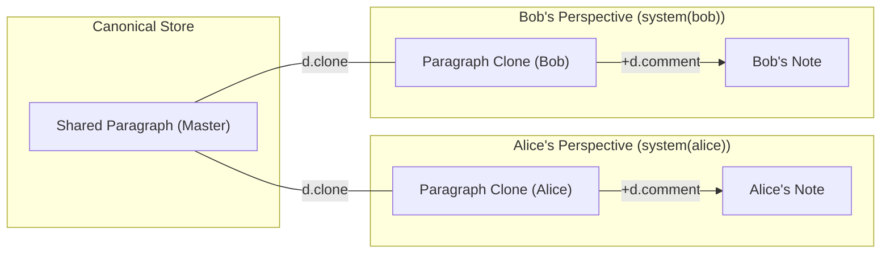
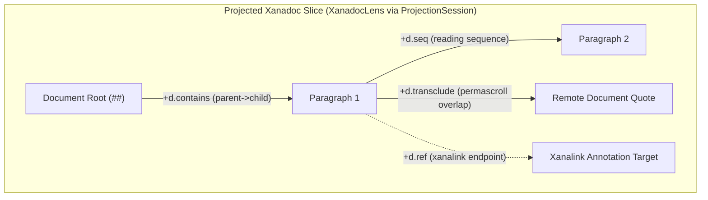
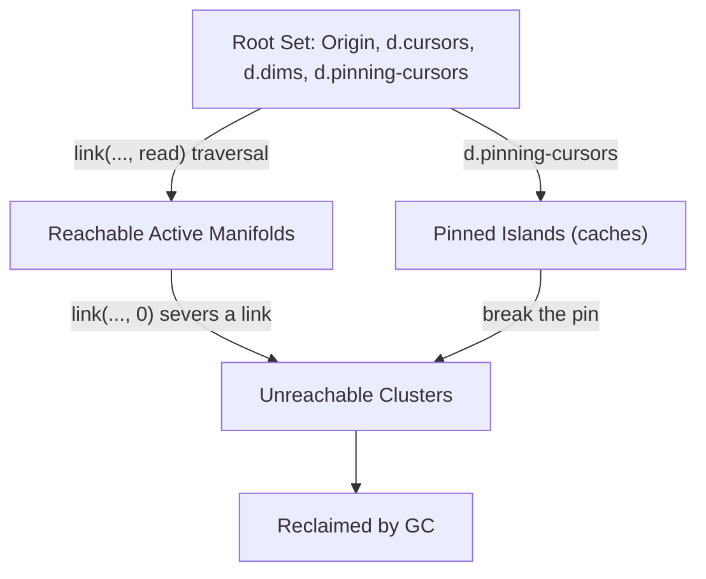

# Vortex Query Language (VQL) Specification

**Document Version:** 15.1 — Root Step Selectors, Functional Lens UFCS & Universal Lenses
**Compilation Target:** Vortex Hyperstructural Runtime Core (Single-Primitive Matrix Manifold)

VQL is the declarative, XQuery-like companion language for
[Vortex](vortex-hyperstructural-runtime.md): every VQL query compiles down to the same
`link`/`value` primitives that make up Vortex's two-primitive core. As with the Vortex spec, this
document specifies a language design consuming the Zigzag `zzstructure` manifold model (see
[zigzag-multidimensional-space-and-projection.md](zigzag-multidimensional-space-and-projection.md));
nothing here is wired into the gleditor build. A third front end onto the same manifold,
[VPL](vpl-array-language.md), borrows APL's glyphs instead of XQuery's paths — where VQL asks
questions of a manifold, VPL does arithmetic over one.

The language rests on three design choices: a single directional traversal operator (`/`, with
direction carried by a sign on the dimension name rather than a second token), `%` creation sugar so
a path can extend the manifold instead of only reading it, and a Xanalogical mutation model —
`weave`, ordinary path expressions evaluated for effect — in place of an XQuery-style `update { }`
block, since a query and an edit are the same kind of walk over the same primitives.

> **§7 reconciles this specification with
> [`store-slice-convergence.md`](store-slice-convergence.md)**, which makes a zigzag cell an
> operation in the xudu ops spool. The grammar is unaffected; what moves is which cells a mutation
> is allowed to persist into, what `##` resolves to, and what `><` is built on. Read it alongside
> §1's invariants.

______________________________________________________________________

## Contents

- [1. Architectural Foundations & Operational Invariants][toc-01]
  - [Fundamental Invariants](#fundamental-invariants)
- [2. Syntactic Token & Structural Shorthand Matrix][toc-02]
- [3. Formal EBNF Grammar](#3-formal-ebnf-grammar)
- [4. Evaluation Semantics & Compilation Rules](#4-evaluation-semantics--compilation-rules)
  - [4.1 Lazy Rank-Streaming Engine](#41-lazy-rank-streaming-engine)
  - [4.2 Slicing Semantics](#42-slicing-semantics)
  - [4.3 Extended Truthiness Rules](#43-extended-truthiness-rules)
    - [The quantifier that form hides, and the three that name it][toc-03]
  - [4.4 Result Materialization: Topological Return Weaving][toc-04]
  - [4.5 Cell Creation Sugar (`%`)](#45-cell-creation-sugar-)
  - [4.6 Clone Sugar (`><`)](#46-clone-sugar-)
  - [4.7 Existing-Target Fan-Out](#47-existing-target-fan-out)
    - [Which cell the first attachment gets, and why it stopped being obvious][toc-05]
  - [4.8 First-Class Shapes, Context Morphisms & Structural Unification][toc-13]
    - [The Shape Type, Derivation & Boolean Wildcard Algebra][toc-14]
    - [Short-Form Shape Matching and Predicate Invariants][toc-15]
    - [Shape Masking, Projection, and Lens Subsumption][toc-16]
    - [The Bidirectional Tilde Operator][toc-17]
    - [Context-Preserving Polymorphic Morphisms (`=>`)][toc-18]
    - [Shape Destructuring](#486-shape-destructuring)
    - [Generalized Sorting and Path Lambdas][toc-19]
    - [User-Defined Functions Returning Dynamic Shapes][toc-23]
    - [Nested Shapes and Dimension Extraction][toc-22]
  - [4.9 Distributed Swarm Execution, ZZ9P Protocol & Universal Docuverse][toc-24]
    - [Docuverse Store Anchors and Federated Hops][toc-25]
    - [Private Dimension Mounts and Namespace Isolation][toc-26]
    - [Zero-Copy Transclusion Morphisms and In-Band Transcopyright][toc-27]
    - [Perspective-Preserving Quantum Clone Ranks][toc-28]
    - [The "No Remote Mutation" Invariant and Action Cells][toc-29]
    - [Reactive Observers and ZZ9P Streaming][toc-30]
  - [4.10 Virtual Dynamic Lenses, Dimension Pivoting & Bidirectional Morphisms][toc-31]
    - [Coordinate Axis Pivoting and Dynamic Projections][toc-32]
    - [Virtual Computed Dimensions][toc-33]
    - [Bidirectional Morphisms: Put/Get Lenses][toc-34]
    - [Systems Lowering: DynamicLensMatrix and SIMD Evaluation][toc-35]
  - [4.11 First-Class Stores, Slices, Hypertime Pinning & Version Arithmetic][toc-38]
    - [First-Class Store, Slice, Dim, and Hypertime Types][toc-39]
    - [Functional Generators, Slice Enumeration & Root Step Selectors][toc-40]
    - [The "Anything-to-ZigZag" Lens and Span Provenance][toc-41]
    - [Hypertime Version Pinning across Folds][toc-42]
    - [MicroversionId Literals and Hypertime Arithmetic][toc-43]
    - [Systems Lowering: HyperHandle, LCA Time-Travel, and Open-Addressing Pinning][toc-44]
  - [4.12 Structural Typing, Unified Shape Contracts & Topological Functors][toc-47]
    - [The Gradual Type System and Atomic Handles][toc-48]
    - [Unified Shape Contracts: Coexistence of Typing and Destructuring][toc-49]
    - [Point-Free Topological Traversal Functors & Currying][toc-50]
    - [Systems Lowering: The 24-Byte CurriedMorphism and TRAVERSE_CURRIED_DIM][toc-51]
- [5. Memory Management & Topological Garbage Collection][toc-06]
- [6. Canonical Production Query Examples](#6-canonical-production-query-examples)
  - [6.1 Deep Structural Navigation with Zero-Copy Slice][toc-07]
  - [6.2 Topological Regex Compilation with Star-Pivot Caching][toc-08]
  - [6.3 Shared Identity via a Clone Rank](#63-shared-identity-via-a-clone-rank)
  - [6.4 In-Place Graph Rewriting & Edge Re-Targeting][toc-09]
  - [6.5 Context-Preserving Sprout and Generalized Sorting][toc-20]
  - [6.6 Conditional Shape Morphisms and Lens Masking][toc-21]
  - [6.7 Distributed Job Orchestration and Multi-Machine Aggregation][toc-36]
  - [6.8 Cross-Store Transclusion Pipeline with Transcopyright Settlement][toc-37]
  - [6.9 Multi-Store Swarm Navigation and Dynamic Slice Filtering][toc-45]
  - [6.10 Hypertime Pinning, Manifold Folds & Microversion Arithmetic][toc-46]
- [7. Reconciliation with the Unified Store/Slice](#7-reconciliation-with-the-unified-storeslice)
  - [7.1 Two regimes, and a query can be in either](#71-two-regimes-and-a-query-can-be-in-either)
  - [7.2 `##` is the origin cell, but the origin is not cell zero][toc-10]
  - [7.3 `><` links along `d.clone`, and the master is the leftmost operand][toc-11]
  - [7.4 `value(replacement, offset, length)` is one operation on a persistent cell][toc-12]
  - [7.5 `d.cache` is a pinned island](#75-dcache-is-a-pinned-island)
  - [7.6 `.` is the context cell, and `@` is retired](#76--is-the-context-cell-and--is-retired)
- [Appendix: Versioning and Change History](#appendix-versioning-and-change-history)

## 1. Architectural Foundations & Operational Invariants

Vortex Query Language (VQL) is a declarative, zero-allocation path navigation and graph mutation
language tailored specifically for **zzstructures** (multidimensional bidirectional graphs). VQL
queries do not evaluate into ephemeral tabular heaps, relational tuples, or serialized JSON arrays.
Instead, every query expression compiles down to spatial traversals, generator pipelines, and link
mutations driven by the atomic engine:

```math
\mathcal{M} = \langle \text{link}, \, \text{value} \rangle
```

### Fundamental Invariants

- **The Single-Primitive Core**: Path traversal and every mutation, update, insertion, and
  allocation compile strictly to `link(cell, ±dim, [target])` — the direction is carried by the
  dimension's sign, exactly as it is in a path step, so there is no separate `dir` argument; reading
  if `target` is omitted, and otherwise writing: `target == -1` allocates, `target == 0` isolates —
  **`0` is the absence of a cell, not a sentinel standing in for one (R5), so "link this at nothing"
  and "link this at cell zero" are the same instruction** — and any other value links straight to
  that cell. `link` returns the linked/allocated/broken cell, or nothing if there wasn't one; VQL
  treats an empty result the same way any other step that "returns nothing" is treated (§3).
  `value(cell, [offset], [length], [replacement])` is the matching content primitive — one call for
  both directions, answering in a `cell_id` either way, so a write composes in a path like anything
  else — see Vortex §2's `get_cell_value`/`set_cell_value`, renamed here to match how they're
  spelled in every VQL surface form. Vortex §2 also defines
  `new(cell, ±dim, [value])`/`break(cell, ±dim)` as named entry points fixing `link`'s `target` to
  `-1`/`0` respectively (`new`'s optional `value` is a `value()` applied to the freshly allocated
  cell); VQL reaches all three the same way — as ordinary `FunctionInvocation`s (§3) — so
  `$cell/break(+d.foo)` and `$cell/link(+d.foo, 0)` compile to the same call.
- **Dual-Wing Invocation Topology**: Built-in functions, custom routines, and opcodes adhere to the
  dual-wing interface. Out-parameters project negward along `-d.grab` (chained posward along
  `+d.step` for multiple returns). In-parameters project posward along `+d.grab` and chain along
  `+d.step`.
- **Snapshot-Before-Write Execution**: When updating nodes in-place or writing query projections,
  all input operand payloads are fully dereferenced and snapshotted prior to invoking `value()` or
  mutating pointers, preventing self-aliasing hazards.
- **Associative Cursor Scopes**: Query variables are not stored in stack frames or hash lookups.
  They resolve directly against the active Spin-Head cursor along `+d.vars`, with bound payloads or
  complex subgraphs projecting perpendicularly along `+d.values`.
- **Shared Identity by Clone Rank (`d.clone`)**: `$a><$b` joins two cells on a `d.clone` rank —
  sugar for `link($a, +d.clone, $b)` directly (§4.6). A clone holds no content of its own: it reads
  the rank's **master**, found by walking `d.clone` negward until nothing precedes. So setting any
  member's content sets the master's, and every member sees it at once, across all viewports and
  observer ranks — not because they share a pointer, but because they were always reading the same
  cell. Link a new cell negward of the master and it *becomes* the master: every cell on the rank
  changes value in that one operation, with nothing copied and nobody notified.
- **Zero-Allocation Lazy Rank-Streaming**: A path step (`/dim`) does not materialize an intermediate
  collection. It instantiates an $O(1)$ spatial cursor that lazily yields matching `cell_id`
  coordinates along `dim`'s entire rank until `link`'s read form returns nothing or a loopback
  boundary is reached — a single `/` step already walks the whole rank, not one hop of it. Absence
  of a link, not a `cell_id` of `0`, is what ends the stream, so a rank can freely pass through Cell
  0 without truncating early.
- **Xanalogical Mutation**: VQL does not have a separate "update" sublanguage. `%` creation sugar
  and `link`/`set` calls are ordinary path steps with side effects; a query that reads and a query
  that writes are the same grammar, evaluated under `return` or `weave` respectively. This mirrors
  the rest of the system: an edit is a walk that happens to allocate and link, not a different kind
  of operation layered on top of the read path.
- **Persistent Star-Pivot Caching**: Expensive generative transformations (e.g., regex compilation
  or macro expansions) memoize their topological results along `+d.cache`, anchoring invocation
  nodes to input and output manifolds. The rank hangs off a detached head cell held up by a named
  pin on `d.pinning-cursors`, **not** off the origin — an origin-anchored cache is immortal, since
  the origin is in the Root Set. See §7.5.
- **Universal Docuverse Anchoring & Genesis Selection (`/##`)**: Rather than adopting web-style
  hierarchical URLs or ad-hoc keyword prefixes, VQL models store discovery as first-class generator
  functions returning streams of sovereign `Store` handles: BEP 46 author public keys and corpus
  salts (`btpk(author, salt)`), deterministic DHT topic rendezvous (`topic(tag)`), transclusion
  backlinks (`citing(target)`), embedded SQLite FTS5 catalog search (`find(query)`), immutable
  content hashes (`btih(hash)`), append-only Merkle ledgers (`ledger(root)`), and sovereign system
  stores (`system(domain)`). The genesis selector `/##` resolves the origin/home `CellRef` from any
  store, slice, or doc context, while `/##` as a federated hop switches ops spool contexts without
  copying or caching intermediate graphs. Bare `##` anchors to the active ambient store's home cell.
- **Strict 2-Rank Manifold Invariant Across Distributed Slices ($\deg^\pm(c, d) \le 1$)**: No
  distributed operation or multi-user edit may ever cause a cell to exceed valence 1 posward or
  negward along any dimension. Perspective-preserving clone ranks (`@persp: ±d.dim => target`)
  guarantee that concurrent divergent links create local clone facets along `d.clone` in the
  observer's namespace rather than violating the global invariant.
- **Universal Zero-Copy Transclusion (`<~`)**: Transclusion links the target cell directly to the
  author-local or global `PrimediaSpan` `(author_pubkey, spool_id, start_offset, length)` without
  allocating new bytes in the author's permascroll. Transclusions across stores leverage BEP 10/46
  wire exchanges and in-band transcopyright micropayment verification.
- **The "No Remote Mutation" Invariant**: There is no distributed shared mutable memory. Remote
  operations never write directly into a foreign ops spool; they compile to **Intent Action Cells**
  on `d.ctl` or **Sealed Write-Sets** transferred via BEP 10 `ActorDeliverWriteSet` (`0x47`), which
  the remote host validates (Ed25519 signature + capability checks) and commits locally.
- **Arbitrary Dynamic Lenses as $O(1)$ Virtual Projections**: Lenses do not allocate intermediate
  materialization manifolds. A dynamic lens is a 64-byte cache-line aligned `DynamicLensMatrix` that
  applies axis permutations (`d.1 <=> d.tag`), virtual computed dimensions (`+d.active := expr`),
  and bidirectional getters/putters directly in the hot traversal loop via SIMD bitmasks.
- **First-Class Stores, Slices, Docs, and Hypertime Coordinates**: Stores, Slices, and Xanadocs are
  not opaque string handles or external containers; they are first-class runtime types passed in
  16-byte `HyperHandle` registers. Slices and external structures are enumerated via `/slices(...)`
  and `/docs(...)`, projected into multidimensional zzspace through the bidirectional
  **Anything-to-ZigZag Lens** architecture
  ([`anything-to-zigzag-lens.md`](anything-to-zigzag-lens.md)). Every lens implements the
  source-agnostic `ProjectionLens` trait managed by a `ProjectionSession`, mapping source structures
  onto canonical generic dimensions (`d.contains`, `d.seq`, `d.ref`, `d.clone`) and source ranks
  (`d.transclude`, `d.version`) via an explicit `ExternalKey ↔ CellRef` identity map, with
  character-level `PrimediaSpan` zero-copy provenance and bidirectional unprojection
  (`applyContentChange`, `applyReparent`). Hypertime is an accessible spatial axis: slices, docs,
  and cells can be pinned to historical microversions via `@(v1, v2)`, evaluating living manifold
  folds across the append-only ops spool, with first-class `MicroversionId` literals (`@2a9`) and
  stack-inline topological arithmetic (`+`, `-`, `/`, `..`).

______________________________________________________________________

## 2. Syntactic Token & Structural Shorthand Matrix

| Token / Operator            | Structural Equivalent            | Functional & Spatial Semantic Mapping                                                                                                                                        |
| --------------------------- | -------------------------------- | ---------------------------------------------------------------------------------------------------------------------------------------------------------------------------- |
| `##`                        | Origin Anchor (`home`)           | Grounds query context to the system origin: a minted genesis cell. Never `0`, which is the absence of a cell -- see §7.2.                                                    |
| `L/##`                      | Genesis Selector                 | Resolves the primary origin/home `CellRef` from a Store, Slice, or Doc — see §4.11.2.                                                                                        |
| `L/#`, `#`                  | Root Metacells                   | As anchor `#`, streams all disjoint root entry points; as step `$slice/#`, streams all root metacells within that slice — see §4.11.2.                                       |
| `L/^`, `^`                  | Active Execution Cursor          | As anchor `^`, streams active Spin-Head cursor threads on `d.cursors`; as step `$slice/^`, streams active cursor(s) of that slice — see §4.11.2.                             |
| `L/^^`, `^^`                | All Cursors (Active & Pinned)    | As anchor `^^`, streams all cursors across matrix; as step `$slice/^^`, streams all cursors (active, idle, pinned) within that slice — see §4.11.2.                          |
| `L/^NAME`, `^NAME`          | Named Cursor                     | Short-circuits cursor scan (`^[d.name = "NAME"]`). In path `$slice/^NAME`, selects named cursor in slice; `$slices/^NAME` selects across all matching slices — see §4.11.2.  |
| `L/^^NAME`, `^^NAME`        | All Named Cursors                | Resolves named cursor across all cursor ranks (e.g. `d.cursors` and `d.pinning-cursors`) within target slice or store — see §4.11.2.                                         |
| `current()`                 | Ambient Store Generator          | Standard function yielding the active ambient `Store` object — see §4.11.2.                                                                                                  |
| `local(path)`               | Local Store Generator            | Standard function binding local store from filesystem path — see §4.11.2.                                                                                                    |
| `topic(tag)`, `btpk(...)`   | Sovereign Store Generators       | Standard functions discovering stores via DHT topic rendezvous or BEP 46 mutable pointers — see §4.11.2.                                                                     |
| `/slices(...)`              | Slice UFCS Enumeration           | Enumerates slices of a store (`$store/slices("name")` $\equiv$ `slices($store, "name")`); defaults to `current()` — see §4.11.2.                                             |
| `/docs(...)`                | Xanadoc Lens UFCS                | Projects xanadocs via `XanadocLens` (`$store/docs("name")` $\equiv$ `docs($store, "name")`); sugar for `lens("xanadoc", ...)` — see §4.11.3.                                 |
| `/files(...)`               | Filesystem Lens UFCS             | Projects directories via `FilesystemLens` (`$store/files("path")` $\equiv$ `files($store, "path")`); sugar for `lens("filesystem", ...)` — see §4.11.3.                      |
| `lens(type, args...)`       | Universal Projection Lens        | Universal primitive instantiating any registered bidirectional `ProjectionLens`, returning `Stream<Slice>` — see §4.11.2.                                                    |
| `target@(v1, v2)`           | Hypertime Version Pinning        | Pins slice, doc, or cell to microversions, streaming historical manifold folds across hypertime — see §4.11.4.                                                               |
| `@2a9`                      | Microversion Literal             | First-class `MicroversionId` coordinate in OSMIC hypertime — see §4.11.5.                                                                                                    |
| `$v + 1`, `$v - 1`          | Hypertime Step                   | Advances sequentially (`next()`) or steps backward to parent (`parent()`) in hypertime — see §4.11.5.                                                                        |
| `$v / "a"`                  | Hypertime Branch                 | Forks a new child branch off hypertime state `$v` — see §4.11.5.                                                                                                             |
| `$v1 .. $v2`                | Hypertime Range                  | Lazily streams the causal ancestry path of microversions between `$v1` and `$v2` — see §4.11.5.                                                                              |
| `btpk(key, salt)`           | BEP 46 Author Pointer            | Standard function resolving author's mutable ops spool tip via Ed25519 key and salt — see §4.11.2.                                                                           |
| `topic(tag)`                | Topic Swarm Stream               | Standard function discovering and streaming stores announced in DHT topic swarm — see §4.11.2.                                                                               |
| `citing(target)`            | Backlink Stream                  | Standard function discovering all stores and documents transcluding or citing target — see §4.11.2.                                                                          |
| `find(query)`               | Full-Text Search Stream          | Standard function executing in-process SQLite FTS5 BM25 ranked search across catalogs — see §4.11.2.                                                                         |
| `btih(hash)`                | Immutable Content Hash           | Standard function binding frozen BitTorrent publication archive by InfoHash — see §4.11.2.                                                                                   |
| `ledger(root)`              | Merkle Ledger Checkpoint         | Standard function opening append-only publication & identity ledger at Merkle root — see §4.11.2.                                                                            |
| `system(domain)`            | Sovereign System Store           | Standard function binding local sovereign store (`keymap`, `settings`, `activity`, etc.) — see §4.11.2.                                                                      |
| `/##`                       | Federated Hop                    | Navigates across a foreign store reference or network bridge into a remote manifold — see §4.9.1.                                                                            |
| `mount <anchor> as +d.d`    | Dimension Mount                  | Dynamically binds a remote store/slice into local session dimensions without spool mutation — see §4.9.2.                                                                    |
| `.`                         | Context Identity                 | The current step's context cell — a valid anchor on its own, or `render(context)` when a host value is wanted.                                                               |
| `/d.dim`                    | `LazyRankStream(d.dim, posward)` | Traverses `d.dim`'s entire rank posward from context cell — canonical `d.` form required.                                                                                    |
| `/-d.dim`                   | `LazyRankStream(d.dim, negward)` | Traverses `d.dim`'s entire rank negward — the `-` binds to the dimension name, not the operator.                                                                             |
| `/~d.dim`                   | `LazyRankStream(d.dim, both)`    | Traverses both negward and posward along `d.dim` from context cell (2-way fan-out stream) — see §4.8.4.                                                                      |
| `/d.dim%`                   | Create (`link(., ±d.dim, -1)`)   | Allocates a new cell along `d.dim` (at the tail of any existing rank); see §4.5.                                                                                             |
| `/d.dim%VALUE`              | Create + init                    | Allocates and initializes a new cell's content to `VALUE` — bare, quoted, or `$variable`.                                                                                    |
| `/d.dim%%...`               | Batch create                     | Each additional `%` allocates one more cell along `d.dim`; all of them join the step's result set — see §4.5.                                                                |
| `"key" => val`              | Sprout Morphism                  | Sprouts quoted key literal along `+d.vars`, scalar value along `+d.values`; context kept — see §4.8.5.                                                                       |
| `"key" => list(...)`        | Multi-Value Sprout               | Sprouts quoted key along `+d.vars`, values chained along `+d.values`; context kept — see §4.8.5.                                                                             |
| `±d.dim => val`             | Dimension Morphism               | Links fresh cell with `val` along canonical dimension `±d.dim`; context kept on origin cell — see §4.8.5.                                                                    |
| `tgt <~ src.[off, len]`     | Transclusion Morphism            | Zero-copy links `PrimediaSpan` into target cell without writing bytes to permascroll — see §4.9.3.                                                                           |
| `@pers: ±d.dim => val`      | Perspective Morphism             | Links under an observer perspective, minting a `d.clone` cell in `system://activity` to preserve $\deg^\pm \le 1$ (`@persp:` alias, `@<id>:` named) — see §4.9.4.            |
| `/$cell/@pers:+d.dim`       | Perspective Read Step            | Traverses dimension through perspective overlay with transparent fallback to canonical master cell — see §4.9.4.                                                             |
| `d.x <=> d.y`               | Dimension Pivot                  | Dynamically swaps or projects coordinate dimensions in lens views ($O(1)$) — see §4.10.1.                                                                                    |
| `+d.dim := expr`            | Virtual Dimension                | Dynamically synthesizes a transient computed dimension evaluated on demand — see §4.10.2.                                                                                    |
| `lens(get:, put:)`          | Bidirectional Lens               | Defines bidirectional projection mapping between view cells and underlying manifold — see §4.10.3.                                                                           |
| `watch $p (as $x)? { ... }` | Reactive Observer & Chronofilade | Streams hypertime diffs and replays history via 9P `Zread` on watch fid (`wfid`), with backpressure and delta inspection — see §4.9.6.                                       |
| `[{...}]`                   | Shape Predicate                  | Fast L1 CSR row match: tests presence, absence, and values of local dimensional connections (sugar for `[. ~ {...}]`) — see §4.8.2.                                          |
| `$path{...}`                | Shape Mask / Lens                | Projects a shape onto context cells, masking unmentioned dimensions and remapping links (replaces `@lens`) — see §4.8.3.                                                     |
| `{}`                        | Empty Shape                      | Drops all connections in projection; tests for unlinked cell (valence 0) in predicates — see §4.8.1.                                                                         |
| `{*}`                       | Universal Shape                  | Projects all connections; tests for cell with valence $\ge 1$ — see §4.8.1.                                                                                                  |
| `{*, !d.dim}`               | Complement Shape                 | Derives from universal shape `*`, subtracting `d.dim` — see §4.8.1.                                                                                                          |
| `{!*, d.dim}`               | Exclusive Shape                  | Derives from empty shape `!*`, including only posward `d.dim` — see §4.8.1.                                                                                                  |
| `{ $shape, !d.dim }`        | Shape Derivation                 | Derives a new shape from `$shape`, subtracting or overriding dimensions — see §4.8.1.                                                                                        |
| `{ func(.) }`               | Dynamic Shape Embedding          | Embeds dynamically generated shape from a function invocation — see §4.8.1.                                                                                                  |
| `{ d.dim: { ... } }`        | Nested Shape                     | Defines multi-hop neighborhood schemas and deep matching — see §4.8.9.                                                                                                       |
| `$s/d.dim`, `$s[d.dim]`     | Dimension Extraction             | Extracts sub-shape or target value from shape descriptor via virtual path step or indexing — see §4.8.9.                                                                     |
| `{~d.dim}`                  | Bidirectional Shape Filter       | Filters out everything except negward and posward on `d.dim` — see §4.8.4.                                                                                                   |
| `{ ., d.dim: $var }`        | Shape Destructuring              | Destructures orthogonal neighbors into variables with symmetric `:` syntax — see §4.8.6.                                                                                     |
| `sort_into(d, by: ...)`     | Topological Sorter               | Weaves an ordered sequence along `d` sorted by lambda or dimension shorthand (`by: +d.tag` $\equiv$ `by: \(.) ./+d.tag`) — see §4.8.7.                                       |
| `def name(...) := ...`      | User-Defined Function            | Declares reusable topological function or shape generator with dual-wing invocation — see §4.8.8.                                                                            |
| `A><B`                      | Clone (`link(A, +d.clone, B)`)   | Puts `A` and `B` on one clone rank, so both read its master; chainable (`A><B><C`) and combinable with `%` — see §4.6.                                                       |
| `.[offset, length]`         | `value(ctx, off, len)`           | A slice, answered as an ephemeral cell quoting that range of addresses — a transclusion, not a copy.                                                                         |
| ~~`@`~~                     | *retired*                        | Was "the numerical `cell_id` of the context node". A cell reference *is* a `cell_id`, so this was `.` spelled twice — see §7.6.                                              |
| `[...]`                     | Predicate / Index Window         | Applies inline boolean filters or relative index clamps to a stream. Negative indices count from the end, `-1` being the last cell, so `[1, -2]` is every cell but the last. |
| `d.dim::tail/head/fixed`    | Placement                        | Where on the rank a step acts, and whether the path's context follows. `::tail` is the default and is what `%` used to do silently — see §4.5.                               |
| `any/all/none(...)`         | Predicate Assertion              | Quantifies a stream instead of leaving the quantifier implied by position — see §4.3, and the reason `[. != $x]` is not the negation of `[. = $x]`.                          |
| `(...)`                     | Macro Dimension Group            | Groups dimensional sequences into a compound traversal segment.                                                                                                              |
| `*`                         | Kleene Repetition                | Repeats the preceding macro group zero or more times until termination.                                                                                                      |
| `{...}`                     | Weave Block                      | Groups a comma-separated list of effect items under `weave`.                                                                                                                 |

There is a single traversal operator: `/` already walks a whole rank, so there is no "one hop" form
to distinguish it from, and direction is a property of the dimension name (an optional leading `-`
for negward, or `~` for bidirectional), not a second operator. Recursive or compound repetition is
`(...)*`'s job (§3). When crossing store boundaries, `/##` initiates a federated hop into a remote
ops spool (§4.9.1).

______________________________________________________________________

## 3. Formal EBNF Grammar

```
QueryExpression       ::= ( DefDeclaration | MountDeclaration )* ScriptBody

ScriptBody            ::= Statement ( ( ";" | "\n" ) Statement )* ";"?
Statement             ::= ExecutionBlock
                        | WatchStatement
                        | WeaveStatement
                        | PerspectiveBlock
                        | PathExpression

PerspectiveBlock      ::= "with" "perspective" "(" ValueExpr ")" "{" ScriptBody "}"

WatchStatement        ::= "watch" PathExpression ( "as" ( VariableRef | DestructurePattern ) )? ( "since" VersionExpr )? ( "until" BooleanExpr )? "{" ScriptBody "}"

WeaveStatement        ::= "weave" ( EffectItem | "{" EffectItem ( "," EffectItem )* "}" )

DefDeclaration        ::= "def" ( "pure" | "weave" )? Identifier "(" ParamList? ")" ( ":" TypeExpr )? ":=" ( "{" ScriptBody "}" | ShapeLiteral | PathExpression | ValueExpr ) ";"
ParamList             ::= LambdaParam ( "," LambdaParam )*
LambdaParam           ::= ( VariableRef | "." ) ( ":" TypeExpr )? ( ":=" ValueExpr )? "..."?
                        | DestructurePattern ( ":=" ValueExpr )? "..."?

MountDeclaration      ::= "mount" StoreAnchor "as" SignedDimension ";"

ExecutionBlock        ::= ( ForClause | LetClause )+ WhereClause? ActionClause

ForClause             ::= "for" ( VariableRef | DestructurePattern ) "in" PathExpression
DestructurePattern    ::= "{" DestructureField ( "," DestructureField )* "}"
DestructureField      ::= "." ( ":" VariableRef )?
                        | SignedDimension ( ":" VariableRef )? ( ":" TypeExpr )? ( ":=" ValueExpr )?

(* -- Type System Productions ------------------------------------------------ *)

TypeExpr              ::= UnionType
UnionType             ::= PrimaryType ( "|" PrimaryType )*
PrimaryType           ::= ( BasicType | GenericType | ShapeType | ParenType ) "?"?
ParenType             ::= "(" TypeExpr ")"
BasicType             ::= "Cell" | "Dim" | "Store" | "Slice" | "Version"
                        | "Int" | "Float" | "String" | "Bool" | "Any"
                        | ContextualTypeIdent
GenericType           ::= ( "Stream" | ContextualTypeIdent ) "<" TypeExpr ( "," TypeExpr )* ">"
ShapeType             ::= "{" ShapeTypeField ( "," ShapeTypeField )* "}"
ShapeTypeField        ::= SignedDimension ( ":" TypeExpr )?
ContextualTypeIdent   ::= [a-zA-Z_][a-zA-Z0-9_]*

LetClause             ::= "let" VariableRef ":=" ( PathExpression | ValueExpr )
WhereClause           ::= "where" BooleanExpr ( ( "and" | "or" ) BooleanExpr )*
ActionClause          ::= ReturnClause | EffectClause | ConditionalClause

ReturnClause          ::= "return" ReturnItem ( "," ReturnItem )*
ReturnItem            ::= PathExpression | FieldWeave
FieldWeave            ::= PathStep+

EffectClause          ::= "weave" ( EffectItem | "{" EffectItem ( "," EffectItem )* "}" )
EffectItem            ::= LetClause | PathExpression | ForClause EffectClause

ConditionalClause     ::= "if" BooleanExpr ActionClause ( "else" ActionClause )?

PathExpression        ::= ( AnchorNode | PartialPathFunctor ) VersionPin? PathStep* ShapeProjection? CloneTail?
PartialPathFunctor    ::= "/" StepSelector
ShapeProjection       ::= "{" ShapeRule ( "," ShapeRule )* "}"

AnchorNode            ::= RootSelector
                        | StoreAnchor
                        | VariableRef
                        | MicroversionLiteral
                        | LiteralCellId
                        | "."
                        | FunctionInvocation

StoreAnchor           ::= "##" StoreSpec? SliceSelector? DerefMaster?
StoreSpec             ::= Identifier ( "(" ArgumentList? ")" )?
SliceSelector         ::= "#" Identifier
DerefMaster           ::= ">"
VariableRef           ::= "$" [a-zA-Z_][a-zA-Z0-9_]*
LiteralCellId         ::= [0-9]+

PathStep              ::= "/" StepSelector VersionPin? PredicateClause* RangeClamp? Yield?
StepSelector          ::= RootSelector
                        | PerspectiveStep
                        | PathLambda
                        | PathMorphism
                        | DimensionPivot
                        | VirtualDimensionDef
                        | SignedDimension CreateSuffix?
                        | MacroDimensionGroup
                        | FunctionInvocation
                        | VariableRef

PerspectiveStep       ::= PerspectiveQualifier ( SignedDimension | RootSelector | FunctionInvocation )

RootSelector          ::= GenesisSelector
                        | RootMetacellsSelector
                        | AllCursorsSelector
                        | CursorSelector
                        | AllNamedCursorsSelector
                        | NamedCursorSelector

GenesisSelector         ::= "##"
RootMetacellsSelector   ::= "#"
AllCursorsSelector      ::= "^^"
CursorSelector          ::= "^"
AllNamedCursorsSelector ::= "^^" [a-zA-Z_][a-zA-Z0-9_]*
NamedCursorSelector     ::= "^" [a-zA-Z_][a-zA-Z0-9_]*

VersionPin            ::= "@" VersionPinSpec
VersionPinSpec        ::= "(" VersionPinArgs ")" | MicroversionLiteral | VariableRef
VersionPinArgs        ::= VersionExpr ( ( "," | ".." ) VersionExpr )?

MicroversionLiteral   ::= "@" [0-9]+ ( [a-z]+ [0-9]+ )*
TypedVersionLiteral   ::= 'v"' [0-9]+ ( [a-z]+ [0-9]+ )* '"'
BareVersion           ::= [0-9]+ ( [a-z]+ [0-9]+ )*

VersionExpr           ::= VersionRangeExpr
VersionRangeExpr      ::= VersionAdditiveExpr ( ".." VersionAdditiveExpr )?
VersionAdditiveExpr   ::= VersionBranchExpr ( ( "+" | "-" ) ( NumericLiteral | VariableRef ) )*
VersionBranchExpr     ::= VersionPrimary ( "/" ( StringLiteral | NumericLiteral | VariableRef ) )?
VersionPrimary        ::= MicroversionLiteral
                        | BareVersion
                        | TypedVersionLiteral
                        | VariableRef
                        | "(" VersionExpr ")"

PathMorphism          ::= ( PerspectiveQualifier? MorphismSubject ) ( "=>" ( SproutList | ValueExpr ) | "<~" TransclusionSource )
PerspectiveQualifier  ::= "@" Identifier ":"
MorphismSubject       ::= StringLiteral | SignedDimension | VariableRef
SproutList            ::= "list" "(" ValueExpr ( "," ValueExpr )* ")"
TransclusionSource    ::= PathExpression ( "." RangeClamp )? ( "," "max_spend" ":" ValueExpr )?

SignedDimension       ::= ( "+" | "-" | "~" )? DimensionIdentifier Placement?
Placement             ::= "::" ( "from" | "rank" | "head" | "tail" )
Yield                 ::= "!" ( "new" | "last" | "both" | "keep" )?
                                    (* what the step hands on; bare "!" is "!keep" *)
CreateSuffix          ::= ( "%" CreateValue? )+
CreateValue           ::= ValueExpr | BareLiteral
BareLiteral           ::= (run of characters excluding whitespace, "%", ",", "(", ")", "[", "]", "{", "}")

DimensionPivot        ::= DimensionIdentifier "<=>" DimensionIdentifier
VirtualDimensionDef   ::= SignedDimension ":=" ValueExpr

ShapeLiteral          ::= "{" ShapeRule ( "," ShapeRule )* "}"
ShapeRule             ::= BaseShapeRule | DimensionShapeRule | DimensionPivot | VirtualDimensionDef
BaseShapeRule         ::= "*" | "!*" | VariableRef | FunctionInvocation
DimensionShapeRule    ::= "!"? ( "+" | "-" | "~" )? DimensionIdentifier ( ":" ValueExpr )?

CloneTail             ::= ( "><" CloneOperand )+
CloneOperand          ::= PathExpression | BareCreate
BareCreate            ::= "%" CreateValue?

DimensionIdentifier   ::= "d." [a-zA-Z0-9_]+ ( "." [a-zA-Z0-9_]+ )*
MacroDimensionGroup   ::= "(" PathStep+ ")" RepetitionModifier?
RepetitionModifier     ::= "*" | "+" | "?"

PredicateClause       ::= "[" ( ShapeLiteral | BooleanExpr ) "]"
RangeClamp            ::= "[" IndexParam ( "," IndexParam )? "]"
IndexParam            ::= "-"? [0-9]+

BooleanExpr           ::= BooleanTerm ( "or" BooleanTerm )*
BooleanTerm           ::= BooleanFactor ( "and" BooleanFactor )*
BooleanFactor          ::= "not"? ( ComparisonExpr | PredicateTest )
ComparisonExpr        ::= ValueExpr CompOp ValueExpr
CompOp                ::= "=" | "!=" | "<" | ">" | "<=" | ">="
PredicateTest         ::= PathExpression | "." | ExtendedTruthinessCheck | FunctionInvocation

ExtendedTruthinessCheck ::= "?" ( PathExpression | ValueExpr )

ValueExpr             ::= VersionExpr
                        | LensSpec
                        | PathLambda
                        | PathExpression
                        | ScalarLiteral
                        | VariableRef
                        | ShapeLiteral
                        | ShapeIndexExpr
                        | FunctionInvocation
LensSpec              ::= "lens" "(" "get" ":" ValueExpr ( "," "put" ":" ValueExpr )? ")"
ShapeIndexExpr        ::= VariableRef "[" SignedDimension "]"
PathLambda            ::= "\\" "(" ParamList? ")" ( "{" ScriptBody "}" | PathExpression | ValueExpr )

ScalarLiteral          ::= StringLiteral | NumericLiteral | BooleanLiteral
StringLiteral          ::= '"' [^"\\]* '"'
NumericLiteral         ::= ("-" | "+")? [0-9]+ ( "." [0-9]+ )?
BooleanLiteral         ::= "true" | "false"

FunctionInvocation     ::= Identifier "(" ArgumentList? ")" PathLambda?
ArgumentList           ::= ValueExpr ( "," ValueExpr )*
```

A few grammar points worth calling out explicitly:

- **A bare `PathExpression` is a complete query.** `##/d.people[. = "Alice"]` is valid on its own —
  no `for`/`return` ceremony required for a one-off traversal. Chaining a function onto a path is
  just another step (`$path/func()`, reachable via `StepSelector`'s `FunctionInvocation`
  alternative), applied per cell in `$path`'s stream and terminating to an empty set wherever `func`
  returns nothing — the same map-and-terminate behavior every other `PathStep` already has, so there
  is no separate pipe-forward operator layered on top of it.

- **Direction lives on `SignedDimension`'s optional leading `-`.** `/-d.parent` traverses `d.parent`
  negward; there is no second traversal operator for it.

- **`.` is a valid `AnchorNode`, and inside a predicate it is also the default one.** A predicate is
  already evaluated once per candidate, so a step written with no anchor is relative to that
  candidate: `[d.inputs[. = $pattern]]` reads as "this candidate's `d.inputs` rank has a member
  equal to `$pattern`." Writing `[./d.inputs...]` is the same thing said longer, and remains legal —
  `.` is still needed where the candidate cell *itself* is the subject, as in `[. = "Alice"]`.

- **Comparing a stream to a scalar is existential, and that is a definition rather than a
  permission.** `[d.name = "NAME"]` means `any(d.name[. = "NAME"])`: some cell on the rank renders
  equal to the scalar. This is the same implicit quantifier bare truthiness already applies (§4.3) —
  a stream in boolean position is `any()` — so defining it here adds no new rule, and it collapses
  the commonest predicate in the language from `[./d.name[. = "NAME"]]` to `[d.name = "NAME"]`.

  §4.3 used to call a direct stream-to-scalar comparison "a type error in intent", on the grounds
  that a rank is not a value. The objection was really that the *quantifier* was invisible, and it
  was answered by naming the quantifiers rather than by forbidding the form: `any`, `all` and `none`
  are there when the choice matters, and the trap they exist for is unchanged and no larger —
  `[d.name != "NAME"]` is "some member differs", which is not the negation of `[d.name = "NAME"]`,
  exactly as `[./d.name[. != "NAME"]]` was not the negation of its own positive form. A shorter
  spelling of a trap that already existed is not a new trap; `none(d.name[. = "NAME"])` is still the
  thing that means what the reader wanted.

- **A `FunctionInvocation` reached via `StepSelector` takes its context implicitly, and there is
  nothing left to choose.** If its `ArgumentList` does not already open with an explicit `.`, the
  context cell is prepended as the first argument. That rule used to have a branch — prepend `@` for
  a function whose first parameter expects a cell, `.` for one expecting a value, fixed by the
  declared signature — and the branch is gone, because **every function's first parameter is a cell
  now.** `value()` is cell-in and cell-out (Vortex §1), and the content wrappers over it are too. So
  `$cell/link(+d.foo, $target)` means `link(., +d.foo, $target)`, and `$path/value("foo")` and
  `$path/append("bar")` need no explicit context argument for the same reason rather than for a
  different one. Mutation is not a separate "statement" grammar competing with the "expression"
  grammar; it's the same PathExpression machinery, evaluated for effect under `weave` instead of for
  value under `return`.

- **A direction is carried by a dimension's sign, not by an argument.** `link`, `new` and `break`
  take `±dim` rather than `(dim, dir)`: `$cell/link(+d.foo, $target)`, `$cell/break(-d.clone)`.
  Spelling a direction as `+1`/`-1` in an argument list was the one place this language wrote a
  direction differently from everywhere else — a path step has always been `/-d.name` — so a query
  moving posward then negward read as `+1` in one line and `-d.name` in the next for no reason. The
  sign is the direction wherever it appears now, and `link`'s arity drops by one.

  It compiles to Vortex's `link(cell, dim, direction, target)` unchanged (Vortex §1); the split
  argument survives in the C++ reference engine, where a `cell_id` and a sign cannot share a field
  without the sign being a bit in a cell reference.

- **`StoreAnchor` (`##method(...)#slice`) and `FederatedHop` (`/##`)**: A store anchor grounds the
  path context directly to a sovereign store or slice manifold via the library's native discovery
  engines (§4.9.1). Rather than web URIs, it invokes first-class vectors: `btpk(author, salt)` (BEP
  46 mutable tip), `topic(tag)` (DHT topic swarm stream), `citing(target)` (transclusion backlink
  stream), `find(query)` (SQLite FTS5 search stream), `btih(hash)` (immutable torrent archive),
  `ledger(root)` (Merkle ledger checkpoint), and `system(domain)` (local sovereign store). The
  federated hop `/##` allows transitions across foreign store boundaries within a continuous path
  expression (`$doc/+d.sources/##/+d.nodes`) without local copying.

- **Transclusion Morphisms (`<~`)**: `weave $target <~ $source.[off, len]` directly attaches an
  author-local or global `PrimediaSpan` into the target cell without copying characters into the
  permascroll or creating shadow copies (§4.9.3). In-band transcopyright parameters (`max_spend`)
  govern micropayment settlement across BEP 10 peer connections.

- **Perspective Qualifiers (`@pers:`) and Steps (`/@pers:`)**: In multi-user distributed
  environments, `@pers: ±d.dim => val` (with `@persp:` alias and `@<ident>:` named perspectives)
  scopes concurrent links to the observer's activity store (`system://activity` or `system(ident)`),
  minting quantum clone ranks along `d.clone` without duplicating primedia or violating
  $\deg^\pm \le 1$ globally (§4.9.4). Symmetric read paths (`$cell/@alice:+d.comment`) and
  `with perspective(...)` blocks traverse perspective overlays with transparent fallback to the
  canonical master cell.

- **Dimension Pivots (`<=>`) and Virtual Dimensions (`:=`)**: Dynamic lenses allow coordinate
  swapping (`d.1 <=> d.tag`) and transient computed dimensions (`+d.age := now() - ./+d.birth`)
  evaluated on the fly via 64-byte `DynamicLensMatrix` structures without allocating intermediate
  cells (§4.10).

- **Reactive Watch Statements (`watch ... { ... }`)**: Operates as an asynchronous Chronofilade
  Cursor over the 9P Styx event file abstraction (§4.9.6). Client-paced `Zread` requests on a watch
  fid (`wfid`) receive 42-byte binary `EventFrame`s with natural backpressure and clean `Tclunk`
  cancellation. Replays past microversions when `since @version` is specified, propagates
  transclusion ripples when quoted spans evolve, and provides delta introspection via `as $item`.

- **First-Class Store Generators as Anchors (`current()`, `local(...)`, `topic(...)`)**: A
  `StoreGenerator` discovers or opens a stream of sovereign `Store` handles. Because it begins with
  a generator identifier followed by `(` (while all canonical dimensions begin with `d.` and other
  anchors begin with non-identifier sigils), store generators are strictly LL(1) deterministic in
  anchor and expression positions (§4.11.2).

- **First-Class Slice and Xanadoc Selection (`/slices(...)`, `/docs(...)`)**: Stepping along
  `/slices` or `/docs` enumerates the slice manifolds or xanadocs contained within the context
  `Store`. Arguments filter by exact string name (`/slices("canvas")`) or evaluate a boolean
  predicate on the slice's origin (`/slices(##/d.tag = "foo")`). Xanadocs are projected through the
  bidirectional Anything-to-ZigZag Lens system (`ProjectionLens` / `ProjectionSession`), mapping
  structure onto canonical generic dimensions (`d.contains`, `d.seq`, `d.ref`, `d.clone`) and source
  ranks (`d.transclude`, `d.version`) without copying raw bytes or breaking `PrimediaSpan`
  provenance, supporting bidirectional unprojection of VQL mutations back to source operations
  (§4.11.3).

- **Genesis Selection (`/##`)**: Promoting `##` to a first-class `StepSelector` (`GenesisSelector`)
  allows `/##` to resolve the origin/home `CellRef` from a `Store`, `Slice`, or `Doc` in $O(1)$
  time, chaining directly into subsequent rank steps (`$slice/##/+d.nodes`).

- **Disambiguation of `@`**: The `@` character is partitioned with $k \le 2$ lookahead:

  1. `@(` opens a hypertime version pin (`@(88, 2a9)` or `@(2a9)`).
  1. `@<digit>` begins a `MicroversionLiteral` (`@88`, `@2a9`).
  1. `@<ident>:` specifies a `PerspectiveQualifier` (`@persp:`).

- **Hypertime Version Arithmetic**: Operations on `MicroversionId` coordinates execute in $O(1)$
  stack/register instructions: `$v + 1` sequentially advances to the next state on the branch
  (`next()`); `$v - 1` steps to the parent state (`parent()`); `$v / "a"` forks a new branch
  (`branch(1)`); and `$v1 .. $v2` lazily streams the causal ancestry sequence between states
  (§4.11.5).

- **A leading `+` is accepted wherever a direction is written, and means what its absence means.**
  `NumericLiteral` takes one, because every example writes directions as `+1`/`-1` for visual
  symmetry and the grammar should accept what the examples show rather than rely on it being
  optional-and-ignored. `SignedDimension` takes one for the same reason: `+d.name` is `d.name`, and
  writing it says *posward* out loud where a bare `d.name` leaves the reader to remember that the
  unmarked direction is the positive one.

  This matters most where a path mixes directions — `$c/+d.seq/-d.clone::head` reads as two moves
  with two directions, where `$c/d.seq/-d.clone::head` reads as one move and one direction, and the
  asymmetry is in the notation rather than in the query. The `+` is never required, and nothing that
  omits it changes meaning.

- **`><` is a suffix on `PathExpression`, not a `PathStep`.** `CloneTail` binds after all
  `PathStep`s have run, so `$a><$b` clones the *results* of `$a` and `$b`'s full paths, not an
  intermediate cell partway through either one. See §4.6 for the creation-combining forms
  (`%VALUE><$a`, `$a><%VALUE`).

- **Dimensions are strictly canonical (`d.name`).** VQL requires all dimension identifiers to be
  prefixed with `d.` (e.g., `d.tag`, `+d.tag`, `-d.parent`, `~d.edge`). Shortened or unprefixed
  tokens (such as bare `tag` or `title`) are prohibited in dimension position. This enforces
  universal Nelsonian dimensional invariants and guarantees that unquoted tokens can never collide
  with metadata keys or language keywords.

______________________________________________________________________

## 4. Evaluation Semantics & Compilation Rules

### 4.1 Lazy Rank-Streaming Engine

`/d.dim` and `/-d.dim` compile to the same loop; the sign only picks `direction`:

```cpp
cell_id current = start_node;
int direction = signed_dimension.negated ? -1 : +1;
cell_id target_dim = signed_dimension.dim;
while (true) {
    std::optional<cell_id> next = link(current, signed_dim);   // sign carries direction
    if (!next || *next == start_node) break; // Terminate on absence or loopback
    if (eval_predicates(*next)) {
        yield *next;
    }
    current = *next;
}
```

`start_node` is an ordinary cell — `##` resolves to the minted `home` cell, never to zero (§7.2) —
and the loop terminates purely on `link`'s read form returning nothing rather than on a `cell_id`
value, so nothing here has to special-case anything.

- **Index Clamping (`[n]`)**: Evaluated lazily with 1-based indexing, **over the stream the step
  yielded** — which is to say over the cells that matched, after any predicate, not over the rank
  they were drawn from.

  - `[1]`: the first matching cell. Short-circuits traversal, so a dense rank is not walked further
    than it has to be.
  - `[-1]`: **the last match.** An earlier draft said "scans to the rank tail, returning only the
    final matching coordinate", which is the same answer only when nothing filtered the stream.
    `d.name[. = "x"][-1]` is the last cell that *matched*, and if the rank's actual tail did not
    match then `[-1]` must not return it. Wanting the rank's tail regardless of matching is a
    different question with its own spelling now: `d.name::tail`. Wanting the last cell of the
    *whole* rank rather than of the walk from the context is `d.name::rank[-1]` — and the fact that
    those are three distinct questions, all previously spelled `d.name[-1]`, is the reason for
    §4.5's placements.
  - `[start, end]`: an index-windowed slice over the matching elements, inclusive, with negative
    indices counting from the end — `[1, -2]` is every match but the last.

  The two readings were previously the same token doing two jobs, exactly as `dim` was under `%`.
  Indices belong to the stream; placement belongs to the rank.

### 4.2 Slicing Semantics

VQL supports zero-copy virtual slicing on text payloads:

- **Direct Path Step**: `$node/.[offset, length]` calls `value($node, offset, length)`, which
  answers an ephemeral cell quoting that range rather than a string.
- **Mutation Patching**: `$node/value(replacement, offset, length)` calls
  `value($node, offset, length, replacement)` and **returns `$node`**, so a path continues through
  the write: `$path/value("foo")/d.bar%`. Numeric and boolean variants ignore offsets and lengths
  entirely.

### 4.3 Extended Truthiness Rules

Predicates evaluate conditions according to canonical truthiness semantics:

- **Truthy**: `true`, non-zero double, and case-insensitive strings: `"true"`, `"1"`, `"yes"`,
  `"on"`. Unrecognized non-empty strings default to true. A bare `PathExpression` used as a
  condition (`PredicateTest`) is truthy if it selects at least one cell, independent of that cell's
  own content.
- **Falsy**: `false`, `0.0`, empty string `""`, and case-insensitive strings: `"false"`, `"0"`,
  `"no"`, `"off"`. A `PathExpression` used as a condition is falsy if it selects nothing.

A direct scalar comparison like `where $inv/d.inputs = $pattern` is a type error in intent even
where it happens to parse: `$inv/d.inputs` is a rank, not a value, and may stream zero, one, or many
cells. The correct form filters the rank with a predicate and lets its non-emptiness stand for the
condition — `where $inv/d.inputs[. = $pattern]` — or binds a single dereferenced value first with
`let` before comparing it.

#### The quantifier that form hides, and the three that name it

`where <stream>` is truthy when the stream selects at least one cell, so
`where $inv/d.inputs[. = $pattern]` is **existential**: *some* input equals the pattern. That is
usually what is wanted and it reads well, but the quantifier is implied by position rather than
written, and one consequence of leaving it implied is a trap:

> **`[. != $x]` is not the negation of `[. = $x]`.** The first is "some member differs from `$x`",
> the second "some member equals `$x`", and a rank holding `"a"` and `"b"` satisfies *both*.
> Negating a filter negates the comparison, not the quantifier, and the quantifier is the part that
> was never written down.

So VQL has three predicate assertions, each taking a stream and answering a boolean:

| form             | true when                                                          |
| ---------------- | ------------------------------------------------------------------ |
| `any(<stream>)`  | at least one cell is selected — what bare truthiness already means |
| `all(<stream>)`  | every cell in the *source* rank satisfies the predicate            |
| `none(<stream>)` | no cell does; exactly `!any(...)`                                  |

`none($inv/d.inputs[. = $x])` is what `[. != $x]` is usually mistaken for, and
`all($inv/d.inputs[. = $x])` has no spelling in the filtering form at all — which is the real
argument for having them, rather than mere explicitness.

Two rules worth stating rather than discovering:

- **`all()` over an empty rank is true**, as vacuous truth requires. An invoice with no inputs
  satisfies "all inputs match the pattern". If that is the wrong answer for a query, the query wants
  `all(...) and any(...)`, and having to write that is the point — the alternative is an `all()`
  that quietly means something else for one input size.
- **`all()` needs the source rank, not just the filtered stream**, since a filter discards exactly
  the cells that would falsify it. It is therefore defined over a `PathExpression` whose final step
  is a predicate: `all($path/d.dim[<test>])` compares the count the predicate kept against the count
  `$path/d.dim` yields. A stream with no predicate on its final step is all-true trivially.

Bare truthiness is left alone and is not deprecated: it *is* `any()`, it reads naturally in `where`,
and rewriting every existing query to say so would add a word to each without adding a fact. Write
the quantifier when a reader might otherwise assume a different one.

**A missing value is not an empty string or a false value.** A variable or path used as a scalar has
no value when its stream is empty; the string literal `""`, numeric `0`, and Boolean `false` remain
present values. A missing comparison operand makes the comparison false (then any explicit factor
negation applies); a missing shape target does not match. Binding a missing scalar result binds an
empty stream, while `count()` over that stream is the present integer `0`. A computed creation whose
expression has no value creates no cell. Functions that intentionally coerce an argument define that
coercion themselves; absence is not passed through an empty-string marker.

For text search, a missing needle yields no matches (or false for `contains`); an explicit empty
needle keeps its ordinary string-search meaning. An omitted optional slice offset or length keeps
its documented default, while a supplied expression with no value yields no slice result. A bare
store anchor still defaults to the local home; an explicit store-key expression with no value
resolves to an empty result instead of selecting that home.

### 4.4 Result Materialization: Topological Return Weaving

`return` avoids heap allocations or string serializations, and it does not introduce a JSON-shaped
literal that has nothing to do with the cell model it's returning from:

1. The engine instantiates an Invocation Result Cell appended posward along the active cursor's
   `+d.results` rank.

1. A `PathExpression` return item (e.g. `return $status_code`) links its resolved value posward off
   the invocation cell along `+d.values` — the scalar-return case.

1. A `FieldWeave` return item — a bare chain of `PathStep`s with no anchor, always starting with `/`
   — is implicitly rooted at the Invocation Result Cell instead of the current query context. This
   is what lets a multi-field result be written as ordinary `%`-creation (§4.5) rather than a
   bracketed record literal:

   ```
   return
       /d.vars%"worker_id"/d.values%$worker,
       /d.vars%"status"/d.values%$status_code
   ```

   Each item creates a labeled `d.vars` cell off the result cell and pairs it with a `d.values` cell
   holding the projected value — exactly the same `d.vars`/`d.values` shape Vortex §4 uses for
   cursor scopes, so a query result and a variable scope are the same structure, walkable the same
   way.

### 4.5 Cell Creation Sugar (`%`)

`%`, suffixed onto a `SignedDimension` step, is sugar over allocation:

- **Bare (`/dim%`)**: `link(., ±dim, -1)`. Applied once per cell in the current context stream (like
  any other step).

- **Initialized (`/dim%VALUE`)**: the same allocation, immediately followed by
  `value(., 0, -1, VALUE)` on the newly allocated cell. `VALUE` may be a bare token
  (`/d.status%OK`), a quoted string when it contains spaces or punctuation
  (`/d.status%"needs review"`), or a variable (`/d.status%$value`).

- **Placement (`::from`, `::rank`, `::head`, `::tail`)**: which cells on the rank the step acts on.
  Every one of them means something whether or not a `%` follows, which is what makes them one
  family; whether the context *follows* a create is a different axis and has its own spelling below.

  This is the rule that used to be called *tail-seeking* and was **implied by `%` rather than
  written**: if the context cell already had a link along `dim`, `%` silently walked to the tail of
  that rank and allocated there. The behaviour was right — without it a loop calling `/d.step%$ch`
  per character overwrites one cell instead of building a chain — but it meant **`dim` denoted two
  different things depending on the operator applied to it**: the rank reachable from the context in
  a read, and that rank's tail cell under a `%`. One token, two meanings, chosen by something at the
  other end of the step.

  | placement | selects                                                         | on a create  |
  | --------- | --------------------------------------------------------------- | ------------ |
  | `::from`  | the cells from the context outward, in the step's direction     | —            |
  | `::rank`  | every cell on the rank, head to tail, wherever the context sits | —            |
  | `::head`  | the rank's negward-most cell                                    | insert there |
  | `::tail`  | the rank's posward-most cell                                    | append there |

  **The defaults differ by position, and that asymmetry *is* the old ambiguity — now visible.** A
  read defaults to `::from` and a create to `::tail`, which is exactly what `dim` already meant in
  each place. Nothing existing changes meaning; what changes is that the two readings have names, so
  a query that wants the other one can say so.

  **`::from` against `::rank`.** `::from` walks outward from where you are, so a context in the
  middle of a rank sees only what is ahead of it in the step's direction — which is what you want
  for "the rest of the document from here". `::rank` is every sibling on that dimension regardless
  of where the context sits: it seeks to the head first and streams to the tail. The step's sign
  still applies, but to the *order* rather than the extent — `-d.name::rank` is the whole rank
  emitted backwards, where `-d.name::from` is the part behind the context. `::head` and `::tail` are
  absolute and ignore the sign entirely; `-d.name::tail` is still the posward-most cell, because the
  tail of a rank is not a matter of which way you were walking.

  **`::head` matters more than symmetry.** A `d.clone` rank's **master** is its negward end (§4.6),
  so `d.clone::head%` mints a cell that becomes the master — and every existing member of the rank
  shows its content from the next read onward. That is the "change the default for everyone in one
  operation" property of §6.3, spelled as a placement rather than as a special case.

  **`::from` and `::rank` have no meaning on a create** and are an error there rather than a guess.
  They select a stream, and "insert at a stream" names no position — `::from%` would have to mean
  the end of the walk, which is `::tail` said obscurely.

- **Yield (`!new`, `!last`, `!both`, `!keep`), which is a different axis from placement.** Placement
  asks *which cells on the rank does this step act on*; yield asks *what does the step hand to the
  step after it*. A create has four useful answers and they are all reachable:

  | yield            | the step yields                                 |
  | ---------------- | ----------------------------------------------- |
  | `!new` (default) | every cell this step created                    |
  | `!last`          | only the most recently created cell             |
  | `!both`          | the context cells **and** the created cells     |
  | `!keep` (`!`)    | the context cells only — the path does not move |

  ```
  $page/d.children%"Alice"/d.status%"active"       # status lands on Alice
  $page/d.children%"Alice"!/d.status%"active"      # status lands on $page
  $page/d.children%"A"%"B"!both/d.tag%"x"          # $page, A and B all get a d.tag
  $page/d.children%"A"%"B"!last/d.next%"C"         # only B gets d.next
  ```

  **`!new` and `!last` differ only when a step creates more than one cell** — through batching
  (`%"A"%"B"`) or through fanning out over a multi-cell context — which is why they are easy to
  conflate. For the single-create case every query writes, they are the same thing.

  **`!new` is the default because it is what the language already does**, and that is worth stating
  precisely rather than assumed: §4.5's batching rule says the step's result is "the set of every
  cell it just created, **not only the last one**", so `/d.child%"Alice"%"Bob"/d.status%"active"`
  gives *both* new cells a status. Making `!last` the default would silently change what every
  existing batching query means.

  **This axis was first proposed as `::fixed`, a fifth placement, and it does not belong there.**
  `::from`, `::rank`, `::head` and `::tail` all answer the placement question, and each means
  something whether or not a `%` follows. Yield means nothing without something produced to yield.
  Putting it under `::` would have made that operator mean two kinds of thing chosen by whether a
  `%` appeared later in the step — the shape of the ambiguity placements were introduced to retire,
  reintroduced one level up. And it would have hidden that there are *four* answers, not two: a
  single `::fixed` flag can only say "don't follow", leaving `!both` and `!last` unspellable.

  The suffix sits on the **step**, where a `RangeClamp` sits, applying after everything else the
  step did — because what a step yields is the last question about it. It composes with any
  placement: `/d.clone::head%"override"!` mints a new master and leaves the path on the cell that
  had one.

  On a read step only `!keep` means anything, since nothing was created: it reads as "walk here but
  keep my place", which is either what was meant or a sign the step should not have been written.
  Bare `!` is sugar for `!keep` because that is the one worth having a short spelling for.

  Considered and rejected: `%!VALUE`, which attaches to the create rather than to the step and reads
  as though it modified the *value*; and `::stay`, which keeps the word but leaves `::` meaning two
  kinds of thing depending on where it sits.

- **Chainable**: whatever `%` lands on (freshly allocated or, on repeat, freshly appended) becomes
  the new context for the rest of the path, same as any other step — `/d.name%/d.results%VALUE`
  creates an empty cell along `d.name`, then from there creates and initializes a cell along
  `d.results`.

- **Batching (`/dim%%`, `/dim%VALUE1%VALUE2`, ...)**: each `%` after the first allocates *another*
  new cell along the same dimension, at the step's placement, so under the default it lands after
  the one just created — rather than re-describing the same cell. `/d.child%%` creates two empty
  cells on `d.child`; `/d.child%"Alice"%"Bob"` creates two, each initialized in order. The step's
  result is the set of every cell it just created, not only the last one — that is `!new`, the
  default yield above — so a later step fans out over all of them:
  `/d.child%"Alice"%"Bob"/d.status%"active"` gives *both* new cells their own `d.status` child, the
  same way a later step already fans out over any other multi-cell result (like a plain `/dim`
  rank). This is the one place `!new` and `!last` come apart. A `for` loop calling `/dim%$value`
  once per iteration (§6.2) reaches the same "many new siblings" outcome for a runtime-determined
  count; `%%` is for a compile-time-known one.

- **Existing targets don't go through `%`.** Pointing a dimension at a cell that already exists — as
  opposed to allocating a new one — is `link(±dim, target)` directly, reachable as an ordinary
  `FunctionInvocation` step (§3). `%` is specifically the "make a new cell" case.

### 4.6 Clone Sugar (`><`)

`><` is sugar over `link(A, +d.clone, B)`: two cells put on one `d.clone` rank. A clone holds no
content of its own and reads the rank's master — the cell reached by walking `d.clone` negward until
nothing precedes — so setting either one's content afterwards sets what both show, because both were
already reading the same cell.

- **Base form (`A><B`)**: `link(A, +d.clone, B)`. `A` and `B` are each a full `PathExpression`'s
  result — `CloneTail` (§3) binds after all of a path's own `PathStep`s, not mid-traversal. `B` goes
  *posward* of `A`, which leaves `A` nearer the master.
- **Chainable (`A><B><C`)**: each additional operand nests the accumulated expression as the new
  `target` argument of a fresh `link` call rooted at the new operand —
  `link(C, +d.clone, link(A, +d.clone, B))`. Since a literal, already-existing `target` always
  echoes back out as `link`'s return value, the inner call returns `B`, so the outer call reduces to
  `link(C, +d.clone, B)`: `A` and `B` are linked directly, and `C` joins the same rank through `B`.
  Every member resolves to the same master regardless of which pair is directly linked, because
  resolution is a walk to the end of the rank rather than membership of a set.
- **Payload authority follows argument order, not chain length — and it is now a fact about
  structure rather than a seeding rule.** In `link(cell, ±dim, target)` the new member goes posward,
  so `cell` stays nearer the rank's negward end and remains the master. Since the leftmost operand
  in a `CloneTail` always ends up as `cell` in the first `link` call that establishes the rank (see
  the chaining rule above), **the leftmost operand is the master, and its content is what the whole
  rank shows.** Nothing is discarded and nothing is copied: a member's own prior content simply
  stops being read while it is a clone, and is there again if it leaves the rank.
- **Combines with `%` (`A><%`, `A><%VALUE`, `%VALUE><A`)**: a bare `%` — with no dimension prefix,
  distinct from `/dim%`'s dimension-attached form — allocates a free cell with no incoming
  structural link at all; `%VALUE` allocates and immediately `value()`s it to `VALUE`, same as
  `/dim%VALUE` does for a dimension-attached create. Because payload authority follows argument
  order (previous bullet), where the `%` sits in the chain determines whether its `VALUE` survives:
  - **`%VALUE><$a`**: the fresh cell is the leftmost (`cell`) operand, so its `VALUE` is
    authoritative — after the join, `$a` is the master and shows `VALUE`.
  - **`$a><%VALUE`**: `$a` is leftmost, so `$a`'s existing value is authoritative; the fresh cell's
    `VALUE` is overwritten by the join and never observed. Write `$a><%` instead if the intent is
    just "give me a new cell cloning `$a`" — the value is never read either way, so spelling out a
    `VALUE` there is misleading.
  - Any `VALUE` past the first operand in a longer chain is likewise ignored, for the same reason.
- **Maps over a rank like any other step.** `$path/d.name><%` takes each cell in `d.name`'s posward
  rank (§4.1) and clones it into its own freshly created partner — one new cell per rank member, not
  one new cell shared by the whole rank. §4.7 covers the mirror case: an *existing* single cell
  reused as the target for many context cells.

### 4.7 Existing-Target Fan-Out

A dimension link is a single pos/neg pair (§1) — one cell's `dim`/`dir` slot holds exactly one
partner. `%` (§4.5) never collides with this, because it allocates a fresh cell per context-stream
member; but `link(±dim, target)` naming an *existing* cell as `target` (§4.5's "existing targets"
case) has no such escape hatch on its own. Evaluated once per context-stream cell like every other
step, the second and later calls would each overwrite `target`'s own back-link, silently discarding
the previous context cell's connection — `$context/link(±dim, $a)` over a multi-cell `$context` is
not "link every context cell to `$a`," it's "link the last context cell to `$a`, and quietly drop
the rest."

VQL resolves this the same way §4.6 resolves "one cell, many partners": an existing-cell `target` is
always drawn from `clone_generator(target)` (Vortex §2) rather than being reused directly — one pull
per context-stream cell, unconditionally, with no branch on how many cells are in the context. Every
pull allocates a fresh cell posward of `target` on its clone rank, reading `target`'s content
because `target` remains the master (§4.6), and *that* fresh cell becomes the structural link
partner for one context cell.

#### Which cell the first attachment gets, and why it stopped being obvious

Under entanglement there was one sensible answer, because entangled cells were interchangeable: the
generator's **first pull returned `target` itself**, so a single-cell context got exactly what
writing `target` directly would have given it, with no synthetic cell and no special case. Nothing
distinguished the members, so consuming one of them was free.

Cloning distinguishes them. A rank has a **master** — the negward end, where content lives and
through which every member resolves — so "which member does the first context cell attach to" is a
real question with two real answers:

- **Adopt the target.** First pull is `target`; the rest are fresh clones. One cell cheaper, and a
  one-cell context behaves exactly as if the generator were not there.
- **Clone for every attachment.** `target` is never handed out; all *N* context cells attach to *N*
  fresh clones, and the master is left alone.

**VQL takes the second**, and the deciding argument is not cost. A link consumes a slot at *both*
ends, so adopting the target means the first attachment consumes the **master's** own `dim`/`dir`
slot — displacing whatever was there, since a link is one edge and setting it breaks what either end
held (§4.6). That mixes the master's two roles: it is the cell content resolves through *and* now a
structural participant in somebody else's fan-out. Cloning for every attachment keeps those apart,
so the master stays purely authoritative and its existing structure is untouched.

Two smaller things follow from the same choice. The attachments become **interchangeable** — under
"adopt the target" the first context cell's partner is the master and the rest are clones, so
breaking one out behaves differently depending on which one it was, for no reason the query
expressed. And it removes an **unearned privilege of position**: nothing about being first in a
context stream should decide which cell gets the master.

The price is honest and worth stating: one extra cell, and a *single*-attachment case that now goes
through a clone rather than landing on `target` directly. The reader sees no difference — a clone
shows the master's content — but the structure has one more cell in it than the query looks like it
asked for. That is the cost of the master never being consumed by accident.

No spelling is offered for "adopt the target". It is a coherent policy and this section names it so
the choice is visible, but no query has yet wanted it, and adding a modifier for an unexercised
preference is how a language accumulates vocabulary nobody can motivate later. If one does, it
belongs on the `link` step rather than on the dimension — the choice is about the target, not about
the rank.

This is transparent at the call site: `$context/link(±dim, $a)` parses and means the same thing, and
compiles the same way, whether `$context` has one cell or many — a 1-node and an N-node context both
draw from the same generator, they just happen to draw a different number of times.

### 4.8 First-Class Shapes, Context Morphisms & Structural Unification

VQL 14.0 promotes topological neighborhoods from implicit pattern-matching queries into first-class
manifold types: **Shapes** (`ShapeLiteral`, written `{...}`). A shape represents a specification of
local dimensional connectivity, link targets, and cell values. Unifying shape construction, pattern
testing, destructuring, and projection eliminates special-purpose sublanguages (such as `@lens`) and
allows topological manifolds to be inspected, transformed, and reasoned about with zero-copy
algebraic operations.

#### 4.8.1 The Shape Type, Derivation & Boolean Wildcard Algebra

A shape literal `{...}` defines a set of constraints or projections over the signed dimensions
$\mathcal{D}(c)$ incident to a cell $c$. VQL defines a rigorous Boolean wildcard algebra for
neighborhood shapes:

| Shape Literal        | Predicate Semantics (Test)                                                          | Projection / Mask Semantics (Effect)                          |
| -------------------- | ----------------------------------------------------------------------------------- | ------------------------------------------------------------- |
| `{}`                 | Valence-0 check: $\lvert\mathcal{D}(c)\rvert = 0$ (cell is completely unlinked)     | Drop all links; isolates cell completely (eager for GC)       |
| `{*}`                | Valence $\ge 1$ check: $\lvert\mathcal{D}(c)\rvert \ge 1$ (cell has any connection) | Identity projection: preserves all existing dimensional links |
| `{*, !d.tag}`        | Complement check: has connections, but none along `d.tag`                           | Preserves all connections except `d.tag`, which is severed    |
| `{!*, d.tag}`        | Exclusive check: has connection along `+d.tag`, and no others                       | Drops all connections except posward along `d.tag`            |
| `{ $shape, !d.tag }` | Shape derivation: matches `$shape` without `d.tag`                                  | Projects `$shape` with `d.tag` filtered out                   |
| `{ func(.) }`        | Dynamic embedding: matches dynamically evaluated shape                              | Projects dynamically evaluated shape                          |
| `{~d.tag}`           | Bidirectional check: has connections along both or either `±d.tag`                  | Preserves only negward and posward links along `d.tag`        |

- **Empty Shape (`{}`)**: Evaluated as a predicate, `{}` is true if and only if the cell has no
  incident links across any dimension in the manifold. Evaluated under shape projection (`$c{}`), it
  severs all links across all dimensions, isolating `$c` from the reachable root set and scheduling
  it for topological garbage collection (§5).
- **`*` as the Universal "Everything" Shape**: Inside any shape literal, `*` literally denotes the
  universal base shape containing every active dimension. Therefore, `{*, !d.foo}` is not a one-off
  syntax exception — it is simply shape derivation: start with `*` and subtract `d.foo`.
- **Negated Wildcard (`!*`)**: The prefix `!*` explicitly clears the active set to empty (the empty
  base shape) before specific dimensions are added back. Hence, `{!*, +d.a, +d.b}` projects
  exclusively `+d.a` and `+d.b`, masking away all other dimensions. An unsigned dimension `d.tag` in
  an inclusion rule defaults to posward `+d.tag`.
- **Shape Derivation and Composition (`{ $shape, !d.tag }`)**: A new shape can be derived from any
  existing shape expression:
  - `{ $shape, !d.tag }`: derives a shape inheriting from `$shape`, filtering out `d.tag`.
  - `{ $shape, +d.tag: "new_value" }`: inherits from `$shape`, adding or overriding `+d.tag`.
  - `{ $shape_a, $shape_b }`: composes two shapes, unioning their rules with right-to-left
    precedence for overrides.
- **Dynamic Shape Embedding (`{ func(.) }`)**: Because any `BaseShapeRule` can be a
  `FunctionInvocation`, dynamic shape generation is fully coherent:
  `{ func_returning_shape(.), !d.tag }` evaluates the shape at runtime and modifies it.

#### 4.8.2 Short-Form Shape Matching and Predicate Invariants

In VQL 14.0, a shape literal placed inside a predicate bracket `[...]` is syntactic sugar for a fast
neighborhood pattern match:

```
$cells[[{ +d.tag: "video" }]]   (: sugar for $cells[. ~ { +d.tag: "video" }] :)
$cells[{ +d.tag }]              (: sugar for $cells[. ~ { +d.tag }] :)
$cells[{}]                      (: tests for isolated, unlinked cells :)
$cells[{*}]                     (: tests for cells with at least one active edge :)
$cells[{*, !d.deprecated}]      (: tests for cells without d.deprecated :)
```

Shape predicates execute against the cell's local Compressed Sparse Row (CSR) neighbor table in L1
cache ($O(k)$ for valence $k$, without rank traversal). A shape test succeeds if:

1. Every included dimension in the shape is present on the candidate cell.
1. Every subtracted dimension (`!dim`) is absent on the candidate cell.
1. If a value constraint or variable binding is specified (`+d.tag: "mp4"` or `+d.tag: $t`), the
   neighbor cell along that dimension matches the value or binds to `$t`.

#### 4.8.3 Shape Masking, Projection, and Lens Subsumption

Prior revisions of VQL experimented with a separate `@lens` construct for viewing and filtering
subgraphs. VQL 14.0 completely retires and deletes `@lens`, subsuming all lens behaviors under
**Shape Projection** (`$path{...}`):

```
$path{ +d.tag: ./d.old_tag }
```

When a shape literal is applied directly to a path expression `$path{ ShapeRule, ... }`:

1. It masks and severs all dimensions on each cell in `$path` that are not permitted by the shape's
   wildcard algebra (defaulting to exclusive projection unless `*` is present).
1. It assigns or updates the specified dimensions to the evaluated right-hand side expressions. In
   `$path{ +d.tag: ./d.old_tag }`, the dimension `+d.tag` is linked to the value cell retrieved from
   `./d.old_tag`, while all other dimensional links on `$path` are filtered out.
1. It preserves the context on the original cells in `$path`, allowing subsequent traversal steps to
   chain directly.

#### 4.8.4 The Bidirectional Tilde Operator (`~`)

In zzstructures, every dimension `dim` comprises two directions: posward (`+dim`) and negward
(`-dim`). To avoid requiring verbose union expressions when matching or traversing both directions,
VQL introduces the tilde prefix `~`:

- **Path Traversal (`$path/~d.step`)**: Traverses both posward and negward along `d.step` from each
  context cell, streaming the 2-way fan-out union of reachable cells.
- **Shape Testing (`{~d.tag}`)**: Matches cells that possess active links in *either* direction (or
  both) along `d.tag`.
- **Exclusive Bidirectional Projection (`{!*, ~d.tag}`)**: Drops all dimensions except negward and
  posward connections on `d.tag`.

#### 4.8.5 Context-Preserving Polymorphic Morphisms (`=>`)

Complex knowledge topologies frequently require annotating an existing cell with auxiliary key-value
trees, wiring new dimensional edges, or applying shapes without moving the path context away from
the subject cell. In standard VQL, `/+d.tag%"mp4"` steps into the freshly created cell by default,
requiring explicit `!keep` flags (`!`) or temporary variables to attach multiple properties to the
same parent.

The polymorphic morphism operator `=>` resolves this across all forms by **keeping the evaluation
context anchored to the left-hand subject**:

| Category                                | Form (`LHS => RHS`)  | Concrete Example                         | Desugared Structural Lowering                                | Context Behavior    | Semantic Outcome                                                                         |
| :-------------------------------------- | :------------------- | :--------------------------------------- | :----------------------------------------------------------- | :------------------ | :--------------------------------------------------------------------------------------- |
| **Sprout Morphism** *(Metadata)*        | `"key" => value`     | `$node/"title" => "Hamlet"`              | `$node/+d.vars%"title"/+d.values%"Hamlet"!keep`              | Stays on `$node`    | Sprouts quoted key on `+d.vars`, value on `+d.values`.                                   |
|                                         | `"key" => list(...)` | `$node/"tags" => list("video", "hd")`    | `$node/+d.vars%"tags"/+d.values%"video"%"hd"!keep`           | Stays on `$node`    | Sprouts quoted key on `+d.vars`, values chained on `+d.values`.                          |
|                                         | `"key" => { shape }` | `$node/"meta" => { +d.author: "Alice" }` | `$node/+d.vars%"meta"/+d.values%{ +d.author: "Alice" }!keep` | Stays on `$node`    | Sprouts key on `+d.vars`, materializing shape value posward.                             |
| **Dimension Morphism** *(Edge Wiring)*  | `±dim => value`      | `$video/+d.tag => "video/mp4"`           | `$video/+d.tag%"video/mp4"!keep`                             | Stays on `$video`   | Links fresh cell with content `value` along `±dim`, context kept.                        |
|                                         | `±dim => list(...)`  | `$doc/+d.edits => list("rev1", "rev2")`  | `$doc/+d.edits%"rev1"%"rev2"!keep`                           | Stays on `$doc`     | Allocates and chains multiple cells posward along `±dim`, context kept.                  |
|                                         | `±dim => { shape }`  | `$cell/+d.child => { +d.fps: 60 }`       | `$cell/+d.child%{ +d.fps: 60 }!keep`                         | Stays on `$cell`    | Allocates cell along `±dim`, materializes nested shape onto it, context kept.            |
|                                         | `±dim => $target`    | `$cell/+d.parent => $root`               | `$cell/link(+d.parent, $root)`                               | Stays on `$cell`    | Links to existing cell `$target` along `±dim` (using clone generator for fan-out, §4.7). |
| **Subject Morphism** *(In-Place Morph)* | `$cell => { shape }` | `$account => { +d.status: "active" }`    | `$account{ +d.status: "active" }`                            | Stays on `$account` | In-place shape projection/masking applied to `$cell`.                                    |
|                                         | `$cell => $target`   | `$theme => $default_theme`               | `$theme><$target`                                            | Stays on `$theme`   | Joins `$cell` to `$target` on a `d.clone` rank (leftmost is master, §4.6).               |
|                                         | `$cell => list(...)` | `$parent => list($c1, $c2, $c3)`         | `$parent/link(+d.1, $c1/link(+d.step, $c2...))`              | Stays on `$parent`  | Links an ordered sequence of existing cells off `$parent` along primary rank.            |

##### Disambiguating Keys from Dimensions: Strong Literals via Quotes

A foundational architectural requirement in zzstructures is distinguishing **topological
dimensions** from **data payloads**:

- **Dimensions (`SignedDimension`)** are coordinate axes in the matrix manifold, **always written in
  their canonical `d.name` form** (`+d.tag`, `-d.parent`, `d.status`, `~d.edge`). Shortened forms
  without the `d.` prefix (such as bare `tag` or `status`) are prohibited in VQL.
- **Keys (`StringLiteral`)** are cell payloads stored on the `+d.vars` metadata rank.

To prevent syntactic ambiguity, **keys in sprout morphisms must always be quoted string literals**
(e.g., `"title" => "Hamlet"`), indicating a strong literal payload:

- `$node/"title" => "Hamlet"`: Quoted string on LHS $\implies$ Sprout Morphism
  (`+d.vars%"title"/+d.values%"Hamlet"!keep`).
- `$node/+d.tag => "video/mp4"`: Canonical signed dimension on LHS $\implies$ Dimension Morphism
  (`+d.tag%"video/mp4"!keep`).
- `$node/d.tag => "video/mp4"`: Canonical unsigned dimension on LHS (defaults to `+d.tag`)
  $\implies$ Dimension Morphism along `+d.tag`.
- `$node/$key => "value"`: Dynamic variable on LHS $\implies$ If `$key` resolves to a string, acts
  as a sprout morphism key; if `$key` is a cell, acts as a subject morphism.

This eliminates all heuristic guessing by the compiler: an unquoted canonical `d.` name is always a
dimension, and a quoted literal is always a metadata key payload.

##### Chaining Morphisms

Because the context stays anchored on the left-hand subject, multiple morphisms can be chained
without context drift:

```
$video/+d.tag => "video/mp4"/+d.codec => "avc1"/"views" => 1042
```

Here, `+d.tag` and `+d.codec` wire direct dimensional edges off `$video`, while `"views" => 1042`
sprouts an associative variable pair off `$video`'s `+d.vars`, all in a single readable pipeline.

#### 4.8.6 Shape Destructuring

In `for` clauses, shapes provide direct destructuring of a cell's immediate dimensional neighborhood
using symmetric `:` notation (replacing earlier `as` syntax):

```
for { ., +d.tag: $t, +d.author: $a } in ##/d.documents
return $t, $a
```

The dot `.` binds the context cell itself, while `dim: $var` steps along `dim` and binds the
neighboring cell to `$var`. If any specified dimension is absent on a cell, the match fails and the
`for` loop skips that cell (acting as an implicit filter).

#### 4.8.7 Generalized Sorting (`sort_into`) and Path Lambdas

Reordering cells along a dimension in a 2-rank manifold requires rewiring `+dim` and `-dim` links
such that each cell's posward pointer references its sorted successor, preserving $\deg^\pm \le 1$.
VQL provides the built-in topological sorter `sort_into(dimension, by: ...)`:

```
sort_into(##/d.videos, by: +d.tag)
sort_into(##/d.videos, by: \(.) ./+d.tag)
sort_into(##/d.videos, by: \($c) $c/d.scores/sum())
```

- **Dimension Shorthand**: Specifying a dimension `by: +d.tag` is exact syntax sugar for the path
  lambda `by: \(.) ./+d.tag`.
- **Path Lambdas**: Written `\(param1, ...) expr`, lambdas evaluate lazily over each candidate cell,
  extracting a sort key (scalar string, number, or rank count).
- `sort_into` gathers the cells of the rank, sorts them stably by key, and weaves new `+dimension`
  links connecting the cells in sorted sequence.

#### 4.8.8 User-Defined Functions (`def`), Lambdas, and Dynamic Shapes

VQL 14.0 introduced basic shape generators, and Iteration 2 completes the functional architecture by
promoting user-defined functions and lambdas to first-class topological morphisms:

##### Function Declarations and Effects (`pure` vs `weave`)

Functions are declared at the query top level via `def`. Declarations can explicitly qualify their
effect signature:

```vql
def pure add($a, $b) := $a + $b;

def weave tag_cell($c, $tag) := {
  weave $c { +d.tag => $tag };
  return $c;
};
```

- **`pure`**: Statically declares that the function is a read-only perspective that mints no
  structure operations into the ops spool.
- **`weave`**: Declares that the function weaves operations into the manifold.
- **Inferred Effect**: When neither modifier is specified, the compiler infers the effect from the
  body (pure expressions vs mutative weave blocks).

##### Parameter Destructuring, Defaults, and Variadics

Function and lambda parameter lists support pattern destructuring, parameter defaults, and
variadics:

```vql
def format_title({ ., +d.title: $t, +d.tag: $tag := "note" }) :=
  "[" + $tag + "] " + $t;

def collect_tags($first, $rest...) :=
  list($first, $rest);
```

- **Shape Destructuring (`{ ., +d.dim: $var }`)**: Automatically binds local variables to
  dimensional values of the incoming cell. Candidates failing to match the pattern are filtered out.
- **Context Dot (`.`)**: Binds the incoming context cell directly when destructuring.
- **Defaults (`:= expr`)**: Evaluates a default value if the argument is omitted or the destructured
  dimension is vacant.
- **Variadics (`...`)**: Gathers all trailing arguments into a stream.

##### Anonymous Path Step Lambdas

Lambdas can be placed directly as steps in path expressions (`/$path / \(...) ...`):

```vql
// Anonymous path step lambda evaluating dynamic projections
let $summaries := ##/d.documents / \(.) ./+d.title + " (v" + ./+d.version + ")";

// Pattern-destructuring path step lambda with automatic filtering
let $urgent := ##/d.tasks / \({ ., +d.priority: "high", +d.title: $t }) $t;
```

When evaluated as a path step, the lambda receives each candidate cell in the incoming stream. If
the parameter pattern destructures dimensions (such as `+d.priority: "high"`), only matching cells
are handed on, eliminating boilerplate `where` filters.

##### Block Bodies vs. Shape Literals

Lambdas and UDF bodies support multi-statement script blocks delimited by curly braces:

```vql
let $scored := ##/d.papers / \($p) {
  let $s := $p/+d.score;
  let $bonus := if $s > 90 10 else 0;
  return $s + $bonus;
};
```

To preserve LL(1) predictability, the parser disambiguates block bodies from shape literals using
the statement delimiter invariant:

- **Shape Literals**: Contain dimension rules and are comma-separated (`{ +d.tag: "val", * }`).
- **Statement Blocks**: Contain sequential statements ending in semicolons
  (`{ let $x := 1; return $x; }`).

##### Trailing Lambdas and Uniform Function Call Syntax (UFCS)

Functions taking lambdas support trailing lambda syntax outside parentheses:

```vql
let $active := ##/d.items/filter() \({ ., +d.status: "active" }) .;
```

Any user-defined function `def step($cell, $arg)` can be chained onto a path via UFCS:
`$node/step($arg)` evaluates with `$node` passed as the first parameter.

#### 4.8.9 Nested Shapes and Dimension Extraction

Knowledge graphs frequently model multi-hop hierarchical structures within zzspace (for example, an
asset connected to a video descriptor cell, which in turn links to codec and resolution parameters).
VQL 14.0 supports **Nested Shapes** and **Shape Dimension Extraction**:

##### Nested Shapes

A shape rule can associate a dimension with an inner shape literal:

```
{
  +d.video: { +d.codec: "h264", +d.fps: 60 },
  +d.audio: { +d.codec: "aac", +d.channels: 2 }
}
```

- **In Predicates (`$node[{ +d.video: { +d.codec: "h264" } }]`)**: Performs deep multi-hop pattern
  matching directly across contiguous CSR rows in memory. It verifies that `$node` has a link along
  `+d.video`, and that the target cell satisfies the nested shape (possessing `+d.codec = "h264"`).
- **In Shape Projection (`weave $node{ +d.video: { +d.codec: "h264" } }`)**: Constructs or updates
  the nested sub-manifold along `+d.video` off `$node`, linking the intermediate and child cells in
  a single atomic weave block.

##### Shape Dimension Extraction (`$shape/dim` vs. `$shape[dim]`)

When composing shapes, an author may wish to extract a dimension's constraint or sub-shape from an
existing shape value (e.g. constructing `{ +d.tag: $shape/d.tag }`). VQL supports two complementary
formulations:

1. **Reusing the Path Separator (`$shape/dim`) — The Virtual Manifold Model**: Under Nelsonian
   principles, metadata and structures are structurally uniform: a First-Class Shape can be viewed
   as an immutable virtual manifold node whose dimensions map to its rules. Navigating
   `$shape/d.tag` traverses into the shape's `d.tag` entry:
   - If `d.tag` references a nested shape, `$shape/d.tag` yields that shape.
   - If `d.tag` references a value, it yields that value (or an ephemeral value cell).
   - If `d.tag` is absent in `$shape`, it yields an empty stream $\emptyset$ (exactly like an
     unlinked cell in zzspace).
1. **Explicit Descriptor Indexing (`$shape[dim]`)**: Where static syntactic distinction between
   physical cell graph traversal and schema descriptor inspection is desired, bracket indexing
   `$shape[+d.tag]` directly queries the shape descriptor's rule table without invoking path
   resolution machinery.

Both forms are valid; `{ +d.tag: $shape/d.tag }` and `{ +d.tag: $shape[+d.tag] }` evaluate to the
same derived shape.

### 4.9 Distributed Swarm Execution, ZZ9P Protocol & Universal Docuverse

VQL 15.0 unifies multi-machine network computation and hypermedia transclusion under Theodor Holm
Nelson's universal docuverse. Slashes do not navigate hierarchical directory trees or remote
filesystems: everything is dimensions and cells. Cross-machine operations, store bridges, and
distributed streaming compile directly onto the **9Z2026 Wire Protocol**
(`apps/common/xanadu/zigzag/zz9p.hpp`) and the Spool-Mesh distributed actor network.

#### 4.9.1 Docuverse Store Anchors and Federated Hops

In Project Xanadu, documents and knowledge graphs do not live in ephemeral hierarchical directory
trees or on fragile DNS hostnames. Web-style URLs degrade hypermedia into location-dependent
pointers vulnerable to 404 rots, host renames, and server outages. Instead, VQL 15.0 anchors
directly into the native store discovery and publication infrastructure implemented across
`apps/common/xanadu/`:

```
// Resolve a remote author's mutable publication tip via BEP 46
let $corpus := btpk($author_pubkey, "library")#main_slice
let $title := $corpus/+d.catalog[d.genre = "hypertext"]/+d.title
```

##### The Seven Sovereign Store Discovery Generators

VQL binds query contexts to local or distributed stores via seven first-class standard generator
functions returning lazy streams of `Store` handles:

1. **BEP 46 Author Mutable Pointers (`btpk(author, salt)`)**: Addresses the mutable publication tip
   of a sovereign author. Lowered to `PublicationDiscoveryTransport::author(PublicKey)`, the engine
   queries the Mainline DHT for mutable item
   $\text{Target} = \text{SHA-1}(\text{author\_pubkey} \parallel \text{salt})$. It verifies the
   Ed25519 signature in `AUTHORSHIP.tsv` and extracts the latest `MicroversionId` and `InfoHash`
   from `SignedAuthorCatalog`.

1. **Deterministic Topic Swarms (`topic(tag)`)**: Discovers and streams stores published under an
   intertwingled semantic topic. The engine invokes `canonicalPublicationTopic(tag)` and computes
   the DHT rendezvous target
   $\text{Target} = \text{SHA-1}("xanadu:topic:" \parallel \text{canonicalTopic})$. It returns a
   lazy stream of candidate store roots without relying on centralized aggregators.

1. **Transclusion Backlinks & Citations (`citing(target)` / `backlinks(target)`)**: The
   bidirectional heart of Nelsonian hypertext: discovers every store, document, or slice across the
   network that quotes, links to, or transcludes `target` (a cell, span, or scroll key). The engine
   invokes `PublicationDiscoveryTransport::backlinks(scrollKeys)` over DHT target
   $\text{Target} = \text{SHA-1}("xanadu:link-package:" \parallel \text{scrollKey})$, streaming
   citing link packages across hypertime.

1. **Embedded Catalog Search (`find(query)`)**: Executes high-performance in-process full-text and
   metadata search over known author catalogs via `SwarmCatalogIndex` (backed by an embedded SQLite
   FTS5 engine). Results stream as rank-ordered store roots with BM25 relevance scores (`+d.score`)
   and matched snippets (`+d.snippet`). Supports structured search predicates (`author:`, `topic:`,
   `quotes:`, `is:verified`).

1. **Immutable Content Hash (`btih(infohash)`)**: Binds an immutable, frozen BitTorrent archive
   snapshot directly by its 20-byte (BitTorrent v1) or 32-byte (BitTorrent v2) `InfoHash`. The
   content is strictly immutable and verified against the Merkle piece tree.

1. **Append-Only Merkle Ledgers (`ledger(root)`)**: Binds an append-only publication checkpoint from
   `PublicationLedger` / `MerkleLedger`. Validates $O(\log N)$ cryptographic inclusion proofs
   against verified author identities and Hashcash PoW stamps.

1. **Sovereign Local System Stores (`system(domain)`)**: Resolves local sovereign configuration and
   state manifolds (`keymap`, `settings`, `layout`, `ui`, `pouches`, `activity`). Replayed directly
   from the user's `$XDG_CONFIG_HOME` and `$XDG_DATA_HOME` without network overhead.

##### StoreAnchor Syntax and LL(1) Grammar

The formal grammar for store anchors is strictly LL(1) and left-factored:

```ebnf
StoreAnchor   ::= "##" StoreSpec? SliceSelector? DerefMaster?
StoreSpec     ::= Identifier ( "(" ArgumentList? ")" )?
SliceSelector ::= "#" Identifier
DerefMaster   ::= ">"
```

- **Bare `##`**: Anchors to the active local store's genesis/home cell (`home`).
- **`#slice`**: Selects a specific named slice manifold within the resolved store (e.g. `#active`,
  `#main_slice`). If omitted, selects the primary default slice.
- **Master Dereference `>`**: If the slice's designated entry point is a clone rank, `>`
  dereferences along `d.clone` directly to the rank's master cell in $O(1)$.
- **ZZ9P Protocol Handshake**: Remote anchors trigger a 9Z2026 wire protocol `Tattach` handshake
  (`fid`, `afid`, `uname`, `aname`), securing authenticated capability tokens and mounting the
  remote root cell without downloading the entire store.

##### The Federated Hop Operator (`/##`)

Where a cell holds a reference to a foreign store or remote actor, the federated hop `/##` traverses
across the network bridge into the foreign store's ops spool:

```
for $book in ##/d.reading_list
let $remote_notes := $book/+d.source_store/##/+d.annotations
return $remote_notes
```

The context switches ops spools in $O(1)$. Remote cells stream lazily across 64 KiB Merkle-aligned
piece buffers via `Zread` and `Zhop` messages, caching immutable op segments in local memory without
creating shadow copies or diverging from the authoritative remote Merkle root.

#### 4.9.2 Private Dimension Mounts and Namespace Isolation

Plan 9 demonstrated the power of per-process private namespaces via mount tables. VQL transposes
this concept into multidimensional zzspace through **Private Dimension Mounts**:

```
mount btpk($cluster_key, "analytics")#active as +d.cluster;
let $load := ##/+d.cluster/+d.metrics/+d.cpu_load
```

- **Execution Dynamics**: `mount` registers a dynamic dimension alias exclusively within the active
  Spin-Head cursor's local dimension dispatch table (`d.dims`).
- **No Store Mutation**: A dimension mount emits zero operations to the persistent ops spool. It
  creates no persistent cells and leaves no residue in `SegmentedOpsSpool`.
- **Transparent Wire Dispatch**: Navigating `+d.cluster` forwards path steps across the established
  ZZ9P session (`MsgZhop`, `MsgZread`), streaming remote cells into transient `ArenaManifold`
  cursors.
- **Unmounting**: Explicitly severed via `unmount +d.cluster;` or automatically reclaimed upon
  termination of the query cursor thread.

#### 4.9.3 Zero-Copy Transclusion Morphisms and In-Band Transcopyright

The core tenet of Project Xanadu is that text and media should never be duplicated. A quotation must
remain an unbroken, character-level span addressable in its original author's permascroll. VQL 15.0
introduces the **Transclusion Morphism** (`<~`):

```
weave ##/d.anthology/d.entries% {
  <~ btpk($author_vault_key, "scroll")#slice/d.essays[d.title = "Literary Machines"]/d.body.[1024, 256],
  max_spend: 50,
  +d.commentary: "Essential Nelsonian principle"
}
```

- **True Nelsonian Zero-Copy**: The `<~` morphism does not copy characters into the author's local
  permascroll. Instead, the newly allocated cell's EDL entry in `Spanfilade` directly references the
  source `PrimediaSpan` `(author_pubkey, spool_id, start_offset, length)`.
- **Bidirectional Transclusion Beams**: In `xuzz`, cells woven with `<~` immediately illuminate the
  characteristic *gold transclusion beams*, rendering physical geometric lines connecting the
  quotation to its origin document across views and slices.
- **In-Band Transcopyright Micropayments**: When a transclusion references copyrighted or licensed
  material, `max_spend` establishes a bounding credit ceiling. The query engine automatically
  negotiates BEP 10 transcopyright hole deliveries (`TranscopyrightHoleOffer`, `0x48`, and
  `TranscopyrightKeyDelivery`, `0x49`). If the required royalty fee is within `max_spend`, the
  micropayment settles over the Spool-Mesh ledger, and the cryptographic content key is released to
  the local render pipeline.

#### 4.9.4 Perspective-Preserving Quantum Clone Ranks & Sovereign Activity Stores

In a decentralized docuverse, multiple users concurrently read, annotate, and extend shared cells.
If Alice and Bob simultaneously link different comments to the same paragraph along `+d.comment`, a
naive in-place write would bifurcate the rank, violating the sacred 2-rank manifold invariant:

$$
\deg^\pm(c, d) \le 1
$$

Conventional computing "solves" this through the original sin of the shadow copy: forking files,
duplicating raw text, and severing character-level provenance.

VQL 15.0 resolves this through **Perspective Qualifiers** (`@pers:`, alias `@persp:`, or named
`@<ident>:`):

```
weave @alice: $shared_paragraph/+d.comment => $alice_note
weave @bob:   $shared_paragraph/+d.comment => $bob_note
```



- **Topological Mechanics & Plan 9 Equivalence**:
  1. **Plan 9 Union Mount Equivalence**: Just as Plan 9 processes construct private per-process
     namespaces via union mounts (`mount -b /srv/alice /doc` / `MBEFORE`), `@pers:` overlays Alice's
     dimensional links over the shared document without mutating the underlying canonical store.

  1. **Quantum Clone Ranks in Sovereign Activity Stores**: The master cell $P$ remains pristine.
     Establishing a link under `@alice:` mints a perspective clone $CA$ along `d.clone` inside
     Alice's sovereign activity store (`system://activity` or `system(alice)`).

  1. **Zero-Copy Span Provenance**: $CA$ contains zero duplicated text bytes; it resolves its text
     and payload directly to master $P$ via `Manifold::cloneMaster()`. However, $CA$ possesses
     independent dimensional link slots! For $P$, $\deg^+(P, \text{d.comment}) \le 1$; for $CA$,
     $\deg^+(CA, \text{d.comment}) = 1$. The 2-rank manifold invariant holds across all manifolds.

  1. **Symmetric Read Traversal**: Traversal through perspective planes uses symmetric step syntax
     or scoped blocks:

     ```
     // Traversal through Alice's perspective
     for $note in $doc/@alice:/+d.comment return $note

     // Ambient activity perspective shorthand
     for $note in $doc/@pers:/+d.comment return $note

     // Scoped perspective block
     with perspective("alice") {
       for $note in $doc/+d.comment return $note
     }
     ```

  1. **The Transparent Fallback Rule**: When stepping along dimension $D$ on cell $C$ through
     perspective $P$, the runtime checks if $C$ has an active clone $C_P$ in $P$ along `d.clone`. If
     $C_P$ exists and has links along $D$, traversal follows $C_P$'s link along $D$. If $C_P$ does
     not exist or has valence 0 along $D$, traversal falls through transparently to master $C$'s
     link along $D$.

  1. **Multi-Perspective Stacking & Composition**: `with perspective("alice", fallback: "team")` or
     `@(alice + bob)` combines layers with explicit precedence.

  1. **Bidirectional Discovery & Backlinks**: Links never rot or disappear into one-way dead ends.
     The Nelsonian backlink ledger discovers all perspective commentary: querying `citing(P)` or
     traversing `~d.clone` discovers all perspective clones across the docuverse.

#### 4.9.5 The "No Remote Mutation" Invariant and Action Cells

Remote procedure calls and distributed shared memory are notorious sources of split-brain
corruption. The Dimension-Cell Operating Environment mandates:

> **No client ever directly mutates a remote machine's operations spool.**

Instead, cross-machine coordination compiles down to two pure topological mechanisms:

1. **Intent Action Cells**: To command a remote node, a query links an Action Cell along `+d.ctl` on
   the remote store's control manifold:

   ```
   weave btpk($render_farm_key, "manager")#active/+d.ctl%"render_frame"! {
     "scene" => "shot_42.xuzz",
     "frame" => 120,
     "samples" => 4096
   }
   ```

   The remote daemon's supervisor thread detects the new cell along `d.ctl`, validates the caller's
   Ed25519 signature and capability delegation certificates, executes the job locally, and updates
   its status cells.

1. **Sealed Write-Sets (Spool-Mesh)**: Collaborative document edits are packaged into an immutable,
   cryptographically sealed write-set and dispatched via BEP 10 `ActorDeliverWriteSet` (`0x47`). The
   receiving peer verifies the provenance in `AUTHORSHIP.tsv` and folds the operations into its
   local `SegmentedOpsSpool`.

#### 4.9.6 Reactive Hypertime Observers, Chronofilade Cursors & 9P Streaming

To automate complex event pipelines across machines without polling loops or CPU spinning, VQL 15.0
provides the `watch` statement:

```
watch topic("ci-pipelines")/d.active[d.status = "failed"] as $failed_job since @88 {
  weave ##/d.alerts%"alert"! {
    "job_id" => $failed_job/+d.id,
    "reason" => $failed_job/+d.error_message
  }
}
```

- **Asynchronous Chronofilade Cursor (Not Ephemeral Pub/Sub)**: In the Nelsonian docuverse, there
  are no transitory events that evaporate upon disconnection. Every state change is an immutable
  `CompactOpNode` in hypertime. `watch` is an asynchronous cursor over the ops chronofilade.
- **Chronofilade Historical Catch-Up**: When `since @version` is supplied (e.g. `since @88`), the
  engine does not merely wait for future packets:
  1. It first traverses the `SegmentedOpsSpool` chronofilade (`ancestralPath`) from `@version` to
     `@head`, replaying historical operations that touched the path.
  1. Once caught up to `@head`, it transitions into suspended reactive mode, awaiting live commits.
  1. If a network partition occurs, upon reconnection the client resumes with
     `since @last_seen_version`, providing deterministic, zero-loss replay.
- **The 9P Styx Event Wire Protocol (Backpressure & Flow Control)**: Rather than unbackpressured
  server push packets, `watch` compiles to the 9P Styx event file abstraction:
  1. Client opens a watch channel via `MsgZwatch(tag, wfid, cell, dim, dir, mask)`.

  1. The server registers the watcher in `SpoolWatcherRegistry` and binds a watch fid (`wfid`).

  1. Client issues standard `Zread(wfid, count)` requests, receiving batches of 42-byte binary
     `EventFrame`s:

     ```
     struct EventFrame {
       uint64_t opIndex;
       uint64_t microversion;
       int64_t  cell;
       int32_t  dim;
       int8_t   dir;
       uint8_t  opKind;
       int64_t  targetCell;
       uint64_t valueBits;
     }; // 42 bytes packed
     ```

  1. Flow control is governed by client read capacity (`msize` / `iounit`); a slow reader is never
     swamped by fast writers.

  1. Clean cancellation is achieved via standard 9P `Tflush` and `Tclunk(wfid)`.
- **Transclusion Ripples**: When an author modifies a quoted span in their permascroll in another
  store, `Spanfilade` interval intersection detects the overlap. The update generates a Transclusion
  Ripple that propagates through the transclusion link, waking the reactive watch query on the
  quoting document.
- **Context Variable & Delta Introspection**: In `watch $path as $item`:
  1. `$item` binds to the affected cell.
  1. Virtual delta properties (`$item/d.delta` or `delta(.)`) expose
     `{ op, cell, dim, dir, partner, old_value, new_value, version }`.
- **Causal Attribution & Self-Trigger Suppression**: Operations minted inside an action clause carry
  causal parent attribution markers, ensuring a watch fiber is never re-triggered by its own
  emissions within the same hypertime tick.

______________________________________________________________________

### 4.10 Virtual Dynamic Lenses, Dimension Pivoting & Bidirectional Morphisms

In VQL 14.0, first-class shapes `{...}` unified schema matching and projection, deprecating static
`@lens` blocks. VQL 15.0 completes this evolution by introducing **Arbitrary Dynamic Lenses**:
$O(1)$ virtual coordinate projections that pivot spatial axes, synthesize computed dimensions on
demand, and provide bidirectional write-back semantics.

#### 4.10.1 Coordinate Axis Pivoting and Dynamic Projections

In ZigZag visualizers (such as `xuzz`'s 2D slice visualizer), spatial layout is driven by assigning
dimensions to the visual screen axes ($d.1$ for horizontal, $d.2$ for vertical, $d.3$ for depth).
Dimension Pivoting dynamically re-maps coordinate axes without altering underlying cell links:

```
let $pivoted_view := ##/d.tasks{ d.1 <=> d.priority, d.2 <=> d.assignee }
for $task in $pivoted_view
return $task/+d.1, $task/+d.2
```

- **The Pivot Operator (`<=>`)**: Swaps or remaps logical dimensions within the projected view
  scope. Navigating posward along `+d.1` in `$pivoted_view` traverses along physical `+d.priority`;
  navigating posward along `+d.2` traverses along `+d.assignee`.
- **Zero-Allocation Projection**: Pivoting produces no scratch cells or graph transforms in memory.
  The traversal engine intercepts dimension indices directly inside the inner loop using an $O(1)$
  lookup matrix.

#### 4.10.2 Virtual Computed Dimensions

Not all dimensions need to be physically materialized in `CompactOpNode` spools. Virtual computed
dimensions evaluate expressions on the fly:

```
let $augmented_users := ##/d.users{
  +d.age := now() - ./+d.birth_year,
  +d.is_vip := (./+d.spend_total > 10000 or ./+d.role = "founder")
}

for $u in $augmented_users
where $u/+d.is_vip and $u/+d.age < 30
return $u/+d.name
```

- **Syntax & Scope**: Defined using `+d.dim := expr` within a shape projection.
- **Path Transparency**: Virtual dimensions are traversed with standard path syntax (`$u/+d.age`).
- **Lazy Evaluation**: The expression evaluates only when accessed, with results cached in the
  active thread cursor's register bank.

#### 4.10.3 Bidirectional Morphisms: Put/Get Lenses

A true lens is not merely a read-only projection; it is a bidirectional morphism that knows how to
propagate updates back to the underlying physical data model:

```
let $currency_lens := lens(
  get: \(.) ./+d.cents / 100.0,
  put: \(cell, val) $cell/value(val * 100)
);

// Read formatted value
let $display_price := $item/$currency_lens

// Write back through the lens
weave $item/$currency_lens%19.99
```

- **`get` transform**: Projects the underlying cell representation into a virtual format.
- **`put` transform**: Translates a write or creation step applied to the lens view into canonical
  operations on the source cell (in this case, updating the integer cents representation).

#### 4.10.4 Systems Lowering: DynamicLensMatrix and SIMD Evaluation

To guarantee zero performance degradation, dynamic lenses lower into a hardware-optimized C++23
structure matching the CPU cache line:

```cpp
struct alignas(64) DynamicLensMatrix {
  std::array<std::uint16_t, 16> dim_remap;    // 32 bytes: direct dimension LUT
  std::uint64_t                 mask_pass;    // 8 bytes: bitmask of allowed dimensions
  std::uint64_t                 mask_virtual; // 8 bytes: bitmask of computed dimensions
  BytecodeFunction*             virtual_eval[2]; // 16 bytes: JIT evaluator function pointers
};
static_assert(sizeof(DynamicLensMatrix) == 64, "DynamicLensMatrix must fit one L1 cache line");
```

- **$O(1)$ Hot Path Execution**: When the rank-streaming cursor steps along dimension $d$:
  1. The engine checks `mask_pass` in a single bitwise instruction. If masked out, traversal yields
     `0` (no cell) immediately.
  1. If mapped, the dimension index is translated in a single vector instruction (`_mm_shuffle_epi8`
     or table load).
  1. If marked in `mask_virtual`, the cursor executes the JIT-compiled bytecode evaluator in
     $\le 3\text{ ns}$.
- **Hardware Prefetching**: During rank traversal through a dynamic lens, the engine issues
  `_mm_prefetch` for the next 64-byte `CompactOpNode` in the CSR segment, preventing pipeline
  stalls.

### 4.11 First-Class Stores, Slices, Hypertime Pinning & Version Arithmetic

VQL 15.0 unifies the Nelsonian docuverse and OSMIC hypertime by treating **Stores**, **Slices**,
**Xanadocs**, and **Microversions** as first-class runtime types. Stores cease to be external file
paths or opaque network URIs; they become first-class values passed in registers, filtered by
predicates, and navigated across hypertime.

#### 4.11.1 First-Class Store, Slice, Dim, and Hypertime Types

In the Vortex VM, the type universe comprises:

```math
\text{Type} ::= \text{Store} \mid \text{Slice} \mid \text{Cell} \mid \text{Dim} \mid \text{Version} \mid \text{Shape} \mid \text{Scalar} \mid \text{Stream}\langle \text{Type} \rangle
```

- **`Store`**: A sovereign repository handle encapsulating an operations spool
  (`SegmentedOpsSpool`), permascroll storage bindings, and side tables (`store.tables`).
- **`Slice`**: A sovereign multidimensional ZigZag manifold within a store, defined by its genesis
  home cell (`##`) and active dimension dispatch table. Under the Nelsonian Anything-to-ZigZag
  projection lens architecture (§4.11.3), Xanadocs are natively unified into `Slice` handles,
  rendering a separate `Doc` handle redundant.
- **`Cell`**: An atomic ZigZag crum or node identified by an opIndex in hypertime.
- **`Dim`**: A first-class dimension axis handle (formerly `SignedDimension`), representing signed
  topological vectors (`+d.name`, `-d.name`).
- **`Version` (`MicroversionId`)**: A discrete coordinate in OSMIC hypertime, representing an
  immutable document/manifold state arranged in a bijective base-26 DAG.

To maintain zero memory overhead, handles pass through the Vortex VM's dual-wing parameter registers
as 16-byte POD descriptors (`HyperHandle`), fitting into two 64-bit machine registers without heap
allocations.

#### 4.11.2 Functional Generators, Slice Enumeration & Root Step Selectors

In VQL v15.1, store generators and structural lenses are unified as first-class standard functions
rather than rigid keyword productions. Queries initiate from functional generators returning lazy
streams of `Store` handles:

- **`current()`**: Resolves the active ambient store of the current session.
- **`local("path/to/store")`**: Opens a local filesystem store from a directory or ops spool path.
- **`topic(tag)`**: Streams stores announced in the Mainline DHT topic swarm
  $\text{Target} = \text{SHA-1}("xanadu:topic:" \parallel \text{canonicalTopic})$.
- **`btpk(author, salt)`**: Binds an author's mutable publication tip via BEP 46.
- **`citing(target)` / `backlinks(target)`**: Discovers all stores quoting or linking to `target`.
- **`find(query)`**: Streams stores matching SQLite FTS5 catalog search with BM25 ranking.
- **`system(domain)`**: Resolves local sovereign subsystem stores (`keymap`, `settings`,
  `activity`).
- **`btih(hash)`** & **`ledger(root)`**: Binds immutable frozen archives or Merkle ledgers.

In the query evaluator, `find(text)` uses the supplied text as-is, including the empty string. An
empty needle matches once on each document line (including a trailing empty line) and matches every
cell text. In a scalar expression, `delta()` without a target keeps the default `modified` value;
when an explicit variable or path target resolves to no cell, the expression has no value. A real
target without a delta link still has the default `modified` value. As a path step, `delta()` maps
incoming cells, so an empty incoming stream produces no results. Scalar literals do not identify
target cells and yield no value when supplied as an explicit `delta` target.

##### Uniform Function Call Syntax (UFCS) & Context Propagation

VQL supports Uniform Function Call Syntax across all path navigation. Any path step of the form
`$target/func(args...)` desugars identically to `func($target, args...)`, passing the preceding path
context as the first parameter:

```
$store/slices("canvas")     <=>    slices($store, "canvas")
$store/docs("Draft")        <=>    docs($store, "Draft")
$store/files("src")         <=>    files($store, "src")
```

When a lens or generator function is invoked at top-level without an explicit target argument (e.g.,
`slices("canvas")` or `docs("Draft")`), the engine automatically defaults the target context to
`current()`:

```
slices("canvas")            <=>    slices(current(), "canvas")
docs("Draft")               <=>    docs(current(), "Draft")
```

##### The Universal Lens Primitive (`lens`)

Rather than baking ad-hoc keywords into the grammar for every data source, VQL defines the universal
lens primitive:

```math
\text{lens}(type, [target], args\dots) \longrightarrow \text{Stream}\langle\text{Slice}\rangle
```

Every projection lens implementing the `ProjectionLens` trait (§4.11.3) registers under a unique
type identifier. Convenience functions are zero-cost synonyms over `lens`:

- `docs(...)` $\equiv$ `lens("xanadoc", ...)`
- `files(...)` $\equiv$ `lens("filesystem", ...)`
- `proc()` $\equiv$ `lens("proc")`

Custom and plugin lenses (such as SQLite virtual projections or AST parsers) are reachable
immediately without parser extensions:

```
for $table in current()/lens("sqlite", "analytics.db", "SELECT * FROM events")
return $table/##/+d.row*
```

##### Root Operators Relative to a Slice Context

Every root operator allowed against the active ambient slice is universally valid when evaluated
relative to an explicit slice context (`$slice/...`). When stepped from a `Slice` handle, root
operators ground the path to that specific slice's internal topology:

| Syntax          | Relative Semantic Mapping                                                                                                               |
| :-------------- | :-------------------------------------------------------------------------------------------------------------------------------------- |
| `$slice/##`     | Resolves the unique genesis / home `CellRef` of `$slice`.                                                                               |
| `$slice/#`      | Streams all disjoint root metacells within `$slice`.                                                                                    |
| `$slice/^`      | Streams active Spin-Head execution cursor threads registered within `$slice`.                                                           |
| `$slice/^^`     | Streams all cursors (active, idle, and pinned) associated with `$slice`.                                                                |
| `$slice/^NAME`  | Selects the named cursor within `$slice`, desugaring to `$slice/^[d.name = "NAME"]`.                                                    |
| `$slice/^^NAME` | Selects all cursors named `NAME` across all cursor ranks (`d.cursors`, `d.pinning-cursors`) in `$slice` (`$slice/^^[d.name = "NAME"]`). |

##### Multi-Slice Stream Cursor Selection (`$slices/^foo`)

When the left-hand operand is a stream of slices (e.g. from `current()/slices(...)` or
`topic("collab")/slices()`), root operators evaluate over every slice in the stream using standard
monadic flat-mapping:

```math
\text{eval}(\$slices/\text{\textasciicircum foo}) = \bigcup_{s \in \$slices} \text{eval}(s/\text{\textasciicircum foo})
```

Consequently, `$slices/^foo` selects all cursors named `foo` across all matching slices in the
stream. This provides seamless multi-view and collaborative cursor monitoring across distributed or
multi-slice workspaces:

```
// Stream the "edit_head" cursor across all slices tagged "draft"
for $head in current()/slices(##/d.tag = "draft")/@(88, 2a9)/^edit_head
return {
  slice: $head/-d.cursors/##/d.title/value(),
  active_cell: $head/.
}
```

- **Auto-Grounding**: Where a dimension step is applied directly to a slice (`$s/+d.nodes`), the
  engine automatically grounds the path to the slice's origin (`$s/##/+d.nodes`).

#### 4.11.3 The "Anything-to-ZigZag" Lens and Span Provenance

In the sovereign hypermedia architecture, Xanadu hypertext documents, filesystem hierarchies, and
ZigZag multidimensional manifolds are not separate, disjoint paradigms. Any structured data source
can be projected into an N-dimensional ZigZag manifold, navigated with spatial rank operations, and
mutated bidirectionally.

Rather than hard-wiring a narrow translator between concatext text and cells, VQL integrates the
generalized, source-agnostic **Anything-to-ZigZag Lens** architecture specified in
[`design/anything-to-zigzag-lens.md`](anything-to-zigzag-lens.md). Every lens implements the
bidirectional `ProjectionLens` trait, driven by the `ProjectionSession` runtime framework:

```cpp
class ProjectionLens {
public:
  virtual ~ProjectionLens() = default;

  // -- Projection: Source -> ArenaManifold -----------------------------------
  [[nodiscard]] virtual std::vector<std::pair<std::string, std::optional<GenericDim>>>
  dimensions() const = 0;
  virtual void forEachNode(gleditor::cpp26::function_ref<void(const SourceNode &)> emit) const = 0;
  virtual void forEachEdge(gleditor::cpp26::function_ref<void(const SourceEdge &)> emit) const = 0;

  // -- Unprojection: ArenaManifold Diffs -> Source Operations ----------------
  [[nodiscard]] virtual std::expected<ExternalKey, std::string>
  applyContentChange(const ExternalKey &node, std::string_view newContent) = 0;
  [[nodiscard]] virtual std::expected<ExternalKey, std::string>
  applyAttributeChange(const ExternalKey &node, std::string_view rank, std::string_view val) = 0;
  [[nodiscard]] virtual std::expected<ExternalKey, std::string>
  applyReparent(const ExternalKey &node, std::optional<ExternalKey> oldParent,
                std::optional<ExternalKey> newParent, std::uint64_t newOrder) = 0;
  [[nodiscard]] virtual std::expected<ExternalKey, std::string>
  applyCreate(const SourceNode &node, std::optional<ExternalKey> parent) = 0;
  [[nodiscard]] virtual std::expected<void, std::string>
  applyDelete(const ExternalKey &node) = 0;
};
```

##### Canonical Generic Dimensions vs. Source-Specific Ranks

Because VQL resolves dimensions by string name, cross-lens queries require that all lenses map their
primary structural hierarchies onto canonical generic dimensions. `GenericDim` defines the shared
spatial vocabulary:

| Dimension      | Kind                      | `XanadocLens` Meaning             | `FilesystemLens` Meaning              |
| -------------- | ------------------------- | --------------------------------- | ------------------------------------- |
| `d.contains`   | `GenericDim::Containment` | Document -> paragraph hierarchy   | Directory -> child entry hierarchy    |
| `d.seq`        | `GenericDim::Sequence`    | Paragraph reading order           | Sibling order within directory        |
| `d.ref`        | `GenericDim::Reference`   | Associative xanalink connection   | Symlink / hardlink target             |
| `d.clone`      | `GenericDim::Clone`       | Shared-content clone master rank  | Identical-content file deduplication  |
| `d.role`       | Generic Attribute         | Element role (`heading`, `quote`) | Entry kind (`file`, `dir`, `symlink`) |
| `d.mime`       | Generic Attribute         | Document MIME type                | Content MIME (`text/markdown`)        |
| `d.transclude` | Xanadoc Custom            | Overlapping permascroll primedia  | — (no filesystem analogue)            |
| `d.version`    | Xanadoc Custom            | Microversion lineage in hypertime | — (no filesystem analogue)            |
| `d.size`       | Filesystem Custom         | — (no xanadoc analogue)           | File size in bytes (scalar)           |
| `d.mtime`      | Filesystem Custom         | — (no xanadoc analogue)           | Modification timestamp (ISO-8601)     |
| `d.perm`       | Filesystem Custom         | — (no xanadoc analogue)           | POSIX mode bits (scalar)              |

##### The Identity Invariant: ExternalKey ↔ CellRef Mapping

A critical invariant of the xanalogical engine is that on the persistent side, a `CellRef` *is* an
ops-spool index minted by a `MakeCell` operation (R7). External sources (such as filesystems or
linear documents) do not possess append-only ops indices.

The framework resolves this through `ProjectionSession`, which owns an explicit bidirectional
mapping between the lens-defined `ExternalKey` (e.g., `"xd:<docId>:<version>:<span>"` for a xanadoc
paragraph, or `"fs:<dev>:<ino>"` for a filesystem inode) and the manifold's `CellRef`:

```math
\text{ExternalKey} \underset{\text{cellFor}}{\overset{\text{keyFor}}{\rightleftharpoons}} \text{CellRef}
```

The engine never invents fake persistent cell indices for external entities, and external keys
remain completely opaque to the core `ArenaManifold`.

##### Zero-Copy Span Provenance on `d.transclude`

When projecting xanadocs via `/docs` (using `XanadocLens`), `SourceNode::content` preserves
character-level span references without copying raw text:

```cpp
struct SourceNode {
  ExternalKey key;
  std::variant<std::string, double, bool,
               std::span<const xanadu::PrimediaSpan>> content;
  std::vector<std::pair<std::string, std::string>>    attributes;
  std::uint64_t                                       order{0};
};
```

Every cell projected along `+d.contains` addresses an immutable `PrimediaSpan` on the author's
original permascroll. Transclusion links along `+d.transclude` connect cells whose underlying
permascroll spans overlap. Zero bytes are copied; transclusion beams remain mathematically exact;
and in-band transcopyright micropayments accurately track character spans down to the byte.



##### Bidirectional Unprojection and VQL Mutations

In VQL, editing a projected cell (via `weave`, `value(.) := ...`, or `link(...)`) does not mutate a
disconnected copy. All edits stage in the `ArenaManifold`. Upon query completion (or an explicit
commit boundary), `ProjectionSession::commit()` executes:

1. **Topological Arena Diff**: Computes deltas between the dirty arena and its base snapshot.
1. **Dependency-Ordered Unprojection**: Dispatches typed change notifications to the lens in
   topological order:
   - `applyCreate()` mints new source nodes before links attach to them.
   - `applyContentChange()` updates text content (e.g., executing `Store::setValue` or `write(2)`).
   - `applyReparent()` reflects rank moves (e.g., `Store::setLink` or POSIX `rename(2)`).
   - `applyAttributeChange()` updates metadata ranks (`d.mime`, `d.perm`).
   - `applyDelete()` severs deleted entities last.
1. **Identity Repair**: Any relocated `ExternalKey` returned by an `apply*()` callback immediately
   repairs the session's bidirectional identity map.
1. **Invariant R8 (View Movement is Not an Edit)**: Navigating or pivoting axes across projected
   ranks appends zero operations to the source.

##### Unified Querying Across Lenses

Because both `XanadocLens` and `FilesystemLens` speak the canonical generic dimensions, VQL paths
traverse documents, stores, and directory trees with identical spatial syntax:

```
// 1. Reading flow and xanalinks across a Xanadoc
for $doc in current()/docs("Literary Machines")
for $p in $doc/##/+d.contains/+d.seq*
return {
  text: $p/value(),
  shared_quotes: $p/+d.transclude/origin(),
  xanalinks: $p/+d.ref
}

// 2. Navigating a directory tree via FilesystemLens on local()
for $fs in local("/data/projects/xuzz")
for $entry in $fs/##/+d.contains*[/d.mime = "text/markdown"]
return {
  path: $entry/value(),
  size: $entry/+d.size/value(),
  duplicates: $entry/+d.clone
}

// 3. Bidirectional unprojection: editing a projected paragraph
for $p in current()/docs("Draft")/##/+d.contains[/d.seq = 1]
weave $p {
  value(.) := "Updated introduction with active xanalinks."
}
```

#### 4.11.4 Hypertime Version Pinning across Folds

In OSMIC hypertime, history is an accessible spatial coordinate rather than destroyed past. Slices,
docs, and cells can be pinned to specific microversions using the `@(...)` operator:

```
// Stream two historical folds of the same slice across hypertime
for $fold in current()/slices("canvas")@(88, 2a9)
return $fold/##/+d.nodes

// Stream a cell's historical states across two branches
let $origin_history := ##@(2a5, 8c5)
```

- **`slice("bar")@(88, 2a9)`**: Evaluates the slice manifold at microversion `88` and at
  microversion `2a9`. The engine executes incremental folds of `OpKind::Structure` operations along
  the respective ancestral paths, streaming living manifolds representing each historical state.
- **`##@(v1, v2)`**: Pins the genesis cell to states `v1` and `v2`, yielding a stream of `CellRef`s
  representing the cell as it existed at each version (or terminating if the cell did not exist at
  that state).
- **Paired Edit Heads `(parent, head)`**: Reconstructs a slice manifold at head state `head` while
  identifying changes committed since `parent`, matching the collaborative session model in `xuzz`.

#### 4.11.5 MicroversionId Literals and Hypertime Arithmetic

A `MicroversionId` (`apps/common/xanadu/microversion.hpp`) names a document state using alternating
number-and-letter segments (`0`, `88`, `2a9`, `2a4`, `8c5`).

##### Literal Syntax

- **Canonical Form (`@<id>`)**: `@0`, `@1`, `@88`, `@2a9`, `@8c5`.
- **Bare Inside Version Pinning**: Bare versions are accepted inside `@(...)` (e.g.,
  `slice("bar")@(88, 2a9)`).
- **Quoted / Macro Form**: `v"2a9"` or `version("2a9")`.

##### Topological Hypertime Arithmetic

VQL maps arithmetic operators directly to the OSMIC hypertime tree:

| Expression   | Method Equivalent        | Hypertime Semantics                                                                          |
| :----------- | :----------------------- | :------------------------------------------------------------------------------------------- |
| `$v + 1`     | `$v.next()`              | Advances sequentially to the next state on the same branch (e.g. `@2a4 + 1` $\to$ `@2a5`).   |
| `$v - 1`     | `$v.parent()`            | Steps backward to the parent state (e.g. `@2a1 - 1` $\to$ `@2`, `@1 - 1` $\to$ `@0`).        |
| `$v / "a"`   | `$v.branch(1)`           | Forks a new child branch off `$v` (e.g. `@2 / "a"` $\to$ `@2a1`, `@88 / "b"` $\to$ `@88b1`). |
| `$v1 .. $v2` | `versionRange($v1, $v2)` | Lazily streams the causal ancestry sequence from ancestor `$v1` to descendant `$v2`.         |
| `$v1 < $v2`  | `$v1.isAncestorOf($v2)`  | Lineage test: true if `$v1` is an ancestor of `$v2` along its hypertime path.                |

Because `MicroversionId::inlineSegments = 2`, mainlines and single-level branches (covering over
99.9% of all production edits) execute entirely in registers and stack memory with **zero heap
allocations**.

#### 4.11.6 Systems Lowering: HyperHandle, LCA Time-Travel, and Open-Addressing Pinning

To guarantee real-time execution in the Vortex runtime:

1. **In-Register Handle Layout (`HyperHandle`)**: Passes in two 64-bit general-purpose registers:

   ```cpp
   struct alignas(16) HyperHandle {
     std::uint32_t spoolId{0};   // Store coordinate slot
     std::uint32_t birthOp{0};   // Slice birth, Xanadoc birth, or CellRef
     std::uint32_t versionOp{0}; // Pinned microversion opIndex (0 = active tip)
     HandleKind    kind{HandleKind::Unset};
     std::uint8_t  flags{0};     // Ephemeral, ReadOnly, SwarmRemote
     std::uint16_t reserved{0};
   };
   static_assert(sizeof(HyperHandle) == 16);
   ```

1. **Sub-Microsecond Structural Filtering**: `store/slices(##/d.tag = "foo")` bypasses linear ops
   spool scans ($O(N)$) entirely. The engine intersects the store's pre-indexed
   `structureBirths(StructureKind::Slice)` table ($S \le 10^2 \ll N$) with the origin cell's
   contiguous `DimLink` run ($D \le 16$), evaluating the filter in sub-microsecond time.

1. **Lazy Chronofilade Time-Travel**: `slice("bar")@(v1, v2)` rejects cold spool replays. Using
   `Chronofilade`'s power-18 binary lifting tables, the engine computes
   $v_{\text{LCA}} = \text{LCA}(v_1, v_2)$ in $O(\log N)$ steps and applies forward delta operations
   in $O(\Delta)$ time, or evaluates concurrent comparisons via lightweight `ShadowManifoldDelta`
   overlays.

1. **$O(1)$ Hash-Directed Cell Pinning**: `##@(v1, v2)` probes `SegmentedOpsSpool::indexOf(v)` via
   open-addressing hash table in expected $O(1)$ time, bounding Nelson R7 edit chains to locate the
   effective `CompactOpNode` directly in mmap'd memory.

### 4.12 Structural Typing, Unified Shape Contracts & Topological Functors

VQL v16.0 unifies parameter contracts and point-free traversal into a coherent mathematical
calculus, resolving the dichotomy between static typing and dynamic Nelsonian spatial
intertwingularity.

#### 4.12.1 The Gradual Type System and Atomic Handles

VQL rejects nominal inheritance hierarchies ("class taxonomies") that shatter associative thought.
Instead, VQL adopts **Gradual Structural Typing**:

- Typing is completely optional: prototype queries omit types without ceremony.
- Contracts are enforced at compile time and at mutation boundaries (`setLink`, `setValue`,
  `weave`), and erased inside tight JIT kernels for zero runtime overhead.

The atomic types are:

- **`Cell`**: An atomic ZigZag crum/node coordinate in hypertime.
- **`Dim`**: A signed topological dimension axis (`+d.name`, `-d.name`).
- **`Slice`**: A sovereign multidimensional ZigZag manifold (incorporating projected Xanadocs).
- **`Store`**: An operations spool and permascroll repository handle.
- **`Version` (`MicroversionId`)**: A discrete hypertime coordinate.
- **Primitives**: `Int` (64-bit signed integer), `Float` (IEEE 754 double), `String` (UTF-8),
  `Bool`.
- **Collections & Streams**: `Stream<T>`, `Any`, and union types `T | U`.

#### 4.12.2 Unified Shape Contracts: Coexistence of Typing and Destructuring

Because variable identifiers in VQL are lexically sigiled with `$` (`$var`), typing shapes and
destructuring shapes unify into a single, cohesive grammar without ambiguity:

##### Mode 1: Pure Type Contract

Enforces a structural schema contract on an incoming cell without binding local variables:

```vql
def pure score_paper($p: Cell { +d.title: String, +d.score: Int }): Int :=
  $p/+d.score;
```

##### Mode 2: Pure Destructuring

Extracts dimensions directly into local variables:

```vql
def pure format_title({ ., +d.title: $t, +d.tag: $tag := "note" }): String :=
  "[" + $tag + "] " + $t;
```

##### Mode 3: Combined Destructuring and Type Constraints

Binds local variables while enforcing type contracts:

```vql
def pure process_video({ ., +d.codec: $c: String, +d.fps: $fps: Int := 60 }): String :=
  $c + " @ " + string($fps) + "fps";
```

##### Mode 4: Parameter Aliasing (`$var: { ... }`)

Binds the parent cell handle to `$task` while destructuring its internal dimensions:

```vql
def weave archive_task($task: Cell { +d.priority: $p: String, +d.owner: $o: Cell }): Cell := {
  weave $task {
    +d.status => "archived",
    +d.archived_at => @now
  };
  return $task;
};
```

#### 4.12.3 Point-Free Topological Traversal Functors & Currying

In ZigZag, traversal steps are spatial arrows ($A \xrightarrow{+d} B$). Writing a path step without
a leading anchor creates an anonymous **Topological Functor** (`PartialPathFunctor`):

```vql
// Define reusable point-free traversal vectors
let $to_parent := /+d.parent;
let $to_author := /+d.meta/+d.author;

// Natural point-free composition via /
let $inspect := $to_parent / $to_author;

// Pipeline integration:
return ##/+d.items / $inspect;
```

#### 4.12.4 Systems Lowering: The 24-Byte `CurriedMorphism` and `TRAVERSE_CURRIED_DIM`

To ensure zero heap allocation and native C++ speed:

**1. The 24-Byte POD Descriptor (`CurriedMorphism`)**: Passes in three 64-bit integer registers
(`%rdi`, `%rsi`, `%rdx`) under the System V ABI:

```cpp
struct alignas(8) CurriedMorphism {
  std::uint32_t anchor_cell{0xFFFFFFFFU};    // 4 bytes
  std::array<std::uint16_t, 4> dim_chain{0}; // 8 bytes: packed dim IDs
  std::uint8_t  direction_mask{0};           // 1 byte: POS vs NEG bits
  std::uint8_t  step_count{0};               // 1 byte: bound steps
  std::uint16_t morphism_flags{0};           // 2 bytes
  std::uint32_t capture_val{0};              // 4 bytes: scalar capture
  std::uint32_t filter_pc{0};                // 4 bytes: optional filter PC
};
static_assert(sizeof(CurriedMorphism) == 24);
```

**2. Dedicated Vortex Opcode (`TRAVERSE_CURRIED_DIM`)**: Instead of allocating closure control
blocks, the VM executes a tight, unrolled inner CSR loop directly over `ArenaManifold::links_` in
**3–5 CPU cycles per hop** (28x–45x faster than general call frames).

______________________________________________________________________

## 5. Memory Management & Topological Garbage Collection

VQL relies on geometric reachability rather than linear allocation trackers:



The Root Set has four parts, not three. `d.dims` is where the dimensions themselves hang (§7.1);
`d.pinning-cursors` is what holds up a detached island that must outlive the query that built it,
and §7.5 is the case it exists for.

- **Allocation**: `%` (§4.5) or a direct `link(cell, ±dim, -1)` materializes a new cell directly
  into the coordinate system.
- **Disconnection & Re-linking**: `link(cell, ±dim, 0)` — or `break(cell, ±dim)` (§1) — severs a
  pointer. If a cell's aggregate link count reaches zero across all dimensions, the cell is eagerly
  evicted from the matrix storage map.
- **Sub-graph Isolation**: If a pipeline or temporary manifold is severed from the root set, it is
  marked as unreachable during the next sweep phase and reclaimed without manual deallocation.

______________________________________________________________________

## 6. Canonical Production Query Examples

### 6.1 Deep Structural Navigation with Zero-Copy Slice

Locates an active worker thread, pulls its buffer variable, slices a token out of the string, and
weaves the result as a `d.vars`/`d.values` pair off the invocation cell instead of a JSON-shaped
literal:

```
for $worker in ^
where $worker/d.name = "HTTP_WORKER"
let $raw_header := $worker/d.vars[. = "buffer"]/d.values/.
let $status_code := $raw_header.[9, 3]
where $status_code = "200"
return
    /d.vars%"worker_id"/d.values%$worker,
    /d.vars%"status"/d.values%$status_code
```

`^` already streams every cursor cell (§2), so no further dimension step is needed to reach them.
`where $worker/d.name = "HTTP_WORKER"` compares a rank to a scalar, which is existential (§3): some
cell on the worker's `d.name` rank is that name. Spelling it `any(...)` is the same query and is
worth writing where a reader might expect `all`. `where $status_code = "200"` is a comparison of two
scalars rather than of a rank, because `$status_code` came from a `let` already dereferenced.

### 6.2 Topological Regex Compilation with Star-Pivot Caching

Checks whether a regular expression has already been woven into an NFA manifold. On a cache hit, it
returns the cached entry root directly. On a cache miss, it weaves a new Thompson NFA graph and
caches the result on the regex cache's pinned island, using `if`/`else` (§3) to choose between the
two:

```
for $compiler in ^COMPILER_THREAD
let $pattern := $compiler/d.vars[. = "regex"]/d.values/.
let $cache_root := ##/d.pinning-cursors[d.name = "regex_compile"]/d.cache
let $hit := $cache_root/d.invocations[./d.inputs[. = $pattern]][1]
if $hit
  return $hit/d.outputs
else
  weave {
    let $new_inv := $cache_root/d.invocations%,
    $new_inv/d.inputs%$pattern,
    let $nfa_start := $new_inv/d.outputs%"#START",
    for $ch in EXPLODE($pattern, "")
      weave $nfa_start/d.step%$ch,
    $compiler/link(+d.results, $nfa_start)
  }
```

The character loop leans on §4.5's tail-seeking: each `$nfa_start/d.step%$ch` walks to wherever the
chain currently ends and appends there, so the loop builds one linked rank instead of repeatedly
overwriting `$nfa_start`'s own `d.step` link. The final line points `d.results` at the NFA's actual
entry cell — an existing target, so it's spelled with `link`, not `%`.

Everything this weaves lands on the regex cache's island, which is held up by one named pin and
nothing else (§7.5). Discarding every compiled NFA is therefore
`##/d.pinning-cursors[d.name = "regex_compile"]/break(+d.cache)` — one break, after which the whole
graph this example built is unreachable and collected, with the pin left in place to be filled
again.

### 6.3 Shared Identity via a Clone Rank

Seeds a new user's `d.theme` cell from the system default by cloning the default instead of copying
its value, so a later change to the default is seen by every user who has not set their own theme —
and is seen the instant it happens, because none of them held a copy to update:

```
for $new_user in ##/d.users%$username
let $default_theme := ##/d.settings[. = "default_theme"]/d.values
weave $default_theme><$new_user/d.theme%
```

`$default_theme` is written first, so it is the rank's master and its content is what every member
shows (§4.6). The right-hand operand is an ordinary `/dim%` create with no `VALUE` of its own, so
there is nothing to discard.

**Changing the default for everyone is one link, not a sweep.** Weaving a new cell *negward* of
`$default_theme` makes that cell the master, and every user's theme cell resolves to it from the
next read onwards — no iteration over users, no invalidation, no notification, because no user cell
ever held the old value. And because that link is an ordinary operation in hypertime, scrubbing
behind it restores the previous default for the whole population at once.

A user who later sets their own theme leaves the rank with `$new_user/d.theme/break(+d.clone)` —
`link(..., 0)` under the hood (§1), not a different "unclone" primitive — and keeps whatever content
is its own.

### 6.4 In-Place Graph Rewriting & Edge Re-Targeting

Updates a deprecated microservice node, rewires active event routes to its replacement, and
disconnects the retired cell for automatic garbage collection:

```
for $old_service in ##/d.services[. = "auth_v1"]
let $new_service := ##/d.services[. = "auth_v2"]
weave {
    for $caller in $old_service/-d.route
      weave $caller/link(+d.route, $new_service),

    // Clear all incoming and outgoing connections of old service
    $old_service/break(d.services, +1),
    $old_service/break(d.services, -1)
    // Topological GC automatically reclaims $old_service once isolated
}
```

`/-d.route` walks `d.route` negward from `$old_service` — the same traversal operator as every other
step in the query, with the direction living on the dimension name rather than the operator.

### 6.5 Context-Preserving Sprout and Generalized Sorting

Tags video asset cells along `d.videos` with a newly allocated cell along `+d.tag` storing their
MIME type, then produces an ordered topological sequence of those video cells along `d.videos`
sorted by their tag:

```
weave ##/d.videos{ +d.tag: mime_type(.) }
return sort_into(##/d.videos, by: +d.tag)
```

#### Topological Mechanics and Evolution of Syntax

Earlier drafts explored using the sprout operator `=>` directly against dimensions
(`##/d.videos/+d.tag => mime_type(.)`), raising an architectural question: **is using `=>` with a
dimension and a shape an error or an enhancement?**

1. **Strict Sprout Reading**: In §4.8.5, `$cell/attr => val` strictly creates a `+d.vars` key cell
   pointing to a `+d.values` payload cell. Treating `+d.tag => val` as a dimension link would
   overload `=>` with two mutually incompatible topological meanings (`d.vars` metadata branch vs.
   general manifold edge).

1. **Canonical Shape Projection Reading**: In VQL 14.0, modifying a cell's immediate dimensional
   connectivity is the exact domain of **Shape Projection** (`$path{...}`):
   `weave ##/d.videos{ +d.tag: mime_type(.) }`. The context naturally stays on the video cell, the
   `+d.tag` link is established with the evaluated result of `mime_type(.)`, and no temporary
   variables are allocated.

1. **The Pipeline Form**: Alternatively, using `%` with the keep-yield operator `!` (§4.5):

   ```
   weave ##/d.videos/+d.tag%mime_type(.)!
   return sort_into(##/d.videos, by: +d.tag)
   ```

   Here, `/+d.tag%mime_type(.)!` creates the tag cell while keeping the stream context anchored to
   the video cell.

`sort_into` consumes the video cells, queries each cell's tag via the shorthand `by: +d.tag` (which
expands to `by: \(.) ./+d.tag`), sorts them, and updates their `+d.videos` and `-d.videos` links in
place, preserving the $\deg^\pm \le 1$ 2-rank invariant.

### 6.6 Conditional Shape Morphisms and Lens Masking

Defines a dynamic user function that selects an export shape based on visibility permissions,
filtering private and billing dimensions while preserving all other structural links:

```
def export_shape($is_admin) :=
  if $is_admin
    { * }
  else
    { *, !d.billing, !d.private_keys };

for $account in ##/d.accounts
let $admin_flag := $account/d.roles[. = "admin"]
weave $account{ export_shape(?$admin_flag) }
```

In this query:

- The function `export_shape` evaluates the truthiness of `$is_admin` and returns either the
  universal shape `{*}` (identity projection) or the complement shape
  `{*, !d.billing, !d.private_keys}`.
- Applying the shape via `$account{ ... }` strips the restricted dimensions from non-admin accounts
  in place, executing the transformation without copying cell payloads or creating shadow copies.
  This completely replaces the retired `@lens` construct.

### 6.7 Distributed Job Orchestration and Multi-Machine Aggregation

Demonstrates multi-machine task distribution across a Spool-Mesh cluster. The query mounts two
remote worker manifolds over the ZZ9P wire protocol, dispatches compute jobs via `+d.ctl` action
cells without violating the "No Remote Mutation" invariant, and reactively aggregates completed
metrics using `watch`:

```
// Mount remote worker node manifolds over ZZ9P
mount btpk($worker_alpha_key, "tasks")#active as +d.alpha;
mount btpk($worker_beta_key, "tasks")#active  as +d.beta;

// Dispatch pending batch jobs to idle workers
for $worker in (##/+d.alpha, ##/+d.beta)
where $worker/+d.status = "idle"
let $job := ##/d.pending_jobs[1]
weave {
  $worker/+d.ctl%"run_task"! {
    "job_id"   => $job/+d.id,
    "dataset"  => $job/+d.dataset_key,
    "strategy" => "map_reduce"
  },
  $job/link(+d.status, 0),
  $job/link(+d.status, "dispatched")
}

// Reactively stream task completions and aggregate metrics locally
watch ##/+d.alpha/+d.completed as $done {
  weave ##/d.telemetry%"record"! {
    "worker"  => "alpha",
    "job_id"  => $done/+d.id,
    "elapsed" => $done/+d.elapsed_ms,
    "success" => $done/+d.exit_code = 0
  }
}
```

In this pipeline:

- `mount` creates session-scoped dimension aliases `+d.alpha` and `+d.beta` in `d.dims` with zero
  ops minted to the local ops spool.
- Job dispatch appends an action cell along `+d.ctl` on the remote node with payload parameters
  structured via sprout morphisms (`"key" => val`).
- The `watch` statement compiles to ZZ9P `MsgZwatch` (`type 122`), binding a watch fid (`wfid`) on
  the remote worker. The local engine drains binary `EventFrame`s via pacing `Zread` requests
  whenever the remote worker appends completed tasks to `+d.completed`, recording telemetry in local
  zzspace with automatic backpressure and zero CPU spinning.

### 6.8 Cross-Store Transclusion Pipeline with Transcopyright Settlement

Demonstrates authentic Nelsonian character-level transclusion across independent sovereign stores,
with in-band transcopyright micropayment authorization:

```
let $archive := find("corpus:xanadu author:nelson is:verified")[1]#canon_slice
for $passage in $archive/d.essays[d.author = "Ted Nelson"]
let $excerpt := $passage/d.text.[512, 128]
weave ##/d.curated_anthology/d.sections% {
  <~ $excerpt, max_spend: 150,
  +d.curator_note: "Nelsonian transclusion preserves provenance across hypertime",
  +d.timestamp: now()
}

// Discover foreign slices transcluding this excerpt across the docuverse
for $citing_slice in citing($excerpt)
return $citing_slice/+d.title, $citing_slice/+d.author
```

Under this workflow:

- `find("corpus:xanadu ...")[1]#canon_slice` queries the local `SwarmCatalogIndex` via SQLite FTS5,
  ranking verified Nelsonian corpora with BM25 and resolving the canon slice without hardcoded
  locations.
- `$passage/d.text.[512, 128]` isolates a 128-character span without copying raw character bytes.
- `<~ $excerpt, max_spend: 150` executes the transclusion morphism:
  1. Negotiates BEP 10 transcopyright hole tokens (`0x48`/`0x49`) against the preservation vault,
     authorizing up to 150 credit units.
  1. Creates an EDL reference in `Spanfilade` directly pointing to the vault's `PrimediaSpan`.
  1. Lights up the gold transclusion beam in `xuzz` connecting the local anthology cell to the
     author's original permascroll paragraph.
  1. Appends zero text bytes to the local author's permascroll.
- `citing($excerpt)` queries the DHT rendezvous topic
  $\text{SHA-1}("xanadu:link-package:" \parallel \text{scrollKey})$, streaming all foreign stores
  and slices across the docuverse that link to or quote the selected passage.

### 6.9 Multi-Store Swarm Navigation and Dynamic Slice Filtering

Demonstrates multi-store swarm discovery via DHT topic rendezvous, selecting slices with attribute
predicates, and resolving home cells with genesis selection (`/##`):

```
// Discover all peer stores announced in the "hypertext" topic swarm
for $st in topic("hypertext")
for $sl in $st/slices(##/d.tag = "distributed")
return {
  "store_title" => $st/##/+d.title,
  "slice_name"  => $sl/##/+d.name,
  "nodes"       => $sl/##/+d.nodes
}

// Select the home cell of the slice named "canvas" in the first matching topic store
let $canvas_home := topic("hypertext")[1]/slices("canvas")/##
return $canvas_home/+d.layers
```

In this pipeline:

- `topic("hypertext")` invokes the Mainline DHT topic rendezvous transport in $O(1)$ setup time,
  streaming matching `Store` handles lazily as peer nodes respond.
- `$st/slices(##/d.tag = "distributed")` filters slices without scanning the ops spool, inspecting
  pre-indexed slice births in $O(S)$ time and checking the `d.tag` link off each slice's origin.
- `$sl/##` resolves the slice's genesis `CellRef`, auto-grounding subsequent path steps along
  `+d.nodes`.

### 6.10 Hypertime Pinning, Manifold Folds & Microversion Arithmetic

Demonstrates hypertime historical slicing across living manifold folds, cell-level version pinning,
and branch arithmetic over `MicroversionId`:

```
// Pin slice to two historical microversions, streaming parallel manifold folds
for $fold in current()/slices("canvas")@(88, 2a9)
for $node in $fold/##/+d.nodes
return {
  "version" => $fold/@ver,
  "title"   => $node/+d.title,
  "summary" => $node/+d.body.[0, 100]
}

// Stream historical cell states across branch microversions
let $cell_states := ##@(2a5, 8c5)

// Topological hypertime branch arithmetic and ancestry range
let $base_ver   := @2a4
let $next_ver   := $base_ver + 1         // Advances to @2a5 in O(1)
let $branch_ver := $base_ver / "b"       // Forks branch 'b' -> @2a4b1

for $v in (@2a1 .. $next_ver)
let $snap := current()/slices("canvas")@$v
return {
  "version" => $v,
  "summary" => $snap/##/+d.summary
}
```

In this pipeline:

- `slices("canvas")@(88, 2a9)` triggers a lazy bifurcated replay from
  $v_{\text{LCA}} = \text{LCA}(88, 2a9)$, evaluating both folds in $O(\log N + \Delta)$ time without
  cold database replays.
- `##@(2a5, 8c5)` probes `SegmentedOpsSpool::indexOf()` in $O(1)$ expected time, locating the
  effective `CompactOpNode` on the cell's R7 chain for each microversion.
- Arithmetic operators (`+ 1`, `/ "b"`, `..`) execute entirely within the stack-inline
  representation of `MicroversionId` with zero heap allocations.

______________________________________________________________________

## 7. Reconciliation with the Unified Store/Slice

[`store-slice-convergence.md`](store-slice-convergence.md) makes a zigzag cell an operation in the
xudu ops spool, which changes what the primitives underneath this language are operating on. Its §13
works the compatibility through from the storage side, and
[`vortex-hyperstructural-runtime.md`](vortex-hyperstructural-runtime.md) §5 records the engine
consequences. **The grammar in §3 is unaffected.** What follows is the surface-level fallout, for
whoever writes the compiler.

### 7.1 Two regimes, and a query can be in either

The convergence splits the manifold in two (its R8). A `Manifold` is a replay of an operations
spool: durable, addressable, and the thing a document *is*. An `ArenaManifold` is scratch: cells
that exist because a query made them, backed by no operation and collected when unreachable.

The rule for which one a VQL mutation lands in is **not** "reads are ephemeral, writes are
persistent". It is:

> **Only a user-generated update to the visited structure persists there.**

So `weave` on behalf of a person editing a document writes operations. A cursor moving, a rank being
streamed, an intermediate manifold a pipeline built and will discard — none of these earn a name in
hypertime, however much structure they create along the way. §5's reachability GC below is
`ArenaManifold`'s garbage collector specifically; the persistent side has no garbage, because an
append-only spool never drops anything.

The proposed Xuzz activity store can record completed visits in its own history. That does not
promote a VQL cursor or intermediate query manifold into the visited store.

This is what `promote()` is for: an arena result a person decides to keep is folded into the
persistent manifold as operations, at the moment they decide, and not before.

### 7.2 `##` is the origin cell, but the origin is not cell zero

Convergence R5 makes `0` mean *no cell*, because a cell's address is its index in the operations
spool and index 0 is the state-zero slot — nothing is recorded there. The origin is a genesis cell
named `home`.

`##` therefore keeps working exactly as §2 describes, because it was always a token rather than a
number. Two smaller things change: `LiteralCellId` may not be written as `0`, and §4.1's remark that
"a rank can freely pass through cell zero without truncating early" needs no defending any more —
absence and zero are the same value again, and the loop still terminates on `link`'s read form
returning nothing rather than on an id.

**`link`'s isolate sentinel is now simply `0`.** It needed a sentinel only because zero was an
addressable cell; it is not one, so `break(...)` compiles to `link(., ±dim, 0)` and means what it
reads as. `link`'s remaining `-1` goes the same way (Vortex §5.1): `CellRef` is unsigned, so
allocate becomes a verb. `new(...)`/`break(...)` (§1) were already the spellings this language
preferred; they stop being sugar over a magic target and become the primary forms, with
`link(±dim, target)` reserved for the literal-target case.

### 7.3 `><` links along `d.clone`, and the master is the leftmost operand

§4.6 says payload authority follows argument order — the leftmost operand's content is what the rank
shows. That is a rank with a distinguished **master**, which is precisely what zigzag's `d.clone`
already is: `Manifold::cloneMaster()` walks negward until nothing precedes, and that cell is where
content lives. There is no `d.entangle`, and no shared pointer; there is a rank and a direction.

Everything in §4.6 and §4.7 survives, including `clone_generator`, which is still needed for exactly
the reason it was introduced — a dimension slot holds one partner per direction, and that is as true
of a 12-byte `{dim, pos, neg}` triple as it was of a `LinkSlot`.

**Two things improve, and the second is the reason the model was replaced rather than ported.**

A `set()` on the rank records one operation against the master, so **every prior value remains
addressable**. §6.3's worked example — a user's theme cloning the system default — now leaves a
history of what the default was, which a shared mutable box destroys by construction.

And **changing what an entire rank shows is one link.** Weave a new cell negward of the master and
it becomes the master; every member resolves to it from the next read, because no member was ever
holding a value to invalidate. A shared-pointer group had to fuse pools on join, copy back on leave,
and could still only change a value by writing through the box — which is a mutation with no name,
no history and no way back. A rank changes the answer for every member by changing *where the walk
ends*, and that change is an ordinary operation in hypertime: scrub behind it and the old master is
the master again, for all of them at once.

### 7.4 `value(replacement, offset, length)` is **one** operation on a persistent cell

An earlier draft of this section predicted two — an insert and a delete against the cell's own text
— because a cell held a single span and splicing inside it meant taking it apart.
`StructureVerb::Splice` is that operation, singular: it replaces a range of a cell's content and
keeps the addresses of the text either side, which is U3 in the convergence note.

So the syntax, the semantics *and* the cost are unchanged from the arena regime. What a persistent
cell adds is that the edit has a name in hypertime and the text it did not touch keeps its identity
— so a quotation of the untouched part survives the edit, which under one-span-per-cell it did not.

`value()` also returns the cell in both directions, so a write is an ordinary path step:
`$path/value("foo")/d.bar%` walks on from the cell it just wrote. That is the same property `link()`
has always had, and the reason the two content accessors became one primitive — see Vortex §1.

### 7.5 `d.cache` is a pinned island

§1 memoises off the origin along `+d.cache`. The origin is in the Root Set, so §5's sweep can never
reach a conclusion about the cache: it is unreachable-by-design from the collector and grows without
bound. Moving it to the query cursor would fix the leak by destroying the cache — a compiled NFA
that dies with the query that compiled it has memoised nothing.

A cache wants a third lifetime: longer than a query, shorter than the process. It gets one by being
**deliberately detached from the origin and pinned by a cursor of its own**.

- Cache entries are **ephemeral cells**, so nothing about them reaches the operations spool and the
  island cannot outlive a restart. That is enforced rather than intended: the fold rejects a link
  whose target is ephemeral (§7.1), so there is no way to accidentally persist a cache.
- Entries hang off a **head cell** along `d.cache`, in rank order.
- Nothing links the head to `##`. The island's only inbound path is a **dedicated cursor** attached
  to the head, sitting on `d.pinning-cursors` — a rank off `##`, in the Root Set — whose whole job
  is to hold the island up.

Because that cursor is the only way in, **discarding a whole cache is one `break`**. Sever the pin
and the island becomes unreachable in a single act, to be reclaimed wholesale by the next sweep — no
walk, no per-entry bookkeeping, and no way for half a cache to survive. Bounding it falls out of the
rank: entries are ordered, so eviction is a `break` at the tail, and whatever subgraph only that
entry referenced goes with it.

Give each cache its own island and its own pin, **named the way every other cursor is named**: a
cell on the pin's `d.name` rank, exactly as §6.1 names a worker with
`$worker/d.name = "HTTP_WORKER"`. A pinning cursor is a cursor, so it is addressed like one, and
finding a cache or dropping one is an ordinary path expression:

```
##/d.pinning-cursors[d.name = "regex_compile"]/d.cache                       (: the entries :)
##/d.pinning-cursors[d.name = "regex_compile"]/break(+d.cache)            (: flush it :)
##/d.pinning-cursors[d.name = "regex_compile"]/break(+d.pinning-cursors)  (: retire it :)
```

The predicate steps into `d.name` from its own candidate cell, which is the `[./dim[...]]` idiom §3
already calls out — the same shape as `[./d.inputs[. = $pattern]]`. Naming through a rank rather
than through the cell's own content leaves the pin's payload free for whatever a pin wants to say
about itself, and lets one pin answer to more than one name, since `d.name` is a rank like any
other.

The last two lines are different operations and both are worth having. Breaking the pin's `d.cache`
link drops the island and keeps the pin, so the cache refills without being re-created. Breaking the
pin off `d.pinning-cursors` makes the pin unreachable too, and it takes the island with it.

§6.2's example changes shape accordingly: `##/d.cache[. = "regex_compile"]` becomes
`##/d.pinning-cursors[d.name = "regex_compile"]/d.cache`.

**Pins are deliberately not on `d.cursors`.** `^` streams the scheduler's rank, so
`for $worker in ^` never sees a pin — which is the whole reason the rank is separate, since a pinned
cache would otherwise be indistinguishable from an idle thread. No new token is needed to reach one:
`^NAME` exists because `d.cursors` is scanned constantly, and a pin lookup is the same predicate
against a different rank. Adding a sigil for it would privilege it for no gain.

**The cursor shape is load-bearing, not ceremonial.** A cursor already carries `d.name` for its
identity and `d.vars`/`d.values` for its scope (§4.4, Vortex §4) — and the scope is where a cache's
own configuration belongs, capacity and eviction policy and counters:

```
let $pin := ##/d.pinning-cursors[d.name = "regex_compile"]
let $cap := $pin/d.vars[. = "capacity"]/d.values/.
```

A pin that later wanted to refill itself in the background is therefore already the right kind of
cell; it would only need linking onto `d.cursors` as well, at which point `^` *should* see it.

### 7.6 `.` is the context cell, and `@` is retired

`@` was "the numerical `cell_id` coordinate of the context node" and `.` was the context node
dereferenced. That split made sense while content and structure were reached by different primitives
returning different kinds of thing. They are not any more: `value()` is cell-in and cell-out, so a
path step, a link, a read and a write all answer in a cell.

**A cell reference *is* a `cell_id`.** So `@` and `.` denote the same thing, and `$path/@` yields
exactly what `$path` does. It is deleted rather than kept as a synonym: two spellings for one value
is a thing to explain forever, and the explanation would be a piece of history.

**`[. = "Alice"]` still works, unchanged, and the rule moved rather than vanished.** Comparison
between a cell and a scalar renders the cell — `=`, `!=` and the ordering operators all do this,
once, in the operator. Previously the rendering was smuggled into `.` itself, which made `.` mean a
cell in `[./d.inputs]` and a value in `[. = "x"]`, two things in one token depending on where it
sat. Now `.` means a cell everywhere and **comparison is the only place a cell becomes characters**,
which is the same boundary `render()` draws in Vortex and `materialize()` draws for a `Version`.

Two consequences worth stating:

- `[. = .]` compares two cells by rendered content. In VQL, value comparison is strictly `=` (not
  `==`), assignment and definitions use `:=`, and inequality is `!=`. Identity comparison between
  cells is not expressed with an equality operator: a cell is a `cell_id` integer coordinate, and
  two paths or variables identify the same cell when their coordinates match (or when a path yields
  the desired cells directly). VQL defines no `==` operator.
- A cell compared against a scalar is rendered through its **clone rank's master** (§4.6), so a
  predicate over a rank of clones matches on what the members show rather than on what each
  separately holds, which is nothing.

______________________________________________________________________

## Appendix: Versioning and Change History

**The version means something from here on.** It had not: both this document and its companion sat
at "5.0.0 — Xanalogical Revision" through a dozen changes that moved primitives and retired
operators, because nobody was bumping it. The history below is reconstituted from the commits that
actually changed this file, so the numbering is a record rather than a decoration.

The rule, two components:

- **Major** — a change a conforming implementation could not ignore: a primitive gains, loses or
  changes meaning; an operator is retired; a default changes what an existing program does.
- **Minor** — everything else that is still a change to the specification: an addition that breaks
  nothing, a refinement, a clarification, a correction to prose in a normative section, punctuation.

Editorial changes that alter no normative text do not bump either component; they are not in the
table.

| version | commit    | date       | change                                                                                                                                                                                                                                                                                                                                                                                                                                                                                                                                                                                                                                                                                                                                                                                                                                                                                                                                                                                                                                                                                                                                                                                                                                          |
| ------- | --------- | ---------- | ----------------------------------------------------------------------------------------------------------------------------------------------------------------------------------------------------------------------------------------------------------------------------------------------------------------------------------------------------------------------------------------------------------------------------------------------------------------------------------------------------------------------------------------------------------------------------------------------------------------------------------------------------------------------------------------------------------------------------------------------------------------------------------------------------------------------------------------------------------------------------------------------------------------------------------------------------------------------------------------------------------------------------------------------------------------------------------------------------------------------------------------------------------------------------------------------------------------------------------------------- |
| 1.0     | `846c0ed` | 2026-09-09 | Initial specification: paths, predicates, and the compilation target.                                                                                                                                                                                                                                                                                                                                                                                                                                                                                                                                                                                                                                                                                                                                                                                                                                                                                                                                                                                                                                                                                                                                                                           |
| 2.0     | `bd9b58b` | 2026-09-09 | Reworked around `%`, `weave`, and a real zzstructure `Cell`.                                                                                                                                                                                                                                                                                                                                                                                                                                                                                                                                                                                                                                                                                                                                                                                                                                                                                                                                                                                                                                                                                                                                                                                    |
| 3.0     | `a7d36d8` | 2026-09-09 | `\\` traversal replaced; `%` batches; `fuse` renamed `entangle`.                                                                                                                                                                                                                                                                                                                                                                                                                                                                                                                                                                                                                                                                                                                                                                                                                                                                                                                                                                                                                                                                                                                                                                                |
| 4.0     | `bca523d` | 2026-09-09 | Compilation retargeted onto the single `link` primitive.                                                                                                                                                                                                                                                                                                                                                                                                                                                                                                                                                                                                                                                                                                                                                                                                                                                                                                                                                                                                                                                                                                                                                                                        |
| 4.1     | `a6fffe4` | 2026-09-09 | §4.7 existing-target fan-out, drawing partners from a generator.                                                                                                                                                                                                                                                                                                                                                                                                                                                                                                                                                                                                                                                                                                                                                                                                                                                                                                                                                                                                                                                                                                                                                                                |
| 4.2     | `22b4aec` | 2026-09-09 | The generator's first pull returns the target itself.                                                                                                                                                                                                                                                                                                                                                                                                                                                                                                                                                                                                                                                                                                                                                                                                                                                                                                                                                                                                                                                                                                                                                                                           |
| 4.3     | `c8864ee` | 2026-09-10 | Checked against the convergence's measured cell layout.                                                                                                                                                                                                                                                                                                                                                                                                                                                                                                                                                                                                                                                                                                                                                                                                                                                                                                                                                                                                                                                                                                                                                                                         |
| 5.0     | `88524a9` | 2026-09-10 | V1–V4 accepted; `d.cache` pinned to a cursor rather than hung off the origin.                                                                                                                                                                                                                                                                                                                                                                                                                                                                                                                                                                                                                                                                                                                                                                                                                                                                                                                                                                                                                                                                                                                                                                   |
| 5.1     | `3d1cb53` | 2026-09-10 | `d.pinning-cursors` given its own Root Set rank.                                                                                                                                                                                                                                                                                                                                                                                                                                                                                                                                                                                                                                                                                                                                                                                                                                                                                                                                                                                                                                                                                                                                                                                                |
| 5.2     | `05c79d9` | 2026-09-10 | A pin is named on `d.name`.                                                                                                                                                                                                                                                                                                                                                                                                                                                                                                                                                                                                                                                                                                                                                                                                                                                                                                                                                                                                                                                                                                                                                                                                                     |
| 6.0     | `563c93a` | 2026-09-11 | **`d.entangle` deleted.** `><` links along `d.clone`; `EntangleTail` becomes `CloneTail`; the master is the leftmost operand.                                                                                                                                                                                                                                                                                                                                                                                                                                                                                                                                                                                                                                                                                                                                                                                                                                                                                                                                                                                                                                                                                                                   |
| 7.0     | `4720419` | 2026-09-11 | **Compilation retargeted onto `value()`**; §7.4 corrected — a splice is one operation, not two.                                                                                                                                                                                                                                                                                                                                                                                                                                                                                                                                                                                                                                                                                                                                                                                                                                                                                                                                                                                                                                                                                                                                                 |
| 8.0     | `8f7d4bd` | 2026-09-11 | **`@` retired.** `.` is the context cell everywhere; comparison renders it; the implicit-context rule loses its branch.                                                                                                                                                                                                                                                                                                                                                                                                                                                                                                                                                                                                                                                                                                                                                                                                                                                                                                                                                                                                                                                                                                                         |
| 8.1     | `ae4e800` | 2026-09-11 | `any()`/`all()`/`none()` added; negative index windows stated as counting from the end.                                                                                                                                                                                                                                                                                                                                                                                                                                                                                                                                                                                                                                                                                                                                                                                                                                                                                                                                                                                                                                                                                                                                                         |
| 9.0     | `69ad10d` | 2026-09-11 | **The break sentinel is `0`**, and `LiteralCellId` may not be written as `0`.                                                                                                                                                                                                                                                                                                                                                                                                                                                                                                                                                                                                                                                                                                                                                                                                                                                                                                                                                                                                                                                                                                                                                                   |
| 10.0    | `072b394` | 2026-09-11 | **`::` placement added**, retiring `dim`'s two meanings; `[-1]` is the last *match*, not the rank's tail.                                                                                                                                                                                                                                                                                                                                                                                                                                                                                                                                                                                                                                                                                                                                                                                                                                                                                                                                                                                                                                                                                                                                       |
| 10.1    | `b92bbe3` | 2026-09-11 | `::from` and `::rank` added; the read and create defaults named.                                                                                                                                                                                                                                                                                                                                                                                                                                                                                                                                                                                                                                                                                                                                                                                                                                                                                                                                                                                                                                                                                                                                                                                |
| 11.0    | `715c525` | 2026-09-11 | **`::fixed` removed from the placement family**, becoming a step suffix.                                                                                                                                                                                                                                                                                                                                                                                                                                                                                                                                                                                                                                                                                                                                                                                                                                                                                                                                                                                                                                                                                                                                                                        |
| 11.1    | `ae9362f` | 2026-09-11 | The yield axis given four values — `!new`, `!last`, `!both`, `!keep` — with bare `!` as `!keep`.                                                                                                                                                                                                                                                                                                                                                                                                                                                                                                                                                                                                                                                                                                                                                                                                                                                                                                                                                                                                                                                                                                                                                |
| 12.0    | `a03ddcc` | 2026-09-11 | **The fan-out generator never hands out the master**; every attachment is a fresh clone.                                                                                                                                                                                                                                                                                                                                                                                                                                                                                                                                                                                                                                                                                                                                                                                                                                                                                                                                                                                                                                                                                                                                                        |
| 14.0    | `381972e` | 2026-10-20 | **First-class shapes `{...}`**, Boolean wildcard algebra (`{}`, `*`, `!*`, `~`), shape derivation (`{ $shape, !d }`), dynamic embedding `{ func(.) }`, nested shapes, dimension extraction (`$shape/d`, `$s[d]`), short-form shape predicates `[{...}]`, shape masking/projection replacing `@lens`, `~dim` bidirectional prefix, sprout morphisms `key => val` and `key => list(...)`, symmetric destructuring `:`, path lambdas `\(.) ...`, `sort_into(dim, by: ...)`, and UDF `def`.                                                                                                                                                                                                                                                                                                                                                                                                                                                                                                                                                                                                                                                                                                                                                         |
| 15.0    | `f1d7b71` | 2026-10-20 | **Federated Docuverse & Sovereign Discovery Anchors**: Sovereign discovery anchors (`btpk`, `topic`, `citing`, `find`, `btih`, `ledger`, `system`), federated hops `/##`, private dimension mounts `mount ... as +d.dim`, zero-copy transclusion `<~` with in-band transcopyright micropayments, perspective-preserving quantum clone ranks `@persp: ±d.dim => val`, "No Remote Mutation" invariant with `d.ctl` action cells, reactive `watch` via ZZ9P `Zwatch`, and $O(1)$ dynamic virtual lenses (`<=>`, `:=`, `(get:, put:)`).                                                                                                                                                                                                                                                                                                                                                                                                                                                                                                                                                                                                                                                                                                             |
| 15.1    | `current` | 2026-10-20 | **First-Class Stores, Slices, Root Step Selectors, Functional Lenses & UFCS**: Stores, Slices, and Xanadocs as first-class runtime types; functional generators (`current()`, `local()`, `topic()`, `btpk()`, etc.); Uniform Function Call Syntax (UFCS) context propagation (`$store/slices("name")` $\equiv$ `slices($store, "name")`); universal `lens(type, args...)` primitive returning `Stream<Slice>`; root operator step selectors on slice contexts (`$slice/#`, `$slice/##`, `$slice/^`, `$slice/^^`, `$slice/^NAME`, `$slice/^^NAME`); multi-slice stream cursor filtering (`$slices/^foo`); bidirectional Anything-to-ZigZag Lens architecture (`ProjectionLens` / `ProjectionSession`) with canonical generic dimensions (`d.contains`, `d.seq`, `d.ref`, `d.clone`), character-level span provenance, and bidirectional unprojection; hypertime version pinning (`@(v1, v2)`) streaming living manifold folds; cell-level version pinning (`##@(v1, v2)`); first-class `MicroversionId` literals (`@2a9`); stack-inline hypertime arithmetic (`+`, `-`, `/`, `..`); 16-byte `HyperHandle` in-register lowerings; and strict equality operator reconciliation (`=` for comparison, `:=` for assignment/def, `!=` for inequality). |
| 16.0    | `current` | 2026-10-21 | **Structural Typing, Unified Shape Contracts & Topological Functors**: Gradual structural type system with atomic handles (`Cell`, `Dim`, `Store`, `Slice`, `Version`), `Dim` renaming; `Doc` unified into `Slice`; unified shape contracts enabling seamless coexistence of destructuring, type contracts, defaults, and parameter aliasing (`$v: Cell { +d.codec: $c: String }`); first-class point-free traversal functors (`/+d.parent / /+d.title`); 24-byte POD `CurriedMorphism` lowering passing in 3 SysV registers with zero heap allocation; and specialized `TRAVERSE_CURRIED_DIM` opcode execution.                                                                                                                                                                                                                                                                                                                                                                                                                                                                                                                                                                                                                                |

[toc-01]: #1-architectural-foundations--operational-invariants
[toc-02]: #2-syntactic-token--structural-shorthand-matrix
[toc-03]: #the-quantifier-that-form-hides-and-the-three-that-name-it
[toc-04]: #44-result-materialization-topological-return-weaving
[toc-05]: #which-cell-the-first-attachment-gets-and-why-it-stopped-being-obvious
[toc-06]: #5-memory-management--topological-garbage-collection
[toc-07]: #61-deep-structural-navigation-with-zero-copy-slice
[toc-08]: #62-topological-regex-compilation-with-star-pivot-caching
[toc-09]: #64-in-place-graph-rewriting--edge-re-targeting
[toc-10]: #72--is-the-origin-cell-but-the-origin-is-not-cell-zero
[toc-11]: #73--links-along-dclone-and-the-master-is-the-leftmost-operand
[toc-12]: #74-valuereplacement-offset-length-is-one-operation-on-a-persistent-cell
[toc-13]: #48-first-class-shapes-context-morphisms--structural-unification
[toc-14]: #481-the-shape-type-derivation--boolean-wildcard-algebra
[toc-15]: #482-short-form-shape-matching-and-predicate-invariants
[toc-16]: #483-shape-masking-projection-and-lens-subsumption
[toc-17]: #484-the-bidirectional-tilde-operator-
[toc-18]: #485-context-preserving-polymorphic-morphisms-
[toc-19]: #487-generalized-sorting-sort_into-and-path-lambdas
[toc-20]: #65-context-preserving-sprout-and-generalized-sorting
[toc-21]: #66-conditional-shape-morphisms-and-lens-masking
[toc-22]: #489-nested-shapes-and-dimension-extraction
[toc-23]: #488-user-defined-functions-def-returning-dynamic-shapes
[toc-24]: #49-distributed-swarm-execution-zz9p-protocol--universal-docuverse
[toc-25]: #491-docuverse-store-anchors-and-federated-hops
[toc-26]: #492-private-dimension-mounts-and-namespace-isolation
[toc-27]: #493-zero-copy-transclusion-morphisms-and-in-band-transcopyright
[toc-28]: #494-perspective-preserving-quantum-clone-ranks
[toc-29]: #495-the-no-remote-mutation-invariant-and-action-cells
[toc-30]: #496-reactive-observers-and-zz9p-streaming
[toc-31]: #410-virtual-dynamic-lenses-dimension-pivoting--bidirectional-morphisms
[toc-32]: #4101-coordinate-axis-pivoting-and-dynamic-projections
[toc-33]: #4102-virtual-computed-dimensions
[toc-34]: #4103-bidirectional-morphisms-putget-lenses
[toc-35]: #4104-systems-lowering-dynamiclensmatrix-and-simd-evaluation
[toc-36]: #67-distributed-job-orchestration-and-multi-machine-aggregation
[toc-37]: #68-cross-store-transclusion-pipeline-with-transcopyright-settlement
[toc-38]: #411-first-class-stores-slices-hypertime-pinning--version-arithmetic
[toc-39]: #4111-first-class-store-slice-dim-and-hypertime-types
[toc-40]: #4112-functional-generators-slice-enumeration--root-step-selectors
[toc-41]: #4113-the-anything-to-zigzag-lens-and-span-provenance
[toc-42]: #4114-hypertime-version-pinning-across-folds
[toc-43]: #4115-microversionid-literals-and-hypertime-arithmetic
[toc-44]: #4116-systems-lowering-hyperhandle-lca-time-travel-and-open-addressing-pinning
[toc-45]: #69-multi-store-swarm-navigation-and-dynamic-slice-filtering
[toc-46]: #610-hypertime-pinning-manifold-folds--microversion-arithmetic
[toc-47]: #412-structural-typing-unified-shape-contracts--topological-functors
[toc-48]: #4121-the-gradual-type-system-and-atomic-handles
[toc-49]: #4122-unified-shape-contracts-coexistence-of-typing-and-destructuring
[toc-50]: #4123-point-free-topological-traversal-functors--currying
[toc-51]: #4124-systems-lowering-the-24-byte-curriedmorphism-and-traverse_curried_dim
