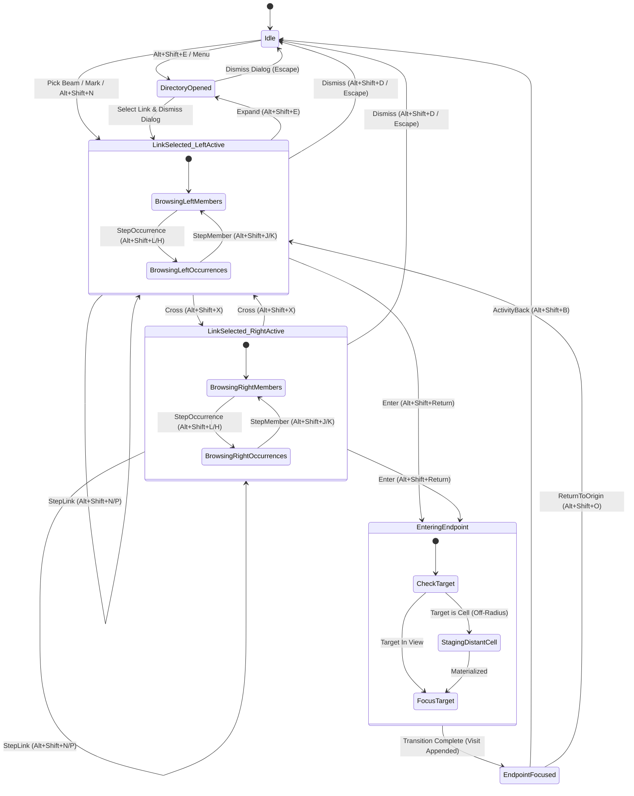

# Xuzz Design Language: The Sovereign Hypermedium Architecture

## 1. Executive Summary & Philosophical Grounding

### 1.1 The Liberation from Paper Simulators

For over four decades, personal computing has languished under what Theodor Holm Nelson diagnosed as
the **"Bleditor"** paradigm—the reduction of digital computing machinery to electronic paper
simulators. Mainstream word processors, PDF readers, and web browsers simulate the arbitrary
boundaries of 8.5" × 11" dead wood pulp, complete with isolated margins, destructive linear undo
stacks, fragile one-way hyperlinks, and lossy, uncredited copy-pasting.

Xuzz is not an electronic paper simulator. It is an authentic **hypermedium** and an **instrument of
thought** (*Dream Machines*, *Literary Machines*), providing a unified spatial environment where
xanadocs and ZigZag multidimensional spaces coexist without an application boundary:

- **One space, no walls:** Documents, sources, transclusion prisms, and cell lattices exist in
  unbroken continuity.
- **Universal Intertwingularity:** Ideas connect across orthogonal dimensions and parallel views;
  moving between page text and cell content preserves origin and context.
- **Retrofuturistic Cybernetic Elegance:** High-precision GPU graphics married to Nelsonian spatial
  instrumentation: deep cosmic slate and obsidian plates, radiant Identity Gold transclusion
  filaments, celestial cyan kinetic tethers, monospace telemetry dials, and cybernetic vellum diff
  cards.

### 1.2 The Ontological Parity of the ZX Dual-Endset Model

In conventional HTML, a link is a directed pointer: a fragile, one-way jump from an anchor `<a>` to
a foreign URL. When the destination moves, the link rots.

In Nelson's **ZX model**, as formally stored in `xanadu::Link` via `apps/common/xanadu/ops.hpp`:

- **One Sovereign Identity:** A link is a first-class, addressable entity (`LinkKey` /
  `GlobalLinkId`) possessing its own permanent identity, author attribution, and semantic type.
- **Two Independent Endsets (Left & Right):** A link binds two complete, independent lists of
  content spans (`PrimediaSpan` lists): the **Left Endset** and the **Right Endset**.
- **Non-Directed Parity:** Left and Right are coordinate labels, not "source" and "target". Neither
  endset is dominant or initial; traversal is inherently bidirectional.
- **Independence of Endset Strands:** A rendered visual strand connecting left member $i$ to right
  member $j$ is an ephemeral geometric projection across the viewport. **It must never falsely imply
  pairwise authorial intent.** An author asserts that the cluster of left spans relates to the
  cluster of right spans ($N \leftrightarrow M$ cardinality); the interface must not collapse this
  relationship into isolated pairs.

### 1.3 Ambient Provenance: The Expulsion of Raw Byte Offsets

In legacy interfaces, link targets were reported as `"document 2, bytes 10 to 14"`. This technical
dump violates Nelson's doctrine of **Ambient Provenance**:

1. **Volatile Machine Contingencies:** Bytes are ephemeral offsets dependent on internal storage
   layouts and UTF-8 encodings. In the docuverse, literature consists of invariant *primedia spans*
   and permanent character identities.
1. **Cognitive Alienation:** Human beings navigate thoughts, sentences, authorial intent, and
   structural context, not memory buffer offsets.
1. **The Semantic Passage Anchor:** Every raw byte report is replaced by a 4-tier semantic anchor:
   - Meaningful typographic passage snippets (`"...the fundamental interconnectedness..."`).
   - Human-authored document titles and bijective microversion tags (`"Literary Machines" v2a1`).
   - Topological cell addresses on ZigZag ranks (`cell 37 [echo] on d.link +1`).
   - Semantic valence badges and discrete coverage tags (`[Quotation] · Full Span`).

### 1.4 Non-Destructive OSMIC Hypertime & Primedia Identity Diffing

Conventional editors implement linear, destructive undo stacks. In Project Xanadu's **OSMIC** model:

- **Time is a 2D Directed Acyclic Graph (DAG):** Edits, deletions, rearrangements, and transclusions
  are immutable historical operations. No version is ever discarded.
- **Mathematical Primedia Identity Diffing:** Character comparison across versions is not a
  heuristic guess (like `git diff` or Myers diff); it is an exact mathematical evaluation of
  primedia coordinate survival across Edit Decision Lists (EDLs).
- **Zero Copy-Paste Quotation (`[Quote into Head]`):** Quoting any historical span into the active
  head appends an EDL reference to the progenitor's permanent primedia coordinates. Zero bytes are
  duplicated in memory or on disk, and Transcopyright micro-royalties remain intact.

______________________________________________________________________

## 2. Core Aesthetic Invariants (Principles P1–P7)

Governed by `design/projects/view-reviews/04-aesthetics.md`, every component in Xuzz conforms to
seven invariant principles:

- **P1 — Real is a sharp rectangle; view-only chrome is soft and seamed, never the reverse.** Every
  real stored ZigZag cell and xanadoc page is an unrounded Cartesian quad (`radius = 0.0px`). Every
  view-only element (panels, buttons, badges, ghost cells, tabs, dialogs) has soft-cornered geometry
  (`r = 0.5 × theme.paddingEm`) or chamfered edges, and a lighter stroke.
- **P2 — Depth means something, or it is zero.** Displacements along the $Z$-axis represent real
  bound dimension steps, document deck offsets, or the camera's rest tilt. Cosmetic depth jitter is
  forbidden.
- **P3 — The thing the reader tracks leads and outlasts.** Flown documents and focused targets lead
  transitions and out-duration context shifts (`anim::sworphSubject` = 620 ms outlasts
  `anim::sworphRow` = 450 ms).
- **P4 — What stays still is the reader's anchor.** The focused cell and anchor page do not jump;
  camera reframing accommodates expanding content. Numeric counters use fixed-advance monospace
  figures so count changes never reflow neighboring labels.
- **P5 — Colour is identity, never state.** A dimension's or link type's hue is immutable. Transient
  state (hover, focus, arming, selection) modulates luminance, outline weight, or glow—never hue.
- **P6 — A view-only placeholder never outshines the dimmest real thing on screen.** Ghost cells and
  background chrome remain visually subordinate to all real stored literature.
- **P7 — Legibility degrades in discrete, named steps with hysteresis.** Typography steps down
  through measured rungs (`Full → Abbreviated → Coarse → Badge → None`) with a dead zone preventing
  transition thrashing.

______________________________________________________________________

## 3. Geometric & Mathematical Specifications

### 3.1 Adaptive Button Sizing & Hierarchy

The legacy UI enforced a global 44px touch target on desktop displays, resulting in clumsy, bloated
buttons. The new specification introduces modality-aware sizing:

```
Desktop Pointer Mode (InputModality::Mouse):
├── Compact Toolbar / Stepper:    Height = 28px | V-pad = 4px,  H-pad = 10px | Radius = 14px (Pill)
├── Standard Action Capsule:      Height = 32px | V-pad = 6px,  H-pad = 14px | Radius = 16px (Capsule)
├── Chamfered Manifold Tab:       Height = 26px | V-pad = 4px,  H-pad = 12px | Chamfer = 4px (45°)
└── Micro-Badge / Figure Pill:    Height = 22px | V-pad = 2px,  H-pad =  6px | Radius = 11px (Mono)

Touch Coarse Mode (InputModality::Touch):
└── Visual Height = 32–36px | Hit-Target Padding expanded to 44px (minTouchPx)
```

### 3.2 Purposeful Button Shape Taxonomy

```
1. SEGMENTED STEPPER PILL (Integrated Stepping Instrument)
   ╭────┬───────────────────────────────────────┬────╮
   │ ◀  │  Link 42 of 108 · (Quotation)         │ ▶  │  (Height: 28px, Outer r: 14px,
   ╰────┴───────────────────────────────────────┴────╯   1px hairline inner seams)

2. ACTION CAPSULE (Primary Semantic Verbs: Enter, Cross, Commit)
   ╭────────────────────────────────────────────╮
   │   ⚡ Enter Occurrence 01                    │  (Height: 32px, Capsule r: 16px,
   ╰────────────────────────────────────────────╯   1.5px luminous rim glow)

3. CHAMFERED MICRO-TAB (Manifold Switching: Graph | Diff | 3D)
    /‾‾‾‾‾‾‾‾‾‾‾‾‾‾\ /‾‾‾‾‾‾‾‾‾‾‾‾‾‾\
   /  DAG Graph     X  Comparison   │               (Height: 26px, 45° top chamfer c: 4px,
  └─────────────────┴───────────────┘                2px accent baseline indicator)

4. GHOST PILL (Auxiliary / Dismiss Actions: Close, Clear, Reset)
   ┌┈┈┈┈┈┈┈┈┈┈┈┈┈┈┈┈┈┈┈┈┈┈┈┈┈┈┈┈┈┈┈┈┈┈┈┈┈┈┈┈┈┈┈┈┐
   ┊         ✕ Dismiss Live Navigation          ┊  (1px hairline border, transparent fill)
   └┈┈┈┈┈┈┈┈┈┈┈┈┈┈┈┈┈┈┈┈┈┈┈┈┈┈┈┈┈┈┈┈┈┈┈┈┈┈┈┈┈┈┈┈┘
```

1. **Segmented Stepper Pill `[ ◀ | Link 42 | ▶ ]`:** A continuous outer capsule (`height = 28px`,
   `radius = 14px`) partitioned by 1px hairline seams (`pack.seam = 1px`) into Left Chevron,
   Monospace Center Counter, and Right Chevron.
1. **Action Capsule:** Full capsule geometry (`radius = 0.5 × height`) with a 1.5px luminous rim
   glow. Hover increases surface luminance by +12% without altering hue (**P5**).
1. **Chamfered Micro-Tab:** 45° chamfered top corners (`c = 4px`). The active tab is anchored by a
   2px accent baseline rail.
1. **Ghost Pill:** 1px hairline border with transparent background, revealing a subtle slate fill on
   hover.

### 3.3 The Optical Label Centering Formulation

In `Canvas::addText`, glyphs were historically drawn flush at `box.left` and
`box.bottom + box.height`. In a 44px box, a 14px label left 30px of unbalanced space below it.

Given bounding box $R = [\text{left}, \text{bottom}, W, H]$, shaped text width $W_{\text{text}}$,
font ascender $\text{ascent} > 0$, and descender $\text{descent} > 0$:

#### Horizontal Optical Centering

```math
\text{drawTextLeft} = \text{box.left} + \operatorname{round}\left(\frac{W - W_{\text{text}}}{2}\right)
```

#### Vertical Baseline Optical Centering

The box center is $Y_{\text{box\_mid}} = \text{box.bottom} + \frac{H}{2}$. The typographic midpoint
is $Y_{\text{text\_mid}} = Y_{\text{baseline}} + \frac{\text{ascent} - \text{descent}}{2}$. Equating
both midpoints yields the target pen baseline:

```math
Y_{\text{baseline}} = \text{box.bottom} + \frac{H - \text{ascent} + \text{descent}}{2}
```

Since `Canvas::drawText` places the pen top at $Y_{\text{baseline}} + \text{ascent}$:

```math
\text{drawTextTop} = \text{box.bottom} + \operatorname{round}\left(\frac{H + \text{ascent} + \text{descent}}{2}\right)
```

#### Descenderless / Title-Case Refinement

When text contains no descending characters ($g, j, p, q, y$), centering against capital letter
height ($\text{ascent}$) prevents the label from appearing optically elevated:

```math
\text{drawTextTop} = \text{box.bottom} + \operatorname{round}\left(\frac{H + \text{ascent}}{2}\right)
```

### 3.4 Micro-Surfaces, Text Fields, and Badges

- **Recessed Luminescent Wells (Text Inputs):** Inputs are rendered as recessed obsidian wells
  (`#0D0F14`, 25% darker than standard panel `#1A1E29`) with a top 1px hairline shadow
  `rgba(0, 0, 0, 0.55)` and soft $r = 4\text{px}$ corners.
- **Focus Aura:** Resting inputs display a 1px border at `rgba(border, 0.45)`. Focused inputs
  illuminate with a 1.5px border glow in **Identity Gold** (`#FFD700`) or **Celestial Cyan**
  (`#00E5FF`) with a 2px outer gaussian dispersion at $\alpha = 0.20$.
- **Monospace Figure Badges (P4 Invariant):** All count and valence badges use `FontRole::Mono` with
  fixed-advance tabular figures so counter increments (`9` $\rightarrow$ `10`) never cause reflow or
  jitter in neighboring labels.

______________________________________________________________________

## 4. Redesigned Components

### 4.1 The Streamlined Link Navigator Bar

Replacing the 3×3 grid of 9 buttons, the new navigator is a single, horizontally balanced, floating
or docked bar (`height = 38px`, `border-radius = 6px`, surface `rgba(18, 20, 26, 0.94)`, backdrop
blur 12px):

```
┌──────────────────────────────────────────────────────────────────────────────────────────────────────────────────────────────────────────────────────┐
│ [LEFT ENDSET WING]                               │ [CENTER HUB]                               │ [RIGHT ENDSET WING]                 │ [ACTION DOCK]  │
├──────────────────────────────────────────────────┼────────────────────────────────────────────┼─────────────────────────────────────┼────────────────┤
│ ◀ M 1/2 ▶ │ ‹ O 1/2 › │ “...address space...” │● │ ◀ Link 42 (3/8) ▶ │ [Quotation] │ @alice │⤢│ ◀ M 2/3 ▶ │ ‹ O 1/1 › │ “Cell #37: ech...│○│ ⇄ │ ⏎ │ ⌂ │ ↶ │✕│
│ (Left Active)         │ [In View]                │ (Left Active ◀)   │ Gold Tier   │ Curator│ │ (Right Standby)     │ [Companion Cell]    │ Cross|Ent|Org|Bck|Cls│
└──────────────────────────────────────────────────┴────────────────────────────────────────────┴─────────────────────────────────────┴────────────────┘
```

#### Detailed Zone Breakdown

- **Left Endset Wing (35% width):**
  - Member Stepper `[◀ M i/N ▶]` (steps stored `Link::left` members).
  - Occurrence Stepper `[‹ O j/M ›]` (steps occurrences within the open version/cell).
  - Contextual Snippet: Truncated UTF-8 passage excerpt (18–24 characters) in `FontRole::Label`.
  - Status Tag: `● In View` (Emerald `#10B981`), `○ Companion Cell` (Purple `#BA68C8`), `△ Distant`
    (Amber `#FFB74D`), `⚠ Unresolved` (Crimson `#EF4444`).
- **Center Hub (30% width):**
  - Link Stepper `[◀ Link i/Total ▶]` ordered by reading rank and Link ID.
  - Semantic Link Type Badge (`[Quotation]`, `[Comment]`, `[Disagreement]`, `[Citation]`,
    `[Transclusion]`, `[Format]`, `[Dimension]`).
  - Curator/Author Pill (`Author`, `@alice`, `DHT Swarm`).
  - Active Side Direction Indicator (`◀ LEFT ACTIVE` or `RIGHT ACTIVE ▶`).
  - Directory Trigger `[⤢ Directory]`.
- **Right Endset Wing (25% width):**
  - Symmetrical controls for `Link::right`. Stepping Right leaves Left cursors intact.
- **Action Dock (10% width):**
  - Cross `[ ⇄ ]`: Toggles active side (`Left ↔ Right`) without moving caret focus.
  - Enter `[ ⏎ ]`: Focuses chosen occurrence, aligns companion view, appends visit to
    `system://activity`.
  - Origin `[ ⌂ ]`: Restores link's origin visit.
  - Activity Back `[ ↶ ]`: Restores parent visit in reader's private activity DAG.
  - Dismiss `[ ✕ ]`: Dismisses bar and clears live cursors.

______________________________________________________________________

### 4.2 The Expanded Link Directory Dialog

Expanding the bar via `[⤢]` unfolds a full-document modal/docked inspection surface
(`780px × 540px`):

```
┌────────────────────────────────────────────────────────────────────────────────────────────────────────┐
│ 🔗 Link Directory — Document: "Udanax Green Architecture" (48 Links)                         [—] [✕] │
├────────────────────────────────────────────────────────────────────────────────────────────────────────┤
│ 🔍 Search passage text: [ primordial address                                                ] [Clear] │
├────────────────────────────────────────────────────────────────────────────────────────────────────────┤
│ Filters: [Type: All ▾] [Quotation ✕] [Comment] [Disagreement] | [Author: @ted ✕] | [1:N, N:M ✕]       │
├─────────────────────────────────────────────┬──────────────────────────────────────────────────────────┤
│ MATCHING LINKS (3 found)                    │ LINK DETAIL INSPECTOR (Link #42)                         │
├─────────────────────────────────────────────┼──────────────────────────────────────────────────────────┤
│ ▶ Link 42 · Quotation · @ted               │ Identity: store:0 / link:42  Type: Quotation  Tier: Author│
│   L: "The primordial address space..."     ├──────────────────────────────────────────────────────────┤
│   R: Cell 37 (d.1) + 2 doc spans (1:3)     │ LEFT ENDSET (1 Member):                                  │
│   Status: [● In View]                      │  • M1: "The primordial address space is immutable..."    │
│                                             │    Occurrences: [Doc 1, p.4, len: 42] (● In View)       │
│ ▶ Link 89 · Comment · @alice                ├──────────────────────────────────────────────────────────┤
│   L: "The primordial address..."           │ RIGHT ENDSET (3 Members):                                │
│   R: "Note on storage scalability" (1:1)   │  • M1: Cell 37 "echo" on d.1 (○ Companion Cell)          │
│   Status: [○ Companion Cell]                │  • M2: Doc 2 "Parallel concatext" (● In View)            │
│                                             │  • M3: Cell 104 "remote" (△ Off-Radius Neighborhood)     │
│ ▶ Link 112 · Transclusion · @bob           ├──────────────────────────────────────────────────────────┤
│   L: "...address space..."                 │ ▼ ADVANCED PRIMEDIA INSPECTOR (Collapsed by Default)     │
│   R: Doc 3 (1:1)                           │   Left M1:  PrimediaSpan [0x00A410, len: 42]             │
│   Status: [● In View]                      │   Right M1: CellRef [37], PrimediaSpan [0x00F820, len: 8]│
│                                             │   Right M3: CellRef [104], Store: 8a3f91 (External)      │
├─────────────────────────────────────────────┴──────────────────────────────────────────────────────────┤
│ [ Select in Bar ]       [ Jump to Left M1 ]       [ Enter Right M1 ]       [ Annotate Link in Walks ] │
└────────────────────────────────────────────────────────────────────────────────────────────────────────┘
```

#### Inspector Features

- **Full-Text Passage Search:** Substring and fuzzy matching across all members of both endsets.
- **Faceted Semantic Filter Pills:** Multi-select filtering by Link Type, Author/Curator, and Endset
  Topology (`1:1`, `1:N`, `N:1`, `N:M`).
- **Collapsed Primedia Disclosure:** Raw hexadecimal spans (`PrimediaSpan [0x00A410, 42]`) and
  storage hashes remain collapsed by default and appear only when explicitly toggled.

______________________________________________________________________

### 4.3 Hypertime DAG & Visual Diff HUD with Xanadulogical Flair

```
   Lane 0
  (Trunk)
   ────◎───────────────────────◆───────────────────────◎───────────────► [NOW]
       │ (G: Genesis)          │ (Crystal Fork)        │ (I: Insert)
       │ Cyan Core             │                       │ Emerald Core
       │                       │ Lineage Filament      │
       │                       ▼ (Rounded Turn r:4px)  │
   Lane 1                      ╭───────────────────────╯
  (Draft)                      │
   ────────────────────────────◎───────────────────────────────────────►
                                 (T: Transclude)
                                 Identity Gold Core

 ════════════════════════════════════════════════════════════════════════════════
  TACTILE TIMELINE SCRUBBER (Vernier Caliper Carriage):
   ├───┼───┼──┼───┼──┼───┼─────[ ◈ d.1.4 (3/6) ]─────────┼───┼──┼───┤
   ▲                     ▲             ▲
   Baseline rail      Pips (Edits)   Vernier Carriage (fixed-advance readout)
```

1. **Anti-Aliased Vector Microversion Orbs:** 24px diameter vector/SDF orbs with a 3px outer lineage
   aura ($\alpha = 0.35$), a 1.5px luminous ring, an obsidian core (`#0C0E14`), and optically
   centered monospace operational glyphs:
   - `G` Genesis (Celestial Cyan/White)
   - `I` Insert (Emerald Mint `#10B981`)
   - `D` Delete / Limbo (Coral Crimson `#F43F5E`)
   - `T` Transclude (Identity Gold `#FFD700`)
   - `L` Link (Amethyst Purple `#BA68C8`)
   - `S` Structure / Cell (Sky Blue `#38BDF8`)
   - `R` Rearrange (Amber `#FFA726`)
1. **Orthogonal Lineage Rails with Filleted Elbows:** 4px diffusion aura, 2px solid lineage
   conductor, and smooth 4px rounded turns at branch bends.
1. **Temporal Crystal Branch Nodes:** Dual-faceted rotated diamond prisms ($45^\circ$) marking fork
   bifurcations.
1. **Vernier Caliper Timeline Scrubber:** Recessed 6px metallic groove, 2px vertical tick pips at
   microversions, and a knurled carriage with live monospace readout and magnetic milestone
   snapping.
1. **Cybernetic Vellum Diff Cards:** Layered translucent sheets (`rgba(16, 20, 28, 0.88)` with 1px
   luminous edge). Text coloring adheres strictly to **P5 Reserved Bands**:
   - Universal Invariant Spans: Identity Gold (`#FFD700`) 18% wash with glowing gold baseline
     ribbon.
   - Shared Branch Spans: Amber (`#F59E0B`) 15% wash.
   - Unique Additions: Mint Green (`#10B981`) 18% wash with left bracket.
   - Limbo Deletions: Coral Red (`#EF4444`) 18% wash with crisp strikethrough filament.
1. **`[ ❝ Quote into Head ]` Action:** Transcludes selected historical passage into the active
   document at caret with zero byte duplication and full Nelsonian provenance.

______________________________________________________________________

## 5. Visual Design Tokens & Palette Architecture

### 5.1 Reserved Harmonic Bands (Principle P5)

Preserving the chromatic invariants defined in `design/projects/view-reviews/04-aesthetics.md`:

```
                      0° / 360° Coral Disagreement (350°–20°)
                              ▲
                 OPEN ARC 4   │   OPEN ARC 1
                 (322°–350°)  │   (58°–140°)
                              │
  Authorship Purple ◄─────────┼─────────► Identity Gold Transclusion
  (258°–322°)                 │           (28°–58°)
                              │
                 OPEN ARC 3   │   OPEN ARC 2
                 (222°–258°)  │   (162°–190°)
                              ▼
                      Quotation Green (140°–162°)
                      Celestial Cyan  (190°–222°)
```

- **Reserved Functional Bands:**
  - **Identity Gold & Amber** ($28^\circ - 58^\circ$, `#FFD700`): Transclusion prisms, focus
    highlight, universal diff spans.
  - **Celestial Cyan** ($190^\circ - 222^\circ$, `#00E5FF`): Kinetic tethers, accent chrome, comment
    links.
  - **Amethyst & Magenta** ($258^\circ - 322^\circ$, `#BA68C8`): Authorship, citation ribbons,
    xanalink ribbons.
  - **Emerald & Mint** ($140^\circ - 162^\circ$, `#10B981`): Quotation, verified sources.
  - **Coral & Crimson** ($350^\circ - 20^\circ$, `#F43F5E`): Disagreement, conflict, deletion/limbo.
- **Dynamic Dimension Hues (Golden Angle Allocation):** New dimensions ($d.1, d.2, \dots$) are
  mapped deterministically into the **Four Open Arcs**
  ($[58^\circ, 140^\circ), [162^\circ, 190^\circ), [222^\circ, 258^\circ), [322^\circ, 350^\circ)$):
  `hue(n) = domain(frac(n * 0.6180339887))`. Collisions with Gold, Cyan, Purple, Green, and Red are
  structurally impossible. Each dimension receives a persistent dash pattern and compass glyph as
  secondary accessibility cues.

### 5.2 C++ Design Tokens (`theme.hpp`)

```cpp
namespace gleditor::ui {

struct ButtonMetrics {
  float heightCompactPx{28.0F};     // Desktop compact toolbar/dialog
  float heightStandardPx{32.0F};    // Desktop primary action
  float heightTouchPx{44.0F};       // Touch modality minimum
  float radiusPillShare{0.5F};      // Capsule radius multiplier (0.5 * height)
  float radiusChamferPx{4.0F};      // Chamfered micro-tab corner cut
  float paddingHorizontalEm{0.75F}; // Horizontal internal padding
  float paddingVerticalEm{0.25F};   // Vertical internal padding
};

struct XanaduFlairColours {
  // Deep Obsidian Core
  glm::vec4 obsidianVoid{0.05F, 0.06F, 0.08F, 1.0F};      // #0D0F14
  glm::vec4 slateSurface{0.10F, 0.12F, 0.16F, 1.0F};      // #1A1E29
  glm::vec4 buttonPlate{0.14F, 0.16F, 0.22F, 1.0F};       // #242938
  glm::vec4 wellRecessed{0.08F, 0.09F, 0.12F, 1.0F};      // #14171F

  // Reserved Harmonic Invariants (P5)
  glm::vec4 identityGold{1.00F, 0.84F, 0.00F, 1.0F};      // #FFD700 (Transclusion)
  glm::vec4 celestialCyan{0.00F, 0.90F, 1.00F, 1.0F};     // #00E5FF (Tethers/Accent)
  glm::vec4 amethystPurple{0.73F, 0.41F, 0.78F, 1.0F};    // #BA68C8 (Citation/Authorship)
  glm::vec4 emeraldMint{0.06F, 0.73F, 0.51F, 1.0F};       // #10B981 (Quotation)
  glm::vec4 coralCrimson{0.96F, 0.25F, 0.37F, 1.0F};      // #F43F5E (Disagreement)

  // Atmospheric Auras
  glm::vec4 goldAura{1.00F, 0.84F, 0.00F, 0.18F};
  glm::vec4 cyanAura{0.00F, 0.90F, 1.00F, 0.18F};
  glm::vec4 rimGlowHairline{0.35F, 0.40F, 0.50F, 0.60F};
};

} // namespace gleditor::ui
```

______________________________________________________________________

## 6. Interaction State Machines & Keymap Chords

### 6.1 Link Navigation State Machine



### 6.2 Sovereign Keymap Chords (`system://keymap`)

| Chord              | Action Identifier  | Semantic Effect                                         |
| :----------------- | :----------------- | :------------------------------------------------------ |
| `Alt+Shift+N`      | `link-next`        | Advance to next link candidate at current focus         |
| `Alt+Shift+P`      | `link-prev`        | Return to previous link candidate                       |
| `Alt+Shift+J`      | `member-next`      | Step active side's member cursor forward (+1)           |
| `Alt+Shift+K`      | `member-prev`      | Step active side's member cursor backward (-1)          |
| `Alt+Shift+L`      | `occurrence-next`  | Step active side's occurrence cursor forward (+1)       |
| `Alt+Shift+H`      | `occurrence-prev`  | Step active side's occurrence cursor backward (-1)      |
| `Alt+Shift+X`      | `link-cross`       | Toggle active side (`Left ↔ Right`)                     |
| `Alt+Shift+Return` | `link-enter`       | Focus chosen occurrence, materialize cell, record visit |
| `Alt+Shift+O`      | `link-origin`      | Restore active link's origin visit                      |
| `Alt+Shift+B`      | `activity-back`    | Step back to parent visit in `system://activity`        |
| `Alt+Shift+F`      | `activity-fwd`     | Choose and step into forward child visit                |
| `Alt+Shift+E`      | `link-directory`   | Open / toggle Expanded Link Directory Dialog            |
| `Alt+Shift+D`      | `link-dismiss`     | Close Link Bar and clear live cursors                   |
| `Ctrl+H`           | `hypertime-toggle` | Toggle 2D Hypertime DAG and visual diff HUD             |
| `Ctrl+[`           | `scrub-backward`   | Scrub backward one microversion along lineage           |
| `Ctrl+]`           | `scrub-forward`    | Scrub forward one microversion along lineage            |
| `Ctrl+Shift+Q`     | `diff-quote-head`  | Transclude selected diff card text into current Head    |
| `Escape`           | `ui-cancel`        | Dismiss top-most overlay/dialog; revert focus           |

______________________________________________________________________

## 7. AccessKit Accessibility Architecture

The accessibility tree exposes the complete semantic structure:

```
Role::Window ("Xuzz — Workspace")
 └── Role::Group ("Streamlined Link Navigator", live: Polite)
      ├── Role::Button ("Previous link", action: Click)
      ├── Role::Label ("Link 42, Quotation, Curated by @alice")
      ├── Role::Button ("Next link", action: Click)
      ├── Role::Group ("Left Endset (Active Side)")
      │    ├── Role::Button ("Previous left member", action: Click)
      │    ├── Role::Label ("Left member 1 of 2")
      │    ├── Role::Button ("Next left member", action: Click)
      │    ├── Role::Button ("Previous left occurrence", action: Click)
      │    ├── Role::Label ("Occurrence 1 of 2: In View, Literary Machines p.4")
      │    ├── Role::Button ("Next left occurrence", action: Click)
      │    └── Role::Label ("Passage: 'The primordial address space...'")
      ├── Role::Button ("Cross to right endset", action: Click)
      ├── Role::Group ("Right Endset")
      │    ├── Role::Button ("Previous right member", action: Click)
      │    ├── Role::Label ("Right member 2 of 3")
      │    ├── Role::Button ("Next right member", action: Click)
      │    ├── Role::Label ("Occurrence 1 of 1: Companion cell 37 on dimension d.1")
      │    └── Role::Label ("Passage: 'Cell 37 echo'")
      ├── Role::Button ("Enter endpoint", action: Click, default: true)
      ├── Role::Button ("Return to origin", action: Click)
      ├── Role::Button ("Activity back", action: Click)
      ├── Role::Button ("Expand link directory", action: Click)
      └── Role::Button ("Dismiss link navigator", action: Click)
```
