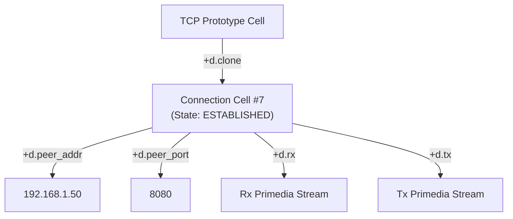

# The Dimension-Cell Operating Environment: Zigzag Lenses as Universal Interface

**Status:** Exploratory Architecture & Design Proposal\
**Branch:** `feat/zigzag-lenses` (incorporating `study/vortex-multithreading` & Spool-Mesh)\
**Date:** 2026-10-17\
**Inspiration:** The Plan 9 from Bell Labs philosophy ("Everything is a file", 9P network
transparency, private namespaces, `ctl` files, and the Plumber) transposed onto Theodor Holm
Nelson's Zigzag and Xanadu hyperstructure ("Everything is dimensions and cells", the 2-rank manifold
invariant, and universal transclusion) powered by the **Spool-Mesh** distributed runtime.

______________________________________________________________________

## Abstract

Plan 9 demonstrated that an operating system can achieve profound compositional power, network
transparency, and conceptual purity by unifying all resources—storage, devices, processes,
networking, windowing, and IPC—under a single primitive: the **file** (a byte stream) organized into
hierarchical **trees** (directories), manipulated via a single network-transparent protocol
(**9P**), and composed via per-process **private namespaces**.

Yet the file tree is an artifact of 1960s filing cabinets. Hierarchies enforce arbitrary primary
taxonomies, break under multi-axial categorizations, require artificial link mechanics (symlinks,
hardlinks) that produce cycles and dangling pointers, and force unstructured byte serialization onto
rich, relational data.

This document proposes a radical alternative rooted in Project Xanadu, Zigzag, and the Spool-Mesh
distributed architecture: **the Dimension-Cell Operating Environment**. In this system:

1. **Everything is a Cell**: Informational atoms (processes, network sockets, framebuffers, text
   fragments, window panes, database tuples, and executable closures) are cells.
1. **Every Relationship is a Dimension**: Orthogonal, directed axes ($d.1, d.2, \dots$) weave cells
   into an $N$-dimensional manifold where every cell has at most one positive and one negative
   neighbor per dimension (the strict 2-rank manifold invariant).
1. **Every Program, View, and Virtual Server is a Lens**: A **Lens** is a bidirectional, composable
   projection over dimensions and cells. It replaces synthetic filesystems (like `/proc` and
   `/net`), stream pipelines (`cat | grep`), window managers (`rio`), and text environments
   (`acme`).
1. **9Z and Spool-Mesh replace 9P**: A minimal, invariant-preserving protocol and content-addressed
   messaging mesh for querying, stepping, linking, and observing manifolds across local threads,
   subprocesses, or distributed BitTorrent swarms.
1. **Private Dimension Bindings replace Mount Tables**: Processes and views do not mount directory
   trees; they bind, alias, filter, and orient dimensions across local and remote nodes.
1. **Network Transparency with No Remote Mutation**: Distributed computation is achieved not by
   leaky distributed shared memory or RPC, but by share-nothing arenas passing immutable,
   content-addressed messages, merging state deterministically via local cell minting.

```
+─────────────────────────────────────────────────────────────────────────+
|                               ZIGZAG LENS                               |
|  Bidirectional morphism: (Source Manifold) <---> (Projected View/Action) |
+─────────────────────────────────────────────────────────────────────────+
       │                                                              │
       │ Tier 1: Synthetic Manifold                                  │ Tier 3: Presentation
       ▼                                                              ▼
┌──────────────────────────┐                                   ┌──────────────────────────┐
│   Operating System &     │                                   │    User Sensory Space    │
│   Hardware Substrates    │                                   │ (Lattice, Canvas, Acme,  │
│ (/proc, /net, /dev, GPU) │                                   │  Xanadoc, 3D Spatial)    │
└──────────────────────────┘                                   └──────────────────────────┘
       ▲                                                              ▲
       │                                                              │
       +─────────────────────── Tier 2: Transductive ─────────────────+
                                Pipeline & Plumber
                                (Filter, Pivot, Sort)
                                      ▲
                                      │
                         Spool-Mesh Distributed Wire
                         (Immutable Content Messages)
                                      ▼
                        ┌──────────────────────────┐
                        │ Remote Swarm Peer Nodes  │
                        │ (DHT / BEP 46 / BEP 10)  │
                        └──────────────────────────┘
```

______________________________________________________________________

## 1. Plan 9 vs. Zigzag: Comparative Philosophy

To build a system with the true philosophy of Plan 9, we must not copy its syntax (slashes and byte
streams); we must transpose its deepest architectural virtues into the multidimensional domain.

| Plan 9 Architectural Principle | Plan 9 Implementation ("Everything is a File")                           | Zigzag Environment ("Everything is Dimensions & Cells")                                    |
| :----------------------------- | :----------------------------------------------------------------------- | :----------------------------------------------------------------------------------------- |
| **Universal Atom**             | Byte stream (untyped file)                                               | **Cell** (typed value or primedia span with permanent hypertime identity)                  |
| **Structural Topology**        | Hierarchical Tree (1 parent, $N$ children)                               | **$N$-Dimensional Manifold** (orthogonal 2-rank invariant: $\text{deg}^\pm(c, d) \le 1$)   |
| **Addressing**                 | Hierarchical path strings (`/net/tcp/0/data`)                            | **Dimensional Coordinates & Hops** (`hop(cell, +d.net, +d.tcp, +d.data)`)                  |
| **Synthetic Resources**        | Synthetic 9P filesystems (`/proc`, `/net`, `/dev/draw`, `/dev/mouse`)    | **Synthetic Dynamic Manifolds & Lenses** (processes, sockets, hardware as cells and ranks) |
| **Protocol**                   | **9P** (14 messages: `walk`, `open`, `read`, `write`, `clunk`, etc.)     | **9Z** (7 primitives: `zhop`, `zread`, `zdims`, `zlink`, `zunlink`, `zmake`, `zwatch`)     |
| **Network Transparency**       | 9P over network connection (`import machine /net /net`)                  | **Spool-Mesh**: Share-nothing arenas over swappable loopback/socket/swarm channels         |
| **Distributed Safety**         | Central file server / lock state                                         | **No Remote Mutation**: Content-addressed messages merged locally by minting ops           |
| **Composition & Isolation**    | Per-process **Mount Tables** & Union Directories                         | Per-context **Dimension Bindings**, Lens Pipelines, and Scoped Views                       |
| **Control Interface**          | Text commands written to `ctl` files (`echo 'connect 1.2.3.4!80' > ctl`) | **Action Cells linked along `d.ctl`**, or evaluated Vortex hyperstructural verbs           |
| **Inter-Client Plumbing**      | **The Plumber** (message router matching regexes to ports)               | **Hyperplumber**: Transclusion-guided, type-aware activation along relational dimensions   |
| **Windowing & Interaction**    | **rio** / **8½** (windows as virtual `/dev` namespaces) & **acme**       | **Xuzz / Acme-ZZ**: Viewports as Lenses over sub-manifolds; no rigid window cages          |

______________________________________________________________________

## 2. The Tripartite Dialectic

Following the Nelsonian reasoning framework, we stress-test this architecture through the tripartite
dialectic between ideological purity, mechanical sympathy, and existing codebase grounding.

### 2.1 Thesis: The Xanadulogical Purist (`xanadu_purist`)

1. **Abolition of the File Silo**: The concept of a file with an arbitrary filename in a
   hierarchical folder is an arbitrary human-imposed cage. Real human thought and natural phenomena
   are intertwingled. A file forces an author to decide whether a project note belongs under "Work"
   or "Personal" or "2026". In Zigzag, a cell simultaneously belongs to `d.category`, `d.time`,
   `d.author`, `d.importance`, and `d.provenance` without duplication.
1. **Absolute Transclusion**: There is no copy-paste. When a process communicates with another, or
   when data is displayed in multiple views, it is transcluded via `vspans` or linked along
   `d.clone`. Every byte has immutable provenance in the permascroll.
1. **The 2-Rank Manifold Invariant**: Along any dimension $d$, every cell $C$ has at most one
   positive neighbor ($+1$) and at most one negative neighbor ($-1$):
   ```math
   \text{deg}^+(C, d) \le 1, \quad \text{deg}^-(C, d) \le 1
   ```
   Ranks are linear sequences. Branching is not allowed within a single dimension; branching is
   achieved orthogonally by introducing a new dimension.
1. **Universal Symmetry**: All operations are bidirectional. Walking $+d$ is inverted by $-d$. Every
   link is indexed from both endpoints.

### 2.2 Antithesis: The Systems Realist (`systems_realist`)

1. **The I/O Throughput Bottleneck**: In Plan 9, streaming 100 Gbps network packets or 4K video
   frames through 9P is fast because a file is a raw byte buffer that can be zero-copy spliced via
   DMA. If every single byte or network packet were a 64-byte `CompactOpNode` in an append-only ops
   spool, memory and disk would explode in seconds. *Resolution*: **Primedia Streams vs. Structural
   Cells**. The data plane (bulk streaming bytes) resides in memory-mapped ring buffers or
   `PrimediaSpan` streams. The control plane, routing, metadata, protocol state machines, and
   endpoints reside in Zigzag dimensions and cells.
1. **Ephemeral State vs. Permanent Storage**: In Unix/Plan 9, `/proc` is ephemeral RAM; rebooting
   wipes it. In Xanadu, the ops spool is traditionally persistent, append-only, and Merkle-sealed.
   We cannot write a scheduler tick or mouse coordinate to `SegmentedOpsSpool` on NVMe.
   *Resolution*: **The Two-Manifold Architecture**. Persistent entities live in `Store`/`Manifold`
   backed by `CompactOpNode`. Transient system state (processes, mouse cursors, intermediate
   pipeline ranks) lives in high-performance, zero-allocation `ArenaManifold`s.
1. **Distributed Latency & Churn**: Distributed object systems (CORBA, DCOM, distributed shared
   memory) fail because network partitions and pointer chasing over wires stall execution.
   *Resolution*: **Spool-Mesh Discipline**. Location transparency via share-nothing arenas and
   asynchronous content-addressed message passing. No distributed locks, no remote pointers.

### 2.3 Synthesis: The Codebase Expert (`codebase_expert`)

1. **Foundational Types in Place**:
   - `CompactOpNode` (64 bytes, cache-line aligned) with `OpKind::Structure` (`MakeCell`, `SetLink`,
     `SetValue`, `Splice`).
   - `zigzag::Manifold` (persistent, folded from ops) and `zigzag::ArenaManifold` (ephemeral, CSR
     storage).
   - `cell_views.hpp`: Lazy ranges (`rank`, `rankAfter`, `step`, `hop`, `neighbours`) that compose
     with `std::ranges` without memory allocation.
   - `ProjectionLens` and `ProjectionSession` (`projection_lens.hpp`, `projection_session.hpp`):
     Source-agnostic projection of external trees/structures into arenas with bidirectional identity
     mapping (`ExternalKey <-> CellRef`).
   - `VortexHost`: The hyperstructural virtual machine executing bytecode where registers, stacks,
     and arguments are cell ranks.
   - `SpoolMesh` (`apps/common/xanadu/vortex/spool_mesh.hpp`): Content-addressed messaging
     (`MeshMessage`, `contentId = sha256Hex(payload)`), share-nothing `MeshNode`, swappable
     `MeshChannel` (loopback, socket, BEP 10 swarm wire).
1. **Path to Implementation**:
   - Generalize `ViewAxisBinding` into a polymorphic `Lens` hierarchy.
   - Integrate `ProjectionLens` and `ProjectionSession` with `SpoolMesh` to allow remote synthetic
     manifolds.
   - Implement the `9Z` protocol interface in `apps/common/xanadu/zigzag/zz9p.hpp`.

______________________________________________________________________

## 3. The Architecture of Zigzag Lenses

In this operating environment, a **Lens** is not a passive window widget; it is a **bidirectional
structural morphism**. We classify lenses into three cooperating tiers:

```
+─────────────────────────────────────────────────────────────────────────+
|                           TIER 3: PRESENTATION LENSES                   |
|   LatticeLens  |  XanadocLens  |  AcmeLens  |  SheetLens  |  Spatial3D  |
+─────────────────────────────────────────────────────────────────────────+
                                    ▲  │ (User gestures / edits)
         (Renderable layout boxes)  │  ▼
+─────────────────────────────────────────────────────────────────────────+
|                           TIER 2: TRANSDUCTIVE LENSES                   |
|      FilterLens   |   PivotLens   |   SortLens   |   Hyperplumber       |
+─────────────────────────────────────────────────────────────────────────+
                                    ▲  │ (Derived dimension writes)
          (Filtered/ordered ranks)  │  ▼
+─────────────────────────────────────────────────────────────────────────+
|                           TIER 1: SYNTHETIC MANIFOLD LENSES             |
|       ProcLens    |     NetLens   |     DevLens  |     VfsLens      |
+─────────────────────────────────────────────────────────────────────────+
                                    ▲  │ (Hardware I/O / Syscalls)
             (System event cells)   │  ▼
+─────────────────────────────────────────────────────────────────────────+
|                             KERNEL / HARDWARE                           |
|       Processes   |   TCP/IP / P2P|   GPU / DRM  |   Storage NVMe       |
+─────────────────────────────────────────────────────────────────────────+
```

______________________________________________________________________

## 4. Tier 1: Synthetic Manifold Lenses (The Plan 9 Device / Server Model)

In Plan 9, a device driver or system service exports a 9P synthetic filesystem. In the Zigzag
environment, a service exports a **Synthetic Manifold Lens** that materializes cells and dimensions
on demand into an `ArenaManifold` driven by a `ProjectionSession`.

### 4.1 `ProcLens`: The Process Manifold (Plan 9 `/proc` Reimagined)

In Plan 9, `/proc/1234/` contains `ctl`, `mem`, `status`, `note`, and `text`. In `ProcLens`, every
process is a **Cell**. Relationships between processes are direct dimensional connections:

```
                                  ▲ +d.parent
                                  │
                               [Process 1] (init/launcher)
                                  │
                                  ▼ -d.parent / +d.child
                               [Process 42] (xuzz session) ─── +d.threads ─── [Thread 1] ─── +d.threads ─── [Thread 2]
                                  │          │
                     +d.proc_next │          ├─── +d.ctl ───── [Ctl Headcell]
                                  │          ├─── +d.env ───── [Key=Val Cell] ─── +d.env ─── [Key=Val Cell]
                                  ▼          └─── +d.channels ─ [StdIn Cell]  ─── +d.next ─── [StdOut Cell]
                               [Process 43]
```

#### Dimensional Specifications for Processes

- **`d.parent` / `d.child`**: The process hierarchy tree mapped into two orthogonal directions.
  Traversing `+d.parent` moves to the parent process cell; traversing `+d.child` visits child
  processes in creation order.
- **`d.threads`**: The rank of execution threads running within this process.
- **`d.ctl`**: The control rank. Writing a command to this rank (or linking a command cell such as
  `pause`, `resume`, `kill`, `profile`) signals the process.
- **`d.channels`**: Inter-process communication endpoints (replacing file descriptors 0, 1, 2).
  Linking a channel cell along `d.channels` to another process's channel cell establishes a direct,
  zero-copy pipe.
- **`d.memory`**: Virtual memory segments represented as primedia spans.

### 4.2 `NetLens`: The Network Manifold (Plan 9 `/net` Reimagined)

Plan 9's `/net/tcp` contains a `clone` file that allocates a connection directory upon opening. In
`NetLens`, the network stack is a dynamic multidimensional manifold:

- **The Prototype Cell**: A cell representing the TCP stack.
- **Creating a Connection**: Navigating to the TCP prototype cell and linking a new cell along
  `d.clone` creates an ephemeral connection cell.
- **Connecting**: The connection cell has dimensions:
  - `d.peer_addr`: Linked to a cell containing the destination IP/hostname.
  - `d.peer_port`: Linked to a cell containing the target port.
  - `d.state`: Ranks through `IDLE -> CONNECTING -> ESTABLISHED -> CLOSED`.
  - `d.in` / `d.out`: The streaming primedia endpoints.



### 4.3 `DevLens`: Hardware & Input Manifold (Plan 9 `/dev` Reimagined)

- **`d.device`**: Enumerates available hardware controllers (GPUs, displays, mice, keyboards, audio
  interfaces).
- **`d.event`**: An append-only event stream rank. As input events (key presses, mouse motions, pen
  pressure) arrive from the OS or evdev, event cells are linked posward along `d.event`. A
  subscriber lens simply walks `rank(m, cursor, d.event)` to consume input reactively without
  blocking threads.

______________________________________________________________________

## 5. Tier 2: Transductive Lenses (The Pipeline & Plumbing Architecture)

In Plan 9, the shell pipeline (`|`) connects byte streams, and the **Plumber** routes semantic
messages between interactive applications. In Zigzag, these mechanisms become **Transductive
Lenses**: morphisms that derive new dimensions and ranks on top of underlying manifolds.

### 5.1 The Rank Pipeline: Filter, Map, Sort

Unlike Unix pipelines which flatten structured data into line-oriented ASCII, a Zigzag pipeline
maintains structural invariants:

```cpp
// Conceptual C++26 pipeline using cell_views.hpp
auto activeProcesses = rank(sysManifold, initProc, d.proc_next)
                     | std::views::filter(holdsState(ProcState::Running))
                     | std::views::transform(projectToSummaryCell);
```

A **Transductive Lens** materializes this pipeline as an *ephemeral dimension*:

- Let dimension $d.\text{source}$ be the raw rank of items.
- The **Filter Lens** introduces an ephemeral dimension $d.\text{filtered}$. It walks
  $d.\text{source}$, tests each cell against a predicate (written in Vortex bytecode or native C++),
  and links matching cells along $d.\text{filtered}$.
- Navigating $+d.\text{filtered}$ hops directly to the next matching cell in $O(1)$ without
  modifying the persistent $d.\text{source}$ rank!

### 5.2 The Hyperplumber: Semantic Dimensional Dispatch

Plan 9's plumber reads `/sys/lib/plumb/initial.plumbing` and dispatches messages:

```
# Plan 9 plumbing rule
type is text
data matches 'http://[a-zA-Z0-9_./]+'
plumb to web
```

In Zigzag, the **Hyperplumber** routes actions based on **Cell Signatures**:

1. **Value Kind Signature**: Cells holding URLs, coordinate vectors, source code, or images have
   explicit types (via OSMIC R6 typed values: `ValueKind::String`, `ValueKind::Integer`,
   `ValueKind::Rational`, `ValueKind::Float`, `ValueKind::Span`).
1. **Dimension Signatures**: The set of dimensions intersecting a cell defines its semantic role. A
   cell connected to `d.parent` and `d.threads` is a Process; a cell connected to `d.author` and
   `d.biblio` is a Citation.
1. **Activation Dispatch**: When a user activates a cell (via middle click, Enter key, or gesture):
   - The Hyperplumber inspects the cell's dimension signature.
   - It selects the most specific registered **Lens Factory**.
   - It transitions the viewport or opens a companion pane bound to that lens.
   - *Example*: Activating a compiler error cell hops along `d.provenance` to the exact span in the
     source xanadoc, while opening a `ProcLens` pane focused on the running compiler process!

______________________________________________________________________

## 6. Tier 3: Presentation Lenses (The Interface System)

In Plan 9, **rio** provides windows containing terminal multiplexers, and **acme** provides a text
editor where text itself is the command language. In the Zigzag environment, **presentation is
pluggable and multidimensional**.

### 6.1 The Pluggable Lens Interface

Every presentation lens implements a unified C++ contract conforming to `libgleditor`'s rendering
architecture:

```cpp
namespace xanadu::lens {

/**
 * @brief Abstract specification for a Zigzag Presentation Lens.
 */
class ILens {
public:
  virtual ~ILens() = default;

  /// The human-readable name of the lens (e.g. "Lattice", "Acme-ZZ", "Xanadoc Flow").
  [[nodiscard]] virtual std::string_view name() const noexcept = 0;

  /// The set of dimensions this lens binds to spatial axes or layout roles.
  [[nodiscard]] virtual std::span<const DimRef> boundDimensions() const noexcept = 0;

  /// Rebuilds layout geometry and visual boxes from the underlying manifold.
  virtual void layout(const zigzag::Manifold &manifold,
                      zigzag::CellRef focusCell,
                      const gleditor::ui::LayoutContext &ctx) = 0;

  /// Submits renderable primitives to the gleditor stream buffer / GPU pipeline.
  virtual void draw(gleditor::StreamBufferGL &streamBuffer,
                    const gleditor::Renderer &renderer) = 0;

  /// Handles user input (spatial cursor movement, cell activation, link manipulation).
  virtual bool handleInput(const SDL_Event &event,
                           zigzag::Manifold &manifold,
                           zigzag::CellRef &focusCell) = 0;

  /// Exposes the accessibility tree for assistive technology via AccessKit.
  virtual void populateA11y(gleditor::a11y::Node &parentNode) = 0;
};

} // namespace xanadu::lens
```

### 6.2 Key Presentation Lenses

#### 1. The Lattice Lens (`LatticeLens`)

The standard Nelsonian orthogonal visualization.

- **Axes**: Maps user-selected dimensions to spatial $(X, Y, Z)$ axes (e.g., $X = d.time$,
  $Y = d.category$, $Z = d.author$).
- **Projection**: Cells are rendered as cards in 3D world space. Ranks are connected by visual beams
  or tendons. Moving the cursor along an axis steps through the rank with smooth camera tracking.

#### 2. The Xanadoc Lens (`XanadocLens`)

Unrolls multidimensional cells into continuous prose.

- **Mapping**: Ranks along $d.contents$ or $d.seq$ are unrolled into typographic paragraphs and
  pages using `src/text/` (HarfBuzz, FreeType 2, FriBidi).
- **Transclusion Beams**: When a cell on the page is transcluded elsewhere in the docuverse, optical
  connection beams bridge the page to the companion document or slice.

#### 3. The Acme-ZZ Lens (`AcmeLens`)

A direct homage to Rob Pike's Acme, elevated into multidimensional space.

- **The Acme Cell Structure**: Every window or buffer in Acme is represented by a cell with two
  primary ranks:
  - `+d.tag`: The command bar rank containing executable cells (`Put`, `Get`, `Look`, `Del`,
    `Vortex`).
  - `+d.body`: The text or content rank.
- **Three-Button Mouse Semantics**:
  - **Button 1 (Left)**: Selects text or moves the focus cell.
  - **Button 2 (Middle)**: Executes the cell under cursor. If the cell contains a Vortex expression,
    the Vortex VM evaluates it; if it names an OS command, it spawns a `ProcLens` cell.
  - **Button 3 (Right)**: Contextual plumbing. Hopping along `d.clone` or searching across
    dimensions for the selected text or cell reference.
- **No Overlapping Windows**: Panes tile dynamically along orthogonal layout dimensions `d.layout_x`
  and `d.layout_y`. Splitting a pane is simply inserting a new cell into the layout rank!

```
+─────────────────────────────────────────────────────────────────────────+
| [New] [Cut] [Paste] [Sort: d.time] [Lens: Lattice]                      | <- Global Tag Rank (d.tag)
+─────────────────────────────────────────────────────────────────────────+
| Column 1 (d.layout_x)                   | Column 2 (d.layout_x)         |
| +─────────────────────────────────────+ | +───────────────────────────+ |
| | /proc/active [Kill] [Inspect]       | | | /net/tcp/0 [Close] [Dump] | | <- Window Tag
| +─────────────────────────────────────+ | +───────────────────────────+ |
| | Process: 42 (xuzz)                  | | | Remote: 10.0.0.1:80       | |
| | State: RUNNING                      | | | Rx: 4.2 MB                | | <- Window Body
| | Threads: 4                          | | | Tx: 1.1 MB                | |    (d.body)
| +─────────────────────────────────────+ | +───────────────────────────+ |
| | /notes/2026 [Put] [Transclude]      | |                               |
| +─────────────────────────────────────+ |                               |
| | Nelsonian hyperstructure notes...   | |                               |
| +─────────────────────────────────────+ |                               |
+─────────────────────────────────────────────────────────────────────────+
```

#### 4. The Sheet / Relational Lens (`SheetLens`)

Projects orthogonal dimensions as a live, interactive spreadsheet.

- Horizontal axis = $d.column$; Vertical axis = $d.row$.
- Formulas are cells holding Vortex bytecode. Cells reactively update when cells along their
  `d.depends` rank change.

______________________________________________________________________

## 7. The 9Z Protocol: Invariant-Preserving Manifold Wire

Plan 9 operates over 9P (Styx), which exposes 14 message types. The Zigzag Operating Environment
operates over **9Z**, a minimal, elegant protocol designed specifically for $N$-dimensional 2-rank
manifolds.

### 7.1 The 9Z Message Primitives

```
+─────────────────────────────────────────────────────────────────────────+
|                              THE 9Z PROTOCOL                            |
|                                                                         |
|  1. Zhop    (cell, dim, dir, count)    -> TargetCell                    |
|  2. Zread   (cell)                     -> Value / PrimediaSpan          |
|  3. Zdims   (cell)                     -> [DimRef]                      |
|  4. Zlink   (cell_a, cell_b, dim, dir) -> ResultCode                    |
|  5. Zunlink (cell, dim, dir)           -> ResultCode                    |
|  6. Zmake   (span / value)             -> NewCellRef                    |
|  7. Zwatch  (cell / rank)              -> EventStream (Reactivity)      |
+─────────────────────────────────────────────────────────────────────────+
```

1. **`Zhop`**: Navigates from an anchor cell along a dimension in a given direction (`+` or `-`) by
   $N$ hops. Returns the resulting cell, or nullopt if the rank terminates.
1. **`Zread`**: Retrieves the payload of a cell (either an immutable `PrimediaSpan` or an OSMIC
   typed value).
1. **`Zdims`**: Queries all dimensions currently passing through the specified cell.
1. **`Zlink`**: Creates a link between two cells along dimension $d$, strictly enforcing the 2-rank
   manifold invariant ($\text{deg}^\pm \le 1$). If either cell already has a neighbor along $d$ in
   that direction, the call fails unless an explicit splice operation is requested.
1. **`Zunlink`**: Sever an existing link along dimension $d$.
1. **`Zmake`**: Mints a new cell with an initial value or span, assigning it a permanent hypertime
   identity in the ops spool.
1. **`Zwatch`**: Registers a reactive subscription to changes occurring on a cell or rank, enabling
   event-driven lenses without polling.

______________________________________________________________________

## 8. Network Transparency & Spool-Mesh Distributed Lenses (Plan 9 `import`/`export` Reborn)

Plan 9's greatest achievement was that network transparency was not a library or an afterthought; it
was inherent in the file protocol: `import remote_machine /net /net` allowed a local terminal to use
a remote machine's network stack without code changes.

In the Dimension-Cell Environment, network transparency is achieved through the **Spool-Mesh**
architecture (`apps/common/xanadu/vortex/spool_mesh.hpp` and `design/vortex-distribution.md`).

### 8.1 The Core Invariant: "There is No Remote Mutation"

In traditional distributed object systems or distributed shared memory, remote pointer dereferences
cause blocking stalls, race conditions, and split-brain failures.

Spool-Mesh resolves this with a decisive safety property: **There is no remote mutation**.

- A node never reaches into another node's arena or manifold to mutate a cell.
- Instead, communication occurs strictly via **content-addressed, immutable messages**
  (`MeshMessage`), where `contentId = sha256Hex(payload)`.
- When a remote node wants to affect local state, it sends an immutable message or sealed write-set
  (`Promoted`).
- The receiver **merges the message locally by minting its own operations** in its local
  `ArenaManifold` or `Store`.
- Duplicate messages (from network retries or multi-path delivery) are automatically deduplicated by
  `contentId` (at-least-once transport + content dedup = **effectively-once execution**).

### 8.2 Foreign Cells and Distributed Dimensions

When a lens attaches to a remote node:

1. **Node Identity**: Each node has a stable `NodeId{authorKey, deviceKey, epoch}`.
1. **Foreign Cells**: In the local manifold, a remote entity is represented by a **Proxy Cell**
   carrying `ValueKind::ForeignOpHandle` with an attribute rank along `d.op-label` recording the
   remote `NodeId` and source key.
1. **Distributed Hops**: When a lens walks along a dimension leading to a foreign cell:
   - The local `ProjectionSession` checks its local cache.
   - If unmaterialized, it sends a `Zhop` or actor query via `MeshChannel` (`LoopbackChannel`,
     `SocketChannel`, or the BitTorrent BEP 10 actor wire extension `xudu_vortex_actor`).
   - The remote worker responds with the neighbor's content-addressed payload.
   - The local node mints a local proxy cell and establishes the local link in $O(1)$.
   - The visualizer renders smoothly without stalling the main UI frame loop.

```
       LOCAL NODE (xuzz UI)                          REMOTE NODE (Compute Server)
+─────────────────────────────────+             +────────────────────────────────────+
|  Local ArenaManifold            |             |  Remote ArenaManifold              |
|                                 |             |                                    |
| [Local Process Cell]            |             | [Compute Worker Cell]              |
|        │                        |             |         │                          |
|    +d.cluster                   |   MeshWire  |     +d.threads                     |
|        ▼                        |  (BEP 10)   |         ▼                          |
| [Proxy Cell #99] <══════════════╪═════════════╪════> [Thread Cell #1]              |
| (holds ForeignOpHandle)         |             |                                    |
+─────────────────────────────────+             +────────────────────────────────────+
```

### 8.3 Mounting a Remote Lens (Plan 9 `import` Reborn)

Just as Plan 9 lets you `import host /proc /remote_proc`:

- In Zigzag, a user can mount a remote node's `ProcLens` or `NetLens`:
  ```vql
  mount_lens("bep46:5f2a...7c", "sys:proc", d.remote_procs)
  ```
- The remote process tree appears as a rank along `d.remote_procs`.
- A user operating an `AcmeLens` or `LatticeLens` can browse, inspect, and step through processes
  running on remote cluster nodes as if they were local, with complete location transparency!

### 8.4 Distributed Control and Event Feedback (`d.ctl` & `d.event`)

How does a local lens control a remote service without remote mutation?

- **Commanding**: The local user links an action cell (e.g. `kill`, `profile`) onto the proxy's
  `d.ctl` rank. The local node seals this action into a signed `MeshMessage` and dispatches it over
  the wire.
- **Remote Execution**: The remote node receives the message, validates authorization against its
  `RefusingVerifier`, links the command to its physical process controller, and executes the action.
- **Event Feedback**: As the remote process generates stdout or telemetry, it emits
  content-addressed event chunks streamed back over the mesh channel, which the local node merges
  into the proxy's `d.event` rank.

______________________________________________________________________

## 9. Private Dimension Namespaces (Plan 9 Mount Tables Reimagined)

In Plan 9, security, customization, and isolation are achieved through per-process **private
namespaces**. A process builds its universe by mounting file servers at arbitrary mount points:

```sh
# Plan 9 namespace configuration
mount /srv/net /net
bind -b /usr/alice/bin /bin
```

In the Zigzag Operating Environment, processes and lenses do not mount directories. Instead, they
construct a **Private Dimension Namespace**:

```
+─────────────────────────────────────────────────────────────────────────+
|                       PRIVATE DIMENSION NAMESPACE                       |
|                                                                         |
|  Global Dimension            Local Alias / Scope                        |
|  -------------------------   ---------------------------------------   |
|  system://proc#d.parent  --> d.up                                       |
|  system://proc#d.child   --> d.down                                     |
|  remote://cluster#d.proc --> d.cluster_procs (Spool-Mesh Wire)          |
|  user://alice#d.notes    --> d.contents                                 |
|  union(d.team, d.public) --> d.social (Layered Union Rank)              |
+─────────────────────────────────────────────────────────────────────────+
```

### 9.1 Dimension Aliasing

A lens can rebind semantic dimensions to its expected layout axes. For example, a generic
`TableLens` expects `d.row` and `d.column`. A user can bind:

- `d.row := d.time`
- `d.column := d.author` The `TableLens` immediately renders a temporal-author matrix without any
  data conversion.

### 9.2 Dimension Union (Union Directories Reimagined)

Plan 9 allows binding multiple directories onto `/bin` in union mode (`bind -a /new/bin /bin`), so
executables are looked up sequentially.

In Zigzag, a **Union Rank** merges multiple ranks along an ephemeral dimension:

- Traversing `+d.union` traverses the primary rank; when it hits a dead end, it seamlessly bridges
  to the secondary rank.
- This provides layered namespaces, fallback configurations, and collaborative workspaces across
  local and remote nodes without mutating underlying source manifolds!

______________________________________________________________________

## 10. Concrete Implementation Blueprint for `gleditor` / `xuzz`

To ground this brainstorm in executable reality within our repository, here is the architectural
plan for introducing Zigzag Lenses into `apps/common/xanadu/zigzag/`, `apps/common/xanadu/vortex/`,
and `apps/common/ui/slice/`:

### 10.1 Phase 1: The Core Seam (`zz_lens.hpp` & `projection_session.hpp`)

1. Define `zigzag::ILens` in `apps/common/xanadu/zigzag/zz_lens.hpp`.
1. Standardize `ProjectionLens` and `ProjectionSession` to manage the `ExternalKey <-> CellRef`
   mapping for any synthetic manifold source.
1. Extract the current 2D/3D lattice layout into `LatticeLens`.
1. Replace rigid `ViewAxisBinding` with `DimensionNamespaceBinding`.

### 10.2 Phase 2: Synthetic Manifold Lenses (`sys_lens.hpp`)

1. Implement `SysLens` providing the ephemeral `ArenaManifold` for system state.
1. Implement `ProcLens` exposing local thread/task states as cells and ranks.
1. Wire `FilesystemLens` to project host file trees into Zigzag manifolds.
1. Bridge `gleditor::PickObserver` and `gleditor::FrameContributor` through the active lens.

### 10.3 Phase 3: The Acme-ZZ Presentation Lens (`acme_lens.hpp`)

1. Implement tiled spatial pane management along `d.layout_x` and `d.layout_y`.
1. Wire Button 2 (middle click) execution to `xanadu::vortex::VortexHost`.
1. Wire Button 3 (right click) plumbing to `UnifiedTransclusionEngine` and `Hyperplumber`.

### 10.4 Phase 4: Network-Transparent Lenses over Spool-Mesh

1. Implement `MeshLensBridge` connecting `ProjectionSession` to `SpoolMesh`.
1. Implement remote dimension hopping over `MeshChannel` (`xudu_vortex_actor` BEP 10 extension).
1. Verify remote process inspection and distributed Acme-ZZ editing across two peers in
   `tools/swarm-netns-test.sh`.

______________________________________________________________________

## 11. Conclusion: The Power of True Convergence

By combining Plan 9's structural purity and network transparency with Nelson's multidimensional
hyperstructure and the Spool-Mesh distributed discipline, the Dimension-Cell Operating Environment
eliminates the friction between storage, networking, execution, and visualization:

- **No file formats**: Data is typed cells and orthogonal dimensions.
- **No window silos**: Every interface is a lens focused on an intertwingled manifold.
- **No broken links**: All connections are bidirectional, permanent, and character-addressed.
- **No remote mutation**: Distributed computing is safe, deterministic, and crash-resilient.
- **Infinite composition**: Any lens can observe, filter, transform, and project any
  manifold—locally or across the global swarm.

In this architecture, we realize both Ted Nelson's dream of the universal docuverse and Ken Thompson
and Rob Pike's dream of a radically unified, orthogonal, network-transparent operating system.
